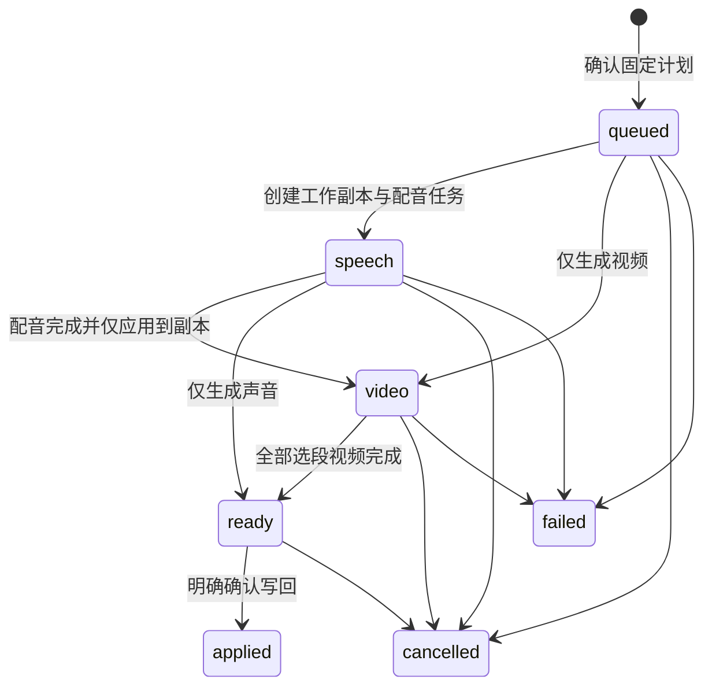
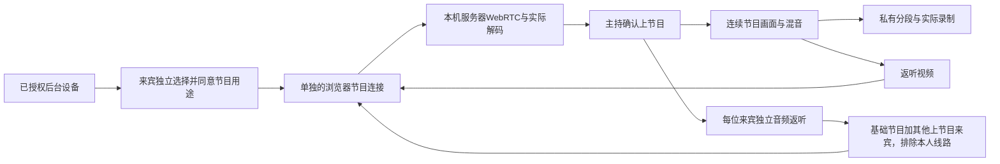

# DigitalGuide 数字人平台建设总文档

版本 1.2｜2026-11-26｜设计基线；应用已启动开发，实际进度见 PLAN.md。

本文件便于整体阅读，由专项文档自动汇编。修改请更新 docs 内原文与 backlog.json 后运行 node scripts/build-docs.mjs。Codex 开发入口为 [README](README.md)、[AGENTS](AGENTS.md) 与 [PLAN](PLAN.md)。

统一覆盖预制视频、PPT、直播、发布投放、展厅、企业前台和餐厅，以及前期竞品已发现能力。内容包括产品设计、技术架构、数据接口、开发验收、竞品功能矩阵、接入条件、134 项需求、38 项任务及目标执行提示词。


## DigitalGuide 产品设计

版本 1.2｜2026-11-17｜设计基线

### 产品定位

平台让企业创建和管理数字人，使同一品牌角色参与预制视频、PPT 讲解、线上直播、发布投放，以及展厅、企业前台和餐厅服务。产品包含创作、直播、展厅、接待、餐饮、课程训练及运营工作台。形象、音色、语气、知识、权限、记忆与任务统一管理；具体供应商的资产兼容能力单独验证。

完整目标包含六条业务线：

1. 文案与素材到数字人口播、双人访谈、剪辑、团队审核、批量生产和多平台传播。
2. 企业前台识别来访意图、登记、通知接待人、引导、保存必要记录，并为员工传递口信与会议提醒。
3. 餐厅迎宾、熟客服务、选桌、推荐、点单、通知后厨、查询进度、结账及送别。
4. 线上数字人直播、节目场控、观众互动、多平台分发、录制与回放。
5. 展厅展品与路线讲解、团体问答、断点续讲和受控屏幕联动。
6. 多平台内容发布与付费广告投放、审核、预算和效果回收。

共同基础包含音色与语气风格、2D/3D 资产、PPT 预制/实时讲解、知识、视觉、记忆及开放运营。详见 [全场景功能扩展](docs/09-full-platform-scope.md) 和 [竞品功能覆盖矩阵](docs/08-competitor-capability-matrix.md)。前期研究确认的多语言、智能剪辑、互动课程、角色训练和企业运营等能力也纳入完整目标。

后续采用分阶段建设，不把上述任一业务线从最终目标中删除。本文是自有产品设计，供应商已公开能力见研究文档。

### 用户和权限角色

| 角色 | 主要任务 | 默认边界 |
| --- | --- | --- |
| 平台管理员 | 配置组织、供应商、部署与运行策略 | 跨租户运维按单独权限审计，默认不能任意读取私人聊天 |
| 企业管理员 | 成员、角色、场所、业务接入、保留期 | 仅本组织 |
| 内容编辑 | 脚本、模板、时间线、视频和素材 | 仅授权工作空间 |
| 审核与发布人员 | 评论、审批、发布计划 | 发布权限独立于编辑权限 |
| 前台与接待员工 | 来访通知、接待、口信 | 只查看与本人或职责有关的信息 |
| 餐厅服务员 | 桌台、菜单、订单与服务请求 | 退款、优惠和库存管理另授权限 |
| 后厨人员 | 查看制作单、变更出餐状态 | 不访问顾客人脸、私人对话或支付凭据 |
| 顾客或访客 | 登记、咨询、本人订单与消息 | 无组织后台权限 |
| 已验证员工 | 本人提醒、本人消息、获授权的业务 | 人脸匹配不直接授予此角色 |

人员可同时具有多个业务角色；身份资料与每个角色的权限分离。企业和餐厅之间不得默认共享顾客记忆。

### 页面与导航

桌面工作台采用左侧导航：总览、创作、模板、资产与角色、直播、展厅、接待、人员与记忆、餐厅、消息、发布与投放、课程训练、团队、运营、设置。移动端保留接待操作、审批和订单；专业时间线优先桌面。

主要页面：

- 总览：待处理接待、视频任务、待审作品、渠道异常、订单和成本。
- 创作项目：脚本、分镜、画布、时间线同步；草稿保存、预览、历史版本、导出。
- 资产中心：形象、声音、照片、视频、音频、字幕、模板及使用授权。
- 接待台：数字人画面、摄像头权限、字幕、状态、文字备用入口、人工接管。
- 人员详情：角色、已确认资料、允许使用的记忆、授权与删除入口。
- 企业接待队列：来访者、受访人、等待时间、通知结果、交接与结束。
- 餐厅业务台：桌台图、排队、菜单、订单、后厨看板、账单与支付状态。
- 发布中心：媒体账号、内容包、审核、排期、任务回执及数据。
- 直播中心：节目单、试播、场景与推流、观众问题、人工接管、录制与链路状态。
- 展厅中心：展馆/展品、路线、讲稿、团体、终端联动和现场导览。
- 投放中心：广告账户、计划、素材版本、预算审批、暂停、回执和指标。
- 课程与训练：互动分支、测验、SCORM、软件模拟、角色练习及访谈。
- 运营中心：套餐权益、货架、品牌嵌入、SSO、开放 API 和跨场景数据。
- 设置：供应商能力、费用限制、场所、角色权限、保留策略、连接状态。

界面展示“演示模式”“未连接”“可试用”“已通过真实验证”等能力状态。涉及技术配置的字段放在管理界面，不干扰普通访客。

### 视频创作与传播

#### 创建和编辑

输入支持文字、上传音频、媒体素材和结构化脚本；PPT/PDF 导入后形成可编辑分镜。选择数字人、声音、比例和模板后，先显示可审阅的制作计划：台词、分镜、素材、时长及费用估计。用户可直接手动编辑，无需经过 AI。

编辑器同时提供模板模式和多轨模式，共用同一工程数据。至少包含数字人、背景视频/图片、旁白、音乐、字幕、贴纸/文字轨。要求剪切、拆分、移动、吸附、裁切、缩放、分层、淡入淡出、基础转场、音量、静音、字幕修订、撤销重做、自动保存。

专业能力逐步增加关键帧、音频包络、画中画、变速、色彩调整和镜头布局。初期不承诺与 Premiere/剪映的专有工程文件双向互通；导出开放工程 JSON 与源素材清单。

口播自动剪辑可建议辅助画面、字幕重点、停顿、音量和画面变化；所有建议回写可编辑时间线，不只交付不可编辑的成片。

#### 互动动作素材

互动角色的身体素材采用统一姿势与独立动作库，覆盖待机、倾听、解释、强调、指引、打断和继续讲解。制作提示词与衔接规则见 [互动讲解员全身动作提示词](docs/11-interactive-motion-prompts.md)，细化 R-032、R-033、R-105、R-106、R-132。素材生成、真实口型与任意姿态打断分别验证，动作文档不代表运行能力已实现。

#### 多人模式

至少支持两个独立角色同屏和轮流发言。角色绑定自己的声音与台词轨；明确说话、听者、静默和旁白状态，避免同时乱动嘴。提供左右同屏、主讲者特写、访谈切换模板。

供应商仅支持“同一参考视频内多人改口型”时，标注素材限制；独立形象合成属于自有布局与渲染能力。镜头切换应可手动修改。

#### 资产与输出

真人形象克隆、声音复刻都有素材上传、授权记录、质量检查、任务进度、试听/预览、确认和失败重试。数字分身的形象、声音和使用场景分别记录授权。

输出必须区分：普通 MP4、带 Alpha 的透明视频、真正的 4K 视频、音频、字幕、工程及可授权下载的资产包。编码格式、分辨率、帧率、透明通道和供应商限制写入产物元数据。画布为 4K 不代表形象细节为原生 4K；透明预览不代表透明文件通过验收。

资产迁移拆分为源素材导出、工程导出、供应商形象包下载、模型运行时迁移。前三项按权限支持；第四项只对有明确格式、运行时和许可支持的模型承诺。业务数据库使用平台资产 ID，不把供应商 ID 作为唯一主键。

#### 批量、协作和发布

模板绑定变量，可导入结构化数据批量生成；每项任务独立保存状态、费用、结果和失败原因，支持取消、限流与有界重试。

团队提供角色、共享素材、评论、版本和审批。初期采用版本号与乐观锁，避免覆盖；多人实时同屏编辑可在后续增加，不把团队协作等同于已具备 CRDT。

发布以作品、媒体账号、平台变体和任务组成。自动生成标题、封面、字幕和横竖版建议，经审核后按授权发送到已接通渠道。提供定时发布、回执、失败处理和可用的数据回收。没有官方接口或未获得账号权限的平台交付“人工发布包”，不能虚报自动发布。

### 企业前台

#### 接待流程

接近检测 → 适度问候 → 匿名会话或已登记身份确认 → 询问姓名/单位/事由/受访人 → 确认登记内容 → 通知 → 等待回复 → 引导/人工接管 → 结束及摘要。

感知区域可配置；同一短时目标使用临时 track ID，设置问候冷却和离场超时。摄像头拒绝授权或不可用时，提供点击开始和文字入口。多人同时到来时保持单个活动会话或明确排队，不将旁人的话写入当前人员档案。

已授权识别结果作为候选，低置信度回退到预约码、工牌或人工确认。不得仅因“看起来像员工”就展示私人提醒。

访客登记字段：姓名/昵称、单位、受访人、来访事由、预约引用、可选联系方式。自述资料标注为自述，不能升级为经过核验的身份。

通知包含接待所需最少信息。消息状态区分待发、已被渠道接受、已送达（渠道支持时）、已读/确认。超时联系备用人员或人工前台，不能向访客泄露员工日程、手机号和内部组织详情。

#### 员工服务

口信记录发信人、收信人、内容、发送时间、到期时间、可公开程度及回执。数字人清楚表述为代转口信，不能冒充同事作出承诺。

会议提醒以日历/会议系统为事实源；取消和改期同步撤销旧提醒。无日历接入时仅使用明确录入的本地事项。公共场所仅提示“有待查看消息”，敏感内容转个人终端。

主动交流基于本人已确认的偏好和待办，带冷却、静默时段和关闭选项。温暖体现在得体称呼、少打扰、及时交接，不靠推断情绪或性格。

### 餐厅接待

流程：欢迎 → 人数/预约 → 排队或桌台分配 → 引导 → 菜单与偏好确认 → 订单草稿 → 顾客确认 → 提交业务系统和后厨 → 查询服务 → 账单 → 顾客发起支付 → 支付核实 → 送别。

桌台和预订由服务端统一分配并锁定；摄像头只能辅助观察，不直接判定可用桌。数字人提供语音和地图引导，真正移动带位不在本期范围，需机器人或其他硬件扩展。

推荐依据菜单、库存、价格、用户明确偏好和预算。历史少辣不自动覆盖当前要求；忌口和过敏信息本次确认后才用于订单，必要时转服务员核对。

订单修改生成明确差异；重复语音或网络重试不能重复下单。后厨只接收桌号、菜品、数量和必要备注，不接收整段聊天。缺货、换菜、取消和退款遵循业务权限。

结账从订单系统读取金额。数字人展示支付入口并说明流程，不能获取银行卡密码或把截图、口头确认当作成功。仅使用可信支付通知或主动查询更新状态。离店后联系需另有有效的联系方式及沟通许可。

### 记忆、授权与资料生命周期

统一 Person，附组织/场所范围内的角色与资料。会话原文、会话摘要、已确认长期记忆和业务记录分别保存，使用不同访问范围和保留策略。

记忆包含事实内容、来源会话/用户确认、更新时间、有效期、适用范围和确认状态。自动抽取先进入待确认候选，不能用模型猜测覆盖已确认资料。纠错和删除应传播到检索索引与缓存。

陌生人进入先创建匿名接待会话，不默认抓拍永久建档。人脸登记与使用需满足具体部署条件和必要授权，提供非人脸替代方式。公共场所部署另评估适用限制，详见研究证据 SRC-26。

默认不保存连续摄像头视频或原始音频。初始建议：未登记匿名会话结束后 24 小时删除；已告知的接待文本 30 天；长期偏好每 180 天提醒复核。以上是设计默认值，不是法定期限，正式上线前按用途和合同核定。订单、财务及审计记录的保留策略独立配置，不因删除偏好而破坏必要业务记录。

### 首版范围与后续目标

G1 交付六条业务线及竞品扩展模块的可操作流程、编辑器、真实本地合成和显式模拟供应商。语气、直播、展厅、广告和课程的规格见 v1.1 扩展，不以只完成三个场景作为整个 G1 完成。真实摄像头权限与匿名接近检测可在条件允许时验证；人脸识别、克隆、业务通知、自动发布和支付的真实验收归 G2。

不在本期自主实现底层人脸模型、真人克隆大模型训练、全功能桌面剪辑软件、移动机器人或任意第三方专有模型转换器。对应需求通过适配器、已有模型和受许可的资产格式实现。

### v1.2 接待专注对话

前台、餐厅桌位和展厅增加目标说话人锁定：先确定本次发问人，建立临时语音参考，结合降噪、回声消除和目标语音提取持续跟踪，只将确认属于目标的内容送入回答与业务流程。噪声更大的旁人不能直接抢走会话；目标插话和普通背景声音分别处理。

座位接待将此能力显示为“专注对话”：每个桌位/终端独立锁定当前发问人，旁人内容不改变当前问题、偏好或订单；同桌换人明确交接。功能清单和餐桌示例统一维护在专项设计中。

默认临时参考会话结束即清理，长期登记另行授权。声纹匹配不授予员工或支付权限；切换发问人需显式交接，避免串单、串档。无法可靠分离时提示轮流说话、靠近或按住说话。详细流程、供应商边界和测量条件见 [专项设计](docs/10-speaker-focus.md)，对应 R-129—R-134、T37/T38 与 AC-60—AC-65。

### T13 餐厅本地实现

餐厅工作台与顾客终端已接入实际本地数据库。独立门店职责管理营业、桌位图、预约/改期/签到、现场队列、短时方案和预留、入座引导及清洁；顾客凭证恢复会移交归属并重新确认口味。菜单支持规格、整数分价格、库存盘点及多种配料信息，推荐仅使用本次确认及当前菜单。历史记忆需单独按本次目的导入，价格、库存或来源变化使旧推荐和待播报回复失效。具体操作、角色边界及证据见 [餐厅桌台、预约与菜单](docs/18-restaurant.md)。T14/T15继续接订单、后厨和支付，真实目标声音能力仍按T38验证。

### T08 创作工作台本地使用

入口 /studio，依次提供工程、模板、品牌素材、PPT/PDF 导入和克隆验收。编辑者可创建、保存和归档；只读成员可查看。所有已确认工程、修订、模板和任务保存到数据库。编辑草稿只保留在当前页面内存，自动保存失败会提示原因；离开前提醒未保存内容，不把私人草稿写入跨账号浏览器缓存。

1. 从空白或模板开始。模板填写变量后生成独立工程，变量只替换文字。内置布局只读，可另存副本；自有模板更新增加版本，旧版本选择不能静默套用新内容。
2. 在工程中编辑台词、标题、备注、分镜时长、顺序及画面元素。画面支持文字、PNG、矩形/椭圆、位置尺寸与层级，角色分别绑定原始形象和声音参考。支持本页撤销/重做、自动保存、刷新恢复、历史修订恢复及归档。冲突时保留本地草稿，可另存工程；明确放弃后才载入另一窗口的新版本。
3. 在品牌素材保存颜色、字体类别与可选 PNG 标志，在工程中明确应用版本；替换原品牌对应色，保留独立自定义色。品牌更新不会改写已有工程。
4. 上传不超过 8 MB、40 页的已授权 PPTX/PDF，等待持久化解析，再审阅页面、备注、图片、降级说明并选页建立工程。PPTX 保留页序、可提取文字、支持的图片与演讲者备注；PDF 提取文字并实际渲染独立参考 PNG。扫描页没有 OCR 文稿，需手动补稿；图表、动画、组合和主题字体不承诺保真。已被工程或模板引用的导入不能直接取消。
5. 保存后核对制作计划，确认台词、分镜、时长、素材与费用状态，再生成当前或未就绪分镜的实际 PNG，每批至多二十段。修改一段只使依赖该段的预览过期；修改共同画布、品牌或参考会使相关段落过期。生成中工程或授权变化后，旧结果不能提交。未配置真实服务价格时显示未知，不把价格写成免费。
6. 克隆验收先分别登记形象或声音训练用途，再提交明确模拟训练。查看原始 PNG/WAV 参考后接受、拒绝或明确重试；未知结果不自动重发。验收后的模拟记录可以绑定工程；撤销或授权失效后旧预览与计划被阻断。训练授权不自动成为接待声纹识别授权。

T08 提供由同一分镜推导的六类关联轨道；T09 已在同一工程补充专业编辑，见下节。真人克隆、声音复刻、口型驱动、正式成片、4K/Alpha 编码、模型下载迁移与后续传播等要求继续保留，不把画布、静态图片、低清预览或模拟验收当作这些能力完成。当前分镜 PNG 最长边为 640 像素，PDF 参考图最长边至多 1280 像素，均不作为 4K 成片。

### T09 专业时间线与双人制作

在工程下方点击“启用专业时间线”，从已有分镜建立背景、数字人、旁白、音乐、字幕和叠加六类轨道；可增加同类轨道，最多二十四条。旧工程不自动改写，启用后与脚本、模板共用同一份工程及版本。联动片段随分镜时长和顺序调整；关闭联动可独立制作，独立字幕不会被脚本覆盖。

- 选择片段可拖动或填写起点，吸附播放头及其他片段边界；支持播放头拆分、裁掉前后、源入点、时长、速度、复制、同类轨道移动及删除。关联移动/拆分为明确选项，同轨重叠片段分行显示，可分别选择。轨道锁防止直接编辑，轨道顺序影响实际画面层次。
- 画面片段可设置位置、尺寸、旋转、透明度、四边裁切、完整显示/填充、淡入淡出、渐显/重叠叠化、擦除及亮度/对比度/饱和度。播放头可增加关键帧，逐项修改时间、画面值及线性/保持插值；拆分不会在切点重新开始原有曲线。
- 旁白和音乐支持独立素材、源入点、循环、音量、静音和可视化音量包络。变速同时改变当前原始录音音高，尚未提供保音高时间拉伸。未绑定音源的台词保持静音并提示，不自动假冒人声合成。共用分镜的字幕修改同步脚本，也可明确转为独立字幕。
- 配置两个角色后，可明确替换数字人轨为左右同屏、主讲特写与听者小窗或访谈切换。每个角色保留独立录音绑定；台词与旁白分开，只有角色台词触发对应发言状态，旁白时角色倾听。布局生成当前时间范围的可编辑镜头，随后可以手动修改，或在调整时长后重新应用。
- “分析已保存文案”提供待审阅的时长、重点文字、镜头推进和本空间背景素材候选，采用后写入可编辑时间线并可撤销。当前服务明确为本地规则，不声称调用了 AI 模型或完成语义素材匹配；不自动采用或花费外部服务额度。

编辑布局为无声画面示意。保存后审阅当前版本和区间，明确确认再生成真实本地 MP4/WAV。预览最长边 640、15 帧/秒，每次 0.1—30 秒；使用 H.264/AAC，支持带鉴权的字节区间播放与下载。历史任务落库，刷新可见；工程、素材、授权或角色变化后旧链接失效，迟到结果不能提交。

当前输入为受验证的 PNG 与 16 位 PCM WAV，可用原始合法录音；演示使用原创合成形象与三种独立提示音。角色是静态参考和明确的发言/倾听标记，没有真人口型、语音复刻或真实声音克隆。背景视频等更广输入、1080p/4K/透明成片与工程迁移继续由 T10/T23 等任务完成，不以低清预览代替最终输出。证据见 [T09 验证记录](docs/evidence/T09/verification.json)。

### T10 当前成片与音频输出

工程编辑页下方的“成片与音频导出”使用当前保存版本。选择视频或独立音频、完整工程或指定区间，先审阅计划及源素材规格，再分别确认输出限制和素材使用权限。普通分镜可直接导出，不强制启用专业编辑；自动建立的输出轨道不改写原工程。更改设置或版本会使旧计划确认失效。

- 普通视频实际生成 H.264/AAC MP4。1080p 为1920×1080，4K UHD为3840×2160；竖屏分别为1080×1920、2160×3840，其他画布比例等比适配并留边，不拉伸画面。支持24/25/30/60fps，源图尺寸在计划中列出，低分辨率图片放大不称为高细节真人素材。
- 透明视频实际编码为 ProRes4444 MOV，另可明确移除背景轨道。透明格式不会自动抠除素材中的背景，覆盖全画面的不透明图片仍会遮住透明底；普通网页播放器可能无法播放，应使用兼容剪辑软件。实际测试同时检查Alpha的0/255和中间值、4K帧及黑白底色合成，不以透明画布开关代替文件验证。
- 每次输出同一范围的48kHz、双声道、16位PCM WAV和UTF-8 SRT/VTT。视频可选择烧录字幕；外挂字幕保留文字与时间点，不携带字体、旋转或布局。没有启用字幕时明确说明空文件；没有录音的台词保留静音，不假造人声。
- 规格清单记录范围、尺寸、帧率、编码、像素格式、真实格式时长、素材规格、文件大小和SHA-256。原始语音、静态角色与真实克隆的能力边界继续显示；普通成片不烧录开发预览水印或静态角色状态标签。
- 导出任务与文件索引落库，刷新后可查看。取消停止当前任务；工作进程正常停止时保留同一任务，重启后从头重新生成，失去租约可有界重试。提交前和下载时重查来源、权限与版本，旧工程或归档素材的输出不再开放下载。文件需登录并支持单一字节范围，没有公开下载链接。

范围参数最多三小时、本地单文件上限32GB，超限明确失败；运行速度取决于工程和本机，尚未进行三小时4K性能验收。正式绘制按当前画面加载图片，音频分块混合；当前图片与录音输入规格沿用资产中心限制。

PNG/WAV媒体输出、Chrome播放、黑白底Alpha边缘和构建后独立进程的历史子项记录见 [T10 媒体输出记录](docs/evidence/T10/exports-verification.json)；MP4进展见下节。**T10仍在建设：工程/素材ZIP导出及干净工作空间重导入未完成**，不把媒体输出子项当作AC-16、完整T10、G1或G2完成。真人克隆、语气、实时驱动和所有后续传播、餐饮等目标继续保留。

### T10 视频素材与原声剪辑

入口/studio/media，也可从资产上传弹窗进入“导入MP4视频”。当前支持128 MB内、10分钟内、一条8位H.264画面和至多一条单/双声道AAC原声，标称不超过60fps、单边不超过4096像素；不符合条件会说明转换或拆分要求。原始文件不做有损转码，保存实际检查后的规格与独立封面帧；正交显示旋转按元数据处理，已验证90度手机式文件。其他视频格式和特殊显示变换仍需分别兼容验证。

1. 选择文件、名称及背景/通用分类，说明来源和制作导出权限，明确确认后导入。浏览器逐片核对内容，每片4 MB；后台保存分片哈希和顺序指纹。只核对文件名、大小不能当作同一文件；同名但内容不同的文件不可续传。
2. 可暂停传输，刷新后重新选择同一原文件继续，已确认分片不会重复上传。续传沿用原任务已确认用途；连续24小时未继续的上传会失败并清理临时分片。完整文件先进入排队/检查，真正完整解码及封面生成通过后才创建素材，不以“上传完成”冒充“视频可用”。
3. “我的导入任务”只向上传本人开放，另一管理员也不能接管别人的未完成上传。就绪后资产按本工作空间原有素材权限共享，视频库有原片播放和真实封面；只读成员可查看，不能创建或控制任务。
4. “用此视频创建工程”把底片放在背景轨，保留字幕、数字人及其他叠加层在上方，避免全画面视频遮住默认字幕轨。也可在现有时间线的背景/数字人/叠加轨添加视频；有原声的视频可单独加入旁白/音乐轨。轨道层级仍可手动修改。
5. 视频画面与内嵌原声在同一片段中共用起点、源入点、长度、速度与循环时钟，移动、剪切、拆分和裁切后不分离成两个容易错位的对象。静音/隐藏片段同时停止该片段；音量设为0可只静音原声，保留画面。视频支持原声包络、画面关键帧、裁切、调色、转场等原编辑规则；变速同时改变原声音高，不冒充保音高拉伸。
6. 编辑布局中的视频保持静音，按播放头定位原片，实际声画以生成的MP4/WAV或正式导出核对；静态分镜也读取相应源时刻的视频帧。用户填写字幕不意味着系统已完成自动转写、配音或克隆。无原声文件明确保持静音。

本地同时最多四条视频画面，其他片段仍遵循时间线总密度限制。音频按当前混音块所需的源时间窗解码至临时PCM，逐小块读取，不一次把整个长视频音频装入内存；循环及30秒块边界已用实际样本比对。源视频归档、权限变化或未检查完成时不能继续生成或下载旧输出。

本批证据见 [T10 视频输入与剪辑记录](docs/evidence/T10/video-verification.json)，包含MP4原声、拆分连续、变速/裁切、循环、静音、90度旋转、字幕可见、4K/60fps实际输入和4K输出。示例为本项目生成的颜色图形与独立音调，真实文件处理不等于真人克隆、语气复刻或实时口型；该批仅验证视频子项；开放工程迁移及完整T10本地验收见下节。

### T10 开放工程与源素材迁移

2026-11-19本地定义已验证，完整G1/G2继续建设；需求R-027、AC-16。工程中的“成片与音频导出”选择“开放工程与源素材ZIP”，审阅完整工程、素材和不可迁移项，再确认本次导出权限。独立worker生成ZIP、工程JSON和素材清单。ZIP内project.json为版本化开放格式，assets目录保存原始PNG、PCM WAV和MP4；不重新压制源素材，不冒充第三方软件工程或供应商模型。

从“工程迁移”（/studio/packages）选择ZIP，填写新工程名称和目标用途权限说明，并单独确认账号、模型、克隆记录与原文档绑定不迁移。上传沿用4 MB分片、本人任务、暂停/重选同一文件续传及取消。检查全部完成后才在当前空间建立独立工程、源素材及视频封面；失败或取消不留下可用的半成工程。就绪后从任务打开工程，也可继续生成实际成片。

保留脚本、分镜、布局、品牌颜色/标志、时间线顺序、裁切/速度/循环、关键帧、包络、字幕和原声。所有素材、角色对象、分镜、元素、轨道与片段重新编号，引用必须来自包内清单；不会回退寻找目标空间已有同名或同编号素材。PPT/PDF中已使用的参考图成为普通素材；可编辑对象保留，原文档及处理记录不随包转移。供应商模型、角色配置绑定、形象/声音克隆记录、训练授权和账号不会复制，输出计划逐项列明原因，原工程继续保留原绑定。

ZIP及展开内容最多1 GB，最多1000项素材，清单最多8 MB；PNG/WAV沿用8 MB限制，MP4沿用128 MB、10分钟等视频条件。不接受加密、特殊文件、路径穿越、重复路径、高压缩比例、额外文件、失配大小/CRC/SHA-256、未知版本或缺失引用。素材有效期按包中值保留，不自动延长；包文件可以被外部编辑，清单不是权属证明，导入者仍需确认目标用途权限。

[完整本地验收](docs/evidence/T10/verification.json)包括真实PDF参考图、PNG/WAV/MP4空白空间迁移、三个不可迁移绑定说明及有效期保留。构建后的独立API与worker用原创图形/音调实测：迁移前后1080p视频及PCM文件字节完全一致，重启后工程、任务和实际文件下载一致。4K/Alpha仍使用原创合成测试素材，不证明真人形象、音色/语气、实时口型或真实声纹效果。

### T11 批量生产与团队审核

2026-11-19本地定义已验证，对应R-020、R-021、R-022及AC-13、AC-17；完整G1/G2继续建设。入口/studio/batches、/studio/reviews，工程底部提供“评论与团队审核”。示例素材为本项目原创合成图形、独立音调和文字；替换文案只替换画面/字幕，不自动合成新语音、口型或真人动作。

#### 批量使用

选择固定版本模板，填写批次名称，导入JSON或CSV并审阅逐项错误。JSON为带name和variables的数组；CSV可用__name列命名工程，其余表头对应模板变量，支持带引号的逗号、换行、双引号及UTF-8 BOM。每批1—100项、数据最多1 MB。空物理行忽略，显式空字段行保留给模板校验；数字不强制转成文字。

确认模板版本、输出计划和素材用途后开始；无效行需单独确认，登记为失败项，其余继续。每项保存独立工程、导出、错误、尝试记录和真实文件。当前支持视频及字幕/混音或独立音频输出，视频可选1080p/4K、帧率和透明MOV。使用现有素材本地合成，外部服务费用为0，本地计算和存储仍有资源消耗。

“在途任务”包括已安排但尚未完成的排队/生成条目，可设1—3；组织当前环境至多3份未完成导出，独立媒体进程池最多同时执行2项。暂停后不再安排新项，已有任务继续完成；取消停止未完成条目，已完成结果保留。失败项由有编辑权限的成员明确修正变量和用途后重试，每项最多3次；重试创建独立工程，历史结果不覆盖。排队期间来源、授权、账号权限或工具变化会明确失败，不以模拟结果代替文件。

#### 评论与审核使用

同空间成员按权限共享工程。评论可定位整个工程、指定分镜、片段或时间点，支持回复及作者/审核人员处理。记录明确保留原工程版本；新版本不会把旧评论假装成新意见。输入中的评论草稿也保留原版本和定位，另一窗口更新后显示提示，可明确改为评论当前版本。评论作为纯文字显示，不执行HTML。

新增独立审核员角色：有读取、评论和审批权限，不能编辑、训练或发布。管理员/内容编辑提交工程审核或指定成品审核，审核人须与提交人、最后编辑人不同。审核员从自己的收件箱打开该次绑定成品、字幕或文件，确认版本后通过或填写原因退回。工程审核只评价脚本与编辑内容，不能当作成品批准；成品审核绑定具体已完成输出。发布权限与审批分开，T11不向任何渠道发送内容或真实通知。

保存/恢复新版本、归档、来源变更或审核人权限/范围变化会使旧审批不可用于当前作品。权限撤回后重新授予也不会复活原审批，需重新提交。旧成品因来源或版本失效时显示不可下载，历史生成记录保留。既有乐观锁和冲突草稿另存继续生效；多人实时同屏编辑和更高级媒体协作仍按T25等原任务建设。

[验证记录](docs/evidence/T11/verification.json)包含20项逐项实际生产与独立失败/重试、编译后20份FHD及100份文件下载、实际两项并行、暂停/重启/继续、版本定位评论、权限与审批失效、桌面/手机和旧工程兼容。可从[原创三项示例](http://127.0.0.1:5174/studio/batches/d4ac060b-3b13-4643-9226-e785260aeef4)体验两项实际完成、一项故意缺少文案；先用编辑身份提交，再切换“顾言 · 审核员”。真实企业身份服务、配音/克隆和渠道回执仍按相应G2任务验收。

### T12 传播与渠道工作台

2026-11-19本地定义已验证，对应R-029—R-031与AC-18。入口/distribution，原/modules/publishing仍可访问；真实自然发布、真实指标和付费投放分别按原任务建设，不以本批模拟替代。

#### 变体与审核

从创作工作台已保存工程另建16:9、9:16或1:1工程，保留原稿及可编辑时间线。新比例需要人工审阅布局、字幕和裁切，然后实际导出。传播变体选择当前可用MP4、本空间PNG封面、标题、说明、标签及AI标识；可从工程名/脚本提供明确规则建议，不伪称调用AI生成模型。还可播放/定位成片，确认用途后把当前实际画面生成长边最多1280像素的PNG封面并保存到素材库，自动选入编辑草稿；核对图片后需重新确认用途、保存变体及审核。来源更新后不能继续从失效成片生成。元数据历史按版本和操作者保存，编辑草稿不会被另一窗口新版本覆盖；保存冲突会保留草稿并说明重新载入方式。

先完成T11的独立成品审核，再提交传播版本审核。后一层绑定具体视频/字幕、封面版本、标题说明、平台及有效成品审批。审核人与提交人和最后编辑人独立；审核权限/范围撤回后恢复不会复活原决定。重新取得传播批准也不会自动复活绑定旧批准的排期或发布包。工程、素材权益或内容更新后按当前快照重新核对。

#### 人工包和模拟渠道

人工发布ZIP实际包含video.mp4、audio.wav、cover.png、subtitles.srt、subtitles.vtt、metadata.json、发布说明和SHA清单。生成、下载都重检来源/审批，流式核对文件哈希；包缺失或损坏时明确提示重新生成。下载不会自动发布，包中不包含账号凭据、真人模型或克隆授权。

渠道按抖音、快手、视频号、哔哩哔哩、小红书、YouTube、LinkedIn及自定义平台分类；当前分类均未声称真实自动接通。管理员可创建人工分类或明确模拟账号。编辑者不能发布，审核员不能编辑/发布。账号停用或配置版本变化使旧未提交排期失效，不能套用新配置执行旧计划。

发布前审阅具体传播版本、账号版本和北京时间排期，再确认。任务持久化区分等待、提交、仅接受、确认发布、失败、未知核对、取消与失效；只有有对应远端编号的已确认回执才能进入已发布，当前编号均为mock-publish。未知结果查询同一请求，不自动重发。渠道已接受后的历史结果仍按当时快照记录；后来修改标题不改写原提交记录。指标显式标注模拟，并分别保存事件时间、获取时间；不作为真实播放或广告效果。

[原创传播示例](http://127.0.0.1:5174/distribution?variant=35180aae-1e93-4811-a0b3-13b62f4dd310)已生成实际竖屏文件与人工包；模拟账号故意保留响应丢失，可在“排期与回执”点击查询。原T11待审记录未被自动批准。使用虚构编辑、审核员和管理员账号演示，真实SSO仍待接入。[完整证据](docs/evidence/T12/verification.json)。

### T15 餐厅账单、服务与送别

2026-11-20本地定义已验证。餐厅工作台和当前顾客终端共用服务器账单、独立模拟收银和退款核对；已付款订单继续制作，新增点单使用新订单，未履行及未知资金均不能直接清桌。经理退款两步确认且保留额度；厨房无账单、联系方式或评价权限。数字人只读核实付款，不能凭“我已付钱”入账。

新增“服务与餐后”队列；加水、餐巾纸、店员帮助、进度和结账协助需本人确认，再由店员接收与完成。实际结束后提供送别、自愿评价、单独目的/期限的回访授权及撤回。联系方式只加密保存、显示掩码，不发送真实联系；非目标、partial和归属不明语音不能产生服务建议。操作、数据保存、检查及真实能力边界见[账单与餐后服务](docs/20-billing-service.md)。这批不替代真实声音/声纹、支付渠道或完整G1/G2。

### T22 语气、系统配音、语言版本和逐词字幕

创作工作台增加“语气与配音”，独立管理语气参考用途/有效期及配置历史、表达档位、发音/品牌术语和原文锚点标注。Windows系统声音可实际生成WAV，试听并确认后写入可编辑音轨，原片段保留且静音；这不代表真人音色或参考风格迁移。工程内入口与专业时间线共用同一版本。

人工译文建立独立语言工程，源稿与词典变化保留已写译文并提示过期。逐词字幕分开记录估算、时间编辑未确认及明确人工核对，保留不可覆写修订，下载SRT/VTT并实际应用到成片。使用、限制与当前证据见[语气、韵律与多语言](docs/21-voice-localization.md)。真实翻译、克隆、强制对齐及口型继续保留T17/T31，真实目标发问人声音提取继续T38。

### T23 多类型形象、变体与实际动作

形象与动作入口/studio/characters统一登记照片、视频、二维及三维来源；独立形象使用用途、来源版本/哈希、到期、修订和服装/姿态变体均持久化。变体要求实际不同素材；原创二维可配置服装、配色及站/坐姿，GLB提供受控静态网格检查和可调角度预览。检查报告区分实际图像、声音、视频及网格指标与未检测项；模拟准备另需训练授权，未知只核对原请求，模拟接受不成为真实模型。

工程中保存手势/表情/声音与时间点计划，明确确认后生成实际二维512×768/24fps视频，WAV幅度驱动简单开合口。原动作视频无声，关联配音单独入轨，沿用正式输出合成有声成片。应用只替换选定区间，保留原片及区间外可编辑内容；超长声音需独立确认裁尾。冲突保留草稿，来源撤回后资产、任务文件和导出均受限。

使用、限制和证据见[形象类型与动作](docs/22-character-motion.md)。四类入口不等于四类真实驱动已接通；照片/真人/3D驱动、骨骼、神经口型与完整克隆继续T31，目标说话人提取继续T38。现有透明成片容器不自动去除本模块普通背景动作中的底色。

### T24 内容来源与定位子模块（进行中）

内容来源入口/studio/content已支持实际文字、无宏Word正文/表格、公开静态网页/手工HTML快照及绑定已导入MP4的人工转写，保留出处、字节哈希、使用依据/期限和撤回事实。到期、撤回或原片失效后正文受限；没有自动把来源写入工程、识别视频或对外发布。账号定位、受众、目标、渠道、表达及人工选题独立修订，冲突保留输入。

新增/studio/drafts把来源整理为可编辑脚本，支持人工修订、恢复为新版本、独立变体及先审阅再应用的计划。规则指令/明确模拟有独立标识，已有工程映射只修改指定分镜台词，保留无关内容和旧版本；改稿不会自动生成新声音或口型。来源期限沿用到配音和导出，失效时限制后续使用。

新增/studio/recordings提供本人录制方案、草稿/工程提词快照、浏览器明确开启、摄像头/共享画面/画中画及可选声音混合、提词滚动/镜像、暂停/停止和本机恢复。核对原片后明确上传，实际保留原WebM/MP4并转换为可播放剪辑MP4，创建工程或向时间线真实末尾追加，不覆盖原片尾。来源与用途期限沿用到直接文件和后续输出。自动化用合成流验证原生编码和实际媒体管线，物理设备及共享对话框尚未验收。

真实语义写作、自动视频转写、完整聊天式重新生成和画面加工继续T24，不能据此验收整个AC-35/36/37。操作、检查与完整范围见[内容制作工具](docs/23-content-workbench.md)。

### 互动课程本地子模块（2026-11-20）

课程工作台现位于 `/learning`，管理员/编辑编排草稿、固定发布版、安排成员；学员只看到本人课程和当前步骤。视频说明、真实分支、单/多选、PNG热点或模拟输入共用持久进度，明确接管后操作，旧窗口接管权变化时停止提交。学习按服务端判题与实际经过路径汇总成绩，原草稿改版不改旧成绩。

自学包实际包含播放器与媒体，可导出SCORM1.2/2004第4版；静态MP4不保留互动。完整官方schema与真实LMS仍待验收，角色训练归T30、私域嵌入/分享归R-085，保持全平台范围。[使用及实际边界](docs/28-courses-learning.md)。

### 互动视频与私域分享（037）

新增“互动视频与分享”：选用已独立批准的自定义传播MP4，配置章节、定时跳转热点、网站和固定选项；发布人确认后建立固定版、独立观看链接及iframe。新草稿不改正在分享的版本，来源或批准失效会限制后续观看。未列出和明确公开分别选择，浏览器嵌入只接受精确来源。

观众默认不保存互动；自愿开启后记录时间、组件/选项与断点，可关闭并删除。匿名会话不授予成员身份，不公开工程、原始资产或内部说明。与成员课程的判题/成绩分别管理；真实目标网站/浏览器及企业身份另验收，不缩减原有数字人、直播、投放、接待与全部竞品要求。见[使用与边界](docs/31-interactive-sharing.md)。

### 内容审核、AI标识与来源（038）

R-121首批覆盖Studio批准MP4的传播链路。管理员配置当前空间/环境/渠道的标识及字面阻断/提示词；制作人核对固定来源与分类声明，排队制作实际带标签的视频和封面，再由独立审核员查看最终文件及逐项提示。来源分类始终未获真实性认证，原私有说明不进入公开回执。

已配置规则的渠道采用最新固定制作输入；其未批准、撤回、规则变化或停用时阻断排期、人工包及分享，不回退旧版或原片。公开回执使用独立平台密钥核对当前批准文件，不能当作C2PA或第三方证明。字面词表不替代音画语义审核，真实服务、隐式来源和其他媒体/场景继续按R-121与AC-57验收。[操作、权限和边界](docs/32-content-governance.md)。

### 直播节目、场控和本地归档（039）

直播中心开始实现R-093—R-100：节目单/CAS历史、预制/实时/混合模式配置、来源预检、本地预览、模拟排期、独立目标与故障处理、观众审核/问答、人工文字接管及时间轴归档。预制段使用已独立审核的实际MP4；实时段和连麦明确为协议模拟，不伪称真人实时输出。节目偏移与本场时间分开，问答和接管后保留主线断点。

普通观众未主动提供音视频时不能被看见。当前只由认证场控提交合成渠道事件，公开知识与商品来源分别核对，不能调用员工记忆或业务工具；接管/代次变化使未播回复取消。按时间轴生成实际720p归档及多轨拆条，继承原素材、审核及知识范围；它不是远端直播捕获。拆条保存于制作工程列表，刷新后可继续编辑，发布仍走原审核链。持续媒体合流、更多字幕/音乐/图形场控、真实数字人/推流/评论/连麦与录制等继续建设。[操作与具体边界](docs/33-live-control.md)。


### PPT组合提问增量

R-110新增逐子问呈现：同一原问题分别保留有据、无据和越界片段、答复与出处，允许部分答复；主持人可实际播放系统语音或人工接管，再回到原页毫秒断点。旧场次明确重新配置后才使用新策略，不能自动升级或把引用存在等同于正确。 [操作、证据和边界](docs/55-presentation-question-parts.md)。

### 角色练习与调研访谈（052）

新增独立“角色练习与访谈”：接待/销售/面试/调研向导、固定问题分支、带原话的配置反馈、明确继续和持久断点。默认本人私有，独立共享给原发布者，可撤回或删除；训练不进入正式业务。模拟字样不理解语义或否定，真实模型另验收。见[使用、当前验证与限制](docs/57-role-practice.md)。

## DigitalGuide 全场景平台功能扩展

版本 1.1｜2026-11-17｜用户补充与竞品功能并集

### 范围规则

平台以用户目标和前期调研发现的功能共同构成完整范围。不能只实现前台、餐厅和口播三个示例；也不能把竞品功能仅放进“参考资料”而没有需求和任务。每项功能归入结构化需求，标注证据、交付阶段、实现方式及验收条件。

“竞品功能并集”指当前已查阅的公开产品页、帮助文档、API 和公开代码所能确认或提出验证的功能类别；不宣称已看到每个平台登录后台、商务定制或未来版本的所有细节。新发现的功能继续进入同一矩阵。未证实项保留验证任务，不写成供应商已支持。

同一种业务能力可以由自研模块或经许可的供应商接入实现，不要求采购所有竞品，也不复制未授权代码和资产。

### 一个角色配置 多种运行场景

统一 DigitalHumanProfile 管理形象、声音、表达风格、知识、业务工具、权限、视觉设置与版本。一个角色配置可发布为：

1. 预制视频角色：口播、访谈、宣传、课程、批量个性化视频。
2. PPT 讲解角色：逐页录制导出，也可以实时翻页、答疑并恢复讲解。
3. 直播角色：实时播报、观众问答、素材插播、多人主持和人工接管。
4. 在线交互角色：网页、小程序、应用内语音/视频对话。
5. 展厅讲解员：展品与路线、屏幕联动、团体讲解和预约服务。
6. 企业前台：访客接待、员工通知、口信和会议提醒。
7. 餐厅接待员：排队、带位指引、偏好、订单、后厨和结账。

配置统一不代表供应商模型通用；各运行场景有自己的资产绑定和能力检查。多场景同时运行时，访客、员工、顾客、直播观众的身份与记忆不会自动混在一起。

### 声音 语气和表达风格

分别定义三类能力：

- 音色克隆：保持说话人的声音身份。
- 表达控制：语速、音量、音高、停顿、重读、读音、多音字和语言；仅展示提供商实际支持的参数。
- 语气/韵律参考迁移：从获得授权的参考音频建立表达风格，生成后试听确认。目标包括温和接待、专业讲解、活泼直播等预设及个人风格。

语气克隆不能仅通过“把语速调快”宣布完成，也不承诺任意模型可精确复制任何风格。保存参考样本、风格版本、支持参数和盲听结果；技术不支持的控制项明确提示，不静默丢弃。只有用户或演员主动提供的表达样本可用于此功能，不从观众摄像头或声音推断其人格、心理或敏感属性。

表达配置和角色动作可协同，但语音节奏、表情、手势需分别验证。预制视频、实时对话和直播都应能选择同一风格配置及兼容的供应商变体。

### 数字人直播中心

直播与普通一对一实时会话分别建模。直播面向一对多观众，具有节目时间线、场控和多个分发目标。

#### 模式

- 实时数字人：根据脚本或动态回复实时生成画面和声音。
- 预制节目：把已生成视频按播单播放，可循环、定时切换和人工跳转。
- 混合模式：预制片段与实时问答交替；清晰标识预录内容，不把预录当作正在发生的真人互动。

#### 场控

创建直播间，设置角色、背景、字幕、音乐、节目单、问答规则、推流目标和封面。支持预览、试播、开播、暂停互动、切备用画面、人工接管、结束和录制归档。

推流层支持适配 RTMP/RTMPS 等实际渠道协议；多路目标独立记录健康状态。WebRTC 对话输出需要编码/合流后才能推流，不能把视频对话 SDK 接通等同于完成直播。断流重连不重新发送订单或观众业务动作。

#### 观众互动

按授权渠道接收评论、弹幕、提问；提供去重、限频、审核、优先级和问答队列。连麦或观众摄像头输入必须由观众主动加入并授权，系统不能看到普通直播观众未分享的摄像头。

回答可查询公开知识、节目内容和经过核实的商品信息；商品卡、链接、报价和促销话术只能来自可审查配置。观众输入作为不可信内容，不得让其改系统指令、读取员工记忆或调用任意后台工具。

人工场控可接管麦克风或文本、静音、取消未播回复、停推和切备用内容。直播录制进入资产库，可智能拆条、编辑、审核并再次发布。

### 发布与付费投放

平台区分自然内容发布、直播分发和付费广告投放，三类对象共用素材与品牌，但权限、账号、预算和回执分别管理。

自然发布保留标题、封面、字幕、比例、定时、渠道回执、失败处理和数据。候选渠道包括国内主流视频/内容平台及 YouTube、TikTok、Instagram 等；具体自动能力取决于渠道 API、账号资格和授权。未接通渠道提供人工素材包，不虚报发文成功。

付费投放模块包含广告账户、目标、素材版本、计划、广告组、受众配置、排期、预算、审批、暂停与效果数据。这里是用户新增产品目标，不声称前面所有数字人供应商都提供广告管理。

花费权限与内容发布权限分离；创建草稿或预估不产生费用，启动投放绑定明确审批和预算。预算限制需结合平台实际机制、回传延迟和在途消耗进行验证，不能承诺本地停用后远端瞬时零花费。提供费用对账、阈值告警和主动暂停。

### 展厅与导览

新增展馆、楼层、展区、展品、讲解稿、开放时间、路线、预约团体和终端绑定。知识有版本、来源和生效范围；屏幕播放与讲解引用同一版本。

讲解可按路线、时长、语言和观众选择进行。观众提问后暂停主线，回答结束回到可见断点；多人采用排队或主持人规则，避免同时抢答。

摄像头用于有人靠近、交互对象和已授权识别的辅助；不默认识别所有游客。可指向展品或共享画面问答，但事实以展品知识为依据，视觉猜测需确认。

联动屏幕、PPT、视频和导览标识采用已配置设备与动作白名单。没有现场协议时使用模拟设备，不声称已经控制硬件。数字人提供路线图与语音，不自动扩展为移动机器人。

### PPT 录制与现场讲解

逐页提取内容和讲稿，允许修改台词、选择声音与语气、设置数字人位置、指示重点、过渡与字幕。原始动画、字体、音视频是否可保留须实际探测；静态化时显示降级清单。

预制模式生成可编辑项目及讲解视频。实时模式支持下一页、上一页、跳转、暂停、提问、答疑后继续。页码、字幕、讲稿与画面保持同步，不能答疑后丢失原讲解位置。

### 补齐竞品中的创作能力

- 图像/视频/文本形象入口，2D/3D、写实/卡通、服装和姿态变体；能力以资产类型声明。
- 账号定位、选题、脚本改写、多版本建议；文档、网页和现有视频转脚本；生成前计划审阅与聊天式局部修改。
- 录屏、摄像头录制、提词器，素材质检和复刻验收。
- 多语种配音、视频翻译、字幕翻译与校对，术语库、品牌字体/颜色/Logo、语言版本关联。
- 口播视线修正、抠像、降噪、逐词字幕、主体横竖版重构、长视频拆条、画质增强。
- 模板变量批量合成及高级动效模板适配；AE 模板需实际授权渲染服务，不承诺在浏览器原生运行任意 AE 工程。
- 团队帧级批注、外部审阅、素材版本、回收站、文件收集和私域分享。
- 互动视频分支、测验、学习进度、SCORM/LMS 交付；静态 MP4 不等于保留互动。
- 角色扮演、接待/销售/面试练习、调研访谈和反馈。评分必须标注依据和限制，不替代真人聘用或考核决定。
- 软件操作教学与模拟步骤，结合录屏、指示和检查点，而非任意控制观众电脑。

需要 AI 或外部渲染的功能，G1 实现数据、界面、任务与清晰的模拟，G2 以实际结果验证；不能仅创建一个不可操作的按钮就算纳入实现。

### 企业运营与开放能力

扩展会员套餐、席位/时长/额度、增值权益、形象/声音/模板货架、企业 SSO、品牌嵌入、开发者 API/Webhook、用量与费用对账。品牌角色、场景应用与素材可按工作空间共享并审计。

端侧、云端与混合渲染、透明实时流、多终端 SDK、3D 资产与本地运行时列为部署能力。完全离线必须逐项确认渲染、ASR、TTS、LLM、授权和数据组件，不能仅因模型包可下载而宣称离线完成。

跨场景看板分别显示视频产量、直播质量、渠道与广告效果、导览会话、接待处理、餐厅订单和费用。指标不等于对个人进行隐蔽画像，跨场景关联需要明确目的和权限。

### 交付与迭代

v1.1 将上述能力纳入需求、任务和验收。范围扩大后仍分阶段执行，不虚构原先的工期和预算。G1 本地版本覆盖新增模块的数据与可操作流程，真实供应商、正式推流、广告花费和现场硬件验证归 G2。各阶段可拆分为更小目标持续推进，但完整需求必须保留。

### 2026-11-19 T27 展厅本地使用与验收范围

展厅中心位于 /exhibition，独立观众终端为 /tour-terminal/:id。R-104—R-108 的本地内容、路线、预约、问答与模拟设备已实现，证据见 [T27 验证记录](docs/evidence/T27/verification.json)。真实真人驱动、人声合成、目标声音归属及现场协议仍需分别接入；本批没有采集摄像头或麦克风，也没有控制真实设备。

#### 从展品到一场导览

1. 进入展厅中心，创建展馆，填写楼层/展区、介绍和开放说明。新展馆自动建立当前工作空间的独立场所，使用中的展区不能直接移除；停用展馆会使相应导览停止。
2. 在“展品讲稿”创建展品，填写编号、展区、兴趣标签、工作人员核对的无障碍可达性、来源和有效期。按段落编辑中文及可选英文/日文、时长、对应讲义页或模拟视频状态。保存草稿后，在选中版本的只读预览中核对，再明确发布。
3. 在“参观路线”选择已发布展品、调整顺序、标记必经与可选展品。必经段落必须满足语言、时长、有效期与可达性；可选展品按兴趣、时长及可达性安排。未提供译稿或内容不可用的可选站会明确列为略过，不自动生成翻译。
4. 在“知识与场景”配置同一工作空间的公开展厅应用及具有 exhibition 场景的角色。开启导览使用该应用和角色快照，对话模型沿用显式模拟服务；不允许选择内部频道供匿名观众使用。
5. 如需团体预约，在“预约与团体”开放具体时段、容量并登记团体；开放说明供查看，具体时段才决定可预约性。同馆时段不能重叠，名额在事务中校验；可在开始前半小时至结束前签到。取消释放名额，参观完成保留已完成状态。备注仅管理人员可读，不带入公共终端。
6. 在“开启与管理导览”选择路线、语言、可用时间、兴趣与可达性，预览站点及略过原因后开始。已签到团体须与本馆、人数、语言和有效时段一致；没有预约也可开启独立参观。预览哈希绑定路线、展馆与讲稿版本，变化后须重新预览。
7. 管理人员打开独立导览终端后，观众可开始/暂停、跳转当前段落位置、推进下一段、排队提问、答疑及请求工作人员接管。匿名凭证只访问此导览，不能登录员工后台或访问其他团体。

本地预览已准备“合成科技展馆 · 本地示例”“能源演示路线”“展厅本地示例频道”和一个明确模拟展屏，均为本项目原创合成内容。未替换原有用户对象，未自动开启现场导览。可直接在“开启与管理导览”选择它们并预览；当前运行配置及示例 ID 保存在 [运行记录](docs/evidence/T27/final-runtime.json)。

#### 讲解与团体答疑

主线保存站点、段落和毫秒偏移。计时运行会跨段推进；暂停、提问、接管及服务重建均保留正确位置。此计时代表本地控制演示，不代表已同步真实人声或数字人视频。

观众只通过明确文字入口排队。队列按顺序回答，一次一个问题；后续排队不覆盖主线断点。接下一问时冻结主线并更新当前发问版本，答复引用本次已发布展品及场景允许的公开知识。结束答疑先回到原断点的暂停状态，再由观众继续；已回答内容可展开查看。

问题不生成员工身份，不自动写入人员记忆，不执行订单、门禁或设备工具。实时音频和客户端自报 target 不在此入口支持范围，不能将未经归属确认的语音包装为已验证识别。人工接管停止自动计时，访客不能自行恢复，需工作人员操作。

运行中的讲解和展屏引用同一个已保存版本。新普通讲稿发布不会改写正在讲解的内容；撤回正在使用的版本、内容到期、停用展馆/路线/场景或角色素材不可用，会停止旧导览并遮蔽旧内容。公开知识撤回或权限收紧后，已保存答案中的相应引用也不再公开。幂等缓存只存标识，不缓存整段问答原文。

#### 模拟展屏、动作白名单与回执

管理员在“展屏与终端”登记 mock-display 或尚未接通的 external-display，并配置展示讲义页、播放视频状态、暂停媒体和清屏动作。内容编辑可管理内容与预约，不能直接控制设备。真实服务未配置时明确报错，不回退为模拟成功。

开启导览时，管理员可明确绑定设备并授权当前路线的自动联动。设备不能同时被两场活动导览占用。动作负载只从当前展品版本和段落生成，不接收任意 URL、脚本或门禁动作。

命令落库后由独立 worker 处理，再形成模拟回执和已确认画面。命令核对设备配置、当前租约、播放代数、路线许可与内容有效性；重锁定播放、下一段、接管和结束使旧指令失效，旧会话的清屏不能清空新会话的画面。重复提交及重建 worker 不重复执行已确认命令。

模拟执行支持成功、失败和未知回执。离线、白名单收窄、配置变动或未知结果不会显示已切换；画面只展示最后确认状态，未知不自动重试。暂停与结束始终先停止主线控制，即使清屏失败也保留失败记录供工作人员处理。

讲义页在浏览器中实际显示结构化标题和要点；视频仅模拟播放状态。此处尚未导入或解码真实 PPT/MP4，不把状态示意当作真实媒体播放。实际媒体工程、导出及 PPT 能力继续按 T10/T25 和真实接入任务建设，完整平台要求未删减。

#### 存储、权限与当前容量

迁移 012 增加展馆/展区、展品版本、路线、预约时段、团体预约、导览快照、提问、设备、命令及回执。数据按租户、工作空间、场所和 mock/sandbox/live 环境隔离；所有写入有 CSRF、权限、版本、幂等及审计，发问版本在旧幂等响应前校验。

导览凭证为 HttpOnly、按会话路径限定的 dg_tour cookie，最长四小时。再次打开终端会重新签发并使旧凭证失效；结束时撤销访问。它不授予账户、门禁、支付或其他后台权限，不按人脸或声纹识别观众。

本地规则：每馆最多二百件展品，单条路线最多三十站，每件展品最多四十段；一个工作空间最多一百场同时活动导览。提问最多一百条、其中排队最多二十条、每分钟最多十条。管理列表当前显示最近一百条预约/导览记录，旧记录仍落库；大规模归档检索及生产并发按后续治理和运营任务扩展，不宣称已通过生产规模验收。

实际自动验证覆盖内容草稿/版本、语言/兴趣/时长/可达性、并发预约、团体签到、断点与队列、服务重建、知识撤回、匿名隔离、模拟设备回执、配置收紧、旧清屏及重复执行。测试命令、计数、截图和源文件哈希以 T27 验证记录为准，不能代替 G2 现场效果。


### 主动连麦的当前实现边界

R-097/R-128已实现[本地主动授权WebRTC主持间连麦](docs/53-local-webrtc-calls.md)，受限来宾实际分享选择的设备，主持端分享当前节目，审批/接通、来源和用途撤回独立核对。普通观看不采集设备。当前来宾不合入节目/录制，不自动识别或转写，不构成员工身份或专注对话验收；真实渠道、多来宾质量和现场能力继续。完整134需求/38任务/65验收和前期竞品26类并集不变，所有制作、PPT、直播、发布投放、展厅、前台、餐厅、克隆与资产迁移最终要求保持。


### 051来宾参与节目的当前边界

[三人实际节目及独立录制用途](docs/54-live-guest-programme.md)补齐本地服务器接入、同屏/混音、各自返听、节目场控、录制/实际拆条及撤权；原050后台同意不扩大。三位canvas/振荡器来宾经过真实RTP及解码，不计物理设备、公网、声纹、现场质量或真人克隆。用途最长24小时，撤回后混合历史录制拒绝提供，自动去除相关人物尚未实现。全部134需求/38任务/65验收、26类竞品并集保持，T24/T25/T28及G1/G2继续；所有制作、多轨模板、批量协作、4K/透明、资产迁移、PPT、投放发布和接待业务线不缩减。


### PPT组合问题纳入原范围

R-110保留并分别回答原问题各片段，对资料缺失或越界部分给出明确状态，逐段关联固定讲稿出处；语音播放、人工接管和原断点持续可用。新策略须明确配置，旧v1不重写。真实本机模型与系统WAV属于此本地增量，不替代真人/声纹/语气克隆、图片理解或实时现场能力。134/38/65、26类竞品并集及22项本地verified保持，所有制作、直播、发布投放和接待业务线继续。 [操作、证据和边界](docs/55-presentation-question-parts.md)。

### 训练场景实现记录（052）

角色练习/调研模板、问题流程、配置依据/本人原话和版本断点已有可操作G1模拟实现；统一角色与正式业务隔离。私有、共享撤回、到期及删除单独生效。字样反馈不能当作智能语义、人格/能力或招聘评价，真实数字人、声音语气、模型和语音部分继续按原要求。见[当前功能与证据](docs/57-role-practice.md)，完整134需求/38任务/65验收及26类并集不变。

## DigitalGuide 目标说话人锁定与抗干扰对话

版本 1.2｜2026-11-17｜接待与多人互动新增能力

### 产品目标

在餐厅、企业前台、展厅和多人接待终端中，锁定当前发问人，优先提取和转写其声音，回复其问题，避免周边谈话、音乐、设备噪声和数字人自身扬声器输出干扰会话。适用于站立或座位接待；多个桌位/终端分别维护会话，不建立一个全场唯一说话人。

产品名称为“专注对话”，后台技术名称为目标说话人锁定。声纹匹配用于判断一段声音是否可能来自目标，目标语音提取/分离用于从混合音频中突出该声音，说话人跟踪用于维持连续性。这些能力需要组合，不能用一个声纹相似度判断宣称已经消除了混响和重叠语音。

数字人的回复内容与动作只路由到当前会话。普通扬声器仍可能被附近人听到，私人内容继续使用个人终端，不承诺软件声纹锁定能够实现定向声场。

#### 座位接待功能清单

本次座位接待补充沿用 R-129—R-134，不重复新增需求编号：

| 功能 | 用户可感知的行为 | 需求 |
| --- | --- | --- |
| 锁定当前发问人 | 确认本次服务对象后建立临时声音参考，显示“正在听您说”；无需事先登记为熟客 | R-129 |
| 持续跟踪与抗噪 | 结合目标声音提取、降噪和回声处理，在声明可用的环境中持续跟踪发问人 | R-130 |
| 只回答目标问题 | 仅分析确认属于发问人的内容；邻桌交谈、广播和数字人自身声音不能改变问题、偏好或业务操作 | R-131 |
| 同桌换人与多桌隔离 | 同桌下一位明确交接后重新确认声音；相邻桌位或终端各自维护会话 | R-132 |
| 自动清理与回退 | 会话结束清理临时参考；听不清时提示轮流说话，提供近场、按住说话、文字及人工入口 | R-133、R-134 |

以上是产品要求。T37 已验证本地模拟控制；真实麦克风输入、声纹锁定和多人抗噪效果仍按 T38 单独验收。

### 两种模式

#### 临时会话锁定 默认方式

访客通过接待区域唤醒、点击开始或明确对话意图建立会话。系统采集一段质量合格的目标语音作为临时参考，并结合麦克风声源方向、终端/座位位置和已授权摄像头中的发言活动辅助确认目标。

不能简单把“场内最响的声音”或“最先检测到的任何声音”认作发问人。样本太短、含多人重叠或质量不足时，显示尚未锁定，提示靠近、单独说一句或使用按住说话。初次对话在锁定前不保存未经确认的个人偏好或执行业务动作。

临时参考不绑定真实姓名或员工账户，不自动转为长期声纹库。会话结束、授权撤回或空闲超时后删除；设备离线缓存也需执行删除。

#### 已登记声纹 可选方式

经独立授权登记的人员可以复用声纹参考以缩短锁定过程。保存授权目的、有效期、提供商模板引用、版本和删除状态。不因声纹匹配成功就取得员工权限，也不使用语音克隆样本自动创建识别档案。

腾讯当前 AI 对话 1.0 声纹文档描述：预先注册约 8—18 秒有效音频，固定模式填写一个 VoicePrintId，非匹配的最终字幕默认不发给 LLM；页面同时注明试用阶段。此路径不能当作所有终端、2.0 版本或“新来客即时临时建模”都已经支持。[官方接入文档](https://cloud.tencent.com/document/product/647/119842)

VoiceAI HarmonyOS SDK 另有指定说话人转写与声纹降噪说明，仍需核对其他目标终端的 SDK 和授权条件。[HarmonyOS 文档](https://cloud.tencent.com/document/product/647/137686)

### 对话流程

等待 → 确定本次服务对象 → 采集合格参考 → 锁定 → 目标语音提取与转写 → 核对归属 → 生成回复 → 持续跟踪 → 主动交接/重锁/结束。

界面显示：未锁定、正在确认、正在听您说、声音不清楚、请轮流说话、已切换服务对象。不向普通访客展示相似度阈值等实现细节。

- 锁定后，旁人声音即使更响，也不能直接抢走目标。
- 目标人物移动、转头或暂时沉默时保留短时跟踪；证据不足则进入重锁，不绑定到最近出现的声音。
- 他人需要提问，可点击切换、排队或经当前会话明确交接，避免错误锁定长期排斥其他顾客。
- 两人同时讲话且无法可靠分离时，请轮流发言，不拼接两个人的内容作为一条命令。
- 发问人的插话可打断数字人；邻近谈话或电视声音不应任意打断。
- “停止服务”和人工接管等明确控制保留屏幕按钮或工作人员渠道，不完全依赖被锁定的声音。
- 会话切换先结束/冻结原会话的待确认内容，新说话人不能确认旧订单或读取旧私人消息。

#### 餐桌接待示例

3 号桌的甲点击开始并完成临时参考确认，数字人显示“正在听您说”。甲询问“不辣的面有哪些”，邻桌乙同时说“加辣”，后厨广播正在播报取餐号：只有经目标归属确认的甲的语句可进入菜单问答或订单草稿；乙的语句、广播和数字人自身回声不得改变口味、桌号、订单或甲的偏好。无法可靠分离时显示“声音不清楚，请轮流说话”，保留已经确认的业务记录，提供按住说话、文字及服务员入口。

同桌丙要接着点餐时，需明确切换发问人并重新确认声音，不能因丙声音更大而自动夺取会话。切换后，甲的迟到转写和旧确认按钮不能更改丙的草稿；是否共享同桌订单由餐厅业务权限和顾客确认决定，不能从声纹推断。相邻 4 号桌独立维护目标与会话，不受 3 号桌切换影响。

该例对应 R-129—R-134、AC-60—AC-65；先用模拟事件验证过滤和隔离，再由 T38 在实际桌位、麦克风、扬声器及多人混合音频下测量。模拟事件通过不代表已经识别或分离真实声音。

### 音频链路

麦克风采集 → 回声消除 → 环境降噪/可选阵列波束形成 → 目标语音提取与跟踪 → ASR → 目标归属过滤 → LLM/业务编排 → TTS/数字人。

具体 DSP 顺序可按提供商要求调整，以现场验证为准。麦克风阵列、摆位、近场麦克风和回声参考可以改善条件，不能承诺单个普通麦克风在所有噪声/距离下都有效。

非目标或归属不明的内容不得写入目标会话长期记录、摘要、记忆或触发工具。处理混合音频必然会接触环境声音，但不等于应把旁人语音长期保存或送入对话模型。

如果提供商只在最终字幕返回声纹结果，partial 字幕先处于短期、限长的待确认缓冲；目标归属确认前不得送入 LLM、公开展示、写记忆或执行订单，拒绝或超时后即清除。早期打断判定需另外确认：没有可靠目标判定时不宣称实现“目标专属打断”，可暂时采用按键或受控近场模式。

声纹不是安全认证。录音重放、相似声音或错误匹配不得用于绕过账户、付款、退款、门禁等权限。

### 数据与接口

新增 SpeakerFocusSession：tenantId、venueId、sessionId、mode、targetSpeakerToken、state、sourceChannelId、referenceScope、confidenceBand、expiresAt、configVersion、focusVersion。配置版本与目标归属版本分开；换人、重锁、释放均递增 focusVersion，使迟到音频判定失效。

SpeakerReference：temporary 或 enrolled、来源、授权引用、质量检测、提供商模板引用、存储位置和删除状态。默认临时参考只在当前会话有效；需要上传给外部服务时执行该用途的数据与授权配置，不能静默转云。

SpeakerSegmentDecision：segmentId、focusVersion、speakerToken、startMs/endMs、target/other/uncertain、final、quality、decisionReason。一般审计只保存判定元数据，不保存旁人转写文本或声纹向量。

状态：idle → acquiring → locked → uncertain/reacquiring → locked → releasing → ended。
handoff_pending 为显式切换流程，只有新的参考和会话归属确认后才切换；异常返回未锁定，不回退为“所有声音都是目标”。

接口草案：

- POST /sessions/:id/speaker-focus：创建临时锁定或选择已授权登记参考。
- GET /sessions/:id/speaker-focus：查询终端可展示状态。
- POST /sessions/:id/speaker-focus/reacquire：重新确认目标。
- POST /sessions/:id/speaker-focus/handoff：按权限交接会话。
- DELETE /sessions/:id/speaker-focus：释放并清理临时参考。
- POST /speaker-references：只在授权登记流程保存长期模板。
- DELETE /speaker-references/:id：撤回/删除，并传播到提供商和缓存。

事件：speaker.focus_acquiring、speaker.focus_locked、speaker.focus_uncertain、speaker.focus_changed、speaker.segment_rejected、speaker.focus_released。业务执行必须核对事件的 sessionId 与 focusVersion，防止旧音频或旧目标的迟到结果影响新会话。

### 验收与测量

G1 使用明确标记的多说话人测试事件验证锁定、部分字幕缓冲、目标过滤、交接、删除和权限；模拟事件不能证明实际降噪成功。G2 使用获得授权的多人录音与实际终端复验。

场景至少覆盖餐厅人声/餐具、展厅团体、前台邻近交谈、背景音乐、数字人自声、目标移动、方言/口音、两人重叠及无麦克风阵列的回退。优先采用可控录音混合和真实场景测量，不通过提高现场噪声制造不必要风险。

测试前登记硬件、距离、角度、混响、采样率、前处理、提供商版本，以及 SNR 与重叠比例。可使用 0/5/10 dB SNR 和 0/25/50% 重叠组成探索矩阵；这些是测试条件，不是承诺支持的工作范围。

分别记录目标语句保留率、目标中文字符错误率、旁人触发率、错误换人率、目标打断成功率、端到端延迟和相对未启用方案的变化。建议初始可用域目标为目标有效语句保留率至少 95%、旁人触发率不超过 1%；阈值和测量分母须在试点前确定，不在看到结果后临时放宽。真实业务误操作在负向测试集中必须为零。

目标保留率 = 被正确接纳的目标有效语句数 / 人工标注的目标有效语句总数；旁人触发率 = 引发自动回答、打断或业务调用的非目标语句数 / 人工标注的非目标语句总数，各类事件另行分项。每个声明支持的主要场景至少测试 100 条目标语句、300 条非目标语句，并报告样本量、置信区间及重叠语音子集结果。零次观测错误不表述为真实错误概率为零。

若不能达到已声明可用范围，收窄自动模式使用范围并启用近场/按住说话/轮流发言/人工接管；不得声称“完全不受周围声音干扰”。以上为产品要求。T37 验证本地模拟控制与统计契约，真实训练和现场实验仍按 T38 验收。

### 2026-11-19 T37 本地实现与使用

本地实现覆盖 R-129—R-134 的 G1 控制与评测契约，最终结果及源文件哈希见 [T37 验证记录](docs/evidence/T37/verification.json)。T38 的真实临时声纹、目标提取、重叠分离、麦克风转写及现场抗噪尚未接入。界面中的“锁定”始终标为合成样例，不代表麦克风实际识别成功。

操作顺序：

1. 在“知识与场景”选择场景应用，将“目标说话人服务”设为最终字幕归属或早期目标归属的模拟服务，目标提取设为模拟过滤，保存。默认关闭；真实服务未配置会明确失败。
2. 从企业接待为该应用开启匿名访客终端。终端内“专注对话”要求本人确认本次服务对象及用途，开始后处于正在确认。清晰合成样例才进入锁定；过短、重叠和不匹配保持不确定。
3. 管理员从接待台进入当前会话的“专注对话模拟实验室”，选择合成参考质量与音频事件。片段可先发送 partial 再 final；一个 final 后需点击“开始新的合成片段”。实验室不录音，不允许访客自报归属后直接进入模型。
4. 只有本次目标版本中通过判定的 final 进入问答，标记“已确认模拟目标字幕”。旁人更响、回声、噪声、无法分离的重叠及未知归属被拦截；待确认 partial 不公开展示、落原文或生成回答。
5. 本人继续时，明确勾选“仍由本人继续”再重新确认声音。focusVersion、回复代数、画面与工具确认同步更新；本人已授权资料保留来源与期限，未提交通知需重新确认。另一人接待则明确选择交给下一位，结束旧会话并开启新匿名会话，旧草稿、资料、聊天、设备与确认不带入。
6. 不清楚时可近场说明、按键或文字回退，也可直接停止回复、人工接管及结束。本地按键为十秒内单句合成许可，不采集音频；普通目标事件不能绕过按键许可。最终归属服务在 final 前不自动打断，早期模拟服务只接受已确认目标的插话事件，旁人不打断。

默认临时参考不创建人员档案，不复用克隆素材。参考最多五分钟，并受会话结束限制。普通企业接待空闲两分钟或总时长十五分钟到期；餐厅会话空闲三十分钟或总时长六小时到期，声音参考仍最多五分钟。结束、撤回、重锁、人工接管、策略收紧或到期清理引用及临时缓冲。后台巡检与请求入口执行到期处理。临时缓冲最多四个片段、每段十六次更新、共四千字符、首段起五秒；final 使用独立最终文本，不拼接未经确认的 partial。

#### 本人已登记参考

工作台“我的声音参考”允许登录账号本人单独授权登记合成参考，保留一至三十天，最多十条有效参考。用途固定为专注对话，服务与目标场景必须一致；管理员没有默认读取他人参考的权限。

本人为指定会话签发最多六十秒的一次性使用码，终端本人明确同意后粘贴。使用码绑定参考版本、会话、focusVersion、环境和有效期；数据库仅存哈希，缓存仅存元数据。已用、错会话、重锁、过期或撤回均失效。登记不自动把参考拥有者变为当前访客身份，录音重放样例和匹配成功均不能进入员工后台或支付权限。

本人撤回会停止对应会话的匹配、清空使用码与引用。模拟适配器返回 completed_mock；未来真实提供商必须核验删除回执，不能把 pending_external 标成删除完成。

#### 实际接口与持久化

匿名终端使用 GET/POST /guest/sessions/:id/speaker-focus，POST 子路由 reference、reacquire、release、handoff、fallback 和 ptt。写入要求当前访客凭证、CSRF、幂等、版本和 focusVersion；当前对象校验先于旧幂等响应。旧的客户端自报 audio.segment 入口仍拒绝。

管理员使用 GET /sessions/:id/speaker-focus、POST /sessions/:id/speaker-focus/reference 和 POST /sessions/:id/speaker-events。事件只接收明确 mock_speaker_event 与合成枚举，由服务器映射判定；需要 session.manage，不开放真实 SDK 回调。长期参考为 GET/POST /speaker-references、POST /speaker-references/:id/authorize-use 和 /delete，按真实账号本人隔离。

迁移 011 增加参考、会话锁定、片段判定元数据、一次使用码和按键许可。归属判定不保存字幕原文、声纹向量或目标令牌；私有参考句柄不进入访客响应。最终接纳的目标字幕进入正常会话，来源 verified_mock_audio 只可生成待本人确认的记忆。记忆会话关联改为 sessionId 与 focusVersion 的复合键，以保留同一人重锁前的合法来源；交给另一人使用新会话隔离。

#### 预登记基准和报告

[基准计划示例](docs/fixtures/speaker-focus-plan.json) 固定 SNR 0/5/10 dB × 重叠 0/25/50% 九格及设备、距离、角度、混响、采样率、前处理、SDK/ASR 版本。示例只是字段和统计输入，没有实际音频，不能作为这些条件可用的证据。现场还须按餐厅、展厅、前台、音乐、自声、移动、口音分别建场景并预登记授权证据。

每格至少一百条目标、三百条非目标、五十次目标插话；目标保留和插话成功至少 95%，旁人触发及错误换人不超过 1%，回复 p95 不超过 2500ms、停止 p95 不超过 500ms，真实业务误操作为零。阈值和计划先生成哈希再采样；修改计划、重复样本、未知场景及早于计划采集的数据会拒绝统计。哈希由试点证据系统另行归档，CLI 本身不提供不可篡改的时间证明。

同一原始音频与标注须按 pairId 提供 focus 与 baseline 两个条件，缺少基线或配对不一致不能满足观测阈值，报告列出相对未启用方案的差值。报告记录各场景、重叠子集（按场景的固定比例）、目标保留、CER、旁人回答/打断/工具及其并集、错误换人、目标打断、延迟和 Wilson 95% 区间。延迟缺失或样本不足不能满足观测阈值；CER 使用所有标注有效目标句，包含未接纳句的删除错误，按 NFC 后字符计数并保留标点空格。原始字幕和参考文本不进入输出报告。

~~~powershell
$taskSpeakerHash = node --import tsx scripts/speaker-benchmark.ts hash docs/fixtures/speaker-focus-plan.json
node --import tsx scripts/speaker-benchmark.ts report docs/fixtures/speaker-focus-plan.json docs/fixtures/speaker-focus-samples.json $taskSpeakerHash docs/evidence/T37/synthetic-benchmark-report.json
~~~

[三十六条配对合成输入示例](docs/fixtures/speaker-focus-samples.json) 故意不足样本量，各格报告 insufficient_samples 并列出回退。[统计报告](docs/evidence/T37/synthetic-benchmark-report.json) 同时输出 Markdown。即使合成数据满足数值，或导入现场数据，均不自动授予 G2 验收；仍需独立核对授权、原始音频、标注、基线对照、设备日志与可用范围。真实参考、ASR、TTS 和数字人链路需按 T38/T16/T33 分项接入。


### 2026-11-24 原生临时控制基础

T20迁移已验证临时合成参考、同一人重锁和隐私生命周期的原生持久化，并保留原来访/记忆事实和期限。原生登记参考、可信最终字幕及独立换人交接仍继续，speakerFocus能力开关保持关闭。旧SQLite工作台的T37模拟能力不变，真实声音和T38要求不变；当前实现、分次检查、失败与关闭记录见[原生迁移说明](docs/101-postgres-speaker-focus.md)。


### 2026-11-24 登记参考后端接续

本人独立同意的合成参考登记、固定60秒单次授权/消费与撤回联动已接入原生后端。185个不同检查分次有通过记录，22项新增；完整编译恢复尚在接续，可信声音事件和独立换人未完成，speakerFocus仍关闭。原076实例和成功强杀记录保持，077修复已知授权并发重放，原时钟不重写。详见[当前实现与验收边界](docs/101-postgres-speaker-focus.md)。


### 2026-11-24 原生登记参考生命周期本地验证

原CzXBKY实例已按076→077受控接续，原编译、身份、密钥、原迁移与接续时全部业务行保持。12项编译/兼容检查及4个当前GUI流程通过，登记、固定单次授权、原子消费、同一人重锁、撤回/记忆/来访联动与原期限恢复已本地验证；185项后端记录仍为分次结果。完整原生speakerFocus继续关闭，可信声音事件、下一访客交接及真实声纹/T38未完成，详见[当前原生结果与边界](docs/101-postgres-speaker-focus.md)。


### 2026-11-24 原生可信合成声音事件后端验证

078仅在明确mock模式接通当前目标最终字幕到问答及待确认偏好。218个不同用例分次通过，37项新增；独立编译7项检查通过，包含新声音问答提交前一次实际API中断、原键八个双API真实等待者恢复、API关闭时原五秒/十秒自然清理及API/PG重启。旧076/077及原CzXBKY保持。无新GUI或真实声纹验收，完整speakerFocus继续关闭，从079接独立换人及界面；详情见[当前原生结果与边界](docs/101-postgres-speaker-focus.md)。


### 2026-11-25 原生下一访客交接后端验证

079—081完成独立限时意图、旧结束/新匿名会话/访问原子绑定与一次领取。原普通Cookie单独不能恢复新访问，新访客不继承旧资料、来访、参考或权限。256个不同用例分次有通过记录，20项新增；编译7+3项分别覆盖实际强杀/原键八请求恢复、API关闭原60秒清理、重启以及同库修正版实际丢弃响应正文后的恢复。旧产物和原期限保持，没有重做已成功强杀；无新GUI或真实声纹验收。完整speakerFocus继续关闭，详见[实际结果及边界](docs/101-postgres-speaker-focus.md)。


#### 原生界面实施状态（2026-11-25）

私有mock预览已连接参考控制、可信字幕状态和独立交接/恢复。34项定向后端/配置断言通过、9项新增，类型/lint/构建通过；GUI质量确认流程通过，完整GUI继续，默认speakerFocus仍false。客户端不以待核对标记、模拟字幕或声纹匹配授予身份；旧访客查询、迟到响应、设备和输入在交接中隔离。实际麦克风、目标语音提取、ASR及多人噪声仍须T38现场验收。详细失败与续验状态见[实施文档](docs/101-postgres-speaker-focus.md)。


#### 原生控制界面本地验收（2026-11-25）

独立原生mock运行时现默认开放本地专注控制界面，无需预览标记。22种GUI流程分阶段验证，涵盖质量、可信模拟字幕/偏好、回退、本人登记/按次使用/撤回、目标打断及独立交接/正文丢失恢复/迟到响应隔离；138项不同后端/配置断言为分阶段记录。未配置场景仍不可用，真实声纹、语音提取、ASR与噪声现场尚未验收，G2不因界面完成而完成。主工作台不重启切库，完整平台要求保持。见[当前实现与证据](docs/101-postgres-speaker-focus.md)。

## 互动讲解员全身动作提示词

版本 1.0｜2026-11-17

这套素材面向可被提问、打断和继续讲解的互动数字人，也可用于预制视频、PPT、直播和接待。共 36 个动作，每个动作独立生成，统一人物、机位和起止姿势；程序按会话状态、语义及音频进度选择素材。

制作时先完成一小组可衔接素材，再扩展丰富度。提示词规定的是制作目标；真正可循环、可打断和口型同步的范围，要用生成后的素材验证。动作设计细化已有 R-032、R-033、R-105、R-106、R-132，不改变平台的完整范围或应用任务状态。

机器可读清单见 [动作清单 JSON](docs/interactive-motion-catalog.json)。其中每个动作的 fullPrompt 已展开公共前缀、起止姿势、动作与嘴部要求，可单独复制；生成视频后才能填写真实文件路径和时间标记。

### 怎样使用这套提示词

1. 确定一个成年讲解员形象，使用同一套有权使用的参考素材。默认职业、亲切、不过度表演，服装避免复杂纹理与飘动配饰。
2. 固定画幅、相机、灯光和人物尺寸。竖屏终端可先按 9:16 构图；横屏 PPT 或展厅可改为 16:9，但同一素材库不要混用两个机位。
3. 准备 N0 和 S0 两张经过确认的基准姿势图，保持同一身份与脚位。每次生成使用对应起止图；若工具只支持首帧，尾帧匹配需靠筛选、重生成或后期处理。
4. 每次仅生成一个动作。输入公共提示词、该动作的起止姿势、动作正文、嘴部模式和收尾要求；有独立负面提示词栏时再填负面词。
5. 首批制作 16 个动作，先检查待机、说话、倾听之间的连续播放，再增加其余动作及 A/B/C 变体。

支持首尾帧输入的工具可帮助约束起止姿势。例如 Google 的官方视频文档说明了首帧与尾帧输入方式；具体模型和账号能力仍应按所用版本核对，不能把首尾帧控制理解为保证无缝连接。[首尾帧视频生成说明](https://docs.cloud.google.com/vertex-ai/generative-ai/docs/video/generate-videos-from-first-and-last-frames)

### 统一姿势与拍摄条件

| 姿势 | 定义 | 用途 |
| --- | --- | --- |
| N0 | 面向正前方，头部端正，双脚自然分开约与髋同宽，脚尖基本向前，体重均衡，肩膀放松，双手自然垂于大腿外侧且与衣服略分离，手指自然弯曲，嘴唇轻合，表情温和。 | 待机、倾听、等待、问候 |
| S0 | 脚位、头部、躯干及画面位置与N0相同；双肘微屈，双手自然悬于腰腹前方，掌心略朝内上方，两手分开且互不交叠，左右手高度接近，嘴唇轻合，表情温和。 | 讲话、解释、强调、展示 |

N0 和 S0 是素材约定，模型不会天然认识这两个代号。复制提示词时必须包含其完整描述，并尽可能使用相应参考图。

左右统一以观众看到的画面为准：正面人物的右手用于展示画面左侧，人物左手用于展示画面右侧。不要直接镜像成品，避免服装、标记和惯用手一起翻转。

同一库使用统一分辨率和帧率。可将 1080×1920、30fps 作为竖屏交付目标；供应商原始规格若不同，应记录并统一处理，写入提示词并不能强制获得该规格。4K、Alpha 和真实实时驱动仍按项目原有要求分别验证。

背景选择与人物颜色分离的均匀纯色。绿幕仅在人物没有近似绿色时使用；纯色背景视频要经过抠像才能得到透明素材。不要把“透明背景”几个字当成文件已带 Alpha 的证据。

### 公共提示词

每条动作都使用这一段前缀：

~~~text
使用同一个已确认的成年讲解员参考形象，保持面容、发型、服装、鞋子、身高比例一致。正面全身固定镜头，从头顶到鞋底完整入镜，头顶和脚下留余量，左右留出伸手空间。相机位置、焦距、人物大小、脚底位置和柔和照明全程固定。纯色均匀背景，与服装和肤色明显区分。双脚踏实站定，躯干稳定，动作自然有惯性，肩部放松，手指清晰，手臂不遮挡面部。视线以正前方观众为主。只完成本条指定动作，准备、主体、收势连续完整，结束时回到指定姿势。保留自然呼吸和偶尔眨眼。单一连续镜头。
~~~

普通一次性动作追加：

~~~text
起始和结尾各保留约0.3至0.5秒的低动作幅度余量，保持微呼吸。先做自然准备，再完整完成一次主体动作，然后逐渐减速并收势到指定结束姿势。最后不突然定格，不留下尚未收回的手势。
~~~

循环候选动作改用：

~~~text
完成一个自然运动周期。结尾与开头的手位、头位、眼神、表情、呼吸相位以及运动方向和速度尽量相近。保持持续但细微的自然运动，不用整段冻结或倒放实现循环。
~~~

建议动作时长见各条目。它们是有效素材目标，不是所有模型都接受的生成参数。过渡动作目标为 1—2 秒；若模型只允许更长视频，应生成带前后余量的片段，保留完整过渡并裁除多余等待，不要大幅加速手势。

### 嘴部模式必须单独选择

对于以互动为主的用途，优先试制可复用身体底片，并验证所选驱动器能否处理它：

~~~text
本次制作可复用身体动作底片：即使动作表现为讲解，嘴唇也保持自然轻合，仅有正常面部微动，不模拟连续说话，不生成台词、音乐或环境声；后续讲话口型由兼容的音频驱动流程单独处理。
~~~

这是身体素材制作阶段的要求。实际讲话时必须开启对应音频的口型驱动，待机和倾听时关闭。全身素材中的脸部像素较少，须实测口型驱动的脸部尺寸、头转角、遮挡、延迟和输出质量；有的实时平台只接受自己的专有形象，不能直接导入这些动作视频。

如果所用数字人平台支持音频与动作一起生成，可将上面的嘴部段替换为：

~~~text
以提供的真实台词音频作为发声时间基准，嘴部开合、停顿及表情跟随该音频。保留指定身体动作；只在实际发声时说话，停顿和结束后自然闭口，不增加额外台词或声音。
~~~

后一模式得到的是这段台词对应的视频。它不能靠替换音轨就自动适配任意新回答。若平台不支持输入音频或口型驱动，也不能只靠文字提示词补出该能力。

### 可选负面提示词

~~~text
镜头移动、推拉摇移、切镜、自动裁切、半身特写、脚被裁掉、人物走位、滑步、身高或比例变化、脸部身份漂移、服装变色、灯光闪烁、背景变化、手指畸形、多余肢体、手臂穿模、遮挡嘴部、持续抖动、机械摆手、动作未收回、突然复位、文字、字幕、图标、水印
~~~

负面提示词的支持方式因工具而异。没有独立负面词栏时，优先保留公共提示词中的正向约束，不必强行提交不支持的参数。

### 动作目录与逐条提示词

下列动作正文与公共前缀、起止姿势和嘴部模式组合使用。循环表示制作目标，成品通过首尾检查后才可在播放器中循环。强度 0 为极轻微，1 为克制，2 为明显，3 为兴奋；不代表对观众情绪的识别结果。

#### 待机与倾听

##### 01 自然待机

调用名：`idle_neutral`。用途：无人发言或会话空闲。起止：N0 → N0。循环候选，建议 6—8 秒，强度 0。

~~~text
保持站姿，完成一个非常轻微的呼吸周期，胸肩只有细小起伏，偶尔自然眨眼。双手基本安静，视线平稳朝前；收尾时回到与开始相近的呼吸相位、头部角度和重心，不突然定格。
~~~

##### 02 微笑待机

调用名：`idle_warm`。用途：有人在场但尚未提问。起止：N0 → N0。循环候选，建议 6—8 秒，强度 1。

~~~text
保持温和亲切的神情，笑意轻微加深后自然放松到初始程度，身体不前后摇晃。仅配合细小呼吸和一次自然眨眼，双手保持低位，首尾表情与站姿接近。
~~~

##### 03 轻微重心调整

调用名：`idle_weight`。用途：长时间待机的低频变体。起止：N0 → N0。循环候选，建议 6—8 秒，强度 1。

~~~text
脚底始终在原位，重心缓慢向一侧稍作调整，幅度小到肩部几乎不产生侧移，然后回到双脚均衡承重。手臂自然跟随身体微动，头部保持朝前，不走步、不交叉腿。
~~~

##### 04 专注倾听

调用名：`listen_attentive`。用途：当前目标说话人正在发言。起止：N0 → N0。循环候选，建议 6—8 秒，强度 1。

~~~text
目光温和集中于前方，头部非常轻微地前倾表示专注，再缓慢回到端正位置。嘴唇闭合，手臂安静，保持自然呼吸，不连续点头，不表现为抢话。
~~~

##### 05 倾听回应

调用名：`listen_ack`。用途：听到一个语义停顿时表示在听。起止：N0 → N0。单次，建议 3—4 秒，强度 1。

~~~text
目光保持朝前，进行一次幅度很小、速度柔和的点头，然后抬回初始头部角度。全程闭口，双手不动；表达正在听，不表现为强烈同意或正式确认。
~~~

##### 06 短暂思考

调用名：`think_brief`。用途：已收到问题且正在组织回答。起止：N0 → N0。单次，建议 3—4 秒，强度 1。

~~~text
神情由倾听自然转为轻微思考，视线短暂略向侧下方偏移，头部只做很小的偏转；随即重新看向前方，恢复初始神情。双手保持低位，不托腮，不皱眉夸张，不长时间移开目光。
~~~

##### 07 耐心等待

调用名：`wait_patient`。用途：等待用户选择或业务查询结果。起止：N0 → N0。循环候选，建议 6—8 秒，强度 0。

~~~text
保持平静、耐心、友好的表情，轻微呼吸与自然眨眼。身体站定，视线停留在前方，双手放松，不看表、不催促、不做重复点头，首尾状态接近。
~~~

#### 问候与结束

##### 08 挥手问候

调用名：`greet_wave`。用途：新会话欢迎一次。起止：N0 → N0。单次，建议 4—6 秒，强度 2。

~~~text
从低位自然抬起人物右手至肩部附近，掌心朝前，手指放松并拢，手掌轻轻左右摆动两次。微笑略微加深，左手保持低位；右手沿自然弧线缓慢落回大腿外侧，恢复初始表情。
~~~

##### 09 展开双手欢迎

调用名：`greet_open`。用途：团体到访或正式开场。起止：N0 → N0。单次，建议 4—6 秒，强度 2。

~~~text
双手从身体两侧缓慢抬至腰部前方，掌心斜向上，向左右适度展开，表达欢迎。手肘保持弯曲，不张开成拥抱姿势；短暂停留后双手自然收回并落到低位。
~~~

##### 10 挥手送别

调用名：`farewell_wave`。用途：本轮会话已结束。起止：N0 → N0。单次，建议 4—6 秒，强度 2。

~~~text
微笑看向前方，人物右手抬到肩部略下方，以柔和速度轻摆两次告别，配合一次很轻的点头，然后手掌放低并恢复初始站姿。脚不移动，不转身离开画面。
~~~

##### 11 致谢

调用名：`thank_nod`。用途：回答结束或用户提供帮助后。起止：N0 → N0。单次，建议 3—4 秒，强度 1。

~~~text
保持双手自然垂放，微笑稍微加深，头部连同上身轻轻前倾致意，幅度克制；随后平稳直起，恢复原来的视线和神情，不深鞠躬、不合十、不鼓掌。
~~~

#### 讲解与强调

##### 12 平静讲话

调用名：`talk_calm`。用途：一般回答与长段落基础动作。起止：S0 → S0。循环候选，建议 4—6 秒，强度 1。

~~~text
以平静讲解的身体节奏，人物右手在腰腹前方做一次小幅向前、向上的开放手势，左手轻微配合，随后回到双手准备位置。动作柔和克制，首尾手位和速度接近，不连续机械摆动。
~~~

##### 13 自然讲解

调用名：`talk_explain`。用途：说明展品特点或原理。起止：S0 → S0。循环候选，建议 4—6 秒，强度 2。

~~~text
人物右手先向前展开，掌心略向上；左手随后做一次幅度更小的辅助展开，像在层层说明。两手动作有先后，不同时大幅挥动，最后自然回到腰腹前方，头部仅轻微配合。
~~~

##### 14 亲切交流

调用名：`talk_warm`。用途：接待介绍和轻松答疑。起止：S0 → S0。循环候选，建议 4—6 秒，强度 1。

~~~text
带温和微笑，双手在腰腹前方小幅打开，掌心略向上，身体只做很轻的前倾，像与近处观众友好交流；随后身体回正、双手回到准备位置，保持克制的动作幅度。
~~~

##### 15 强调一个重点

调用名：`emphasize_single`。用途：句子中一个关键结论。起止：S0 → S0。单次，建议 3—4 秒，强度 2。

~~~text
人物右手略抬至下胸部高度，手指自然并拢，用开放手掌做一次清晰而短促的向前下方强调动作，动作到位后柔和减速。左手保持稳定，随后右手收回腰前；不伸食指指向观众。
~~~

##### 16 兴奋讲解挥手

调用名：`emphasize_excited`。用途：亮点揭晓或明确兴奋的台词。起止：S0 → S0。单次，建议 4—6 秒，强度 3。

~~~text
表情由温和转为明亮兴奋，双手从腰前抬到胸部附近，先适度向两侧展开，再由人物右手完成一次有力量但受控的向外挥臂强调，左手做较小配合。手掌始终低于肩顶，不遮脸、不跳跃；动作峰值后逐渐减速，双手收回腰前，表情恢复温和。
~~~

##### 17 分步骤讲解

调用名：`explain_steps`。用途：说明两到三个步骤。起止：S0 → S0。单次，建议 4—6 秒，强度 2。

~~~text
人物右手以开放手掌在身体前方依次做三次间隔清楚的小幅推进动作，每次稍有停顿，表现步骤逐项展开。左手保持自然辅助，手势不模拟精确手指数数；完成第三次后右手平稳收回腰前。
~~~

##### 18 比较两个选项

调用名：`compare_options`。用途：比较两个展品或方案。起止：S0 → S0。单次，建议 4—6 秒，强度 2。

~~~text
先用人物右手朝画面左侧做一次掌心向上的展示，再收近身体；随后用人物左手朝画面右侧做对应展示。视线短暂跟随各侧后回正，最后双手回到腰前。两侧动作幅度相近，不交叉双臂。
~~~

##### 19 总结收束

调用名：`summarize`。用途：段落总结或最后一句。起止：S0 → S0。单次，建议 4—6 秒，强度 1。

~~~text
双手从腰前稍微向两侧展开，再平稳向中间靠近，表达把信息归纳到一起；两手之间始终留有空间，不拍手、不交叠。配合一次轻微点头，然后恢复腰前准备姿势。
~~~

#### 指引与邀请

##### 20 展示画面左侧

调用名：`present_viewer_left`。用途：介绍观众看到的画面左侧内容。起止：S0 → S0。单次，建议 4—6 秒，强度 2。

~~~text
人物右手朝画面左侧缓慢展开，掌心向上，肘部保留自然弯曲；头部与视线短暂朝画面左侧转动小角度，停留展示后先将视线回到观众，再把右手收回腰前。脚位固定，身体基本正对镜头。
~~~

##### 21 展示画面右侧

调用名：`present_viewer_right`。用途：介绍观众看到的画面右侧内容。起止：S0 → S0。单次，建议 4—6 秒，强度 2。

~~~text
人物左手朝画面右侧缓慢展开，掌心向上，肘部保留自然弯曲；头部与视线短暂朝画面右侧转动小角度，停留展示后先将视线回到观众，再把左手收回腰前。脚位固定，身体基本正对镜头。
~~~

##### 22 指示屏幕下方

调用名：`present_screen_low`。用途：邀请查看界面下方实际存在的选项。起止：S0 → S0。单次，建议 4—6 秒，强度 1。

~~~text
人物右手在身体前方偏画面左侧，以整个手掌向屏幕下方做一次柔和示意，手指自然并拢。视线短暂向下，再回到观众；手掌缓缓回到腰前，不伸手点按不存在的物体。
~~~

##### 23 邀请对方提问

调用名：`invite_response`。用途：一句提问结束后交还话轮。起止：S0 → N0。单次，建议 4—6 秒，强度 1。

~~~text
人物右手掌心朝上向前轻轻展开，表情亲切，头部略微侧倾，像在邀请观众表达。停留片刻后手臂自然落下，双手最终垂于身体两侧，头部回正，以闭口倾听的状态结束。
~~~

#### 回应与情绪

##### 24 温和确认

调用名：`confirm_nod`。用途：复述已核实信息或询问确认。起止：S0 → S0。单次，建议 3—4 秒，强度 1。

~~~text
看向前方，轻轻点头一次，人物右手同时做一次小幅掌心向上的确认手势，随后头部回正、手回腰前。神情认真而友好，不做胜利手势或强烈肯定。
~~~

##### 25 请求澄清

调用名：`clarify`。用途：没听清或有两个可能含义。起止：S0 → S0。单次，建议 3—4 秒，强度 1。

~~~text
眉部轻微抬起，头部略侧倾，人物右手掌心向上小幅打开，表达礼貌询问。保持耐心，不耸肩、不翻白眼、不露出责备神情；结束时回到端正头部和腰前手位。
~~~

##### 26 礼貌致歉

调用名：`apologize`。用途：出现真实失败或需要更正。起止：S0 → S0。单次，建议 3—4 秒，强度 1。

~~~text
笑意适度收敛，头部轻轻前倾一次表示歉意，双手保持靠近腰前且不交叠；随后抬头恢复温和认真的神情，手位稳定。不夸张悲伤，不反复鞠躬。
~~~

##### 27 温和安抚

调用名：`reassure`。用途：用户明确表达担忧时回应。起止：S0 → S0。单次，建议 4—6 秒，强度 1。

~~~text
神情平和，双手掌心略向下，在腰部到下胸部之间做一次缓慢、幅度很小的下压手势，表达放慢节奏和耐心说明。动作柔软，手不伸向观众脸部；随后双手回到腰前。
~~~

##### 28 温和纠正

调用名：`correct_gently`。用途：纠正一个已确认的事实。起止：S0 → S0。单次，建议 3—4 秒，强度 1。

~~~text
头部进行一次很轻的左右摇动，人物右手以开放掌心做小幅侧向解释，表情友好且认真。随后头部回正，手回腰前；不摆食指、不叉腰、不表现生气或训斥。
~~~

##### 29 欣喜认可

调用名：`pleased`。用途：用户作出选择或互动有进展。起止：S0 → S0。单次，建议 3—4 秒，强度 2。

~~~text
微笑自然加深，头部轻点一次，双手稍稍向前打开表达积极回应，然后双手回到腰前、笑意恢复初始程度。不鼓掌、不跳跃，不做夸张惊讶表情。
~~~

##### 30 小幅庆祝

调用名：`celebrate`。用途：互动任务完成或确有成功回执。起止：S0 → S0。单次，建议 4—6 秒，强度 3。

~~~text
神情明亮开心，双手自然抬到胸口以下，做一次短促的向外展开并轻轻上提，表达克制的庆祝；随后缓慢回落至腰前，恢复平静微笑。双脚不动，不握拳高举，不形成循环欢呼。
~~~

#### 过渡与控制

##### 31 准备开口

调用名：`neutral_to_speak`。用途：从待机或倾听开始回答。起止：N0 → S0。过渡，建议 1—2 秒，强度 1。

~~~text
头部和视线保持朝前，双手从大腿外侧沿自然弧线抬起到腰腹前方，双肘轻屈，掌心略朝内上方，两手分开。动作逐渐减速，在腰前准备位置结束；嘴唇保持轻合，供后续口型驱动接入。
~~~

##### 32 停讲转倾听

调用名：`speak_to_listen`。用途：语音结束或打断后已到兼容手位。起止：S0 → N0。过渡，建议 1—2 秒，强度 1。

~~~text
由腰前准备姿势开始，表情收敛为专注倾听，双手平稳落回大腿外侧，头部保持朝前，最后进入安静、闭口、准备听对方说话的站姿。此动作只从腰前准备手位出发，不包含手臂高举时的突然复位。
~~~

##### 33 讲完放松

调用名：`speak_to_idle`。用途：完整回答结束且无需继续提问。起止：S0 → N0。过渡，建议 1—2 秒，强度 1。

~~~text
双手从腰前缓缓放低到身体两侧，肩部轻微放松，表情从讲解状态回到平静温和。眼神朝前，头部端正，脚位固定，以自然呼吸状态结束。
~~~

##### 34 恢复讲解

调用名：`resume_speaking`。用途：回答插入问题后继续原讲稿。起止：N0 → S0。过渡，建议 1—2 秒，强度 1。

~~~text
保持与观众的视线连接，先轻微点头一次，再把双手从身体两侧平稳抬回腰腹前方，形成准备讲解的开放手位。动作紧凑而不急促，结束时头部端正，不附加问候动作。
~~~

##### 35 转交人工

调用名：`handoff_human`。用途：已进入人工接管流程。起止：S0 → N0。单次，建议 4—6 秒，强度 1。

~~~text
人物右手以开放手掌向前轻轻示意，表情礼貌认真，像在说明接下来由工作人员协助；随后双手自然放低至身体两侧，进入安静等待姿势。不凭空出现手机、对讲机或工作人员，不指向未配置的方向。
~~~

##### 36 等待重新确认对象

调用名：`focus_uncertain`。用途：无法确定当前发问人或等待重锁。起止：N0 → N0。循环候选，建议 6—8 秒，强度 0。

~~~text
保持中性友好的站姿与稳定呼吸，嘴唇闭合，双手低位，头部和目光平稳朝前。只进行自然眨眼，不左右寻找、不追随多个方向、不点头确认，首尾姿势接近。
~~~

### 第一批制作顺序

先做这 16 个动作，形成可互动的最小素材组合：

1. 自然待机 `idle_neutral`
2. 微笑待机 `idle_warm`
3. 专注倾听 `listen_attentive`
4. 倾听回应 `listen_ack`
5. 短暂思考 `think_brief`
6. 耐心等待 `wait_patient`
7. 挥手问候 `greet_wave`
8. 平静讲话 `talk_calm`
9. 自然讲解 `talk_explain`
10. 强调一个重点 `emphasize_single`
11. 兴奋讲解挥手 `emphasize_excited`
12. 展示画面左侧 `present_viewer_left`
13. 展示画面右侧 `present_viewer_right`
14. 准备开口 `neutral_to_speak`
15. 停讲转倾听 `speak_to_listen`
16. 挥手送别 `farewell_wave`

普通讲话、待机和倾听通过衔接检查后，各做 A/B/C 三个轻微不同的版本。变体只改变手势路径、眨眼和小幅头动，身份、机位、基准姿势保持一致。兴奋、告别和庆祝按语义触发，不随机频繁插入。

### 丰富动作应怎样触发

| 情况 | 建议动作 | 频率原则 |
| --- | --- | --- |
| 没有人讲话 | 自然待机、微笑待机、低频重心调整 | 大部分时间安静，避免每几秒大幅活动 |
| 目标用户正在讲话 | 专注倾听，语义停顿时偶尔倾听回应 | 小点头表示在听，不表示接受订单或作出承诺 |
| 已收到问题，回复尚未准备好 | 一次短暂思考，然后耐心等待 | 不重复思考动作，不假装一直在说话 |
| 普通解释 | 平静讲话与自然讲解变体 | 按句群切换；小幅动作承担主体 |
| “关键在于”“特别值得看的是” | 强调一个重点 | 对准关键词，不按每个词触发 |
| “特别令人振奋的是”或亮点揭晓 | 兴奋讲解挥手 | 只用于适合兴奋的内容，先设置较长冷却 |
| “第一步、第二步、第三步” | 分步骤讲解 | 根据真实音频对齐手势节拍，不保证生成器天然对齐 |
| “两者的区别是” | 比较两个选项 | 与画面实际左右内容一致 |
| “请看左边”“请看右边” | 对应展示动作 | 确认现场屏幕布局后再用 |
| “你想先了解哪部分” | 邀请对方提问，然后倾听 | 问完交还话轮，不能继续循环张嘴 |
| 信息不清楚、失败或更正 | 澄清、致歉、温和纠正 | 与实际状态一致，避免错误庆祝 |
| 已核实成功 | 欣喜认可或小幅庆祝 | 支付、通知和订单成功只能依据真实业务确认 |
| 目标用户插话 | 立即停止旧语音及口型，身体收势后转倾听 | 不等完整长动作播完才停声音 |
| 非目标说话人或归属不明 | 保持等待或进入专注对象重确认 | 不触发 LLM、记忆、业务动作或错误打断 |

初始调度可采用“普通动作较多、明显强调少量、兴奋动作偶发”的分布。JSON 中单次动作的 8 秒冷却和高强度动作的 30 秒冷却只是待调参数，不是用户测试后的最佳值。

“挥手打招呼”与“兴奋讲话”分别使用不同动作：前者掌心向观众左右摆动；后者是胸前有节奏的开放手势。这样可以避免讲解过程中反复出现告别或招手的含义。

### 程序怎样衔接

#### 先限制合法的起止姿势

同一姿势的素材优先互接：N0 待机接 N0 问候或倾听；S0 讲话接 S0 强调或展示。N0 到 S0 使用“准备开口”，S0 到 N0 使用“停讲转倾听”或“讲完放松”。

可以把顺序理解为：

~~~text
自然待机 → 挥手问候 → 专注倾听 → 短暂思考
→ 准备开口 → 平静讲话 → 重点强调 → 平静讲话
→ 停讲转倾听 → 专注倾听
~~~

这里的兼容性只在实际标注的边界帧成立。“开始和结束都是 S0”并不意味着中途任意帧都可以切换到其他 S0 视频。

首尾画面接近时仍需检查前后几帧的运动方向与速度。优先使用低速度、低遮挡的自然出口。短叠化只适合差异很小的边界；双臂位置差异大时会出现重影，不能当作通用修复办法。

#### 音频时间决定手势节奏

按短句或语义段选择动作，并将重点手势峰值对齐实际音频中的重读位置。通用生成视频的动作峰值只能在成品检查后标注；不能直接把“第 2 秒”当成模型必然遵守的结果。

一句话长于动作时，使用已审核的讲话循环或变体接续；短于动作时，停止口型并让身体自然收势。不要通过整段视频大幅变速来贴合语音，否则呼吸、眨眼和手势会一起失真。

为防止每句话都“抬手、放手”显得机械，连续讲解期间尽量在 S0 系列之间变化，仅在交还话轮、长停顿或结束时回 N0。

#### 打断不能只做一个视频

“停讲转倾听”从 S0 开始，只覆盖该入口。若打断发生在兴奋挥手最高点，不能硬切回 S0。

音频和口型应优先取消；身体使用当前片段已审核的就近收势出口，或为常见中间姿势制作专门收势素材。骨骼或实时驱动角色可以评估从当前姿态混合到倾听；纯视频库没有天然的任意姿态混合能力。纯视频方案若找不到兼容出口，需要明确取舍短暂身体动作延续与可见切换，并做实际交互测试。

播放结束、生成返回、音频回调都要核验 sessionId、focusVersion、utteranceId，丢弃旧会话、旧说话对象和已取消回答的迟到结果。目标确认和打断边界遵循 [目标说话人专项设计](docs/10-speaker-focus.md)。人工停止始终保留。

#### 素材元数据

[动作清单](docs/interactive-motion-catalog.json) 保存 36 条提示词、场景、强度、起止姿势和建议参数。当前资产状态均为 not_generated、runtimeReady 为 false。以下字段须根据真实文件填写：

| 字段 | 含义 |
| --- | --- |
| assetFile | 审核通过的真实文件路径 |
| durationMs 和 fps | 从文件探测到的实际时长与帧率 |
| loopWindowFrames | 经多次播放审核的循环区间 |
| safeExitFrames | 每个可切换出口及其实际姿势，不能只写一个通用代号 |
| gesturePeakFrame | 指向、强调等主动作达到峰值的帧 |
| lipSyncVerified | 该素材是否已通过实际音频驱动验证 |
| alphaVerified | 文件是否带所需透明通道且边缘合成正确 |
| runtimeReady | 媒体、时间标记、兼容路径和播放验收全部完成后才可设为 true |

模型只建议动作意图，不直接决定素材文件、权限或业务状态。调度器应按当前状态、可用能力、姿势和冷却筛选动作，失败时回到已审核的低动作幅度素材或文字/人工服务。

### 制作完成后的检查

1. 人物身份、头身比例、服装、鞋子、构图和脚位在所有素材中一致；全身和展开的手没有被裁切。
2. 逐帧检查手指、腕部、手臂交叉、面部漂移、脚底滑动和光线闪动；不合格片段重生成或修复。
3. 每个单次动作有完整准备、主体和收势；每个循环至少连续播放 5 次，检查接缝、呼吸和眨眼是否显得重复。
4. 检查“待机→问候→倾听”和“讲话→强调→讲话→倾听”等常用路径；记录可连接素材对，不能仅分别检查单个文件。
5. 采用短句、长句、有停顿和不同情绪的测试音频检查口型；尤其检查头部侧转、兴奋动作和全身画面下的小脸区域。
6. 在抬手、手势峰值、收手三个时刻分别发起目标打断，检查旧音频/口型取消、身体收势、旧回调丢弃和再次开口。
7. 如需透明，分别合成到深色、浅色背景检查发丝、鞋边和手指；如需 4K，记录实际源人像细节与输出规格。
8. 再进行真实终端的预加载、切换时延、丢帧和视听同步测试。当前提示词文档的结构校验不替代这些媒体与互动检查。

### 使用边界与后续条件

本次交付是提示词和制作清单，不包含已生成视频、形象克隆、口型驱动器或动作播放器。无需启动应用：复制 JSON 的 fullPrompt，或按本文组合提示词，在所选视频工具中逐条生成即可。

后续需要同一角色的参考素材、能生成对应动作的工具，以及经验证可接收该素材的口型或实时数字人驱动链路。优先试做“待机、普通讲话、准备开口、停讲转倾听”四段，验证连续性后再批量制作，避免整库生成后才发现驱动器不兼容。

## 餐厅桌台、预约与菜单

2026-11-19｜T13 本地定义已验证｜R-046、R-047

### 使用入口

工作台入口为 /restaurant，原 /modules/restaurant 仍可进入。当前本地预览运行于 http://127.0.0.1:5174，API 4301，可追踪会话为 63128。实例运行期间无需重复启动；关闭后按 [README](README.md) 的端口设置运行 pnpm dev。

本地已准备“青禾合成餐厅 · 本地示例”：选择虚构账号“沈禾 · 餐饮管理员”，进入“餐饮运营”工作空间，可打开 [餐厅示例](http://127.0.0.1:5174/restaurant?restaurant=24cead91-1bf0-4257-afab-02bf387132a4)。包含四桌、四道原创合成菜品及五个规格、一份等候记录和一份未来预约。没有自动开启顾客会话、发送真实通知或启动订单。

门店、桌位、预约、排队、菜单、库存和本次偏好是实际数据库业务记录。问答使用当前本地菜单和规则；数字人画面、语音归属及声音提取仍为示意或明确模拟。真实 POS、下单、后厨和结账分别按 T14/T15 及真实接入任务继续建设，不能将本批验证视为餐饮生产系统验收。

### 门店与接待权限

组织管理员可在授权工作空间的场所建立门店，并获得管理能力。内容编辑、审核员和只读成员不会自动取得餐厅权限；经理可从“终端与设置”给本空间成员授予独立的迎宾或经理职责，并配置有效期。

迎宾可登记、签到、安排桌位、确认口味和结束本地就餐；经理另可配置营业窗口、桌位容量、菜品、库存、终端和人员权限。服务端按当前组织、工作空间及门店授权重新检查，权限撤回后旧幂等请求也不可读取缓存结果。界面隐藏按钮不替代此检查。

“终端与设置”可开启当前或下一位顾客会话。每个终端独立维护匿名凭证和发问人版本。接待下一位会结束原会话；原有已确认预约和桌位仍保留。顾客终端不能访问门店后台、其他顾客记录或企业来访登记、员工目录。

### 预约、排队和座位

1. 在“新增排队或预约”核对称呼、人数、预计时长和备注；预约还需核对日期、时段和桌位。时间输入按本机时区显示，服务器以门店时区及整个使用区间检查营业窗口。跨午夜营业拆为两个连续时段；单次使用最长四小时。
2. 预约以实际人数、启用容量和当前已保存区间校验冲突，相邻不重叠时段可预约。未签到的有效预约可改期或调桌，提交时核对预约和同行记录版本。
3. 默认可在预约开始前半小时至开始后配置的迟到宽限内签到。签到后取得现场排队号；未到店且超时的预约标为未到店。已签到但错过预约时段的顾客仍在等候，预约变为过期，不误记成未到店。
4. 选择一组顾客，查看当前桌位方案。方案有效三十秒，绑定人数、桌位、门店、操作人及发问人版本。勾选核对后才预留；数据库事务及唯一约束保证多个终端不能同时占用同一桌，也不能给同一组占多桌。
5. 预留默认两分钟，可由经理配置为三十至六百秒。顾客或店员须在有效期内确认实际入座；主动释放或到期后恢复原排队顺序。桌位或预约变化会使旧方案失效，不会覆盖新占用。
6. 入座后显示桌号、区域、公开带位说明和位置图。预计结束时间不自动释放正在就餐的桌位。店员核对结束前，服务器检查未完成订单/账单义务；结束后转为待清洁，现场确认清洁完成后才重新开放。

T14 必须把订单和账单接入 dining_obligations；该表当前只是结束保护接口，演示中清空合成义务不代表真实付款或结账。

### 本人就餐凭证与换人

等候、预约或入座的本人记录提供折叠显示的私有就餐凭证。新终端明确确认并输入最新凭证，可继续同门店的原安排；恢复会轮换凭证、移交记录归属，并清除旧的本次偏好。旧终端失去操作权，原凭证不能再次使用。入座时也会轮换原排队/预约凭证。

凭证不恢复员工身份或长期记忆。数据库保存凭证哈希及生成引用，普通审计和幂等缓存不保存凭证原文；错误核对计数在失败事务后仍会保存，达到限额后短时限制重试。尚在短时预留中的记录需先协调释放，不能用恢复操作夺走占用。

同一终端最多管理五份未结束安排，选择“当前问答对象”后，菜单和排队问答只使用该组的本次资料。不同桌位和终端的会话分别维护。专注对话的同人重锁使旧请求及待确认按钮失效，本人明确继续时已确认资料仍受原来源和期限约束；交给另一人会创建新的匿名会话，不自动带入原顾客的预约、偏好或聊天。

### 菜单、库存与本次口味

经理从“菜单与库存”编辑分类、配料、需避开及可能接触的成分、核对状态、口味、辣度、新菜和上下架。每道菜可有多个规格、整数分价格、份量、销售状态和可选库存计数。移除规格会归档，保留历史引用。盘点保存前后数量、原因及操作人；盘点同时更新菜品版本，旧编辑草稿不能覆盖新库存。

顾客只看到当前公开菜单、价格与可供状态，不看到内部库存数量。价格和库存变化会更新菜单版本，使旧推荐和尚未完成的菜单播报失效；旧请求重放也只返回当前会话状态。

本次偏好先保存草稿，再明确确认。支持喜欢、忌口、过敏信息是否已提供及明确成分、可接受辣度、单道菜预算和说明。未确认的内容不用于个性化推荐；没有提供过敏信息时不会推断为无过敏。筛选只根据菜单登记信息，涉及成分或共用厨房条件仍需店员核对。

已恢复的本人记忆需单独授权本次读取，并手动选择称呼、喜欢或忌口作为草稿建议；不会自动把长期记忆投入餐厅问答，也不会从历史喜欢推断过敏信息。来源修改、撤回、到期或停用个性化后，依赖该来源的确认、推荐和待播放回复不可继续使用。本次偏好及导入内容到期会清理正文和来源快照。

推荐依据当前可供规格、价格及本次已确认偏好，可显示符合口味的新菜与排除原因。推荐十五分钟内有效；人数、偏好或菜单变化会使其失效。推荐不创建订单；T14 下单前还须再次核对服务器价格、库存与桌位。

所有编辑草稿绑定原版本。其他终端变更时保留当前输入，明确提示并提供载入当前记录的入口，不自动把旧确认绑定到新内容。

### 专注对话与真实能力边界

餐厅沿用 [专注对话](docs/10-speaker-focus.md) 的 R-129—R-134：仅将本次目标 final 字幕送入菜单问答，非目标、重叠无法分离或不确定内容不进入回答、记忆或业务。换人校验 sessionId/focusVersion，旁人声音不能改变桌位、人数和口味。

当前麦克风预览不执行真实转写、声纹识别或多人声音分离。餐厅示例绑定合成归属服务，用户仍须明确确认服务对象，并使用合成事件或文字验证流程。真实参考、降噪、回声处理、目标提取、设备摆位及现场噪声效果归 T38；不能把本批接口测试当作真实抗噪证据。

餐厅会话最长六小时、空闲三十分钟到期；普通企业接待仍为十五分钟/两分钟。声音临时参考仍按专注对话的独立短时生命周期管理，不因就餐会话较长而延长生物特征保留。

### 已执行检查与后续接线

最终记录见 [T13 验证记录](docs/evidence/T13/verification.json)。全量单元与集成 316 项、浏览器 39 项通过；类型、lint、OpenAPI 导出和构建通过。独立编译 API 双进程真实竞争返回 200/409；编译 worker 实际约三十秒释放预留，读取数据库观察到期后才查询 API。另验证重启保留、菜单失效、凭证轮换、未结义务及清洁流程，所有证明用进程已观察退出。

当前预览由本人持有的旧句柄63434停止后升级020，升级前100张表399条旧行按原列哈希全部保留。示例核对后99张非登录会话表的375条旧业务行仍一致；既有登录逻辑清理的两条过期 auth_sessions 另有原始差异和解释记录，没有恢复过期凭证或替换基线。旧T10/T11及T12共32份文件已实际重新下载核对，原T11待审仍pending。桌面和手机预览检查通过，没有自动开启顾客会话。

下一步 T14 接订单、价格快照、库存原子扣减、后厨模拟回执、加菜/取消和人工接管；T15 接账单与模拟支付。两者都须复用本批当前归属、版本、推荐有效性及未结义务检查。真实业务渠道、生产数据库、克隆和现场音视频仍按各原任务实施，完整 G1/G2 未完成。

## 订单、库存与后厨

2026-11-20｜T14 本地定义已验证｜R-048、R-049｜真实POS仍待T19

### 本轮范围

在T13桌台、菜单和当前顾客归属之上，接通订单草稿、明细差异、短时确认、库存预占、持久派单、后厨模拟回执、加菜/退菜、制作/上菜状态及人工处理。确认和提交分开，任何下单都以服务器当前桌位、菜单价格、可售库存和本次偏好为准。

真实POS与业务渠道归T19；账单、支付、退款和餐后服务归T15。已出餐不等于已付款，T14不提供把未结订单标成已付款的捷径。所有原有平台场景和功能继续保留。

### 订单与改单

- 同组至多一个未结束订单，同一订单至多一个未完成的变更。初始点单、加菜、数量调整及退菜都保存独立变更和差异，不改写已接单行的历史价格。
- 草稿可在等候时准备，正式确认与提交要求当前实际入座。草稿、审阅、确认、排队发送、提交中、渠道接收、后厨接单、制作、上菜和结算分别表达。
- 审阅生成两分钟有效的服务器快照及确认令牌，绑定操作者、会话/focusVersion、就餐及访问版本、占用、菜单、偏好、连接版本、动作、金额和变更版本。重新审阅不复活旧确认。
- 确认时核对快照；提交时再次核对，并在一个数据库事务中预占新菜库存、锁定待退数量和建立持久派单。菜单或来源变化要求重新审阅，客户端不能指定价格或总额。
- 原已接单的菜保留原价格；新增份量按当前价格成为新行。退菜只允许未开做的数量；已开做、已上菜或回执不明的部分须交工作人员处理，不能直接删除。
- 订单履行义务接入dining_obligations，直到已核实取消或由T15确认结算。未结、派单中和结果未知均阻止清桌结束。

本次明确成分信息只按用户确认使用，不从声音、外貌或历史喜欢推断。涉及需避开成分的冲突或菜单信息不足时停止该候选的提交，交店员核对；超出口味辣度/单道菜预算等提示须在本次快照中明确确认。后厨所需的成分避让提示由顾客单独确认分享，不自动传递姓名、单位、长期记忆或整段聊天。

### 后厨与权限

门店职责扩展为manager、host、kitchen。新增后厨职责不继承迎宾权限；只读厨房目录、桌号、菜品、数量、必要制作提示及制作状态，不访问顾客资料、恢复凭证、员工目录、私人聊天或记忆。组织管理员及门店经理可管理；迎宾核对顾客订单并确认上菜，后厨独立更新开做与备好。

每个接单行保留数量计数：有效数量、已开做、已备好、已上菜及待退锁定量。服务器保证已上菜≤已备好≤已开做≤有效数量；待退部分不能再开做。部分开做/上菜后仍可处理剩余未开做数量，所有动作核对版本、权限和当前业务状态。

库存表示可售余量，预占后扣除；明确拒绝或核实未发送才归还，结果未知不释放。盘点界面须区分可售与已预占数量，订单库存变化同步更新SKU、菜品和菜单版本，避免旧目录草稿覆盖。

### 派单与模拟接口

POSProvider采用独立契约和明确模拟实现，按门店连接版本、环境、请求ID及快照哈希处理。默认未连接；缺少真实接口不会返回模拟成功。mock仅在允许的本地/沙箱模式启用，生产拒绝模拟发送与模拟回执工具。

worker在租约内处理持久队列，发送前重新检查授权、当前归属和连接。已开始发送后中断转为结果未知，保留库存及义务，只核对同一个请求，不更换编号自动重发。渠道接收不等于后厨接单；只有可信接单结果才建立制作行。

模拟回调需验签、时间窗口、请求/餐厅/远端编号和哈希匹配、事件去重及序列保护。重复或乱序不能重复扣库存、接单或退菜；相互矛盾的最终回执转人工核对。冲突回执本身保留，即使应用本地业务失败，也不会部分更新库存。存在此类未核实冲突时，恢复自动处理和后厨继续制作均由服务器阻止；本地按钮不能冒充POS对账完成。后续真实业务核对与纠正仍归T19。真实结果不因原顾客离开或权限撤回就消失，但不会给新顾客任何旧身份权限。

正常、明确拒绝、响应丢失及无法核实的场景分别验证。人工接管保留已下单事实；本地标注“已处理”不能冒充真实POS确认。诊断中构造的模拟远端结果始终标为模拟。

### 数字人对话

当前餐厅会话可读本人订单及后厨状态。启用餐厅草稿工具后，明确点单语句可提出服务器菜单范围内的草稿建议；模拟阶段采用有限的可说明规则，歧义须澄清，不宣称任意自然语言理解。

建议只进入待确认工具请求。顾客明确应用后才建立可编辑草稿，仍需独立审阅、确认和提交；对话本身不扣库存或派单。工具受当前场景白名单、菜单/就餐版本、会话、replyEpoch与focusVersion限制。旁人、partial、未知归属和迟到语音不能创建可执行建议，旧工具确认不能影响新访客。

### 数据及验证

新增021迁移，保留020原记录与既有权限。新增门店连接、订单/变更/审阅、派单、库存预占及变动、制作行、业务事件、模拟远端记录与回执元数据；全部业务记录落库。

重点验收：同一草稿重复确认/提交仅一单；两个独立终端争最后库存；变价/缺货/换人/撤回偏好令旧确认失效；后厨最小目录及越权；部分制作/退菜的数量不变量；签名、重复、乱序、未知、重启和不重发；加菜旧价与新价差异；对话建议不直接派单；订单义务与T15结算边界。

全量单元/集成344项通过；最后收紧矛盾回执恢复/制作限制后，28项订单/语言专项再次通过。全量浏览器42项通过，界面收尾及新增跨窗口草稿用例后，订单4项与既有餐厅3项共7项再次通过，合计43个不同浏览器用例；不将两批报告相加冒充49个独立用例。lint、类型、OpenAPI及构建通过。最终记录见[验证证据](docs/evidence/T14/verification.json)。

独立编译API竞争最后一份库存得到200/409；队列和响应丢失跨进程重启保留。实际观察worker进入submitting后强制终止，重启约10.1秒后转unknown，原请求发送次数仍为1，预占保留；只查询原请求，并通过显式模拟结果恢复。使用只读SQLite观察状态，不借API调用触发租约恢复。证明子进程均已退出，详见[编译验证](docs/evidence/T14/compiled-final/proof.json)。这些只证明本地模拟POS工作流，没有真实后厨送达、付款或现场语音效果。

主预览升级021前保存116张原表473行的原列哈希，迁移后全部一致。示例及登录后，115张业务表444行旧数据一致；2条旧认证会话在现有登录清理路径消失，原始全表FAIL和独立业务复核均保留，未重设基线或恢复旧令牌。32份既有媒体重新下载与原哈希一致；T13原门店、菜单与预约不改写。

### 使用方式

现有预览：[点单示例](http://127.0.0.1:5174/restaurant?restaurant=2c5b7b3e-9970-49b0-a08b-4e95f0858c51)、[后厨看板](http://127.0.0.1:5174/kitchen?restaurant=2c5b7b3e-9970-49b0-a08b-4e95f0858c51)。选择“沈禾 · 餐饮管理员”和“餐饮运营”，在顾客安排中选择“合成同行 · 点单体验”。示例为原创合成数据：菌菇饭2份、暖汤1份，共78元；已开做1份，尚未结算。没有自动打开顾客会话或设备。

新门店默认未连接后厨。经理在“终端与设置→后厨连接”明确启用模拟POS，并选择正常、拒绝、响应丢失或无法核实场景。完成本次口味确认及实际入座后，在“本次点单”保存草稿、按当前信息审阅、勾选核对、确认审阅，再重新勾选并提交。修改草稿、菜单或发问人后旧确认失效。跨窗口更新保留本地未保存输入，载入当前草稿后才能继续。

“后厨看板”使用独立入口及权限：后厨开做/备好，迎宾确认上菜，门店经理可核对全部动作。数量以服务器计数为准。菜单盘点填写扣除预占后的可售余量，另列预占及库存账目。

公开餐厅场景可单独启用`restaurant.order_draft`。例如“来两份青禾菌菇饭”只形成待应用建议；应用后仍需点单审阅和确认。多规格须明确规格，歧义、否定及取消不自动猜测。现在是有限规则匹配与合成归属事件，不是任意自然语言理解或真实声音识别。旁人、partial及未知归属不进入点单工具；T38的真实目标语音和抗噪继续单独验收。

需要重新启动时，在仓库目录使用PowerShell，确保现有本地实例已停止：

~~~powershell
pnpm install --frozen-lockfile
pnpm setup:local
$env:APP_ENV='development'
$env:PROVIDER_MODE='mock'
$env:DATA_DIR='storage'
$env:API_PORT='4301'
$env:WEB_PORT='5174'
$env:WEB_ORIGIN='http://127.0.0.1:5174'
pnpm dev
~~~

常规启动不重复灌入示例。独立验证脚本`orders-compiled-proof.ts`只使用新建合成数据库；`orders-preview-check.ts`仅维护自己登记的示例，不覆盖已修改的用户数据。`--prepare-venue`仅在本预览停止后使用。

### 下一步与外部条件

T15已续接账单、模拟支付/退款、结算义务、服务交接和餐后送别，当前主预览已升级迁移022，见[账单与餐后服务](docs/20-billing-service.md)；本文件保留T14当批的历史验证。已上菜及人工接管仍不能解除未结订单义务，付款也不能替代实际履行。R-049本地已验证，真实后厨通知仍未接通。真实POS需要接口、沙箱账号、签名及查询/回调协议；真实声音、声纹及抗噪还需要供应商、授权音频和现场麦克风条件。其余视频/PPT、直播、发布投放、展厅、形象/声音/语气克隆及完整G1/G2要求均保留。

当前状态以PLAN.md和backlog.json为准，不将演示或本地通过当作真实业务验收。

## 账单、模拟支付与餐后服务

2026-11-20｜T15本地定义已验证｜R-050本地verified、真实planned｜R-051本地verified

### 范围和边界

在T14已接单、保留原价的订单之上，已实现服务器账单、短时确认、独立支付尝试、可识别的模拟收银台、持久支付/退款任务、签名回执和查询核实。真实付款、真实退款和通知渠道尚未接通，按T19继续；外部支付配置未完成时明确不可用，不静默退回模拟。

餐中服务提供加水、餐巾纸、店员帮助、催菜/进度和结账协助请求，店员确认接收和处理；数字人可提出待确认请求，不能凭一句“已付款”改变账单。结算及实际服务完成后，由店员核对离店、结束就餐并转清洁，再提供送别、可撤回的自愿评价与单独目的的回访授权，不自动向外联系。

### 账单与履行

每个订单对应一份版本化账单，按服务器已接单有效数量和原价计算，不接受客户端价格、商户或总额。审阅保存不可变行、订单contentVersion、账单版本、就餐归属/访问版本、会话/focus、确认人、连接/商户、币种、金额和两分钟有效期，确认令牌绑定全部快照。

同一账单只允许一份queued/submitting/pending/unknown支付传输尝试，这些状态保留财务锁与义务，禁止旧订单再改单。明确未发送撤回、可信失败/到期或成功后才释放相应传输锁。失败后新尝试使用新编号和新审阅，未知只查原请求；截图、口头声称和客户端成功标志不作入账依据。

付款核实与菜品进度分开：可以先付款，但尚未履行的订单继续阻止结束和清桌。已结算订单冻结，之后加菜建立新订单/账单；同组可同时存在已付款待出餐订单和一份未结订单。只有财务义务、制作履行及待核实退款均已核实，才可结束就餐。已上菜不等于付款，已付款也不等于已上齐。

### 资金事实及退款

收款和退款分别保存只追加账目，金额以整数分、CNY处理。回执需HMAC验签、五分钟时窗、原请求/环境/门店/商户/币种/金额/远端编号匹配及事件去重。每份业务资金事实只记一次，成功不被失败或旧回执降级；可信迟到成功不因顾客离开或操作人撤权而消失。若导致超付或与其他未核实尝试冲突，保留资金事实并转人工核对，不误放行清桌。

可信回执先进入持久收件箱，再在savepoint内登记账目和应用业务；局部入账失败保留回执，操作和账单进入needs_attention，禁止假定已结算。该人工核对状态独立于单一传输锁，因此旧尝试迟到成功时，即使已有新支付且本地入账失败，也不会因唯一索引冲突丢失资金事实；它继续保留业务义务和退款额度，只允许查询，不能由本地关闭或再次付款抹除。较新的待支付回执不能重新打开已失败/关闭的尝试，但较旧的可信成功仍须保留。

退款由门店经理独立审阅、确认理由和金额后执行模拟。可退额扣除已成功及仍预占的退款；unknown和needs_attention退款保留预占，防止再退。部分退款、整笔退款均有独立请求、状态和账目，不能修改原收款记录。退款不自动把顾客重新变成欠款，也不自动归还食物库存或删除已制作行；需退菜仍走T14。矛盾财务事实不能通过本地“恢复”按钮抹除，真实对账归T19。

worker在十秒持久租约中处理创建收银台、查询/关闭原支付和退款，网络在事务外。发送后中断转unknown，禁止重新创建收银台/重发退款；只核对原编号。查询确认原收银台仍待支付时，即使序号与中断前相同也可解除未知状态，但已经尝试过的模拟付款不能再执行；可核实关闭原入口，重新审阅建立新尝试。人工核对标记跨查询、中断和通信错误保留。模拟支付须在明确模拟收银台中单独确认，不因创建支付入口就算付款。

### 权限、当前发问人和服务

顾客仅操作本人当前门店/就餐记录，所有写操作再次校验focusVersion，缓存仅存引用并在返回前重查权限。店员按门店host/manager权限接待；厨房不读账单、联系方式和评价。退款及支付配置仅经理。声纹、人脸和客户端按钮不授予身份或退款权限。

餐中服务请求持久保存，明确requested、acknowledged、resolved、cancelled；同次请求重试不重复建立。普通请求不自动改订单、发起支付或退款。结束就餐时关闭尚未完成的非财务服务请求，保留处理历史。

送别只依据当前就餐、可信结算和实际结束状态。评价自愿，可更正/撤回，三十天到期清除评分/内容；回访联系方式、visit_followup目的、一至三十天有效期和授权独立确认，默认不启用，撤回或到期清除密文和掩码。联系方式使用服务端AES-256-GCM及用途/环境/就餐记录绑定的认证数据加密，仅返回掩码，不进入普通日志、LLM、长期记忆、厨房或幂等响应。请求入口和worker到期巡检执行清理。没有真实发送渠道，不伪造回访送达。

### 本地操作

当前已有预览运行时直接打开[账单示例](http://127.0.0.1:5174/restaurant?restaurant=84f560ae-44a6-425f-8209-a0eeb334754e)，选择“沈禾 · 餐饮管理员”及“餐饮运营”，再选“合成同行 · 账单体验”。示例独立于T13/T14，已模拟收款78元、退款10元、尚未上齐；另有一项加水请求。不要用已有付款记录重复演示新付款，可另外建立合成就餐订单。

1. 点单、审阅、确认及提交仍走T14。账单区点击“按当前订单核对账单”，核对服务器明细后勾选并创建模拟收银入口；此时金额尚未入账。
2. 在支付尝试中单独勾选“仅执行本地模拟付款”，再确认付款。响应丢失或中断时只点击“查询原资金请求”；需要新尝试时先核实关闭原入口，再重新审阅。下载的JSON是本地模拟收据。
3. 经理展开“经理核对退款”，选择原收款、金额和原因，先审阅再独立确认。未知/待人工核对退款继续占用额度，不能再退同一部分；退款不还原菜品库存。
4. 在“本次服务”提交加水等请求；从[服务与餐后](http://127.0.0.1:5174/restaurant?restaurant=84f560ae-44a6-425f-8209-a0eeb334754e&tab=services)由店员接收、完成或取消。数字人对话中的建议也须本人确认后才进入队列。
5. 财务核实且菜品实际履行后，由店员核对结束并转清洁。当前顾客终端可自愿评价，单独选择回访目的、联系方式和期限，也可更正/撤回；未授权不建立回访联系。主示例没有自动开启顾客会话、麦克风或摄像头。

常规重启前先确认已有实例并停止本人持有的开发句柄；不要重复启动或处理其他端口的进程。在仓库根目录PowerShell运行：

~~~powershell
pnpm install --frozen-lockfile
pnpm setup:local
$env:APP_ENV='development'
$env:PROVIDER_MODE='mock'
$env:DATA_DIR='storage'
$env:API_PORT='4301'
$env:WEB_PORT='5174'
$env:WEB_ORIGIN='http://127.0.0.1:5174'
pnpm dev
~~~

当前预览句柄为39453，API4301、页面5174，迁移022已经应用。API/worker源文件变更需重启dev；本批没有再次修改已应用的021/022。storage中的数据库和素材保留，常规启动不重新建立演示。

### 实际验证与剩余条件

重点验证金额与版本绑定、当前归属/focus、重复及乱序/错误金额/伪造回调、可信成功不降级、迟到成功和超付、两进程支付/退款竞争、未知不重发、重启恢复、部分/全额及并行退款额度、付款与制作义务、已付款后加菜、门店/厨房/顾客隔离、服务请求/送别/自愿授权/撤回/到期与持久化。

最终全量后端379项通过，包含T15的35条接口/安全/餐后用例以及原订单、声纹归属过滤等回归。全量浏览器45通过/1来访超时；修正测试等待后二条来访通过，账单三条在资金边界补强后通过。合并为46个不同用例有通过证据，不把多轮计数相加或伪称一次全量零失败。类型、lint、构建、OpenAPI通过；桌面/手机实图已查看，无横向溢出。详细命令、失败记录和哈希见[T15验证记录](docs/evidence/T15/verification.json)。

编译双API支付及退款竞争各为200/409，只有一份操作。实际观察worker付款simulate和退款submitting租约后SIGKILL，重启约10201ms/10191ms转unknown；不自动重发且退款3000分额度保留，另退1001分被拒。关闭原支付并重新审阅、显式模拟退款核实后，实际服务上齐、转清洁、送别及重开API后的收据持久性均通过。所有证明子进程已观察退出，当前主预览独立保持运行。

主库迁移后原128张表564行全保留；最终127张业务表531行仍一致。原始全表after-final.json为FAIL，差异为7条到期认证会话，原始行哈希/到期时间及独立说明保留；已有登录清理路径可解释，未另采集逐删除事务，不恢复过期凭证或替换基线。原32份媒体实际再次下载哈希一致，T13/T14示例未覆盖。

真实支付/退款、POS/后厨通知及对外回访需要T19取得具体业务授权、测试商户和接口/签名/查询条件。真实数字人、声音/语气及抗噪需各自供应商、授权素材与现场设备，T37模拟锁定不能代替T38。下一步按依赖继续T22等扩展；完整134项需求、38项任务、G1/G2及所有竞品功能保留。

## 语气、韵律与多语言制作

2026-11-20｜T22本地定义已验证｜R-065、R-066、R-067、R-075、R-077｜完整G1/G2尚未验收

### 本批目标

在已有可编辑工程、模拟克隆验收和品牌素材之上，建设独立语气参考、表达预设、发音词典/术语、多语言关联版本和逐词字幕校对。语气参考不复用声音训练授权；语速、音高和音量控制不称为语气克隆。真实风格迁移、翻译模型、跨语言音色和口型效果仍由T17/T31验收。

G1须能保存和重开配置、检查供应商能力、生成可检查的受控SSML，并将有效控制用于明确的本地试听。当前机器只读检查发现中英文Windows SAPI系统声音，可作为独立本地系统配音提供商；它不使用真人参考、不产生克隆音色，也不推断性格。缺少目标语言声音时明确不可用，不切换到别的语言或静默模拟。

### 表达与授权

语气参考与工程音色分别保存，独立用途voice_style、来源、版本、有效期及撤回。仅主动提供且已授权的WAV可登记。温和接待、专业讲解、活泼播报等预设保存表达参数；原始参考留待支持真实迁移的引擎，不把系统声音控制试听当作复刻参考。

第一版用明确的五档语速/音高、六档音量、段内停顿、重读和读音别名，避免把不同引擎单位冒充相同百分比/半音。保留原文，发音别名只作用于声音，字幕显示原词。按Unicode码点校验标注范围、重叠与文本来源，词典最长匹配且不覆盖显式标注。生成SSML只允许服务端已知结构，文本/属性转义，禁止外部音频、URI、实体和任意执行。

SSML参考[W3C规范](https://www.w3.org/TR/speech-synthesis11/)。本地SAPI是单独适配器，按[Microsoft XML TTS说明](https://learn.microsoft.com/en-us/previous-versions/windows/desktop/ms717077(v=vs.85))映射离散档位、silence、emph和别名文本；不会把这套映射宣称为所有供应商的相同效果。系统声音写入文件流，不通过电脑扬声器自动播报，参见[SpVoice接口](https://learn.microsoft.com/en-us/previous-versions/windows/desktop/ms723602(v=vs.85))。

### 语言与字幕

同一内容的语言版本与源工程、源修订、目标语言和术语版本关联。中英两版均可编辑；源更新后提示过期，不覆写人工译文。人工翻译与明确模拟翻译分别标注，不能把复制原文当作翻译成功。目标语言工程保留布局与音乐，原语言配音不会被冒充目标语言声音。

逐词字幕保留分镜归属、文字和起止时间，支持校对、时间编辑、SRT/VTT下载及明确确认后写入可编辑字幕轨。估算时间必须标估算，不能称为ASR或强制对齐。更新脚本/时间线后要复核旧字幕；应用时保留历史工程和人工轨道。实际导出沿用已验证的T10管线，不能只提供不影响成片的文本框。

只修改文字仍保留“估算时间”；修改时间但没有逐条确认时显示“时间编辑未确认”。用户明确勾选已逐条核对全部时间后，才记录人工确认，后续修改又使该确认失效。每次创建、保存、应用保留不可覆写的修订快照，历史只读且不替代当前来源检查。

### 当前使用方式

从“创作工作台 → 语气与配音”进入，或从工程点击“语气、配音与语言”。当前预览可打开[独立合成示例](http://127.0.0.1:5174/studio/voice?project=2b04c0cd-27f0-4090-b919-1bb13956e978)，选择“林知 · 管理员”和“品牌与接待”。此示例使用系统声音和原创文字，中文工程已有实际音轨与估算字幕，英文工程为人工译文。

1. 在“语气与词典库”保存表达配置。专业讲解、温和接待等预设只设定控制档位；可分别调整语速、音高、音量和额外末尾停顿。要保存真实风格参考，须为自己有权使用的WAV登记独立voice_style授权；已有声音训练授权不能代替。参考只保存配置，当前本地引擎拒绝迁移参考。
2. 在发音术语库保存原词、语言、读音别名和各语言译名，可关联品牌。显式段内标注优先于词典，词典采用原文最长匹配。文字保持原稿，读音别名只用于合成。每次更新保留版本；旧任务不会静默采用新词典。
3. 在“工程配音与语言”选择已保存工程、配音语言和本机系统声音。可选择上述配置和词典，按分镜标注短语的读音、重读与额外停顿，并预览受控SSML。本机实际发现zh-CN和en-US声音；界面允许其他规范语言代码，但没有对应声音时不能生成。每次最多十段、共四千字。
4. 明确确认后生成实际PCM WAV。可取消或在限额内重试；重启会恢复同一持久任务。试听由用户点击，服务不自动通过电脑扬声器播放。试听并核对用途后，可确认应用到时间线；原片段保留且静音，不能绕过锁定配音轨。音频超出分镜时先拒绝，只有另行勾选才裁去尾部。
5. 为目标语言填写每段人工译文，确认原稿和术语后建立独立关联工程。布局、品牌和音乐保留；原语言配音与字幕静音。字幕之外的画布文字和叠加内容也须人工复核。源稿或词典更新显示过期，译文继续保留；系统没有自动翻译、跨语言真人音色或口型服务。
6. 创建逐词估算字幕，校对文字和起止时间，保存新修订，下载SRT/VTT或确认写入字幕轨。分镜使用实际时间线起点，禁止越界、重叠和少于100毫秒的字幕。旧字幕轨保留且静音；锁定轨不能被替换。完成后从原工程使用“成片与音频导出”，校对字幕和系统配音实际进入视频。

工程或配置被其他窗口修改时，本地输入保留，须明确载入新版本后再操作。下载、应用和任务提交都重新检查当前权限与来源；后续工程修改可能使旧试听任务不可再下载，已经应用的音频仍作为工程资产按权限管理。

### 数据与实际适配器

追加迁移023保存voice_styles及历史、pronunciation_books及历史、studio_language_links、studio_subtitle_editions/revisions和studio_speech_jobs。所有任务使用当前租户/空间/运行环境、原作者权限、固定工程/配置/词典版本及输入哈希，缓存只存引用。独立语气授权的旧幂等响应重新投影当前撤回状态，降权或撤销空间后不得重放旧授权。

Windows适配器将系统TTS明确作为windows-sapi提供商，与外部克隆服务分开。实际文件为22.05kHz、单声道16位PCM WAV；应用后按原T10管线输出48kHz立体声和视频。额外停顿用确定长度PCM静音拼接，避免把系统引擎缩短的尾部静音当作精确时长。系统控制效果与参考风格相似度分别验收，音高文件不同不能代替准确音高曲线测量。

worker使用30秒租约和心跳，最多两次本地生成尝试。退出或取消会停止其受控语音子进程，Windows脚本另观察拥有者进程退出。提交前重新核对租约、输入、当前权限和来源；过期结果不入库。音频文件下载先校验大小和SHA-256，沿用受保护私有文件的长度、Range及禁止缓存响应。未接通外部服务时明确失败。

### 启动与验证入口

当前本地预览使用API4301、网页5174。已有实例运行时直接打开页面；关闭后在项目根目录的PowerShell执行：

~~~powershell
$env:API_PORT='4301'
$env:WEB_PORT='5174'
$env:WEB_ORIGIN='http://127.0.0.1:5174'
pnpm dev
~~~

首次准备沿用README中的pnpm install、pnpm setup:local、pnpm setup:media。系统声音由Windows已安装声音决定；其他操作系统仍可编辑配置与语言稿，系统配音会明确说明不可用。文件生成不需要真人样本或付费账户。

已运行的完整回归为后端406项、浏览器50项；实际原生文件证明含九份WAV，验证额外停顿1000毫秒、读音别名与显式读法PCM一致，以及速度/音量效果。编译双API抢占、worker实际中断和租约恢复、实际1920×1080 H.264/AAC视频、配音非静音、校对字幕、重启后文件哈希和旧来源下载拒绝已有证据。末轮播放器长度/Range修复后相关接口15项与浏览器4项复验通过，最终编译证明再次通过。最终运行与数据保留结果以[本批验证记录](docs/evidence/T22/verification.json)和PLAN.md为准，原有140张业务表658行一致，五条缺失认证会话均有到期记录；原始全表报告保留FAIL并附独立解释，不恢复过期令牌。

### 工程约束与验收

新接口在幂等缓存前检查当前租户/空间/编辑权限与来源；缓存仅存引用，重新投影。保存使用版本锁，输入冲突保留草稿。任务持久化，生成和下载复核来源、能力、授权及环境，失败不返回模拟成功。密钥和原始旁人音频不进入本模块。

AC-31本地验证独立参考/用途、受控SSML、实际停顿/读音及不支持控制的失败；G2至少十句、两场景的真实风格试听仍保留。AC-32本地验证中英关联版本、术语、可编辑逐词字幕和实际字幕产物；真实翻译、跨语言配音与口型逐项另验。完成前记录当前机器实际结果，不以本设计作为通过证明。完整134项需求和38项任务不变。


### 字幕断行、字形边界与预览缓存（2026-11-23）

R-077补充共享绘制修正：按词/字素断行、基线/字幕间距、带策略的预览缓存，已通过205项相关检查及真实编译FHD/4K透明产物复验。73的原失败图保留；当前图片另行通过。该修正不改保存的字幕、逐词时序或声音控制；真实翻译/对齐/口型仍按T31继续。 详见[本批实现与验证](docs/74-subtitle-word-layout.md)。


### 长字幕显示与逐词时序

长段落在原字幕片段内估算分页，分镜和成片共享字形容量，过密或过小明确失败。原字幕稿和SRT/VTT时序保持；需要精确逐词跟随时到字幕制作页拆分并校对。没有把显示分页当作强制对齐/翻译验收。 详见[长字幕分页、验证与边界](docs/76-caption-pagination.md)。

## 形象类型、变体、素材质检与动作

2026-11-20｜T23本地定义已验证｜R-068—R-071｜真实驱动按T31另验收

### 范围与能力边界

统一登记照片、视频、二维形象和三维模型，保存原素材、独立使用授权、版本、变体关系、造型/姿态说明及有效期。变体必须有不同素材或实际不同的原创角色配置，不能只修改标签就宣称换装。照片/视频/模型的真实免训练驱动、真人重建及神经口型继续按T31验收。

本地支持实际PNG、已验证MP4、平台原创二维参数角色及受控GLB静态三角网格。原始文件、实际静态预览、原创二维动作视频、明确模拟训练分别标记。二维角色可设置服装、配色和站/坐姿，手势/表情时间点及WAV幅度驱动简单嘴部开合；它不模仿真人，也不声称逐音素口型。

GLB按[Khronos glTF 2.0规范](https://registry.khronos.org/glTF/specs/2.0/glTF-2.0.html)检查容器、内嵌缓冲和访问器边界。本地预览只接收无外部资源的静态三角网格；纹理、骨骼、变形、动画和压缩扩展不在该预览器范围，遇到时明确拒绝或报告不支持，不能静默当作兼容实时模型。原始模型的许可、下载和运行时迁移分别判断。

### 验收目标

AC-33验证四类入口、变体、有效期、授权与撤回、持久化、格式/大小边界、实际检查及模拟准备/验收。图像统计、音频幅度和模型结构检查不等于人脸数量、身份、噪声消除或真人复刻质量；没有实际测量的项必须显示未检测。

AC-34验证动作时间点可编辑保存、同通道冲突/越界拒绝、实际二维手势与表情输出、声音与动作同步、版本与授权变化的拦截及不支持引擎的明确拒绝。生成物可进入原时间线和正式导出；完整134项需求、38项任务、65条验收及G1/G2仍保留。

所有新写入在幂等缓存前、异步结果提交前和响应前重新检查当前身份、空间、权限及来源。完整检查见[本批证据](docs/evidence/T23/verification.json)，编译进程和实际文件见[编译证明](docs/evidence/T23/compiled-final/proof.json)。任务verified只覆盖本地定义；R-068—R-071最终仍in_progress、真实能力仍planned。

### 入口与操作

打开[形象与动作](http://127.0.0.1:5174/studio/characters)，选择“林知 · 管理员”及“品牌与接待”。创作导航和工程编辑页均有入口；只读成员可以查看，但不能借旧幂等请求写入。

1. 在“形象库”选择照片、视频、二维或三维来源。PNG/WAV沿用素材中心，MP4先经过视频素材入口实际解码；GLB有独立上传入口。也可生成平台原创二维参数角色或原创静态人形GLB，无需下载竞品素材。
2. 登记授权主体、证明、到期时间和独立“形象使用”用途。声音训练、形象训练、语气参考和形象使用互不代替。登记时固定素材编号、版本与SHA；到期、撤回、归档或素材变化均会限制使用。
3. 建立服装/姿态变体时选择父形象并提供实际不同的来源。原创二维角色可选西装、围裙、便服及站姿/坐姿、主体和配色；只改名称或造型标签不能成为有效换装。历史修订和归档/恢复保留。
4. 运行“素材检查”，查看实际指标、问题等级和未检测项。模拟准备还需单独训练用途及本次检查；明确选择模拟成功、暂时/永久失败或响应未知。未知只核对原请求，模拟验收不生成模型或真实服务凭证。
5. 切换“动作制作”，选择已保存工程、分镜、当前形象和可选WAV，编辑时间窗、背景、手势、表情、起点、时长和强度，然后保存计划。更新冲突保留输入，不自动覆盖草稿。
6. 明确确认后生成实际动作视频，试听关联WAV，核对再应用到工程。原动作MP4为无声文件，WAV单独关联；应用后为可编辑形象轨和配音轨，通过原正式导出管线合成有声成片。

计划每次保存都有版本；工程、分镜、形象、声音或权限变化后旧计划/任务会说明失效原因。重新加载当前版本与主动采用新工程分开，不能靠静默刷新丢掉人工输入。输出下载流校验SHA及大小，并支持播放器长度和Range请求。

### 实际支持范围

| 项目 | 本地实现与限制 |
| --- | --- |
| PNG参考 | 实际PNG静态图，不代表照片被驱动讲话 |
| MP4参考 | 从已解码原片截取实际片段，保留存在的原声；不是从视频训练新模型 |
| 原创二维 | 实际512×768、24fps、0.5—10秒H.264普通背景视频；服装、坐姿、颜色和几何动作由原创程序生成 |
| 手势/表情 | 挥手、讲解、左右指示、点头、摇头，以及微笑、专注、惊讶；最多40个时间点，同通道重叠、越界及重复编号拒绝 |
| 关联声音 | 实际PCM幅度驱动嘴部开合，配音单独入轨；不是逐音素口型、真人声音或语气复刻 |
| 三维预览 | GLB最多8MB、12000三角形、36000顶点、256节点；校验内嵌缓冲/访问器/索引/变换并实际栅格化，可调水平观察角 |
| 质检 | PNG尺寸/可见比例/亮度/边缘统计，WAV实际时长/幅度/削波/低幅占比，MP4解码后的流与时长，GLB网格与边界，二维配置 |
| 未检测项 | 真人身份、人脸数量、姿态/遮挡、真人复刻质量、单人语音、噪声信噪比、口型质量；页面明确列出 |
| 模拟准备 | 持久状态、独立授权、未知核对、有界重试及人工接受/拒绝；没有真实模型文件，readyForRealService始终false |

局部应用只替换选择的时间区间：保留原始完整片段并静音，区间外保留可编辑副本，继承源偏移、关键帧相位和音量包络。短于100ms的残片、锁定轨或超过300片段会明确拒绝，不截断原作品。声音长于应用区间时需另外确认裁尾。派生素材继承形象、来源、授权及声音中的最短有效期，底层素材接口、工程导出及任务下载都检查原始依赖，不能绕过来源撤回。

本模块原始动作文件没有透明背景。既有T10正式导出支持1080p/4K及Alpha格式，但普通背景动作视频不会因选择透明容器就自动去底；真实透明驱动素材和模型运行时迁移仍需相应能力与许可。原始GLB/参数源可以按权限下载，不表示克隆模型可以迁移。

### 已验证的结果

- 完整后端运行428/428通过；新增区间外保留用例后，最终相关23/23通过。两阶段合计429个不同后端用例具有通过证据，并非一次429项全量运行。
- 浏览器完整运行53通过、1条旧时间线只读登录用例失败。原因是测试未等待演示登录响应便跳转；修正等待后形象4条及时间线2条全部通过，末轮形象4条再次通过。54个不同浏览器用例具有通过证据；首次失败、截图和复验报告保留。
- lint、类型、OpenAPI及构建实际成功。实际动作/口部对照分别有12253及296个区域像素改变，未据此宣称神经口型准确。
- 最终编译证明使用两个编译API及编译worker，同输入200/409且仅一份活跃任务；观察rendering租约后实际终止拥有的worker，30.940秒后原任务第二次尝试完成。未确认终止前原生编码器已消费输入。
- 实际导出1920×1080 H.264/AAC、WAV、SRT/VTT及清单，并另行调用编译媒体入口重放，视频字节与常规流程一致。重启后工程、计划、资产和下载哈希保留；撤回形象使用授权后原资产、任务文件、成片及旧应用缓存全部拒绝，无关模型仍可用。证明的8个拥有进程均观察退出。
- 新预览15项HTTP/契约/鉴权/Range/回环监听检查通过；桌面和390px手机检查无横向溢出。浏览器实际静音解码9秒动作视频及8.237秒中文系统配音，未打开摄像头或麦克风。

保留原149张表747条旧行作为升级基线，迁移024后全部保留。示例和旧模块检查后的原148张业务表704行均一致；全表原始报告仍为FAIL，仅8条已到期认证会话缺失，逐行到期证据和独立解释保留，不改写基线或恢复旧令牌。T13/T14/T15和T22示例、32份旧媒体下载哈希已复核，见[运行证据目录](docs/evidence/T23/verification.json)。

### 当前预览与启动

T23验收时本地开发会话82973运行API4301、网页5174、迁移024，现已升级到T24，当前运行状态以[执行计划](PLAN.md)为准；旧4300/5173未操作。仍可打开[原创动作示例](http://127.0.0.1:5174/studio/characters?tab=production&project=3268b5ab-88d1-48ca-bbc9-57d329b1ca10&character=14c92e03-c6ab-4db3-adc8-b7d77f1cea11)。形象库含四类来源及一个围裙坐姿变体；“照片”入口的示例也是合成PNG，并非真人。模拟准备故意保留“未知”，供手动核对。

已有实例运行时直接访问。关闭该实例后，从项目目录运行：

~~~powershell
$env:API_PORT='4301'
$env:WEB_PORT='5174'
$env:WEB_ORIGIN='http://127.0.0.1:5174'
pnpm dev
~~~

首次安装按README执行pnpm install和pnpm setup:local；主库已应用的迁移不可回改。仅核对已建示例可以运行pnpm exec tsx scripts/character-preview-check.ts --verify-only；不需要重新生成或覆盖旧项目。

### 剩余条件

真实照片免训练讲话、视频/真人克隆、3D骨骼或实时驱动、音素级口型、专业真人质量评估仍需T31对应的可用引擎、账号、授权参考素材、兼容模型与实际验收。声音/语气按T17/T31，座位接待的真实目标声音提取与抗噪按T38提供麦克风/扬声器和多人测试条件；T37模拟控制不作为真实效果证据。

后续按依赖继续T24内容智能加工与录制，保留T25、T28—T30等完整范围。当前21项本地任务verified，完整134项需求、38项任务、65条验收、竞品并集与G1/G2出口均未缩减；整个开发目标保持进行中。

## 内容智能加工与录制工具

2026-11-22续跑新增[本机资料脚本候选与制作](docs/47-source-script-generation.md)：真实Qwen/E5结合固定授权资料、定位和选题生成多候选，明确采用为独立稿，保留原模型v1与人工修订v2，再按原计划/配音/导出流程制作。语言模型存在条件遗漏及引用覆盖不足，质量FAIL保留；完整T24/AC-35继续，当前主20811/schema047以PLAN为准。下面各批运行号为历史记录。

2026-11-21续跑新增[聊天式局部编辑与实际预览](docs/36-studio-assistant.md)：固定选段、多轮前后对照、实际系统配音/视频及明确确认写回。主042及当前运行号见[PLAN](PLAN.md)，下文保留前期来源/草稿/录制/加工/离线转写各批证据和当时实例，不将有限规则、系统声音和静态形象当作真实语义或真人驱动。完整T24/G1/G2继续。

2026-11-20｜T24进行中｜R-072、R-073、R-074、R-076、R-078—R-080、R-127

当前本地实例82355运行4301/5174、迁移030；逐帧协作见[媒体协作文档](docs/24-media-collaboration.md)。新增[视频转写与校对](http://127.0.0.1:5174/studio/transcriptions?job=882272e0-dd11-4e9d-a35a-4cf31a913cef)、[已校对来源](http://127.0.0.1:5174/studio/content?source=9c0b0eb2-92e0-4997-bd3e-8403ac8faefb)及[独立脚本草稿](http://127.0.0.1:5174/studio/drafts?draft=22858efc-c1b6-4dc2-9faa-af230cf5a882)。选择“林知 · 管理员／品牌与接待”。既有[实际透明抠像](http://127.0.0.1:5174/studio/processing?plan=6459a162-129f-4d47-baf5-aad1b72b0513&job=43e04d06-f07a-4888-af55-878e90d14d71)和全部旧示例保留。前文各阶段的运行编号和检查结果作为历史记录，当前实现及边界见文末离线转写章节。

### 完整范围

本任务继续覆盖账号定位、选题、脚本改写及多版本，Word/网页/视频转内容，生成前计划审阅与聊天式局部修改，录屏/摄像头/提词录制，以及视线修正、抠像、降噪、主体重构、长片拆条、画质增强和老片修复。不能用内容来源库代替整个任务，也不能用一个有按钮的模拟页面宣称真实算法已完成。

AC-35要求可编辑草稿、可审阅计划及局部修改保留无关片段与版本；AC-36要求录制文件能实际进入工程播放，并有拒绝权限回退；AC-37要求原片对照、结果规格、可回退版本及分别验证真实结果。真实模型结果继续按G2验收，本地能够完成的解析、媒体转换和滤镜应实际执行。

### 内容来源与账号定位

页面路径为/studio/content，创作导航中名称为“内容来源”。当前建设四类来源及定位版本，不把人工输入标成AI生成或自动ASR。

| 来源 | 实际行为 | 限制 |
| --- | --- | --- |
| 文字 | 保存正文、段落、原材料与正文SHA、授权主体/依据及期限 | 1—60000字符、最多1000段，不静默裁剪 |
| Word | 解析无宏DOCX的正文及表格段落 | 文件最多8MB；最多1000项、展开总量24MB；不导入图片/版式/页眉页脚/批注/脚注；保留插入修订、忽略删除和字段指令 |
| 网页 | 读取公开HTTPS静态HTML/纯文字，或由用户粘贴HTML快照；保留出处及捕获方式 | 不登录、不执行脚本，不取图片；UTF-8、1MB、最多3次重定向及12秒总期限；动态网页可复制正文 |
| 视频 | 绑定本空间已实际解码MP4/MOV的编号/版本/SHA，手工录入，或执行本机文件ASR并保存校对修订、明确确认后登记来源 | 本机ASR依赖实际安装的语言；没有视觉理解、目标说话人分离或声纹识别；原片或转写用途失效后正文不可继续读取 |

网页获取拒绝账户密码、非HTTPS、非标准端口、直接IP及本地名称；逐次检查全部DNS地址，并把连接固定到已检查的公开地址，重定向重新校验。不向网页转发应用cookie、凭据或用户会话。HTML提取器移除脚本等块，但不判断CSS隐藏和语义正文，必须人工核对。网页文字只是来源材料，不具有系统指令权限。

来源入库前核对当前创作用途与有效期；异步解析/获取完成后、幂等缓存之前和最终返回前重新检查当前登录、成员及空间权限。来源到期、撤回、正文哈希不符或原视频失效后，列表、单项及旧创建缓存均不返回正文；来源历史只提供哈希和捕获/撤回事实，不通过历史恢复已受限正文。撤回并不等于磁盘物理删除，保留治理按后续数据任务继续。

账号定位保存名称、定位、受众、内容目标、传播渠道、表达方式及最多20条人工选题，拒绝重复选题。保存使用版本锁，不可覆写修订；另一窗口更新时页面保留输入、阻止旧版覆盖，并允许明确放弃输入后载入当前定位。来源可继续整理为脚本草稿；没有接通真实语义写作模型或自动发布。

### 脚本草稿、独立变体与计划审阅

新增/studio/drafts，导航名称“脚本与计划”。来源页和定位页可跳转建立草稿；也可从已有工程明确选择分镜，固定工程版本后复制为独立稿件。默认local-rules实际按段整理原文，受限于最多40段、每段4000字符及总量边界，不静默截断；未提供来源时只建立待补事实的选题提纲。mock-content明确标识模拟改写，external-content未配置时拒绝，不退回模拟成功。

草稿保存来源版本/正文SHA、定位快照、提供方式、人工台词、建议时长和父/根关系，支持不可覆写修订、历史恢复为新修订、独立变体。定位在别处更新后保留已写台词，需明确采用新定位；来源或原工程失效后给出原因。刷新及API/worker重启后草稿、计划和新工程仍保留。

生成计划前必须保存草稿，并核对当前选段和目标；计划固定草稿版本/哈希、来源、定位及可选目标工程版本/哈希。三种用途分别是局部改稿、建立独立横/竖/方形工程、映射到已有工程分镜。计划提供原文字与新文字，允许人工保存修改、确认应用、取消及查看历史；保存只能修改已选范围的新文字，不能借此扩大目标。并发变化时保留本地输入，明确载入当前版本或重新建计划。

当前自然语言指令只识别“规范空白”“请精简所选段落”和单段“替换为：文字”等受限规则，未支持的指令会明确拒绝。精简按句保留前半部分，可能遗漏信息，必须人工对照；这不是任意语义模型。规则建议和明确模拟建议都先进入审阅，不能自动执行来源文字中的指令、系统命令或业务操作。

已有工程只修改映射分镜的文字与受保护的来源信息，保留分镜编号、标题、时长、元素及无关场景/剪辑。相关旧配音和静态字幕保留并静音；未绑定具体分镜的音轨/覆盖元素另行提示人工核对，锁定的相关有声轨拒绝应用。普通工程保存不能自行移除或改写服务端来源标识和期限。改稿后不会自动生成新声音、形象或口型，可跳转既有“语气与配音”选择当前配置并重新生成；局部配音保留原片和区间外的源偏移、关键帧相位及包络。

来源到期或撤回后，相关草稿和未应用计划及其历史不再返回正文；已经明确确认写入的工程和历史保留。后续配音、形象派生、成片/工程包及直接音频/资产文件需要重新检查来源依赖，不能借旧任务链接或应用缓存绕过限制。派生音频继承最短期限。开放工程包移除服务端来源编号并说明不可迁移项，保留最短到期时间；导入需按既有流程重新确认素材用途，不携带原账号、模型或来源授权。

### 数据与接口

迁移025保存studio_content_sources/source_versions和studio_content_briefs/brief_versions；026增加drafts/draft_versions、plans/plan_versions、content_origins与content_asset_origins。两次迁移均已应用主库并冻结，后续以新迁移扩展。T23及更早迁移和历史证据保持。

接口前缀/api/v1：

- GET /studio/content/capabilities：声明实际来源能力与尚未接入项。
- GET/POST /studio/content/sources：分页、捕获与授权登记。
- GET /studio/content/sources/:id及versions；POST withdraw：当前正文与撤回、只读事实修订。
- GET/POST /studio/content/briefs；GET /:id及versions；POST /:id/save：定位/选题与版本保存。
- GET/POST /studio/content/drafts；单项GET及save/fork/restore/versions/plans：草稿、修订及计划。
- POST /studio/projects/:id/content-draft：固定已保存工程版本及所选分镜，复制为草稿。
- GET /studio/content/plans/:id及versions；POST save/apply/cancel：人工审阅、带版本及哈希确认应用和取消。

共享字段和返回由[OpenAPI](docs/api/openapi.json)生成。普通只读账号可看本空间来源及定位，不能新增、撤回或保存；每次请求由服务端校验，按钮状态不作为授权。

### 使用与检查

当前预览[脚本与计划示例](http://127.0.0.1:5174/studio/drafts?draft=f4f5c9e3-e67a-4d59-a673-774893f07de7)，选择“林知 · 管理员”及“品牌与接待”。三段原创讲稿已保留v1—v3、独立变体、已应用的局部精简及新工程计划；选择“待人工审阅 · 更亲切的开场”可看未应用对照。新增主预览工程仅含文字分镜，尚未对新稿配音或驱动形象。

[内容来源与定位](http://127.0.0.1:5174/studio/content)仍保留四类原创示例。网页示例为项目原创HTML快照，example.invalid只是未部署的占位出处；视频稿是旧原创色块测试片的人工说明，未执行自动ASR。

从“添加内容来源”填写名称、选择来源、核对创作用途及期限后读取保存，先对照原稿查看正文与警告。Word只提取正文/表格文字，动态网页可改为HTML快照或手工文字；视频需先从素材入口实际导入，再录入已经核对的人工稿。来源可撤回，撤回后正文受限且保留事实修订。账号定位及人工选题独立保存，冲突不会覆盖本地输入。

来源阶段41项相关后端通过，旧/新8个不同浏览器用例有通过证据；首轮2条定位失败和复验报告均保留。实际公开HTTPS读取577字节、解析156字符，外站正文没有入主库，测量不代替素材许可；见[来源阶段证据](docs/evidence/T24/content-sources/verification.json)。

草稿阶段全量后端455/455通过，原生专项19项通过；新增草稿3条、来源2条和旧时间线2条浏览器共7/7通过。桌面和390px手机实图已查看，无横向溢出；主预览只读浏览器检查也通过。lint、typecheck、OpenAPI及构建成功。主预览脚本首轮因选题不在定位中被409正确拒绝，改用定位已有选题后通过，原失败和请求检查点保留。

隔离编译双API/worker实际验证：两进程竞争同一草稿/工程计划分别200/409，均只增加一个版本，无关段落/剪辑保留。真实系统声音输出WAV，并合成1920×1080 H.264/AAC两秒视频，PCM能量非零；实际ZIP/工程JSON去除服务端来源编号、保留期限。重启后工程、草稿和下载哈希一致；撤回来源后原音频、直接资产、成片/ZIP及旧应用缓存全部拒绝，无关资产仍可读。六个拥有的证明进程均已观察退出。系统声音不代表声音或语气克隆。

草稿阶段当时运行89435、4301/5174及迁移026，现已升级为录制章节的027版本。重新核对75997后定向停止并保存159表863行基线，升级026后旧行全保留，再启动95459建立独立示例。重新确认句柄/readiness后停止95459并观察退出/端口释放，重启89435，草稿/计划/工程/来源及旧配音、动作文件保留。该阶段最终158张业务表824条旧行全部一致；原始全表FAIL仅1条已到期认证会话，原报告及独立解释保持，未更换基线或恢复旧令牌。原T13/T14/T15及32份旧媒体已复核。

本批证据见[草稿与计划记录](docs/evidence/T24/content-drafts/verification.json)。这些是来源、草稿及计划的子模块证据，不是整个T24、完整AC-35/36/37或G1/G2验收。

已有实例运行时直接访问；关闭后从项目目录运行：

~~~powershell
$env:API_PORT='4301'
$env:WEB_PORT='5174'
$env:WEB_ORIGIN='http://127.0.0.1:5174'
pnpm dev
~~~

首次安装仍按README。只读核对已经建立的草稿示例可运行pnpm exec tsx scripts/content-drafts-preview.ts --verify-only；脚本不会替用户保存或应用计划。原阶段证据作为历史保存，当前证据位于content-drafts目录。

### 来源与草稿阶段后续记录（当前进度见文末）

1. 继续媒体处理任务：保存原片、配置、当前权限及来源，实际可本地执行的降噪/键控/裁切/分段/滤镜输出真实文件；实际分割及点选主体跟随已在后续批次接入，见[分割](docs/37-neural-segmentation.md)和[跟随](docs/38-subject-tracking.md)；视线、智能拆条、神经修复等未配置能力保留真实接入，模拟只返回明确流程报告。
2. 接入并独立验证真实语义写作和视频ASR，继续完整聊天式局部重新生成，不能用规则截句、人工转写或链接到已有配音流程代替全部智能要求。
3. 在用户明确操作下补验实际摄像头、麦克风、屏幕共享选择器及不同浏览器的声音/后台帧率；不将合成测试流当成物理设备结果。

T24仍in_progress，不提升任何需求为verified，不将这批来源与定位称为完整AC-35/36/37或G1/G2通过。真实脚本/视频识别和图像算法的后续接入仍需相应引擎、账号和有授权素材；座位接待目标语音与多人抗噪继续T38，本任务不替代该链路。

### 录屏、摄像头、画中画与提词

新增/studio/recordings，导航“录制与提词”。先保存本人方案及独立录制用途，配置摄像头、共享屏幕/窗口/标签页或画中画；声音可选无声、麦克风、共享来源声音或混合。设备默认关闭，明确核对并点击“开启所选录制来源”后才调用浏览器接口；预览静音且尚未录制。所选声音缺失或权限拒绝时停止并给出重新选择、修改权限或上传已有WebM/MP4的回退，不静默改成无声/缺少摄像头的结果。

单来源保留浏览器实际画面尺寸；画中画实际合成为1280×720、720×1280或720×720，可选四角摄像头位置。麦克风与共享声音通过浏览器音频图混合并降低各路增益；不向扬声器自动回放。共享声音是否可用以实际获得的轨道为准，不保证所有系统和来源都提供声音。使用遵循[MediaRecorder](https://developer.mozilla.org/en-US/docs/Web/API/MediaRecorder)、[屏幕共享接口](https://developer.mozilla.org/en-US/docs/Web/API/MediaDevices/getDisplayMedia)及[设备权限接口](https://developer.mozilla.org/en-US/docs/Web/API/MediaDevices/getUserMedia)；这些文档说明接口，产品效果以本项目实际证据为准。

点击“开始录制”后原生MediaRecorder输出真实文件，可暂停/继续、停止及下载本机原片。停止先完成编码收尾再释放设备，超过两秒未结束则强制释放并明确报错；离开或取消开启会释放已有及迟到返回的轨道。录制最多10分钟，接近原片128 MB时自动停止并提示。提词器支持滚动、速度、字号、镜像和回到开头；从已保存草稿或工程选段时固定版本及来源期限，手工稿另行声明用途。提词文字不自动生成字幕，也不叠加进画中画；共享本页本身时可能被选入共享画面。

本浏览器用IndexedDB逐片保存原片、方案版本和计时，刷新或离页可恢复；未正常停止的内容明确提示检查完整性。并行窗口不能覆盖已有录制，丢弃需要明确操作并核对当前暂存标识。文件不会因停止录制自动上传；清除网站数据会删除本机暂存，换浏览器不能恢复。服务器不把浏览器的设备在线状态或本机计时当作身份权限。方案在其他窗口改版会停止旧录制，旧原片保留版本，不自动绑定到新提词稿。

“上传原片并转换入库”复用4 MB分片、完整SHA、续传、持久排队及独立worker。保存上传原片和转换MP4两份文件/哈希，只有完整转换、解码及当前权限/来源复核后才建立素材。WebM接收VP8/VP9与Opus/Vorbis，MP4接收H.264/AAC；至多一条画面和一条单/双声道声音，最多128 MB、10分钟和4096像素单边。用实际解码帧及时间戳检查约60fps上限，不能把Chrome部分原片中的1000帧率字段当作真实帧率。无总时长的文件另测音视频帧时间；无声静止原片可用本次浏览器计时保持末帧，计时提示及是否使用均记录，不缩短实际已解码内容、不补造声音。最后再次检查实际30fps H.264/AAC MP4及封面。

入库后可实际播放、下载受保护原片，创建独立可编辑工程，或在已有工程真实时间线末尾追加录像分镜；原分镜及无关剪辑保留，超出名义分镜的片尾也会保留。相同固定请求在两API或不同幂等键下返回同一应用，避免未知响应后的重复工程/追加。原片、素材、封面、派生形象声音、成片和工程包都重检当前录制用途、提词来源和最短期限；撤回后限制直接链接与旧应用缓存，已确认工程历史不删除。源码、模型、账号和授权不能借原片/工程包自动迁移。

027新增studio_recordings、recording_versions、recording_outputs及recording_applications，现已应用主库并冻结。/studio/recordings提供本人分页、创建、capabilities、单项、save/upload/withdraw/apply/versions/source；既有/studio/transfers提供受录制来源约束的分片、提交和取消。完整接口见[OpenAPI](docs/api/openapi.json)。同一方案只绑定一份原片，需录另一条时复制配置建立新方案；服务端校验当前账号、空间、环境、源版本和用途，按钮状态不作权限依据。

实际检查：录制/旧视频首轮8通过、2条权限顺序/预期状态码失败，修正后10/10；随后相关24/24及全量460/460通过。浏览器首轮2通过/2失败，先修正结束收尾和按实际文件大小等待，再确认容器1000字段误拒绝；第二轮仍2/2，按解码时间修正后8通过/1条测试定位失败，修正定位并补静止/双窗口/离页/撤回后12/12通过（录制7、旧视频2、草稿3）。实际画中画像素、非零音频能量、暂停/恢复、原片刷新恢复、无声静止末尾定位和工程MP4播放均有证据。所有失败及原始文件保留，未把失败改写为通过。

编译双API/worker最终通过：上传绑定200/409、一份传输；重复分片200/200、一条分片记录；确认分片后实际重启可续传；同一新建/追加请求200/200且只应用一次，原片尾和旧剪辑保留。实际生成1920×1080 H.264/AAC两秒成片、非零PCM、原片像素和开放ZIP；静止无声原片按本机提示保持到3.5秒且没有音轨。就绪后重启，方案/工程及全部输出哈希保留；撤回后原片/资产/封面/视频/ZIP及旧应用缓存拒绝，无关静止录像和旧声音仍可访问。八个拥有的证明根进程均已观察退出；未声称所有原生子进程均使用编译入口。首轮辅助抽帧参数“.5”被FFmpeg拒绝，改为“0.5”后在新目录完整复验，首轮成片及FAIL保留。

当前主预览36923运行4301/5174、迁移027。原165表903行升级基线不变，升级时旧行全保留；启动14335新增两份原创方案、实际录制素材及独立剪辑工程，重启36923后原片/MP4/提词/工程及旧配音/动作哈希保持。最终164张业务表856条旧行一致；全表原始FAIL仅6条到期认证会话，保留原报告、逐行到期依据和独立评估，未换基线或恢复令牌。原T13/T14/T15、32份旧媒体、T22/T23、四类来源及旧草稿/计划均已复核。

可直接打开本页开头的测试片与待录方案；前者来自合成画布和振荡器的原生浏览器文件，测试音不是提词台词，不是真人视频、ASR或克隆。后者从未开启设备。主预览只读浏览器检查确认零设备调用、实际640×360/约2.53秒视频解码与原片像素、刷新及390px无溢出。第一次只读脚本因序列化命名辅助函数失败，改用固定JS内容后通过，失败保留。代码lint/类型/共享OpenAPI和完整构建通过，最后封面/提示文字及来源页入口修改后重新构建前端并只读复验。

录制子模块证据见[本批记录](docs/evidence/T24/recording/verification.json)。原生编码、混音和服务端媒体处理已实际执行；自动化使用合成获取设备流，物理摄像头、麦克风、共享选择器及现场回声/后台帧率仍待明确操作验收。R-074、T24及完整AC-35/36/37、G1/G2不提升为verified。真实语义模型/视频ASR、完整聊天重新生成和媒体处理管线继续建设。

当前实例关闭后，按上方4301/5174/WEB_ORIGIN执行pnpm dev；已有实例直接访问。只读核对当前录制示例可运行pnpm exec tsx scripts/recording-preview.ts --verify-only，不会开启设备、录制、上传或应用工程；会建立本地演示登录会话。

### 媒体加工、透明素材与工程应用（T24进行中）

以下028批的验证及当时待办保留。当前已增加真实[前景模型](docs/37-neural-segmentation.md)和[点选主体跟随](docs/38-subject-tracking.md)；最终状态以PLAN与backlog为准，未完成能力未删减。

需求为R-076、R-078、R-079、R-080/AC-37，工作台路径为`/studio/processing`。本批后端已写入028-media-processing.sql，增加加工方案/修订、持久任务、输出、工程应用记录及透明代理/帧缓存。主库升级和运行编号以本文件开头及PLAN.md的最新运行记录为准，已应用迁移不改写。

| 能力 | 当前实际实现 | 最终能力仍需补充 |
| --- | --- | --- |
| 音频降噪 | FFmpeg频谱降噪，处理WAV或视频整段原声，原片保留 | 不是目标说话人提取或声纹锁定；实时多人抗噪继续T38 |
| 抠像与透明 | 纯色键控及实际U²-Net-P显著前景分割，原Alpha保留；RGBA PNG或ProRes 4444 MOV | 真人/头发/多人、时序稳定与现场质量验收，详见[模型说明](docs/37-neural-segmentation.md) |
| 横竖屏 | 手工裁切及起始点选主体的实际模型跟随、横/竖/方比例与留边，最长边至3840 | 跨镜头、真实多人/遮挡/长片与实时质量，见[主体跟随](docs/38-subject-tracking.md) |
| 拆条 | 最多20个明确选段，原始画面变化生成可审阅镜头候选 | 台词语义、内容精选及长视频自动再创作 |
| 画面增强 | 常规缩放、去噪、锐化、色彩和去隔行；保留透明通道 | 真实超分/神经修复、老片损伤修复模型 |
| 视线修正 | 方案与接口、明确模拟报告及外部未配置失败 | 真实视线模型与有授权素材的效果验收 |

模型模拟只生成带simulated=true、realAlgorithm=false的流程报告，等待明确接受或拒绝。不会登记处理后的媒体，也不能应用到工程。外部模型未配置时执行明确409，不静默返回本地滤镜或模拟成功。开发素材由色块、画布、振荡器和合成噪声生成，没有采集真人或开启设备。

#### 操作

1. 从当前空间选择已检查视频、PNG或PCM WAV，明确固定素材版本，填写本次用途、授权依据和期限。
2. 保存加工方案，核对输出格式、尺寸、区间及能力边界，再勾选开始。编辑与执行分别确认；另一窗口改版后旧勾选失效，未保存输入保留，可明确载入当前修订。
3. 后台任务持久排队，查看进度、失败原因，取消或最多三次尝试。服务中断恢复同一任务，不用新结果覆盖原片。
4. 对照原素材和处理结果，下载原件。透明视频的网页播放代理带浅色背景，原始MOV及工程渲染保留Alpha；时间线通过实际RGBA定位帧显示透明区域，网页定位帧解码并非保证原帧率的实时播放。
5. 勾选结果后建立独立新工程，或追加到已有实际时间线末尾，也可替换直接引用原素材的指定片段。替换要求结果完整覆盖其取材区间，保留原起点、时长、变速、变换与曲线；不会批量替换其他片段。
6. 追加/替换可审阅恢复到应用前，恢复写新修订。后续已有其他编辑时拒绝直接恢复，转到工程历史审阅；新建独立工程不删除原工程。已确认的工程历史不会因用途撤回消失。

#### 数据、权限与文件边界

方案/任务属于本人、组织、空间和服务环境，素材结果可按空间权限使用。服务端在缓存前、异步处理后及交付前重检当前登录/成员权限、原素材版本、大小/摘要/规格、最短期限及上游来源。声纹或人脸候选不参与此权限判断。原素材更版须明确采用，历史任务仍使用自己的不可覆写快照；新方案延长用途不会延长旧任务自己的期限。方案撤回限制全部输出、封面、代理、缓存透明帧及未来派生生成/下载。

处理进程有租约、心跳、三次上限、独立取消和迟到结果拒绝；一个坏任务不阻塞其他业务。结果经完整格式/解码与摘要检查后才登记，写入失败清理本次拥有的文件。没有支付、发布、真实通知或外部业务操作。

本地输入最多10分钟、60帧/秒、4096像素单边；MP4最多128 MB，透明ProRes MOV最多1 GB，PNG/WAV最多8 MB。单任务最多20个输出、2 GB，总选段最多20分钟。实际帧时钟会使视频长度量化到帧，返回实际解码规格，不伪造精确采样时长。图片保留可用透明通道。WAV较长或高采样率时需要缩短区间，避免超过8 MB。

透明原件可随开放工程ZIP迁移，导入完整检查ProRes、透明像素、音轨、哈希及规格，并重新生成封面/代理。保留合成标记（新包）、最短期限；旧包缺少标记不代表已证明真实采集。服务端加工方案、上游撤回凭据和授权不随文件转移，目标环境须独立确认用途。未新增可跨平台迁移的真人形象/声音模型。

离线滤镜参数依据本机固定工具实际验证，可参照[FFmpeg滤镜官方说明](https://ffmpeg.org/ffmpeg-filters.html)。该模块不把常规滤镜的效果当作模型类智能能力完成。

#### 本批验证记录

实际专项35/35通过，覆盖新加工、旧录制、脚本计划、视频时间线和工程包。新增8项加工检查包括透明像素/真实合成、实际降低合成噪声能量、重复加工保留透明、工程包往返、角色失权/环境隔离/异步后重检、原件和代理校验、坏队首、取消恢复及用途撤回。

浏览器复验4/4通过，包含新增2项加工和旧视频2项。已经查看桌面/390px实图；实际代理解码与透明帧像素、刷新、无横向溢出、零设备调用、模型模拟无媒体、版本冲突保留输入及旧确认失效均已测。首轮浏览器1通过3失败的原报告/截图保留，主要为选择框标签与旧测试状态定位；未改低实际媒体检查要求。

编译证明[proof.json](docs/evidence/T24/media-processing/compiled-final/proof.json)实际PASS：双API保存200/409、执行只建一个任务、新建/追加竞争只应用一次、实际末尾10000ms及旧片尾保持、恢复原文档、排队与就绪重启后文件哈希保留。实际H.264/AAC 1080p、ProRes 4444透明3840×2160、非零PCM与工程ZIP生成，实际抽帧确认下层透出和透明区域；本批媒体原生子进程自报实际编译入口，九个拥有的根进程均观察退出。撤回后原件、代理、缓存帧、成片、工程包及旧应用请求409，无关原片与旧声音仍可用。未把这些测试宣称为物理设备或神经模型验收。

首轮后端5/5；扩展20项18通过2失败（测试登记字段、ZIP旧扩展名规则），再复验7项6通过1失败（既有透明度被键控覆盖），分别修正并保留原报告，之后7/7及35/35通过。构建前类型检查发现辅助脚本未用导入和PCM字段名，修正后构建成功；预览辅助脚本最终类型、lint及实际运行已通过；全量回归与主预览升级结果见下方本轮最终运行记录。

T24、R-076/R-078/R-079/R-080、完整AC-37和G1/G2继续in_progress；当前只是本地滤镜与媒体流程子模块，最终模型功能保留在完整134项需求和38项任务中。

#### 媒体加工子模块本轮最终运行

当前实例50837，API 4301、Web 5174、schema028。可打开[实际蓝幕透明抠像](http://127.0.0.1:5174/studio/processing?plan=6459a162-129f-4d47-baf5-aad1b72b0513&job=43e04d06-f07a-4888-af55-878e90d14d71)和[独立透明剪辑工程](http://127.0.0.1:5174/studio/projects/fcb8fc67-a62d-4c4f-9d53-5c8d97866ef5)。示例是既有合成录制的蓝底与绿色色块，经实际键控后露出下层暖色。另有只保存、未执行的外部视线模型方案；没有设备采集或假模型输出。

主库升级前重新确认36923/readiness和端口，定向停止并观察exit1，保存不可覆盖169表938行基线；升级028后全部旧行保留，028现已冻结。57269启动建立独立示例、首轮24项检查通过；重新核对该句柄、readiness/端口后停止exit1并观察释放，再启动50837。最终16项只读HTTP/契约/Range/鉴权检查与独立浏览器检查通过，方案/任务/工程及全部原件、代理、封面和帧哈希保持。原录制14项、来源4类、旧草稿/计划、旧声音及动作和T13/T14/T15/32份旧媒体复核通过；主预览只监听回环，未操作旧4300/5173。

最终168张业务表885条旧行一致。全表原始报告保留FAIL，仅15条捕获的已到期auth_sessions缺失；逐行到期哈希证据与独立说明保留，不更换基线或恢复过期会话，也未独立审计每条删除事务。

全量单元/集成468/468通过，相关35/35通过；镜头候选尾部均分与透明尺寸边界修正后，加工专项8/8复验通过，编译进程在compiled-final再次完整PASS。浏览器最终4/4通过（新增加工2、旧视频2），未追加重复全量回归；最后构建、类型、lint、共享OpenAPI及文档检查以本批[验证汇总](docs/evidence/T24/media-processing/verification.json)为准。源代码、编译产物、实际文件和所有首轮失败均存档，不覆盖以前T22/T23/来源/草稿/录制档案。

### 本机离线视频转写与校对（R-073/AC-35）

新增`/studio/transcriptions`，导航“视频转写”。本机实际发现Microsoft简体中文离线识别器，使用Windows PowerShell/System.Speech对授权视频原声执行DictationGrammar文件识别；没有把已知台词作为识别提示。非Windows、缺少识别器或语言、外部ASR未配置均明确返回原因，不静默切换模拟。`mock-file-asr`只在允许的模拟环境生成明确报告，没有原声和真实转写来源。

选择带声音且已检查的MP4/MOV、固定素材版本及起止区间，确认独立用途后排队。本地入库视频和单次转写最多10分钟；FFmpeg实际解码为16kHz单声道PCM16，完整检查WAV和SHA后识别。该私有音频允许约19.2MB，不伪装成受通用小文件限制的普通素材。后台保存租约、心跳、取消及最多三次恢复，坏队首不阻塞其他任务；作者失权、原素材变化或用途失效时，迟到结果不能提交。

界面同时保留两份内容：不可覆写的原始识别片段，以及可编辑的独立校对稿。可听原声、定位片段、调整时间、增删文字、保存不可覆写修订，并下载JSON/SRT/VTT；字幕沿用原视频毫秒时间，播放声音从所选区间零秒开始。乱序、重叠、重复编号、越界和超过总字符限制的修订由服务端拒绝。另一窗口更新后保留本地输入，需明确载入当前修订；旧确认勾选不能沿用。

本机仅提供原生片段起止及词条参考分；不承诺逐词对齐。参考分不是准确率或概率。实际原创中文样片的原稿将“您好”“您”分别识别为“你好”“你”，页面保留这些错误，校对稿另行修正。示例自动按已知原创台词演示校对确认流程，校对说明明确注明不作为人工听审或真实场景准确率证据；原声和原稿可独立查看。

仅当当前已保存的真实转写稿通过文字/时间及用途确认，才登记为内容来源。固定转写编号、原稿摘要、校对修订/摘要、识别器、原视频版本/SHA、区间和最短期限，并记录人工是否改变文字。重复确认同一修订只登记一次；新校对修订不覆盖旧来源。来源随后进入既有草稿/计划、系统配音及输出链路，规则整理仍明确显示为local-rules，不能冒充语义写作。

本人任务按组织/空间/服务环境隔离，列表不携带原稿或校对正文；写入需studio.write，所有原声和文件读取均由后端复核身份。异步读取后再次检查权限及原件摘要。转写撤回、原视频失效或已确认关系缺失后，禁止原声、历史文件、来源正文/草稿及后续配音、资产、成片和ZIP下载；旧幂等缓存也不能绕过限制。确认工程历史与无关原视频、旧声音保留。撤回不是磁盘物理销毁。

#### 数据和接口

029-transcriptions.sql增加studio_transcriptions、studio_transcription_revisions及studio_transcription_sources。三张表分别保存不可变输入快照/原稿/当前校对、不可覆写校对修订及修订到内容来源的唯一确认关系。029已由主预览启动时的Repository迁移应用并冻结，028及以前哈希保持；初次命令行迁移因参数引号错误未执行数据库代码，原失败在补充记录中说明，升级后另行对原基线核对。

接口前缀`/api/v1`：

- GET `/studio/transcriptions/capabilities?workspaceId=…`：实际识别器、语言、文件限制和明确边界。
- GET/POST `/studio/transcriptions`，GET `/:id`：本人分页/创建及当前状态。
- POST `/:id/review`、GET `/:id/revisions`：带任务版本和校对版本保存，查看历史。
- POST `/:id/control`、`/:id/withdraw`：取消/有界重试及独立用途撤回。
- POST `/:id/confirm`：当前任务版本、校对版本/摘要、用途和听审确认，不接受前端直接伪造ASR来源。
- GET `/:id/audio`：私有原声、Range和字节校验；GET `/:id/export?format=json|srt|vtt&reviewVersion=…`：固定修订文件，明确标记未校对/已校对/模拟。

完整输入和响应由共享契约生成到[OpenAPI](docs/api/openapi.json)。来源能力接口现根据实际清单返回automaticVideoASR及manual_or_reviewed_asr，其他未配置能力仍如实声明。

#### 实际验证与运行

全量单元/集成478/478通过；相关转写/来源/草稿/录制30/30通过。之后独立复现启动时数据库短暂排他锁导致初始化提前退出，调整busy_timeout在journal_mode之前后，启动/转写/单元专项12/12通过。本机ASR8项包含整段停顿后继续识别、原稿不覆写、来源传播、身份/环境、异步失权、撤回、旧修订、原声校验及重试配额。未因该局部修复重复全量，保留478与后续12项的各自边界。

浏览器首轮2/4通过（毫秒时长与表单step、文字框标签），第二轮3/4（文本断行预期），第三轮4/4。主预览进一步发现StrictMode清理后没有恢复音频src，原失败DOM记录显示src为空；修复后加入实际声音加载/播放和第二片段定位，最终4/4（转写2、来源2）通过。桌面/390px刷新、冲突保留输入/旧确认失效、撤回隐藏历史、模拟不能登记均已测。主预览独立检查实际播放约11.002秒PCM、定位5.5秒、原稿/校对稿及来源/草稿可读，零设备调用、无页面错误或横向溢出；实图已查看。

[编译最终证明](docs/evidence/T24/transcriptions/compiled-final/proof.json)PASS：双API同配置只建一条任务，排队重启后续跑；校对竞争200/409，确认竞争只登记一个来源和一个版本。实际原声、中文系统配音、1920×1080 H.264/AAC两秒成片、非零PCM和开放ZIP均生成。就绪后两个API/worker重启，任务、来源、工程和所有文件哈希一致；撤回后相关音频/资产/字幕/成片/ZIP及旧确认缓存409，无关原视频/旧声音200，确认工程历史保留。九个拥有的根进程均观察退出，原生识别助手仍是PowerShell/.NET Framework，不混称全部编译。首轮编译重启有一个根进程退出且未捕获启动日志，原因未能直接判定；原FAIL保留，第二轮与修复后的最终轮完整通过。

主预览：重新确认50837/readiness及回环端口后停止exit1，保存176表969行不可覆盖基线。迁移029后全部原行保持；72300创建独立原创中文视频/转写/校对来源及草稿，首轮32项HTTP/契约检查通过。再次确认72300后停止exit1并观察端口释放，该批重启为78748（现已升级为文首实例）。13项只读检查及独立浏览器通过，原稿/校对/来源/草稿/原声和字幕哈希保持。T13/T14/T15、32份旧媒体、T22/T23、四类来源、旧草稿、录制与媒体加工均复核；两份旧辅助脚本关于“ASR未实现”的预期更新到当前清单，未改历史证据。

最终175张业务表917条旧行保持。原始全表报告为FAIL，仅8条原基线中的到期auth_sessions被已有登录清理；逐行到期证据及独立评估保留，未更换基线、恢复凭证或把说明当作每笔删除事务审计。实际证据及所有首轮记录见[转写子模块汇总](docs/evidence/T24/transcriptions/verification.json)。

已有实例直接访问文首示例；关闭后使用前文4301/5174/WEB_ORIGIN启动命令。只读核对可运行`pnpm exec tsx scripts/transcription-preview.ts --verify-only`，新证据应设置TRANSCRIPTION_EVIDENCE_DIR，不能覆盖已归档阶段。首次环境需要实际安装所选Windows语言的离线语音识别器；本机能力列表不保证其他电脑或服务器同样存在。

下一步继续真实语义写作、完整聊天重新生成、模型级视线/分割/跟踪/语义拆条/神经修复、直播/发布投放，以及实际设备/语言/真实噪声场景验证。没有使用麦克风、人脸/声纹或模型账号；离线单声道ASR不分离目标发问人、不提供接待身份或业务授权，T38保持独立。T24、R-073、完整AC-35/36/37和G1/G2继续in_progress，21项本地任务和完整134项需求/38项任务不变。

技术依据：[Microsoft文件输入](https://learn.microsoft.com/en-us/dotnet/api/system.speech.recognition.speechrecognitionengine.setinputtowavefile?view=netframework-4.8)、[异步识别](https://learn.microsoft.com/en-us/dotnet/api/system.speech.recognition.speechrecognitionengine.recognizeasync?view=netframework-4.8)、[完整输入结束事件](https://learn.microsoft.com/en-us/dotnet/api/system.speech.recognition.recognizecompletedeventargs.inputstreamended?view=netframework-4.8)和[SQLite busy_timeout](https://www.sqlite.org/pragma.html#pragma_busy_timeout)。运行中的.NET Framework词条没有新版逐词时间属性，以本次实际编译和原生结果为准。

主预览只读复核可运行`pnpm exec tsx scripts/media-processing-preview.ts --verify-only`；会建立演示登录会话，不会开始新任务或应用工程。`pnpm exec tsx scripts/media-processing-preview-browser.ts`仅导航、静音播放和查看透明定位帧。关闭实例后按本文4301/5174/WEB_ORIGIN配置执行`pnpm dev`，已有实例直接访问。

后续继续真实内容模型、视频ASR、完整聊天重新生成和视线/分割/跟踪/语义/修复引擎；接待声纹聚焦和真实目标声源提取继续T38。缺少模型/账号时不把滤镜或模拟报告当作完整验收；平台完整目标继续active。


### 本机眼部几何纠偏

T24/R-076接入固定MediaPipe FaceLandmarker v1/Tasks1.2.3、Playwright1.65.1和现有Chrome的实际CPU478点检测，受控离线上下文和眼眶内有界几何处理；不是神经视线生成或真实注视方向。严格gaze设置/engine和全部帧记录进入现有方案/持久任务JSON，旧JSON不加默认字段、无SQL迁移，043冻结/下一044。来源版本/哈希/用途、当前权限、租约、取消、撤回及单次工程应用由服务端校验。PNG和有声/透明视频经实际处理，前后眼部按准确帧号/固定版本及摘要取帧并核对解码，失败有重试；正常视频入口同时支持128MiB内ProRes 4444 MOV、完整解码和私有代理。大报告等待IPC发送完成后辅助进程才断开，实际编译240帧强杀/原租约恢复已验证。详情、许可、设备/遥测阻断与真实边界见[实现说明](docs/42-gaze-geometry.md)，完整T24/G1/G2继续。


### 原生文件转写增量

PostgreSQL文件原声解码、ASR、校对历史、字幕下载和确认来源已迁移。语义时间来源只接受与真实分析/当前校对匹配的原视频，媒体加工、录制其余原生模块继续；长整段默认字幕框裁切另记R-077。 详见[本批操作、接口和证据](docs/75-postgres-file-transcriptions.md)。


### 原生媒体加工与来源撤回

PostgreSQL加工方案/历史、真实媒体、候选选择、明确工程采用/恢复与上游撤回链已迁移。语义时间来源只接受与真实文件分析/当前校对匹配的确认来源。原生录制、日历、聊天式编辑及其余领域继续。 详见[本批操作和实际证据](docs/77-postgres-media-processing.md)。


### 原生录制与提词来源

方案固定手工/草稿/工程提词快照和原来源，浏览器录制/恢复后明确核对上传，后台保留两份原件/规范视频及SHA，明确采用或追加工程。上游撤回和权限/期限变化限制下游。新建工程后不再刷新空目标地址。独立会话同键并发续传、完成和取消分别12请求验证，全成功且每项状态只变更一次。 详见[本批操作与实际证据](docs/78-postgres-recordings.md)。


### 原生AE历史登记与源包

AE工作台的源工程与依赖素材在原生数据库可操作：选历史版本、独立许可审阅、明确建队列、实际ZIP下载、刷新、取消/重试/永久撤回。原生AE制作批次仍明确503，不返回模拟成功；后续继续接通实际渲染和成片采用。 详见[本批实现和证据](docs/79-postgres-ae-sources.md)。


### 2026-11-23 原生AE渲染与成片采用

2026-11-23 原生AE单条/批量参数渲染、逐项错误和修正重试、视频/回执/Range，以及实际成片入库、透明代理和六轨工程已接通。583个不同检查/32文件有通过证据，新增36项；首轮关联540通过/29失败/13未执行，独立PG意外退出及既有分词器缺失的原失败保留；从原批准包恢复缺失文件后45项通过，真实问答单项补验1项通过，合计46且非单轮，再追加元数据入口1项通过；非单轮全部使用最终API。五次编译累计22项/26次检查通过、8个built流程；缺少夹具媒体工具、刷新未展开详情及二进制误读JSON的中断均保留，后续使用原编译/原实例续验，五类提交前强杀、实际FFmpeg强杀和三个原30秒自然恢复不重跑。最后仅API元数据读取守卫变化，worker、媒体程序及50份前端保持；最终双HTTP API及只读账户撤回后仍读到不可用原因，文件和工程继续受限。63直接/67观测/29Chrome关闭。032已应用冻结，函数引用以033追加修复，当前PG001—033/runtime30/下一034；SQLite052/下一053。主33223原四进程不重启不切库，3317原行/3310业务行和两密钥保持，本批原认证移除0。134/38/65/26及27本地verified保持；真实Adobe/克隆/声纹/G2和全平台继续。 见[本批实现和证据](docs/80-postgres-ae-render-media.md)。


### 2026-11-23 原生团队评论与独立审核

2026-11-23 原生固定版本评论、回复/处理、独立工程与成品审核、收件箱、固定快照及决定回执已接通。两轮定向165个不同检查/7文件通过，新增35项；首轮分镜夹具500ms的33个失败、早期两次类型错误保留，修正夹具和类型后通过。相同编译两次累计13项/15次通过、6个built流程；首次旁白角色夹具被拒绝的失败保留，修正后完成五次实际API提交前强杀、同键恢复、双HTTP API独立会话十二并发、实际FHD原片/非静音合成纯音、390px/只读及API/PG重启。39直接/20观测/28Chrome关闭；50份前端和原71份编译文件保持，API/worker/CLI三份变化。034应用冻结，PG001—034/runtime31/下一035；SQLite052/下一053。主33223原四进程不重启不切库，3318原行/3310业务行和两密钥保持，原认证到期移除0。134/38/65/26及27本地verified保持；逐帧副本/邀请和直播继续，真实克隆/声纹/G2与全平台未完成。 见[本批实现与边界](docs/81-postgres-team-reviews.md)。


### 2026-11-23 原生逐帧审阅与限时邀请

2026-11-23 原生完整逐帧副本、帧/画面坐标批注、内外讨论、独立外部反馈、限时邀请/会话/退出及撤回已接通。四轮选择性运行合计174个不同检查/6文件、38项新增通过（61+1+1+111）；两个专项过滤36/37项，非单轮174或全仓验收。编译首轮17项后BOM读取中断的FAIL保留；同一实例与75份原编译续验5项，共22项/22次通过、9个built流程。八次API及一次worker提交前强杀、原45秒租约恢复、原65秒邀请自然到期、独立实际Node/FFmpeg强杀、4K透明原件/24帧FHD副本和非静音合成纯音均验，原中断/自然期限未重跑或改写。60直接/57观测/30Chrome关闭。71份原编译与50份前端保持，三份变化且新增frame-review.mjs。035应用冻结，PG001—035/runtime32/下一036，SQLite052/下一053。主33223原四进程不重启不切库，3318原行/3310业务行/两密钥保持，原认证到期移除0。134/38/65/26及27本地verified保持；原生直播、生产身份/对外部署及全平台/G2继续，真实克隆/声纹未接受。 见[本批实现与边界](docs/82-postgres-frame-reviews.md)。


### 2026-11-23 原生直播节目单与互动场控

2026-11-23 原生节目单/历史、固定场次、独立批准实际MP4、预览/自然排期、代次场控、模拟独立分发与人工/商品问答已接通。当前63及关联87项通过，共150个不同检查/6文件、新增38项，非单轮全仓验收；首轮5项失败及036清单字段顺序、037停止清理修复均保留。相同75份编译产物5次验证，累计37种/42次通过检查、8个最终GUI流程；前四次中断保留，最后沿用强杀/期限和原实例完成。强证据为终止前即时等待见证的10次API及1次worker回滚/原键恢复；另保留早期10/1物理强杀，不当作额外强证据。原3秒锁上限不改，新2.5秒来源暂存后自然到期409/全回滚、原3秒排期一次启动、实际FHD/24帧/非静音纯音、API/PG重启均验。111直接/179观测/29Chrome关闭、12私有集群关闭；截图加载态/展开导航限制单列。72原编译/50前端保持，仅API/worker/CLI变化。PG001—037冻结/runtime34/下一038，SQLite052/下一053。主33223原四进程不重启不切库，3318原行/3310业务行/两密钥保持，原认证移除0。134/38/65/26及27本地verified保持；原生连续媒体/录制/知识/播音/模型/数字人/连麦与全平台/G2继续，真实克隆/声纹/推流未接受。 见[本批实现与边界](docs/83-postgres-live-control.md)。


### 2026-11-23 原生连续合流与实际录制

2026-11-23 原生连续720p/24fps合流、标题/字幕/PNG/WAV/静音预制画中画、实际帧计时与编码确认、实际片段MP4录制及拆条导出/撤回链已接通。最终原生47及关联116项通过，共163个不同检查/7文件、22项新增；关联运行早于后续封存/审计/重放校验收紧，非单轮全仓验收。7次编译验证累计25种/26次通过检查、6个不同GUI流程，另保留一次未启动实例的参数失败。原实例及75份原编译持续续验，早期权限/夹具/类型与报告、定位器、旧代次拒绝、过早观察、进程筛选等FAIL均保留，不重复已成功强杀或修改原租约、时钟、次数及期限。三类API及帧/录制两个worker提交前强杀、两个原30秒自然恢复、实际编码器独立强停、双HTTP API独立会话12并发拆条与撤回后原键拒绝、2.5秒来源暂存后自然到期409回滚均验。682帧与原实际片段逐帧一致，纯音/静音PCM、真实蓝色视频与后续稳定390px截图、API/PG重启已验。最终仅API增加拆条重放来源校验，另外74份编译含worker/媒体/CLI/50前端与原证据一致；相对83批仅API/worker/CLI三份变化。94直接/198观测/60Chrome及13私有集群关闭。PG001—039冻结/runtime36/下一040，SQLite052/下一053。主33223原四进程不重启不切库，3318原行/3310业务行/两密钥与AE配置保持，认证移除0。134/38/65/26及27本地verified保持；原生时间轴重建/知识/播音/模型/角色/连麦及全平台/G2继续，真实克隆/声纹/渠道未接受。 见[实现与边界](docs/84-postgres-live-output.md)。


### 2026-11-23 原生时间轴重建录制

2026-11-23 原生时间轴重建归档已接通：停止/自然结束与任务原子保存，实际720p/24fps H.264/AAC、预制原声/暂停冻结/静音/人工问答卡片，支持取消、固定执行器重试、素材采用和拆条导出；保留与实际连续片段录制的区别。专项42项、关联73+1项通过，共116个不同检查/6文件，17项新增，非单轮或全仓验收；旧失败保留。相同76份编译、同一私有实例两轮10种/11次检查及5个GUI流程通过：API停止与worker归档提交前强杀、原90秒租约自然恢复、实际helper强杀/FFmpeg退出、双API独立会话12并发重试与拆条、实际纯音/静音/冻结帧、API/PG重启和原工程变更后全链阻断。PG001—040冻结/runtime37/下一041，SQLite052/下一053；原工作台33223不重启不切库。134需求/38任务/65验收/26组与27项本地verified保持，T20及完整G2/平台继续，真实克隆、声纹与渠道未验收。 见[实现、启动和边界](docs/85-postgres-live-timeline.md)。


### 2026-11-24 时间轴容量与停播收尾

2026-11-24 时间轴600段停播边界已完成本地修正：最后片段自动收尾，旧满额可停止，待播取消与归档原子保存；原片段不覆盖，未记录尾段不补造。新增可选terminalReason，容量提示与来源可用性分开，SQLite与原生服务均验证。136个不同检查/13文件有通过记录，13项新增；74+49关联早于最后原因分类修正，最终13项及当前编译覆盖该修正，非单轮全仓验收。同一私有实例续验保留原548条记录并实际成片，再用旧API/worker真正产生600段、复现409；修正版接手后600原行逐条不变，原键恢复、双API独立会话12次停止重放只结束/归档一次。最终7项编译检查、6个GUI流程及实际720p/AAC/原前缀时长、API/PG重启已验。原700请求驱动上限、清理函数名、快照并发占用及程序差异假设的中断均保留；未手动修改原时钟、计数或租约。PG001—040/runtime37冻结/下一041，无新SQL；SQLite052/下一053，主33223不重启不切库。134/38/65/26及27项本地verified保持，T20/G2与完整平台继续。 见[实现、启动和边界](docs/86-postgres-live-terminal.md)。


### 2026-11-24 原生知识、场景与公开直播回复

原生运行目录38/迁移041已接通知识与场景现有接口。来源、受众、角色和播出代次贯穿回复与实际媒体派生，worker只获绑定公开来源的布尔校验，不读取内部原文。草稿/发布/撤回历史不可覆盖，过期或撤回用途不续期。关键词和模拟提示音不冒充语义模型、真人或真实ASR/TTS；未迁移业务工具明确503。原SQLite工作台不切换，后续PG042/SQLite053。见[实现、验证、启动与边界](docs/87-postgres-live-knowledge.md)。


### 2026-11-24 原生直播实际系统播音

原生运行目录39/迁移042已接通系统播音现有接口与真实Windows SAPI生成，方案/任务输入和实际WAV/PCM回执不可覆盖。API控制与worker领取/提交权限分离；需明确选用方案和插播，暂停保持声音位置，静音继续推进。异常恢复只采用已发布片段的语音位置，撤回继续限制录像、素材、拆条和导出。系统声音不代表克隆、实时人物、真实渠道或现场说话人效果。主SQLite工作台不切换，后续PG043/SQLite053。见[实现、验证、启动与边界](docs/88-postgres-live-speech.md)。


### 2026-11-24 原生直播本机模型问答

原生运行目录40/迁移043已接通实际Qwen/E5与原模型问答接口。配置、固定公开输入、实际结果和主持采用回执不可覆盖，自动模式仅准备已审核问题的候选，明确采用和播音仍分别确认。与PPT/脚本共用一个CPU槽位，30秒租约、最多三次尝试，取消保留物理执行器退出前的互斥。来源或权限失效贯穿答复、系统语音、片段、录像、素材、剪辑和导出。206项不同后端检查分次通过，7个GUI流程及实际模型、系统声音、AAC录像与重启已验；有限样本不代表低延迟、真人克隆或真实业务渠道。主SQLite不切换，后续PG044/SQLite053。见[实现、验证、启动与边界](docs/89-postgres-live-answers.md)。


### 2026-11-24 原生形象目录与二维角色直播

运行目录42/迁移044—045接通原生形象来源、独立使用授权、目录版本/变体/归档、实际预览与固定二维直播绑定。复用原RMS绘制器及真实系统播音，源/版本/授权变化限制含形象的连续片段、录像、素材、剪辑和导出，独立系统WAV用途保持。专项47与关联239项分次通过；实际像素、音轨、原租约恢复、GUI及API/PG重启已验。工程动作/质检/训练和来宾合流仍待迁移，原工作台完整路径保留。卡通幅度口部不代表真人克隆、音素质量、实时吞吐或真实渠道。后续PG046/SQLite053。见[实现、验证、启动与边界](docs/90-postgres-live-puppet.md)。

## 逐帧批注与受限外部审阅

2026-11-20｜T25/R-083进行中｜AC-17、AC-39子模块

当前实例86898：API 4301、Web 5174、迁移033。本页下列测试为030审阅批次档案；后续进展见[素材库说明](docs/25-asset-library.md)与[受限文件收集](docs/26-file-collections.md)。[打开实际审阅示例](http://127.0.0.1:5174/studio/frame-reviews?review=107fecdd-dcf0-4c93-a313-1c7600e8f73c)，选择“林知 · 管理员／品牌与接待”。原有来源、转写、录制、媒体加工、形象/配音及业务示例保留。完整证据见[本批汇总](docs/evidence/T25/frame-reviews/verification.json)。

### 使用流程

1. 在创作工程中完成视频导出，再进入“逐帧审阅”，选择固定工程版本及实际成片、填写审阅用途并确认。
2. 后台生成独立H.264/AAC审阅副本，实际解码核对原成片与副本的完整帧数。副本就绪后可播放、前后逐帧、输入帧号或拖动帧位置。
3. 定位画面后输入批注，也可点击“在画面放置标记”。批注保存固定帧号与归一化坐标；继续移动播放头不会悄悄改变已输入意见的位置，需明确采用当前帧。
4. 团队批注默认仅内部可见，可以明确改为对外可见。回复继承原讨论的定位和可见范围；不能把内部讨论通过回复转为公开。
5. 可创建最多七天、可撤回的邀请，并选择仅查看或允许批注/反馈。创建响应提供完整链接；邀请列表只显示元数据，不显示访问凭证。复制链接是本机操作，本模块不自动发送邮件或消息。
6. 受邀者填写自报显示名称并确认加入；页面移除地址栏中的访问片段，签发限时且限定路径的独立Cookie。受邀者只能读取副本与对外讨论、处理本人批注、保存本人反馈，不能读取工作空间、素材原件、模型或工程包。
7. 外部“目前看起来合适／建议修改”是反馈，不增加内部审批记录。正式审批仍在原工程中，由有权限的独立人员完成。

界面显示的帧号从1开始，API的frameIndex从0开始；timeMs为副本帧时间，timelineMs为原工程导出起点加帧时间。例如24fps成片第25帧的frameIndex=24、相对时间1000ms。归一化坐标不依赖原片与副本分辨率。

### 实际媒体与边界

支持本平台已完成的MP4及ProRes透明MOV视频成片；音频和开放工程包不能作为逐帧视频来源。原片经SHA和完整帧数校验后制作副本，过程中和登记前重新检查字节、来源、租约及原作者权限。不生成假视频，不回退到模拟识别或其他提供商。

审阅副本最长边至多1920像素且保持比例，H.264视频、存在原声时保留为AAC，原透明区域使用固定浅色底。界面同时显示原成片与副本规格；副本不作为原生4K或Alpha交付文件。原片保持，正式4K/透明输出继续使用已有导出流程。当前单份副本最多512MB，超过大小、完整帧数不符或处理超时均明确失败，不提供截断文件。

播放器预取视频供逐帧定位，保留实际声音和静音控制。画面标记属于审阅讨论，不烧入原成片；内部可下载固定审阅的批注/反馈JSON。副本可被接收者保存；撤回限制后续请求，不能收回已经取得的内容。

### 权限与持久化

030-frame-reviews.sql保存六类记录：固定源快照与副本任务、限时邀请、受邀会话、版本化批注处理状态、本人反馈及幂等请求摘要。任务有租约/心跳、取消、三次有界恢复、坏队首隔离和组织十条在途上限；新建及重试均执行限额。同一输入在途去重，停止后保留同一任务。

组织、空间、开发环境和提供商环境均由后端限制。创建副本/邀请需要studio.write，内部批注需要studio.comment；只读成员可以查看授权范围内的内容。内部审批沿用原studio.approve规则，不接受受邀凭证。

邀请凭证使用服务端密钥派生，只保存随机盐与哈希；通用幂等缓存只存资源编号，受邀操作只存请求摘要与结果编号。访问片段不进入HTTP路径；受邀Cookie为HttpOnly、SameSite Strict并限定到单份邀请路径。外部写入还需受信任Origin及当前CSRF凭证。受邀姓名是自报信息，不是公司登录身份。客户端字段不能扩大可见性、处理他人批注或覆盖旧反馈版本。

每次读取副本检查实际SHA/大小，并在异步校验后重新核对身份、邀请和来源；支持受限Range。到期、撤回、退出、原素材/授权/脚本来源失效都会拒绝相应后续访问及旧缓存。工程改版/归档和邀请人权限变化由数据库触发器永久关闭旧邀请，恢复工程或重新授予权限不会复活旧链接。

来源仍有效时，内部可以查看旧版本副本和历史讨论，明确显示旧版本；新成片需另建审阅。来源失效时内部批注和反馈正文也隐藏，报告和副本不可下载，确认后的工程历史保留。源快照只在服务端使用；外部响应不包含工程文稿、素材编号、原件下载地址或团队内部意见。

### 接口

前缀为/api/v1，具体契约见[OpenAPI](docs/api/openapi.json)。

| 接口 | 用途 |
| --- | --- |
| GET/POST /studio/frame-reviews；GET /:id | 本空间列表、确认源后建立持久任务、状态与规格 |
| POST /:id/control | 版本锁取消或有界重试 |
| GET /:id/video、/:id/report | 授权副本/Range及内部讨论JSON |
| GET/POST /:id/comments；POST /:id/comments/:commentId/resolve | 固定帧号/位置、回复、团队/对外范围、处理状态 |
| GET /:id/feedback | 内部查看外部反馈，来源失效隐藏正文 |
| GET/POST /:id/links；POST /:id/links/:linkId/revoke | 邀请元数据、明确签发及撤回 |
| POST /external/frame-reviews/:id/join | 完整邀请及自报名称换取本份邀请的会话Cookie |
| GET /external/frame-reviews/:id/context、/video、/comments | 最小受邀上下文、受限副本及可见讨论 |
| POST /external/frame-reviews/:id/comments、/comments/:commentId/resolve、/feedback、/leave | 本人意见、处理状态、版本化反馈与退出 |

### 验证与失败记录

实际单元/集成59文件491/491通过；审阅/原团队审核/视频导出的相关28/28通过。新增审阅11项覆盖配额及重试、角色/组织/空间/环境、只读邀请、到期/撤回/退出、旧缓存、版本/归档/来源、异步失权、文件篡改、取消恢复、迟到提交、坏队首、本人批注及旧反馈版本。单元检查原工程区间映射、帧边界和归一化坐标。

原生首轮两项因夹具使用了不存在的rect形状值失败；改为既有rectangle契约后2/2，再扩展10/10。补重试去重时引入字符串引号解析错误，一次相关检查只有单元1项通过、3个接口套件未载入；修正后28/28及全量491/491通过，不把未执行用例计为通过。

浏览器首轮6/6（新审阅3、既有团队3）通过。补真实播放/帧就绪及外部页面样式后，第二轮5/6，剩余为五秒轮询恰好使用五秒断言期限；保留失败上下文，调整观测窗口后最终6/6。实际视频第25帧蓝色像素、位置标记、批注草稿定位不变、内外隔离、反馈冲突保留输入/旧确认失效、只读邀请、撤回、刷新、桌面/390px无溢出均已测。使用合成流零设备调用，实图已查看；自动trace关闭，手工截图均在移除邀请片段后保存。

[编译最终证明](docs/evidence/T25/frame-reviews/compiled-final/proof.json)PASS：两个API同输入只建一份副本，同一加入请求只建一个会话，同一批注只保存一条，反馈竞争200/409。实际3840×2160 ProRes Alpha原片、1920×1080 H.264审阅副本均为36帧；第7帧红色/第25帧蓝色及浅底像素检查通过，提取PCM的RMS约0.0278。排队重启可续跑，副本就绪后两个API/worker重启，受邀Cookie、本人反馈、内部讨论报告和原片/副本SHA一致；撤回阻断公共媒体/讨论及旧请求缓存，内部副本与原片仍可用。恢复工程不复活邀请；隔离夹具中把原合成声音置为到期后，实际编译API拒绝副本/报告并隐藏正文，工程历史保留。九个拥有的根进程均观察退出。

编译首轮使用提交批注前的旧commentCount作重启比较，0与3不符；原FAIL及媒体保留，比较提交后的快照后最终通过。原生FFmpeg/ffprobe实际执行，不将它们称为Node编译代码；根API/worker的编译文件SHA单独记录。

### 主预览与启动

重新确认78748/readiness和回环端口后停止exit1，保存179表1008行不可覆盖基线；62059启动实际应用030，升级后全部旧行保留，030及以前迁移冻结。新增独立工程d324a639-a16e-46f9-8251-db701921da32、审阅107fecdd-dcf0-4c93-a313-1c7600e8f73c、一条仅团队批注、两条对外批注及一份示例反馈；没有发送实际邀请。

确认62059后再次停止exit1、观察端口释放并重启82355。12项只读HTTP/契约/Range/鉴权检查通过，工程、源成片、审阅副本、批注、反馈和文件哈希保持。独立浏览器加入合成邀请后，内部3条与外部2条讨论、实际1920×1080/1.5秒、readyState4及蓝色像素一致，刷新和390px检查通过；没有提交新批注/反馈或内部审批。首次辅助浏览器未设置baseURL，API请求使用相对地址失败，修正为绝对本地URL后在新目录完整通过；初次已生成的桌面图和事后说明保留。

旧T13/T14/T15、32份旧媒体、T22声音/T23动作、四类来源、草稿/计划、录制、媒体加工与离线转写均复核。最终179表1008条原行全部保持，其中178张业务表949行；原始全表报告PASS，认证会话删除数为0。旧阶段的原始FAIL和解释继续保留，本批不改写它们。

当前实例已经运行，直接访问文首链接。关闭后在项目目录运行：

~~~powershell
$env:API_PORT='4301'
$env:WEB_PORT='5174'
$env:WEB_ORIGIN='http://127.0.0.1:5174'
pnpm dev
~~~

首次安装与FFmpeg校验按README。已建示例只读核对可运行pnpm exec tsx scripts/frame-review-preview.ts --verify-only；设置FRAME_REVIEW_EVIDENCE_DIR到新目录保存当前证据，不能覆盖本批档案。示例为原创几何图形和合成测试音，所有姓名虚构；不代表真人驱动、克隆或真实客户审片。

本机受限邀请已实现，公网部署和真实对外发送仍需另行授权与部署。T25及R-083、完整AC-39与G1/G2仍进行中，本地已验证任务仍21项；素材分类/文件版本已在后续031批次交付，受限文件收集/隔离检查/明确验收已在032批次交付。高级模板/AE、互动课程/SCORM、PPT逐页/实时和内容审核/AI标识继续建设。T24语义写作/完整聊天、直播、发布投放和全部接待/真实目标语音的最终范围不变。

最终类型、lint、共享OpenAPI和完整构建均实际成功；Vite提示某应用包压缩后超过500kB，未调高阈值，整体生产性能出口仍待后续验收。本文已纳入平台总文档，当前证据按源码、编译入口、媒体和原始报告分别保存，不覆盖旧阶段档案。

## 素材分类、文件版本与回收站

2026-11-20｜T25/R-084进行中｜AC-39素材库子模块

入口为[素材库与文件版本](http://127.0.0.1:5174/assets/library)，也可以从“资产与角色”进入。选择“林知 · 管理员／品牌与接待”；只读成员可以查看当前有权使用的文件。当前运行与示例地址见[执行计划](PLAN.md)，本批记录在[验证汇总](docs/evidence/T25/asset-library/verification.json)。

### 使用流程

1. 新建文件夹、子文件夹，按名称、精确标签、媒体类型、位置和回收状态检索。最多五层，每个工作空间200个文件夹（含归档）；同一位置名称不能重复，禁止循环和移动后超层。仅归档没有素材组和活动子文件夹的空位置。
2. 上传PNG或16位PCM WAV，单文件最多8MB。MP4、透明MOV、二维/三维和生成媒体继续通过现有相应入口创建，所有既有/新建资产自动进入素材库。视频、工程包分片导入和透明MOV的实际限制沿用原模块，素材库没有提高限制。
3. 修改素材组名称、位置和最多12个标签。标签规范化、去重，检索由服务端分页。整理不会修改原件、asset.version、专项授权或工程文档。
4. 上传新版后，选择“将独立素材加入新版”，选择只有一个文件的独立素材组、填写说明并明确确认。用途及媒体大类必须一致；图片、音频、视频、三维GLB和二维参数角色分别分组，MP4和透明MOV可以属于视频的不同版本。每组最多100版。
5. 每个文件版本有独立素材ID、原文件、SHA-256和顺序号。加入新版不会替换工程、模板、角色或任务中的旧ID，也不继承旧版授权、克隆和模型。来源独立组保留为合并记录，旧组地址提示刷新。
6. 在列表明确选择要预览或下载的原件。最新登记文件已回收、到期或来源不可用时显示原因，不自动退回其他版本冒充最新版。
7. 勾选具体文件，预览回收或恢复影响，再确认。计划绑定素材组版本、文件状态和直接引用摘要；变化后需重新核对。只恢复本次所选文件，不恢复其他已回收版本。

文件顺序号与素材内容版本分别显示。例如文件v2恢复后可能是asset.version=3，文件v1仍为asset.version=1。不把改名产生的元数据历史快照当成新文件。

### 数据、权限与撤回

迁移031增加文件夹、素材组、文件版本、变更事件和授权撤回记录，将原资产索引到新表，不改写既有资产、上传、工程或业务行。所有原资产创建路径通过触发器自动入库。

分类元数据沿用基础素材库的租户/工作空间范围，为该范围共享，不随mock/sandbox/live复制分类；实际文件的派生来源、角色授权、内容用途、录制和加工环境仍通过Repository逐次检查。影响预览统计同一范围各环境的直接引用，并提醒可能存在间接影响。

服务端执行asset.read/write、工作空间、类型、版本及状态校验。写入使用事务和乐观锁；幂等表只保存结果ID，回放按当前身份重新投影。只读界面之外，直接API也不能整理、分组或回收。并发冲突保留本地输入，需明确载入最新状态。事件记录操作者、时间、结果ID及有限元数据；普通审计不保存Base64、授权证明或凭证。

回收/恢复递增所选资产内容版本，永久撤回原专项授权并记录原因；原有PATCH资产接口也遵守。恢复库存不复活旧克隆/角色用途授权或旧邀请，重新使用需按用途重新核对。原文件和工程文档继续保留，不自动替换项目引用。

新的原件下载地址校验实际SHA-256后重新检查当前登录、范围、来源及文件记录；支持私有Range、禁止缓存。文件丢失或损坏明确失败，不用其他版本替代。视频缩略图沿用原素材服务；透明MOV不在浏览器中伪装为透明成片播放。

### 验证与能力边界

测试、浏览器、编译进程、主预览、数据保留及启动记录见[本批证据](docs/evidence/T25/asset-library/verification.json)。桌面与390像素手机页面经过实际截图检查，浏览器读取原创图片的像素，不使用摄像头、麦克风或真实人物素材。

双编译API共享隔离数据库，验证分类/同名文件夹竞争200/409、新版/回收相同请求200/200且各执行一次。重启前后四个API根进程验证同一会话、版本、事件、分类和工程持久保留；独立解码原件像素/摘要，原授权不复活、失权不回放写入、损坏原件不能下载。

031批次实现真实本地持久化素材库。受限外部文件收集/上传隔离/验收入库已由后续032批次实现，见[文件收集说明](docs/26-file-collections.md)；原“外部审阅”仍只供固定成片反馈。生产云对象存储、病毒扫描和生产容量治理继续保留。

R-084、完整AC-39、T25和G1/G2仍进行中，本地已验证任务仍21项。高级模板/AE、私域互动、课程/SCORM、PPT逐页/实时、审核/AI标识和其他完整平台目标保留。

### 启动与复核

~~~powershell
$env:API_PORT='4301'
$env:WEB_PORT='5174'
$env:WEB_ORIGIN='http://127.0.0.1:5174'
pnpm dev
~~~

初始化和FFmpeg按README，不对已有主库重新运行初始化。只读核对使用pnpm exec tsx scripts/asset-library-preview.ts --verify-only，设置ASSET_LIBRARY_EVIDENCE_DIR为新目录保存当前证据，不能覆盖归档。主示例只生成新的原创图形/测试音，不改旧示例。

没有发送真实邀请、上传真实人物、对外发布、开播、扣费或部署公网。真人形象、克隆声音/语气、目标说话人抗噪及生产业务接入仍需相应真实供应商、授权和现场验收。

031批次运行结果：全量502/502（60文件），之后增加异步失权/到期用例并执行资产专项18/18，相关28/28；浏览器8/8，手机截图及目录树顺序调整后相关3/3。当时65438运行4301/5174；22项重启核对、主浏览器与十组旧模块/32份旧媒体通过。该批原185表1062行（184业务表988行）全保留，认证删除0。最终类型/lint/OpenAPI/构建成功；构建仍有原应用包超过500kB提示，不作为生产性能验收。当前86898/schema033及后续实测结果见[执行计划](PLAN.md)；031及更早迁移仍冻结。

## 受限文件收集、隔离检查与验收入库

2026-11-20｜T25/R-084｜AC-39本地文件收集子模块

入口为[文件收集与验收](http://127.0.0.1:5174/assets/collections)，也可从“资产与角色”或“素材库与版本”进入。选择“林知 · 管理员／品牌与接待”。当前运行、示例和未完成项以[执行计划](PLAN.md)为准，证据见[本批验证](docs/evidence/T25/file-collections/verification.json)。

### 从提供文件到入库

1. 编辑成员创建收集：明确说明、允许类型、数量、总容量、截止时间和建议文件夹。范围创建后固定；调整范围需创建新收集。每个工作空间/环境最多200个收集，单次最多100份、2GB登记容量，截止时间最多七天。
2. 创建有期限、可撤回的上传邀请，手动复制完整链接。完整凭证只在创建响应展示，不在历史列表、普通日志、幂等响应或证据档案中保存，不自动发邮件或通知。
3. 提供者以自报名称加入，确认有权提供及媒体使用范围。自报名称不是身份认证。本次会话只可提交本人文件、看本人回执和停止未验收文件，不能浏览团队素材、其他人的文件或执行内部业务。
4. 浏览器按4MB计算分片摘要并逐片上传，不将整个1GB文件读入浏览器内存。刷新后可选回执继续上传，必须选择同一原件；分片不能被不同内容覆盖。上传阶段最多24小时，会话最多24小时且不超过邀请期限；每会话最多登记20份文件。
5. 提供者明确提交后，独立进程检查格式及完整解码，保留原件并生成实际预览。状态为“格式检查完成 · 待人工验收”时仍没有资产、授权、模型或工程被自动创建。
6. 编辑成员查看/试听原件、核对提供声明和独立媒体使用范围，明确名称、分类、位置、有效期及是否合成，再确认入库。有效期不能超过提供者声明的期限；本次不创建形象、声纹、声音克隆或训练授权。
7. 入库形成独立素材ID和使用许可，可在素材库继续分类、分组、下载和明确采用到工程。团队也可永久撤回使用许可，届时原件及依赖输出停止访问，工程历史保留。

### 实际格式与限制

| 文件 | 当前接收和检查 | 大小上限 |
| --- | --- | --- |
| PNG | 实际CRC/像素解码，最多约1678万像素 | 8MB |
| WAV | 16位PCM，单/双声道、8—96kHz，校验块与实际时长 | 8MB |
| MP4 | H.264/AAC，实际全片解码与原帧封面 | 128MB |
| 透明MOV | ProRes 4444/4444 XQ，保留Alpha原件；实际浅底H.264/AAC播放副本 | 1GB |
| GLB | 静态内嵌三角网格，最多12000三角形，不支持纹理、骨骼、动画或扩展；实际渲染预览 | 8MB |
| 平台二维配置 | 严格digitalguide-puppet格式，只含受控配置，不执行代码/外部资源；实际预览 | 8MB |

视频最长10分钟、至多60帧/秒、4096像素单边，至多一条受支持原声。具体文件还需在收集允许范围和剩余容量内。PPT/Word/PDF等文档继续使用已有文档来源/导入入口，本模块不把它们伪装为支持的媒体资产。

检查是格式和完整解码，不是病毒扫描或权利真伪鉴定；检查结果明确记录malwareScan=not_performed。透明浏览器副本是浅底，不作为Alpha交付；GLB和二维预览不代表真人驱动或已训练模型。

### 三种独立生命周期

| 对象 | 结束或撤回的效果 | 保留内容 |
| --- | --- | --- |
| 邀请/上传会话/收集 | 禁止新登记、分片和提交；未提交上传停止并清理 | 已提交文件继续交给团队检查，已入库文件按独立许可管理 |
| 待验收回执 | 提供者停止、团队拒收或保管/用途到期后禁止读原件、拒绝迟到检查结果并清理隔离文件 | 有限回执和审计；到期隐藏声明正文 |
| 入库素材使用许可 | 永久撤回或到期，原件/预览及依赖成片、工程包等的新请求被拒绝 | 已确认工程文档、来源记录和审计；不复活旧许可 |

提供声明最长366天。待验收文件最多保管30天，且不超过声明有效期；验收后按独立许可期限保管，不随上传链接到期自动撤回。取消、失败和拒收仍计入该收集的生命周期登记额度。团队隔离区同时最多100份/2GB登记量，待清理文件也占用相应额度，不靠反复取消重置容量。

状态为uploading → queued → validating → review → accepted，也可以进入failed/rejected/cancelled/expired。检查有45秒租约、1秒心跳，最多三次尝试；停止可恢复相同任务，重试不另建重复文件。坏文件或失败队首不阻塞后续文件。

### 权限、环境和数据

迁移032增加collections、links、sessions、receipts、parts、requests、origins七组表。原有资产/工程/业务行不被重写。所有核心状态持久化，分片与隔离文件使用服务器生成的受控名称，客户端文件名不作为路径。

上传邀请和会话使用独立目的HMAC、摘要及限定路径的HttpOnly/SameSite Cookie；与成员登录、外部审片和其他邀请相互独立。每个会话的写请求预算按全部动作/分片累计，最多10000条；同键已确认操作可安全读取当前回执。公开写请求校验Origin/CSRF，后台每次检查当前范围、期限、发起人权限和本人会话。失权触发器永久撤回旧链接，恢复成员权限不复活它；密钥轮换也不会通过旧创建缓存返回一个失效却宣称可用的链接。

成员和公开幂等表只保存结果ID和请求摘要，回放重新检查当前权限与状态。文件登记还受本人clientFileId及固定分片指纹约束。并发验收事务只允许一次入库；实际复制在事务外完成，再鉴权/验版本/核对用途，未采用的临时原件清理。

收件箱与待验收原件仅编辑成员可读。普通只读成员只能在素材库读取已经验收且当前有权使用的资产。所有原件/预览下载计算实际SHA后重新鉴权和检查当前来源，支持私有Range，不返回错误或替代版本字节。

独立许可绑定组织、工作空间和运行环境。Repository对收集资产要求明确环境，环境不明或不一致不可使用；API和worker创建Repository时传入实际上下文。原有中性分类元数据仍按基础素材库范围共享，不能借分类绕过收集来源约束。用途撤回/到期沿已有资产依赖检查传播，不从外貌、声音或上传声明推断身份/权限。

### 已执行验证

原始报告、媒体、截图、失败记录、编译入口摘要和主库保留记录见[本批汇总](docs/evidence/T25/file-collections/verification.json)。最终全量61文件523/523，专项20条收集用例加6条基础资产26/26通过；相关浏览器11/11及最终代码复验3/3通过。最终构建、类型、lint和OpenAPI实际成功，保留原应用包522.05kB/>500kB提示，生产性能出口尚未验收。早期测试错误预期、首帧取像素失败及其复验分别归档，不覆盖原失败。

最终compiled-release编译验证实际使用两个API、worker和编译检查子进程，十个拥有的根进程均观察退出：六种格式保留原件、实际Alpha像素/非零PCM、上传/加入去重、验收同键200/200且一次、不同键200/409；分片未完成和已排队时重启、全部就绪后再重启，同一受限会话与媒体摘要保持。六个检查结果记录实际dist/collection-inspect.mjs的compiled入口及SHA。关闭链接不影响独立入库许可；撤回来源许可阻断已有实际1080p成片下载，原工程文档和无关声音保留。沙箱不能读取另一环境的收集或原件。

浏览器检查真实PNG像素、MP4播放/定位、两片文件中断/刷新/同一原件续传、手动验收与撤回、外部回执隔离及390像素界面，没有调用摄像头或麦克风。样例全部为本项目原创图形、静态模型、测试音和虚构名称，不代表真人识别、声音复刻或真实权利审查。

该032批次主预览29408运行4301/5174，以下保留本批档案；当前86898/schema033，见执行计划，后续新增迁移034。[主收集示例](http://127.0.0.1:5174/assets/collections?collection=1eae9939-25a1-45c6-b6e0-f43fe6251c6e)含两份已验收图片/视频与一份待验收音频，关联独立工程40c2d5d4-5bc3-40c7-a3ff-cf06fb68fef1。重启前后三份回执、受限会话、用途许可、工程文档与实际媒体摘要一致，30项只读核对及实际桌面/手机检查通过；未验收剩余音频。

升级时190表1217条原行全保留。收尾189张业务表1122条原行保持，十一组旧模块及32份旧媒体通过；全表原始报告FAIL仅9条已捕获到期的登录会话，逐行到期证据和独立解释保留，不重新建立基线、恢复过期凭证或将解释当作逐笔删除审计。本批档案和续传提示未发现实际邀请令牌、受限Cookie或CSRF字节；服务器私有配置/DB不在该扫描范围，也不声称截图OCR核验。

### 启动与剩余条件

~~~powershell
$env:API_PORT='4301'
$env:WEB_PORT='5174'
$env:WEB_ORIGIN='http://127.0.0.1:5174'
pnpm dev
~~~

首次安装和FFmpeg校验按README，不对已有主库重新初始化。已建示例只读核对使用pnpm exec tsx scripts/file-collection-preview.ts --verify-only；设置FILE_COLLECTION_EVIDENCE_DIR为新目录，不能覆盖已归档证据。复用的合成会话和邀请有真实期限，到期不自动重开或伪装继续有效。

当前是本机真实持久化和受限上传流程。生产对象存储、病毒扫描、公开部署、容量/防滥用运营和真实提供者试点仍待G2验证；未发送真实邀请、通知、正式推流、发布或扣费。T25/R-084及完整平台仍进行中，保留高级模板/AE、互动课程/SCORM、PPT逐页/实时、直播投放与全部接待/克隆/目标说话人要求。

## PPT逐页制作与实时讲解

T25／R-109、R-110／AC-53｜建设中，完整G1/G2尚未验收。

044本机子模块实现检查已完成，已知模型质量限制及完整R-110仍在推进：[本机模型PPT自动答疑](docs/43-local-presentation-answers.md)接入实际Qwen/E5、讲稿引用、系统WAV、人工接管和播放代次保护。旧场次继续默认人工；033原示例和以下原批验收记录保持。当前运行实例与迁移状态以[执行计划](PLAN.md)为准，不以本页历史实例号重新启动或补迁移。

入口[逐页讲解工作台](http://127.0.0.1:5174/studio/presentations)。当前主8172/schema044，仅回环4301/5174；033原场次与示例保持，当前状态以[执行计划](PLAN.md)为准。原033交付见[原证据](docs/evidence/T25/presentations/verification.json)，044扩展见[本机模型答疑](docs/43-local-presentation-answers.md)。043及以前迁移保持，044已应用冻结，后续045。

### 制作流程

1. 从既有PPT/PDF导入入口上传有权使用的文档，审阅页序、原文、备注和降级清单，再选页建立讲解工程。原有8MB／40页限制、无宏及安全解析规则继续适用；不抓取外部关系，不虚构缺失图片或扫描页文字。
2. 从当前讲解工程固定版本建立逐页方案。方案保存来源文档、资产/角色/权限快照摘要；原工程改版、归档或来源失效后，不再采用旧方案。修订正文按当前来源状态提供，失效时隐藏。
3. 每页可改讲稿、时长、角色与位置；选择原角色声音、独立WAV或静音，分别编排字幕起止时间、重点边框/聚光点、指示文字和直接切页/淡入/擦入。可重排、移除页面并从固定原稿补回未采用页。
4. 保存方案形成不可覆写修订。冲突期间保留本地输入；明确载入当前版本才替换输入。默认字幕按页时长估算，不能冒充实际配音或逐词对齐。
5. 明确确认后采用为独立新工程，并重建背景、数字人、声音、音乐、字幕和叠加六类时间线。原工程和已有专业剪辑保留；同一方案版本只建立一个目标工程，不悄悄重复生成。
6. 在独立工程中继续多轨编辑，或从本页展开系统配音，选择当前实际可用的系统声音、语气/语速/停顿和词典；生成、试听并独立确认应用。讲稿编辑不会自动改变已有录音；长音频需延长页面或明确确认截断。系统声音不是人物声音或语气复刻。
7. 使用既有导出管线审阅当前版本和素材用途，生成实际MP4/混音/字幕/规格清单；4K、透明MOV及开放工程继续沿既有导出能力，透明MOV需在兼容软件检查。逐页指示、字幕和自有过渡进入实际时间线，不是仅在编辑器显示。

来源PPT的动画、字体、图表、SmartArt、复杂分组与原音视频不承诺保留；原导入警告一直可查。自有淡入/擦入不代表保留原PPT动画。静态图形角色或已授权素材不代表真人口型、神经驱动或已训练模型。

### 成员讲解与问答

讲解场次绑定当前讲解工程的完整、已完成MP4和实际SHA。片段、透明MOV、旧版本或页界与专业时间线不一致的输出被拒绝；服务器不根据猜测的页时长控制另一份视频。

主持人或本空间管理员可开始、暂停、上一页、下一页、指定页与页内毫秒跳转、明确结束本场。其他编辑成员不能接管主持；有权读取本空间的成员可查看与明确文字提问。没有提供匿名公开分享凭证，公开嵌入等仍归R-085及后续接入。

服务端保存位置/锚点、状态和版本。进行中的时钟继续推进，重新进入会同步当前断点；暂停和提问期间不推进。本机需要实际载入并播放，界面分别报告设备播放状态、错误和需手动同步的情况；服务器计时本身不作为设备播放证据。开始声音需要本机明确操作，不开启摄像头或麦克风。

提问提交同时校验观察页和场次版本，冻结实际服务端断点；已有一个问题时拒绝覆盖断点。主持人填写并明确保存人工答复，再确认从原页/原毫秒继续，恢复提问前的播放/暂停状态。迟到答复、另一问题、旧版本或另一页的操作被拒绝；新的页面/问题版本不会静默采用尚未确认的输入。

033原场次及未明确开启模型的场次为human_text，文字问题不进入LLM；044可由主持人单独开启本机模型与系统配音，范围和边界见[自动答疑](docs/43-local-presentation-answers.md)。两种方式均不自动进入长期记忆或业务工具。realTimeAvatarAvailable=false；现场目标声音提取/打断、声纹抗噪、实时数字人驱动和现场链路仍按R-110/T31/T38等最终要求继续，不把控制已有成片或系统WAV作为这些真实能力验收。

### 状态、权限和存储

033新增studio_presentation_plans、studio_presentation_plan_versions、studio_presentation_applications、studio_presentation_sessions、studio_presentation_questions。方案、修订、目标工程、场次、页界、字幕和问答记录均落库；核心确认数据不依赖浏览器缓存。重复请求只保存结果ID/请求摘要，回放重查当前身份、来源和状态。

方案采用在事务内重新核对版本、来源和许可并唯一建立独立工程。创建场次先实际检查MP4摘要，再核对当前角色、源快照及成片元数据；成员媒体请求在全文件摘要后重新鉴权与核对来源，支持私有Range。较大文件的完整摘要开销仍需生产性能验收。

原主持失去编辑权限或工作空间范围后，旧场次永久失效，恢复成员权限不复活。绑定工程改版或归档也永久停止旧场次；原工程历史与问答事实保留。资产/内容来源到期或撤回限制媒体、字幕和问答正文；确认工程文档按原规则保留。方案原稿与采用后的独立工程分开，修改原稿不会替独立工程改写内容。

每个空间/环境最多200份方案、200个场次；方案最多100版。逐页最多40页、总时长3小时；单页1—600秒、30条字幕/10个重点，字幕至少0.1秒且不重叠。沿既有总计1000片段/同时32片段限制，密集指示需错开；每场最多100个问题，同时处理一个。无真实通知、邀请发送、直播推流、对外发布或支付。

### 验证与续跑

实际专项18/18、全量541/541（63文件）及相关浏览器17/17通过：真实PPTX/备注与降级、方案修订/明确采用、原工程保留、音频截断、角色/环境/组织、真实FHD/字幕/重点像素、私有Range、同页毫秒问答恢复、失权/到期/改版、损坏文件及异步后再次鉴权/元数据检查。首轮15/17，修正实际翻页对象引用及上传201测试预期；第二轮16/17修正按数组下标定位不同页音频的测试。浏览器标签及控制回执/刷新竞争、截图稳定问题的原始失败/早期结果与复验分别保留，未覆盖原档案。

compiled-second实际使用两个编译API与worker，十根拥有的根进程均观察退出。实际PPTX、两页中文SAPI及参数语气、1080p/PCM/字幕/重点像素、并发保存200/409与同键采用/场次/翻页/答复200/200、导出排队与提问断点重启、同一成员Cookie/字节摘要、失权缓存/用途到期及环境拒绝通过。开发中的文档解析助手仍为TS源进程；原生SAPI/FFmpeg不混称Node编译代码。当前API/worker/视频交付编译入口SHA与实际证明一致；最终类型/lint/OpenAPI/构建实际成功，根包522.06kB提示保留，未替代生产性能验收。

主[逐页方案](http://127.0.0.1:5174/studio/presentations?plan=a24fe41b-7537-4c13-bc2f-0af564692561&output=78d8b8e0-8159-4298-ada5-95abab7cd0ed)关联独立有声工程；[成员场次](http://127.0.0.1:5174/studio/presentations?session=5115c00a-e9e0-4ec7-930c-02ac9ebba2ef)停在第一页面向成员讲解的1.5秒，保留一条已答复的虚构示例和一条待答问题。填写并明确保存人工答复后，再从原断点继续；无需生成另一份成片。全部姓名、图形和问答虚构，声音由本机系统合成；示例答复是测试文案，不是实际员工处理证明。

主重启26项只读核对、桌面/手机实际视频帧/重点像素、两份系统WAV、刷新和未确认输入边界通过。初版手机截图在媒体载入前采集，screenshots-release补充手机实际帧和像素检查后通过，原档案保留。十二组旧模块及32份旧媒体通过；升级时197表1291行全保留，收尾196张业务表1187条原行保持。原始全表FAIL仅21条已捕获到期的登录会话，原报告和独立说明保留，不重新建立基线或恢复过期凭证。

~~~powershell
$env:API_PORT='4301'
$env:WEB_PORT='5174'
$env:WEB_ORIGIN='http://127.0.0.1:5174'
pnpm dev
~~~

首次安装和FFmpeg校验按README；已有主实例直接访问，不重新初始化或另起同端口服务。已建示例可用pnpm exec tsx scripts/presentation-preview.ts --verify-only核对，PRESENTATION_EVIDENCE_DIR需设为新目录保存当前结果，不能覆盖本批档案。该核对不修改PPT/场次业务状态，成员登录仍会建立会话并按原规则清理到期认证记录。

真实人物/声音/语气、现场语音和实际终端协议仍需对应账号/模型、人物及用途授权和现场验收；本机问答模型另由044扩展验证。R-109、R-110、T25、AC-53及完整G1/G2继续进行；高级模板/AE、课程/SCORM、直播/发布投放和全部接待需求保留。

## 互动课程、学习进度与 SCORM 自学包

关联 T25、R-086、R-087、R-089、AC-41。本地课程与自学包子模块已验证；完整 T25、G1/G2、官方完整schema与目标 LMS 验收仍在进行。R-085 私域嵌入/分享、T30 角色训练及其他平台能力继续原任务，不由本模块替代。

### 使用入口

本地预览在 [互动课程](http://127.0.0.1:5174/learning)，旧的 `/modules/learning` 入口也路由到同一模块。管理员和编辑成员可以制作、发布、安排课程；其他成员只查看自己的安排与尝试。

1. 在视频制作台生成 MP4，或在素材中心上传 MP4 与原创 PNG 操作截图。
2. 在“课程制作”建立草稿，设置视频说明、分支、测验、截图点击或模拟输入步骤；为每个分支选择去向。
3. 保存草稿，审阅发布计划并确认素材使用范围，生成固定发布版本。
4. 给当前工作空间成员安排这个发布版。学员在“我的学习”开始一次尝试。
5. 学员先查看已保存断点，再明确“接管播放器并继续学习”。仅打开详情不提交学习事件；另一个窗口接管后，旧窗口停止操作。
6. 按路径学习和作答，最后提交学习结果。刷新、服务重启和草稿后续改版不改写已保存成绩。重学建立新尝试，保留旧记录。

开发启动：`pnpm setup:local` 后运行 `pnpm dev`，端口与数据目录遵循已有本地配置；在已有工作区先核对正在运行的实例，不另起相同端口。`dev` 会构建独立课程播放器。只需单独重建播放器时运行 `pnpm build:course-player`；完整构建仍是 `pnpm build`，编译后使用 `node dist/api.mjs` 与 `node dist/worker.mjs`。

### 已实现的产品行为

| 能力 | 本地行为与边界 |
| --- | --- |
| 课程编排 | 可视化节点表单，视频/文字、分支、单选/多选、软件截图与完成页；标准答案、反馈、分值与正确/错误去向均可编辑。 |
| 图校验 | 最多一百节点，校验唯一编号、有效答案/热点、存在的目标、无环、可达与结束路径；含计分步骤时每条完成路径至少有一个计分节点。通过新尝试重学，不在同一次路径内循环改分。 |
| 发布版本 | 草稿修订独立保存。发布前检查原媒体实际 SHA 与元数据，固定课程图和来源指纹；不把后续草稿改动传播给已经安排的学习。 |
| 媒体来源 | 本空间 PNG/MP4 或当前工程版本的已完成 MP4 输出；原片和实际字节不通过时明确失败；成片继承上游资产和脚本标注的最早期限，写入学习包。单段视频0.1秒至10分钟，视频合计最多三小时，媒体合计上限1GB。 |
| 成员学习 | 制作者明确安排本空间成员，学员只读写本人尝试；服务端执行租户、工作空间、运行环境与当前成员权限检查。教师报告只提供安排与成绩，不开放学员原始输入正文。 |
| 观看进度 | 保存位置与已观看区间，按服务端经过时间、视频位置、最多2倍速与播放器epoch校验；重复区间去重。超过十秒的心跳间隔不补算观看，跳转不直接增加已观看时长；最多64段离散区间。 |
| 测验与反馈 | 服务端校验选项并判题，每题每次尝试只提交一次。先呈现反馈，再按正确/错误路径继续；未选分支不计分，通过率按实际经过的计分步骤汇总。 |
| 软件模拟 | 在实际PNG截图中点击目标区域，或在模拟输入框填写文本；提供反馈、计分和后续路径。没有执行真实软件、下单、通知、支付或设备操作。 |
| 持久进度 | 节点、已选路径、回答结果、视频区间、位置、事件序号与摘要落库。版本/观察节点拒绝迟到修改；视频事件另校验epoch。每次尝试最多一万事件、每份安排最多十次尝试。 |
| 撤回与失权 | 课程发布版和学习安排永久撤回。成员离开组织/空间时原安排永久失效，恢复成员不会复活旧安排。原素材到期、撤回、归档、版本变化或工程失效限制后续内容与下载，历史成绩事实保留。 |

播放进度检查不证明真人注意力、监考或实际操作真实软件。学员接口只下发当前步骤与已经过路径，不提前返回标准答案、正确去向、未访问题目或热点区域。制作人始终能核对自己的课程草稿并修复素材选择。

### SCORM 学习包

提供 **SCORM 1.2** 和 **SCORM 2004 第4版** 两种实际 ZIP。每个包是单一 SCO，内部播放器处理分支与判题，包含根目录 `imsmanifest.xml`、原创播放器、样式、课程数据、说明和按摘要命名的实际媒体；不含租户、成员、原工程、素材绑定或存储路径。没有服务器回连、平台凭据或远程素材依赖。

运行桥接器寻找当前/父窗口/打开者提供的对应 LMS API，明确初始化、读取断点、写入成绩/状态、Commit 与 Terminate。1.2写入 `cmi.core.*`；2004分别记录完成与通过状态，并写入比例进度和标准时长。逐题记录使用对应标准的响应格式。1.2不支持可选逐题/成绩边界字段时显示降级原因；必需字段或保存失败时停止推进，不显示保存成功。

断点采用本项目原创的紧凑编码，连同课程版本摘要、选路、作答结果、视频位置和区间保存；一百节点与六十四区间的边界验证小于1.2的4096字符容量，不截断学习数据。复习/浏览模式不改写LMS成绩。包内含判题规则，因此用于自学；不是保密考试或监考产品。平台成员安排和重学次数不约束独立LMS注册/重考策略，须由目标LMS配置。

没有LMS API时须明确选择“仅预览”，只在本页内存中运行，不声称成绩已提交。LMS保存失败可重试原进度；字段写入与Commit不保证跨字段事务原子性，需核对LMS记录。使用“保存并结束本次会话”完成交接；直接关闭浏览器不保证最后一次写入送达。

打包由持久worker处理，45秒租约、心跳、最多三次执行、取消、令牌/期限校验和迟到结果阻断；复制实际媒体后及登记前再次检查来源与原发起人权限。私有ZIP下载校验摘要、支持Range并指定ZIP文件名。离线包一旦下载不能远程召回，分发者应遵循素材授权范围与期限。MP4不保留分支、测验、操作模拟和学习记录。

**待验证边界：**当前没有真实目标LMS账号或部署，浏览器只使用本项目明确标识的严格本地LMS模拟器验证运行接口。清单未附第三方XSD，完整官方schema验证、目标LMS实际导入/运行/恢复/成绩与ADL认证均未声称通过；没有跨SCO复杂编序。本地可运行包不能替代AC-41的目标LMS验收。

### 数据与接口

迁移 `034-courses.sql` 新增课程、修订、发布版、安排、尝试、学习事件与导出任务七张表。发布快照与永久撤回受数据库约束；学习事件保存于专门业务表，普通审计只记录操作、资源编号与结果。多轨工程、已有PPT场次和其他模块表结构不改写。

主要接口如下，字段见 [契约](packages/contracts/src/courses.ts) 与 [OpenAPI注册](packages/contracts/src/course-openapi.ts)：

| 对象 | 接口 |
| --- | --- |
| 草稿与修订 | `GET/POST /courses`，`GET /courses/:id`，`POST /courses/:id/save`，`GET /courses/:id/versions` |
| 固定发布 | `POST /courses/:id/publish-plan`、`/publish`，`GET /courses/releases/:id`，`POST .../withdraw` |
| 学员安排/报告 | `GET /courses/eligible-members`，`GET/POST /courses/releases/:id/enrollments`，`POST /courses/enrollments/:id/revoke` |
| 我的学习 | `GET /learning-enrollments`，`POST /learning-enrollments/:id/attempts`，`GET /learning-attempts/:id`，`POST .../events` |
| 私有媒体 | `GET /courses/:id/nodes/:nodeId/media`，`GET /learning-attempts/:id/nodes/:nodeId/media` |
| 学习包 | `POST /courses/releases/:id/export-plan`、`/exports`，`GET .../exports`，`GET /courses/exports/:id`、`.../file`，`POST .../cancel` |

写操作沿用当前成员会话、CSRF、来源检查和幂等编号。幂等记录只缓存资源引用，回放时重新检查权限/来源并读取当前状态；不会把旧位置或旧成绩响应当作当前结果。发布和下载在媒体SHA异步完成后重新鉴权。尚未配置真实LMS时不会模拟一个真实供应商成功回执。

### 研究来源与复用边界

本模块按规范事实实现原创运行代码，不复制竞品、ADL示例运行时或许可证不清的schema。协议参考 [ADL SCORM 1.2运行环境原文（镜像）](https://xml.coverpages.org/SCORM-12-RunTimeEnv.pdf)、[ADL 1.2内容聚合原文（镜像）](https://xml.coverpages.org/SCORM-12-CAM.pdf)、[IMS Content Packaging 1.1.2](https://www.imsglobal.org/content/packaging/cpv1p1p2/imscp_bestv1p1p2.html) 与 [ADL 2004第4版SampleRTE资料](https://github.com/adlnet/SCORM-2004-4ed-SampleRTE)。

ADL归档仓库根README与部分文件/旧许可页存在不同许可标记；该仓库只用于核对协议字段，没有引入其代码或XSD。IMS文档许可另见 [发布方许可页](https://www.imsglobal.org/license.html)，不能把协议研究直接等同于第三方材料可复用。完整LMS验收还须覆盖实际导入、初始化、状态/类型、恢复、成绩和结束，不只检查ZIP后缀；参考 [ADL 2004测试要求](https://adlnet.gov/assets/uploads/SCORM_2004_4ED_v1_1_TR_20090814.pdf)。

### 本轮执行与证据

当前主预览73890，API4301/Web5174只监听127.0.0.1，主库已升级036，035及更早迁移保持冻结，后续从037新增。本页034批证据保留当时运行状态，原课程与学习记录已在036下只读复核。选择“林知 · 管理员 / 品牌与接待”，打开[课程制作示例](http://127.0.0.1:5174/learning?course=407342f1-d880-4e07-82c0-65460e73c231)或[暂停在1.5秒的学习记录](http://127.0.0.1:5174/learning?attempt=e26575c8-fc73-4817-82ec-cd1113fc88e0)。另有一份100分的已提交尝试，保留成绩后创建新的尝试。

示例使用代码生成的原创PNG、实际FHD视频和合成520Hz测试音；学习事件由合成客户端建立，用于验证状态与重启，不是识别到真实学员或证明真人注意力。示例与旧PPT/餐厅/素材分开保存。主浏览器观察仅查看，明确没有接管、学习事件或真实外发。

| 实际执行 | 结果 |
| --- | --- |
| 全量单元/集成 | 572/572，67文件；后续租约期限保护另由最终课程专项覆盖 |
| 最终课程专项 | 31/31，含实际媒体、队列/取消/中断、过期租约和原始字节检查 |
| 浏览器 | 课程最终5/5；相关PPT/工作台5/5；实际ZIP在严格本地LMS接口中运行 |
| 编译根进程 | 11次，双API/worker，实际FHD/PCM/两种ZIP，排队与3500ms断点重启 |
| 主预览 | 重启核对43项，桌面/手机实际解码帧与浏览器观察15项，13组旧模块、32份旧媒体 |
| 数据保留 | 升级时202表1373行全保留；后续201业务表1268行保持，原始全表差异14条已捕获到期认证会话另行说明 |
| 静态/构建 | lint、typecheck、build、api:spec已运行成功；文档检查见证据索引 |

原始首轮失败和后续修复均保留：归档XML解析器曾将版本1.2读为数字，已修正测试解析设置；手机截图曾在侧栏过渡中捕获，后续等待布局/实际帧。最后还明确了学习记录版本标签和播放器接管语义。[完整证据](docs/evidence/T25/courses/verification.json)，[编译验证](docs/evidence/T25/courses/compiled-second/proof.json)，[最终课程专项](docs/evidence/T25/courses/native-fourth/report.json)，[重启核对](docs/evidence/T25/courses/runtime/restart-final/runtime.json)。

## 参数化动效模板与类型化批量制作

2026-11-20｜T25、R-081、R-082继续进行；本批验证原生模板子模块，完整AC-38、AE渲染及G1/G2未完成。

### 当前可操作入口

主预览运行于本机4301/5174，当前会话73890，迁移035/036已应用冻结，后续从037新增。选择“林知 · 管理员 / 品牌与接待”。

- [原创参数化模板](http://127.0.0.1:5174/studio/templates?template=2627f65d-f162-4ce2-b50f-a460864aca60)：当前修订v3，八个参数，历史v1/v2保留。
- [独立参数工程](http://127.0.0.1:5174/studio/projects/6d305074-5202-41d8-9398-6db914329eca)：固定采用模板v1，来源、参数、授权说明可展开查看。
- [两条实际视频](http://127.0.0.1:5174/studio/batches/601ccbf5-e245-4436-80b5-37f0fdf995fd)：绿色有声、红色静音；FHD/24fps、混音WAV、字幕和规格文件可下载。

布局、色块、PNG与440Hz音调均为本项目原创合成素材。它们没有使用真人形象/声音，也没有进行人物训练、物理采集或对外业务。

### 制作与采用

1. 在已有分镜/多轨工程中选择“另存为模板”，或进入模板中心新建/编辑模板。
2. 在“开放参数位置”中选择具体属性，再添加类型化参数。可设置参数键、中文名称、说明、默认值、数值范围、整数/必填限制；同一参数最多绑定十处同类型属性。
3. 对位置、尺寸、旋转或透明度选择曲线处理方式，确认模板布局与素材权利后保存。移除参数需明确删除，旧客户端省略参数字段会保留原定义。
4. 选择“填写模板”，修改参数并审阅生成计划。计划检查当前模板版本、素材范围、参数类型及完整工程；可拖动预览时间检查布局。修改参数会使旧计划和确认失效。
5. 明确确认后创建独立工程，再通过原有多轨编辑和成片导出流程生成实际文件。布局预览本身不代表视频已渲染。创建请求丢失回执时，未改输入的重试复用幂等键。

文字宏`{{变量名}}`继续保留，仅作旧有字符串替换。类型化参数在宏替换后应用，不把参数中的宏、公式或脚本当作表达式执行。两种方式可以共存；不再用字符串表示数字、开关或素材选择。

| 参数类型 | 默认值及校验 | 可绑定的示例 |
| --- | --- | --- |
| 文字 | 必填可选，最多4000字符，各参数可收紧 | 分镜标题/台词/备注、画面文字、多轨文字 |
| 颜色 | 六位十六进制颜色 | 品牌色、分镜底色、形状填充、文字颜色 |
| 数值 | 有限数值、明确上下限，可限整数 | 时长/起点、位置/尺寸/旋转/透明度、字号、音量、速度与基础调色 |
| 开关 | JSON使用`true`/`false` | 加粗、轨道/片段静音或隐藏、循环 |
| 素材 | UUID或允许为空的`null`；声明PNG/WAV/MP4/QuickTime格式 | 品牌标志、形象参考、配音素材、已绑定素材的多轨片段 |

每个模板最多40个参数；同一目标属性只能绑定一次。槽位来自现有工程，绑定引用明确的分镜/元素/轨道/片段编号，不接收任意JSON路径、URL或执行代码。服务端校验素材组织、空间、状态、到期时间和确切声明格式；使用未指定格式的片段槽位也不能绕过参数格式校验。

| 曲线处理 | 行为 |
| --- | --- |
| 整条曲线偏移 | 新基础值减旧基础值，平移所有关键帧，保留时间及缓动 |
| 整条曲线缩放 | 按新旧基础值比例缩放关键帧；旧基础值为零时拒绝 |
| 覆盖为恒定值 | 基础值与所有关键帧改为同一值；保留原时间节点 |

控制值通过校验后仍需通过完整工程、时间线、媒体与输出校验。例如数值属于参数范围，并不保证组合后画面或时间区间必定有效；错误会说明原因，不能生成“模拟成功”。改变文字不会自动生成配音或口型，已有声音和字幕长度仍需制作者核对。

### CSV、JSON与失败项

“批量生产”使用同一套固定模板、参数规则、持久队列、输出与权限检查。CSV列名`__name`为工程名，文字变量使用原变量名，类型化参数使用`p.参数键`：

```csv
__name,p.title,p.color,p.position,p.hideVoice
绿色有声,原创绿色品牌片,#22dd66,0.1,false
红色静音,原创红色品牌片,#ee2233,0.5,true
```

等价JSON数据可以只提供参数，或同时提供`variables`：

```json
[
  {
    "name": "绿色有声",
    "variables": {},
    "parameters": {
      "title": "原创绿色品牌片",
      "color": "#22dd66",
      "position": 0.1,
      "hideVoice": false
    }
  }
]
```

每批1—100项，输入上限1 MB。JSON保留原类型；CSV依据固定模板声明转换数值和布尔。非文字参数空单元格使用默认值，文字空单元格保留为空；素材可明确填`null`。CSV无效数字保留原文供修正，未知参数不会因空值被忽略，表格公式作为普通文字处理。

审阅计划按行显示有效/失败及原因。明确接受错误行后，其他条目可继续；在批次详情展开失败项，修改文字变量或“重试类型化参数JSON”，确认权限后仅重试这一项。参数框留空保留此前参数，`{}`重新使用固定模板默认值。已成功条目的工程、文件与尝试记录不会重做或覆盖。

批次建立时保存不可变模板快照，后续模板改名、修改参数或恢复修订不会改变排队内容。派发时重建参数结果并比较已审阅文档，再检查素材；素材失效会明确失败。每个实际工程记录创建时的模板版本、变量、规范化参数和权利说明；工程独立编辑后来源区会说明布局已变化。

模板历史恢复需要选择目标修订并确认权利，恢复结果是新修订。服务端版本锁阻止另一窗口覆盖；界面保留冲突后的未提交内容。旧工程、旧批次和旧修订不被恢复操作改写。

### 实际输出与AE边界

本批原生引擎复用已实现的六类轨道、关键帧、混音、批量队列和导出。两条FHD实际视频在100、500、900毫秒的移动色块位置和颜色、WAV有声/静音、字幕与文件哈希均有验证。另一项独立验证实际生成3840×2160 ProRes 4444：空白像素Alpha为0，半透明色块Alpha为129，蓝色替换图片为`[10,20,230,255]`。这属于原生多轨渲染。

模板中心“查看模板渲染能力”显示服务端能力。该035批时AE适配器尚未实现；036已新增[受控AE适配与明确契约模式](docs/30-ae-templates.md)，真实Adobe效果仍未验收。此前未检测到PATH上的`aerender.exe`或卸载登记中的After Effects/Media Encoder；这不是对所有手工安装路径或许可证的穷尽检查。请求`adobe_aerender`返回503 `AE_RENDER_NOT_CONFIGURED`，不创建替代工程，也不把原生视频算作AE效果。

真实AE后续仍需：在已实现受控适配上接入合法AE运行环境或目标渲染服务、兼容且获得授权的AEP/MOGRT、依赖素材与字体许可、渲染/失败/取消/重启/规格检查，以及实际样例验收。当前没有获取或复制竞品模板、模型和代码。

设计参考的Adobe官方资料：[aerender自动化渲染](https://helpx.adobe.com/after-effects/desktop/render-and-export/automate-rendering/automated-rendering-network-rendering.html)、[数据驱动动画](https://helpx.adobe.com/after-effects/desktop/animate-in-after-effects/data-driven-animation/data-driven-animations.html)、[Dynamic Graphics Render实践](https://developer.adobe.com/audio-video-firefly-services/guides/dgr/dgr-best-practices)。这些资料支持后续适配设计；资料描述不作为本项目运行证据。

### 接口与存储

新增共享Zod/OpenAPI契约：

- `GET /studio/template-engines`：当前空间可用引擎与明确原因。
- `GET /studio/projects/:id/template-targets?version=...`：写权限、工程版本和完整校验后的分页槽位。
- `POST /studio/templates/:id/instantiate-plan`：固定模板/参数/素材计划。
- `GET /studio/templates/:id/versions`、`POST .../restore`：历史修订及明确恢复。
- `GET /studio/projects/:id/template-origin`：当前可读工程的固定来源；旧工程为空。

原创建工程接口增加可选`parameters`与`templatePlanHash`；含高级参数的模板创建必须提供一致计划哈希。批量计划/条目/重试增加可选参数字段，旧模板与旧行省略新增字段，保持原规范化文档及哈希语义。来源的环境和组织/空间由服务端确认；素材权限不由前端按钮决定。

迁移035只给`studio_templates`、`studio_batch_items`增加可空元数据，并新增`studio_template_instantiations`。迁移034及此前文件保持冻结，旧表原列与原行保留。来源中不存登录凭证；密钥仍在本机服务端私有配置。

### 验证、保留及启动

[本批验证清单](docs/evidence/T25/templates/verification.json)关联原始结果、源文件/证据哈希和明确边界：全量587/587（69文件），之后新增独立4K透明用例1/1，共588个不同后端用例；专项19/19，相关浏览器13/13；编译双API、双worker与七个进程根的15项核对；主预览重启30项、只读浏览器17项。两条视频在Chrome解码到500毫秒并检查实际像素；验证临时视频元素会移除，截图展示产品界面。

主库升级前保存209表1499行哈希和本地私有SQLite备份，升级后原行全保留。最终208业务表1371行保持；原始全表报告的15条差异是已捕获到期登录会话，保留原始FAIL和独立说明，不更换基线或恢复过期凭证。十四组旧模块核对完成，含32份旧媒体；课程检查原先要求最新迁移恰为034，修正为034已应用后原断点/成绩继续一致，原失败日志保留。

首轮测试素材的旁白模式/字幕轨、浏览器定位器、验证解码命令`.5`及只读设备拦截脚本的转译问题均有先前失败产物；修正后再验证，不把失败记录删除。当前所有素材为原创合成，未启动摄像头、麦克风、真实通知、支付、推流、发布或广告。

使用现有依赖及服务端本地媒体工具，没有新增软件包。主预览正在运行；重启前确认4301/5174空闲，在项目根目录PowerShell执行：

```powershell
$env:API_PORT='4301'
$env:WEB_PORT='5174'
$env:WEB_ORIGIN='http://127.0.0.1:5174'
$env:DATA_DIR='storage'
$env:APP_ENV='development'
$env:PROVIDER_MODE='mock'
pnpm dev
```

媒体工具缺失时按README运行`pnpm setup:media`。已有数据、私有会话密钥与示例检查点需保留；不要用初始化设计重置它们。后续继续真实AE验收、私域互动/嵌入、AI审核标识与其余T25内容；完整平台仍保留134项需求、38项任务、65条验收，本地verified任务21项，T24/T25与完整G1/G2继续进行。

## 受控AE模板、批量任务与契约验证

2026-11-20初始实现；2026-11-22补充[独立授权的源工程导出](docs/50-ae-source-exports.md)。当前主84751/schema048，本文下方73890/036为原批次历史证据。T25、R-081、R-082继续进行；真实Adobe渲染、授权AEP样例及完整AC-38尚未验收。

### 当前入口和真实边界

主预览73890运行API4301/Web5174，仅监听127.0.0.1；迁移036已应用冻结。选择“林知 · 管理员 / 品牌与接待”。

- [AE模板制作](http://127.0.0.1:5174/studio/ae)：目录登记、单条参数、CSV/JSON批量、固定版本计划。
- [原创契约批次](http://127.0.0.1:5174/studio/ae/9a7cd481-da6b-4cc9-bd82-1a3b33626a77)：两条已完成的FHD契约视频、参数和制作核对记录。
- [原生动效模板](http://127.0.0.1:5174/studio/templates?template=2627f65d-f162-4ce2-b50f-a460864aca60)：沿用既有多轨、原生参数与实际成片，独立保留。

当前AE入口使用`contract_test`，测试引擎是本项目原创Node/FFmpeg程序，工程文件明确是无效的假AEP。它验证类型数据、程序参数、进程生命周期、队列、文件与权限，不运行Adobe软件，也不验证AE效果、文字排版、字体或插件。页面、计划、API、文件名和核对记录始终显示契约模式，`simulated=true`、`realAeVerified=false`。测试视频是真实媒体文件；其中色块、图片及测试音均为原创合成。

`local_aerender`路径已实现，采用本机管理员指定并固定指纹的`aerender.exe`。本轮没有实际Adobe引擎、有效授权AEP或真实AE视觉结果，不把契约产物或原生成片算作AE验收。MOGRT直接渲染/云端DGR以及实际AE样例仍需后续扩展和验证。048已补齐基于`sourceExportAllowed`和独立权限的固定源工程打包下载，详见[源文件说明](docs/50-ae-source-exports.md)；契约假AEP的实际ZIP不证明有效Adobe工程或模型迁移。

### 使用流程

1. 管理员在服务器接入固定引擎和授权工程包，并限定组织、工作空间及运行环境。编辑员只能从本空间的已授权目录登记版本，不能通过页面提交程序路径、命令、脚本或任意AEP上传。
2. 在AE模板制作中选择工程修订，核对权利说明后登记。旧登记修订不可覆写；更新登记时明确选择另一个授权工程修订，形成新版本。
3. 采用模板，选择单条参数编辑或CSV/JSON批量。支持文字、颜色、数值、开关、PNG/WAV/MP4/QuickTime素材；素材为空时沿用模板内原素材。
4. 审阅固定登记版本、工程包、参数、素材、输出格式及执行模式。修改输入会使计划和确认失效。明确接受错误行后，其他条目可以继续制作。
5. 建立持久批次；每项有等待、准备、渲染、检查文件、完成/失败/取消状态和独立尝试记录。失败项可修正参数后重试，最多三次；成功项保留，不重做。授权新成员重试时，以新成员身份执行该次尝试，并保留原批次创建者和旧记录。
6. 完成后下载视频与制作核对记录。读取前重新鉴权、检查授权/素材及实际文件SHA；文件损坏、素材到期/撤回或目录授权移除会明确阻断，不回放旧缓存成功。

单条和批量共用同一规则。每批1—100项、结构化数据上限1 MB，当前环境每组织最多三项未完成AE批次。一个固定模板最多40个参数。JSON使用`parameters`，CSV参数列使用`p.参数键`，可选`__name`表示作品名；数字和布尔按模板声明转换，错误数字原文保留用于修正。

```csv
__name,p.title,p.color,p.position,p.hideVoice
绿色有声,原创绿色,#22dd66,0.1,false
红色静音,原创红色,#ee2233,0.5,true
```

完整工程、参数定义、执行模式和引擎指纹固定进批次。登记更新不会重写旧批次；管理员需保留旧修订的授权目录，旧任务才能继续执行。制作过程中包/引擎/权限变化会停止或明确失败；没有静默换成原生渲染、模拟成功或新版本工程。

### 管理员接入约定

`AE_RUNTIME_CONFIG`是可选的服务端私有JSON配置路径，不进入前端包、普通日志或文档产物。配置缺失或出错只影响AE，不阻塞原生制作、课程、PPT、接待等模块。

私有配置采用共享Zod的`aeRuntimeConfig`：

| 字段 | 接入要求 |
| --- | --- |
| `schemaVersion` | 固定为1 |
| `mode` | `local_aerender`或显式`contract_test`；契约模式在production和live被拒绝 |
| `command.file` / `sha256` | 绝对路径及真实文件SHA256；本机AE模式只接受aerender.exe，不接受额外启动脚本或参数 |
| `command.prefixArgs` / `prefixFiles` | 本机AE必须为空；契约模式仅允许一个固定指纹的测试入口 |
| `timeoutMs` | 1000—1800000毫秒；转换分发MP4另有受控时限 |
| `maxConcurrent` | 同一运行时指纹最多1—2个活跃租约，多worker共用数据库执行上限 |
| `catalog[]` | 绝对工程目录、清单文件名/指纹、catalogId/修订，以及tenantId/workspaceId/environment/appEnv授权范围 |

工程包清单采用`aeManifest`，包含：AEP相对文件名、JSON数据文件相对名、合成名称、参数定义、所有依赖文件的相对路径/大小/SHA、固定输出规格和许可说明/到期时间。源包总计最多512 MB、100项文件；相对路径采用受控字符，禁止目录逃逸、链接/联接点和可执行脚本。依赖字体、插件和输出模块应由管理员合法预装，不能通过包内脚本安装或执行。

AEP需要由可信作者准备并收集依赖素材，使用相对素材路径，读取指定JSON数据，并为素材参数绑定独立占位文件。当前桥接不会自动把任意现成AEP转为参数模板，也不解析AEP二进制以证明其中所有依赖/表达式安全；必须使用经审核的可信工程。目录文件指纹只能证明已登记内容一致，不能证明Adobe身份、许可或视觉质量。

每次制作复制清单中的固定文件到本任务独立目录，并核对复制结果；替换素材后核对同空间、准确格式、授权状态和文件摘要。向数据文件写入：

```json
{
  "schemaVersion": 1,
  "parameters": {
    "title": "作为数据传递的原文",
    "color": "#22dd66",
    "position": 0.1,
    "hideVoice": false,
    "cover": "assets/cover.png"
  }
}
```

素材UUID用于平台授权和追溯，传入工程的数据值是受控占位文件的相对名称。文字使用JSON编码，不拼进命令或可执行表达式；项目内如何使用这些属性由可信作者制作并通过真实AE样例验收。

输出尺寸固定128—4096像素，帧率采用分数表示、最多120fps，时长0.1秒—10分钟。适配器用固定合成、从0到`frameCount-1`的帧区间及指定输出模块启动独立进程；不复用用户已打开的AE，也不启用缺素材继续渲染。首先检查实际MOV的尺寸、帧率、时长和所需音轨，再输出MP4；透明MOV必须实际为带Alpha的ProRes4444。单文件上限32 GB，输出模块缺失或规格不符会失败。

Adobe官方依据：[aerender自动化渲染与参数](https://helpx.adobe.com/after-effects/desktop/render-and-export/automate-rendering/automated-rendering-network-rendering.html)、[数据驱动动画](https://helpx.adobe.com/after-effects/desktop/animate-in-after-effects/data-driven-animation/data-driven-animations.html)。当前接口按这些文档实现；真实运行兼容性仍以合法引擎、工程、字体和插件的实际验收为准。

### 任务、取消、恢复与成果保留

API只登记持久任务，独立worker持有带令牌的90秒租约，定期续期并检查当前身份/素材/授权；另核对当前目录和引擎配置。每个运行尝试使用独立目录。取消、正常关闭和租约失效会阻止迟到结果登记；Windows仅停止本任务启动的进程树。

渲染辅助进程通过IPC感知worker退出，停止自己启动的引擎和子进程；worker崩溃后，存活worker在真实租约到期后恢复原参数和固定工程。中断的尝试保留，恢复最多计入三次尝试。工程与临时素材清理采用明确目录边界和Windows重试；不会清理用户的已登记工程目录。

已完成文件与继续制作分别校验：引擎被移除或升级后，仍有目录授权和有效素材的已完成视频可以读取，不要求重新安装旧引擎。排队或重试仍要求原计划对应的可用引擎，配置变化需重新审阅。删除整个授权目录配置、清单失效或许可到期会暂停读取；不会把缺少授权当作仅缺引擎。单条素材失效只影响相应条目，不隐藏同批其他有效结果。

worker空闲且没有待执行/到期任务时不读取引擎文件；引擎指纹采用文件属性缓存，变化时重新核验。工程包和实际素材在需要时仍做完整摘要检查，避免空闲校验持续占用其他模块的资源。

### 接口与存储

新增`/studio/ae-catalog`、`/studio/ae-templates`及修订同步/历史、`/studio/ae-batch-plan`、`/studio/ae-batches`及单项取消/重试，以及私有`/studio/ae-artifacts/:id/file`。创建请求需要计划哈希、执行模式和明确权限确认，幂等缓存只存资源引用，返回时读取当前权限下的状态。字段由共享Zod/OpenAPI生成。

迁移036新增六张AE专用表：模板、不可覆写修订、固定批次、条目、执行者/参数尝试记录及产物；SQL触发器保护修订和批次来源。既有模板/工程/批次表和旧数据保持，035及更早迁移不修改。之后新增迁移从037开始。

### 实际证据与未完成项

[本批验证清单](docs/evidence/T25/ae/verification.json)包含全量608/608（72文件）、随后新增成果保留1项与最终AE专项21/21，共609个不同后端用例有通过证据；相关AE浏览器3/3、原生制作回归13/13。原39/40专项失败定位为素材存储关联错误，修复后40/40通过；原报告与单项诊断保留。

最终编译验证使用双API、双worker、八个进程根，23项检查：并发幂等/CAS、队列重启、固定旧修订、真实90秒租约到期恢复、从内核观察实际`dist/ae-runner.mjs`、停止引擎/子进程及取消后无迟到文件。两个契约MP4的FHD实际像素、解码PCM有声/静音、输出摘要与制作记录已核对；生产者媒体标签中的参数摘要证明JSON原文实际传入契约进程。另有真实媒体Alpha/图片替换的契约用例；这些均不是Adobe效果证据。

主预览重启21项、最终只读浏览器16项、十五组旧模块与32份旧媒体核对完成。升级前210表1570行哈希和私有SQLite备份保留；升级时原行全保留，最终209业务表1436行保持。原始全表FAIL的36条差异均为已捕获到期认证会话，原报告与独立说明保留，没有更换基线或恢复过期凭证。

首次编译恢复检查误读旧临时目录标记，改为按当前数据库租约定位活进程，原失败保留；单独浏览器检查的相对URL错误、首轮MJS lint问题也记录并修复。当前没有真实Adobe渲染、有效AEP效果、MOGRT/DGR、字体/插件兼容或源工程导出的验收；没有人物训练、摄像头/麦克风、真实通知、发布、推流、支付或广告。

### 启动

当前主预览已运行。保留现有storage、私有密钥、授权配置和示例检查点；在项目根目录PowerShell重启：

```powershell
$env:API_PORT='4301'
$env:WEB_PORT='5174'
$env:WEB_ORIGIN='http://127.0.0.1:5174'
$env:DATA_DIR='storage'
$env:APP_ENV='development'
$env:PROVIDER_MODE='mock'
$aeState=Get-Content storage/ae-preview-state.json -Raw | ConvertFrom-Json
$env:AE_RUNTIME_CONFIG=$aeState.configFile
pnpm dev
```

这是现有契约示例的启动配置。真实接入时由管理员另设私有`AE_RUNTIME_CONFIG`，提供合法AE及可信AEP工程，不能把契约配置改个名称当作真实引擎。缺少配置时平台保留明确不可用原因，其余模块继续运行。完整平台仍为134项需求、38项任务、65条验收、21项本地verified任务；T25、R-081/R-082、完整G1/G2继续建设。

## 互动视频、私域分享与网页嵌入

2026-11-21｜T25 / R-085 / AC-40。R-085本地定义已验证，真实目标站点/浏览器矩阵仍待验收；结果以[验证记录](docs/evidence/T25/shares/verification.json)与 PLAN.md 为准。完整平台仍为134项需求、38项任务、65条验收，21项本地任务verified；T25与G1/G2继续建设。

### 使用入口与制作流程

工作台的“互动视频与分享”（`/sharing`）把已审核的口播、PPT成片或专业剪辑视频变为可以点击和跳转的固定视频。它与有成员安排、判题和成绩的[互动课程](docs/28-courses-learning.md)分别管理，匿名观看者不会变成企业成员。

1. 在创作工作台完成实际MP4导出，由独立审核员通过成品审核。
2. 在“发布与投放”建立**自定义渠道**传播版本，确认标题、说明、封面、AI标识与用途，由独立审核员完成传播审核。其他平台专用的批准不能直接当作私域渠道批准。
3. 在“互动视频与分享”选择该传播版本，创建草稿。添加按时间递增的章节、定时跳转热点、网站按钮或带固定选项的选择组件。组件在画面中的位置和大小按百分比配置。
4. 保存互动配置。其他页面已经保存时，当前输入保留，旧版本不能覆盖新版本；“重新载入当前版本”会明确替换未保存输入。
5. 有`publishing.publish`权限的发布人核对互动目标及素材用途，建立固定发布版。后续编辑另存新草稿版本，原分享不会跟着草稿改变。互动配置目前由发布人确认；独立传播审核覆盖底片及传播元数据，尚未提供互动配置单独的审核流。
6. 创建完整链接访问或明确公开的链接，设置到期时间、精确嵌入来源和是否允许观众自愿保存互动。取得观看地址和iframe代码后，在独立播放器核对。

链接名称与草稿名称只在内部使用；对外标题、说明、封面、字幕和AI标识来自已批准的传播版本。选择组件是内容偏好或导航，不产生考试成绩，也不执行订单、支付、通知或其他业务操作。

### 固定发布版与来源

发布计划绑定草稿版本、组件、批准的传播版本与批准记录、成片及文件摘要，并异步校验实际文件。提交时再次检查当前身份、版本、计划、来源和用途。文件只提供MP4、批准的PNG封面及VTT字幕，不提供工程、模型、原始素材、授权文档或内部资产接口。

修改底片工程、传播内容、封面或相关审核，素材失效、到期、归档，发布人失去所属组织/空间的发布权限，以及撤回发布版或链接，都会使后续访问失败。重新通过底片或传播审核不会复活绑定旧批准的分享；需建立新的固定版本。原发布人和建链人需持续具备当前范围的发布权限；目前未提供发布责任转移。

视频、封面和字幕请求均先验证观看会话与来源，核对实际文件SHA和大小，异步读取后再检查最新授权、链接代次和固定发布版。视频支持单段HTTP Range。撤回只能限制后续请求；浏览器已缓存、正在接收或观众已经保存的视频无法远程删除。域名允许列表控制浏览器嵌入，不是防复制或实名身份验证。

当前来源为现有Studio导出的、已批准的自定义传播MP4，单条0.1秒至10分钟。PPT及原生模板经同一导出/审核流程的成片可使用。AE独立批次输出、任意上传MP4、实时流和课程发布版没有在本轮直接接入；真实形象、声音和Adobe效果按各自任务验收，不由此模块证明。

### 外部观看权限

未列出的链接以URL片段中的随机访问值交换独立观看Cookie；片段不会进入HTTP请求路径或查询参数，播放器读取后清除地址中的片段，仅保留在当前文档内存。刷新后会使用已有观看会话，已失效时需要重新打开原完整链接。跟随轮换后的同页片段链接会重新初始化播放器。重复加入已有有效会话不会丢弃原断点或生成替代会话。

明确公开的链接不需要片段密钥；任何取得地址的人可加入观看，但仍使用独立受限的会话。公开分享不会列出企业内容，也不会赋予后台身份。服务器只接受当前环境的链接及本链接代次的观看Cookie。Cookie不能访问`/me`、资产、工程、统计或内部API；企业登录Cookie也不能代替观看Cookie。

观看Cookie为签名HttpOnly、限定当前链接路径。HTTPS使用`Secure; SameSite=None; Partitioned`，以适应跨站嵌入；本地HTTP回环采用Lax，不能据此声称跨站Cookie兼容。写请求同时要求播放器的规范Origin和本人CSRF，加入与互动写入有独立幂等范围；链接轮换使旧密钥、旧加入请求及所有旧观看会话失效。已撤回或到期的链接不能恢复，只能另建。

普通成员可按所在工作空间读取草稿；编辑者可制作，发布人才能建立发布版、创建/取得/轮换/撤回链接、查看汇总。所有权限在服务端执行，缓存的幂等响应不能跳过当前权限。发布幂等表和审计只保存引用，不保存明文访问值、Cookie或CSRF。

### 嵌入部署与浏览器回退

iframe指向规范`WEB_ORIGIN`下的`/api/v1/external/shares/{linkId}/player`，独立加载原创播放器代码，不加载成员工作台、登录页或成员接口。生产反向代理应将这些API路径与播放器脚本转到API，保留其CSP和Set-Cookie响应头。需要单独构建时运行：

~~~powershell
pnpm build:share-player
~~~

`pnpm dev`与`pnpm build`会自动构建播放器。不要将外部播放器静态地址指向企业工作台的SPA回退。

允许嵌入的来源须为精确HTTPS来源及可选端口，例如`https://portal.example.com:8443`；不能包含路径、通配符、登录信息或换行。本地开发可使用HTTP回环。空列表只允许平台自身嵌入。服务器以响应头`Content-Security-Policy: frame-ancestors`限制**所有祖先页面**，外部父页不能用请求体自报来源绕过；没有开放跨来源写入或任意CORS。播放器禁用摄像头、麦克风与定位权限，不接收任意父页面业务命令。

浏览器不保留观看Cookie时，页面明确说明原因并提供“在新窗口打开观看”；不会把播放失败显示为成功，也不会将观看凭证转存到localStorage。跨站兼容取决于浏览器、隐私设置、目标站点CSP及HTTPS部署，需要在实际目标站点验证。

本地跨站验证使用不同可注册`.test`域名映射到127.0.0.1、临时自签名HTTPS证书与独立Chrome上下文；不改系统证书信任，不关闭第三方Cookie安全功能。单独故障用例由测试代理剥掉Set-Cookie，验证明确回退，不能把该用例混作普通浏览器Cookie策略验证。

参考：[CSP frame-ancestors及嵌套祖先检查](https://developer.mozilla.org/en-US/docs/Web/HTTP/Reference/Headers/Content-Security-Policy/frame-ancestors)、[分区Cookie](https://developer.mozilla.org/en-US/docs/Web/Privacy/Guides/Third-party_cookies/Partitioned_cookies)。

### 互动记录、断点与删除

默认不保存互动和断点。观众即使不同意，也可播放、切换章节、点热点、打开批准的网站或选择选项。保存需要分享人开启记录能力，并由该观众主动勾选；没有预选，没有姓名、设备采集或自由文字表单。

同意后只保存事件类型、视频时间、组件/选项编号及当前断点。服务端检查时间范围、组件在该时间是否显示、选项是否属于组件、最新会话版本和本人CSRF；未知组件、其他组件的选项、过期版本和归属不明的请求不能记入。网站导航只在观众点击时打开已确认来源的HTTP(S)地址，使用新窗口与noopener/noreferrer，不由服务器抓取目标网页。

关闭保存或“清除本次互动记录并关闭保存”会删除本次事件和事件幂等记录、归零断点，并停止后续记录。旧请求不能复活已撤回的记录。保留期限到达后，接口和汇总立即隐藏到期记录；worker按分钟、每轮最多500会话清理其事件与断点。观看会话自身最多24小时，链接最多30天；保留记录不会授予新的观看权限。

汇总只向发布人提供同意会话数、事件数、播放/结束事件数和组件/选项次数，不返回观众原始身份、IP、Cookie或单人明细。它是客户端提交的互动统计，不证明真实注意力、独立自然人数、成交或学习成绩。未同意的观看仍会建立最小的短期权限会话，不进入互动统计；基础访问会话和幂等元数据的长期运维清理继续归平台数据治理任务。

### 本地规格与运行

草稿每空间最多200份；章节50、组件40、每个选择组件2至6个选项、跳转来源20；固定发布版每份最多50个链接、每链接最多2000个观看会话、每会话最多10000个互动事件。记录保留1至90天。链接和文件不得超过任何上游素材及内容的最早期限。到期、限额、并发冲突和文件失效均给出明确失败原因，不静默切换到模拟成功。

数据库在037新增八张持久表，036及此前迁移不改写。首次升级主预览前须保存原库及原行摘要；保留`storage`和原`.session-secret`，不得重新播种或替换库。当前主预览地址及运行实例以PLAN.md为准：

~~~powershell
$env:API_PORT='4301'; $env:WEB_PORT='5174'
$env:WEB_ORIGIN='http://127.0.0.1:5174'
$env:DATA_DIR='storage'; $env:APP_ENV='development'; $env:PROVIDER_MODE='mock'
$aeState=Get-Content storage/ae-preview-state.json -Raw | ConvertFrom-Json
$env:AE_RUNTIME_CONFIG=$aeState.configFile
pnpm dev
~~~

然后在浏览器打开[互动视频与分享](http://127.0.0.1:5174/sharing)，选择“林知 · 管理员 / 品牌与接待”。真实业务渠道、真实观众与公网部署尚未启动。G2仍需真实域名/HTTPS与代理、目标站点及浏览器设置、企业身份与发布责任安排、授权媒体与正式记录保留政策；不自动购买服务或对外发送链接。

### 已执行验证

全量后端620/620（74文件）；最终编译双API/worker六根进程21项；浏览器三个不同场景已有通过证据，最终编辑/轮换2项与连续播放/互动1项分别复验，不能将早期失败报告计为全量通过。主63407/schema037重启19项、只读浏览器12项；此前升级后2226实例16组旧模块与32份旧媒体通过。最终原216表1574行全部保留，认证会话没有删除。原始报告、失败原因、命令与清单见验证记录。

本地HTTPS测试另需Python及cryptography，仅用于生成独立测试证书；应用运行不依赖Python，也不更改系统信任。

### 实际验证入口

- 单元与接口：`tests/unit/shares.test.ts`、`tests/integration/shares.test.ts`；覆盖批准源、固定版、隔离、幂等/CAS、同意/删除/到期、轮换/撤回、文件校验和异步后失权。
- 浏览器：`tests/e2e/shares.spec.ts`；编辑与冲突草稿、实际视频颜色和跳转、刷新恢复、删除与轮换。
- 编译API/worker及HTTPS跨站：`scripts/share-compiled-proof.ts`；实际MP4、双API请求、重启、CHIPS、嵌套祖先、目标点击及Cookie故障回退。Studio成片沿用development模式的既有媒体子进程，不将本测试称作全链路production验收。
- 主预览、原库保留和旧模块核对结果在最终[验证记录](docs/evidence/T25/shares/verification.json)中汇总；早期失败报告保留，不作为通过证据。

本轮不改变课程/LMS、真实克隆/声纹、AE、直播、投放、接待或其余最终需求；AC-40的本地子模块与真实目标渠道分别记状态。

## 内容审核、AI标识与生成来源

2026-11-21｜T25 / R-121 / AC-57。本批为现有Studio传播链路的本地子模块；R-121、完整AC-57和G1/G2继续进行。以[原始验证与文件清单](docs/evidence/T25/governance/verification.json)及PLAN.md记录最终运行状态，未把本地文字规则、分类声明或签名当作真实智能审核、AI检测或第三方真实性认证。

### 入口与操作

工作台“内容审核与标识”（`/governance`）提供渠道规则、固定来源计划、实际标识制作、最终文件独立审核和公开来源回执；“传播与发布”可直接打开所选传播版本的治理页面。

1. 在Studio完成MP4，先通过独立成品审核及传播版本审核。
2. 管理员为当前空间及渠道配置规则。当前渠道分类沿用抖音、快手、视频号、哔哩哔哩、小红书、YouTube、LinkedIn、自定义；分类名称不代表已接通该平台。
3. 制作方选择已批准的传播版本，填写生成方式声明和仅成员可见的来源说明，核对固定计划。生成方式可选AI生成、AI辅助、制作方声明非AI、来源未核验；分类始终记录`declarationVerified=false`。
4. 核对公开标签及用途后，排队制作实际带标识的视频和封面。原文件保留，不自动发文。**同一传播版本创建新标识输入后，渠道采用最新输入；在其通过审核前不能继续用较旧批准版发布。**失败、取消或撤回也不会偷偷回退原片，需处理或新建当前记录。
5. 文件完成后指定独立审核员。审核员与制作人、提交人和传播最后编辑人须不同，且具有当前空间的审核权限。审核员观看实际标识视频/封面，逐项确认规则提示，必要时填写说明，然后批准或退回。
6. 发布人继续使用既有发布计划、人工ZIP或独立分享流程。已配置规则的渠道只取当前有效批准的标识文件和回执，排期、ZIP及分享固定版绑定其摘要。

规则按组织、空间、渠道、运行环境隔离，使用CAS修订并保存历史。规则名称、标识前缀、位置、封面标识和字面词表可以配置。视频必须制作可见标签；封面可选择保留原图。停止规则会阻断渠道传播，不能靠“停用”绕过治理。

当前主示例只配置**LinkedIn分类的本地演示规则**，没有连接LinkedIn账号、发送内容或改变既有自定义/抖音示例。没有规则的development/mock历史流程仍按原约定运行，不因此获得治理核验；production/live缺少渠道规则时明确拒绝传播。

### 实际标识与固定来源

采用当前已批准Studio MP4及PNG封面，保存固定传播版本、成品/传播批准、原视频/封面摘要、工程版本、登记素材版本/摘要及最早用途期限。来源摘要来自服务器实际记录；生成方式由制作方声明，不根据声音、外貌或文件名推断真实性、人格或敏感属性。

视频通过独立受控子进程使用本机FFmpeg叠加原创PNG标识，不执行用户脚本、正则或拼接的shell命令。标签文字由固定分类与管理员配置的前缀组成，位置为四角之一。保持源视频尺寸、帧率、时长和音轨；实际输出再探测规格、计算SHA并提交。MP4 comment记录公开来源编号和固定计划摘要，不包含内部声明。封面实际生成PNG，可叠加同一标签。字幕和独立音频沿用原批准文件。

本批媒体实测为FHD MP4、音轨及PNG可见标签；4K、多比例沿用输入尺寸的实现路径不替代本批未执行的规格实测，既有原生4K/透明导出证据继续保留。此链路只接受Studio当前批准的MP4，单条最多10分钟，不把透明MOV静默转为已验收透明结果。AE独立批次、外部模型/克隆供应商的全链路来源、直播、广告、课程/LMS、PPT实时服务等治理接入仍在R-121及相应任务中继续。

创建前核对固定计划；worker使用自己的目录复制输入并校验实际SHA，检查当前权限/来源，制作后再验证租约和来源。任务持久化、最多三次尝试、90秒租约，取消及失权不能提交迟到成功。专用IPC辅助进程在父进程断开时中止自己的FFmpeg；提交与临时文件清理由本任务范围控制。编译入口明确选择`dist/governance-render.mjs`，不以源码helper冒充该渲染链路的编译验收。

### 规则、人工审核与权限

文字检查是NFKC及大小写归一后的**字面包含匹配**。管理员可设置阻断词，以及需审核员逐项确认的提示词；没有命中只说明这组规则没有命中，不表示内容已全面审核。规则不执行用户正则，也不读取输入中的工具指令。检查标题、说明、原AI说明、来源声明、分镜台词及文字元素；视觉/OCR、音频语义和真实智能审核服务尚未接入。

阻断词不能由制作请求的正文删除或降级；需要修改原内容并重新完成相应审核。提示词作为需要核对的数据保留。评论、文档或声明中的“忽略规则、提权、转发内部数据”等文字不会转为权限、通知或发布动作。当前负向证据覆盖该固定工作流，不宣称已证明所有未来LLM供应商与提示注入场景。

规则管理需要`session.manage`；制作与提交需要`studio.write`；指定最终审核员需要`studio.approve`；实际排期仍需要独立`publishing.publish`。界面隐藏按钮不代替服务端校验。异步校验文件后重新检查当前身份、范围、原内容、规则及审核状态；旧幂等确认不恢复当前权限。审核/提交成员失权后，即使重新授予也不会复活原审核，需重新提交。

固定输入、规则历史、原来源和实际输出分别保留。原片/素材/用途、传播审核、规则或角色变化，或者撤回当前标识版，都会阻断后续相应发布和分享。较早的批准、签名或包不自动套用新记录。已经下载的视频或离线ZIP无法远程删除。

### 回执与独立签名密钥

公开回执只包含公开编号、分类声明、标签、输入视频/封面SHA、输出文件SHA/规格、规则摘要、批准时间及签名。不包含原始来源说明、内部素材ID、工程/成员/租户ID、私有路径、提示词、模型或授权文档。内部事实清单仍受工作空间成员权限控制。

签名为本服务的HMAC-SHA256，主要用于平台内核对已批准的记录与文件，**不是C2PA凭证、AI检测结论或可由任意第三方独立验证的真实性证书**。人工发布ZIP的metadata.json包含同一公开回执，video.mp4/cover.png是审核过的标识文件；校验和清单记录它们的实际字节。分享播放器只展示固定公开字段，受限观看Cookie不能访问内部治理或素材接口。

正常本地应用把独立来源签名密钥持久保存在`storage/.provenance-secret`，不使用前端变量。应随数据库及原`.session-secret`一起私有备份；没有把这些文件纳入交付证据。登录密钥更换不应改变已有来源回执。来源签名密钥丢失/更换后，旧签名不能按当前密钥核验，可重新核对原实际文件并由独立审核员批准签发；原审核明确失效，不悄悄改写旧回执。

production必须配置服务端`CONTENT_PROVENANCE_SIGNING_KEY`（至少48字符）；非production应用未设置该项时使用上述独立私有文件。live也必须有独立来源密钥，不能退回登录密钥；缺失时相关签名能力明确不可用，不启动模拟批准。直接构造Config的非production/mock契约测试可使用会话密钥作为测试回退；正常本地启动使用独立文件，production/live没有登录密钥回退。不要把密钥写入源码、UI、报告或`VITE_*`配置。

### 数据、接口与限额

迁移038新增规则、规则历史、固定制作记录、实际产物、最终审核、来源回执六表，并对固定输入/历史及成员权限变化加以约束。037及此前迁移不改写；主库应用038后冻结，下一次从039新增。

- `/content-governance/policies`及`/:id/save|versions`：按空间/环境配置渠道规则与CAS历史。
- `/content-governance/plan|deliveries`：来源/规则计划及持久制作记录。
- `/content-governance/deliveries/:id/cancel|retry|withdraw|reviews`：受控状态转移及独立最终审核。
- `/content-governance/review-inbox`及`/reviews/:id/decision`：本人待审与带版本的决定。
- `/content-governance/deliveries/:id/video|cover|receipt|verify-receipt`：当前范围内的实际文件、公开字段回执及当前文件/来源/签名核对。
- `/external/shares/:id/provenance`：仅当前观看范围可取得的固定公开回执，不返回内部清单。

每环境每组织最多三项待制作/制作中任务；每传播版本最多100份制作记录，每记录最多100次审核；规则各最多50个阻断词/提示词，最多200条命中。所有写入使用服务器权限、来源、CSRF、版本与适用的幂等；敏感内容不写普通日志。完整字段和错误见共享Zod及生成的OpenAPI。

### 运行与验收边界

本地已运行的实例、具体示例地址及验证计数见PLAN.md；从“林知 · 管理员 / 品牌与接待”进入[内容审核与AI标识](http://127.0.0.1:5174/governance)。复用现有启动方式，保留storage、两类私有密钥与AE契约配置：

~~~powershell
$env:API_PORT='4301'; $env:WEB_PORT='5174'
$env:WEB_ORIGIN='http://127.0.0.1:5174'
$env:DATA_DIR='storage'; $env:APP_ENV='development'; $env:PROVIDER_MODE='mock'
$aeState=Get-Content storage/ae-preview-state.json -Raw | ConvertFrom-Json
$env:AE_RUNTIME_CONFIG=$aeState.configFile
pnpm dev
~~~

应用、媒体、来源分类和渠道的验证分别记账。当前实际生成文件、规则/独立审核、签名/密钥分离、持久恢复、人工包/分享保护有本地证据；媒体与人员均为原创合成或虚构示例。真实语义审核供应商、目标渠道和适用标识规则、C2PA/其他隐式标识、OCR/音画语义、外部克隆/模型及全场景生成链路、生产密钥管理和部署仍待相应接入与实测。不自动购买、真实发文、推流、发送通知或对外部署，完整平台范围不变。

## 直播节目、场控与本地归档

2026-11-21｜T28 / R-093—R-100，关联统一角色、场景、指令隔离及主动授权要求。当前为本地控制与模拟分发子模块；T28、完整AC-44—AC-49及G1/G2继续进行。[原始证据与文件清单](docs/evidence/T28/verification.json)和PLAN.md记录实际运行实例及最终检查，不把模拟目标、文字卡片或时间轴重建当作真实直播接通。

新增[连续媒体模式](docs/34-live-continuous-output.md)：为未开始场次附加实际编码、合流和片段录制；以下保留原模式的行为及039批证据。当前预览与迁移号以PLAN.md为准，两类录制按captureKind明确区分。

### 入口与使用

工作台“直播中心”（`/live`，旧`/modules/live`转入同一模块）提供节目单与排期、场控与归档。节目编辑和问答审核可由管理员或编辑负责，开播和场控独立授予管理员；普通成员只能读取本空间内容及记录本机播放观察。服务端执行相同限制。

1. 在制作工作台导出实际MP4并通过当前版本的独立成品审核。直播来源选择器仅列出当前可用的已批准成片；不把上传原片或旧成片视为已批准节目。
2. 新建节目，设置模式、顺序、原片区间、卡片/模拟实时讲稿、循环、备用画面、模拟目标及最长时长。需要公开知识答疑、实时或混合协议时，选择本空间已启用的公开直播场景，只允许知识检索工具。
3. 预检当前节目，核对视频实际SHA、成品审核、用途期限和场景范围。创建本地预览、开始模拟播出，或保存未来的模拟排期；排期到时再次检查原开播人的当前权限及实际文件。
4. 场控中观看实际预制视频或模拟文字画面，暂停/继续、静音、跳转、切备用、暂停问答、人工文字接管或立即停止。程序只操作本地状态及媒体，没有使用摄像头或麦克风。
5. 在“合成观众事件”提交模拟问题、评论或主动连麦申请。问题先审核，再按公开知识、已核对商品或人工文字准备回复，最后由有开播权限的成员确认插播。回复结束恢复节目断点。
6. 模拟播出结束后，可按播出时间轴制作实际720p归档、播放/下载，选择区间生成可编辑多轨工程。拆条仍需制作、独立成品审核、传播审核和适用的标识流程，不能直接发布。

节目单采用CAS及不可覆写历史。另一窗口修改时保留本地输入，明确载入新版本后才能继续保存。场次绑定创建时的节目版本；后来修改节目单不会改写正在播出的场次。原视频、成品审核、角色/场景的有效范围收紧，会限制本场继续使用来源。

### 原模式的实际能力与模拟能力

| 环节 | 当前行为 | 继续建设/真实验收 |
| --- | --- | --- |
| 预制节目 | 读取实际已批准MP4及固定区间，浏览器本机播放、声音监听和控制 | 持续媒体生产器、实际推流合流及现场音画表现 |
| 实时/混合模式 | 保存公开场景与统一角色，执行可取消的模拟文字播报/问答；预制与模拟实时段明确标示 | 实时数字人音视频、ASR/TTS、动态口型/动作、WebRTC与编码合流 |
| 分发目标 | 确定性模拟连接、独立心跳、首次失败/回执丢失、断流及有界重连 | 授权账号、RTMP/RTMPS等提供商、网络恢复及真正的远端播放验证 |
| 观众互动 | 认证场控提交合成渠道事件，服务端去重限频、审核、队列和回复 | 真实评论/弹幕适配器、支持时验签、实际观众主动连麦与音视频接入 |
| 知识/商品 | 当前公开知识的模拟模型回答与引用；只选人工配置的商品资料、标价和来源 | 真实模型效果、外部商品系统、真实库存/订单和渠道审核 |
| 人工接管 | 文字接管、取消未播回复、静音、备用和立即停止 | 真实麦克风接管及媒体侧立即生效的实测 |
| 录制归档 | 按保存的服务端播出时间轴重建实际MP4，保留原声/静音/切换；文字输出为卡片和静音 | 实际推流输出/远端媒体捕获、分段容错、长时录制和真实回放 |
| 拆条 | 当前归档区间进入可编辑多轨工程，可再次导出及独立审核 | 语义精彩片段推荐、更多自动包装及全场景来源治理 |

没有把连接模拟器的`connected`状态写成远端已接通：所有当前目标均为`simulated=true`、`realRemotePlaybackVerified=false`。真实或production环境未配置适配器时明确拒绝运行，不退回模拟成功。没有录制远端直播，没有连接真实平台或传输真实观众音视频。

### 时钟、控制与恢复

节目偏移和本场时间轴分别保存。暂停或接管保留原节目位置，本场时间继续推进；问答插播不会消耗原片偏移。固定片段顺序、原片起点、静音、冻结、卡片及已播回答进入不可覆写的播出片段记录，原模式worker重启后按保存的UTC时钟恢复本地模拟；新增连续模式由实际媒体帧推进，停机期间保持。跨停机时间的记录属于虚拟节目时钟连续推进，不证明停机期间真实媒体已经输出。

场控版本与播放代次分别校验；进度/心跳不会使控制版本每次轮询都失效。自动换段、问答切换、接管和控制更新播放代次，旧请求不能控制新画面。命令“已请求”“模拟器已应用”“被后续命令取代”与成员本机播放观察分别展示；观察不授予场控权限，也不是独立的远端监测。

人工接管、静音、切换或暂停问答会取消未播/正在模拟播出的旧回复，释放后不复活旧回答。需要继续时重新提交、审核并准备当前问题。已经执行的业务动作不能因重连重复；本模块只检索公开知识和展示资料，没有执行订单、通知、支付、员工记忆或其它业务工具。

单个模拟目标出错不结束其它目标。未知回执只核对同一操作，不自动重连；明确失败/断开后才可建立新的连接操作，最多三次。排期和当前操作都检查环境、工作空间和当前权限。

### 观众与来源范围

合成渠道事件按场次、目标和原事件编号去重；同编号内容变化会拒绝。临时观众引用只在本场/目标内散列，不关联员工、访客或顾客档案。同一临时观众每分钟最多六条、本场每分钟最多六十条、全场最多一千条。昵称不用于识别人脸、声纹、人格或身份权限。

连麦申请必须明确带有模拟主动音频/视频选择；未选择时不能批准。当前该字段由已认证场控提交，只证明合成协议流程，不能当作真实观众同意。普通观众没有分享摄像头时，平台不会声称看见他们。

知识只限公开直播场景，不能绑定内部知识或员工业务工具；评论中的“改权限、读取员工记录、修改价格”等作为不可信数据，不转为指令。商品名称、描述、资料标价与来源来自工作人员已核对的配置，过期后不能继续插播；显示资料不产生订单或费用。

已准备回答的正文和引用固定保存。知识撤回、改版或收紧范围后，读取会隐藏旧正文和引用，插播再检来源；旧幂等响应也不会返回原私人内容。人工回复属于明确提交的内容，不把它当作模型验证的事实。

### 实际归档与继承授权

结束启用归档的模拟播出时，固定保存连续片段、已使用视频及公开知识引用；本地预览不自动归档。独立worker领取持久任务，复制自有临时输入并检查实际SHA，通过专用IPC helper使用固定FFmpeg参数制作720p/24fps、有音轨的MP4。音轨保留预制原声；静音、冻结和文字卡片使用静音。所有视频加本地模拟/来源未核验提示，不能据此宣称满足任意渠道的AI标识规则。

每段边界按同一24fps时间轴取整，最终核对实际尺寸、音轨、时长及文件SHA，再登记资产、封面和来源。辅助进程选择`dist/live-recording.mjs`或源码入口，并响应取消/父进程断开；归档最多三次尝试、90秒租约。取消、来源变化或失去租约后不能提交迟到成功。编译证明的实际范围见证据，不将人工设置的过期租约或正常完成当作强杀恢复验收。

归档资产及拆条继承原素材、成片、独立审核、角色、专项克隆用途、文档/脚本来源、知识引用及最早期限；没有原期限时，本批本地归档用途最多三十天。原来源失效或撤回归档后，下载、普通资产接口、派生工程和旧操作响应都重新检查，不能绕过。完成文件的读取不要求旧录制引擎仍在运行；已下载的离线文件不能远程删除。

当前上限为三场未结束节目、每节目三十段/四个目标/二十份商品资料、每场三十分钟和六百次记录片段；单视频最多十分钟，节目源文件总量最多1GB。达到片段上限会明确停止处理，不能声称任意长时节目已验收。完整存储回收、观众保留/删除策略、平台运营和真实恢复演练继续归相应任务。

### 数据与接口

迁移039新增节目/历史、场次、目标、播出片段、命令、合成事件、成员观察、归档、资产来源和拆条记录共十一表，核心状态落库。来源快照、节目历史、播出片段与准备好的回答受不可覆写约束。038及以前迁移不改写；039应用后冻结，后续从040新增。

- `/live-programs`、`/:id/save|versions|preflight`：节目、CAS历史与实际来源检查。
- `/live-source-options`：当前可用、已独立审核的Studio MP4。
- `/live-sessions`、`/:id/preflight|start|control|stop`：固定场次、模拟排期及版本/代次控制。
- `/live-destinations/:id/control`：本目标断开、原操作核对、重连与停止。
- `/live-sessions/:id/audience-events`、`/audience-questions/:id/moderate|answer|play`：合成事件、审核、准备及受控插播。
- `/live-sessions/:id/observations`：当前成员的当前代次播放观察，不授予权限。
- `/live-sessions/:id/cues/:cueId/media`：鉴权及实际SHA核对后的私有节目MP4。
- `/live-sessions/:id/recordings`、`/live-recordings/:id/file|control|create-clips`：实际归档、继承用途、撤回及多轨拆条。

所有这些接口要求成员身份、工作空间/环境权限及写入CSRF，不向匿名外部观众开放后台。幂等结果只保留对象引用并重新鉴权。文件异步SHA检查后重检会话、来源与范围，支持单段Range；公开URL不包含对象存储路径。完整字段、错误及权限见共享Zod和生成OpenAPI。

### 启动与后续条件

当前实例与原创示例地址见PLAN.md。保留storage、登录/来源两类私有密钥及既有AE契约配置；没有在证据中交付私有数据库、备份或密钥。

~~~powershell
$env:API_PORT='4301'; $env:WEB_PORT='5174'
$env:WEB_ORIGIN='http://127.0.0.1:5174'
$env:DATA_DIR='storage'; $env:APP_ENV='development'; $env:PROVIDER_MODE='mock'
$aeState=Get-Content storage/ae-preview-state.json -Raw | ConvertFrom-Json
$env:AE_RUNTIME_CONFIG=$aeState.configFile
pnpm dev
~~~

真实实时数字人及语音服务、已授权直播/评论/连麦账号、合流和推流实现、目标端实际播放、真实录制捕获、字幕/音乐/图形场控扩展、全场景生成来源及生产数据治理仍需继续建设与实测。主示例、测试角色、商品、问题和媒体均为原创合成/虚构；不能计入真人克隆、声纹抗噪、远端直播或真实观众授权验收。不自动购买、真实推流、发布、通知、扣费或对外部署；完整平台134/38/65及全部竞品并集保留。


### 045 可选实际系统播音

[实际系统播音](docs/44-live-system-speech.md)扩展节目文字、审核答复与人工稿的真实语音、连续音轨/录制和已发布断点恢复。只有新建场次明确选择已完成方案才启用；以下039/040原行为及证据仍作为原模式记录，旧演示不重建。当前实例98180/schema045，以PLAN.md为准。系统声音不是音色/语气克隆，文字画面和原直播模拟答复模型的边界保留。


### 046 可选真实本机模型候选

[直播本机模型问答](docs/45-live-local-answers.md)在已审核公开问题上使用真实Qwen/E5；候选经主持明确采用后才可准备实际系统语音及插播。仅新配置明确启用，旧规则回复、旧播音与示例保留。当前主32387/schema046，以PLAN.md为准；本节此前数字为历史批次证据，不代表本次完整模型质量或真实渠道验收。

## 直播连续媒体、合流与实际本地录制

2026-11-21｜T28 / R-093—R-100，沿用统一角色及观众范围要求。本批扩展持续生成的本地媒体；T28、完整G1/G2继续进行，134项需求、38项任务与原竞品并集不变。

### 使用

1. 在“直播中心”建立节目、选定已通过当前独立成品审核的Studio MP4，预检后选择“准备连续输出场次”。这一步保留未启动场次。
2. 在场次的“连续媒体与合流”选择固定PNG背景、WAV音乐和固定预制画中画片段，填写标题与画面字幕，预检并确认所选素材用途，准备本场连续媒体。
3. 点击“开始本场本地试播”。worker实际连续编码1280×720、24fps视频和48kHz双声道AAC。浏览器在编码未结束时读取完整片段并播放，可以打开第二个本空间认证终端。
4. 原有场控控制节目断点、暂停/继续、静音、切段、备用、文字问答、人工文字接管与停播；画面配置可调整标题、字幕、原声音量、音乐音量、预制画中画开关和位置。修改采用版本校验，冲突保留输入。
5. 停止本场后，等待“连续输出实际录制”。录制直接封装实际编码片段，可播放/下载、截取区间建立可编辑多轨工程。拆条仍需原有成品、传播与适用标识审核。

连续模式只能附加到尚未开始的场次。原场次、旧来源快照和旧录制保留原模式，不对已经结束的节目声称补录。原“创建本地预览”“开始模拟播出”和排期继续使用[原模式](docs/33-live-control.md)；可通过API在未到期的排期场次附加连续媒体。预览不生成正式归档。

### 已实现与边界

| 环节 | 本批能力 | 边界 |
| --- | --- | --- |
| 持续媒体 | 实际预制视频、卡片、固定PNG背景、标题、人工字幕、WAV音乐、原声混音及预制画中画进入同一H.264/AAC媒体流 | 实时角色/知识问答仍是文字卡片；画中画为固定预制视频的静音循环 |
| 播放 | 当前空间认证成员读取私有初始化段与fMP4片段，Chrome媒体扩展播放；两个终端独立缓冲 | 约一秒的编码片段加发布/浏览器缓冲，不承诺亚秒交互；未测试所有浏览器或长时大并发 |
| 控制 | 暂停节目保留原片断点，输出继续；静音同时作用原声和音乐；接管取消旧回复 | 不采集真实麦克风；已送入编码器的帧无法撤回；本机播放器切换控制版本时暂停并清理旧缓冲 |
| 录制 | 已发布的真实片段直接以流复制方式封装MP4，保留实际合成与混音 | 本地编码输出记录，不是远端抓流；中断期间没有画面，可能丢失未完成/未索引尾部 |
| 分发 | 复用原有独立模拟目标状态 | 两个本地播放器不等于多平台推流，未连接RTMP/RTMPS账号或真实直播平台 |

不启用摄像头、麦克风、人脸或真实声纹，不向外部发送通知、发文、推流、下单或支付。当前仍限定mock、非production环境；真实环境未配置适配器时明确失败。真实数字人、声音/语气驱动、真实评论/连麦/推流及远端播放验收继续按原任务实施。

### 媒体时钟与四类证据

原模式按UTC时钟推进。连续模式的`clockAt`保持空值，由实际写入编码器的24fps帧推进，帧时长采用同一整数时间轴，24帧精确一秒。没有生产帧时，墙上时间和worker轮询不会推进节目或伪造录制。视频缓冲时保留原片断点并产生明确缓冲画面；暂停、备用或接管时节目位置保持，实际输出时间继续。

- **输入已接收**：画面RGBA与音频PCM已交给编码进程，不等于压缩编码完成。
- **编码已完成**：来自FFmpeg实际进度；控制与画面配置在对应帧完成编码后分别确认。
- **片段已发布**：完整分段原子完成，复制到私有对象目录，核对SHA/长度并登记；没有完整段时播放器不读取临时文件。
- **终端播放观察**：浏览器自报实际播放帧数、位置及状态，带独立终端、代次与递增序号；它不能授予控制权限，也不能作为可信的远端平台回执。

场控版本、播放代次、媒体代次与画面配置版本分别保存。迟到的旧帧只计入实际输出时间，不能推进新节目位置、回答剩余时长或业务状态。暂停/接管/切换先检查原有场次版本与代次。停止后播放器立即暂停，实际编码尾部完成后封装录制；不使用旧缓冲继续回复新场景。

### 持久任务、隔离和恢复

迁移040新增独立媒体任务、编码代次、完整片段、帧区间、配置历史、录制关联与终端观察七表，并为原命令增加媒体确认字段、为录制增加捕获类型。039及更早迁移不改写；040进入主预览后冻结，后续从041新增。

每个输出使用30秒租约、一秒心跳、至多三次尝试与随机工作目录。一个worker可独立管理三场输出；多个worker只允许一方持有同一任务。持续生产使用独立IPC helper；编译入口是`dist/live-output.mjs`，父进程断开时停止自有编码/解码子进程并释放资源。

进程中断后保留已索引片段和已保存节目位置。旧租约失效后才能建立新媒体代次，取消旧待播/播放中回复、提升控制版本并重新缓冲，不复活旧回答。不在停机期间增加虚构画面，也不承诺媒体代次间无缝切换。正常停止、强制结束和手动设置过期租约是不同证据，验证记录分别说明实际执行情况。

读取片段及录制均重新检查当前成员、空间、环境、原开播人/任务成员权限、节目来源、独立成品审核、固定背景/音乐、知识引用和用途期限；异步SHA检查后再鉴权。原片、审核、背景、音乐或知识范围变化会限制旧文件使用。撤回媒体同时撤回实际录制；撤回实际录制也关闭原片段入口，普通资产下载及派生工程继承同样限制。

单段路径由服务端生成，不接收用户FFmpeg参数、远程媒体地址或任意文件路径。密钥不进入播放器、普通日志或验证记录。离线已下载文件无法远程删除；完整的片段存储回收及运营保留策略仍由原治理任务继续完善。

### 接口和实现

- `POST /live-outputs/preflight`与`POST /live-outputs`：固定来源预检、实际字节校验与准备任务。
- `GET /live-sessions/:id/output`：读取是否使用连续模式；不改变旧场次快照。
- `GET /live-outputs/:id`：任务、计数、中断、当前画面配置和权限原因。
- `POST /live-outputs/:id/presentation|control`：配置CAS、取消、撤回及有界重试。
- `GET /live-outputs/:id/context|parts/:partId`：私有分段播放窗口及固定完整片段。
- `POST /live-outputs/:id/observations`：独立终端的递增播放观察。

主要代码为`apps/api/src/live-output-*`、`apps/worker/src/live-output.ts`、`packages/media/src/live-output-*`及`apps/web/src/live/ContinuousPlayer.tsx`。接口与共享Zod契约同步到[OpenAPI](docs/api/openapi.json)。原录制接口按`captureKind`区分时间轴重建和`local_continuous_output`。

本地分段使用FFmpeg fMP4初始化段、封闭GOP和完整临时文件原子发布，参考[FFmpeg HLS格式](https://ffmpeg.org/ffmpeg-formats.html#hls)。浏览器通过MediaSource追加初始化段与媒体片段，参考[W3C ISO BMFF字节流格式](https://www.w3.org/TR/mse-byte-stream-format-isobmff/)。这些格式文档不替代本机编码、解码与播放器实测。

### 启动与验证

主入口与当前运行号以PLAN.md为准。先配置已安装的本地媒体工具，随后：

~~~powershell
$env:API_PORT='4301'; $env:WEB_PORT='5174'
$env:WEB_ORIGIN='http://127.0.0.1:5174'
$env:DATA_DIR='storage'; $env:APP_ENV='development'; $env:PROVIDER_MODE='mock'
$aeState=Get-Content storage/ae-preview-state.json -Raw | ConvertFrom-Json
$env:AE_RUNTIME_CONFIG=$aeState.configFile
pnpm dev
~~~

保留既有DATA_DIR、私有会话密钥和来源签名密钥；升级前备份数据库及两类密钥。已运行4301/5174时直接访问，不另启同端口。独立测试使用各自隔离目录，不清理或重置主库。

本批[最终验证记录](docs/evidence/T28/output/verification.json)保存源文件与证据摘要：全量656项/80文件、最后捕获边界修复后19项相关、最终浏览器3项、编译10项；主23744重启23项/只读浏览器20项。96帧增长片段可行性、两终端实际播放、真实强杀等待原租约恢复、编码VCL切片与解码帧一致性均有实测。原240业务表1612行保留；原全表FAIL仅80条已捕获到期认证会话，原报告和独立核对分开保存。首次失败与复验都保留，主录制通过同一249帧/同一媒体代次重试封装，未重新生成媒体。

重新封装可能改变容器信息及H.264参数封装。FFmpeg concat默认启用格式转换，参考[concat选项](https://ffmpeg.org/ffmpeg-formats.html#concat)。首轮直接比较MP4包字节因此失败，原FAIL报告保留；独立核对422帧解码内容一致，最终编译复验同时比对编码VCL切片和全部解码帧，验证实际视频没有重新渲染。


### 045 可选实际系统播音

[实际系统播音](docs/44-live-system-speech.md)扩展节目文字、审核答复与人工稿的真实语音、连续音轨/录制和已发布断点恢复。只有新建场次明确选择已完成方案才启用；以下039/040原行为及证据仍作为原模式记录，旧演示不重建。当前实例98180/schema045，以PLAN.md为准。系统声音不是音色/语气克隆，文字画面和原直播模拟答复模型的边界保留。


### 046 可选真实本机模型候选

[直播本机模型问答](docs/45-live-local-answers.md)在已审核公开问题上使用真实Qwen/E5；候选经主持明确采用后才可准备实际系统语音及插播。仅新配置明确启用，旧规则回复、旧播音与示例保留。当前主32387/schema046，以PLAN.md为准；本节此前数字为历史批次证据，不代表本次完整模型质量或真实渠道验收。

### 可选原创二维角色

[二维直播](docs/46-live-puppet.md)在开播前明确选择固定参数角色和左右位置，以实际三类系统语音驱动幅度口部；暂停/静音/零音量闭口，背景音乐不触发，预制视频与备流保留原画面。独立形象用途继承到实际录制与渲染派生，原已发布位置恢复规则保留。当前主8662/schema046回环4301/5174；无新SQL，下一047。旧文字场次及上述历史证明保持；真人/音素口型、克隆、真实渠道和完整T28继续。

## 广告账户、预算审批与本地投放模拟

2026-11-21｜T29 / R-101、R-102、R-103 / AC-50。沿用完整134项需求、38项任务与65条验收。T29本地范围已验证，覆盖广告计划到费用核对；真实广告渠道和完整G1/G2继续按原任务验收。

### 入口与操作

打开[广告投放中心](http://127.0.0.1:5174/advertising)，选择“林知 · 管理员”和“品牌与接待”。传播成品仍在[传播与自然发布](http://127.0.0.1:5174/distribution)管理，付费广告使用独立的账户、审批、执行及财务记录。

1. 在“账户与费用”建立模拟账户，固定平台分类、币种与预算日时区，设置每日/累计限额和提醒阈值。平台选项当前都是后续接入分类，均不连接真实广告平台。
2. 在“广告授权”授予另一成员独立广告审批权限。管理员具备全部广告权限；编辑默认仅有计划权限；内容审核员与只读成员没有默认广告授权。附加授权可分别授予计划、审批、执行和预算管理。只有组织管理员能再授权。
3. 准备已通过独立成品审核和传播审核的实际MP4、封面和字幕。渠道治理规则要求最终标识文件时，广告沿用当前批准的最终文件，不能绕过治理改用原片。
4. 建立计划，选择固定传播版本，填写文案、HTTPS落地页、目标、归因窗口与起止时间。设置广告组、组预算、上下文地区/语言/主题、素材引用和演练权重。受众条件不读取员工、顾客、访客、人脸、声纹或接待记忆。
5. 预检，指定独立审批人，确认提交固定版本。审批人核对账户、素材、文案、受众、预算和排期后批准或退回；提交人和最后编辑人均不能审批自己的计划。
6. 有执行权限的成员重新预检，确认占用预算并启动本地模拟。未来排期也立即占用剩余累计预算，后台到期再检查素材、权限和批准版本。草稿及批准本身不会启动消费。
7. 正常执行、模拟平台拒绝和响应丢失分别记录。结果未知时选择“核对原未知操作”，只查询原操作，不创建第二份投放。请求暂停后仍须等渠道确认生效，并等待已经发生的费用入账。
8. 在账户查看提醒、分页账本、预算日筛选和CSV；预算管理员可追加模拟费用修正及生成固定对账快照。旧计划、审批、原费用与旧对账快照保留。

计划、预算与授权编辑均带版本校验。别的窗口保存后保留当前输入，提示载入最新版本；没有覆盖保存捷径。金额按币种从十进制字符串精确转换：CNY/USD/EUR两位小数，JPY整数。

### 已实现能力与验收边界

| 需求 | 本地实现 | 后续真实条件 |
| --- | --- | --- |
| R-101 素材版本与广告审批 | 独立账户、计划与组；多素材及文案；固定视频/封面/字幕摘要；不可覆盖的内容版本和审批快照；角色及附加授权、独立审批、保护性变更失效、排期重验 | 真实广告账户及素材用途、各渠道审核/创意模型、相应范围的业务授权 |
| R-102 预算、告警、暂停及对账 | 按账户币种/时区的计划与组日/累计上限、事务预算占用、在途与未知操作、阈值提醒/自动请求暂停、暂停生效确认、追加账本及费用修正、固定对账、分页CSV | 实测平台计费单位、报告延迟、暂停生效、透支/退款/账单语义和异常处理 |
| R-103 回执、指标及归因 | 原操作幂等、独立模拟平台审核、签名费用回执、严格匹配测试渠道原始报告、乱序递延、延迟报告、展示/点击/转化、事件时间与首次获取时间、原执行窗口归因、全部汇总与最近250份样本 | 渠道支持的验签/查询协议、实际点击/转化事件、窗口与时区映射、限流、报表补采和真实效果验证 |

当前所有渠道操作明确为`simulated=true`、`realCostIncurred=false`。模拟指标由测试渠道按规则生成，不是效果预估；模拟平台审核也不是外部平台的内容审核。普通界面的预算提醒仅保存到本地，不发送真实通知。

`live`或`production`没有已验收的广告适配器时返回明确不可用，不静默使用模拟成功。本批没有购买服务、接触真实广告账号、真实投放、扣费、退款、发布、推流、采集设备或线上部署。

### 预算及费用语义

每个账户固定一个币种和预算日时区。费用用整数最小货币单位存储，按账户当地日期归集，跨日和夏令时均按事件时间转换；不同币种不混算。

本地模拟的下一批消费取账户日余额、计划日/累计余额、广告组日/累计余额的最小值，末批可裁切。所有已发生但尚未获取的模拟渠道报告均参与上限计算。计划启动时在同一写事务中占用剩余累计预算，两台API竞争也不能超额分配。未知或暂停中的执行继续保留承诺占用；已确认停止后，仅保留未入账的实际在途金额。

| 界面数值 | 含义 |
| --- | --- |
| 已确认模拟费用 | 已进入追加账本的费用净额，包含已确认的负数修正 |
| 在途模拟费用 | 测试渠道已发生净额超出已确认账本的部分；真实渠道接入后不能把未知金额假定为精确值 |
| 剩余预算占用 | 未结束执行承诺的剩余额度，或确认停止后仍待入账的在途金额 |
| 已占用总额 | 已确认模拟费用 + 剩余预算占用；在途已经包含于占用内，不再次叠加 |
| 可分配总额 | 账户累计限额减去已占用总额 |

每次请求暂停、渠道接受暂停、暂停生效和费用入账是不同状态。未知回执不会因重复自动暂停被抹掉，重复请求不重复生成暂停事件。迟到的激活确认可记入原操作，但不能复活已经停止的执行。未经发送的排期可以取消；已经提交的执行须走暂停和核对。

账户停用、策略改变、素材/传播审核变化、审核人或原操作人成员权限撤回会阻断新投放并请求暂停。已经发生的费用仍须结算，结算不能依赖素材仍有效或原操作人仍有权限。新的账户策略不能低于现有占用或当天已发生/在途金额。

费用回执同时校验专用签名域、时间窗口、环境、账户、执行批次、币种、原始报告摘要、广告组和素材。相同事件只入账一次；修正需引用原费用，累计不能超过原金额。先到的修正递延，原费用入账后再处理，保留首次获取时间，追加负数记录而不改原行。修正说明保存在财务专表，不作为普通审计请求号或普通日志内容。

对账快照区分测试渠道净额、账本净额、待处理报告和无法解释的差额。已知但未入账的报告归入待处理；即使正负报告净额为零，有未处理报告也不标成全部结清。未解释差额以“标记已应用的原始报告金额”与账本比较，已生成快照不会随之后的入账变化。

### 一致性与恢复

广告请求沿用当前认证、CSRF、租户/空间和环境隔离；幂等重放仍检查当前成员权限。只有计划、审批、执行或预算权限之一的成员能读取广告财务数据。只读账号页面先检查能力，不请求财务列表，服务端直接请求也拒绝。

计划、执行和预算视图在同一个SQLite读取事务中组装，指标汇总和样本也使用同一快照。另一工作连接在读取期间提交暂停时，本次读取保持原版本，下一次才整体切换，避免把旧计划版本与新操作状态拼在一起。写入及状态转移仍由服务端事务和版本校验保护。

独立worker扫描到期排期、持有30秒操作租约、记录固定原操作并执行模拟渠道。测试渠道的远端状态、不可覆盖的原操作回执、逐批消费和延迟报告全部落库。操作结果未知时人工确认查询原编号；已知暂停仍在生效中则后台继续核对。最多十个未结束执行/组织环境、每计划二十个执行批次、每批一千轮；素材总量1GB以内，排期最多连续三十天。离线期间不补算虚构曝光或消费。

本地SQLite只承担开发验证。生产数据库、真实渠道、多机调度、报表大数据量与长时压力测试按原任务继续，不能以本地重启证明代替G2。

### 数据及接口

迁移`041-advertising.sql`新增20张表：账户/授权/策略及策略历史、计划/版本/审批、执行/操作/预算占用、模拟远端/原操作结果/逐批消费/报告、回执事件/费用账本/指标/提醒/对账/费用修正请求。主库已应用041；041及更早迁移冻结，后续从042新增。

| 路径（均在`/api/v1`下） | 用途 |
| --- | --- |
| `GET /advertising/capabilities`、`GET/POST /advertising/access` | 独立权限查询与成员授权 |
| `GET /advertising/source-options` | 当前可用的已审核传播成品 |
| `GET/POST /ad-accounts`、`GET /ad-accounts/:id` | 账户与财务视图 |
| `POST /ad-accounts/:id/control`、`/policy` | 账户停启、版本化预算策略 |
| `GET/POST /campaigns`、`GET /campaigns/:id`、`POST .../save`、`GET .../versions` | 计划、广告组、素材与不可覆盖版本 |
| `POST /campaigns/:id/preflight`、`.../reviews`、`POST /campaign-reviews/:id/decision` | 实际字节预检与独立审批 |
| `POST /campaigns/:id/activate`、`.../control`、`.../pause` | 确认占用预算、排期与原操作控制 |
| `GET /campaigns/:id/metrics`、`POST .../mock-credit` | 模拟指标、历史窗口与追加修正 |
| `GET /ad-accounts/:id/ledger`、`.../ledger.csv` | 当前账户内的游标分页、预算日筛选与CSV；一次CSV最多一万条，超出需缩小期间 |
| `POST /ad-accounts/:id/reconcile`、`GET .../reconciliations` | 固定对账快照 |
| `GET /ad-accounts/:id/alerts`、`POST /ad-alerts/:id/acknowledge` | 本地预算提醒与知悉记录 |
| `POST /webhooks/mock-advertising` | 专用签名的测试渠道回执；不使用普通会话代替验签 |

完整输入、输出与错误模型见[OpenAPI](docs/api/openapi.json)。`version`是当前对象的控制版本；预算策略写入使用`policyVersion`，审批决定使用该审批自己的版本。API货币字段为最小单位整数，界面负责精确十进制输入。接口不接受真实广告账户密钥。

### 主示例、启动与证据

主预览46073/schema041，只监听`127.0.0.1`。可打开[原广告计划](http://127.0.0.1:5174/advertising?campaign=c90f89b1-7cd8-4917-80f1-df0d9d7e3cdf)与[原账户账本](http://127.0.0.1:5174/advertising?tab=accounts&account=13f24a3e-f4da-440d-b787-3caed1bfcd6e)。它沿用原治理后的合成视频，未修改旧分享、直播、课程、餐厅、成片或其审批。

初次观察中一次旧控制版本被409拒绝，保留原失败和私有断点；随后使用同一计划、执行批次和原操作核对恢复。期间模拟日预算到达10元后请求暂停，两个原未知操作最终均已确认；10笔费用和1笔追加修正形成净额960分（9.60元），在途及占用为零，对账一致。没有重新建计划、重置预算或把模拟写成真实消耗。

若预览已运行，直接打开链接，不要再占用相同端口。需要重启时先核对已有实例并正常退出，保留`storage`、会话/来源密钥及原AE契约配置，在仓库根目录执行：

```powershell
$env:API_PORT='4301'
$env:WEB_PORT='5174'
$env:WEB_ORIGIN='http://127.0.0.1:5174'
$env:DATA_DIR='storage'
$env:APP_ENV='development'
$env:PROVIDER_MODE='mock'
$aeState=Get-Content storage/ae-preview-state.json -Raw | ConvertFrom-Json
$env:AE_RUNTIME_CONFIG=$aeState.configFile
pnpm dev
```

重新读取原示例可运行`pnpm exec tsx scripts/advertising-preview.ts --verify-only`，并为`AD_EVIDENCE_DIR`指定新的证据目录。`scripts/advertising-preview-browser.ts`仅登录和读取，拦截业务POST、记录设备/外部访问及页面错误。私有断点不包含登录Cookie或CSRF，数据库和密钥备份留在`storage/backups`，不作为公开产物发布。

实际检查：680/680后端全量，最后广告快照修订由24/24定向（4文件）、2/2浏览器及13项编译验证补验；没有重跑最后修改之后的全量。主10项重启/19项只读浏览器，旧18模块及039/040直播原例保留。升级时248表1833原行全保留；最终247业务表1736原行不变，原始全表FAIL仅23条已捕获到期认证会话，基线和原FAIL均保留，单独核对到期而非重建基线。连续媒体旧核对器首次把最新迁移写死为040，改查所需040已应用后单独重验通过。

本批证据集中在`docs/evidence/T29`，包括首次失败、定向检查、完整后端回归、Chrome流程、两台编译API/worker真实进程重启、主示例恢复/再次重启、旧模块和数据保全核对。最终索引与实际数量以`verification.json`为准；未执行的检查不写成通过。

### 真实渠道的接入依据

本地模拟采用可确定的硬上限模型。真实渠道的平均日预算、总预算、计费单位、渠道审核和暂停生效机制必须另作映射，不能直接外推。例如Google官方区分平均日预算与整个排期的总预算，平均日预算并不意味着每天绝不超出该数字。[Google Ads预算文档](https://developers.google.com/google-ads/api/docs/campaigns/budgets/overview)

报告需要分别记录事件发生与拉取时间；真实渠道可能采用实时或离线报表机制，具体延迟、补采和修正需针对选定API实测，本批不承诺一个通用延迟值。[TikTok官方报表延迟文档](https://business-api.tiktok.com/portal/docs/data-latency-for-reports/v1.3)

下一步接入需选定渠道、测试/沙箱账号与最小必要服务端凭据，确认账户、素材用途、允许的测试金额及具体操作授权，完成审核/预算/暂停/费用与归因的渠道契约测试。真实投放、自然发布和线上直播继续各自独立验收；完整平台要求保持不变。

## 聊天式局部编辑与实际预览

本模块推进T24 / R-127 / AC-35。选定已有工程中的分镜，逐轮修改候选文字与配音控制；系统配音和所选时段的视频在独立工作副本生成，核对后才可写回原工程。当前新增[本机真实语义模型与持久解释任务](docs/41-local-semantic-editor.md)；完整T24、通用语义质量、真人语气复刻、形象与口型重新生成继续建设；134项需求、38项任务、65条验收及G1/G2范围保持。

### 使用路径

在创作工作台打开“聊天式局部编辑”，选择已保存的工程和1—8个分镜。工程编辑器也提供“聊天式编辑当前分镜”，有未保存修改时先保存。确认工程版本与所选范围后建立对话；原工程快照、素材来源摘要及选段在该对话中固定，不能悄悄扩大到其他分镜。

每轮显示固定原稿、候选文字、声音控制和提供方式。可以继续提出下一轮修改，也可以人工逐段填写；不会在形成建议时覆盖工程。另一窗口改变候选后保留本窗口未提交文字，先明确载入当前候选再继续。原工程另有保存或归档时，旧对话保留供核对，需从最新工程另开对话。

选择实际系统声音、语气控制和发音词典，审阅局部生成计划。计划显示所选时间、实际输出规格、声音控制、文件估算及覆盖旧声音的处理。确认后生成工作副本、持久配音子任务和逐段视频子任务。可逐段播放WAV、播放MP4，下载当前有效产物；透明MOV需使用支持该格式的软件检查。

最后明确确认采用当前预览，服务端检查同一轮候选、最新生成、工程版本、来源与实际文件后，保存原工程的下一版本及应用记录。无声音控制修改时也可只写回文字；已修改台词所对应的旧声音会静音。含语速等声音控制的候选必须实际重新配音后采用，不能只改变文字就称已实现声音修改。

### 已实现的编辑方式

| 方式 | 实际行为 | 边界 |
| --- | --- | --- |
| 本地明确指令 | 规范空白、精简所选段落、单段“替换为：新文字” | 有限规则，未知指令说明原因；不是通用语义写作 |
| 本地声音指令 | 语速慢一点、语速快一点、恢复正常语速、结尾停顿500毫秒等 | 控制保存在候选中，需要实际系统配音；不复刻真人语气 |
| 人工修订 | 逐段填写候选文字，继承前轮声音控制与模拟标记 | 仅可写固定选段 |
| 模拟建议 | 明确标注模拟编辑结果，可继续人工修改 | mock且非production；生成前须单独确认模拟内容，不能通过人工修改去掉来源标记 |
| 本机语义模型 | 固定Qwen3-4B Q8与llama.cpp CPU实际推理，多轮改写与明确声音控制，持久任务可取消/重试 | 需安装固定4.28GB权重和原生运行时，候选仍需核对事实；不是声音或形象克隆 |
| 外部语义编辑 | 提供接口，未配置时明确503 | 没有真实模型、调用、质量或费用验收，不返回替代成功 |

编辑模型接口只接收当前指令、所选分镜的标题/时长/原稿/候选、声音控制和必要的前轮标记，不接收整个工程、未选文字、素材编号或租户身份。当前本机模型实际遵循该边界；返回后仍检查原稿、固定范围、模拟继承、当前工程和权限，模型输出不能扩大操作范围。旧同步turns入口不直接执行本机模型；使用043的持久解释队列，细节见[本机语义编辑](docs/41-local-semantic-editor.md)。

### 配音、视频与声音保留

实际配音复用Windows SAPI任务与本机声音目录；所选声音/语言不存在时失败，不改用其他声音。支持语速、音高、音量、段尾停顿，及现有无参考语气样式和发音词典的固定版本。聊天中明确提出的声音控制优先显示；与保存的语气样式不同则要求改选自定义控制，避免悄悄丢失指令。

超出分镜时长的声音默认不裁剪，生成失败仍保留实际配音任务、原工程和失败原因。可以延长原工程分镜后另开对话，也可在下一份计划中明确同意裁去超出部分并逐段听审。原WAV保留完整声音，可编辑片段记录选用长度；此类裁剪不是自动语义压缩或对齐。

视频复用现有实际时间线编码，逐个固定分镜时间范围输出。可选HD/4K、24/30/60fps、字幕、移除背景轨、H.264 MP4或带Alpha的ProRes 4444 MOV；具体宽高按原画布比例计算并显示在计划中。4K/透明是编码规格，不证明原素材具备真实4K细节，也不是自动人物抠像。本批浏览器主流程验证1080p MP4，既有4K/透明引擎证据仍见[参数化模板](docs/29-parameterized-templates.md)，不称本批新增规格均已单独现场验收。

新的系统配音只绑定所选分镜。所选旧台词片段保留并静音；跨时段的未绑定旁白会按选段切分，保留外侧原声、源偏移、包络及曲线相位。属于未选分镜的重叠角色声音继续保留。原视频自带声音默认只在选段内静音，画面及范围外声音保持，也可明确选择保留并听审重叠声音。锁定轨道或不足最小片段长度的边界给出原因，不静默丢片段。其他音乐和重叠轨仍按原时间线混合。

工作副本沿用原画面/静态形象、时间线和素材，不能将实际视频文件称作真人重新驱动、动作生成或口型合成。生成视频是听审/查看所选时间段的预览；采用时写回候选文字与新的配音轨，原多轨工程继续可编辑，不把整段成片替换为不可编辑素材。

### 状态、恢复与并发



原工程与候选、生成计划分离。生成计划、指令候选与应用事实不可覆写；阶段、分支版本和子任务编号落库。父任务每次推进在同步事务内重新核对并建立下一项子任务，不在事务内调用异步引擎；双worker不会建立两份工作副本。真实配音/编码继续使用既有持久租约、尝试与提交前检查，进程重启沿用原子任务和代次；取消后迟到结果不能成为当前预览或写回工程。

同一候选最多三次明确生成，每对话最多三十轮、每工程一百份对话；一次最多八个分镜、累计五分钟，系统配音合计最多四千字，局部输出估算不超过1GB。组织当前环境最多五份未完成局部生成，视频全局容量不足时保留当前进度等待。对话详情只带最近六份生成，历史按服务端游标分页。

所有写操作使用现有登录、CSRF、幂等键及当前权限；异步建议、声音目录、文件哈希计算之后重新鉴权。幂等缓存只保留资源引用，重放返回当前投影。候选轮次、父轮次、原工程版本、当前生成版本、计划/输出摘要均须一致；并发确认只保存一次工程版本和应用事实。多行读取使用同一SQLite读取快照。

### 权限、来源与文件

读取需要asset.read和当前工作空间范围，编辑/生成/应用还需studio.write。组织、空间、mock/live及应用环境由服务端核对，前端隐藏按钮不代替权限。工作副本没有额外授予权限；原任务执行者失权、素材用途/期限或内容来源变化，会停止后续生成。

来源失效时旧对话不再返回指令、原文和候选正文，也不提供已生成声音/视频地址；旧幂等响应重新投影相同限制。底层内容来源关系继续约束派生声音、普通资产和视频。原工程已有其他正常修改时保留对话供核对，但禁止旧候选覆盖当前工程。

生成前核对原素材实际字节，预览下载和最终写回重新检查WAV/视频摘要。文件缺失或损坏给出失败原因，不能使用数据库“成功”状态冒充可用媒体。输出为private/no-store，支持既有受控文件Range；不向浏览器返回存储目录、系统命令或密钥。

### 数据与API

042迁移新增四表：studio_assistant_sessions固定原工程/来源/选段并保存控制版本；studio_assistant_turns追加多轮候选与哈希；studio_assistant_generations固定计划并保存工作副本、配音、逐段导出与阶段；studio_assistant_applications保存一次确认的前后版本/摘要、改变文字的分镜和实际重新配音资产。旧迁移和原工程历史保持。

接口基址为/api/v1/studio/assistant，共享Zod与[OpenAPI](docs/api/openapi.json)记录确切字段：

| 路径 | 用途 |
| --- | --- |
| GET /capabilities | 本机声音、编码能力、提供方式及限额 |
| GET/POST /sessions | 分页对话摘要、固定工程和选段 |
| GET /sessions/:id | 当前对话、候选、受限正文和最近生成 |
| POST /sessions/:id/turns | 形成下一轮固定候选 |
| POST /sessions/:id/generation-plan | 审阅当前候选的实际生成计划 |
| GET/POST /sessions/:id/generations | 分页历史、确认固定计划生成 |
| POST /sessions/:id/apply 或 /close | 明确写回当前版本或关闭对话 |
| GET /generations/:id | 当前生成阶段和可用媒体 |
| POST /generations/:id/cancel | 版本保护取消及停止活动子任务 |
| GET /generations/:id/segments/:segmentId/audio | 当前有效WAV |
| GET /generations/:id/artifacts/:artifactId | 属于该生成的实际预览/字幕 |

### 启动与边界

已有4301/5174实例直接访问[聊天式局部编辑](http://127.0.0.1:5174/studio/assistant)，演示账号选择林知及“品牌与接待”。关闭实例后在PowerShell启动；保留storage、两类私有密钥和原AE配置，不重新初始化主库：

```powershell
$env:API_PORT='4301'
$env:WEB_PORT='5174'
$env:WEB_ORIGIN='http://127.0.0.1:5174'
$env:DATA_DIR='storage'
$env:APP_ENV='development'
$env:PROVIDER_MODE='mock'
$aeState=Get-Content storage/ae-preview-state.json -Raw|ConvertFrom-Json
$env:AE_RUNTIME_CONFIG=$aeState.configFile
pnpm dev
```

首次安装按README准备依赖和本地媒体工具；实际配音要求安装对应Windows系统声音。本机可生成声音/视频不表示外部模型、真人克隆或实时口型已接入。服务器部署的声音引擎、真实模型、授权形象/音色素材、现场噪声与目标设备、长期性能和相应真实业务渠道仍须分别验收。

本模块不启动摄像头、麦克风、真实通知、发布、广告花费或推流；与接待目标说话人识别及身份授权分开。模型级视线修正、语义切片、神经修复和任意自然语言编辑仍在原T24；[点选主体跟随](docs/38-subject-tracking.md)已在后续批次接入，真实多人/跨镜头质量继续；后续[本机前景分割](docs/37-neural-segmentation.md)已增加实际模型，真人/发丝/时序与实时质量继续验收。T25/T28及完整平台最终范围未删减。下方50364为本批历史运行记录，当前主实例与断点保留见[执行计划](PLAN.md)。

### 本批实际验证

703/703后端（87文件）、定向54/54（7文件）、Chrome三个完整/并发/对话隔离流程通过，实际pnpm build、类型、lint、OpenAPI与文档检查结果见[完整证据](docs/evidence/T24/assistant/verification.json)。全量启动后另修复前端切换对话的状态归属，最终重新执行三个浏览器流程、构建和编译验证；API、领域与worker保持该全量版本。

编译双API/worker共15个拥有的根进程覆盖排队、配音在途、就绪和应用后的强杀/重启，11项通过。原30秒租约自然到期后同一配音任务第二次尝试完成，未改写时间戳；同一工作副本、两份所选WAV和两段1080p音视频，非零PCM及实际解码通过。双API确认只产生一条应用事实；全部根进程退出有独立OS观察。首次类型/测试夹具和浏览器失败保留，不计为通过。

主50364/schema042的[原创选段样例](http://127.0.0.1:5174/studio/assistant?project=4891c361-da2b-4cb3-b8a1-b0be6bd0cb4c&session=188aa1fe-868a-4872-824e-b77923cc14da)保留原工程v1、两轮候选、一份就绪生成、同一分支/配音/视频。实际主8项与只读浏览器14项覆盖播放、刷新、390px和核对未自动写回。20组旧模块、32份原媒体、039直播32项/浏览器19项、040连续媒体23项/浏览器20项以及原广告10项/浏览器19项复核。广告原排期自然到期，页面隐藏原预览并使旧批准当前有效性失效；审批事实、原账本与对账保留，未续期或重开投放，初始旧预期失败记录保留。

主库和两类私有密钥升级前备份；268表1999原行升级时全保持，最终267业务表1888原行无改变。原始全表FAIL只涉及24条基线中捕获的到期认证会话，原FAIL和独立逐哈希评估保存，不重置基线或恢复旧凭证。042冻结，下一迁移043。

只读复核可设置ASSISTANT_EVIDENCE_DIR为新的证据目录，执行pnpm exec tsx scripts/studio-assistant-preview.ts --verify-only及scripts/studio-assistant-preview-browser.ts；它们只新建演示登录和读取/静音播放现有断点，不开始新生成或确认原工程。运行号通过PREVIEW_SESSION_HANDLE记录，不能复用已有证据目录。T24/R-127保持in_progress，本地verified仍22项，完整134/38/65及G1/G2继续。

## 本机神经前景分割与透明媒体

本模块推进T24 / R-076 / AC-37：安装固定U²-Net-P参数，实际计算非纯色背景的显著前景遮罩，输出透明PNG或逐帧透明视频，复用已有加工任务、下载、工程应用和用途撤回。T24及R-076仍为in_progress；视线、主体跟踪、语义切片、神经修复、现场抗噪及完整G1/G2要求保留。平台仍为134项需求、38项任务、65条验收、22项本地任务verified。

该批64963为历史运行记录，当前实例及断点保留见[执行计划](PLAN.md)；后续[主体跟随](docs/38-subject-tracking.md)复用本模型。

### 使用与当前样例

进入创作工作台的“媒体加工”，选择本空间已有PNG或已检查视频，将加工方式设为“自动前景分割 · 本机模型”。页面显示模型是否就绪及明确失败原因。填写本次素材用途和权利期限，保存后核对版本、区间、固定模型与格式，再明确确认执行。缺少模型时提示安装，不返回模拟成片；模拟处理仍只产生明确标记的报告。

前景边缘收紧默认为0.5，即模型原遮罩。较大值收紧，较小值放松；不能输入名字或文字指令选择某个人。模型计算通用显著前景，可能包含多个物体或地面阴影；不是人物检测、人脸识别或接待身份鉴权。

结果提供原片对照、实际下载、浏览器播放代理和独立工程应用。透明PNG可直接保留Alpha；透明视频原件为ProRes 4444 MOV，浏览器代理混入浅色背景供播放，工程渲染和下载原件仍有透明通道。只有明确选择并确认应用时才写入工程，源文件保持不变。

当前主实例64963，API4301 / Web5174，仅监听127.0.0.1，沿用schema042，没有新增或改写迁移：

- [原创非纯色背景PNG及实际透明结果](http://127.0.0.1:5174/studio/processing?plan=60acf103-314c-418d-bee1-c2c5e01534ef&job=87217b5e-c183-4270-948d-13f5d7e79f1f)。任务一次执行，320×320，独立绘制真值的IoU为0.9267。
- [原创移动人形与原声](http://127.0.0.1:5174/studio/processing?plan=f3a4faa4-352d-45d6-a15f-1526fcee7a74&job=3a292864-6cb1-45e6-8db9-1425a13ac5fc)。320×320、6fps、2秒，实际推理12帧，原测试音保留；透明定位帧IoU为0.9154。
- [独立可编辑工程](http://127.0.0.1:5174/studio/projects/4591cb16-99c2-4093-b317-745d4b46935d)。只有一条原应用事实，工程v1；重启和只读浏览器检查不生成替代样例。

选择“林知 · 管理员 / 品牌与接待”查看。输入为本项目程序绘制的虚构人形、非纯色背景及合成测试音，无真人、物理摄像头或竞品素材。以上IoU只说明该固定夹具上的效果，不代表真人、发丝、遮挡、透明物体或生产素材质量。

### 安装、来源与许可

```powershell
pnpm install --frozen-lockfile
pnpm setup:media
pnpm setup:segmentation
```

参数保存在storage/tools/u2netp/u2netp.onnx，安装元数据、许可证和声明保存在同一私有目录。文件4,574,861字节，SHA-256固定为309c8469258dda742793dce0ebea8e6dd393174f89934733ecc8b14c76f4ddd8，MD5与rembg发布源码中的8e83ca70e441ab06c318d82300c84806一致。安装脚本先尝试原发布URL；网络不可达时读取固定NPM存档的同一参数，校验存档SHA-512及模型长度/两个摘要，只解出参数文件，不安装或执行存档中的JavaScript。已有损坏文件明确失败，不静默覆盖为未知模型。

实际运行时为锁定的onnxruntime-web 1.31.1，使用Node单线程CPU WebAssembly。原生onnxruntime-node安装曾因Windows文件复制EPERM失败，两次记录保留；当前没有要求关闭防护、提权，也没有声称启用DirectML或GPU。

算法、参数来源、镜像取得路径和许可分开列在[第三方声明](docs/third-party/NEURAL-NOTICES.md)；U²-Net使用Apache-2.0，运行时使用MIT。随附[Apache-2.0文本](docs/third-party/U2Net-APACHE-2.0.txt)和[微软MIT声明](docs/third-party/ONNXRUNTIME-MIT.txt)。本批核对了官方项目、rembg参数摘要和微软运行时说明，未复制竞品代码。安装需要访问公开下载地址；模型加载和推理读取本机文件，不上传输入媒体。关闭fetch后的实际PNG推理通过，不能将这一检查扩大成整台机器的网络审计。

### 引擎与数据契约

仍使用/studio/media-processing下的capabilities、plans、run、jobs、cancel、apply及withdraw接口；确切字段见[OpenAPI](docs/api/openapi.json)。capabilities按本机参数与运行时完整性显示segmentation.available及原因。localOperations在就绪时增加segmentation，外部视线等模型仍明确未配置。

创建方案由服务端固定可选engine快照：modelId、modelSha256、runtime、runtimeVersion、runtimeSha256及preprocessing。客户端不能自行传入engine。运行时摘要覆盖实际Node入口、WASM加载器和二进制；预处理标识为u2netp-rgba-bilinear-maxnorm-v1。没有给旧JSON增加隐式默认字段，旧方案摘要、原幂等记录与历史媒体保持；无需SQL迁移，042及更早迁移冻结，后续从043新增。

执行前和helper结束时强制核对固定模型及运行时，处理中也检查文件状态和原引擎快照。模型缺失、文件损坏、参数或运行时变化时拒绝旧任务继续，需恢复原引擎或重新保存、审阅方案。完成且已注册的结果不依赖模型继续安装，但仍受当前来源、权限、用途、实际文件和撤回约束。

所有写操作沿用服务端租户/工作空间、权限、当前会话、幂等、版本和来源保护；异步处理后重新核对，过期租约不能提交。来源撤回后，任务正文、原件、代理、定位帧和派生工程访问均受限，已确认应用事实和无关原片保留。成功的模拟报告不能登记真实媒体或混入实际处理证据。

### 实际图像与视频路径

模型输入320×320，RGB按原Alpha合成黑底、双线性缩放、max-RGB归一化及ImageNet均值/标准差处理。该预处理与上游Lanczos缩放不同，版本标识明确固定。输出首个320×320浮点遮罩，核对形状及有限值，归一化后按收紧参数变换，再映射至源分辨率。原Alpha是上限，完全透明像素的RGB清零，避免下载原件携带已隐藏背景色；仍有Alpha的像素保留原色。

PNG输出RGBA；视频由FFmpeg流式解码，单帧RGBA缓冲逐帧推理并带背压编码，保留源区间原声，无完整视频帧文件堆积。原始尺寸和音轨以服务端检查为准，最终实际文件经过摘要、尺寸、时长、格式与完整解码检查，登记后复用原资产预览/渲染链路。

沿用单任务最长10分钟、60fps及4096像素输入边界，单文件上限1GB。helper时限按实际帧数估算，最低为原有媒体时限、最高24小时，可取消；长视频可能需要很长CPU时间或触及大小/时限。实际吞吐以任务报告为准：本机关闭fetch的单张夹具推理约1.24秒，模型加载约0.32秒，只是该次机器观察，不是服务SLA。320遮罩映射到4K画面不产生原生4K发丝细节。本批真实视频仅验证320×320，并未进行真人长片、时序稳定或实时性能验收。

### 实际验证与数据保留

[本批不可覆写汇总](docs/evidence/T24/segmentation/verification.json)记录源文件/证据摘要、已运行命令和原始失败：

- 全量后端712/712、89文件；新增模型单元4项、集成5项及原媒体8项的定向17/17通过。最终全量覆盖当前媒体/API/worker改动，之后仅更新验证脚本和文档，不重复无变化的全量。
- 最终Chrome四个流程通过，含真实PNG双底色合成、实际透明视频/原声、独立工程、刷新和390px；主重启读取11项、只读浏览器14项通过。图片模型夹具IoU阈值事先固定为0.75，当前0.9267。
- 编译双API/worker、实际独立helper共15个拥有的根进程，12项通过。排队API强杀、模型在途强杀、原30秒租约自然到期后同一任务第二次尝试、就绪重启、并发应用只写一个工程/一条事实、真实ProRes Alpha及原声、撤回读取限制均检查；没有修改时钟或租约时间戳。
- 主库/两类密钥先备份，升级272张原表2050原行全保留。后续原271张业务表1926行保持；原始全表报告中的差异与独立到期认证会话评估分别保留，不更换基线。原聊天两轮/一份就绪生成、原工程v1未采用，20组旧模块/32份旧媒体、原039/040直播和960分模拟广告历史继续核对保留。

首轮PNG超时估算的NaN、视频预览640与真值320坐标不一致的测试比较、非法字段状态码断言和编译浏览器相对URL均已修正，原失败保留。主浏览器脚本先后把API成功状态误写为ready及使用了同时匹配原片/结果的video选择器，改为实际succeeded和结果标签后通过。旧媒体脚本的六项能力写死断言按新增分割能力修正；没有因此重置旧方案或重跑已通过的七组原模块。

### 启动与剩余条件

当前实例已运行，无需重复启动。需要重启时保留storage数据库、两类私有密钥、原媒体、模型和AE配置：

```powershell
$env:API_PORT='4301'
$env:WEB_PORT='5174'
$env:WEB_ORIGIN='http://127.0.0.1:5174'
$env:DATA_DIR='storage'
$env:APP_ENV='development'
$env:PROVIDER_MODE='mock'
$aeState=Get-Content storage/ae-preview-state.json -Raw|ConvertFrom-Json
$env:AE_RUNTIME_CONFIG=$aeState.configFile
pnpm dev
```

全局mock环境下该选项仍执行明确选择的local-media真实模型，不能把全局演示模式误当本次推理为模拟。其他模拟/未配置功能继续显示边界。

下一步需增加经授权的真人/遮挡/头发/多人及长视频质量集、时序稳定方案和目标设备性能证据；实时接待仍独立遵循[目标说话人规则](docs/10-speaker-focus.md)，分割结果不提供身份权限。后续起始点选跟随已接入，真实多人/跨镜头质量继续；其他真实语义、视线、神经修复、形象/声音/语气克隆、真实渠道与现场设备分别接入验收，既有竞品并集和最终功能不因本批子模块而缩减。本批没有真实设备采集、对外发布、推流、通知、花费或公网部署。

## 主体跟随与自动横竖构图

本模块推进T24 / R-078 / AC-37。在起始帧点选显著前景后，实际使用本机模型、视觉外观和运动连续性调整裁切窗口，生成新的图片或视频，并保留原素材、原声和独立工程应用。R-078与T24继续in_progress；真人、多目标交叉、长片、实时及完整G1/G2要求没有缩减。平台仍保留134项需求、38项任务、65条验收和22项本地verified任务。

### 操作与当前样例

在创作工作台打开“媒体加工”，选择已检查PNG、MP4或ProRes素材，将加工方式设为“主体跟踪与自动构图 · 本机模型”。在区间起始帧点选主体内部，也可用X/Y百分比输入；源版本改变时重新选择原片。MP4和ProRes起始帧使用同一固定帧率网格与实际处理对齐，不能用旧版本画面点选新素材。

选择16:9、9:16或1:1、720/1080/1920/3840最长边、跟随平滑、失锁等待和主体留白。平滑0表示直接跟随，其余毫秒值控制响应；保留主体优先，必要时构图留边。前景筛选强度0—1对应遮罩阈值0.35—0.65，不是按姓名选择人物的语义强度。

视频起点与显式时长需在原帧边界的1毫秒内，可使用“对齐到原片帧”；例如6fps最近的167毫秒对应第2帧。完整区间选择可保留源末尾的完整帧。最短处理区间仍为100毫秒。保存后右侧显示固定的起始点、响应时间、失锁设置、留白及输出规格；明确确认运行，再审阅实际成片与轨迹。修正点选时先保存下一修订，再从该修订生成新任务，旧失败记录保留。

当前主实例85348/schema042，4301/5174仅监听127.0.0.1。选择“林知 · 管理员 / 品牌与接待”：

- [原创PNG主体构图](http://127.0.0.1:5174/studio/processing?plan=cf35071d-76fc-4a02-991f-d8ee06ffc879&job=2527ff75-3855-458c-9783-98d34a13f9da)，实际405×720。
- [原创往返移动人形与原声](http://127.0.0.1:5174/studio/processing?plan=0778a9a3-1350-4a23-a75f-397decb3a31b&job=f252d6f5-bc61-47c4-a715-2150eead7c06)，320×320输入、6fps/2秒，逐帧推理12次，404×720 H.264/AAC输出；裁切窗口横移范围为原宽31.25%。
- [独立多轨工程](http://127.0.0.1:5174/studio/projects/13afa4ea-e489-4c8f-a6f6-74e7fa548c7e)，原应用一次、工程v1。重启后读取原任务和原轨迹，没有替代生成或覆盖原片。

轨迹审阅显示原帧、黄色前景框、绿色输出框、最多1200个采样点及当前状态，可用滑块或键盘核对。采样只影响显示，后台仍处理每帧。连续性评分不是身份置信度；失权、撤回或来源版本异常时，轨迹及固定来源快照一起隐藏。

### 跟随、失锁与构图

复用[本机前景模型](docs/37-neural-segmentation.md)及原许可，不下载其他参数。每帧320×320显著遮罩结合原Alpha生成连通区域；起始点必须落在有效区域内。后续候选结合位置预测、区域重叠、外观直方图和面积变化筛选，相近候选难以区分时进入holding，不取所有前景的平均中心。

短暂失锁保持上一构图；超过配置宽限后必须重新点选，即使出现相似区域也不自动重新绑定。明显镜头切换直接停止。初始遮罩将多人连成同一区域时，可能共同入框，必须人工核对；本批没有实例分割、人员重识别或真实多人遮挡质量证据。需要跨镜头或长期跟踪时，最终需求继续保留，不能把这套连续镜头方法当作全场景验收。

构图按目标范围及留白保持可见，使用时间响应平滑和边界约束；较宽主体可能使窗口延伸出原画面而留边。RGBA按预乘Alpha做双线性取样，完全透明颜色不被混入可见边缘。视频由FFmpeg按固定帧率取样、按整数帧范围裁切，音轨使用同一对齐起点和区间，不强制将单声道改为双声道或更换采样率。输出实际检查声道/采样率、格式、尺寸、时长、摘要和完整解码。

原片可继续编辑；当前自动跟随结果已经编码，轨迹用于审阅，不是可直接撤销的原片关键帧曲线。结果明确应用到新建/已有工程或指定素材片段后才写入工程，仍有原应用事实与恢复流程。

### 快照、接口与资源

配置subject_tracking增加可选tracking，其中包含aspect、longestSide、seed、responseMs、maxLostMs和padding。旧模拟/外部跟踪JSON没有增加默认字段；真实本机操作需要完整参数和空文字提示。客户端不能传入engine。服务端在原引擎快照上增加trackingPolicy=u2netp-components-motion-crop-v1，并固定原模型、运行时文件摘要和预处理版本。旧分割引擎和已保存规范化摘要保持不变；本次没有SQL迁移，042冻结、后续从043新增。

沿用/studio/media-processing方案、修订、任务、取消/重试、工程应用和撤回接口。capabilities增加subjectTracking的available/engine/reason/notice；模型就绪时localOperations包括subject_tracking。任务详情增加受当前用途约束的trackingSource，以及报告中的tracking轨迹。实际字段与错误见[OpenAPI](docs/api/openapi.json)。

新GET /assets/:id/inspection-frame接受frame、sourceVersion和sourceSHA256，支持已检查MP4/ProRes。服务端在抽帧前后重检当前会话、租户/空间、来源版本和实际文件摘要，按同一fps/帧号取出最长边640的RGBA PNG。内容private/no-store，不登记为资产，不持久保存这些检查帧；临时文件完成后清理。与原透明帧解码合计每API最多两路，繁忙返回429并提供重试，45秒有界。原透明/browser-preview与/frame接口及旧缓存保持原语义。

仍支持最长10分钟、60fps、单边4096输入，最长输出边3840；透明ProRes单文件最多1GB，MP4最多128MB。每次仅缓冲一帧，CPU模型逐帧执行，输出写入有背压；为与起始帧一致，可能解码所选区间之前的画面。隔离helper按帧数估算时限，最低沿用原媒体时限、最高24小时，可取消。输入长片、复杂背景和设备性能仍需实际验收。

### 已运行验证与边界

[本批汇总](docs/evidence/T24/tracking/verification.json)保留已执行命令、原始失败、当前源文件和证据摘要。当前已验证：

- 729项后端全量通过（91文件）后，补上完整区间的末帧毫秒取整修正，当前跟踪/旧分割/旧媒体定向35项通过（5文件），实际333ms/30fps无声片保留10帧；全量没有在该后端修正后重复。最终新增浏览器两项通过，之前六项含原分割/键控流程通过。完整后端结果与最终类型、lint、OpenAPI、构建和文档检查以汇总为准。
- 编译双API/worker及实际helper共12项、15个拥有的根进程；排队和模型在途强杀、原30秒租约自然到期恢复同一任务、同一轨迹/文件重启、并发只产生一个工程/一条应用事实、撤回后隐藏固定来源及媒体均通过。全部根进程退出后另做Windows进程观察。
- 六帧720p夹具的裁切横移34.375%，实际编码头部位置均为输出宽约51.2%；固定阈值为距中央不超过15%、裁切移动至少原宽25%，没有为了通过测试降低标准。主12帧样例三处实际抽帧的头部位置约51.5%，原声PCM能量比0.9967，声道及采样率保持。
- 另用当前已构建的隔离helper和256MB V8堆限制实际处理三帧2160×3840透明ProRes视频，逐帧推理、完整解码、透明角点/不透明主体及实际居中通过；[4K Alpha证据](docs/evidence/T24/tracking/alpha-4k-final/proof.json)。320输入放大不代表原生4K细节，三帧不代表长时性能。
- 主重启读取12项、只读浏览器16项；原分割11项/浏览器14项、聊天8项/浏览器14项、20组旧模块/32份原媒体、原039/040直播与模拟广告历史保持。主库/两类私有密钥先备份，升级272张原表2126原行全保留；后续原271业务表1988行保持，23条到期登录会话的原始全表FAIL与独立核对分别保留。

所有素材为原创程序绘制的虚构人形、背景、透明真值及合成测试音；没有真人、摄像头或竞品素材。失锁/歧义/切镜头的强约束用独立构造测试覆盖，实际模型还验证了背景点失败、主体离开、非零起点、取消和迟到撤回，不能据此推断真实人群表现。

首轮测试误把边界处正确保持的窗口当成应继续左移，已修正测试位置并保留边界断言；单转双声道造成PCM回听幅度变化，已改为保留源声道/采样率。首次普通MP4点选因旧接口仅支持透明视频失败，新增受限检查帧及同一帧率网格后通过。后加断言的TypeScript闭包收窄、命令行snapshot参数和4K夹具的0.5时长写法问题均保留原失败。末帧修正保留首轮失败，并由当前35项、构建与编译恢复覆盖；实际两个主方案不涉及该完整视频边界，原输出和断点没有改变。这些验证脚本修正不改写旧业务断点。

### 启动与继续建设

当前实例已运行。首次准备依赖、媒体工具和模型后按以下配置启动；需保留storage数据库、两类私有密钥、原媒体、模型和AE配置：

```powershell
pnpm install --frozen-lockfile
pnpm setup:media
pnpm setup:segmentation
$env:API_PORT='4301'
$env:WEB_PORT='5174'
$env:WEB_ORIGIN='http://127.0.0.1:5174'
$env:DATA_DIR='storage'
$env:APP_ENV='development'
$env:PROVIDER_MODE='mock'
$aeState=Get-Content storage/ae-preview-state.json -Raw|ConvertFrom-Json
$env:AE_RUNTIME_CONFIG=$aeState.configFile
pnpm dev
```

全局演示环境中的local-media选项实际执行本机模型；mock-media仍只返回明确模拟报告，外部模型未配置明确失败。该功能不授予接待身份权限，不替代[目标说话人和抗噪](docs/10-speaker-focus.md)。经授权的真人/多人/遮挡/长片质量集、跨镜头重识别和目标硬件仍待接入；视线、语义拆条、神经修复、真人克隆、真实渠道与现场能力继续按原任务验收。本批没有对外发布、推流、通知、花费、设备采集或公网部署。

## T24 / R-079 按主题检索口播与实际拆条

本批在统一数字人平台的媒体加工中接入实际本机多语言语义检索。不是关键词规则或模拟报告：固定的 multilingual-e5-small 量化 ONNX 模型对查询和已确认校对稿推理，生成带原片时间、完整原话和相对相似度的候选；明确选择后使用既有持久任务编码实际片段，可下载并应用到独立工程或原工程。T24、R-079、完整AC-37及G1/G2仍进行中；更长素材、再创作、片段精选质量、真实语义编辑和其他最终需求继续保留。

它是预制口播、PPT讲解成片、直播回放等内容共用的制作能力，接回既有多轨、模板、协作、审核与发布链；不把平台缩回单个场景，也不自动触发发布或投放。原真人形象、声音及语气克隆、多人同屏、批量协作、透明/4K、资产导出、实时服务及接待目标声纹要求继续保留。

### 使用

1. 导入有权使用的原视频，在“视频转写与校对”运行实际离线文件识别，回听并修正正文及短语边界，确认来源。没有时间的粘贴正文不能用于自动切片。
2. “媒体加工”选择同一原片版本，选择“按主题语义切片 · 本机模型”和已确认的校对稿，填写检索主题、分析范围、候选时长及数量，保存并核对用途。
3. 确认开始分析。报告给出按主题排序且互不重叠的完整短语候选，可从相应原片时间回放。相似度是相对余弦排序，不能理解为准确率、事实正确性或传播效果。
4. 回看后勾选候选并明确采用，建立继承完整来源的实际分段方案。可再编辑区间，语义来源约束保留。再次审阅并启动后才编码媒体；按原片时间输出，保留原话、画面、原声通道和采样率。
5. 下载实际成片，或明确应用到工程。新建、追加、指定素材替换与版本保护复用原加工流程。分析、校对稿或上游用途撤回后，派生成片、工程导出及下载继续检查来源。

页面入口：[本机媒体加工](http://127.0.0.1:5174/studio/processing)。主断点在私有 `storage/semantic-preview-state.json`，只读重验不得重新生成或替换原片、任务与工程。

### 模型、范围和质量边界

- 原模型 intfloat/multilingual-e5-small，ONNX 适配 Xenova/multilingual-e5-small，固定修订 `761b726dd34fb83930e26aab4e9ac3899aa1fa78`。量化参数118,308,185字节，SHA-256 `f80102d3f2a1229f387d3c81909990d8945513e347b0eab049f7de3c6f98c193`。公开、不需要账号；按原站固定摘要校验公开镜像文件，不执行远程代码。
- 语义向量384维，查询 `query: `、正文 `passage: `，注意力遮罩均值池化与L2归一化。单次256分词，完整递归拆块并按有效长度加权，不悄悄截断后半段。正文仅为数据，不解释为指令或工具调用。
- 分词库 `@huggingface/tokenizers` 0.2.0，ONNX Runtime Web 1.31.1，CPU单线程WASM。模型、分词数据、ESM分词执行文件、运行时及候选策略摘要固定到方案/任务。缺失、改字节、换版本或指纹不符明确失败，不回退到模拟成功。
- 每个起始短语最多产生三个完整窗口，不跨越超过2秒的停顿。一次最多512窗口、2048次嵌入、20个互不重叠候选；越限要求缩短范围，不抛弃尾部。当前本地加工/校对链上限10分钟。短语跨分析边界或长于最长候选时不硬切，会报告计数；没有有效完整窗口时明确失败。
- 时间来自已确认校对稿，原识别器提供短语时间，不提供逐字强制对齐。错词、漏词或边界错误会影响检索和成片，必须回看。没有生成式改写、自动事实检查、爆款评分、真人形象、声音克隆、现场声纹隔离或自动发布验收。
- 推理在独立媒体helper中运行，语义任务V8堆上限768MB，WASM与原生内存额外计入系统内存；安装探测实际进程RSS约0.9GB。本机性能和内存并非实时服务承诺，长文本及目标设备还需验证。前景分割/跟踪继续使用原256MB设置。

[组件来源与许可](docs/third-party/SEMANTIC-NOTICES.md)随安装保存：模型/ONNX Runtime为MIT，分词库为Apache-2.0。竞品研究证据不视为其代码或素材许可。

### 数据和一致性

没有新增SQL迁移；042及以前冻结，下一迁移043。复用加工方案修订、持久队列、租约、结果与应用记录；新字段均可选，旧JSON不注入默认值，不改变旧方案摘要。

本机语义配置选择 `contentSourceId`。服务端关联 `studio_transcription_sources` 与不可覆写校对修订，校验真实文件识别、确认凭据、原片版本/规格/摘要、租户/环境/空间与有效用途，生成 `semanticSource`。客户端不能上传自己的时间稿或引擎快照冒充受信来源。旧确认修订在仍有用途时可继续使用；另行编辑当前校对稿不会悄悄替换旧快照。

实际分析报告的候选编号由固定策略、查询、校对摘要、短语编号及区间共同计算。采用端点只接受同一实际完成且当前有效的报告中的候选。服务端生成 `semanticBasis`，固定原任务输入/报告摘要与所选编号；不能通过修改分段方案清除这条继承链。相同选择和名称的重复请求在双API中生成同一方案，既有工程应用保持单次事务事实。已编辑过同一选择的方案会明确冲突，不假装重新建立。

校对稿、转写用途、原分析用途和原素材在排队、开始、进度、提交、读取、媒体下载和工程导出时重新校验。任务完成前撤回不登记迟到报告；撤回后隐藏正文/来源和文件链接。来源循环有界拒绝。同步事务不包含异步推理，恢复不重建另一个任务，也不对真实外部系统执行动作。

### 接口

| 接口 | 用途 |
|---|---|
| `GET /studio/media-processing/capabilities` | 本机语义模型、指纹与明确缺失原因 |
| `GET /studio/media-processing/semantic-sources?workspaceId=…&assetId=…` | 当前原片版本可用的已确认时间稿 |
| `POST /studio/media-processing/plans` | `operation=semantic_split`、主题及语义设置；服务端产生固定快照 |
| 原方案保存、运行、任务读取与取消/重试 | 复用当前权限、版本、租约与幂等保护 |
| `POST /studio/media-processing/jobs/:id/semantic-selections` | 明确选择候选，建立保留来源的实际split方案 |
| 既有split任务、媒体内容、工程apply及export | 编码实际片段并持续保护上游用途 |

所有接口前缀 `/api/v1`，写操作需要会话、CSRF和幂等键。计划与任务按本人范围管理，已授权素材复用遵循空间权限，声纹或人脸候选均不授予这些权限。

### 启动与验证

```powershell
pnpm install --frozen-lockfile
pnpm setup:media
pnpm setup:semantic
$env:API_PORT='4301'
$env:WEB_PORT='5174'
$env:WEB_ORIGIN='http://127.0.0.1:5174'
$env:DATA_DIR='storage'
$env:APP_ENV='development'
$env:PROVIDER_MODE='mock'
pnpm dev
```

既有安装继续保留私有密钥和AE运行配置，不重新初始化主库；有AE配置时按原私有配置设置 `AE_RUNTIME_CONFIG`。新建空环境才运行既有 `pnpm setup:local`。安装脚本验证真实文本推理，不把安装探测当作视频、识别或人工审核证据。实际文件ASR需要Windows已安装的相应离线识别器与中文系统声音；其他系统可以继续无依赖模块和明确模拟流程，不声称真实识别已就绪。

[本批证据](docs/evidence/T24/semantic-clips/verification.json)记录实际检查、失败与修正、编译恢复、浏览器、模型质量探测、原库及既有断点保持。合成示例用逐段实际系统配音的已知边界自动校正实际ASR，明确不是独立人工听审或真实人员质量证明。

## T24 / R-080 本机神经修复与超分

媒体加工已接入实际 Real-ESRGAN 全精度模型。图片和视频逐帧执行本机神经推理，输出可选择原尺寸、2倍或4倍；保留原素材、透明度及视频原声，结果可单独下载或明确应用到工程。它是口播、PPT成片、直播回放和其他内容场景共用的制作能力。T24、R-080、完整AC-37及G1/G2仍在进行，老片损伤、划痕、人脸细节、时序和真实素材质量另行验收。

原真人形象克隆、音色与语气复刻、多轨与模板、多人同屏、批量协作、透明/4K、资产迁移、实时交互、发布投放和接待声纹目标均保留；本批不自动执行外部业务。

### 使用

1. 导入有权使用的MP4，或上传PNG。已生成的透明MOV资产也可作为加工来源。常规上传仍为8MiB；视频通过既有分片导入，目前该入口接收MP4，不直接导入MOV。
2. “媒体加工”选择原件，选择“神经修复与超分 · 本机模型”。设置1/2/4倍输出和0至1模型融合。融合0为同一尺寸策略的插值基线，融合1使用模型纹理；需要回看文字、面部和边缘。
3. 视频选择完整原片或区间；用“对齐到原片帧”核对边界。保存并审阅原片版本、输出尺寸、用途、模型和边界，再确认开始。
4. 对照原片与实际结果，PNG显示棋盘背景。透明视频原件是ProRes 4444，浏览器使用合成底色的播放代理；工程仍读取透明原件。普通视频生成H.264。原声保留通道和采样率，经AAC重新编码，不承诺压缩音频字节不变。
5. 下载，或勾选结果并明确应用到新工程、追加或替换片段；不会因处理完成而自动改写原工程。来源或用途撤回后，报告、引擎、来源详情和下载链接按当前权限隐藏，派生工程继续受限，原素材与历史保留。

[本机入口](http://127.0.0.1:5174/studio/processing)。当前原始样例断点在私有 `storage/restoration-preview-state.json`；只读重验使用 `--verify-only`，不得生成替代任务或覆盖原文件。

### 模型来源与可复核身份

| 内容 | 固定身份 |
|---|---|
| 原模型 | [xinntao/Real-ESRGAN](https://github.com/xinntao/Real-ESRGAN)，`realesr-general-x4v3`、SRVGGNetCompact、32个中间卷积块、64通道、原生4倍 |
| 官方权重 | [v0.2.5.0发布文件](https://github.com/xinntao/Real-ESRGAN/releases/download/v0.2.5.0/realesr-general-x4v3.pth)，4,885,111字节，SHA-256 `8dc7edb9ac80ccdc30c3a5dca6616509367f05fbc184ad95b731f05bece96292` |
| 实际ONNX | [vlad-grig/realesr-general-x4v3-onnx](https://huggingface.co/vlad-grig/realesr-general-x4v3-onnx)，修订 `0e95d93e454cf6b5de9bdf5a1c9e7ec340d38231` 的 `onnx/model.onnx`，本机命名 `realesr-general-x4v3-fp32.onnx` |
| ONNX摘要 | 4,866,420字节，SHA-256 `7b10e80021ec3e0ff35017ae5022791879d93a799b2e201e1010a37510202266` |
| 参数核对 | 官方checkpoint的101组参数、1,213,296个FP32数值，与实际ONNX逐项完全相同 |
| 运行时 | 锁定ONNX Runtime Web 1.31.1，独立媒体helper，CPU单线程WASM，V8堆上限256MB；WASM及原生内存额外占用系统内存 |

原始权重由受限读取器解析，禁止任意pickle代码执行；只允许固定描述对象，先校验摘要、ZIP容量、张量类型、形状和连续性，再比较全部参数。独立NumPy卷积/PReLU/像素重排参考与WASM在三组非方形输入比对，最大绝对误差约0.0000018，低于预先固定的0.0005；关闭fetch时推理网络请求为0。运行服务不需要Python或Torch。

曾检查另一个ONNX文件，其中参数先舍入为FP16再扩成FP32，不能通过原始参数一致性检查，未用于当前引擎。其来源、失败和后续全精度验证均保留，不能用“输入输出类型float32”代替参数精度证明。

原模型、原始权重及该转换模型采用BSD-3-Clause，运行时为MIT。[来源与许可说明](docs/third-party/RESTORATION-NOTICES.md)及[原BSD文本](docs/third-party/REALESRGAN-BSD-3-Clause.txt)随安装保存。竞品研究不提供竞品代码、模型或素材的使用许可。

### 像素、音频与资源约束

- 输入为RGB `[0,1]`、动态NCHW；每块核心256像素，外围反射36像素，保留固定裁切区，避免分块边缘失去卷积上下文。源宽270像素的两块实际结果与独立全图参考逐字节一致，边界最大差0。
- 原生4倍结果按面积平均得到1倍或2倍。透明度单独双线性缩放，融合基线使用预乘Alpha；透明隐藏RGB先用最近可见边缘填充，输出Alpha为0时RGB归零，不把隐藏颜色扩散到边缘。完全透明帧明确跳过模型并记录计数，不假报神经推理。
- 输出单边16至4096像素，视频要求偶数尺寸；超过限制明确失败，不悄悄调整倍率。整个区间最多4096次分块推理，越限提示缩短或分批，不截掉后半段。既有本地视频上限10分钟，实际可处理区间也受此推理次数限制。
- 视频按固定fps整数帧网格处理；333ms/30fps完整原片实际保留10帧。独立解码、推理和编码逐帧传递，不把整段未压缩视频放进内存；取消、超时与错误清理拥有的子进程，不登记部分结果。
- PNG工作像素为8位RGBA，ProRes采用透明封装，不承诺原生16位图像精度。生成/已入库PNG限制为64MiB加64KiB封装余量、最多16,777,216像素并检查CRC；常规上传继续8MiB。开放项目包支持这类已入库大PNG，迁移后新资产ID与原始文件SHA分别核对。PNG解码受像素上限约束，不能借大封装大小放大内存。

真实编译helper已把960×540透明合成图经12次推理输出为3840×2160，实际解码并检查透明、半透明和不透明像素、原文件摘要，耗时约81秒，仅为本机单个样例观察。这证明4K像素输出经过模型处理，不证明原片拥有4K细节、模型恢复了真实丢失内容或长片能实时处理。

### 质量对照与仍需验收的范围

以同一原创192×128图形为已知真值，退化至48×32后，比较实际模型4倍结果与Lanczos。全部三组结果均保留，未按好坏筛选。

| 退化 | 模型PSNR | Lanczos PSNR | 模型变化 |
|---|---:|---:|---:|
| 单纯缩小 | 28.276dB | 28.864dB | -0.588dB |
| 缩小并加噪 | 27.374dB | 26.873dB | +0.501dB |
| 缩小并压缩 | 27.226dB | 25.100dB | +2.126dB |

模型会推测纹理，某些输入的像素保真度反而降低；本批不声称通用画质提升。PSNR也不是完整感知质量、可读文字或身份一致性指标。需要使用融合强度、原件对照和人工审核；实际人像、发丝、低照度、旧胶片、划痕、模糊、面部细节、色彩恢复、视频闪烁、长片/GPU及目标硬件仍待验证。没有身份识别、真人克隆或声音复刻验收。

### 数据与接口

无新SQL迁移，042及以前冻结，后续从043新增。复用既有加工方案、不可覆写修订、队列/租约、输出和应用事实。`configuration.restoration`对旧JSON为可选，本机restore必须明确填写；旧模拟/分割/语义快照不自动插入默认字段，历史哈希保持。

| 接口/字段 | 行为 |
|---|---|
| `GET /studio/media-processing/capabilities` | `restoration.available/engine/reason/notice`；实际安装时 `localOperations` 含 `restore` |
| `POST /studio/media-processing/plans` | `provider=local-media`、`operation=restore`、`restoration.scale=1/2/4`、`strength=0..1`；本机不接受文字修复指令 |
| 服务端 `engine` | 固定原权重/ONNX/运行时摘要和反射、分块、缩放、Alpha及融合策略；客户端不能自行注入 |
| 保存、运行、任务控制、读取 | 沿用本人/租户/空间/环境、用途、版本、幂等与租约；模型不符明确失败，不回退成模拟成功 |
| 任务 `restorationSource` 与报告 | 当前来源可用才返回；报告包括实际帧数、推理次数、倍率、融合和资源观察 |
| 下载与工程 `apply` | 提交前和读取时复核来源；并发应用只有同一工程事实，撤回限制派生用途 |

前缀 `/api/v1`，写操作需要会话、CSRF及幂等键。共享契约生成[OpenAPI](docs/api/openapi.json)。模型推理在事务外，结果写入使用新鲜来源检查和租约CAS；没有把人脸/声纹候选当作登录或操作授权。

### 启动与检查

```powershell
pnpm install --frozen-lockfile
pnpm setup:media
pnpm setup:restoration
$env:API_PORT='4301'
$env:WEB_PORT='5174'
$env:WEB_ORIGIN='http://127.0.0.1:5174'
$env:DATA_DIR='storage'
$env:APP_ENV='development'
$env:PROVIDER_MODE='mock'
pnpm dev
```

既有环境保留主库、私有密钥和原AE配置，不重新初始化；有配置时继续设置原 `AE_RUNTIME_CONFIG`。只有新空环境才运行 `pnpm setup:local`。安装脚本固定修订/大小/摘要并真实执行非均匀输入，不以下载成功冒充推理成功。主环境为mock，当前本机修复仍实际运行模型；支付、发布、通知和广告模拟不能当成真实业务验证。

专项可运行 `pnpm exec vitest run tests/unit/restoration.test.ts tests/integration/neural-restoration.test.ts tests/integration/large-png-package.test.ts`。当前18项通过，覆盖真实PNG/有声及无声视频/ProRes Alpha、迟到撤回、在途取消、角色/租户、倍率/边界、透明RGB、大PNG项目包迁移和单次应用。10项关联Chrome流程通过。编译双API/worker的9项检查包括真实处理中SIGKILL、原30秒租约自然恢复、同一任务及文件重启、并发单次应用、实际built页面和撤回；12根进程和拥有的媒体/FFmpeg子进程退出由独立OS检查核对。

[本批汇总](docs/evidence/T24/restoration/verification.json)记录最终全量检查、质量对照、来源/许可证、失败与修正、主库保留和原业务断点。合成图形和测试音只验证本批技术链路，不替代真实素材质量、真人形象/声音/语气、现场设备、真实渠道与完整G1/G2。

## 本机真实语义编辑

本批继续 T24 / R-127 / AC-35。在既有聊天式局部编辑中接入真实本机语言模型，生成自然语言改写候选，继续下一轮精简或明确调整声音控制。原工程先保持，核对候选后可实际生成所选分镜的系统配音与视频，再明确采用。完整平台、T24、真人形象/音色/语气及 G1/G2 继续建设；134 项需求、38 项任务、65 条验收和 22 项本地已验证任务保持。

### 使用与启动

在“创作工作台 → 聊天式局部编辑”打开已有工程，选择 1—8 个分镜并确认固定范围。在“编辑方式”选择“本机语义模型”，输入改写要求后点击“由本机模型生成候选”。页面显示持久任务、实际模型标记、固定原稿及当前候选。刷新或离开页面后仍可回到同一对话，取消在途任务或在允许条件下重试原任务。

候选形成后，沿用[局部编辑操作](docs/36-studio-assistant.md)：继续修改、选择系统声音、审阅局部生成计划、实际生成与逐段播放，最后核对并明确写回。只写回文字会按既有规则处理旧声音；候选包含声音控制时须实际重新配音后采用。未选文字和范围外的原时间线继续保留。

~~~powershell
pnpm install --frozen-lockfile
pnpm setup:media
pnpm setup:editor
$env:API_PORT='4301'
$env:WEB_PORT='5174'
$env:WEB_ORIGIN='http://127.0.0.1:5174'
$env:DATA_DIR='storage'
$env:APP_ENV='development'
$env:PROVIDER_MODE='mock'
# 保留已有 AE 私有配置；存在时继续使用原文件。
if (Test-Path -LiteralPath 'storage/ae-preview-state.json') {
  $aeState=Get-Content -LiteralPath 'storage/ae-preview-state.json' -Raw | ConvertFrom-Json
  $env:AE_RUNTIME_CONFIG=$aeState.configFile
}
pnpm dev
~~~

打开[本地编辑页](http://127.0.0.1:5174/studio/assistant)，使用本地开发账号“林知 · 管理员”和“品牌与接待”工作区。`mock` 是当前外部服务环境标记；本机语言模型、系统 SAPI 和 FFmpeg 在此路径实际执行，不能据此声称外部账号或真人模型已经接通。部署编译版先 `pnpm build`，API 与 worker 使用同一数据目录、环境和私有配置分别运行 `pnpm start`、`pnpm start:worker`，并配置适用的前端服务。

### 固定模型、运行时与许可

| 项目 | 本批采用的实际版本 |
| --- | --- |
| 原模型 | Qwen/Qwen3-4B-Instruct-2507；修订 `cdbee75f17c01a7cc42f958dc650907174af0554` |
| 量化发布者 | unsloth/Qwen3-4B-Instruct-2507-GGUF；修订 `a06e946bb6b655725eafa393f4a9745d460374c9` |
| 文件 | Qwen3-4B-Instruct-2507-Q8_0.gguf，4,280,405,600 字节 |
| 权重 SHA-256 | `391c1e410fd9f4cf2de2b510273b56a84c19ce18f4fa3bfb3774031dac4ef068` |
| 本机程序 | llama.cpp 官方 Windows CPU x64，b12359，实际构建提交 `b1b770d90` |
| 官方压缩包 SHA-256 | `837c1655e87df3b66989f4be33a792a1399c785bf259038dc75c900096683e69` |
| 依赖 | 32 份固定文件：生成/分词 EXE、所需 DLL 及 LLVM OpenMP 许可；逐文件尺寸与摘要固定 |
| 策略 | `qwen3-instruct-selected-json-v1`，8192 上下文、最多 2048 输出 token、8 个 CPU 线程、GPU 层数 0 |

模型使用 Apache-2.0，llama.cpp 使用 MIT，LLVM OpenMP 附带许可单独保留。来源、转换身份及再分发说明见[第三方声明](docs/third-party/LOCAL-EDITOR-NOTICES.md)。本批使用发布者的 Q8 量化 GGUF，不能声称与原始全精度参数逐字节相同，也不将可访问的竞品代码或素材视为获准使用。

安装脚本从固定公开地址取得文件，校验摘要，仅提取批准文件至独立安装目录并执行实际文本推理。已有同名文件校验不符时明确失败，不覆盖为其他模型。权重与本机程序位于 `storage/tools/local-editor`；安装回执和原输出留在本地私有目录，不把大文件或原生可执行程序写进源码。32 文件最小安装另做过实际推理验证。

当前固定原生运行时支持 Windows x64。实际测试机器为 i7-12800HX、32 GB 内存；原生推理进程约占数 GB，不能把 JS helper 的 256 MB 堆上限当作模型的总内存需求。首轮能力探测要读取 4.28 GB 权重摘要；界面显示核对状态，重复探测合并相同校验。其他终端、GPU、长上下文、吞吐和目标现场设备需另验收。

### 输入范围与模型边界

模型只接收明确指令、所选分镜的标题/时长/原文/当前候选、上轮声音控制和模拟继承标记。最多 8 段、每段 4000 字符，候选合计最多 16000 字符；实际分词后输入与最大输出合计不能超过 8192 token，超过时明确失败，不截掉后半段。接口指令最多 4000 字符。

未选文字、整个工程、素材编号、密钥和人员权限不进入模型。输出槽位由服务端映射回原选段 ID，模型不能自行扩大选区。固定提示对聊天边界字符进行转义；原生程序使用固定文件参数、离线模式与受限环境，模型输出只作为数据解析，不执行工具或命令。

JSON 语法只开放本轮明确要求的语速、音高、音量或停顿字段；“保持不变”等否定修改不得开放该字段，未修改值继承前轮。提交前继续检查实际输出的字段、固定原文、完整段数、模拟标记与终止标志；预算耗尽的半截结果不保存。语法和范围校验不能证明事实正确，人物、数字、单位、时间和措辞仍需人工对照。

最初的 1.7B 模型在多轮精简中出现照抄、事实遗漏及意外控制，失败样例保留，未作为默认模型。4B 当前三组实跑包含中文亲切改写、继续精简并指定慢速/600 毫秒、英文邀请改写，按各组已写明的事实与范围标准通过；此前 4B 首轮失败记录也保留。通过三个合成样例不能证明通用质量、真人语气复刻或自动事实校验。

### 持久状态、取消与权限

新增 `043-assistant-interpretations.sql`，已应用后冻结，后续迁移从 044 继续。任务固定会话版本、父轮次、所选输入摘要、来源/工程上下文和模型/运行时/策略身份。每次生成前后核对文件摘要，缺失或变化时明确失败，不退回规则或模拟成功。

~~~mermaid
stateDiagram-v2
    [*] --> queued: 确认所选改写
    queued --> processing: worker 取得租约
    processing --> succeeded: 当前权限/来源/轮次仍有效
    queued --> cancelled
    processing --> cancelled
    processing --> stale: 原稿/来源/权限发生变化
    processing --> failed: 输出/模型/运行时无效
    processing --> queued: 原租约到期且尝试未满
    failed --> queued: 明确重试同一有效上下文
    cancelled --> queued: 明确重试同一有效上下文
~~~

每份数据库同一时刻最多一项有效租约语义推理，避免多 worker 重复占用内存。租约 30 秒、每秒续期、最多三次尝试、每对话最多 60 份任务；原生执行有 10 分钟上限。推理在独立编译或源码 helper 执行，不占数据库事务，其他模块队列继续推进。

取消可接受本次执行代次内的旧状态版本，避免排队刚变处理中时误报冲突；明确重试建立新的控制版本边界，旧取消请求不能取消新一轮。界面当前任务独立返回，不受历史分页影响。关闭对话取消在途解释与媒体任务；迟到结果提交前检查当前租约、权限、来源、父轮次和原工程版本。

worker 强制退出时，helper 的 IPC 断连中止原生子进程；新 worker 等原租约自然到期，沿用同一任务恢复，不以改数据库时间模拟恢复。成功任务与候选不可覆写；候选证据进入既有轮次摘要。来源失效后不再返回受限指令、模型回执或候选，媒体访问拒绝，历史事实继续保留。

实际范围仍由服务端鉴权和租户/工作区/环境隔离决定。模型不接收登录权限，也不授予人脸、声纹或自然语言任何身份权限。文本临时文件正常结束、失败或取消时删除；进程被强杀留下的目录只在私有数据目录中，需按私有备份/保留策略管理，不能冒称已在任意崩溃条件下即时擦除。

### 接口与验证证据

| 接口 | 用途 |
| --- | --- |
| `GET /studio/assistant/capabilities` | 本机模型可用性、固定引擎、失败原因与系统声音；通用语义质量标记仍为未验收 |
| `GET/POST /studio/assistant/sessions/:id/interpretations` | 历史/当前任务分页，或确认版本/父轮次后建立持久任务 |
| `GET /studio/assistant/interpretations/:id` | 当前权限下读取原任务与实际回执 |
| `POST /studio/assistant/interpretations/:id/control` | 带版本取消或重试；写操作仍需 CSRF 与幂等键 |

旧 `/turns` 同步入口不能伪装成本机模型调用；选择 `local_llm` 时需使用持久解释队列。人工、明确指令、模拟和未配置外部模型保留各自实际行为，旧候选 JSON 不自动补模型字段，既有摘要保持。

专项覆盖实际模型输出、双语多段、上下文上限、取消子进程、控制版本竞态、同键重放、权限撤销、来源到期、原稿变化、当前任务分页与旧编辑兼容。Chrome 覆盖实际生成候选、刷新、手机、明确写回、在途取消及原有三条局部编辑流程。编译验证另覆盖双 API/worker、实际原生处理中强杀、原 30 秒租约、同一任务与候选/媒体重启、并发单次明确应用、built 页面实际播放及来源失效。

本批检查结果、原始失败、主实例断点、数据保留、来源/许可/文件摘要及能力边界统一写入[本批最终证据](docs/evidence/T24/local-editor/verification.json)，当前状态见 [PLAN](PLAN.md)。本机编辑和系统配音不代替授权真人形象、音色/语气克隆、口型重驱动；完整语义质量、其他硬件/长片、视线、真实直播/发布/通知/支付/投放及现场接待仍按既有需求继续。

## 本机眼部几何纠偏

继续 T24 / R-076。平台现在提供真实本机人脸关键点检测与眼眶内小幅像素纠偏，可处理PNG、有声MP4和透明ProRes 4444 MOV，查看原件/成片与逐帧眼部对照，再明确应用到工程。本路径是实验性几何处理，R-076的神经视线重定向和真人自然度仍在最终范围内；134项需求、38项任务、65条验收及22项本地已验证任务保持，完整G1/G2未完成。

### 使用和启动

已安装Google Chrome的Windows x64环境执行：

~~~powershell
pnpm install --frozen-lockfile
pnpm setup:media
pnpm setup:gaze
$env:API_PORT='4301'
$env:WEB_PORT='5174'
$env:WEB_ORIGIN='http://127.0.0.1:5174'
$env:DATA_DIR='storage'
$env:APP_ENV='development'
$env:PROVIDER_MODE='mock'
if (Test-Path -LiteralPath 'storage/ae-preview-state.json') {
  $aeState=Get-Content -LiteralPath 'storage/ae-preview-state.json' -Raw | ConvertFrom-Json
  $env:AE_RUNTIME_CONFIG=$aeState.configFile
}
pnpm dev
~~~

打开[媒体加工](http://127.0.0.1:5174/studio/processing)，使用本地开发账号“林知 · 管理员”和“品牌与接待”空间。此处`mock`是外部业务环境，本机关键点、像素处理及FFmpeg实际运行；模拟提供商仍只生成可识别的审阅报告。

PNG通过素材上传。视频从[视频素材](http://127.0.0.1:5174/studio/media)导入：128MiB内的H.264/AAC MP4，或直立ProRes 4444/4444 XQ MOV和至多一条AAC/PCM16双声道。文件按原SHA分片续传、完整解码；MOV保留原件和Alpha，另存私有浅色背景播放代理。改扩展名的H.264不能作为透明MOV入库。上传授权沿用素材制作权限，不能据此发起克隆训练。

选择原素材和“视线修正 · 几何纠偏（实验）”，填写眼眶内水平/垂直目标、最大水平移动、平滑和强度。保存后核对固定模型、源版本、输出规格及用途，再开始实际处理。视频起点须对齐原片帧，可使用“对齐到原片帧”。文字提示不参与几何路径，旧方案需要明确填写几何设置后重新保存，不自动更改旧JSON或旧模拟任务。

完成后可播放、下载、拖动“纠偏帧记录”，查看两幅眼部放大图及移动箭头。闭眼/无法采用的位置显示具体状态并保留该帧；没有改变的帧明确标记。明确选择结果并确认后，沿用已有新建工程、追加或替换片段流程；刷新和重启保留原任务、文件与单次应用记录。来源或用途撤回会隐藏眼部记录、报告与成果链接，并限制引用该结果的工程，原件仍按自己的权限提供。

编译运行先`pnpm build`，API/worker分别`pnpm start`与`pnpm start:worker`，使用同一数据库、环境和服务端配置。`GAZE_CHROME_PATH`只在服务端指定现有Chrome可执行文件；不会下载其他浏览器或静默切换到模拟。

### 模型、算法和真实边界

| 项目 | 本批实现 |
| --- | --- |
| 模型 | Google MediaPipe FaceLandmarker float16/v1 task，3,758,596字节，SHA-256 `64184e229b263107bc2b804c6625db1341ff2bb731874b0bcc2fe6544e0bc9ff` |
| 执行 | 固定`@mediapipe/tasks-vision@1.2.3`、`playwright-core@1.65.1`；当前Google Chrome 158.0.8127.36；CPU/XNNPACK推理，软件图形预处理 |
| 固定范围 | 模型与5份MediaPipe JS/WASM精确SHA，Playwright lib内JS/JSON摘要；Chrome启动文件和核心DLL摘要及实际版本；不是整个浏览器/操作系统的供应链认证 |
| 关键点 | 实际478点及人脸姿态矩阵，最多检测2张脸；多人不挑其中一个人纠偏，不进行身份识别或权限授予 |
| 几何策略 | `iris-aperture-inverse-warp-v1`：眼眶内逆向采样、边缘羽化、位移梯度衰减及时间平滑，只移动已有眼部纹理，不生成或补画眼睛 |
| 限制 | 32—4096像素单边；视频不超过60fps；每任务最多1200帧和268,435,456累计像素，按实际尺寸计费式计算工作量，不截断超限任务 |
| 保持 | 原尺寸/帧率，PNG全部原Alpha及眼眶外RGBA；视频逐帧8位RGBA处理，保留透明通道后重编码，原声通道/采样率不变 |

目标0.5表示眼眶范围中部，范围0.35—0.65；水平移动最多眼宽1%—12%，垂直最多眼高15%，强度0—1，平滑0—1000毫秒。模型处理缩至最长960像素的分析图，纠偏使用原尺寸。闭眼、检测丢失、多脸、姿态超范围及不可靠几何会清除旧平滑状态；恢复后使用当前帧，不能拿旧眼部位置继续移动。

仅适合清晰、单人、正面和小幅变化；头部姿态阈值只是跳过不适用画面的策略。虹膜位置不等于真实注视方向、眼球光轴或“看向镜头”的证明，眼眶中部也未必自然。全片都没有可用眼部会明确失败，不登记替代成片；全闭眼可以完成检测并保持原像素，报告说明没有纠偏。PNG透明值逐像素保留；ProRes/颜色转换、8位中间帧和AAC重编码可能改变原高位深透明值、色彩或音频字节，不宣称无损或原生高位深处理。真人长片、眼镜/遮挡、多人切换、快速动作和生成式视线质量尚待独立验收。

### 离线运行和数据

模型在服务端辅助浏览器中读取受控文件，使用独立私有profile。上下文设为offline，路由只提供固定HTML、批准的JS/WASM和模型文件，其他请求中止；WebSocket关闭、Service Worker禁用、摄像头/麦克风/屏幕捕获禁用。没有启动41765端口的HTTP服务器；该本地地址仅用于浏览器文件路由。

MediaPipe 1.2.3实际尝试请求`https://odml.pa.googleapis.com/v1/log`。本批保留首个观测失败和后续阻断记录：通常有1次被阻断的厂商请求、0个外部响应、0次设备采集。不能声称“没有遥测尝试”或据此声称完成全机网络抓包。浏览器前端没有外网请求，与后端模型进程的被阻断尝试分开报告。

业务库仅保存眼部范围、输入/目标位置、状态及像素计数等纠偏记录；不保存真人478点档案、不建立陌生人人脸库、不推断人格。方案/任务固定模型、处理策略、源版本、哈希及用途；缺失或变化时明确失败，不能静默回退。鉴权、租户、当前角色、撤回、租约、取消和工程CAS均沿用服务端检查。模型关闭后才提交结果；进程断联会终止模型浏览器与FFmpeg，恢复继续使用原任务和原租约规则。

没有新增SQL迁移。当前043迁移冻结，后续从044开始，旧任务JSON不填新默认字段，旧样例及原素材保持。

### 来源、许可和素材

模型从[Google固定版本地址](https://storage.googleapis.com/mediapipe-models/face_landmarker/face_landmarker/float16/1/face_landmarker.task)取得。Google官方任务文档链接的[维护者模型卡](https://huggingface.co/litert-community/MediaPipe-FaceLandmarker)在固定revision `cfb66f449dc5cb9f8dada3d52174d4cdae1c9ef1`声明Apache-2.0；3份原模型卡、版本元数据和精确字节记录保存在本批证据中。MediaPipe和Playwright许可证及NOTICE见[依赖说明](docs/third-party/GAZE-NOTICES.md)。

本机没有NVIDIA AR SDK。当前[NVIDIA安装说明](https://docs.nvidia.com/maxine/ar/latest/WindowsARSDK/InstalltheARSDK.html)、[SDK Core](https://catalog.ngc.nvidia.com/orgs/nvidia/maxine/resources/ar_sdk_core/-)及[Eye Contact资源](https://catalog.ngc.nvidia.com/orgs/nvidia/maxine/collections/nvargazeredirection/-)需要适用NGC访问资格及运行组件，尚未接入。没有购买、注册、绕过授权或复制许可未明确的研究权重。神经重定向仍保留为独立接入和验收项。

两张测试图由内置imagegen生成/编辑，内容为虚构成年人，未使用真人照片：

- [睁眼透明原件](packages/test-fixtures/assets/gaze-portrait.png)，SHA `98965798684f4c003980513d9dff692dd6346c38f68389a6fe22d496dfbd2132`；[完整提示词、内置模式与保存路径](docs/evidence/T24/gaze/fixture-generation.json)。
- [闭眼透明原件](packages/test-fixtures/assets/gaze-blink.png)，SHA `5737b76d10440cad6e7d405a2df03cda37042ff338f93904409f6efee0e99177`；[编辑提示词、内置模式与保存路径](docs/evidence/T24/gaze/fixture-blink-generation.json)。

视频由这两张图及合成测试音实际编码。生成编辑并非两图逐像素身份一致的证明；测试不使用摄像头、真实访客或真实人物身份信息。

### 验证记录与未完成条件

实际模型输出478点，虚构睁眼PNG发生4984像素变化，眼眶外和全部Alpha变化为0。独立重新检测同一合成对照中，两眼相对中点偏差分别从0.1303降到0.0898、0.2055降到0.1697；这是该素材的关键点指标，不能外推为真实视线角度、通用质量或人工自然度认可。[像素与重检测报告](docs/evidence/T24/gaze/pixels-current/proof.json)保留原始指标和结果。

首个像素验证因原图眼部Alpha为252/253而没有移动，已改为对半透明值进行预乘颜色插值，保留原Alpha。首个单元失败是JSON键顺序断言；编译首轮因MOV上传入口缺失而失败；透明MOV伪装格式的首轮错误诊断过于笼统，已显示ProRes要求。失败记录保留，最终实际检查、恢复、主库样例及数据保全结果汇总到[本批验证](docs/evidence/T24/gaze/verification.json)与[当前计划](PLAN.md)。

真人自然度、眼球重建/生成式重定向、长片/实时吞吐、其他硬件与系统、实际4K人像效果、完整T24/T25/T28和G1/G2仍未验收。形象、声音、语气复刻及真实直播/发布/支付/通知也不能使用本组合成素材代替验收。

原全量运行795/796，失败的是取消后立即检查浏览器退出：当时仍有该任务的Chrome主进程和Crashpad进程。固定Playwright 1.65.1会把正在关闭的context视为已关闭，重复调用`close()`可以提前返回。现在取消、错误和finally路径共享并等待首次关闭Promise；原8项测试文件字节和全部断言保持，整文件8/8复验通过，当前编译强杀/自然租约恢复与OS清理也通过。原全量失败及独立诊断保留，未复跑整个796项，不能称一次全量796/796。

眼部放大图按原素材宽高建立坐标，横屏/4K不再被当成方图拉伸。新增Chrome用例实际使用1536×864虚构透明PNG，编译版实际上传、处理和解码3840×2160 PNG；两侧眼部图像的显示宽高比与解码图片一致。原视频第2帧/第3帧的精确读取、非空纹理、眨眼保留和手机布局继续验证。

本批最终检查为首次全量795/796、取消文件8/8复验后跨运行覆盖796个后端用例（101文件）、新增3项和关联10项Chrome、编译10项/12根进程及实际3840×2160透明PNG，主63483/schema043的同一图片/透明视频/工程重启6项和10项浏览器通过。最终图像对照同时核对HTTP200、实际解码的眼部可见像素与纹理；早期仅检查SVG可见的结果不能替代此项。大IPC报告丢失已通过等待发送回调修正。独立1254像素探测4984变化与正常最长960像素分析管线的4688变化分别保留，不混作同一运行。实际4K夹具为按比例放大并透明填充的虚构图，不证明原生4K人物细节。原272业务表2219行、20组旧模块/32媒体和9组旧浏览器保持；认证到期差异见独立保全报告。

## 本机模型PPT自动答疑（T25 / R-110）

本页记录历史v1实现及原4/5质量结果，原组合问题失败仍保留；新明确配置的分段策略、当前12项有限质量题和运行证据见[组合问答](docs/55-presentation-question-parts.md)。旧场次不自动升级。

状态：本地子模块实现检查已完成，已知模型拒答质量目标仍未达到；T25、R-110、完整AC-53与G1/G2仍为未完成。完整134项需求、38项任务、65条验收及22项本地verified不变。预制视频、PPT、直播、发布投放、展厅、企业前台和餐厅继续共用平台基础设施，原竞品并集与最终要求保持。

### 当前能力

主持人可为一个固定工程版本、完整实际MP4及页边界的场次，明确开启`local_model`答疑。旧场次默认`human_text`，升级不会自动开启模型。当前空间成员提交文字问题后，服务端持久保存页码、毫秒和原播放状态，暂停讲解并建立一份持久任务。

实际multilingual-e5-small模型对本场讲稿及文本框分块检索，保留一项当前页候选及全场相关候选，最多8块。实际Qwen3-4B-Instruct-2507模型据此生成自然语言回答和引用，引用须为所选固定讲稿中的连续原文；无依据时明确请主持人补充。答复经严格JSON、完整结束、槽位和引用校验后，使用实际安装的Windows系统声音生成WAV。模型失败、依赖缺失、来源变化或语音未完成时，不回退模拟成功，也不把部分回答写入问题记录。

这条路径读取讲稿和文本框，不把图片或私人备注声称为已理解内容，不读取其他场次、人员记忆或外部网页，不执行通知、订单、支付、发布或其他业务工具。导入PPT中已被明确采用为讲稿的备注属于讲稿。当前输入为成员明确提交的文字，不调用麦克风、摄像头或声纹；现场目标声源仍遵循[声源聚焦](docs/10-speaker-focus.md)，不能把环境字幕直接接入此接口。

### 使用与播放

1. 在[PPT逐页讲解](http://127.0.0.1:5174/studio/presentations)建立逐页工程并导出当前完整MP4，创建一个成员讲解场次。
2. 本场主持人或空间管理员展开“设置后续问题的答疑方式”，选择实际系统声音，核对是否允许播完后恢复原状态，明确开启本机模型答疑。当前问题处理完成后才能修改后续设置。
3. 成员核对页码并提交问题。任务和答复落库，可刷新查看检索、生成、配音进度、引用及失败原因。
4. 主持设备可允许自动播放，或点击“播放／从头重播答复语音”。浏览器阻止播放时显示原因，讲解继续保持原断点。另一设备须明确接管并从头播放；旧设备的结束回调不得恢复讲解。
5. 实际语音播放结束后，当前设备向服务端确认。自动恢复已开启时，恢复原页及原毫秒；原来暂停或准备中的场次仍保持原状态。主持人也可明确直接继续，此操作停止当前答复流程，不会伪造“语音已播完”。
6. 可随时“停止自动答疑，转人工接管”。人工草稿在版本变化时保留，需核对当前问题再保存。已取消的模型结果不能迟到覆盖人工答复。推理失败可在当前问题仍有效时明确重试，同一任务最多三次尝试。

服务端检查当前问题、控制代次、主持权限、设备播放版本、播放租约及实际WAV时长。时间检查用于拒绝过早或旧设备回调；实际播放、解码和恢复另用Chrome检查。软件无法证明现场扬声器已发声或观众听清，现场设备和真实受众仍需G2验收。

### 模型、运行环境与边界

- 复用[真实本机语义编辑](docs/41-local-semantic-editor.md)已校验的4.28GB Qwen3-4B-Instruct-2507 Q8_0、llama.cpp b12359、32份固定CPU依赖及原许可；未新增或替换权重。
- 复用[真实语义检索](docs/39-semantic-clips.md)的multilingual-e5-small量化ONNX及固定分词/WASM。答疑单独记录`ppt-grounded-citations-v1`策略，物理模型身份不带旧编辑或拆条候选策略，不把拆条NMS声称为答疑检索。
- Windows x64、8线程CPU；每个数据目录通过同一资源租约约束本模块与语义编辑，取消后等辅助进程和原生进程退出才释放。每库一项本机语言生成不代表全机其他应用或其他数据目录也受此限制。
- 完整讲稿最多16万字符、512块，每块最多600个UTF-16代码单元且不拆代理对；检索最多2048次实际嵌入。最终提示实际分词后检查8192上下文和2048输出预算，超限明确失败，不截掉讲稿后半段。
- 原生生成限十分钟，答复1200字符以内、语音最长四分钟。CPU耗时不属于低延迟实时对话验收；本机合成样例的具体耗时见证据。
- WAV为22.05kHz、16位、单声道实际PCM；不是克隆声音、真人语气复刻、口型驱动或实时数字人视频。`realTimeAvatarAvailable=false`继续保留。
- 连续引用校验只能证明出处文字存在，不能证明模型每句推论正确。模型答复标为未经主持人逐条审核，需核对数字、条件、否定及含义。中英和跨语言合成样例不代表通用事实质量。

首轮实际模型4个探测中3项达到预期，含恶意指令的组合问题整体拒答；加入英文探测及澄清提示后5项中4项达到预期，该组合问题仍拒答，没有达到“忽略恶意部分后回答正常部分”的目标。两轮原报告保留；当前最终五项探测也为4项达到预期、同一组合问题整体拒答，仍作为质量失败记录；没有把这条质量失败改称通过或执行任何通知。最终质量及运行检查会在本批证据中分开记录。

### 持久、安全与恢复

新增`044-presentation-answers.sql`为旧场次增加默认人工模式、配置及控制代次，新增答疑任务与共享原生资源租约。问题、原始输入、来源及配置摘要、尝试、结果、模型证据、实际WAV摘要和播放状态落库。输入不可修改，已完成答复/语音记录不可覆写；历史引用和语音仅在当前来源与空间权限仍有效时可读。

模型前及配音后均重新检查完整成片实际摘要。权限、租户、环境、当前问题、工程版本、用途/有效期及控制代次在异步前后重新校验；工作租约和原生资源租约为30秒，服务停止或强制退出后同一任务按原期限自然恢复，最多三次。不修改原租约时间，不另建任务掩盖恢复。取消、来源失效或人工接管后，临时提示、音频分片和迟到文件会清理。

API只保存幂等资源引用，重放后按当前权限和状态重新读取。实际WAV与MP4提供私有Range，重新验摘要与权限；普通日志不含讲稿、问题、回答或密钥。本机原生子进程使用固定离线参数和最小环境，不向外部模型API发送讲稿；这不等于全机网络抓包审计。

### API

前缀`/api/v1/studio/presentations`；写入均需当前登录、CSRF及`Idempotency-Key`。

| 方法与路径 | 功能 |
| --- | --- |
| GET `/answer-capabilities?workspaceId=…` | 实际模型、系统声音及缺失原因 |
| POST `/sessions/:id/answer-configuration` | 主持明确开启/关闭后续模型答疑及自动恢复 |
| POST `/sessions/:id/questions` | 当前成员核对页码、冻结断点并按配置原子入队 |
| GET `/sessions/:id/answers`、GET `/answers/:id` | 当前权限下的持久任务、引用、语音及播放状态 |
| POST `/answers/:id/control` | 当前问题明确重试或转人工接管 |
| POST `/answers/:id/playback/start` | 当前主持设备获取/明确接管播放控制 |
| POST `/answers/:id/playback/end` | 拒绝过早/旧设备回调，按原设置恢复断点 |
| GET `/answers/:id/audio` | 实际系统WAV，验摘要/权限并支持私有Range |

共享Zod契约和OpenAPI同步生成；原人工答复与翻页控制接口保留。

### 启动与验证进度

继续使用项目根目录已安装的本机模型、系统声音和媒体工具。PowerShell保留已有存储与AE配置启动：

```powershell
$env:API_PORT='4301'; $env:WEB_PORT='5174'
$env:WEB_ORIGIN='http://127.0.0.1:5174'; $env:DATA_DIR='storage'
$env:APP_ENV='development'; $env:PROVIDER_MODE='mock'
if (Test-Path -LiteralPath 'storage/ae-preview-state.json') {
  $aeState=Get-Content 'storage/ae-preview-state.json' -Raw | ConvertFrom-Json
  $env:AE_RUNTIME_CONFIG=$aeState.configFile
}
pnpm dev
```

本批先备份schema043主库和两类私有密钥，原273表2638行在升级时全保留，最终272业务表2282原行无变化；原始全表FAIL仅37条已观测到期认证删除，原报告和基线保留。当前主8172/schema044，仅回环4301/5174，044已冻结，后续045。[当前实际答疑场次](http://127.0.0.1:5174/studio/presentations?session=9409720b-92f8-4d1b-a29b-f6fb90c9384d)、[本批最终证据](docs/evidence/T25/presentation-answers/verification.json)。815/815后端、103文件，扩展54/54；当前2项新Chrome与原3项PPT分次通过。编译10项/10根进程和独立23进程观察清理、实际WAV播放/500ms恢复、原租约自然恢复同一任务attempt2、当前主重启8项/只读浏览器7项、20旧模块/32媒体、8旧断点及10旧浏览器通过。原生进程中断时的精确加载/首token阶段未单独测量；早期未直接读取设备计数、移动端过渡截图和旧PPT新增空字段快照误报均保留，并由直接计数、稳定侧栏断言及未换基线的原字段比较补证。

真实数字人SDK、授权真人/克隆素材、音色/语气/口型质量、现场目标声源与硬件、多设备长时延迟及真实业务渠道，仍依原最终任务接入。不得据本子模块宣称T25、AC-53、G1/G2或完整平台已验收。

## 直播实际系统播音

2026-11-21｜T28 / R-094、R-097、R-099，关联R-093、R-098、R-100及AC-46—AC-49。此扩展为连续媒体增加实际语音，完整T28、134项需求、38项任务、65条验收及G1/G2继续进行。[当前执行计划](PLAN.md)和[本批证据](docs/evidence/T28/speech/verification.json)记录最终检查。

### 使用与示例

在[直播中心](http://127.0.0.1:5174/live)新建节目，预检后选择“准备连续输出场次”。在“系统播音”选择已安装的Windows系统声音，核对固定文字用途并准备配音。每段卡片或模拟实时讲稿分别生成真实WAV及48kHz双声道PCM；视频段保留原片声音。全部节目配音就绪后，在“连续媒体与合流”的“节目播音方案”明确选择本场方案，再预检、准备连续媒体、开播。未选择方案的旧场次保持原行为。

- [已录制的节目、答复和人工稿](http://127.0.0.1:5174/live?session=55cd275a-6897-4806-b9fd-66a01ed70cdd)：三种语音实际进入连续音轨与38.9秒录制，页面可试听系统WAV、回看实际视频。
- [已准备、尚未开播的新场次](http://127.0.0.1:5174/live?session=0ccd70dd-b614-419f-9384-6ed1da48320f)：配音已生成、连续媒体已准备，场次和媒体时间均为零，需用户明确开始。
- [本批独立拆条工程](http://127.0.0.1:5174/studio/projects/ac74d5c5-090c-4154-a3fc-5746f0ece12e)：v1、单一录制来源，仍需原有成品及传播审核。

问答继续走原有“接收—审核—准备待播回复”流程。选择已经准备的答复，点击“准备此答复实际语音”，试听核对后点击“明确播出此实际语音”。人工稿先进入人工接管，再填写、准备、试听并明确播出。准备本身不插播。场控改变期间保留输入，明确核对当前接管后才能继续使用该稿。仅提交人工字幕和仅插播文字仍是独立操作，界面明确标注不播音。

### 时钟、音轨与恢复

| 操作 | 实际行为 |
| --- | --- |
| 暂停 | 连续输出继续生成；节目和当前语音位置保持，节目声音暂停。背景音乐仍按原混音行为继续。 |
| 静音 | 连续输出与语音位置继续推进；节目和音乐输出零PCM。解除静音从当前位置继续，不补读静音期间文字。 |
| 答复播完 | 按实际语音帧数结束，同一24fps取整相位计算剩余时间，回到插播前的节目片段和毫秒位置。 |
| 人工稿播完 | 保留人工接管，释放后返回节目。 |
| 跳转、备用、释放、替换字幕、暂停问答等 | 停止旧动态语音，旧任务不能控制新代次。暂停/继续和静音/解除静音可保留当前已播语音。 |
| 输出中断 | 原30秒租约自然到期后新建媒体代次；按已经发布的完整片段恢复语音，未发布的已接收尾部重新输出。没有新片段的二次中断也不把旧尾部当作已播。 |
| 明确切换后恢复 | 已停止、被新命令替换的动态语音不会复活。精确落在节目段末尾时归一到下一段或下一轮。 |

恢复可能重读最后一个已发布片段边界附近的内容，不能证明某台终端或远端平台已经听到。界面“语音进度”是编码器接收位置；完整片段发布、本机解码播放和远端回执分别判断。已有播放器缓冲清理与控制确认继续适用。

FFmpeg实际生成1280×720、24fps、48kHz双声道AAC/HLS。录制直接封装实际完整片段，包含播音、控制、字幕和原混音；中断期间不生成虚构录制。录制来源保护增加可选播音计划/任务摘要，撤回语音或方案、来源失效、准备人失权会限制片段、录制、普通资产下载及后续拆条用途。

### 持久结构与API

045新增`live_speech_plans`、`live_speech_jobs`、`live_speech_playbacks`。固定节目摘要、声音、文字、答复及引用构成不可变输入；完成的WAV/PCM结果和方案摘要不可覆盖。任务具备30秒租约、1秒校验、最多三次尝试、取消代次、重试及撤回；每库同时一项播音生成。持久播放记录保存任务、场控代次、语音帧位置及原节目位置。

| API | 用途 |
| --- | --- |
| `GET /live-speech/capabilities?workspaceId=…` | 实际安装声音与不可用原因 |
| `GET /live-sessions/:id/speech` | 本场方案、任务和播音断点 |
| `POST /live-sessions/:id/speech-plans` | 开播前准备固定节目语音 |
| `POST /live-sessions/:id/speech-jobs` | 按当前代次准备审核答复或人工稿 |
| `GET /live-speech-plans/:id`、`GET /live-speech-jobs/:id` | 当前来源保护后的状态 |
| `POST /live-speech-plans/:id/control` | 取消或撤回方案 |
| `POST /live-speech-jobs/:id/control` | 取消、有界重试或撤回语音 |
| `POST /live-speech-jobs/:id/play` | 版本、代次和当前状态校验后明确插播 |
| `GET /live-speech-jobs/:id/audio` | 私有WAV，实际摘要、单段Range和异步后的当前鉴权 |

写入需要当前成员权限、CSRF及幂等键。缓存只保存资源引用，重放重新鉴权；同键不重新播出旧语音。真实模式没有此本地模拟分发回退。共享契约及[OpenAPI](docs/api/openapi.json)包含可选`speechPlanId`与录制`speech`来源，旧JSON不注入默认字段或空值。

每场最多五份方案、二百项任务；每方案实际语音最多512MiB。固定节目单段最多十分钟，实际语音超出固定段时长明确失败，不截断后半句。动态答复/人工稿最多一分钟，超限需缩短并重新准备。编码器按固定摘要复制PCM，最多八份/128MiB缓存；撤回不删除审计和原固定输入。异常强杀可能保留私有临时目录，不据此声称所有临时文件均已清除。

### 验证与边界

首轮专项11项单元、7项API、2项实际连续媒体通过；随后6项恢复契约检查通过。实际录制的节目、答复、人工稿分别与原固定PCM作相关性对照，并验证暂停/静音PCM、完整帧数、媒体重启及撤回。6项状态检查的手工音频元数据仅证明状态契约，不冒充实际合成。当前完整837/837后端、107文件通过，期间无应用或后端测试源码变动；构建、浏览器和最终逐文件摘要见本批证据。

Chrome新增流程通过，原连续直播流程也通过；包含实际WAV试听/解码、实际视频帧、暂停后刷新、输入冲突、390px及只读角色。编译双API/worker9项通过：实际SAPI部分WAV增长时SIGKILL、原30秒租约自然恢复同一任务attempt2；连续编码SIGKILL与原租约恢复到已发布位置；实际录制、持久重启、built Chrome实播及撤回。独立OS观察39个所属进程，最终均退出，当前设备调用计数直接读取为零。

失败记录保留：新增E2E首次漏等登录完成；首轮编译清理检查把观测器自己的PowerShell列入残留；主只读浏览器首帧尚未呈现；旧PPT答疑验证器固定要求044。分别通过明确等待登录、排除CIM观测进程并独立审计、等待真实视频帧、显式检查当前045且仍核对冻结044解决。未替换旧业务基线、演示或早期最终清单。

这是系统文件播音，不是音色或语气克隆。卡片和模拟实时段仍不是数字人视频驱动或口型。原直播公开知识回复仍使用已标明的模拟/规则模型，本次声音不代表接入了真实直播LLM。真实渠道评论、主动授权连麦、硬件麦克风、RTMP/真实平台推流与远端播放、真人克隆、长时多设备和低延迟继续验收。备用画面本身不自动朗读。真实业务发布、通知、支付或投放另按已有具体授权接入。

### 本地启动

在Windows工作目录执行：

```powershell
$env:API_PORT='4301'
$env:WEB_PORT='5174'
$env:WEB_ORIGIN='http://127.0.0.1:5174'
$env:DATA_DIR='storage'
$env:APP_ENV='development'
$env:PROVIDER_MODE='mock'
$aeState=Get-Content 'storage/ae-preview-state.json' -Raw | ConvertFrom-Json
$env:AE_RUNTIME_CONFIG=$aeState.configFile
pnpm dev
```

需已安装相应语言SAPI声音、已有FFmpeg及本仓库依赖；缺失会明确失败。首次已有库升级前保留私有备份，045已应用后冻结，不修改原迁移；下一迁移046。现有预览仅监听回环4301/5174，无真实推流、物理采集或公网部署。

本批升级原275表2693行全保留，最终274业务表2327原行无变化；原始全表FAIL仅66条已观测到期认证删除，原始报告、逐哈希基线和独立解释均保留。当前主98180/schema045，045 SHA 5c306d9766c0a63e8304642ab87855a5221fb2a519ec76bc6fb566697f45e30b冻结，两类私有密钥与14份早期最终清单保持。


### 046 可选真实本机模型候选

[直播本机模型问答](docs/45-live-local-answers.md)在已审核公开问题上使用真实Qwen/E5；候选经主持明确采用后才可准备实际系统语音及插播。仅新配置明确启用，旧规则回复、旧播音与示例保留。当前主32387/schema046，以PLAN.md为准；本节此前数字为历史批次证据，不代表本次完整模型质量或真实渠道验收。


### 2026-11-24 原生直播实际系统播音

原生运行目录39/迁移042已接通系统播音现有接口与真实Windows SAPI生成，方案/任务输入和实际WAV/PCM回执不可覆盖。API控制与worker领取/提交权限分离；需明确选用方案和插播，暂停保持声音位置，静音继续推进。异常恢复只采用已发布片段的语音位置，撤回继续限制录像、素材、拆条和导出。系统声音不代表克隆、实时人物、真实渠道或现场说话人效果。主SQLite工作台不切换，后续PG043/SQLite053。见[实现、验证、启动与边界](docs/88-postgres-live-speech.md)。

## 直播本机模型知识问答

2026-11-21｜T28 / R-097、R-098，关联R-099、R-100及AC-47—AC-49。此扩展在原有直播问答与实际播音上接入真实本机Qwen/E5；完整T28、134项需求、38项任务、65条验收及G1/G2继续。[执行计划](PLAN.md)与[本批证据](docs/evidence/T28/answers/verification.json)记录最终状态。

### 操作流程

在[直播中心](http://127.0.0.1:5174/live)准备场次。在“本机模型问答”明确启用本场实际本机模型，可选择自动为已审核问题生成候选；旧场次默认关闭。观众事件仍要先进入人工审核，评论、未审核问题和模拟连麦请求不会直接送入模型。

1. 节目绑定启用的公开直播知识场景，知识文档先发布；或提供未到期的固定商品资料。
2. 主持人审核问题入队，手动准备候选，或由已开启的自动生成处理。
3. 核对原问题、模型实际使用的连续问题摘录、候选答复、摘引和完整固定来源段落，特别检查条件、例外、否定与数字。
4. 明确点击“确认采用为待播答复”。此操作保存主持确认来源，进入原有待播队列，不自动插播。
5. 若本场已选择[实际系统播音](docs/44-live-system-speech.md)方案，在系统播音中准备答复实际语音，试听后明确播出；也可使用原有文字插播。

开启自动生成仍不自动采用、合成动态语音或播放。真实渠道评论尚未接入；当前观众入口为明确标明的合成事件。固定商品资料中的价格用于介绍，不是下单价格或支付授权。模型没有通知、员工资料、订单、库存、支付或设备操作工具。

### 实际模型与来源

复用已安装的Qwen3-4B-Instruct-2507 Q8_0（Apache-2.0）与llama.cpp b12359（MIT）、multilingual-e5-small固定CPU/WASM检索运行时；本轮未下载或替换旧权重。Qwen实际文件4,280,405,600字节，SHA256 `391c1e410fd9f4cf2de2b510273b56a84c19ce18f4fa3bfb3774031dac4ef068`。本机固定运行时当前为Windows x64，8个CPU线程、8192上下文与2048回答输出token；不支持的平台或安装、摘要变化明确失败，不退回模拟模型成功。模型和依赖许可记录见[本机语义编辑](docs/41-local-semantic-editor.md)及[语义检索](docs/39-semantic-clips.md)。

生成实际运行两次Qwen推理：先标注原问题中用于检索的连续片段，再对E5选出的来源生成回答。问题标注最多512个输出token，只能返回原问题的连续原文或null，不得改写、补字或拼接；null使用完整原问题。原问题和输入摘要不变，回执额外保留实际摘录、两阶段提示与原始输出摘要。完整JSON和原文包含关系由代码验证；截断、越界或无效输出直接失败，不偷偷删掉后半句。

仅收集本场绑定的公开、已发布知识文档及固定未过期商品。内部库、草稿、其他租户/工作区/环境、未绑定资料及员工记忆不进入输入。完整资料按最多600个UTF-16字符、50个码点重叠分块，避免切断代理对；超过512块或十八万字符明确拒绝，不截断正文。E5选最多8块，答复和连续摘引严格验证来源编号、元数据、实际正文、当前发布版本及摘要。资料不足时保留真实模型的无依据判断，返回固定澄清文案。

引擎策略为`live-public-grounded-v1`及`literal-query-span-v1`，与原PPT问答引擎、提示和既有结果分开。连续引用和问题原文包含关系并不能证明每句话语义正确，也不能自动证明摘录保留了所有条件，因此仍保留主持核对。

### 持久状态与场控

046新增`live_answer_configurations`、`live_answer_jobs`、`live_answer_origins`。设置按场次保存开关、自动候选、语言、引擎与配置代次。任务固定节目摘要、问题及版本、配置代次、场控版本、准备人和完整来源；完成的结果与回执不可覆盖。主持采用来源另存不可变记录。

| 情况 | 行为 |
| --- | --- |
| 普通节目自然切段 | 不增加人工场控版本，在途模型任务继续。 |
| 人工暂停、静音、接管、恢复或媒体代次恢复 | 场控版本改变，在途生成失效，迟到答复不会写回。已完成候选需按当前状态明确采用。 |
| 已有人工待播答复 | 模型不能覆盖；仍需当前问题处于审核队列。 |
| 设置更新或关闭 | 取消旧在途任务，递增配置代次。界面保留冲突输入，要求先载入当前设置再核对。 |
| 来源更新 | 旧任务不可重试旧资料；核对并重新应用模型设置，再按当前问题准备新候选。 |
| 取消与领取并发 | 接受领取前至当前控制版本之间的取消，避免后台领取导致用户无法取消。 |
| 工作进程中断 | 原30秒任务与共享CPU租约自然到期后，恢复同一任务，最多三次尝试。 |
| 来源、用途或权限撤回 | 隐藏候选问题、答复、回执、段落与当前答复字幕，限制语音、HLS片段、录制、资产与渲染派生下载。历史与审计保留。 |
| 来源失效后紧急停播 | 仍可停止场次和目标；若不能通过归档来源校验，明确说明未制作录制，不回滚停播。 |

模型与旧PPT问答、语义编辑共用每库一份CPU租约。每秒重新校验，取消后直到辅助进程和原生推理实际退出才释放资源。每场最多100项历史任务，同时最多3项排队/处理中任务，超额提示等待或拆分场次。进程强杀可能留下私有临时目录，不声称所有私有临时文件均清除。

### API与权限

API均位于`/api/v1`，写入需要当前成员权限、CSRF、幂等键及明确确认。

| API | 用途 |
| --- | --- |
| `GET /live-answers/capabilities?workspaceId=…` | 检查实际Qwen/E5及固定引擎摘要 |
| `GET /live-sessions/:id/model-answers` | 本场配置与当前可用的候选 |
| `POST /live-sessions/:id/model-answers/configuration` | CAS保存设置，启用时固定模型摘要 |
| `POST /audience-questions/:id/model-answers` | 按已审核问题和当前场控准备候选 |
| `GET /live-answer-jobs/:id` | 当前来源保护后的结果与回执 |
| `POST /live-answer-jobs/:id/control` | 取消、有界重试或撤回用途 |
| `POST /live-answer-jobs/:id/adopt` | 按当前问题、场控版本与播出代次明确采用 |

`live.moderate`控制模型配置、候选和采用；实际播出继续要求`live.start`。服务端重新核对租户、工作区、环境、当前准备人和采用人的权限。幂等缓存只存资源引用，重放时重新鉴权与来源校验。旧LiveSession JSON不增加模型配置，旧录制guard没有`answers`默认值；旧规则知识、商品资料和人工回复仍可使用，来源标签清楚区分。

### 验证边界与启动

已运行38项关联后端检查、新增Chrome完整流程、全量首轮858/859后端（109文件），Windows进程观测序列化修正后整文件10/10复验，跨运行覆盖859项。全量启动后应用代码仅整理一处常量声明，37项受影响检查、重新构建后的编译11项/10根进程通过；独立OS观察76个所属进程后全部退出。不能用契约测试里的合成原生返回代替真实模型或语音证明。实际4GB模型CPU工作中强杀worker，helper/原生进程退出，未编辑租约时间，原30秒租约自然到期后同一任务attempt2完成；未单独区分加载、prefill和首token阶段。两条答复的实际捕获AAC与各自固定PCM相关性均超过0.88，主持确认来源继承到已渲染派生，并验证撤回阻断。

真实Qwen/E5扩展探测13/13满足预设合成用例，含恶意操作与正常问题组合、反事实营业时间/价格、条件保留、资料注入、未知信息与英文问题。此前8项首轮仅6项通过，追加提示后仍有拒答失败，所有报告保留；两阶段原文标注策略改善了这些既定用例，不代表通用事实质量或接待低延迟验收。原PPT组合问题的既有失败未修改，也未宣称一并解决。

主示例两次实际模型回执记录约39.789秒和36.809秒生成耗时，语音准备与业务排队另计；这两条有限样本不是延迟分位数或压力测试。本轮验证主持审核后的直播答复流程，尚不满足前台即时接待的低延迟目标，后续仍需优化模型驻留与流式处理并独立验收现场声源链路。

本路径产生真实文本和系统语音，但文字画面仍不是数字人视频驱动，SAPI不是音色或语气克隆。真实渠道评论/连麦/推流、远端播放、现场目标声源/麦克风、真人授权与克隆、口型、多设备长时和低延迟仍需后续接入与验收。实测仅使用原创虚构资料、虚构人员、系统声音和本机回环，未发送真实通知、下单、付款、发布或广告花费。

```powershell
$env:API_PORT='4301'
$env:WEB_PORT='5174'
$env:WEB_ORIGIN='http://127.0.0.1:5174'
$env:DATA_DIR='storage'
$env:APP_ENV='development'
$env:PROVIDER_MODE='mock'
$aeState=Get-Content 'storage/ae-preview-state.json' -Raw | ConvertFrom-Json
$env:AE_RUNTIME_CONFIG=$aeState.configFile
pnpm dev
```

保留原数据库和密钥。没有安装固定模型时按既有`pnpm setup:editor`、`pnpm setup:semantic`流程安装并核对许可；无需新增付费服务账号，真实业务接口仍需对应具体授权和提供商配置。

当前主32387/schema046，[两条模型答复与实际录制](http://127.0.0.1:5174/live?session=6c756fed-0ddf-4f1d-8005-986aa7739440)、[独立拆条工程](http://127.0.0.1:5174/studio/projects/0362ee31-0305-4207-affc-ed65e7dc27f4)重启后8项及只读浏览器9项通过，实际录制100.313秒。旧20组/32媒体、8运行断点/10浏览器、PPT8/7及系统播音8/8保持。升级原278表2828行全保留；最终277原业务表2478行无变化，全表FAIL仅17条已到期认证删除，原基线和解释保留。046 SHA c5c4ce0ce9ea26d78dec0b7c7758631db9579cb65996888657112a301089fbb6冻结，两类私有密钥与15份早期最终清单保持。


### 2026-11-24 原生直播本机模型问答

原生运行目录40/迁移043已接通实际Qwen/E5与原模型问答接口。配置、固定公开输入、实际结果和主持采用回执不可覆盖，自动模式仅准备已审核问题的候选，明确采用和播音仍分别确认。与PPT/脚本共用一个CPU槽位，30秒租约、最多三次尝试，取消保留物理执行器退出前的互斥。来源或权限失效贯穿答复、系统语音、片段、录像、素材、剪辑和导出。206项不同后端检查分次通过，7个GUI流程及实际模型、系统声音、AAC录像与重启已验；有限样本不代表低延迟、真人克隆或真实业务渠道。主SQLite不切换，后续PG044/SQLite053。见[实现、验证、启动与边界](docs/89-postgres-live-answers.md)。

## 原创二维角色实时播出

更新：2026-11-22。T28 / R-093、R-094，关联 R-069、R-071、R-099、R-100；属于 AC-45、AC-46、AC-48、AC-49 的本地子模块证据。完整 T28、真人驱动与平台 G1/G2 继续进行。

### 已实现的行为

连续直播可明确选择现有的原创参数二维角色及左右位置。准备媒体时固定角色版本、配置、原件 SHA256、独立形象使用授权及有效期；随后固定节目、主持已确认的问答和人工稿可在卡片中显示角色。实际系统语音进入原有 720p / 24fps 连续 HLS、归档与拆条，口部按同一帧的真实 48kHz 双声道 PCM 幅度开合。

这是平台自己的卡通二维绘制器。口部采用幅度量化，未进行音素识别，不作为写实人物、照片/视频驱动、三维动画、形象克隆、音色/语气复刻或自然口型质量的验收证据。原有未选择形象的场次继续使用文字画面，旧 JSON 不添加默认角色字段。

| 状态 | 角色与声音行为 |
| --- | --- |
| 节目、已确认答复、人工稿播音 | 按实际语音 PCM 及节目音量计算口部 |
| 暂停 | 语音位置保持，持续视频中的角色闭口 |
| 静音 | 节目与语音位置继续推进，角色闭口 |
| 节目音量为零、没有语音或只有背景音乐 | 闭口；音乐不触发口部 |
| 预制视频、备流画面 | 保留原画面，不叠加该角色 |
| 编码进程中断 | 原租约自然到期后恢复固定角色，声音从已发布位置继续 |
| 角色、原件或使用授权失效 | 持续输出及受影响录制、资产、实际渲染派生明确不可用 |

角色使用权与声音使用权独立。只撤回角色使用授权时，含该角色的 HLS、录制及派生被限制；仍有独立用途的原始系统 WAV 保持可读，不能把两类授权混为一项。

### 操作与本机示例

1. 在“资产与角色 / 形象制作”建立原创参数二维源，确认独立形象用途，保存二维角色。
2. 在直播中心建立连续输出场次，准备真实系统节目播音方案。
3. 选择“本场二维直播形象”和左右位置。来源在其他页面更新时，当前选择保留旧版本并提示；明确核对新版后重新预检和确认。
4. 准备媒体后明确开播。模型候选仍需主持确认，再准备并播出实际语音；人工接管沿用已有场控。
5. 停止后播放实际归档，或明确创建独立多轨拆条工程。拆条仍需成品/传播审核及所选渠道的具体授权。

[实际二维播出与录制](http://127.0.0.1:5174/live?session=2842a48f-9fd2-451a-b882-aa1b036e4ef2)、[配音已备、尚未开播](http://127.0.0.1:5174/live?session=dfccea6e-a077-4543-833f-d69c981e229f)、[独立拆条工程](http://127.0.0.1:5174/studio/projects/915ed100-4f48-45b7-abe2-97beb89458eb)。选择林知管理员、品牌与接待空间。本机录制 73.980 秒，实际 1775 个视频帧；录制 SHA256：`e20a2e67c607802eb13fae7dfc6793a72b4d7a26c208b80a1c5ec602ef5e5f90`。持久状态保存在 `storage/live-puppet-preview-state.json`。

原模型问答、系统播音及 PPT 答疑场次保留，未重新创建旧演示或伪造播放完成。新增待开播场次保持时间零、媒体 armed，仍由用户明确开播。

### 启动、依赖与配置

复用现有 Node 24 / pnpm、FFmpeg、Canvas 和 Windows SAPI；本路径没有新增模型、依赖或 SQL 迁移。首次安装与基础启动见 README；本机普通启动为：

~~~powershell
pnpm install --frozen-lockfile
pnpm setup:local
pnpm setup:media
pnpm dev
~~~

标准端口见终端。当前保留实例使用 4301 / 5174，仅回环；API_PORT、WEB_PORT、WEB_ORIGIN 可沿用本地环境配置。已有 AE 演示还需保留本地 `AE_RUNTIME_CONFIG`，不在文档中复制私有配置。已经初始化的库继续使用原库与密钥，不清空数据。

二维播音不依赖生成式模型。需要本机模型问答时，按[模型问答说明](docs/45-live-local-answers.md)安装并明确启用现有 Qwen/E5；模型不可用时显示原因，不能静默生成模拟成功。当前模型 CPU 答复需要数十秒，24fps 视频连续输出不代表模型达到接待所需低延迟。

### 数据、接口与权限

复用现有连续媒体接口：预检 `POST /api/v1/live-outputs/preflight`，准备 `POST /api/v1/live-outputs`。`settings.puppet` 是可选的严格对象：

~~~json
{"characterId":"已有角色ID","characterVersion":1,"placement":"left"}
~~~

选择角色时必须同时选用已完成且当前可用的真实节目播音方案。返回的媒体对象增加可选 `puppet` 固定来源描述，并将 `realtimeAvatarRendering` 标为 `puppet2d_audio`。旧未选择的对象不补此字段，其模式仍为 `text_simulation`。实际录制的可选来源 guard 继承同一角色绑定。

服务端检查租户、空间、环境、当前权限、角色类型/版本/名称、合成参数原件类型/字节摘要/尺寸、独立用途和有效期；worker 执行前重新读取实际源文件并检查固定配置。形象更新、归档、原件变化、授权撤回或到期不能使用已缓存来源绕过。角色绑定参与原媒体计划摘要与幂等约束，不能开播后无声替换。

实时 helper 只接受固定角色的逐帧描述。缓存 17 个透明姿态画布，角色口部仅从同帧播音 PCM 计算；音乐及预制视频声音不作为输入。透明画布用于内部合成，本批连续媒体成品仍为 720p H.264，不代表该路径已经提供 4K、透明视频导出或真人模型迁移。

无新增表或迁移。046 已应用并冻结，SHA256 `c5c4ce0ce9ea26d78dec0b7c7758631db9579cb65996888657112a301089fbb6`；后续需要结构变更时从 047 新增。旧任务、来源链、原30秒租约及按已发布位置恢复规则保留。

### 实际验证与证据边界

[本批最终清单](docs/evidence/T28/puppet/verification.json)记录源码、证据、旧最终清单及运行文件摘要；首轮失败记录单独保留。

- 定向后端 131 / 131、18 文件，涵盖新契约/权限/实际编码、旧直播/播音/模型答复、形象、素材、导出和项目包。没有把上一批全量结果说成本轮重跑全量。
- 新增 Chrome 1 / 1：界面选择角色、外部版本冲突与明确核对、实际角色像素、播音/暂停/刷新、手机布局、只读权限与撤回。
- 当前编译双 API / 双 worker 8 项、9 根进程：跨 API 幂等、真实 Qwen/SAPI、实际编码强杀、原30秒租约自然恢复、录制/实际渲染派生、重启、built Chrome 与来源撤回。独立观察 48 个所属进程，最终归零；不声称强杀后的所有私有临时目录均已删除。
- 独立解码实际捕获帧，核对三类语音开口及暂停、静音、零音量闭口。另限于恢复后的第二代媒体，核对暂停闭口和恢复播音开口，实际 AAC 与固定源 PCM 相关性 0.99996，比较延迟 2432 个样本，约 50.7ms；这只是本次合成录制的媒体对齐，不是端到端互动延迟。
- 主实例重启后 10 项状态/媒体核对及 9 项只读浏览器检查通过；同一角色、任务、73.980秒录制和 v1 工程保持，桌面与390px手机实际解码角色。未采集摄像头或麦克风。

原20组模块/32份媒体、8旧运行断点及10旧只读浏览器保持，PPT答疑8/7、系统播音8/8、上一批直播模型问答8/9复验通过。原280业务表2712行无变化；原始全表报告FAIL仅40条已观测到期认证删除，独立逐哈希解释通过，基线、私有备份与两类密钥未替换。

首个编译证明的主流程通过，但附加检查发现未保证第二代已发布暂停帧：验证器读取了累计接收计数。保留原证明及失败说明，改为等待第二代自己的已发布帧后重新跑完整编译证明，再保持原严格像素与音频断言。没有改租约、补写帧或放宽匹配阈值。

最终证据汇总首轮把静音/零音量场景错误要求在没有操作这两项的编译恢复录制中，汇总因此失败。原错误与汇总脚本保持；实际编码集成测试仍核对全部六类帧，编译证明核对其四类场景，主录制另核对静音。修正证据归属，未修改应用或任何实际像素/音频阈值。

### 剩余建设

真人形象与音色/语气复刻、神经/音素口型、三维与全身自然动作、现场目标说话人及抗噪、低延迟与多设备长时、真实直播平台评论/连麦/推流/远端回执和多平台发布投放继续实施。合法素材、模型/SDK许可、供应商账号、指定设备、具体渠道操作授权及真实场景样本按对应模块接入；单一外部条件缺失不阻止其他工程任务。

完整134项需求、38项任务、65条验收及22项本地verified任务保持。本批不将 T28、完整 AC-46、G1 或 G2 标成完成，也不缩减预制视频、PPT、直播传播、展厅、企业前台和餐厅等既有范围。


### 2026-11-24 原生形象目录与二维角色直播

运行目录42/迁移044—045接通原生形象来源、独立使用授权、目录版本/变体/归档、实际预览与固定二维直播绑定。复用原RMS绘制器及真实系统播音，源/版本/授权变化限制含形象的连续片段、录像、素材、剪辑和导出，独立系统WAV用途保持。专项47与关联239项分次通过；实际像素、音轨、原租约恢复、GUI及API/PG重启已验。工程动作/质检/训练和来宾合流仍待迁移，原工作台完整路径保留。卡通幅度口部不代表真人克隆、音素质量、实时吞吐或真实渠道。后续PG046/SQLite053。见[实现、验证、启动与边界](docs/90-postgres-live-puppet.md)。

## 本机资料脚本候选与制作

更新：2026-11-22。T24 / R-072、R-073，关联 AC-35。真实本机模型已进入资料脚本工作流；完整写作质量、T24及G1/G2继续进行。

### 已实现的工作流

在“脚本与计划”打开“本机模型生成脚本”，选择当前授权的资料，核对账号定位、选题、表达要求、语言和建议时长。服务端固定资料正文/版本/摘要、定位版本和模型指纹，持久排队生成1—3个候选。每段附连续原文引用，页面可查看本任务固定的资料与定位、模型回执及失败原因。

候选生成不改变已有草稿或工程。使用者逐段核对后，明确采用某一候选建立独立草稿；同一任务/候选只建立一次。后续可以人工修订、保留原模型稿、另存变体、建立审阅计划，再按既有流程配音和制作。原规则整理、明确模拟、工程选段和聊天式局部编辑保留。

定位在其他页面更新时，当前选择与输入保留，需明确载入新版；已经完成的旧定位候选仍可对照，不能继续采用。来源撤回/到期、正文摘要变化或原生成权限失效时，原任务的正文、候选、引用和模型回执受限。已经采用的组织草稿沿用原有来源链，不把人员声纹、模型或文字内容当作操作权限。

### 当前质量结论

**语言模型的通用事实准确性未通过验收。** 连续引用、严格JSON及数字校验只证明部分可核对关系，不能证明整段内容被引用支持。

本批实际推理保留了以下观察，未把它们改称质量通过：

- 首次两候选主要复制和交换原句，表达变化有限。
- 加强分段后出现来源没有的“官方”表述。新增正文权威身份字样检查，引用未含相关字样则拒绝；这仍不能验证该身份本身真实。
- 后续候选仍出现把“预约确认后”弱化为“预约后”、以及同段引用没有覆盖全部正文事实的问题。结构检查通过的原始输出与独立质量FAIL报告同时保留。

界面要求人工核对事实、数字、条件和否定，支持在独立草稿中修订后再制作。没有自动发布、自动替换原工程或自动下单等行为。本批主示例明确保留模型起稿v1，另建人工修订v2；成片使用v2，不将人工修正后的准确性归给原模型。

### 本机示例与启动

[原始候选与人工修订v2](http://127.0.0.1:5174/studio/drafts?writing=c6f5fd7c-97b9-41f4-99e2-ad6041c68cff&draft=49a474b6-f5ac-4f09-86d2-6a9a5ffc4cfa)、[独立制作工程](http://127.0.0.1:5174/studio/projects/bb2c7b9e-9dd6-40bb-8926-549a535af5c3)。选择林知管理员、品牌与接待空间。当前主20811/schema047，仅回环4301/5174。

真实Qwen生成耗时74.028秒，两个原候选和一条采用事实保持。人工修订后两段系统WAV分别8.081秒、23.906秒，完整保留且未裁切；按可编辑的12秒/40秒分镜停留生成52秒1920×1080 H.264/AAC有声字幕样片。样片未选择人物形象，本批不将其计为真人、音素口型或音色/语气复刻。建议时长与实际语音长度分别记录，不能混为一项。

[本机样片](docs/evidence/T24/content-writing/runtime/restarted/actual-video.mp4)，视频SHA256 `5f7cdd31e6648ea2f35fb5beac415f61b801033c760f917498d85f923117e068`。持久操作与状态保存在 `storage/content-writing-preview-state.json`，不重新建立旧演示。

已有安装继续保留原库、模型及两类私有密钥，普通启动为 `pnpm dev`。复现当前回环端口和既有AE配置：

~~~powershell
$env:API_PORT='4301'; $env:WEB_PORT='5174'
$env:WEB_ORIGIN='http://127.0.0.1:5174'
$env:DATA_DIR='storage'; $env:APP_ENV='development'; $env:PROVIDER_MODE='mock'
$aeState=Get-Content -LiteralPath 'storage/ae-preview-state.json' -Raw | ConvertFrom-Json
$env:AE_RUNTIME_CONFIG=$aeState.configFile
pnpm dev
~~~

首次本机模型安装沿用[语义编辑模型说明](docs/41-local-semantic-editor.md)的 `pnpm setup:editor` 及[语义模型安装](docs/39-semantic-clips.md)。本批未下载新模型、添加依赖或更改旧43份模型/运行文件。缺失或摘要变化时报告原因，不静默退回规则或模拟成功。外部 `external-content` 供应商入口仍需独立接入。

### 模型、队列与来源

固定Qwen3-4B-Instruct-2507 Q8、llama.cpp b12359 CPU和multilingual-e5-small，沿用各自已记录的来源与许可。先对所选资料分块及真实语义检索，再将最多6块、每块600字符交给Qwen。输入固定原始来源引用，不把来源内的指令作为工具权限；输出严格JSON，仅包含候选和文字引用，没有工具调用接口。

本地边界为每次1—10份来源、最多128块及六万分块字符（含重叠），8192上下文/2048输出token、1—3候选、每候选1—4段与最多1000字符、建议时长5—120秒。实际分词超限或生成预算内未完整结束时明确失败，不保存截断输出。检索只选择相关部分，不代表所有资料都已被模型正确理解。

每空间最多200项任务、同时3项待处理，任务最多3次尝试、十分钟推理限额。与PPT答疑、直播答复和聊天编辑共享每库一项原生CPU租约；30秒租约每秒续期，helper实际关闭后才释放。取消校验控制代次，重试开启新边界，旧取消与迟到输出不能影响新尝试。进程中断后原租约自然到期恢复同一任务。

服务端在能力异步检查后、入队、执行、完成、读取和采用时重新检查当前范围。资料、定位、模型与输入摘要不可覆写；成功结果、回执及采用事实不可覆写。任务只保存引用的幂等回执，重放重新鉴权，不能返回已经受限的正文。

### 数据与接口

047新增 `studio_content_writing_jobs` 和 `studio_content_writing_adoptions`，分别保存固定输入/模型、工作状态/租约/结果，以及单次候选采用事实。旧表不改列，旧JSON不补默认模型字段；草稿payload仅增加 `local-model` 提供方式和可选 `modelOrigin`，该标记表示最初起稿来源，后续人工修订有自己的版本。

| 方法 | 路径 | 行为 |
| --- | --- | --- |
| GET | `/api/v1/studio/content/writing/capabilities?workspaceId=...` | 实际固定模型与检索能力、摘要、失败原因 |
| GET / POST | `/api/v1/studio/content/writing/jobs` | 本空间分页任务 / 固定资料并入队 |
| GET | `/api/v1/studio/content/writing/jobs/:id` | 当前可读的候选、引用、回执与采用事实 |
| POST | `/api/v1/studio/content/writing/jobs/:id/control` | 按版本/控制代次取消或重试 |
| POST | `/api/v1/studio/content/writing/jobs/:id/adopt` | 明确核对并单次建立独立草稿 |

精确字段见[OpenAPI](docs/api/openapi.json)。写入需要当前 `studio.write`、CSRF和幂等键；只读角色可在自身范围内查看。定位版本、来源版本与任务CAS分别校验。旧内容能力入口的 `scriptGeneration` / `realContentModel` 现在反映实际本机模型可用性，两个旧只读验证器改为与新的权威能力入口核对，其原资料/媒体/版本断言保持。

新草稿继承所有选定来源的最早期限，经原内容计划进入工程来源链。撤回限制草稿/计划及其历史正文、后续配音文件、原始派生资产和实际渲染成片；原已确认工程正文按既有审计规则保留，不能由此绕过后续媒体检查。

047已应用并冻结，SHA256 `d9e217c04c12e0113bccc021893763cc8fe8c214185ee8f5399aee1ffe67a859`；后续从048新增。046及以前迁移保持。

### 实际验证及残留限制

[本批最终清单](docs/evidence/T24/content-writing/verification.json)保存当前源码、证据、17份早期最终清单及原模型文件摘要。

- 87项定向后端、10文件通过；本批未重跑全量后端。新增1项实际模型Chrome、原来源/草稿5项Chrome分别通过。
- 编译双API/worker9项、9根进程通过：同键单任务、实际4GB模型CPU工作时SIGKILL、原30秒租约自然恢复同任务attempt2、跨API一次采用、实际SAPI/FHD、原生取消、重启及来源撤回。独立观察40个所属进程后归零；不声称全部私有强杀临时目录都已移除。
- 最后的修改仅补充两处前端来源标识/固定任务说明。四份当前后端/helper产物与上述证明完全相同；该证明的旧前端bundle另作原样归档。当前构建页面另外执行8项只读验收，核对新标识、定位、人工v2、真实WAV/FHD解码及390px布局；未把旧bundle的浏览器证明说成新bundle已验收。
- 主59588新增后实际重启为20811/schema047，同一候选/v1/v2/采用/工程/语音/52秒成片8项核对通过；开发页面8项与当前构建页面8项均只读，业务行未改变、设备请求0。媒体解码的诊断video元素仅用于验收，不冒充产品已内嵌的播放组件。
- 原20组模块/32媒体、8旧运行断点/10旧浏览器，以及PPT答疑8/7、系统播音8/8、直播模型答复8/9、二维直播10/9保持。原280张业务表2947行无变化；全表原始FAIL仅82条已观测到期认证删除，独立解释通过，原基线/备份/私有密钥未替换。

失败记录保留：首轮跨组织断言误期待403而实际404；新增脚本的类型/未使用导入；编译证明没有读取配音应用后的真实assetId，误访问 `/assets/null/content`；主验证器把约10MB生成WAV交给8MiB普通上传检查；浏览器注入回调的`__name`依赖及诊断播放器被侧栏遮挡。分别修正验证器/类型、读取实际回执、独立完整解码和诊断呈现，原应用权限与媒体断言保持。语言模型的事实/条件/引用质量问题属于仍未解决的产品质量边界，单独保留FAIL，不能与这些验证器问题混同。

### 后续目标

继续提升资料事实一致性、条件/否定保留、候选表达差异及长资料/多语言质量；Word/网页/校对视频等复用原来源提取能力，本批真实模型样例使用原创文字，不能外推到所有素材。实际74秒CPU写作不作为接待实时对话低延迟证明。

真人形象与声音语气复刻、自然口型/动作、现场目标声源及抗噪、真实渠道发布/直播/投放和完整T24/T25/T28及G1/G2继续。需按各模块取得合法模型/素材、账号、设备与具体业务操作授权；其他可独立工程工作继续。完整134需求、38任务、65验收和22项本地verified任务保持，不将本批候选流程当作完整AC-35或平台完成。

## 资料脚本逐段模型核对与局部修订

对应 T24、R-072/R-073、AC-35。本批逐段核对、受限片段修订及人工确认流程已完成本地验证，通用事实质量仍未通过；T24、完整平台范围和 G1/G2 继续建设。最终记录见 [证据清单](docs/evidence/T24/writing-review/verification.json)。

### 用户路径

在脚本草稿页选择“本机模型生成脚本”，固定已授权资料、定位版本、选题和表达要求。新任务先生成候选，再由同一本机模型单独核对每段正文，同时独立检查有限的显式前提及范围表述。标题与角度仍须人工审阅，自动事实核对尚未完成。段落只使用自身连续原文引用，不能借用其他段落的出处。规则明确定位错误时，允许一轮片段替换，然后重新核对全部正文。未编辑的文字和原引用由程序保留。来源、数字或明确条件规则仍失败时不保存候选。硬性检查已通过而模型仍有意见时，保留“待人工核对”状态及原意见，须明确确认当前回执才能转入人工修订稿，不标为模型审核通过。

成功任务可打开“逐段模型核对与局部修订”，查看初稿、正文问题、是否修订以及最后的模型核对结论。模型自检可能漏检或误拒，人工仍须核对原文、数字、条件、范围和否定，再明确采用为独立草稿。有分歧的候选额外勾选“明确转入人工修订稿”，服务端校验当前回执摘要并记录确认人及时间；这条确认仅表示转入人工审阅，不表示事实已获认证。后续编辑、制作计划、系统配音、导出与来源撤回沿用原流程。

旧 `source-script-variants-v1` 任务继续按原策略读取，不补新字段、不改原模型稿，也不把上一批人工修订后的准确性归给原模型。新版 `source-script-reviewed-v2` 固定模型与检索引擎、核对策略和预算；缺少回执或版本不符不能采用。

### 实现与证据边界

复用已安装的 Qwen3-4B-Instruct-2507 Q8、llama.cpp b12359 与 E5 CPU 检索，未新下载模型。每次核对只输入一项，使用独立原生进程、实际分词预算和完整 JSON/EOS 校验。生成、逐段核对和局部修订共用原持久任务及每库 CPU 租约，helper 实际退出前不释放；整个 helper 最多十分钟，最多三次任务尝试。较长资料或三候选可能触及预算，界面会返回失败原因。

自动修订只处理独立规则明确定位的片段；模型其他意见保留给人工核对。每项正文仅以自身引用为依据。前期标题核对将主题标签误判为缺少事实，相关真实失败保留；当前引擎明确固定 `reviewTargets: paragraphs`，标题及角度仍为人工核对项，不计自动核对完成。模型判定含支持、不支持、不确定、问题代码和简短依据。`explicit-constraints-v1` 规则另记发现，保留原模型判定，不能将规则拦截当成模型判断正确。规则将有限的确认/审核前提及禁用绝对化短语分别传给修订模型，条件/范围问题必须修改正文，不能只加长引用；只覆盖明确的前提和常见全部范围扩张，未发现问题不表示其他语义准确。`span-edits-v1` 使用唯一连续 oldText/newText，不允许重叠、遗漏明确片段或误改未标记的数字；原引用保留，新引用仅追加去重。服务端重放片段替换、重算规则及输入/提示摘要，检查项目覆盖、最终候选摘要、固定引用和补丁范围。模型原判定与 needs-human-review 结果不被人工确认改写成支持。结构化输入规范化序列化，避免 JSON 契约重排字段造成提示摘要不一致。

初稿、生成回执、核对调用、片段补丁与修订回执保存在成功任务的不可变结果中。失败任务保留错误状态及原因，不显示可采用候选；开发探测另外保存真实原生调用和失败输出。正常退出清理本次提示文件；强杀可能保留私有工作目录，不声称所有临时目录已经移除。来源失效、权限变化或组织不符时，初稿、核对结论及正文一并隐藏，回执不授予来源使用权。

同一模型的自检不是事实证明。早期真实探测的误判、遗漏条件和引用不足保留；开发回归样例与另行冻结的新样例分别记录。JSON、引用连续性、任务恢复和媒体能播放都不能替代语言质量验收。这里没有新增真人形象、声音或语气克隆，也没有摄像头、麦克风、真实通知、对外发布、扣费或公网服务。

### 运行

依赖及安装方式沿用 [上一批说明](docs/47-source-script-generation.md)。本机启动使用 `pnpm dev`，API 与网页分别绑定回环 `4301`/`5174`，沿用私有 `storage` 数据及密钥。本批不新增 SQL，047 已应用并冻结，下一编号 048；旧数据库及私有备份不被重建。

当前主实例为 62916，沿用 schema047。已保存的 [模型候选与人工审阅稿](http://127.0.0.1:5174/studio/drafts?writing=73c0d43d-2c7a-4e53-8ea3-24a081ebbd8e&draft=30204101-8746-42e6-8231-4e293e9a519b) 和 [独立制作工程](http://127.0.0.1:5174/studio/projects/9dedf79f-91b9-431b-b685-d9c00661ebad) 可继续编辑。真实 Qwen/E5 主任务耗时约 259.123 秒，生成两候选、四段正文，经一轮四处模型片段替换后保留原核对意见。演示仅采用候选1；v1 原稿不变，v2 仅将两段时长各延长至40秒，文字没有人工更改。原模型仍将候选1的一段标为不支持，明确确认后才转入人工修订稿；该操作不把模型意见变成支持，也不是外部人工认证。

两份实际系统 WAV 长约16.324秒、17.778秒，均完整保留。导出 [80秒全高清样片](docs/evidence/T24/writing-review/runtime/restarted/actual-video.mp4)，1920×1080、H264/AAC，SHA256 `d205b128684140ef1ed3cf25941eebe584d3f39a18ba65d7665bc136eae6c7d7`。80秒是含留白的工程时长，并非80秒连续讲话。样片只有字幕与系统配音，未选择人物，不计形象、口型、音色或语气克隆验收。浏览器使用临时诊断视频元素播放受保护的实际文件，不声称产品新增了嵌入导出播放器。

### 实际检查与已知失败

108项定向及关联后端用例、13文件通过，未重复全量后端。当前源码构建、类型、lint、API契约和文档检查记录于最终证据。单次合并 Chrome 验证为新增1项、原来源/草稿5项，共6项通过；首次新增浏览器因旧按钮定位器失败的记录保留，修正定位器后重验，没有改应用来迁就测试。

当前编译双 API/worker 的9项验证、9个根进程完成。真实4GB模型在逐段核对阶段进行CPU推理时强杀worker，原30秒租约自然到期后同一任务以attempt2恢复；实际核对阶段取消、跨API幂等采用、SAPI/FHD、重启及来源撤回均验证。独立观测93个所属进程后全部退出。强杀可能留下私有工作目录，不声称临时文件全部清理。主39215完成制作后实际重启为62916，同一模型/草稿/工程/语音/导出分别通过运行8项、开发浏览器8项及当前built浏览器8项；未重建示例。

原20组模块、32份媒体、8组旧断点、10组旧浏览器，以及PPT答疑、系统播音、直播模型问答、二维直播和旧v1写作示例在最后一次重启前分别核对，应用核心代码随后未改。原282业务表3010行无缺失或改动；283表3387行原始全表报告的114条差异均为已观测过期认证删除，独立说明保留原FAIL，不替换基线。私有备份、两类密钥、18份更早最终清单和43个模型/运行文件保持，047冻结，后续048。

语言质量失败与协议检查分开记录：

- 原16例实际模型仍有2例误判；追加有限规则后16例开发回归通过，是对既有输出的事后规则重放，不能称为新的盲测。另行冻结的20例新样例仅19例符合预期，英文必要/充分条件解释争议保留原FAIL。
- 多轮真实修订曾新增入场条件、扩大交易限制或将09:00误改为09:02；失败输出原样保留。当前补丁禁止误改未标记数字，并保留未编辑文字和原引用，覆盖范围仍有限。
- 最终逐字复核发现候选2保留“其他工作日09:00到17:00开放”，来源说“每天……周三闭馆”，没有工作日限制。模型与规则均未检出；早期合成资料准确性审计的PASS范围过宽，追加 [纠正记录](docs/evidence/T24/writing-review/source-fidelity-followup.json) 限定为已采用的候选1。未改写原输出或原审计，候选2未用于主样片，也未作为正确结果验收。
- 另一次真实浏览器生成出现“其他服务无法现场完成”“其他事项均需提前安排”等无来源内容，[质量失败记录](docs/evidence/T24/writing-review/browser-release/quality-boundary-note.json) 保留；该隔离来源已撤回，未用于主工程。6项Chrome通过仅证明操作、确认与撤回流程。
- 标题与角度自动核对仍未完成，正文仍需人工审阅；段落重复、创意差异、长资料、多素材和多语言质量未验收。有限规则无发现或模型支持均不能作为事实证明。

本批证据在 `docs/evidence/T24/writing-review`。完整134项需求、38项任务、65条验收、26类能力及22项本地verified保持；T24/T25/T28及G1/G2不标完成。后续仍需改进通用写作事实质量、真实数字人及音色/语气/驱动、现场目标声源与抗噪、低延迟和长时多设备，以及真实渠道。真人与声音授权素材、供应商凭证、现场设备和具体业务授权仍是对应真实验收的外部条件；其他本地工作继续推进。

## 脚本开放安排核对

对应T24、R-072/R-073及AC-35。本批有限开放日/营业时间核对流程已完成本地验证；完整平台要求、通用事实质量及G1/G2仍未完成。[最终证据清单](docs/evidence/T24/writing-calendar/verification.json)记录当前源码、实际检查与失败边界。

### 使用路径与版本

在“创作工作台 → 脚本与计划 → 本机模型生成脚本”固定已授权资料、定位、选题和表达要求，生成多个待审候选。新任务使用`source-script-reviewed-v3`、`paragraph-support-v2`及`explicit-constraints-v2`；引擎身份和相应提示、来源、结果摘要随任务固定。旧v1不补核对字段，旧v2继续按原提示及规则校验，不给历史结果补新规则或修正文字。

逐段详情分别显示原模型意见、独立规则发现和实际片段补丁。有硬性规则仍不满足时不保存可采用结果；硬性检查通过而模型仍有分歧时，保留待人工核对及当前回执确认要求。标题和角度仍须人工审阅；无异议也不表示事实认证。采用为独立草稿、人工改版、制作计划和来源撤回继续沿用原路径。

### 有限检查范围

新增规则对照本段自身连续引用中的单一、明确、重复发生的开放安排，检查日范围、闭馆例外及一个时段的起止顺序。中英文的每天、工作日、周末、完整星期范围和明确星期例外分别识别；“工作日和周末”等明确并集保留全部相应日期，“时间是……”等相邻且明确属于开放安排的单一时段可与前句一起核对。其他工作事项的处理时间不被借用。例如，完整开放安排不能在改写中暗自将“每天”改成“工作日”；明确举例且属于来源开放日期的子集允许保留。该规则按照保留完整开放安排的写作要求工作，不是一般性的逻辑蕴含证明。

规则仅提供可追溯的原文线索与错误片段，修订仍由实际本机模型给出oldText/newText；未编辑部分和原引用由程序保留。数字顺序也属于核对对象，明确标为数字问题的片段才允许对应修正。修订后重跑正文模型核对和同版规则，服务端重放片段补丁并重算发现、固定提示和结果摘要。删去发现、混用旧版回执或只确认模型分歧均不能绕过。

节假日、调休、临时安排、跨日期范围、多个场所、多个营业窗口及不明确的对应关系不被这项有限解析自动确认，继续由模型及人工核对。规则没有发现不等于这些情况正确。不会用别段或其他场所的开放时间为本段补依据。

### 验证与边界

20例项目原创中英文合成样例在首次规则和模型执行前冻结。实际模型单独17例符合预期、与规则组合18例符合，原结果为FAIL；独立规则20例符合预期。两处正确表述被模型误拒，一处日期缩限被模型漏检。规则后续修正后对原输出事后重放，20例发现完全相同，核对提示与实际执行字节一致；这不是再次运行模型或外部独立盲测。[原模型结果](docs/evidence/T24/writing-calendar/model-calendar-first/probe.json)及[最终规则重放](docs/evidence/T24/writing-calendar/rules-after-union-replay.json)分别保留。

旧v2实际生成的“其他工作日”候选另经9次真实Qwen调用复核、修订及重查，改回来源的每日开放安排，其他候选、段落、标题和原引用保持。这次探测复用旧实际候选，不计本次重新生成；原模型最终仍有分歧。修订后出现重复闭馆提示，创意与自然口播质量继续保留人工审阅。[原生修订证据](docs/evidence/T24/writing-calendar/model-repair-first/probe.json)与[当前代码回放核对](docs/evidence/T24/writing-calendar/compiled-first-failure-audit.json)分开记录。

当前92项定向及关联后端用例、11文件通过；新增真实模型页面1项和原来源/草稿5项在同一次Chrome运行6/6通过。当前编译双API/worker9项、9个根进程通过：实际4GB模型在正文核对阶段进行CPU推理时SIGKILL，原30秒租约自然到期后同一任务attempt2完成；实际核对阶段取消、跨API幂等采用、系统SAPI/FHD、重启及来源撤回均验证。独立观察105个所属进程后全部退出。类型、lint、API契约和文档最终检查见证据清单。本批采用定向回归，其余未受影响模块沿用此前证据。

首轮失败均保留：无日期的“先了解开放安排”等开场被误计为第二日历，首次49通过/4失败，增加回归并修复；首轮编译恢复attempt2后，把“工作日和周末”误当成仅工作日，误触发修订，实际模型随后在无数字片段中加入时段，被原数字门禁拒绝。同输入另经6次真实调用重现该失败及原始补丁。修正日期并集与相邻时段后完成当前92项及完整编译复验，数字校验保持。[根因与原始输出](docs/evidence/T24/writing-calendar/compiled-first-failure-audit.json)不把首轮FAIL改成通过；原独立清理审计因主证明失败而结束，另行观察只证明原进程已退出。当前通过的编译证明在`compiled-fixed`，首轮失败在`compiled-release`。

### 主实例与数据保持

主服务62916更新为43008，保存新候选后再次实际重启为92836；仍为schema047、回环4301/5174。[当前v3候选](http://127.0.0.1:5174/studio/drafts?writing=824a54ae-f852-42fa-ad38-e06100e32bd4)为任务`824a54ae-f852-42fa-ad38-e06100e32bd4`，实际Qwen/E5耗时约279.305秒，两候选、四段正文和三处实际片段修订已保存。该任务的初稿及生成提示与首轮失败复现完全相同，当前解析正确保留“工作日和周末”的并集，只修订真实条件/交易范围问题，数字门禁保持。原模型仍为needs-human-review；没有自动采用、人工改写、配音或导出这份新候选。

同一主任务重启运行6项、开发浏览器6项、当前built浏览器6项通过；旧v2任务、原回执和审阅稿保持可读，旧策略不显示新版日期核对说明。三张当前built截图人工检查了桌面、390px和核对详情的排版。原80秒样片及v2示例继续保留，本批新主候选没有新的成片证明；编译隔离环境另有实际5秒FHD/系统配音流程验证。

起始1255份上一批源码摘要及19份早期最终清单已核对，283表3447行基线和私有备份已保存。原282业务表3072行没有缺失或改动；原始全表报告FAIL的47条差异均为已观测过期认证删除，原基线和原始FAIL保留。两类私有密钥与备份字节相同；模型/运行文件最终摘要核对见清单。完整134项需求、38项任务、65条验收、26类能力与22项本地verified保持，T24/T25/T28和G1/G2仍未完成。

本批不下载新模型或依赖，不新增SQL，047保持冻结，下一迁移048。复用既有Qwen3-4B Q8、E5和CPU运行时；原数据库、私有密钥、旧候选和演示继续保留。当前没有新增真人形象、音色/语气克隆或现场识别，也没有真实通知、发布、推流、支付或广告动作。

启动沿用`pnpm dev`，网页和API分别仅绑定本机`5174`、`4301`。模型与依赖说明见[本机资料脚本](docs/47-source-script-generation.md)，原核对流程和质量失败见[逐段核对](docs/48-script-source-review.md)。真实人物/声音素材授权、供应商及渠道凭证、现场设备和相应业务授权仍是对应真实验收的外部条件；其他本地开发继续推进。

## DigitalGuide 技术架构

版本 1.2｜2026-11-17

T25/R-110的044扩展增加固定讲稿检索、实际本机Qwen答疑与SAPI音频任务。答疑和语义编辑共享数据库中的原生资源租约，持久问题代次与主持设备播放代次分别控制，旧设备回调不得恢复其他问题；既有场次默认人工。细节和当前验证状态见[本机PPT答疑](docs/43-local-presentation-answers.md)，不以此替代现场语音或真实数字人SDK。

### 默认技术决策

原生PostgreSQL[加密备份与跨集群隔离恢复](docs/123-postgres-recovery.md)已完成本地工程验证。独立空库与原绝对数据目录、受限CHECK补充摘要及数据库/文件隔离保持；恢复后撤回删除、身份/业务对账、对象存储和生产激活仍必需。原始运行时目录算法保持，无自动生产启用。

T20/R-059增加[加密备份与隔离恢复](docs/60-encrypted-recovery.md)。独立运维命令对当前SQLite和本地DATA_DIR做离线完整快照，私有目录中核验数据库/文件/密钥与迁移摘要，流式AES-256-GCM归档认证后发布。DATA_DIR父级的短SQLite事务串行化运维锁，原数据库持独占锁；Repository/API配置在启动前检查维护与恢复标记。恢复默认隔离，仅显式mock验证API开放核心只读白名单和新内存cookie签名，worker拒绝启动。生产PostgreSQL/对象存储、正式恢复核对与激活及其余T20交付继续；无新应用SQL，052冻结/后续053。

T24/R-076新增[本机神经降噪](docs/51-neural-denoising.md)：固定DeepFilterNet3/Windows CPU原生程序与看护脚本、输入尾部补齐与时延补偿，复用原媒体方案/任务/工程应用及撤回链。无新SQL，旧频谱配置与快照保持；Windows私有Job Object约束原生子进程生命周期。此离线人声增强不替代T38目标声源/声纹或实时接待验收。

T25的048增量增加授权AE源文件ZIP队列，独立`studio.source.export`权限、固定历史修订、原清单/原件SHA和当前许可，打包/下载不依赖渲染器。私有流式ZIP与回读验证在worker执行，不执行AEP；SQL固定输入及永久撤回，当前会话/原请求人/目录授权在异步核验后再次检查。详见[授权AE源工程导出](docs/50-ae-source-exports.md)，不代表Adobe效果或模型运行时迁移。

先建设模块化单体与独立任务进程，避免为首版引入大量服务。接口、数据与供应商适配器保持边界，以便后续分拆。

| 层次 | 默认选择 | 原因及约束 |
| --- | --- | --- |
| 运行时 | Node.js 24 LTS、TypeScript、pnpm workspace | 当前机器已有 Node 24；初始化时核验兼容性并锁定依赖版本 |
| 前端 | React、Vite、React Router、TanStack Query | 桌面工作台与接待终端共享组件；具体稳定版本在 T01 核验 |
| 编辑器状态 | Zustand + 版本化工程 JSON | 撤销重做和草稿独立于服务端请求缓存 |
| API | Fastify、Zod、OpenAPI | 契约校验和错误结构统一 |
| 本地存储 | Node 内置 SQLite、参数化 SQL、Repository 层 | 无需 Docker；小规模写入放 API/独立数据库执行线程，避免媒体任务阻塞 |
| 生产目标 | PostgreSQL + 对象存储 | G2 验证事务和隔离；维护独立迁移，不假设 SQLite 文件直接转换即可 |
| 任务 | 数据库持久队列、租约、worker、outbox | 首版不依赖 Redis；支持重启恢复、去重、重试和取消 |
| 媒体 | FFmpeg / ffprobe | 实际合成测试视频；外部可执行文件通过受控参数数组启动 |
| 实时链路 | WebRTC/提供商 SDK + 服务端会话控制 | WebSocket/SSE 只承载状态、字幕、事件，不自行重造媒体传输 |
| 测试 | Vitest、API 集成测试、Playwright | 重点测权限、状态机、持久化和关键业务闭环 |
| 鉴权 | 本地开发账号；生产 OIDC 或现有企业身份服务 | 演示登录只在显式 development/sandbox 模式开放 |

首版使用 SQL Repository 边界，不同时引入多个 ORM。生产数据库通过同一契约实现，但迁移、锁和时间处理分别验证。若本机 SQLite 模块不可用，先修复 Node 版本或加载方式，不能静默改为仅内存数据库。本机 Node 24.14.0 已验证可加载 SQLite 3.51.2，但运行时仍提示该接口为 experimental；因此锁定本地运行时，生产验收采用 PostgreSQL，不将此本地方案当作生产稳定性结论。

参考：[Vite](https://vite.dev/guide/)、[Fastify LTS](https://fastify.dev/docs/latest/Reference/LTS/)。设计阶段未安装应用依赖；2026-11-18 已按本决策启动 M1，实际版本由 pnpm-lock.yaml 锁定，验证状态见 PLAN.md。

T28的本地连续媒体模式使用私有fMP4完整片段与浏览器MediaSource，验证实际合流、控制确认和编码片段录制；互动实时链路继续采用上方WebRTC/提供商SDK目标。两者的延迟与远端验证分别验收，详见[连续媒体实现](docs/34-live-continuous-output.md)。

### 目标目录

~~~text
apps/
  web/                 工作台与接待页面
  api/                 HTTP、身份、业务模块、事件与数据库
  worker/              合成、发布、通知、记忆处理等任务
packages/
  contracts/           Zod schema、事件、OpenAPI 类型
  domain/              状态机、权限和计费等纯业务规则
  providers/           模拟与真实供应商适配器
  media/               时间线校验、FFmpeg 编排、输出探测
  ui/                  共用界面组件
  test-fixtures/       虚构人员、测试菜单、合法测试媒体
migrations/
  sqlite/
  postgres/
storage/               本地运行生成文件，不提交个人数据
docs/
scripts/
~~~

### 模块关系

~~~mermaid
flowchart TD
    A[创作工作台与接待终端] --> B[身份 会话 权限 API]
    B --> C[视频项目与渲染任务]
    B --> D[人员 记忆 接待 消息]
    B --> E[餐厅 桌台 订单 支付]
    C --> F[持久任务与事件]
    D --> F
    E --> F
    F --> G[供应商适配器]
    G --> H[数字人 语音 模型 人脸]
    G --> I[通知 日历 发布 POS 支付]
    B --> J[数据库与对象存储]
    F --> J
~~~

业务不直接调用供应商 SDK。所有外部操作经过权限检查、输入校验、幂等记录和审计，然后进入适配器。

### 供应商能力协议

每个适配器声明 ProviderCapabilities：

- 支持视频生成、实时驱动、形象克隆、声音复刻等哪些功能。
- 支持的输入格式、最长时长、分辨率、透明格式、并发及资产限制。
- 是否支持动作、多人、打断、外部音频、会话事件、数据删除和资产下载。
- 使用地区、账号产品线、凭据要求、费用模型和已验证日期。
- 当前环境：mock、sandbox、live；验证状态：not_configured、contract_verified、live_verified。

能力检查发生在用户选择和任务提交两个环节。错误返回 CAPABILITY_UNAVAILABLE，不得将 1080p 输出放大后冒充原生 4K，也不得用绿底冒充 Alpha。

适配器类别：AvatarVideoProvider、AvatarRealtimeProvider、AvatarTrainingProvider、VoiceProvider、LLMProvider、VisionPresenceProvider、IdentityProvider、NotificationProvider、CalendarProvider、PublishingProvider、POSProvider、PaymentProvider、ObjectStore；v1.1 新增的直播、投放、展厅、课程与终端接口见本文件后续章节。

G1 全部外部适配器提供可识别的确定性模拟实现，返回模拟回执并覆盖失败场景。真实适配器优先候选为腾讯实时数字人与业务工作流、蝉镜或 HeyGen 视频能力，最终选取由实测与商务条件确定。不在代码中把某家设为不可替换的核心。

### 接待实时链路

1. 终端检测摄像头与麦克风可用性，用户拒绝时提供文字和点击入口。
2. 匿名 presence 事件只包含临时 track ID、区域与时间，不自动上传人脸。
3. 触发会话后建立 activity lease；人离开、超时或会话结束即释放，防止重复问候。
4. 已获得适当授权时才调用身份检索；身份结果是候选，不产生登录令牌。
5. ASR 文本须先通过目标归属过滤，再与会话状态送入业务编排；归属不明的部分字幕不得提前送入 LLM、记忆或工具。检索限于当前角色可访问的知识和记忆。
6. 业务工具调用通过服务端策略校验；模型不能自选任意 URL、SQL、权限或金额。
7. 已确认业务结果转为回复，由 TTS 和数字人渲染输出。
8. 经确认的目标发问人插话取消尚未播放的旧回复；旁人谈话不触发自动打断，人工停止按钮始终可用；正在执行的订单等动作不能因音频被打断而重复执行。

多模态视觉理解与人脸识别分别配置。理解“有人走近”不意味着知道是谁；识别出候选也不代表可以访问私人资料。

餐厅噪声和设备回声需现场测试；设计麦克风/扬声器状态提示、降噪和回声消除接口。浏览器自动播放、后台休眠和设备权限要有回退流程。

### 视频工程与渲染

ProjectDocument 持有版本、画布、帧率、轨道和素材引用，所有时间用整数毫秒。轨道片段使用稳定 clip ID，包含起止、素材偏移、空间变换、层级、透明度、音量和效果。时间线更改通过版本比较保存。

脚本、分镜和轨道共享稳定的 segment ID。修改一句台词后只将关联声音/形象片段标记过期；旧版本仍可回滚。供应商不支持局部重渲染时明确估算整段成本。

G1 渲染采用受支持的效果白名单；预览和导出共用效果语义。每次导出生成 manifest，记录输入资产哈希、工程版本、供应商、费用、编码与 ffprobe 结果。透明输出通过两种背景叠加验证；4K 通过探测实际文件规格并记录人像源分辨率。

不允许用户直接提交 FFmpeg 命令或任意 filter 表达式。外部媒体 URL 需检查 SSRF、大小、类型、超时与允许域/协议；附件需经过格式探测。

### 数据、权限与记忆

所有租户业务表带 tenant_id；数据库查询由服务端上下文注入租户条件，不信任客户端传入的 tenant_id。工作空间与场所进一步限制资源范围。

会话全文、摘要、长期偏好、身份资料与人脸模板分别存储或分类加密。普通应用日志仅保存请求 ID、状态、耗时和脱敏引用。人脸特征不进通用日志、分析仓库或大模型提示词。

长期记忆先用有范围的结构化字段与全文检索；需要语义检索时增加独立索引适配器。每次检索仍执行租户、身份和用途过滤，向量相似度不代替授权。

使用事务 outbox 将数据库状态和通知事件一起提交。消费者幂等处理；定时提醒按 UTC 保存并以场所时区展示，初始场所时区为 Asia/Shanghai。

### 事务、失败与人工接管

- API 对动作请求使用 Idempotency-Key，作用域含租户、主体、动作类型；相同 key 不产生第二次副作用。
- worker 租约到期可接手任务；外部调用超时后先查状态，再决定重试。
- 每个外部动作记录 intended、submitted、confirmed、failed、unknown，未知不能写成成功。
- 订单、支付、发布使用状态机，禁止模型直接更新最终状态。
- 人工接管后暂停数字人自主动作；转回自动状态需明确释放接管。
- 业务写操作故障时保留草稿或待处理记录，给出下一步，不编造回执。
- 模型或视频服务不可用时保留文字接待和人工服务入口。

### 本地启动与配置契约

M1 使用以下根命令（已开始实现，实际验证与完成状态见 PLAN.md）：

~~~text
pnpm install
pnpm setup:local
pnpm dev
pnpm lint
pnpm typecheck
pnpm test
pnpm test:integration
pnpm test:e2e
pnpm build
~~~

setup:local 初始化数据库和虚构演示资料，可重复运行而不破坏已有数据。dev 启动 web、api 和 worker；默认只监听 127.0.0.1，端口冲突给出可读错误。

.env.example 仅记录配置项：APP_ENV、API_PORT、WEB_ORIGIN、DATA_DIR、SESSION_SECRET、PROVIDER_MODE、FFMPEG_PATH、FFPROBE_PATH、租户供应商引用。真实密钥通过服务端秘密配置提供，不要求所有供应商同时配置才能启动。

首次 FFmpeg 缺失时执行安装检查或使用官方可验证来源安装到受控工具目录；不能仅以占位下载文件假装完成导出。开发进程退出时清理本任务子进程，不杀死无关用户进程。

2026-11-18 M1 实现补充：共享 SQLite Repository 位于 packages/database；Windows 安装采用项目内 pnpm store、hoisted 布局与源码别名，避免系统符号链接权限要求。M1 媒体校验仅接收 PNG 和 16 位 PCM WAV，FFmpeg/实际视频输出在 T10 执行。当前 /events 为经过权限和环境筛选的可分页 JSON 事件流，SSE 推送在实时会话任务扩展；详见本地开发说明。

### 部署与运行

G1 本地单机可用；G2 生产方案为反向代理/TLS、API、worker、PostgreSQL、对象存储与秘密管理，媒体和识别供应商按部署地区接入。Docker 是可选交付方式，不是本地文档阶段的先决条件。

日志包含 request_id、job_id、会话和脱敏业务引用；指标包括任务成功率、排队时长、对话响应、打断时延、供应商费用和未知业务状态数量。

上线前验证迁移、备份恢复、授权删除传播、并发隔离、支付/通知回调、防重放、运营告警和人工接管。备份可恢复才算备份功能完成。

### v1.1 统一角色 直播与广告架构

DigitalHumanProfile 作为跨场景配置聚合，引用 avatarBindings、voiceBindings、expressionProfile、knowledgeScopes、toolPolicy、visualPolicy 和版本。SceneApp 引用角色配置，但显式选择运行场景、场所、频道和可用资产；启动时检查能力与授权。变更基础角色不静默改变正在进行的订单或直播，运行会话绑定配置快照。

新增模块：live、advertising、exhibition、presentation、learning、knowledge、enterprise-operations。继续采用同一模块化单体与 worker，媒体推流进程独立隔离。不得因为范围扩大立即创建无法维护的大量微服务。

直播链路分为控制面与媒体面：

- 控制面：节目单、场景、角色、观众队列、审核、人工接管和目标状态。
- 媒体面：实时数字人/WebRTC 或本地素材 → 合流/编码 → 分发目标；每个目标独立心跳、延迟、重连与回执。
- 互动面：渠道评论/连麦事件 → 去重与限频 → 审核队列 → 知识/业务回复 → 可取消的播报片段。
- 归档面：录制文件 → 媒体资产 → 拆条工程 → 审批 → 发布或投放素材。

新增适配器：StreamingProvider、AudienceEventProvider、AdvertisingProvider、ExhibitDeviceProvider、PresentationRenderer、MediaEnhancementProvider、AdvancedTemplateRenderer、LMSProvider、EnterpriseIdentityProvider。不同平台的推流、评论、发布和广告权限分开声明，不能用一个 connected 标记全部能力可用。

语音适配器增加 referenceStyle、prosodyControls、pronunciationLexicon、supportedLanguages 和 styleTransferSupport。统一表达风格 ID 映射到具体模型；不支持参数时在创建任务前报错。音色与语气验收、费用分别记录。

广告后台使用业务数据库及受控适配器，不由大模型直接调用任意广告平台 API。激活绑定广告账户、素材版本、预算、币种、时段及审批版本。预算限额同时依赖本地策略、平台预算和延迟对账，记录实际生效时间与在途花费。

知识库按租户/场景/角色设范围，文档与网页导入仅是数据，不能携带高优先级系统指令。直播观众、课程练习者和正式员工会话的提示词、记忆与工具权限独立。

展厅设备与 PPT 控制器通过授权动作分发，返回执行确认；设备离线时画面和数字人必须显示真实状态。角色扮演练习的工具采用仿真环境，避免练习“下单”触发正式订单。

首版工程目标增加：直播本地测试流与模拟分发器、广告预算模拟器、展屏模拟器、交互课程播放器、SCORM 包校验、语气配置和提供商契约测试。G2 再分别验证真实媒体、投放、设备和风格效果。

### v1.2 目标说话人音频链路

在接待实时链路中增加 SpeakerFocusProvider 与 TargetSpeechProvider 能力边界，允许一个 SDK 同时实现二者。前者负责临时/登记参考与目标归属，后者负责目标提取、降噪、回声处理；VoiceProvider 的克隆合成职责保持独立。

ProviderCapabilities 增加 temporaryReference、enrolledReference、minReferenceDuration、supportedPlatforms、targetExtraction、overlapSupport、targetBargeIn、attributionTiming、referenceDeletion、processingLocation、audioChannelRequirements。未证实能力保持未验证，不根据同一家厂商其他产品线推断支持。

参考链路为麦克风 → 回声消除/降噪/可选阵列 → 目标提取与跟踪 → ASR → 目标归属过滤 → LLM/工具 → TTS/数字人。按提供商调整具体顺序，但归属过滤必须位于模型、记忆与业务执行前。只能在最终字幕判定目标的服务，部分字幕使用限长短期缓冲；不得提前展示或生成回答。

每个桌位/终端维护独立会话与 focusVersion；换人、重锁和释放使旧版本结果失效。持续匹配只用于对话归属，不能建立已认证身份。参考、事件、回退与评测契约以 [专项设计](docs/10-speaker-focus.md) 为准。G1 验证控制和隔离，G2 验证真实混合音频效果。

### T08 创作工程与本地媒体补充

版本化工程保存稳定的角色、分镜和元素 ID，六类轨道由同一文档推导。编辑器用每个页面独立的 Zustand 草稿、至多五十步撤销/重做及服务端乐观锁；请求期间继续编辑不被保存响应覆盖。冲突不自动覆盖数据库，另存或明确载入后继续。创作与展厅采用懒加载路由，避免把新增编辑器全部放入首页主包。

分镜指纹包含画布、品牌、该段内容及相关素材/参考版本，不包含其他分镜台词。可复用 PNG 仍需在读取时核对当前权限、文档、授权与指纹。预览队列保存计划哈希和源修订，worker 在异步生成前后重新验证；归档、取消和变化后的迟到结果不能提交。

文档导入在独立子进程运行受控本地解析器，有三十秒超时和 256 MB V8 堆上限（原生库内存不在该堆上限内）。PPTX 拒绝宏、路径穿越、DTD、加密、重复项、超量 ZIP 项及解压超额，不抓取外链。PDF 从本地字节解析、提取文字并渲染参考图；不执行文档 JavaScript。输入 8 MB/40 页，PPTX 解压总量 40 MB，导出图片总量 24 MB；单分镜图片像素合计至多三千二百万。限制不能代替后续生产媒体隔离和性能验收。

导入和 PNG 各用独立持久队列、九十秒租约与两次有界恢复，不阻塞原有任务轮询。取消清除可用结果并阻止引用读取，不宣称已经物理抹除原始文件；源文件与无引用对象的完整生命周期由 T20 继续治理。真实克隆仍使用提供商边界；当前模拟训练只复用 M1 任务及独立用途授权。

### T09 可编辑时间线与预览

工程 JSON 的 schemaVersion 保持 1，新增可选 timeline（旧文档读取默认为 null），时间线自身有版本。稳定轨道/片段 ID、源入点、播放速度、变换、裁切、曲线、淡入淡出、转场、调色、角色和音源用途共同决定输出；每工程最多二十四轨、一千片段，同一时刻最多三十二片段。时间线与分镜联动由共享纯规则处理，服务端保存再次校验，前端不单独决定有效状态。

曲线保存原范围及裁切偏移，使拆分后关键帧和音量连续。独立双人形象引用角色，不借首段文案作依赖；分镜缓存指纹仅纳入相应区间实际引用的文案、画面、角色和资源版本。更改全局品牌或共享角色会影响其所有依赖，局部字幕修改不使无关分镜失效。

TimelinePreviews 使用独立持久表、源修订和完整计划哈希。worker 在异步前后校验创建人权限、工作空间、环境和资源授权；九十秒租约、有心跳及两次有界恢复，取消或新修订使旧结果不能提交。编排进程 fork 独立 512 MB V8 堆的时间线渲染进程，再通过受控参数数组调用校验过的 FFmpeg；V8 堆上限不包含原生图形内存。子进程不接收远程素材 URL，所选区间图片合计至多三千二百万像素、音频源至多 32 MB，预览产物至多 64 MB，工作超时受控。原始音频由平台实际混为 PCM，再编码为 AAC；回读解码验证角色提示音顺序，不只探测流名。

本地预览固定最长边 640、15fps、至多三十秒，不允许客户端任意指定工具、文件路径、编解码器或网络输出。PNG 取样复用同一时间线画面规则。正式输出质量与更广输入仍由 T10/T23 发展；源文件、取消后的孤立临时文件及完整回收由 T20 统一处理，不能把逻辑不可用称为物理删除。

### T26 本地落地补充

场景应用版本同时保存模型、ASR、TTS、视觉服务、来源许可及工具白名单。G1 使用显式模拟适配器；ASR/模型/TTS 诊断通过合成输入返回字幕、回答和有效 PCM WAV 提示音，不连麦克风。真实服务选择未配置时明确失败，不替换为模拟。

主动画面链路把本机预览、来源授权与单帧发送分开。visual_grants 绑定来源、提供商、会话和 focusVersion；visual_requests 保存请求哈希、尺寸、回合及状态，不保存原始帧。提供商异步调用在数据库事务外运行，完成后重新校验授权、状态和 replyEpoch，撤回或新回合使迟到结果无效。

工具先受应用快照与当前白名单双重限制。公开接待人查询只读最小目录；人工接待建议落库为 conversation_tool_requests，当前访客明确确认、版本与过期校验通过后才改变接待状态。知识内容和模型文本不直接执行函数。待确认记录支持数据库重开；真实业务动作仍按原模块授权和幂等。

本批 G1 契约见 [知识与场景说明](docs/17-knowledge-scenes.md)。T37/T38 负责目标归属及真实音频，T33 负责真实模型/视觉等服务。不同验收范围不得互相替代。

### T37 本地控制链路

SpeakerFocusProvider 与 TargetSpeechProvider 以显式模拟实现分开声明能力，按场景版本选择。管理员的合成事件由服务器映射归属；匿名访客不得以客户端 attribution 绕过过滤。最终目标字幕经同一 ReceptionConversation 入口进入原有知识、记忆与工具策略，新增可核验的判定来源，不改变业务权限。

partial 只保留限长五秒内存缓冲，不写原文或提前回答。本人重锁保留同一会话的来源关联并更新目标代数，清理视觉、旧回复与待确认操作；新访客交接创建新匿名会话及凭证。长期合成参考按实际账号本人管理，一次性使用码仅授权参考用途，不作为访客登录凭证。

基准计划、样本和统计报告独立于运行时归属逻辑；模拟数据只验证统计契约，现场数据亦需独立审查。使用、限制和真实接入条件见 [专注对话说明](docs/10-speaker-focus.md)。

### T13 餐厅事务与会话

迁移020为既有接待会话增加服务场景和当前就餐引用；场景由服务端终端绑定决定，不信任客户端自报。餐厅与企业接待共用匿名凭证、设备及专注对话控制，按场景保持独立业务入口。餐厅会话六小时/空闲三十分钟，声音参考继续采用独立短时生命周期；交给下一位保留餐厅场景并创建新匿名会话。

餐厅使用门店级manager/host授权，结合当前租户、成员和工作空间重新校验。预约区间、桌位版本、短时计划和唯一有效占用在同一BEGIN IMMEDIATE事务内执行；独立API连接共享数据库约束。worker及请求入口处理预留到期、未到店和偏好清理，已入座不自动释放。结束检查dining_obligations并转清洁；T14/T15须接入订单及账单义务。

菜单变更递增menuVersion，库存盘点同时更新菜品版本并保存盘点记录，防止旧目录草稿覆盖库存。推荐保存菜单/就餐/偏好快照，十五分钟过期；源记忆需目的导入和本次确认。菜单/偏好/来源变化会取消依赖的ready/playing回复并递增replyEpoch，播放确认重新校验。餐厅幂等响应保存资源引用后重新授权并序列化当前状态，私有恢复凭证不进入普通日志或缓存。具体数据、使用和范围见 [餐厅说明](docs/18-restaurant.md)。


### T27 本地导览与设备链路

展厅使用独立 TourService 和受限终端凭证，复用场景/角色及公开知识权限，不挤占企业接待的十五分钟会话。路线计划冻结已发布展品段落、来源、语言与画面，预览哈希在开始时重查。计时断点与答疑恢复位置分别持久化，提问队列不覆盖主线。

ExhibitionDevices 将当前已授权段落投影为固定动作命令。worker 在事务中检查设备租约、配置、播放代数及内容许可，模拟回执与设备状态原子落库。未知结果保留 unknown，不自动重发；真实协议没有接通时拒绝，不执行网络或现场硬件操作。

展馆、场景、知识与资产权限收紧在读取、控制及执行设备动作时重新检查。幂等缓存保存对象标识，返回内容重新投影，避免旧知识或旧会话数据重放。具体流程及当前边界见 [展厅实现说明](docs/09-full-platform-scope.md)。

### T10 当前媒体输出链路

StudioExports将工程版本、资源版本/哈希、规格、区间及pipelineVersion绑定为计划哈希，确认素材使用权限后持久化排队。普通分镜的临时轨道只用于输出，计划绑定原始文档而非随机生成的投影编号；同起点和层级的片段保持原数组顺序，编号迁移不应改变图层。

独立worker领取带租约的任务，执行账号权限及实际源文件哈希检查后，通过受控IPC启动隔离delivery进程。该进程按目标尺寸绘制、仅缓存当前画面需要的图片，按30秒块混合PCM，再使用固定参数启动本地FFmpeg。父进程独立核对受控路径、文件大小/哈希、ffprobe中的分辨率、帧率、Alpha像素格式、音频和时长，复制大文件时不占用数据库写事务。

事务提交前再次检查租约、状态、账号、工作空间及计划；取消或来源变化不能提交迟到结果。正常停止通过AbortSignal终止本任务的媒体子进程，并把未提交任务恢复排队，用户取消优先。崩溃遗留租约最多恢复两次；产物索引、完成状态及事件同事务落库。下载每次重查当前资源范围，使用鉴权流及单一Range，文件路径不进入公开URL。

本批迁移015仅增加输出队列与文件索引。视频传输与开放工程迁移现已由迁移016/017实现，详见后续各节。崩溃时可能留下未索引孤立文件，完整存储回收仍按T20建设。

### T10 分片视频与统一源时钟

迁移016增加media_transfers、media_transfer_parts和video_sources。分片传输绑定本人、组织、空间及环境；4 MB独立内容哈希和可选整体哈希，浏览器另提交完整分片指纹。分片写入可重试，完整后只排队；worker顺序合并并再次核对实际字节，再由隔离video-inspect进程执行受限ffprobe、完整H.264/AAC解码及PNG封面。父进程用严格规格schema和受控路径重新核对，原始MP4、封面、资产版本和就绪状态在新鲜权限/租约下提交。取消、停止、超时和失败不会制造就绪资产。

TimelineVideoFrames按片段维持有背压的RGBA解码流，使用源入点和播放速度取帧，循环时重新定位；切片外流及时释放。静态分镜、低清预览和正式输出使用同一取帧方式。TimelinePcmSources按当前30秒块合并实际需要的源音频时间窗，解码至临时PCM；混音仅缓冲64 KiB源数据，按相同源时钟插值、循环、包络和静音，不把整个长片解码进内存。

视频与原声属于一个时间线片段，避免需要两个独立对象的同步规则。用户可明确在音轨提取原声，或用音量0保留画面。原片和封面均经资产权限及有效期检查，源下载改为私有流式Range；资源依赖包含已检查视频版本与哈希。默认新建底片位于背景轨；字幕遮挡问题用实际输出像素验证，不用界面按钮存在替代验收。

### T10 开放工程ZIP与原子导入

迁移017在media_transfers记录不可迁移项确认时间，并增加studio_package_imports，记录包SHA、项目、素材编号映射及不可迁移项。复用016的分片、租约、有界恢复、停止回排、取消和迟到结果保护。package传输同时要求asset.write和studio.write，处理和提交时重新检查当前用户、组织、工作空间及租约。

studioPackageSnapshot从整个工程采集素材，包含未处于当前播放区间的分镜/角色参考。清单严格采用digitalguide-project v1；文档图像引用转为普通素材，原文档/角色/克隆处理绑定先显式列明后从可迁移副本移除，原工程不改动。计划哈希覆盖文档、源素材、有效期、资源版本和受控文件映射；工程包只接受完整工程范围，无需FFmpeg即可打包PNG/WAV工程。

writeProjectPackage使用yazl惰性流一次读取一份源文件，边读边核对长度与SHA，避免同时打开全部素材；源错误显式传给ZIP输出流，不能让任务永久等待。媒体条目保留原字节并不压缩，JSON单独压缩。输出流另设1 GB限制，复制产物不占用数据库写事务，最后复验来源、权限、版本与租约再提交。

readProjectPackage使用yauzl惰性枚举、严格文件名和实际展开大小检查。只接受project.json及清单中的assets/UUID.ext，拒绝目录/链接/加密、重复/额外条目、未知压缩方式；展开总量、条目数量、单文件大小及压缩比例均有界。流式核对CRC与SHA，写入服务端生成的临时文件名，从不直接使用归档路径写盘。UTF-8和Zod结构/工程图验证后，每份PNG/WAV重新检查，MP4进入隔离的完整视频解码；清单规格必须与检查结果一致。

准备文件时不建立可用业务记录。最终同一事务创建uploads/assets/asset_versions/video_sources、新工程及初始修订、导入映射和ready任务；若取消、授权或租约变化、过期或引用错误，事务回滚并清理该次创建的受控对象。对象和素材ID全部重新映射，时间线数组与相同图层次序保持不变，缓存和模型句柄不随工程复制。完整崩溃孤立文件治理仍属T20；该限制不等于已提交工程可丢失。

### T11 持久批次与版本审批

迁移018在保留原成员角色/工作空间值的前提下扩展reviewer，新增studio_batches、studio_batch_items、studio_batch_attempts、studio_comments和studio_reviews。studio.write、studio.comment、studio.approve分别控制编辑/生产、评论与审批；reviewer不获得其他业务写权限，旧viewer不获得评论或审核权限。知识库默认读者角色保持原配置，新增角色不会自动进入已有知识访问范围。

批次预检按固定模板版本和原始结构化输入生成确定性计划；模板插值可保留对象编号用于计划哈希，真正建工程时再逐项重新映射。哈希覆盖数据、模板、文档及来源版本/哈希/有效期和工具条件；变化须重新审阅。预检失败项单独入库，不阻塞有效行；每项记录独立尝试，明确重试不覆盖旧工程或收据。

调度器复用T10实际导出服务，在数据库事务中核对批次状态、创建者当前权限、来源指纹及组织/批次在途限额，然后原子创建工程、导出和尝试映射。按批次最后安排时间轮转，暂停只停止新安排；行级失败、取消与整体状态各自持久化。独立worker保有最多两份媒体工作Promise，停止时等待/取消自己创建的任务，不以进程内数组代替队列。组织当前环境未完成导出总量仍最多3，多个worker也经过同一事务与配额检查。

审核快照覆盖保存版本、来源指纹及所选实际导出/文件哈希。服务端区分project与delivery阶段；已通过的工程阶段不能给发布提供成品审批。指定审核人、提交人、最后编辑人独立校验，决定和重放请求均重新核对范围与当前状态。StudioReviews.approvedDelivery供后续T12等服务端流程重新检查，不能以客户端按钮或缓存approved字段授予发布权限。

工程保存、恢复与归档事务内失效pending/approved记录，保留原决定及原因。来源/期限通过当前快照复核；成员权限或工作空间配置的UPDATE/DELETE触发持久失效，重新赋权也不会恢复旧审批。G2的PostgreSQL与SSO角色管理需实现同等语义，不直接复用SQLite触发器语法。评论锚点先在目标历史版本验证，跨工程/版本的父评论拒绝；客户端评论草稿保留目标文档与版本，不能随后台刷新自动重绑。

~~~mermaid
flowchart LR
 T[固定模板与JSON/CSV] --> P[预检与明确确认]
 P --> B[持久批次及独立条目]
 B --> E[受控安排与实际导出]
 E --> R[版本评论及指定审核]
 R --> A[当前有效的成品审批]
 A --> C[后续渠道权限与发布检查]
 E --> F[独立失败及有界重试]
 F --> B
~~~

媒体子进程正常退出时，父进程在close终态才判断“通道没有结果”，避免在exit时尚有消息待处理就提前报失败；取消/超时和真实无结果仍失败，并记录安全的退出代码/信号。三种媒体子进程均有“exit先到、结果后到”和“关闭后无结果”的专项验证。首次批次出现的单次提前退出只留下通用日志，不能据此断言精确原因；调整终态契约后的编译实测20项均完成，完整后端280项通过。长时/大规模性能继续按M6验证。

### T12 传播实现与一致性

迁移019新增distribution_variants/variant_versions/reviews、publishing_accounts/jobs/remote_posts/callback_events/metrics/packages。保存传播元数据完整历史、实际文件清单、具体成品与传播审批、账号版本、原发布人及冻结的提交快照。发布账号只有manual和mock，本批没有接收/保存真实平台凭据的入口；sandbox/live提供商未配置不会退回mock。

PublishingService经DistributionService.released组合内容哈希和具体有效传播审核ID；上游仍调用StudioReviews.approvedDelivery，不能把工程审批当成成品审批。每次计划、任务执行与包下载重检当前范围、来源、权益及审批。审核权限变更触发器持久失效原批准；替换批准产生不同release哈希，旧排期及包不会自行恢复。

独立worker串行取得到期发布租约，校验实际视频/字幕/封面字节后，再次校验原发起人当前权限及账号/作品版本，随后调用PublishingProvider。已进入submitting的过期租约转reconciling，不能按普通队列重发。确定性模拟远端回执独立持久化；查询状态是读取同一远端请求，不创建另一作品。模拟指标独立存快照。真实提供商按相同边界在T19接入。

发布包为独立可恢复派生文件队列，使用已固定yazl惰性流逐项核对大小与SHA，限制总量1 GB；生成和下载均检查当前release，下载还核对ZIP本身。停止未完成本地包后可恢复；文件缺失/损坏明确失败。发布和包处理各保留一个运行槽，不占用两个原媒体渲染槽。

回调采用用途隔离的HMAC-SHA256、五分钟签名窗口、事件ID/载荷去重、对应远端ID及事件时间校验。迟到失败不能回退已经确认发布的作品。异步查询/指标先执行只读提供商请求，随后重新验证当前登录会话，在事务内执行幂等写入，缓存只回读资源引用。审计保留编号、动作和状态，不写标题正文、凭据或音视频。

~~~mermaid
flowchart LR
 P[可编辑比例工程] --> E[实际MP4与字幕]
 E --> D[T11独立成品审核]
 D --> V[标题 封面 平台变体]
 V --> R[独立传播审核与release哈希]
 R --> Z[实际人工发布ZIP]
 R --> Q[账号版本及持久排期]
 Q --> C[原权限 来源 字节再次校验]
 C --> M[明确模拟提供商]
 M --> S[接受 发布 失败 未知]
 S --> L[同一请求查询或签名回执]
 L --> H[不可改写的提交快照与模拟指标]
~~~

封面建议由浏览器在用户确认用途后，从同源私有成片的当前实际画面编码PNG（长边最多1280）；先核对所选成片当前下载资格，再复用既有上传格式/大小/账号/空间校验入库。生成后清除旧用途确认，只更新未保存草稿，发布仍须保存当前版本及独立审批。此流程不打开摄像头、不依赖图片生成模型。

APP_ENV=production拒绝模拟发布配置，生产演示登录仍403。编译证明分别使用sandbox+mock工作流与生产拒绝用例、独立数据库和预置虚构会话；不代表企业登录或真实渠道验收。

### T15 财务与餐后服务实现

BillingService在订单原价之上生成账单与两分钟不可变审阅，FinancialOperation记录原请求、商户/连接版本、来源/focus及持久租约，PaymentProvider区分明确mock与未接入外部配置。独立worker最多发送一次，未知仅查询原编号；回执HMAC验签及范围校验后先存收件箱，savepoint内追加账目并更新业务。可信成功不降级，终态不被pending重新打开，局部应用失败独立needs_attention保留事实、义务和额度，不能因另一个活跃支付的唯一锁丢失。

FinancialPosting、订单制作数量和DiningOccupancy分别管理资金、服务履行和占用。全额收款可冻结旧订单并允许建立新的未结订单，但只有履行与财务义务都关闭才可结束/转清洁。退款不回滚原收款或食物库存。DiningHospitality保存服务交接、送别、评价及独立回访授权，联系方式采用服务端用途密钥与AES-GCM加密，撤回/到期清除；顾客上下文与店员权限在每次写入/缓存投影前重查。

本地签名模拟回执及编译进程证据见[账单与餐后服务](docs/20-billing-service.md)。真实商户、通知、POS和对外回访仍由T19逐项接入；不能从G1测试推断真实资金或真实抗噪效果。

### T22 本地系统配音与语言工程

VoiceAuthoring、VoiceSubtitles与SpeechJobs共用现有StudioService和当前空间权限，语气样本、音色、发音术语、语言链接与字幕修订分开落库。结构化标注按Unicode码点和原文锚点校验，再编译受控SSML；不接受任意XML、外部音频或可执行指令。品牌词典版本和工程版本固定到任务，源变化后拒绝旧结果，不覆写人工草稿。

windows-sapi是单独的真实本地系统声音适配器，输出文件而非自动扬声器播放。提供商公开能力明确无真人克隆、参考语气迁移、自动翻译及口型；这些要求继续由T17/T31验收。原生进程采用隐藏Windows窗口、受控参数数组、私有临时输入及拥有者退出观察；worker负责持久租约、心跳、有界恢复、取消及提交前的权限/来源再次校验。精确额外停顿由PCM静音拼接实现。

人工译文创建独立可编辑工程，旧语言声音及字幕静音；逐词字幕使用实际分镜时间窗，估算与明确人工确认分别标记并保留历史。应用实际音频和文字轨后沿用T10正式视频输出，不能只验证配置页面。使用、文件测量与运行证据见[本批说明](docs/21-voice-localization.md)。

### T23 形象来源与动作管线

Characters、CharacterMotionPlans及CharacterJobs复用Studio和当前空间鉴权，固定形象/工程/计划/声音及独立character_use授权版本。原资产、来源和派生关系落库；底层asset读取提供unavailableReason，域校验拒绝失效来源，因此任务URL、直接素材URL与导出都不能绕过授权撤回。输出继承依赖中的最短到期时间。

静态GLB采用有容量上限的容器/缓冲/访问器/索引/节点检查及CPU栅格化，仅接收无外部资源、纹理、骨骼、动画及扩展的静态三角网格。原创二维角色由平台几何参数生成画面，有限手势、表情和实际PCM幅度按帧计算，经FFmpeg编码实际MP4，不把几何开合口包装为神经口型。质量检查和明确模拟准备使用独立操作类型，真实外部引擎未接入时拒绝。

独立worker使用30秒租约、心跳及最多三次恢复，提交前重新检查原生产者权限和来源；失权队首不会回滚claim并阻塞后续任务。实际输出检查后登记video_sources及海报，再写入标准素材。局部应用通过既有sliceTimelineClip保留区间外源偏移、关键帧相位与包络；输出文件提供私有流、长度、Range及字节校验。动作计划、文件与状态经双编译API/worker重启及撤回验证，见[实现与限制](docs/22-character-motion.md)。

### T24 内容来源子模块（进行中）

ContentSources保存正文/段落、原材料/正文SHA、捕获方式、创作用途和有效期，定位另有版本锁与不可覆写修订。DOCX在严格ZIP/展开/路径/XML边界内取正文，不访问关系中的外部资源；HTML仅文本提取。HTTPS读取逐跳校验URL和全部解析地址，以检查过的地址固定连接，TLS仍验证原主机；限制大小、编码、重定向和总时长，不携带应用会话或执行脚本。

异步完成后重新获取当前会话，写入和幂等投影在事务内核对当前空间/权限。到期、撤回、正文哈希异常或绑定视频状态/版本变化后，来源列表、单项及旧创建缓存都不提供正文，历史只记录事实及哈希。录制实现见后文，智能视频处理继续建设，不把子模块读写成功当作整个T24通过；见[范围与证据](docs/23-content-workbench.md)。

ContentDrafts固定来源和定位快照，实际规则整理与明确模拟提供商分开，外部模型缺失明确失败。ContentPlans固定草稿/工程版本及内容哈希，事务中完成范围校验、幂等应用和不可覆写修订；前端不丢弃并发期间未保存输入。普通保存不能移除contentOriginId或contentExpiresAt；计划写入及合法历史恢复通过服务端受控路径处理。

026的内容来源关系连接工程、配音资产及形象声音派生，统一Asset读取和输出验证沿依赖重新核对来源/期限；依赖链有循环和深度限制。确认后的工程历史保留，受限来源的草稿/计划正文隐藏。局部配音先在克隆的时间线上分割和保护区间外偏移/曲线/包络，校验全部成功后提交。开放工程移除不可携带的服务端来源编号并保留最短期限，导入按独立用途重新确认。真实语义模型、ASR和媒体算法继续建设，录制与物理设备边界见后文。

### T24 浏览器录制与原片管线

录制方案、提词来源/版本/最短期限及不可覆写修订在027持久化，设备的开启/预览/录制状态仅属于当前浏览器，不授予身份或业务权限。BrowserRecording以代次处理异步设备返回，拥有全部来源/画布/混音轨道，停止完成编码后释放，超时或离页也关闭设备；IndexedDB按方案和一次录制标识顺序保存原片，禁止另一窗口覆盖。恢复保留方案版本，改版后的旧文件不自动绑定新稿。

服务端复用MediaTransfers的4 MB分片、90秒租约、心跳、最多两次尝试及提交前权限核对，录制传输只能由受控方案入口建立。独立受限进程检查容器/流/像素、解码帧和时间戳，处理Chrome容器帧率误差和缺少总时长；实际转为H.264/AAC，静止末帧覆盖实际声音结束，无声文件可参考已记录本机计时，完整再解码后提交。保留原片、MP4及两份SHA和实际规格，不用模拟文件代替转换。

Repository.recordingSource沿提词来源重新验证用途/期限并参与统一Asset依赖链，直接原片、素材、封面、声音关联、输出及缓存均受限。应用请求按规范输入摘要去重，跨API及不同请求键不能重复建立同一工程/追加；追加位置以实际时间线最大末尾为准。确认后的工程历史保留。G1自动化使用合成流，物理设备及真实环境效果不由此证明，详见[使用与证据](docs/23-content-workbench.md)。

### T25 素材库版本边界

分类与文件原件分层：文件夹/标签只修改素材组版本，文件版本继续使用独立Asset及上传对象，不在服务器或编辑器中把旧assetId解析为latest。迁移031给所有旧资产建立新索引，新增资产触发索引，不改旧业务行。分类沿用基础资产的组织/空间共享范围，实际下载和采用仍检查原有用途与派生环境。

回收/恢复先建立包含明确所选文件及直接引用摘要的计划，事务内重算并校验；内容版本递增、原专项授权永久撤回，恢复库存不恢复旧授权。新原件路由异步计算实际SHA后重新鉴权、核对来源/文件记录再流式返回；损坏或失权不回退其他文件。生产对象存储仍在后续范围，素材库边界见[素材库说明](docs/25-asset-library.md)，受限文件收集实现见下一节。

### T25 受限文件收集与独立使用来源

032将受限邀请、提供者会话、分片回执、检查任务、幂等预算和已验收来源持久化。公开入口在成员鉴权外单独识别，使用独立目的HMAC和限定路径HttpOnly Cookie；公开只投影本次会话的回执，不授予成员、素材读取或训练权限。Origin/CSRF、额度/期限、发起人当前权限和环境均由后端核对，失权/轮换不复活旧链接。

原件先进入私有分片/隔离区；独立有界进程实际检查格式并完整解码，worker以持久租约/心跳处理恢复、取消、迟到结果与清理。生产选择编译入口并记录其实际SHA，检查不包括病毒扫描或权利真伪认定。PNG/WAV/MP4/透明MOV/静态GLB/二维配置均保存原件及实际检查/预览结果，不向提供者开放内部文件。

成员明确验收后才建立独立Asset及asset_collection_origins，文件复制在事务外完成，事务内再鉴权/验版本/用途并唯一入库。邀请生命周期独立于已验收媒体使用许可；Repository读取此类素材时要求明确且匹配的环境上下文，撤回/到期沿资产依赖限制既有输出下载并保留确认工程历史。分类共享不放宽来源约束；API和worker传入实际环境，异步下载及幂等回放再次核对当前权限。[实现、限制和证据](docs/26-file-collections.md)保留生产存储/病毒扫描/防滥用及真实试点条件。

### T25 PPT逐页制作与成员讲解

033将逐页方案/不可覆写修订、唯一采用关系和讲解/问答持久化。方案绑定原工程版本、实际资产/角色/来源快照；保存检查字幕/音频/几何/重点和总量，采用只在独立新工程重建时间线。原专业剪辑保留，应用后的独立工程可继续系统配音、语气控制和正式导出；原PPT动画/字体/复杂对象的降级说明继续显示。

实时控制绑定当前版本完整MP4与实际摘要、顺序页界和字幕；不根据另一份内容的计时驱动画面。服务端保存状态/毫秒/锚点、主持范围及版本，浏览器依据回执与服务端时钟同步实际媒体，回执/刷新完成前禁止连续提交旧版本控制。页面观察值和CAS防止迟到翻页、提问与答复。成员提问冻结单一断点，人工答复后确认恢复同一问题/位置及原播放状态。

成片摘要异步完成后重新核对当前身份、来源与整份元数据，私有Range也执行完整摘要及再次鉴权。原主持失权、绑定工程改版/归档永久停止旧场次，恢复成员权限不复活；资产/来源到期限制媒体与问答/字幕正文，历史事实保留。当前无匿名分享、自动LLM答疑或实时数字人驱动，目标声音/现场链路与R-110完整范围继续按原任务；[使用与验证](docs/27-presentations.md)明确本地真实媒体、人工文字模式和剩余条件。

### T25 互动课程与独立 SCO（2026-11-20）

迁移034将课程草稿、不可覆写修订/发布快照、成员安排、学习尝试/事件与打包任务独立落库。课程固定媒体指纹与实际字节，图校验/服务端评分/观看区间和紧凑恢复编码为共享原创纯规则；学员响应剔除标准答案、热点与未访内容。服务端执行成员、环境、空间、版本及来源检查，媒体SHA异步完成后重新鉴权。

播放器明确接管后记录进度；只查看不提交学习事件。视频事件校验epoch并依据经过时间去重计入区间，刷新/重启不补算页面停留。SCO通过对应LMS API保存状态、成绩、交互与紧凑断点，Commit失败不显示保存成功，无API只能明确进入内存预览。

导出worker以45秒租约/令牌/期限保护复制与登记，最多三次，取消及迟到结果拒绝；输出按SHA命名原媒体的实际ZIP，不回连业务服务或携带平台凭据。当前是单SCO自学实现；官方schema全量、真实目标LMS及生产治理/其他全平台能力继续验收。[模块设计](docs/28-courses-learning.md)。

### 参数化模板与渲染能力边界

R-081/R-082的原生参数层复用现有`StudioTemplate`、工程文档、六类轨道、批量队列和输出链路。白名单声明式槽位由纯领域模块处理；模板计划、素材范围、版本锁与固定来源由API落库，worker派发时重验。参数没有脚本执行、远端URL或任意对象路径权限；旧模板与旧数据保持兼容，迁移035只作增量扩展。

当前`native_timeline`有实际FHD/PCM与4K透明输出证据；该035阶段`adobe_aerender`适配器尚未实现，能力报告当时明确不可用，AE请求503且无引擎替换。后续AE在相同类型参数/来源边界下单独建设受控适配、授权工程与真实运行验收。见[模板说明与外部条件](docs/29-parameterized-templates.md)，T25和完整AC-38继续进行。

### 036受控AE执行链路

已新增服务器私有引擎/目录配置、固定指纹与授权范围、AEP/JSON/素材槽位，以及独立AE批次/尝试/产物存储。aerender通过固定参数数组启动，不复用已打开AE，不启用缺素材继续；先核对实际输出的尺寸/帧率/时长/音轨/Alpha，再转分发格式并提交SHA。执行辅助进程通过IPC处理worker退出，仅清理本任务进程树；租约和提交检查防止迟到成功。

空闲worker先查待处理任务，引擎指纹变化时重验，避免持续扫描程序文件。完成文件读取与继续执行分别检查：授权仍有效时不依赖旧引擎安装；目录/素材撤回继续受服务端控制。当前主示例明确为原创契约引擎/假AEP，真实Adobe与有效AEP验收未执行，见[能力和外部条件](docs/30-ae-templates.md)。036及更早迁移冻结，下一次从037新增。

### 037互动分享与独立播放器

分享复用DistributionService的独立成片及自定义渠道传播批准，固定源哈希、组件与公开元数据。草稿、历史、发布版、链接、观看会话、事件、事件幂等和加入幂等共八表；服务器执行权限、环境/空间隔离、CAS、代次轮换与到期保留。媒体异步SHA检查后重新验证当前授权。

外部播放器为单独浏览器包和HTML外壳，规范WEB_ORIGIN同源API、精确frame-ancestors、独立路径HttpOnly Cookie和CSRF；HTTPS使用Partitioned，受限浏览器明确回退新窗口。它不加载企业工作台、不接收父页任意业务指令，不使用人脸/声纹/设备。worker每分钟清理到期互动；G2的身份、真实目标网站、HTTPS代理、多浏览器与生产数据治理继续。见[互动分享说明](docs/31-interactive-sharing.md)。037及以前迁移冻结，038见下节。

### 038内容审核与发布校验

治理规则按空间/环境/渠道持久化并以CAS保存历史，制作计划固定来源成片、传播版本及其批准、素材事实、用途和规则摘要。字面扫描是确定性数据处理；worker持久领取任务，在自身目录复制及验证输入，受控FFmpeg helper实际生成标识MP4/PNG，重新验证来源/权限/租约后提交。源码与编译helper入口分开，IPC断开处理仅作用于自有子进程。本批编译证明覆盖排队及成品重启、双API/worker并发，不冒充实际中断后90秒租约恢复或进程树强杀实测。

最终独立审核绑定实际文件摘要。`baseReleased`保留原内容/授权检查，仅用于治理内部来源；外部发布链路统一经`released`叠加最新治理记录。无规则的development/mock保留旧流程及旧哈希，production/live无规则拒绝；已配置规则时停用/修订或最新制作未批准都不能降级。分享固定来源可附公开回执，旧未治理快照保持原哈希；发布/分享异步文件校验后再次核对当前范围。

来源HMAC使用独立`CONTENT_PROVENANCE_SIGNING_KEY`；正常本地保存`storage/.provenance-secret`并与库一起私有备份，登录密钥独立。公开回执采用白名单，不包含内部素材/成员/工程/租户、来源说明或路径。密钥丢失不改写旧凭证，重新审核签发。038已应用并冻结，后续从039新增；真实审核、隐式来源、全场景及生产密钥服务继续。[专项说明](docs/32-content-governance.md)。

### 039直播控制、模拟分发与时间轴归档

LiveService固定节目版本、已批准Studio成片/素材及公开场景快照，开播前实际文件SHA检查后重新鉴权和比较计划。程序编辑不改写已建立场次；来源/成品审核/角色或公开知识范围变化限制继续播出。权限增加live.manage、live.start、live.moderate，开播与普通视频编辑分开。真实或production环境没有适配器时拒绝执行。

纯时钟规则分别推进节目偏移、本场时间、问答、暂停和接管；状态/哈希、播放代次、不可覆写片段与命令落库。worker事务串行核对当前版本，双worker不重复切段/连接；目标操作编号、未知查询和重连各自保存。命令应用确认与本机观察分开，均不作为真实远端播放证明。模拟时钟跨停机推进不意味着停机期间真实输出过媒体。

停止后独立归档队列固定已使用片段及来源，隔离IPC helper按24fps边界制作720p/音轨/封面，提交前重检租约、原实际文件、用途和权限。完成归档进入资产库，数据库Repository为派生读取核对原素材、成片/独立审核、角色/专项克隆授权、文档/脚本及知识范围；撤回阻断普通资产和拆条工程。实际代码及运行限制见[直播说明](docs/33-live-control.md)。039已应用冻结，后续从040新增；连续媒体生产器、实时合流/推流和真实捕获仍继续实现。

### 广告执行与财务快照（T29 / 041）

广告模块独立于自然发布：四项广告权限、账户/策略版本、固定素材与预算快照的独立审批、持久原操作、模拟渠道与延迟报告、预算占用、追加账本和固定对账。worker先校验原授权/来源再执行，未知只核对原操作，暂停确认前保留承诺。多行财务视图使用同一读取事务，写入仍做服务端版本检查与事务占用；详细架构与真实渠道边界见[广告账户与预算模拟](docs/35-advertising.md)。当前只支持mock且非production，无真实SDK或花费。

### 聊天候选与局部重新生成（T24 / 042）

对话固定原工程版本、来源与选段，多轮候选不改原工程。编辑提供方只收到所选文本，异步返回后再核对当前权限/上下文并验证范围及模拟继承。父生成任务在事务中持久推进唯一工作副本、系统配音与逐段视频子任务，异步媒体处理复用原租约与取消保护；完成后明确CAS确认才将所选文字/新配音写入原工程下一版本。来源撤回和实际文件摘要检查约束旧正文、缓存及媒体，详情以同一数据库读取快照构造。[使用、数据、限额与真实能力边界](docs/36-studio-assistant.md)。规则编辑和系统声音不作为真实语义模型、真人音色/语气或形象口型重新生成证据。

043新增独立的studio_assistant_interpretations持久队列，接入固定Qwen3-4B Q8/llama.cpp原生CPU。模型、32份原生依赖与策略身份固定到任务，真实完整分词后执行8K上下文/2K输出上限，严格JSON只返回原选段槽位及本轮明确要求的声音字段。推理由异步独立helper执行，不持有数据库事务；每库一项有效原生租约、30秒/每秒续期、最多三次，强杀后IPC断连停止子进程，原租约自然恢复。取消允许同一控制代次的旧状态版本，明确重试建立新边界，防止旧取消影响新尝试。提交候选前重新检查当前权限、来源、原稿、父轮次与模型身份。模型回执参与候选摘要，旧候选JSON无默认变化；来源失效继续隐藏受限正文和回执。实际模型不等于通用质量、真人语气或形象驱动。[模型、安装与证据](docs/41-local-semantic-editor.md)。

### 本机神经前景分割（T24 / R-076）

复用既有加工方案/任务，在可选JSON engine中固定U²-Net-P参数、实际ONNX Runtime Web单线程WASM文件摘要和预处理版本；旧方案无默认字段变化，无新增迁移。服务端生成快照并在执行前/后强制检查，worker租约及来源撤回限制同样适用。隔离helper以单帧缓冲流式解码/推理/编码透明ProRes并保留原声，PNG输出RGBA；320遮罩映射源尺寸、原Alpha取上限、完全透明RGB清零。模型来源、许可、固定校验、恢复/取消、资源限制和质量边界见[本机神经前景分割](docs/37-neural-segmentation.md)。它计算通用显著前景，不承担身份权限或接待声纹锁定，未经真人发丝及实时性能验收。

### 点选主体与自动构图（T24 / R-078）

在原媒体任务中固定tracking参数和额外trackingPolicy，旧分割/模拟JSON不增加默认值。实际320遮罩连通区域结合外观/运动/重叠筛选，歧义/失锁先保持、超时或切镜头失败；不自动切换为其他人员。原帧点选与处理使用相同fps整数帧网格，隔离helper逐帧裁切并保留原声道/采样率；报告和固定来源随原任务落库，提交及读取仍受当前权限/来源/租约约束。新增检查帧接口无持久缓存和资产写入，前后验证实际原片及版本，最多两路有界解码，原透明帧缓存不改写。架构、4K Alpha实跑和连续镜头方法的质量边界见[主体跟随](docs/38-subject-tracking.md)。

### 主题检索与来源继承（T24 / R-079）

实际 multilingual-e5-small 文本向量模型以独立768MB V8堆的媒体helper处理已确认短语稿；分词过程中逐条限制总工作量，推理不访问网络。服务端固定模型、分词文件、分词执行文件、运行时及候选策略，与前景模型独立安装。分析只产生候选报告，明确采用后才建立真实split方案；semanticSource关联不可覆写校对修订，semanticBasis保留父任务/报告摘要和候选编号，旧JSON不填默认值，无新SQL迁移。范围、队列、读写与派生媒体持续验证同一来源链，复用既有租约、幂等、工程应用和导出保护。列表分页不决定已保存方案能否读取自身原片，编辑器另取当前授权素材详情。接口、许可、限额和质量边界统一见[主题拆条](docs/39-semantic-clips.md)，不将检索扩展为通用生成式编辑或传播效果预测。

### 神经修复与超分（T24 / R-080）

实际Real-ESRGAN全精度ONNX与独立256MB V8 helper逐块/逐帧推理，模型参数与官方原始权重101组完全一致；引擎固定原权重/ONNX/运行时摘要、反射36/核心256、缩放、透明和融合策略。1/2/4倍输出保留原件、原声与Alpha，4096次推理及单边4096限制明确拒绝超额，逐帧流式管线复用原租约、取消、来源检查和工程单次应用。生成/已入库大PNG采用有CRC/像素上限的64MiB加64KiB检查，项目包读写匹配；普通上传8MiB保持。旧JSON不加默认值，无新SQL迁移。质量有升有降，实际4K不代表原生细节；模型来源、对照和边界见[神经修复](docs/40-neural-restoration.md)。

### 本机眼部媒体管线

T24/R-076接入固定MediaPipe FaceLandmarker v1/Tasks1.2.3、Playwright1.65.1和现有Chrome的实际CPU478点检测，受控离线上下文和眼眶内有界几何处理；不是神经视线生成或真实注视方向。严格gaze设置/engine和全部帧记录进入现有方案/持久任务JSON，旧JSON不加默认字段、无SQL迁移，043冻结/下一044。来源版本/哈希/用途、当前权限、租约、取消、撤回及单次工程应用由服务端校验。PNG和有声/透明视频经实际处理，前后眼部按准确帧号/固定版本及摘要取帧并核对解码，失败有重试；正常视频入口同时支持128MiB内ProRes 4444 MOV、完整解码和私有代理。大报告等待IPC发送完成后辅助进程才断开，实际编译240帧强杀/原租约恢复已验证。详情、许可、设备/遥测阻断与真实边界见[实现说明](docs/42-gaze-geometry.md)，完整T24/G1/G2继续。


### 045 直播系统播音扩展

[系统播音](docs/44-live-system-speech.md)复用实际SAPI、FFmpeg和连续媒体。固定计划/任务与音频摘要不可变，动态音轨按场控代次和语音帧推进，暂停保持、静音推进。恢复只信已发布完整片段，已接收未发布尾部重读；停止或被新意图替换的语音不复活。录制及派生来源继承播音用途和准备人当前权限；所有旧JSON字段保持缺省。


### 046 直播本机模型问答扩展

[本机模型问答](docs/45-live-local-answers.md)新增只读的原文问题标注、E5检索与真实Qwen候选，不改变旧场次默认或旧PPT引擎。模型配置、任务及主持采用来源落库；与旧PPT/编辑共享CPU租约，进程实际关闭后才释放。自然节目切段不取消在途任务，人工场控版本改变则停止迟到结果。原始公开来源、生成人与采用人当前范围贯穿播音、HLS、录制、资产和实际渲染派生。

### 原创二维实时角色扩展

[二维直播](docs/46-live-puppet.md)复用现有原创参数绘制器和实际系统播音。可选角色绑定固定版本、配置、原件摘要、独立用途和到期；API与worker重检实际来源，helper将同帧语音PCM幅度量化为口部，缓存17个透明姿态画布。暂停、静音、零音量及无语音闭口，音乐不参与，视频/备流不叠角色。角色绑定继承到录制来源guard和实际渲染派生；声音用途独立。原30秒租约与已发布语音位置恢复不变，旧JSON无默认角色，无SQL迁移，046冻结/后续047。幅度卡通不代表音素/真人/三维驱动或声音复刻。

### 047资料脚本候选

[本机资料脚本](docs/47-source-script-generation.md)固定授权来源、定位与模型，真实E5检索后由Qwen生成多候选，复用每库共享CPU租约及实际关闭后释放规则。任务与采用事实独立持久化，当前权限/来源/定位、控制代次、结果摘要及单次采用由服务端执行。采用创建独立草稿，人工修订与原模型稿分版，经原内容计划继承到工程/语音/成片来源链；旧JSON不补模型来源默认值。047冻结/后续048。连续引用及数字检查不能证明语义事实一致，实际确认条件遗漏和引用不足的质量FAIL保留，完整写作质量与T24继续。

### 资料脚本核对策略版本

新任务使用source-script-reviewed-v3，固定paragraph-support-v2和explicit-constraints-v2，新增有限开放日、闭馆例外及单一营业时段核对。旧v1/v2按自身固定策略读取、校验和执行，旧提示摘要及模型意见保持。模型判定与规则发现分开保存；规则定位的错误仅允许一轮实际模型片段补丁，服务端重放并重算同版发现。硬性规则未满足不保存候选；模型分歧保留needs-human-review，明确确认当前回执仅允许转入人工修订，不改变原判定。标题、角度和通用语义仍需人工核对。

复用原持久任务、30秒CPU/工作租约、取消、来源与环境权限，无SQL变更。日历解析仅处理本段连续引用中单一明确的重复安排，复杂日期及多场所/多时段保留人工审阅，不以有限规则或模型支持证明事实质量。[原核对流程](docs/48-script-source-review.md)和[开放安排核对](docs/49-opening-calendar-review.md)分别记录版本、真实失败与实际证据。


### 049 AE成片采用与来源继承

[成片采用](docs/52-ae-media-adoption.md)复用实际视频检查器与Studio/治理，独立持久任务在单事务建立原件、检查帧/透明代理、来源和工程v1。Repository的素材入口同步校验当前目录清单及固定来源，异步计划/worker校验真实文件；新建与重试共用组织/环境限额。Windows私有Job Object挂起纳管Node及FFmpeg，父worker/检查器/看护退出或取消关闭整树；编译使用独立collection-native入口。049应用后冻结，后续050。契约来源与真实AE模式保持，未验收完整Adobe/模型或所有渠道；历史来源与旧API格式不补写默认字段。


### 050主动授权WebRTC主持间连麦

[本地连麦](docs/53-local-webrtc-calls.md)使用独立受限来宾身份和私有有序信令，媒体在两个浏览器之间实际传输。只允许主动设备选择/同意、主持审批和接通后的当前设备代次；服务器核对当前节目来源、双方心跳与租约。5秒前端看护停止受控页面媒体，15秒服务器租约清理信令；临时网络/5xx错误恢复后等待新的明确授权。主持只捕获当前场次/输出/控制及编码代次的MSE节目，音轨显式按场控静音，不把HTML元素静音误当捕获静音。当前无STUN/TURN/SFU、来宾合流/录制、自动转写或识别；不以P2P撤权声称能关闭被改写客户端的硬件。050已冻结，后续051。


### 051来宾节目与独立返听

[来宾节目](docs/54-live-guest-programme.md)需显式新场次开关及独立设备/公开名/录制同意。服务器werift固定H264/Opus、ICE-Lite/回环UDP/关闭默认STUN，三位实际来宾解码后进入原帧时钟；主视频单次编码分流HLS/返程RTP，每人Opus返听排除本人线路。固定运行令牌和代次、15秒设备租约/5秒看护，输出原30秒租约自然恢复不自动重开节目。三人实际合成媒体并发已验，不是物理设备或公网质量；没有ASR/声纹/人脸/建档。原050默认后台用途保持，051冻结/后续052。


### PPT问题分段与版本化执行

新明确配置采用ppt-question-parts-v2：实际模型完整摘录原话、E5共享会话/逐子问排序、实际模型返回来源编号，服务器复制原讲稿并重构根结果。语音前和事务提交时复验分段位置/覆盖/来源及摘要。v2辅助Node在执行前进入Windows私有Job，原生子进程继承，取消或父进程退出回收；compiled使用独立入口。旧v1配置与IPC执行保持自身语义，JSON可选composition不补默认。无新SQL，051冻结/后续052。 [操作、证据和边界](docs/55-presentation-question-parts.md)。

### 独立训练域（052）

T30复用统一角色的learning场景，方案/修订/发布/运行/回答独立存储；服务器重放固定问题分支与反馈并校验状态摘要。读事务中重验认证与本人或明确收件范围，写事务执行版本/观察问题/来源校验及引用型幂等。默认私有，独立撤回，worker分批清除到期正文；不调用正式业务工具、设备或模型，外部适配不可用明确失败。052冻结，后续053；详见[角色练习与访谈](docs/57-role-practice.md)。


### T20独立PostgreSQL隔离迁移（2026-11-22）

当前保留同步SQLite Repository/API/worker；新增独立原生PostgreSQL 001–003基线与离线加密归档导入/回读，覆盖301表及约束、索引、触发器。专用非超级用户/显式TLS、全新隔离schema、事务锁、全事务复制及原生目录/行/序列摘要；不执行归档DDL、不重复触发素材索引。TEXT先读原始字节并严格解码，避免SQLite驱动NUL截断；64位整数不经Number。实际回环PG18.7验证不代表应用或生产切换，异步事务/租约/权限、对象存储和部署继续。SQLite052冻结/下一053，PG后续独立编号。[操作与证据](docs/61-postgres-staging-migration.md)。


### 原生异步核心与逐模块迁移

T20/R-058在相同API工厂/worker入口增加独立原生验证模式；默认完整SQLite工作台保持。PG池连接用AsyncLocalStorage绑定同一事务，保留回滚/嵌套失败/未等待及关闭后异步边界。专用低权限API/worker角色通过固定search_path的受限函数锁定当前成员与租户，不获成员/租户修改权限。核心身份、幂等/额度、原生SKIP LOCKED/10秒令牌租约/提交前权限、事件及用量已实际验证；其他全平台模块继续异步迁移。PG004/005冻结，下次006；SQLite052冻结/下次053。不能激活dg_import归档，生产/真实及不完整配置拒绝。[操作与证据](docs/62-postgres-native-core.md)。


### 原生素材与专项授权增量（2026-11-22）

[原生素材/角色/训练链](docs/63-postgres-native-assets.md)在同一API/worker入口接入私有PNG/WAV、版本及回收、专项授权与固定来源、统一角色和三类模拟任务。等待锁后/执行前/提交时复验当前权限、授权、原件和租约；17项编译实际进程及170项定向检查通过。PG006冻结/下一007，SQLite仍052/下一053；默认完整SQLite工作台33223不变。其他派生来源和全平台模块、对象存储、原生备份/清理/生产身份及G2继续，不把模拟训练称为真实克隆。


### 原生素材库与模拟验收（2026-11-22）

[原生文件版本/影响计划/模拟克隆验收](docs/64-postgres-library-clones.md)接入同一API/worker。范围事务锁保护引用/文件一致性，008受限统计不开放未迁移工程正文；来源、尝试与状态版本固定且永久撤回。229项/14文件、编译23项及4个内嵌built Chrome流程通过，20表实际强杀回滚。PG001–008冻结/下一009，SQLite仍052/下一053；完整SQLite工作台33223保持，其他原生模块/派生来源和生产/G2继续，模拟结果不是真实克隆。


### T20 原生工程与静态分镜增量

工程/模板/品牌及多轨工程JSON、版本历史与固定来源计划现使用同一原生异步事务。90秒/两次领取的独立预览队列在事务外实际渲染PNG，完成事务复验当前权限、版本、来源、期限与租约，帧/文件凭据/任务/事件原子提交。普通API不获得未迁移模块正文权限。原生完整视频/导入/派生链及其他模块继续迁移，默认SQLite不变。详见[操作与证据](docs/65-postgres-studio.md)。

### T20 原生视频与成片增量

同一API/worker现已接通实际时间线MP4/WAV、HD/UHD视频、ProRes 4444透明MOV、音频和字幕清单。组织额度锁先于工作空间/工程锁；固定来源字节在事务外编码，产物/状态/outbox同事务提交。两类媒体合计最多两个有效租约，90秒租期、15秒复验续租及两次领取；正常停止协议与进程意外强杀分别验证。API连接池上限6、worker上限4，双API/双worker合计20，保留管理余量。独立编译根目录没有渲染器TypeScript，实际执行已构建MJS。新增011/012已执行冻结、下一PG013；SQLite仍052/下一053。原生工程包/PPT/派生授权、批量协作、其他全平台场景和生产治理继续，详见[操作与证据](docs/66-postgres-media.md)。


### T20 原生开放工程包增量

同一API/worker已接通完整开放工程ZIP/工程JSON/清单、4MB持久分片及独立用途确认后的重新导入。源来源和最短期限复验后导出参考文件，角色/克隆/专项授权明确不可迁移；目标新建全部编号和package_import固定来源。导入使用受限worker函数提交工程/版本/素材/映射/审计，worker无直接创建这些业务行的权限；完成事件及租约复验与结果同事务。本人额度、工作空间与传输锁保证续传和幂等，90秒租约与两次领取保持。016采用共享nativeLibraryKey保证导入素材的Unicode规范化检索。PG001–016冻结/下一017，SQLite052/下一053，默认完整工作台保持。详见[操作与边界](docs/67-postgres-project-packages.md)。


### T20 原生视频原件与大PNG增量

017新增不可变视频来源、受限完成函数与不授予业务账号的内部素材函数，视频/工程包共享原90秒租约。子进程完整解码，父进程复核实际规格、封面及代理；视频原件通过分块SHA、工作副本及同句柄Range读取。现有多轨、静态分镜、HD/4K Alpha与开放包使用真实视频源。默认SQLite及全平台范围保持；PG001—017冻结/下一018，详见[实现与边界](docs/68-postgres-video-sources.md)。


### T20原生PPT/PDF图文来源增量

018新增不可变文档输入/结果/图片账本和受限完成入口，复用既有有界隔离解析器、原生工程及真实渲染链。父进程复核PNG、编号和引用；来源变动、取消或撤权阻止采用和提交。原90秒租约、双槽、正常停止和强杀自然恢复独立验证。文档原件/图片不转成训练授权；开放包明确移除原处理绑定并携带实际PNG。默认SQLite保持，PG001—018冻结/下一019，原生PPT专用会话/问答及其他全场景模块继续。详见[实现与边界](docs/69-postgres-document-imports.md)。

### T20 / R-058 原生逐页方案与成员讲解场次（2026-11-23）

019在现有五张PPT表上增加固定来源、不可覆写历史/采用凭据、媒体绑定、断点/问题关系及永久失效守卫；API只获得必要列写入权限，worker不开放PPT正文。原生方案复用共享逐页合成器和真实六轨/视频链，成员场次以服务端时钟及实际完整MP4运行。先锁主持成员，再锁空间和场次；提交前重新核验声音及媒体。默认SQLite工作台不切换，PG001—019冻结/runtime16/下一020，自动模型和系统语音答疑及其他全场景原生模块继续。详见[本批实现与边界](docs/70-postgres-presentations.md)。


### 原生 PPT 自动答疑与系统语音（2026-11-23）

020增加不可覆写问答输入/输出账本和worker受限领取、上下文投影、续租、CPU保持、提交及释放函数。实际Qwen/E5和SAPI复用固定引擎，原生任务/CPU租约30秒、最多三次，成员锁早于空间/任务锁；取消后待执行器实际退出才释放CPU。七表排队和六表完成均同事务，原主持/发问人、源MP4、问题代次和最终文件再次复验。实际设备/播放代次与服务端时长约束恢复。PG001—020冻结/runtime17/下一021，SQLite052/下一053及默认完整工作台保持；通用配音等其余原生模块继续。 详见[实现、接口和验证](docs/71-postgres-presentation-answers.md)。


### 原生工程配音、品牌词典与人工语言字幕（2026-11-23）

本节更新前述批次中通用工程配音尚未迁移的状态。021新增语气/词典、语言/字幕及声音任务守卫、不可覆写输入/输出/采用/资产来源账本；022独立修正领取函数同名版本字段歧义，023独立扩大工程包PCM WAV至64MB，024只提供品牌归属布尔检查，worker仍无品牌正文直读权。成员→空间→任务锁、当前权限、最终原件/声音复验和同事务审计/事件保持；两执行槽位、30秒租约、最多两次尝试，取消后待实际执行器退出才释放槽位。源工程后续编辑不使已采用音频自我失效，原素材/期限/场景限制继续继承。001—024冻结/runtime21/下一025，默认SQLite保持；其余原生领域和G2继续。 详见[实现、接口与证据](docs/72-postgres-speech-authoring.md)。


### 原生内容来源、脚本与真实模型队列（2026-11-23）

025在原生数据库增加内容原件、固定脚本来源、计划采用和模型输入/输出/采用凭据及不可覆写版本。外部读取与解析不占最终写事务；完成/采用前重新检查当前成员、来源字节/期限与原始模型指纹。模型写作复用PPT答疑的单物理CPU资源，业务续租与资源占用分开，原30秒租约和最多三次写作尝试；取消后等实际执行器退出才释放。内容来源可沿视频/系统声音递归，十六层循环保护。无内容来源的旧快照不新增空字段，保持原签名。001—025冻结/runtime22/下一026；默认完整SQLite工作台保持。 详见[操作、接口及证据](docs/73-postgres-content-authoring.md)。


### 字幕断行、字形边界与预览缓存（2026-11-23）

共享文字绘制采用按词断行和超长单位字素回退，以实际字形上下边界定位基线，字幕增加框内间距。预览指纹含word-grapheme-ink-v2，已有SQLite/PG服务器校验拒绝旧缓存和旧计划；新图复用、旧文件/原工程保留。无数据契约或SQL变更。 详见[本批实现与验证](docs/74-subtitle-word-layout.md)。


### T20/R-058 原生文件ASR与校对来源

文件识别复用实际Windows离线识别器及FFmpeg 16kHz单声道PCM。固定原视频和识别器、受控worker完成、不可覆写分析/校对/来源绑定，取消后待实际执行结束才释放两槽位；30秒租约与三次尝试，过期token不能提交。001—026/runtime23/下一027；SQLite052不变。新发现默认长整段字幕框容量裁切，R-077继续，未变更74排版策略。 详见[本批操作、接口和证据](docs/75-postgres-file-transcriptions.md)。


### T22/R-077字幕容量与分页

Canvas共享字幕容量按文档坐标和实际字形边界计算，640/FHD/4K统一页序；曲线时间保留裁剪/拆分相位。新视觉计划与worker均校验过密/过小框，音频/开放包跳过绘制预检；已完成视频只跳过新增容量门槛，版本/来源/权限仍核验。预览策略caption-pages-ink-v3，成片原hash协议保持。 详见[长字幕分页、验证与边界](docs/76-caption-pagination.md)。


### T20/R-058 原生媒体加工与真实输出

既有12类处理复用实际本机算法，原生固定输入/模型、30秒单槽租约和三次尝试，完成回执/资产/一次审计事件在同事务提交；取消待执行器实际关闭。027冻结后以028追加审计函数，runtime25/下一029。最终仅列表分支改变API/worker，实际媒体处理和渲染二进制相同。 详见[本批操作和实际证据](docs/77-postgres-media-processing.md)。


### T20/R-058 原生录制与私有原片

录制输入/历史/原片/规范输出/封面和一次完成审计均持久化。变更传输先取工作空间排他锁和当前传输行，再做来源及幂等预检，避免独立会话先共享后升级写锁冲突。复用分片与真实视频检查，共用两项容量，另保留录制实际执行槽位；90秒租约、两次故障恢复，实际关闭后释放。029冻结，以030追加修复完成字段，runtime27/下一031。 详见[本批操作与实际证据](docs/78-postgres-recordings.md)。


### T20/R-058 原生AE登记与源文件

031提供原登记/历史绑定、不可覆写输入/回执及受限源包领取/完成。原30秒租约、单实际槽位、三次故障尝试；取消后等待写入器结束，成功回执/审计/事件同事务。新建与重试共用组织额度锁。AE批次渲染和成片采用仍待原生接通，默认完整SQLite保持。 详见[本批实现和证据](docs/79-postgres-ae-sources.md)。


### 2026-11-23 原生AE渲染与成片采用

2026-11-23 原生AE单条/批量参数渲染、逐项错误和修正重试、视频/回执/Range，以及实际成片入库、透明代理和六轨工程已接通。583个不同检查/32文件有通过证据，新增36项；首轮关联540通过/29失败/13未执行，独立PG意外退出及既有分词器缺失的原失败保留；从原批准包恢复缺失文件后45项通过，真实问答单项补验1项通过，合计46且非单轮，再追加元数据入口1项通过；非单轮全部使用最终API。五次编译累计22项/26次检查通过、8个built流程；缺少夹具媒体工具、刷新未展开详情及二进制误读JSON的中断均保留，后续使用原编译/原实例续验，五类提交前强杀、实际FFmpeg强杀和三个原30秒自然恢复不重跑。最后仅API元数据读取守卫变化，worker、媒体程序及50份前端保持；最终双HTTP API及只读账户撤回后仍读到不可用原因，文件和工程继续受限。63直接/67观测/29Chrome关闭。032已应用冻结，函数引用以033追加修复，当前PG001—033/runtime30/下一034；SQLite052/下一053。主33223原四进程不重启不切库，3317原行/3310业务行和两密钥保持，本批原认证移除0。134/38/65/26及27本地verified保持；真实Adobe/克隆/声纹/G2和全平台继续。 见[本批实现和证据](docs/80-postgres-ae-render-media.md)。


### 2026-11-23 原生团队评论与独立审核

2026-11-23 原生固定版本评论、回复/处理、独立工程与成品审核、收件箱、固定快照及决定回执已接通。两轮定向165个不同检查/7文件通过，新增35项；首轮分镜夹具500ms的33个失败、早期两次类型错误保留，修正夹具和类型后通过。相同编译两次累计13项/15次通过、6个built流程；首次旁白角色夹具被拒绝的失败保留，修正后完成五次实际API提交前强杀、同键恢复、双HTTP API独立会话十二并发、实际FHD原片/非静音合成纯音、390px/只读及API/PG重启。39直接/20观测/28Chrome关闭；50份前端和原71份编译文件保持，API/worker/CLI三份变化。034应用冻结，PG001—034/runtime31/下一035；SQLite052/下一053。主33223原四进程不重启不切库，3318原行/3310业务行和两密钥保持，原认证到期移除0。134/38/65/26及27本地verified保持；逐帧副本/邀请和直播继续，真实克隆/声纹/G2与全平台未完成。 见[本批实现与边界](docs/81-postgres-team-reviews.md)。


### 2026-11-23 原生逐帧审阅与限时邀请

2026-11-23 原生完整逐帧副本、帧/画面坐标批注、内外讨论、独立外部反馈、限时邀请/会话/退出及撤回已接通。四轮选择性运行合计174个不同检查/6文件、38项新增通过（61+1+1+111）；两个专项过滤36/37项，非单轮174或全仓验收。编译首轮17项后BOM读取中断的FAIL保留；同一实例与75份原编译续验5项，共22项/22次通过、9个built流程。八次API及一次worker提交前强杀、原45秒租约恢复、原65秒邀请自然到期、独立实际Node/FFmpeg强杀、4K透明原件/24帧FHD副本和非静音合成纯音均验，原中断/自然期限未重跑或改写。60直接/57观测/30Chrome关闭。71份原编译与50份前端保持，三份变化且新增frame-review.mjs。035应用冻结，PG001—035/runtime32/下一036，SQLite052/下一053。主33223原四进程不重启不切库，3318原行/3310业务行/两密钥保持，原认证到期移除0。134/38/65/26及27本地verified保持；原生直播、生产身份/对外部署及全平台/G2继续，真实克隆/声纹未接受。 见[本批实现与边界](docs/82-postgres-frame-reviews.md)。


### 2026-11-23 原生直播节目单与互动场控

2026-11-23 原生节目单/历史、固定场次、独立批准实际MP4、预览/自然排期、代次场控、模拟独立分发与人工/商品问答已接通。当前63及关联87项通过，共150个不同检查/6文件、新增38项，非单轮全仓验收；首轮5项失败及036清单字段顺序、037停止清理修复均保留。相同75份编译产物5次验证，累计37种/42次通过检查、8个最终GUI流程；前四次中断保留，最后沿用强杀/期限和原实例完成。强证据为终止前即时等待见证的10次API及1次worker回滚/原键恢复；另保留早期10/1物理强杀，不当作额外强证据。原3秒锁上限不改，新2.5秒来源暂存后自然到期409/全回滚、原3秒排期一次启动、实际FHD/24帧/非静音纯音、API/PG重启均验。111直接/179观测/29Chrome关闭、12私有集群关闭；截图加载态/展开导航限制单列。72原编译/50前端保持，仅API/worker/CLI变化。PG001—037冻结/runtime34/下一038，SQLite052/下一053。主33223原四进程不重启不切库，3318原行/3310业务行/两密钥保持，原认证移除0。134/38/65/26及27本地verified保持；原生连续媒体/录制/知识/播音/模型/数字人/连麦与全平台/G2继续，真实克隆/声纹/推流未接受。 见[本批实现与边界](docs/83-postgres-live-control.md)。


### 2026-11-23 原生连续合流与实际录制

2026-11-23 原生连续720p/24fps合流、标题/字幕/PNG/WAV/静音预制画中画、实际帧计时与编码确认、实际片段MP4录制及拆条导出/撤回链已接通。最终原生47及关联116项通过，共163个不同检查/7文件、22项新增；关联运行早于后续封存/审计/重放校验收紧，非单轮全仓验收。7次编译验证累计25种/26次通过检查、6个不同GUI流程，另保留一次未启动实例的参数失败。原实例及75份原编译持续续验，早期权限/夹具/类型与报告、定位器、旧代次拒绝、过早观察、进程筛选等FAIL均保留，不重复已成功强杀或修改原租约、时钟、次数及期限。三类API及帧/录制两个worker提交前强杀、两个原30秒自然恢复、实际编码器独立强停、双HTTP API独立会话12并发拆条与撤回后原键拒绝、2.5秒来源暂存后自然到期409回滚均验。682帧与原实际片段逐帧一致，纯音/静音PCM、真实蓝色视频与后续稳定390px截图、API/PG重启已验。最终仅API增加拆条重放来源校验，另外74份编译含worker/媒体/CLI/50前端与原证据一致；相对83批仅API/worker/CLI三份变化。94直接/198观测/60Chrome及13私有集群关闭。PG001—039冻结/runtime36/下一040，SQLite052/下一053。主33223原四进程不重启不切库，3318原行/3310业务行/两密钥与AE配置保持，认证移除0。134/38/65/26及27本地verified保持；原生时间轴重建/知识/播音/模型/角色/连麦及全平台/G2继续，真实克隆/声纹/渠道未接受。 见[实现与边界](docs/84-postgres-live-output.md)。


### 2026-11-23 原生时间轴重建录制

2026-11-23 原生时间轴重建归档已接通：停止/自然结束与任务原子保存，实际720p/24fps H.264/AAC、预制原声/暂停冻结/静音/人工问答卡片，支持取消、固定执行器重试、素材采用和拆条导出；保留与实际连续片段录制的区别。专项42项、关联73+1项通过，共116个不同检查/6文件，17项新增，非单轮或全仓验收；旧失败保留。相同76份编译、同一私有实例两轮10种/11次检查及5个GUI流程通过：API停止与worker归档提交前强杀、原90秒租约自然恢复、实际helper强杀/FFmpeg退出、双API独立会话12并发重试与拆条、实际纯音/静音/冻结帧、API/PG重启和原工程变更后全链阻断。PG001—040冻结/runtime37/下一041，SQLite052/下一053；原工作台33223不重启不切库。134需求/38任务/65验收/26组与27项本地verified保持，T20及完整G2/平台继续，真实克隆、声纹与渠道未验收。 见[实现、启动和边界](docs/85-postgres-live-timeline.md)。


### 2026-11-24 时间轴容量与停播收尾

2026-11-24 时间轴600段停播边界已完成本地修正：最后片段自动收尾，旧满额可停止，待播取消与归档原子保存；原片段不覆盖，未记录尾段不补造。新增可选terminalReason，容量提示与来源可用性分开，SQLite与原生服务均验证。136个不同检查/13文件有通过记录，13项新增；74+49关联早于最后原因分类修正，最终13项及当前编译覆盖该修正，非单轮全仓验收。同一私有实例续验保留原548条记录并实际成片，再用旧API/worker真正产生600段、复现409；修正版接手后600原行逐条不变，原键恢复、双API独立会话12次停止重放只结束/归档一次。最终7项编译检查、6个GUI流程及实际720p/AAC/原前缀时长、API/PG重启已验。原700请求驱动上限、清理函数名、快照并发占用及程序差异假设的中断均保留；未手动修改原时钟、计数或租约。PG001—040/runtime37冻结/下一041，无新SQL；SQLite052/下一053，主33223不重启不切库。134/38/65/26及27项本地verified保持，T20/G2与完整平台继续。 见[实现、启动和边界](docs/86-postgres-live-terminal.md)。


### 2026-11-24 原生知识、场景与公开直播回复

原生运行目录38/迁移041已接通知识与场景现有接口。来源、受众、角色和播出代次贯穿回复与实际媒体派生，worker只获绑定公开来源的布尔校验，不读取内部原文。草稿/发布/撤回历史不可覆盖，过期或撤回用途不续期。关键词和模拟提示音不冒充语义模型、真人或真实ASR/TTS；未迁移业务工具明确503。原SQLite工作台不切换，后续PG042/SQLite053。见[实现、验证、启动与边界](docs/87-postgres-live-knowledge.md)。


### 2026-11-24 原生直播实际系统播音

原生运行目录39/迁移042已接通系统播音现有接口与真实Windows SAPI生成，方案/任务输入和实际WAV/PCM回执不可覆盖。API控制与worker领取/提交权限分离；需明确选用方案和插播，暂停保持声音位置，静音继续推进。异常恢复只采用已发布片段的语音位置，撤回继续限制录像、素材、拆条和导出。系统声音不代表克隆、实时人物、真实渠道或现场说话人效果。主SQLite工作台不切换，后续PG043/SQLite053。见[实现、验证、启动与边界](docs/88-postgres-live-speech.md)。


### 2026-11-24 原生直播本机模型问答

原生运行目录40/迁移043已接通实际Qwen/E5与原模型问答接口。配置、固定公开输入、实际结果和主持采用回执不可覆盖，自动模式仅准备已审核问题的候选，明确采用和播音仍分别确认。与PPT/脚本共用一个CPU槽位，30秒租约、最多三次尝试，取消保留物理执行器退出前的互斥。来源或权限失效贯穿答复、系统语音、片段、录像、素材、剪辑和导出。206项不同后端检查分次通过，7个GUI流程及实际模型、系统声音、AAC录像与重启已验；有限样本不代表低延迟、真人克隆或真实业务渠道。主SQLite不切换，后续PG044/SQLite053。见[实现、验证、启动与边界](docs/89-postgres-live-answers.md)。


### 2026-11-24 原生形象目录与二维角色直播

运行目录42/迁移044—045接通原生形象来源、独立使用授权、目录版本/变体/归档、实际预览与固定二维直播绑定。复用原RMS绘制器及真实系统播音，源/版本/授权变化限制含形象的连续片段、录像、素材、剪辑和导出，独立系统WAV用途保持。专项47与关联239项分次通过；实际像素、音轨、原租约恢复、GUI及API/PG重启已验。工程动作/质检/训练和来宾合流仍待迁移，原工作台完整路径保留。卡通幅度口部不代表真人克隆、音素质量、实时吞吐或真实渠道。后续PG046/SQLite053。见[实现、验证、启动与边界](docs/90-postgres-live-puppet.md)。


原生[恢复日志与待处理核对计划](docs/124-postgres-recovery-journal.md)：同事务最小变更、外置Ed25519信任根和AES-GCM完整集合包、备份检查点与单调见证链核对已实现。新备份使用按函数签名固定目录与权限关联的v2补充摘要；默认运行目录和旧v1校验不变。计划只记pending，不清理或启用；生产最新见证复制、身份及业务对账仍需完成。


原生[隔离恢复保守个人资料清理](docs/125-postgres-recovery-privacy.md)复用同一签名见证和固定计划验证入口。READ COMMITTED在取得全业务表锁后重核基础日志/计划/隔离结构，再计算完整预览摘要和执行原隐私关联链；旧登录删除与私有不可变运维收据同事务。127独立记recovery_conservative，保持原本人请求来源。仅privacy_applied，不完成计划或启用；当前身份授权、其他隐私族、外部回执、旧版升级及运维收据生产复制/备份继续。


#### 增量126：恢复撤权与已验证操作状态链

[保守撤权与多步衔接](docs/126-postgres-recovery-authority.md)将变动旧成员降为无空间viewer、撤对应用途并归档变动素材，完整历史与关联失效同事务提交；先撤固定授权再归档，避免重复改写撤销时间。SQL128的纯依赖检查只限所有者/隔离/真实待处理计划/本事务，不启用worker。私有public运维收据与两类已验证结果状态边允许同计划多步骤幂等重试，缺边/漂移/跨计划拒绝；旧登录全部失效，身份和权限不自动重新发放。001—128/runtime125/下一129，SQLite052/下一053；运维收据跨备份复制及生产最新见证、完整业务核对与启用继续。


#### 增量127：跨场景运营聚合与未知费用

[运营看板](docs/127-operations-metrics.md)使用同一共享投影在SQLite及原生PG中汇总15个统计对象，不读取私人正文。SQL129增加API专用STABLE聚合接口，函数再次校验当前认证会话、管理员/租户/空间与有界日期；worker不能调用，私人表SELECT不扩大。上海自然日与UTC核心额度分列，当前资产登记不混入期间新增；未迁移对象为null而非零，费用仅按核心回执的类型/单位/币种汇总，缺额保持未知且billingVerified=false。前端按用户/租户/空间/天数绑定读取，撤权和迟到响应不保留旧统计/下载；老API不宣告功能则隐藏入口。129首次提交冻结，001—129/runtime126/下一130及SQLite052/下一053保持；正式计费、套餐/SSO、其他来源和全平台生产治理继续。


#### 增量128：沙箱套餐、席位与核心任务准入

[套餐与席位](docs/128-enterprise-plans.md)以租户/环境/应用环境持久分配策略及现有成员席位，身份角色和空间权限不改变。SQLite同步事务与原生组织锁覆盖版本、席位容量、降级及新核心任务准入；日额度取套餐与原安全上限较小值，不清零旧用量。到期/释放只阻止新核心任务，不清理旧任务或回执；原幂等重试仍指向原资源，套餐重试不重复续期，界面冲突后清除确认。历史孤立席位仅在原分配空间匿名释放，其他空间成员不列出；当前管理员撤权后旧cookie拒绝。仅development/sandbox+mock可写，无真实计费/席位购买和全模块权益声明。新增SQLite053、原生130/runtime127，首次提交冻结，源码下一054/131；主SQLite052不升级，T20完整恢复、企业登录和全平台G2继续。


#### 增量129：空间资源货架与当前选用

[资源货架](docs/129-resource-shelf.md)复用现有形象、声音风格和原生模板来源。条目固定版本/摘要及期限，编辑回草稿，上架和选用检查当前专项授权；原生空间锁后重新加载条目与选用记录。10分钟成员记录不授予身份权限，模板创建在原工程事务内再次核对并单次关联；幂等和已用记录回到原工程，下架阻止新使用且保留旧工程。角色与空间仍由服务器检查，界面冲突清除旧确认并加载当前详情；原资源的其他合法编辑不由货架下架撤销。新SQLite054及原生131/runtime128首次提交冻结，源码下一055/132，主仍052且不升级。商业目录、真实模型/动态三维与许可交付迁移、企业登录和完整T35/T20/G2继续。


#### 增量130：明确企业身份与已有成员控制

[企业登录](docs/130-enterprise-identity.md)使用固定私有OIDC元数据和openid-client6.9.1；授权码/PKCE/state/nonce及RS256验证后，以发行方和精确subject摘要匹配既有成员，不从邮箱/组或角色声明增加权限。流程先短事务一次消费并清除加密秘密，再在事务外交换，完成时组织锁内复查当前提供方/绑定/成员。声明式工作流由SQLite同步事务和原生异步事务分别执行；原生组织锁先于会话/成员锁，停用持目标成员锁，中央成员函数等锁后重读状态，避免互停死锁或双管理员同时失权。启用/绑定使用当前配置核对凭据，绑定还固定提供方修订；过期清理限定当前组织。会话来源逐次匹配配置、绑定和成员代次，恢复不恢复旧会话；全局员工401刷新当前身份，访客/外部入口分别处理。新增055、132/runtime129首次提交冻结，源码下一056/133，主仍052；完整账户供应、跨业务离职、真实互操作/生产策略及T35/T20/G2继续。


#### 增量131：环境成员目录与明确供应

[成员目录](docs/131-member-directory.md)以当前提供商环境/应用环境覆盖角色及空间，旧成员无覆盖则回退基础权限；新建人员的基础成员只记无空间viewer，其他环境不会自动继承。统一有效成员投影供API/worker及团队目录使用，组织锁先于会话/成员锁，更新后撤销当前环境旧登录；当前账户不可自改、部分空间管理员只读。新增056、133/runtime130首次提交冻结，源码下一057/134、主仍052。旧恢复撤权入口遇非空环境目录拒绝签发不完整收据，完整目录恢复规则与异步离职中止、SCIM/真实企业互操作及T35/T20/G2继续。


#### 增量132：业务权限的环境投影

[实际制作权限](docs/132-member-runtime-access.md)新增登记和活动授权两视图，39个现有原生业务函数改用当前环境成员，原两个基础成员锁锚点保持。CREATE OR REPLACE保留函数身份与单独ACL，业务角色只读视图；成员登记包含停用登记，授权排除停用。目录摘要仅在有视图时补定义，无视图旧摘要不变；新连接拒绝同列换权限条件，不声明旧连接逐请求全目录校验。新成员实际PNG与撤权排队任务0次执行、双API/PG重启已验；134/runtime131冻结，下一135，SQLite056/下一057、主052保持。目录/视图实际恢复核对与完整生命周期/SSO/SCIM、T35/T20/G2继续。


#### 增量133：身份撤权的独立恢复步骤

[身份恢复](docs/133-identity-recovery.md)新增固定identity-preview/apply与所有者私有不可变收据，沿用签名日志、完整表锁/隔离目录摘要、最新计划和前后状态摘要。对已知成员固定环境组合匹配目录/停用主键摘要，涵盖备份后才插入的撤权记录；降级相关目录、补停用、停来源/绑定并清除恢复登录及流程，不重发权限。状态链增加identity_authority_v1，原隐私和基础撤权算法/收据不变，身份先行再接基础步骤。实际509表/两视图恢复、两个缺失行场景与三操作链、目标PG重启已验；业务134/runtime131和SQLite056冻结，仍下一135/057，主052保持。计划pending及身份正向重验/权限重发/启用/生产新鲜度均未完成，T20/T35/G2继续。


[受控目录](docs/134-enterprise-directory.md)采用共享组织锁、当前授权管理员、固定非管理员角色/空间及环境投影供应，不按邮箱合并，不赋予组名称权限。核心User/Group、原子PATCH/条件版本/单项eq与派生资源版本、人工停用或权限漂移复核、库外令牌轮换已分阶段验证；令牌在DATA_DIR之外且锁后重核。关闭先撤凭据后提交，失败保持拒绝旧凭据，数据库回滚不静默恢复它。新增SQLite057/原生135五表，runtime132/下一136、SQLite下一058，原生514表/两权限视图/原两密钥/当前cookie重启保持。原恢复v1规则冻结，新目录恢复/保留清除、管理界面/自动组权限映射、真实IdP互操作/完整离职仍待实现，T20/T35/G2继续。


[企业目录管理界面](docs/135-enterprise-directory-ui.md)增加强类型tenant/workspace/connector展示边界、私有策略漂移原因和独立组只读分页。确认绑定连接与三个成员版本，变化/冲突后重新确认；角色与空间仍来自服务端固定策略。查询取消及鉴权失败隔离已通过两API浏览器迟到响应检查，不以按钮隐藏代替权限。底部管理导航在手机选择后收起。20自动/3编译/10GUI分阶段，原5确认/23组/两密钥/原cookie同库接续；两套各96编译、27服务器相同，514表/两视图重启保持。无新迁移，057/135/runtime132/下一058与136不变，原身份恢复v1冻结；自动组权限映射/完整目录恢复与保留清除/真实IdP/离职工作族及T20/T35/G2继续。


2026-11-26 增量136：[目录组空间权限](docs/136-enterprise-directory-access.md)增加已核对基础快照与稳定组ID映射，当前有效并集通过既有成员权限工作流作用于业务访问。只读影响预览全量绑定最多1000成员及操作者/委托账户权限修订，20人分页保留原两分钟期限；明确确认后权限/会话/规则/连接版本/审计与幂等共同提交或回滚。停用/漂移仅收缩，基础未知保守停用，个人复核采用完整并集；来源删除保留不可变历史。058/136/runtime133首次提交冻结，下一059/137；516表/两视图/两密钥与当前cookie重启已验，原身份恢复v1不改，目录专用恢复及保留清除仍待实现，T20/T35/G2继续。


2026-11-26 增量137：[SCIM目录隔离恢复](docs/137-directory-recovery.md)采用独立版本规则和所有者不可变收据，按已知同目录成员/组的主键摘要核对日志，覆盖备份后新增但原行不存在的关系、基础与映射。受影响成员仅限制/停用，触及连接与变化映射停用，原审计和无关范围保留；不轮换库外凭据或重发权限。新增directory_authority_v1状态边，先原身份核对再目录核对才能继续基础撤权，四类收据各按原规则验证。15自动/1原库补验/11编译分阶段已验，516表/两视图/两密钥重启保持。无业务迁移，058/136/runtime133冻结，下一059/137，原身份v1与新目录v1规则分别冻结；完整资料生命周期/真实IdP/正向身份与生产启用及T20/T35/G2继续。


2026-11-26 增量138：[目录资料生命周期](docs/138-directory-lifecycle.md)新增最低不可变清理回执、已删除记录的范围预览/原子确认和来源删除同事务清理，目录正文占位、当前权限/登录/绑定撤回及组关系/基础快照移除共同提交；独占基础姓名由原生专用函数再核实，仅API可执行，worker不授权。其他环境权限、来源管理、有效绑定或登录保护共享姓名并进入HMAC状态摘要，新关联使旧确认失效。当前环境姓名从对应目录读取，不在新全局账户复制个人姓名。059/137/追加138/runtime135首次提交冻结，下一060/139；原身份及目录恢复v1不改，新表与删除需独立版本的备份重核，完整保留期/其他业务/生产身份及T20/T35/G2继续。


2026-11-26 增量139：[恢复后目录资料删除重核](docs/139-directory-erasure-recovery.md)在既有日志格式外增加同快照独立签名范围证明，仅含范围与原业务回执主键摘要及共享姓名清理决定；绑定固定备份公钥、完整日志头且同头不覆盖。新的独立规则/私有不可变收据以directory_erasure_v1接入第五状态边，先原身份/目录撤权再精确清理已证明旧正文、原子移除相关基础/关系并使旧登录失效；来源共享决定/其他范围及原业务回执保持，备份后新人员不创建。基础撤权不能跳过此步，无生产启用。旧身份/目录v1及原日志格式、059/138/runtime135不改，下一060/139；同覆盖版本/隔离副本限制、生产删除标记接续/跨版本恢复与完整T20/T35/G2继续。


2026-11-26 增量140：[开发者访问基础](docs/140-developer-access.md)以组织应用和独立Bearer凭证分离人员登录，固定租户/空间/双环境及projects.read/exports.read。随机256位凭证仅首次响应/当前组件内存显示，数据库/幂等/审计仅元数据及摘要；范围变更/停用原子撤销，旧凭证不复活。每凭证持久分钟窗口60次，原生SECURITY DEFINER重复核对作用域/期限/状态和字段白名单，worker不授权；只返回有完整环境的工程/导出元数据，不借用人员权限或通用jobs。取消/切换/撤权和迟到响应不恢复密钥，缓存仅元数据；有效老凭证优先显示。060/139/runtime136冻结、下一061/140，三类恢复v1不改；写入/通用任务/下载、签名Webhook/品牌嵌入、应用交接、生产凭证恢复核对及全部平台/G2继续。

## DigitalGuide 数据与接口契约

PG089/runtime86给原生餐厅“下一位”增加固定目标：`{action:'next',confirmed:true,sessionId,version,focusVersion}`，在门店和终端锁下复核；列表额外返回`currentSessionVersion/currentFocusVersion`，其他顾客或过期版本409且不执行结束。原生open仍仅action/confirmed，access必须带刚开启的sessionId。UI勾选保存当时的对象，轮询变化后取消确认。旧SQLite请求合同保持，OpenAPI提供原生请求变体；089的实现、分阶段GUI及原网址观察失败见[餐厅终端](docs/104-postgres-restaurant-sessions.md)。

原生餐厅目录沿PG085/086实现门店、独立职责、桌位、菜单与库存，087/088接通独立终端及匿名顾客会话；原表不授予API/worker直接写权限。`Restaurant.capabilities`为可选能力状态，旧工作台缺省时沿用原功能。当前原生`terminals=true`，预约落座、订单、支付及餐后服务仍未启用，顾客`dining=false`。操作及访次绑定成员代次与门店职责版本，撤回再恢复不能复活旧键或Cookie。原生`POST /restaurant/terminals/:id/access`必须提交刚开启的`sessionId`，换人后不签发到其他顾客；旧SQLite仍接收原空对象合同，OpenAPI提供原生请求变体。餐厅访客的员工来访和个人记忆入口由服务端拒绝；专注对话复用共用会话守卫，原生专属`/restaurant/sessions/:id/speaker-events`仅接收本访次开启人的合成事件，不接真实音频。来源选择目录仍只向本店经理返回本空间有限字段，不授予知识编辑或业务身份。详见[原生餐厅配置](docs/103-postgres-restaurant.md)和[顾客终端](docs/104-postgres-restaurant-sessions.md)。

原生受限画面问答的授权、请求、执行租约、撤回与回复来源已沿PG082—084实现；复用既有vision输入，原图仅在内存，不入数据库。原键接续保留原8秒租约/15秒请求期限，当前来源、访问、focus及播放代次均由服务端复核。后端及编译/GUI分阶段验证已完成，原生私有mock的`visionQuestions`默认true；场景来源与逐次同意仍由服务端独立校验，mock-vision不证明视觉识别。当前说明和证据见[原生画面问答](docs/102-postgres-vision.md)。

T20/R-059的[恢复验证模式](docs/60-encrypted-recovery.md)由文件隔离标记和显式`RECOVERY_VALIDATION_ONLY=1`启用，配置还须为development/sandbox与mock。该模式只开放核心素材/角色/任务读取与新登录/登出；其他业务GET、写入及公开回调统一403/`RECOVERY_READ_ONLY`。响应带`X-DigitalGuide-Recovery: validation-only`，readiness明确`recoveryValidationOnly=true`、`worker=disabled`及`businessEnabled=false`。每个验证API独立内存签名使旧cookie无效，worker不启动。普通实例默认接口不变；整库备份不向普通成员提供HTTP下载接口。

版本 1.2｜2026-11-17

044增加`studio_presentation_answer_jobs`和`native_model_leases`，为旧场次增加默认人工答疑配置与控制代次，为问题记录实际回答任务。输入和已完成成果不可覆写；讲稿、引用、语音及播放控制都校验当前空间、来源、版本和有效代次。新增模型能力/场次配置/答疑任务/设备播放与私有WAV接口见[完整说明](docs/43-local-presentation-answers.md)，OpenAPI由共享Zod契约生成。

### T08 创作实体与接口补充

迁移 013 增加 studio_projects/project_versions、studio_templates/template_versions、studio_brand_kits、studio_clones、studio_imports/import_media、studio_preview_frames/review_plans/preview_jobs。工程与模板内容、角色和导入页使用稳定 ID；源文件与 PNG 保存于私有 objects，接口逐次检查成员、工作空间和环境。studio.write 仅管理员/编辑者具备；只读读取不能升级为创建、预览、训练或恢复操作。

GET /studio/projects、/studio/templates、/studio/brands、/studio/imports、/studio/clones 使用 workspaceId/cursor/limit 分页，工程额外支持 archived。工程详情为 /studio/projects/:id，写入子路由 save、restore、archive、plan 和 previews；另有 versions 和 preview-jobs 读取。预览任务为 /studio/preview-jobs/:id 及 cancel，实际 PNG 为 /studio/previews/:id。计划只描述当前保存修订，确认哈希及分镜选择后才排队生成。

导入为 POST /studio/imports，详情、cancel、apply、source 位于 /studio/imports/:id；受控图片位于 /studio/import-media/:id。导入状态 queued → processing → review/failed/cancelled，apply 不消耗源页，以当前源版本和明确选页创建新工程；文件在多个工程复用时不能取消。模板和品牌更新使用 /:id/update；克隆使用 /studio/clones/:id/control，状态包含 training、awaiting_review、accepted、rejected、failed、unknown、cancelled、revoked。

所有写入执行现有鉴权、CSRF、来源、版本和幂等策略。幂等响应只缓存对象编号，返回时重读当前范围与授权，不缓存完整源文档或旧图片。OpenAPI 由共享契约生成；二进制下载仍需登录，不提供公开访问豁免。模拟训练与接待声纹参考是不同实体、用途和授权，不能互相替代。


本文定义首版语义与最低接口范围，开发时在 packages/contracts 中实现 schema 并生成 OpenAPI。接口路径可在保持兼容并更新文档后调整，不可让 UI 与服务端自行解释不同状态。

2026-11-18 T04 实现补充：工作人员使用 /terminals 与 /sessions 接口；匿名访客读取与写入限定在 /guest/sessions/:id 下，通过本会话路径的 HttpOnly Cookie、独立 CSRF 和服务端能力校验访问。此 Cookie 不能用于 /me、资产、任务或其他会话。当前没有自动授予员工身份。完整运行路径见 [接待终端说明](docs/13-reception-terminal.md) 与生成的 [OpenAPI](docs/api/openapi.json)。原表中的其他业务接口仍为后续目标范围，不表示本批全部实现。

T05 的登记、确认和通知使用 /guest/sessions/:id/visit 子路径；工作人员使用 /visits 和 /visits/inbox，接待回复限定已确认的指定收件账号。通知与员工同意分别记录，未知回执不重发，配置变更不重分配旧请求。模拟回调需要签名、时间窗口和事件去重；详情见 [企业来访说明](docs/14-visit-workflow.md)。

T06 的本人资料使用 /people/self 与受所有权限制的 /people/:id，访客仅用 /guest/sessions/:id/memory。Person 的业务角色不会授予 Membership 权限；候选记忆、来源、确认和检索索引分别记录，个人原文/摘要/长期偏好按独立期限清理。实际路径与删除范围见 [人员与记忆说明](docs/15-people-memory.md)。

T07 的员工事务使用 /office/relays、/office/inbox 和 /office/calendar；发信人由服务端身份固定，只有本人收件或参与范围可读。确认、内容修订版本和投递状态分开记录，会议变更使旧版通知失效。/office/public-notice 仅返回本人待查看的通用提示，不包含私密正文。实际状态和保留规则见 [员工消息与日历说明](docs/16-office-messages-calendar.md)。

### T09 时间线接口

迁移 014 增加 studio_timeline_previews，保存组织/空间/环境、创建人、工程修订、计划哈希、区间、状态、租约/尝试数、进度、产物引用与结果。工程 JSON 的 timeline 保存六类可编辑轨道，不新增另一份脚本。片段采用稳定 ID、关联分镜/角色、时间、来源、变换、关键帧和音量曲线；独立形象来源 speaker_avatar 直接绑定角色，避免串联第一段文字及移除角色后的无主引用。

POST /studio/projects/:id/timeline-plan 审阅已保存版本与 0.1—30 秒区间；timeline-previews 子路由确认哈希后排队。GET 同一路径列出最近二十个任务，GET /studio/timeline-previews/:id 查看状态，POST /cancel 取消，GET /video 与 /audio 读取仍然有效的产物。媒体每次鉴权、范围隔离和当前来源校验，支持单一 Range 字节区间、206 与无效区间 416，不签发公开下载链接。

POST /studio/projects/:id/timeline-suggestions 绑定当前修订，返回 local_rules、modelUsed=false 及待审阅提案；背景候选先按工作空间和素材状态过滤。调用不改写工程，采用后通过原有版本化保存接口提交。模拟建议来源、素材混音和真人驱动分别标识，不将其组合为一次“真实克隆完成”。所有操作的共享契约与 OpenAPI 已同步。


### 数据约定

ID 使用不可预测的 UUID；时间保存 UTC，展示按场所时区。金额为最小货币单位整数并携带 currency；数量和单价不使用浮点累计。音视频时间使用整数毫秒。所有可编辑聚合带 version，写入采用乐观锁。

除明确的全局配置外，数据必须带 tenant_id。对访问越权的对象返回 404 或统一拒绝，不能泄露其存在。敏感资料的导出同样执行权限检查。

### 核心实体

| 实体 | 关键字段与关系 |
| --- | --- |
| Tenant / Workspace / Venue | 组织、工作空间、场所、时区、业务类型、保留策略 |
| User / Membership / RoleGrant | 登录主体、组织成员、角色、资源范围、有效期 |
| Person / PersonRole | 业务人员档案；可关联 User，但访客 Person 不是登录用户 |
| ProfileFact | 字段、值、来源、self_reported/verified、确认时间与可见范围 |
| ConsentRecord | 主体、具体用途、告知版本、授予/撤回时间、到期、证明引用 |
| IdentityBinding | person_id、提供商、模型/模板引用、授权引用；不存明文人脸于普通表 |
| MemoryFact | 内容、类型、来源、待确认/已确认/失效、scope、expires_at |
| Session / SessionParticipant | 场所、通道、临时 track、参与者、身份置信状态、接管状态 |
| Message / Transcript / Summary | 发言主体、时间、文本、来源、会话；原文与摘要可分开授权 |
| Visit | 访客、受访人、事由、预约引用、状态、通知和交接记录 |
| RelayMessage / Reminder | 发信人与收信人、内容、保密级别、触发条件、期限、回执 |
| Asset / AssetVariant | 类型、对象存储 key、hash、授权、规格、供应商资产映射 |
| TrainingJob | 形象/声音、素材、授权引用、供应商任务、验收结果 |
| VideoProject / ProjectVersion | 工程 JSON、脚本段、版本、工作空间、审核状态 |
| Template / TemplateVersion | 工程模板、变量 schema、适用比例和许可 |
| RenderJob / BatchJob | 输入版本、输出规格、任务状态、费用预算、manifest |
| Review / Approval | 对象版本、评论定位、审批人、结论、时间 |
| ChannelAccount / PublishJob | 平台、凭据引用、作品版本、计划、远端 ID、回执 |
| RestaurantTable / Reservation | 容量、占用状态、预订区间、版本和占用租约 |
| MenuItem / MenuVariant | 售价、库存引用、规格、可售状态、配料和确认过的限制 |
| DiningSession / Order / OrderLine | 桌台、顾客引用、行项目、备注、价格快照、版本 |
| KitchenTicket / KitchenEvent | 订单行、制作状态、必要备注与回执 |
| PaymentAttempt / Refund | 订单、金额、币种、渠道引用、状态、已验证回调引用 |
| Job / OutboxEvent / Delivery | 任务、持久事件、投递尝试、租约和幂等键 |
| AuditEvent / ProviderUsage | 操作者、动作、资源、结果、请求引用、资源用量和费用 |

唯一约束至少包含：渠道回调事件 ID、租户下幂等动作键、有效桌台占用、供应商任务映射、工作空间内工程版本。业务数据删除使用明确策略；审计不保存不必要原文。

### 身份与权限

身份状态：anonymous → self_reported → verified；face_candidate 仅是辅助证据，不是 verified 的自动升级路径。已验证登录员工的授权来自 Membership / RoleGrant。

访客可创建和查看自己持有会话令牌的来访请求；不能枚举员工、读取他人档案或获得内部通知内容。顾客只操作持有相应餐桌/订单会话凭证的草稿与订单，不因进入已识别人员库获得额外权限。

权限码示例：asset.read、asset.train、video.edit、video.approve、video.publish、visit.manage、message.private.read、memory.manage_self、order.create、order.refund、provider.configure。服务端同时验证对象所属关系、场所和动作，不能只检查角色名称。

### 状态机

#### 来访与通知

Visit：draft → awaiting_confirmation → notifying → waiting_host → accepted / declined / escalated → completed / cancelled。

Delivery：queued → submitted → delivered（若渠道可证实）→ acknowledged；失败进入 failed，结果不明进入 unknown。submitted 只代表渠道接受请求。

接待人没有响应时进入 escalated 并转备用接待；不伪造接待人同意。

#### 视频与发布

TrainingJob：draft → consent_checked → submitted → processing → preview_ready → accepted / rejected / failed。

RenderJob：queued → running → validating → succeeded；任一步可 failed 或 cancellation_requested，worker 停止后才 cancelled。succeeded 必须有实际文件和规格检查。

PublishJob：draft → approved → scheduled → submitting → published；远端状态不明进入 reconciling，不能直接重发。作品变更使原审批过期，须按新版本审批。

#### 餐厅与支付

Table：available → held → seated → cleaning → available；reservation 参与可用性计算。过期 held 自动释放，有顾客确认占用时不得被另一请求覆盖。

Order：draft → awaiting_confirmation → confirmed → submitted → accepted → preparing → served → closed；cancelled 仅在允许状态发生。支付状态独立记录，餐品完成不自动等于已付款。

PaymentAttempt：created → pending → succeeded / failed / expired；退款使用独立 Refund 状态。成功只接受经过验证且订单号、商户、金额、币种匹配的支付结果。重复/乱序通知不得使成功降级，也不得二次记账。

### API 约定

基础路径 /api/v1。认证使用安全会话 cookie 或经过验证的访问令牌。终端访客采用能力受限的短时 session token。敏感写入防 CSRF；跨域仅允许配置来源。

普通成功返回 data、requestId；错误返回 error.code、error.message、error.retryable、requestId。列表使用 cursor 和 limit。异步任务返回 202、jobId、statusUrl。写操作需 Idempotency-Key；版本冲突返回 409。

代表性错误：AUTH_REQUIRED、FORBIDDEN、VERSION_CONFLICT、CONSENT_REQUIRED、CAPABILITY_UNAVAILABLE、QUOTA_EXCEEDED、PROVIDER_NOT_CONFIGURED、PROVIDER_TIMEOUT、STATE_CONFLICT、VALIDATION_FAILED。

| 领域 | 最低接口 |
| --- | --- |
| 系统 | GET /health、GET /readiness、GET /capabilities |
| 身份 | POST /auth/login、POST /auth/logout、GET /me；演示登录受环境限制 |
| 资产 | POST /assets/uploads、POST /assets、GET /assets、GET /assets/:id、POST /assets/:id/export |
| 克隆 | POST /training-jobs、GET /training-jobs/:id、POST /training-jobs/:id/accept |
| 视频 | POST /projects、GET /projects/:id、PUT /projects/:id、GET /projects/:id/versions |
| 模板与批量 | POST /templates、POST /batches、GET /batches/:id |
| 合成 | POST /renders、GET /renders/:id、POST /renders/:id/cancel、GET /renders/:id/manifest |
| 团队与审批 | GET /workspaces/:id/members、POST /reviews、POST /approvals |
| 发布 | POST /publish-jobs、GET /publish-jobs/:id、POST /publish-jobs/:id/cancel |
| 接待 | POST /sessions、POST /sessions/:id/events、POST /sessions/:id/messages、POST /sessions/:id/handoff |
| 人员 | POST /persons、GET /persons/:id、PATCH /persons/:id、POST /persons/:id/consents |
| 识别 | POST /identity/candidates；仅授权用途且不返回登录令牌 |
| 记忆 | GET /persons/:id/memories、POST /memories/:id/confirm、PATCH /memories/:id、DELETE /memories/:id |
| 来访 | POST /visits、POST /visits/:id/confirm、POST /visits/:id/notify、POST /visits/:id/respond |
| 消息 | POST /relay-messages、POST /reminders、POST /deliveries/:id/ack |
| 餐厅 | GET /venues/:id/tables、POST /table-holds、POST /dining-sessions、GET /menus |
| 订单 | POST /orders、PATCH /orders/:id、POST /orders/:id/confirm、POST /orders/:id/submit |
| 后厨 | GET /kitchen-tickets、POST /kitchen-tickets/:id/events |
| 支付 | POST /orders/:id/payment-attempts、GET /payment-attempts/:id、POST /refunds |
| 回调 | POST /webhooks/:provider/:type；独立签名与事件去重 |
| 运行 | GET /jobs/:id、GET /events（SSE）、GET /audit-events、GET /provider-usage |

路径中的 ID 只定位对象，访问控制不得由 ID 保密性代替。每类接口须包含成功、无权限、跨租户、输入错误和状态冲突测试。

### 工程 JSON 示例

~~~json
{
  "schemaVersion": 1,
  "projectId": "example-project",
  "version": 1,
  "canvas": {"width": 1920, "height": 1080, "fps": 25},
  "segments": [{"id": "seg-1", "speakerId": "speaker-a", "text": "欢迎来到演示展厅"}],
  "tracks": [
    {
      "id": "track-avatar-a",
      "type": "avatar",
      "clips": [
        {"id": "clip-1", "segmentId": "seg-1", "assetId": "asset-demo", "startMs": 0, "durationMs": 5000, "sourceInMs": 0, "zIndex": 2}
      ]
    }
  ]
}
~~~

示例 ID 仅用于说明，不代表真实资源。保存服务验证时间非负、素材权限、轨道类型、边界和 schemaVersion；未知版本拒绝并给出迁移提示。

### 事件与工具调用

事件封套：eventId、type、schemaVersion、occurredAt、tenantId、correlationId、aggregateId、payload。敏感信息用引用而非整段原文广播。

关键事件：presence.entered、session.started、identity.candidate_found、visit.confirmed、notification.submitted、notification.acknowledged、memory.proposed、memory.confirmed、render.completed、publish.confirmed、order.confirmed、kitchen.accepted、payment.verified、handoff.requested。

事件必须带环境标识，mock 事件不能进入 live 消费者。模拟摄像头触发与真实摄像头触发在界面和审计中明确区分。

大模型工具采用白名单，例如 lookup_host、create_visit_draft、notify_host、get_menu、hold_table、create_order_draft、submit_confirmed_order、create_payment_link。模型只提供结构化参数；服务端重新读取身份、价格和权限。确认令牌绑定用户、动作、金额/订单哈希、版本、过期时间，防止确认后被更换内容。

### 导出、删除和外部一致性

导出包包含 manifest、工程、被授权的源素材、字幕及可下载的资产；含供应商许可限制与缺失清单。不可下载模型须解释原因，不能提供空文件占位。

删除请求覆盖主库、媒体、检索索引、缓存与供应商侧删除能力。不能立即删除的必要业务记录保留最小字段并限制使用；后台可查看处理状态与失败重试，按既定期限完成。

### v1.1 新增领域契约

| 实体 | 关键字段与约束 |
| --- | --- |
| DigitalHumanProfile / SceneApp | 统一角色版本；场景、角色权限、知识范围、资产/语音/表达绑定及生效快照 |
| ExpressionProfile / PronunciationLexicon | 授权参考音频、风格、模型映射、参数、适用语言、试听验收和词典版本 |
| KnowledgeCollection / KnowledgeDocument / KnowledgeVersion | 来源、租户、场景可见范围、生效时间、索引状态和引用片段 |
| LiveProgram / LiveSession / LiveScene | 节目单、实时/预录/混合模式、时段、控制状态、角色和内容版本 |
| StreamDestination / StreamHealth | 渠道、凭据引用、协议、推流状态、最后心跳、错误与远端播放验证 |
| AudienceEvent / AudienceQuestion | 渠道事件 ID、临时观众引用、授权画面引用、去重键、审核及回答状态 |
| LiveRecording | 场次、分段文件、时间轴、可访问范围、归档与拆条任务 |
| AdAccount / Campaign / AdGroup / AdCreative | 渠道账户、目标、素材版本、预算、币种、排期、审批哈希和远端 ID |
| BudgetPolicy / SpendLedger / CampaignMetric | 本地/平台限额、实耗与在途、指标时间窗、口径、对账与暂停状态 |
| Exhibition / Exhibit / TourRoute / TourSession | 展区内容版本、路线、讲解段、当前断点、团体和预约 |
| DeviceBinding / DeviceCommand | 场所设备、白名单动作、会话授权、执行状态与回执 |
| Presentation / Slide / PresentationSession | 页码、原文、讲稿、人物位置、指示、动画降级、播放断点 |
| Course / BranchNode / Assessment / LearningAttempt | 分支图、题目、条件、学习记录、SCORM/LMS 映射 |
| RoleplayScenario / PracticeSession / Feedback | 角色目标、模拟工具、评价依据、访谈记录，区别正式业务 |
| SharePage / ReviewLink | 内容版本、受众、到期时间、CTA、审核和有限互动统计 |
| PlanSKU / Entitlement / CatalogListing | 套餐、席位/额度、资产货架、租户价格与有效期；不因本地创建就收费 |
| IntegrationClient / WebhookSubscription | 租户应用、授权 scope、凭据引用、事件订阅和去重回执 |

#### 直播状态

LiveSession：draft → scheduled → preflight → preview → starting → live → stopping → ended。
failed、reconnecting、manual_control 为明确异常/控制状态；展示命令已提交和媒体已生效两个状态。某个 StreamDestination 失败不自动终止全部分发；策略配置决定停播或隔离该目标。预录内容绑定 mode，不能伪装为真人实时。

AudienceQuestion：received → moderated → queued → answering → answered；可 rejected、cancelled、expired。撤销未播回复不等于撤销已执行的业务动作；所有工具调用仍走确认和幂等。

#### 广告状态

Campaign：draft → awaiting_approval → approved → activating → active → pausing → paused / completed。
平台审核状态单独记录。审批绑定 account、creativeVersion、budget、currency、schedule；任意受保护字段变化使旧审批失效。paused 只有远端确认后才显示为已暂停，未知进入 reconciling。指标记录 event_time 与 fetched_at，防止回传延迟被误认为花费已停止。

#### 讲解状态

TourSession / PresentationSession：ready → explaining → question_pending → answering → resuming → explaining → completed。
currentSlide、segmentId 和 offsetMs 持久保存。多人提问不覆盖同一主讲断点。设备执行失败不允许数字人宣称“已经切换屏幕”。

#### 新增接口

| 领域 | 最低接口 |
| --- | --- |
| 角色与表达 | POST /digital-human-profiles、POST /scene-apps、POST /expression-profiles、POST /expression-profiles/:id/preview |
| 知识 | POST /knowledge-collections、POST /knowledge-documents、POST /knowledge-versions/:id/publish、POST /knowledge-search |
| 直播 | POST /live-programs、POST /live-sessions、POST /live-sessions/:id/preflight、POST /live-sessions/:id/start、POST /live-sessions/:id/control、POST /live-sessions/:id/stop |
| 观众 | POST /live-sessions/:id/audience-events、POST /audience-questions/:id/moderate、POST /audience-questions/:id/answer |
| 录制 | GET /live-sessions/:id/recordings、POST /live-recordings/:id/create-clips |
| 投放 | POST /campaigns、POST /campaigns/:id/approve、POST /campaigns/:id/activate、POST /campaigns/:id/pause、GET /campaigns/:id/metrics |
| 展厅 | POST /exhibits、POST /tour-routes、POST /tour-sessions、POST /tour-sessions/:id/question、POST /device-commands |
| PPT | POST /presentations、PATCH /presentations/:id/slides/:slideId、POST /presentation-sessions、POST /presentation-sessions/:id/control |
| 课程 | POST /courses、POST /courses/releases/:id/exports、POST /learning-attempts、POST /learning-attempts/:id/events |
| 练习 | POST /practice-sessions、POST /practice-sessions/:id/feedback |
| 运营 | POST /plan-skus、POST /entitlements、POST /catalog-listings、POST /integration-clients、GET /operations-metrics |

新增权限：live.manage、live.start、live.moderate、ad.plan、ad.approve、ad.activate、ad.budget.manage、exhibit.manage、device.control、course.manage、entitlement.manage。普通视频编辑权限不包含广告激活，访客/直播观众不拥有组织后台工具权限。

新增事件：live.started、stream.health_changed、audience.question_received、live.handoff、recording.finalized、campaign.activation_confirmed、budget.threshold_reached、campaign.pause_confirmed、tour.resumed、device.command_confirmed、learning.progress_updated。所有事件沿用租户、环境、版本、关联和幂等约定。

保密约束：推流密钥不进入前端可读日志；普通观众事件不能携带其他用户摄像头；练习记录不自动并入员工绩效或顾客正式档案；跨场景统计优先聚合，不绕过身份和记忆权限。

### v1.2 说话人归属契约

新增 SpeakerFocusSession、SpeakerReference、SpeakerSegmentDecision，字段及接口详见 [目标说话人专项设计](docs/10-speaker-focus.md)。会话保存配置快照和 focusVersion，转写片段保存 target/other/uncertain 判定，不将非目标文本写入对话记录。

接口包括 POST/GET/DELETE /sessions/:id/speaker-focus、POST /sessions/:id/speaker-focus/reacquire、POST /sessions/:id/speaker-focus/handoff，以及 POST/DELETE /speaker-references（删除具体资源时使用 /:id）。创建长期模板要求该用途授权；访问始终检查租户、场所、会话所有权及权限。

事件包括 speaker.focus_acquiring、speaker.focus_locked、speaker.focus_uncertain、speaker.focus_changed、speaker.segment_rejected、speaker.focus_released。订单、记忆与工具调用同时核对 sessionId、focusVersion 和原有确认令牌；新目标不能使用旧目标的确认。此检查在服务端执行，不能只靠客户端过滤字幕。

删除临时参考覆盖本地缓存与提供商引用，并记录完成/失败状态。长期参考与声音克隆素材独立管理；voiceprint match 不建立员工登录态。原始声纹和旁人转写不得进入普通日志或分析仓库。

### T26 本批落地接口

007/008 追加迁移引入 memory_recovery_credentials、memory_session_greetings、knowledge_collections、knowledge_documents、knowledge_versions、knowledge_chunks、scene_apps、scene_app_versions。接待会话追加场景快照，消息追加精确知识引用；旧数据保留。

知识管理位于 /knowledge/collections、/knowledge/documents，包含新草稿、明确发布和撤回；检索为 POST /knowledge/search。场景应用位于 /scene-apps，包含保存修订、query 预览和 resolve 能力检查。管理权限 knowledge.manage 仅授予管理员和内容编辑；内部阅读额外按真实角色过滤。写入检查 CSRF、幂等、对象范围与版本，幂等缓存仅存标识和版本。

本人恢复入口为 /guest/sessions/:id/memory/recovery、recovery/revoke 和 restore。凭证用服务端 HMAC 派生，数据库仅存哈希，成功恢复后一次性失效；同名、声纹和人脸不建立账户关联。访客写入在幂等命中前核对 focusVersion，防止旧对象响应重放。

009/010 追加 visual_grants、visual_requests、conversation_tool_requests；消息增加画面引用及工具建议投影。访客的 /vision/grants、/vision/revoke、/vision/questions 绑定会话与目标版本，使用单帧、八秒处理上限和异步结果再次校验；不持久化原始帧。/tools/confirm 只确认当前白名单内、未过期的人工接待建议，状态变化和审计同事务提交。

/scene-apps/:id/pipeline/check 为管理员/编辑的模拟诊断，使用固定合成输入检查独立 ASR/模型/TTS，不读取麦克风、不执行业务动作；异步后重查身份、配置及知识权限。接待人只读工具只返回当前工作空间有效公开名称。共享契约及实际导出的 OpenAPI 是已实现输入的依据，真实服务和后续业务工具仍按原模块接入，见 [T26 当前交付](docs/17-knowledge-scenes.md)。

### T37 本批落地接口

迁移 011 新增 speaker_references、speaker_focus_sessions、speaker_segment_decisions、speaker_use_tickets、speaker_ptt_permits；reception_messages 追加 input_source 与 speaker_decision_id。memory_session_links 改为 session_id/focus_version 复合键，保留历史同人来源，不能跨人复用。

当前实际路由使用 /guest/sessions/:id/speaker-focus 下的开始、参考确认、重锁、释放、交接和回退操作；登记参考的撤回采用 POST /speaker-references/:id/delete，覆盖原接口草案的删除语义。管理员模拟路由检查 session.manage、工作空间与当前目标版本，并记录实际操作账号；真实 SDK 回调尚未开放。详细输入来自共享 Zod 与生成的 OpenAPI，见 [专项实现说明](docs/10-speaker-focus.md)。

登记使用码的幂等缓存只存元数据，再核对本人、有效期及会话状态后派生明文；消费后立即清空哈希。普通访客响应不含提供商参考、target token、主人账号或未确认字幕。片段判定只持久化元数据，最终通过后才写正常对话，并由判定证明校验记忆来源。

### T27 本批展厅接口

新增 exhibition_halls、exhibits/exhibit_versions、tour_routes、tour_slots、tour_bookings、tour_sessions、tour_questions、exhibit_devices、exhibit_device_commands 与 exhibit_device_receipts。导览保存场景/路线快照、cursor、resume_cursor、focus_version、playback_epoch、access_version；问题和设备回执有各自状态，不靠前端临时变量恢复。

实际路由为 /exhibitions、/exhibits、/tour-routes、/tour-slots、/tour-bookings、/exhibit-devices、/exhibit-device-commands 和 /tours；路线预览为 /tour-routes/:id/plan，工作人员控制为 /tours/:id/control。独立终端 GET /guest/tours/:id，写入 control、questions 和 questions/cancel；客户端 audio 或归属声明不在文字契约中接受。

展馆/讲稿/路线/预约/导览管理使用 exhibit.manage，设备绑定与直接命令使用独立 device.control。匿名终端使用 dg_tour cookie 和独立 CSRF，不能复用为 dg_session。命令状态 pending/succeeded/failed/cancelled/unknown 与模拟回执分开，只有 worker 确认才改变已确认展屏；旧租约或旧播放代数会取消。

共享输入及 OpenAPI 位于 packages/contracts/src/exhibition.ts 与 docs/api/openapi.json；实际使用和本地限制见 [展厅实现说明](docs/09-full-platform-scope.md)。这些落地路由实现前文 /tour-sessions 等草案语义，后续以共享契约为准。

### T10 当前媒体输出接口

迁移015新增studio_exports和studio_export_artifacts，保存输出类型、完整规格、来源计划哈希、范围、确认素材权限时间、状态、租约、尝试次数、进度，以及受控文件键、大小与SHA-256。输出与组织、空间、提供商环境及应用环境绑定，不以页面内状态代替持久化。

POST /studio/projects/:id/export-plan读取当前版本并核对规格；POST /studio/projects/:id/exports要求planHash、confirmed:true和rightsConfirmed:true，使用studio.write、CSRF及幂等。GET /studio/projects/:id/exports与GET /studio/exports/:id按当前权限投影文件，POST /studio/exports/:id/cancel取消未结束任务。GET /studio/exports/:id/files/:artifactId核对任务所属、来源和文件大小，支持单一字节Range与私有禁缓存下载；未登录或跨组织不能读取。

共享Zod输入和响应见packages/contracts/src/export.ts，实际生成规范见docs/api/openapi.json。kind=package现可审阅并生成完整开放工程ZIP、project JSON和素材清单；必须选择完整工程，不使用视频/音频区间。视频及工程包共用下列持久化传输接口。

### T10 当前分片视频接口

POST /studio/transfers要求workspaceId、kind=video、文件声明、分类、partHashes/可选sha256、来源用途说明和rightsConfirmed:true。POST /studio/transfers/:id/parts接收index、contentBase64和sha256，校验准确分片大小、编码和声明内容；相同分片不重复登记。POST子路由finalize与cancel检查当前version。所有写入要求asset.write、CSRF、幂等以及本人/空间/环境；任务GET和列表不向其他上传者开放。

完整分片进入queued→processing→ready/failed/cancelled，处理租约与尝试持久化。ready关联一个实际video/mp4资产和独立封面，不直接向客户端接受mediaType或检查结果。GET /assets/:id/poster读取实际PNG，GET /assets/:id/content支持PNG/WAV/MP4的鉴权单Range；GET /assets增加mediaType筛选，按源素材原有工作空间权限分页。

严格VideoSpecs记录显示与编码尺寸、时长、帧率、正交旋转、原声有无、采样率和声道。原声剪辑复用既有clip的sourceInMs、playbackRate、loop、volume和envelope，不另创建隐式人员或声纹引用。kind=package已经执行独立路径、总量、CRC、SHA-256和工程引用验证，接入方式见下节。

### T10 工程包实际接口

- POST /studio/projects/:id/export-plan：kind=package必须startMs=0、durationMs=null或完整工程时长；返回素材规格、预计大小、不可迁移项与canExport。
- POST /studio/projects/:id/exports：沿用版本、planHash及独立确认，排队后提供package（application/zip）、project（application/json）和manifest三份受控下载；旧工程或来源变化时下载失效。
- POST /studio/transfers：kind=package、.zip文件名、size最多1073741824；rightsConfirmed=true且acceptNonPortable=true，保存两类确认。包传输需要asset.write及studio.write，分片与完成/取消接口同视频。
- GET /studio/transfers及/:id：本人任务的kind、状态、进度、projectId、warnings与失败说明。ready后projectId可通过原工程接口读取；不会把已提交业务对象仅放在客户端内存。

清单为packages/contracts/src/export.ts中的portableProjectSchema。素材清单必须与全部文档引用及ZIP条目一一对应；不能借目标空间已有UUID补齐缺失文件。导入新的素材ID及工程对象ID，保留到期时间；不导入profileId、avatarCloneId、voiceCloneId、importMediaId或原文档source处理绑定。studio_package_imports的服务端映射与包SHA用于追溯，不作为声纹、身份或训练授权。ZIP及素材清单没有平台权属签名，不把用户提交的声明当作原作者或模型许可证明。

### T11 批次、评论与审核实际接口

| 接口 | 输入或结果要点 |
| --- | --- |
| POST /studio/batch-plan | workspaceId、name、templateId/templateVersion、data.format/content、kind、settings、maxInFlight、maxAttempts；返回确定性hash、逐项错误、大小及本地外部费用说明 |
| POST /studio/batches | 同计划及planHash、confirmed、rightsConfirmed；有错误行时另需acceptInvalidRows |
| GET /studio/batches 与 /:id | 范围内摘要、计数、进度、逐项工程/导出/错误/尝试历史，文件仍按T10当前来源校验 |
| POST /studio/batches/:id/control | 批次version及pause/resume/cancel；暂停后已有任务继续 |
| POST /studio/batches/:id/items/:itemId/retry | 条目version、新name/variables及rightsConfirmed；只接受失败项和剩余尝试次数 |
| POST /studio/batches/:id/items/:itemId/cancel | 条目version；不修改其他条目或既有完成文件 |
| GET/POST /studio/projects/:id/comments | 当前范围内版本定位评论；POST的version为目标工程版本，anchor含可选segmentId/clipId/timeMs，parentId须同工程同版本 |
| POST /studio/projects/:id/comments/:commentId/resolve | 评论自身version及resolved，不把评论版本与工程版本混用 |
| GET /studio/projects/:id/review-summary | 能力、可选独立审核者、当前可用成品、审核历史和有效approvedDeliveryIds |
| POST /studio/projects/:id/reviews | 工程version、stage=project或delivery、exportId、reviewerId、confirmed；成品须属于同一当前工程且已实际完成 |
| GET /studio/reviews 与 /:id | 组织/空间/环境范围，支持assigned=me/all、status=pending/all；返回历史status和当前effectiveStatus、失效原因及可执行动作 |
| POST /studio/reviews/:id/decision | 审核记录version、approve/request_changes、note及confirmed；退回必须有原因，仅指定且独立的审核人可处理 |
| POST /studio/reviews/:id/withdraw | 审核记录version，仅提交人或管理员撤回待审 |

所有写入先做当前权限和范围检查，执行幂等与审计；缓存只返回资源引用，再读取当前对象状态。评论正文、批量文案、凭据不进入普通审计日志。state/version转移在服务端及数据库事务执行；人脸或声纹匹配与这些账号权限无关。

Batch状态running/paused到completed或completed_with_errors，明确取消到cancelled；Item为queued/rendering/succeeded/failed/cancelled。成功状态记录历史生成结果，来源/版本变化后旧文件可不可下载由T10重新校验，不把历史成功当作当前有效成品。Review保留pending/approved/changes_requested/withdrawn，effectiveStatus可为stale；原决定不抹除。接口契约由packages/contracts/src/studio-team.ts与OpenAPI共同提供。

### T12 传播实际接口

以下路径前缀/api/v1。写操作使用当前登录、CSRF、工作空间、版本和幂等；publishing.publish只授予管理员，studio.write负责变体编辑和生成本地包，studio.approve负责指定审核。

| 方法/路径 | 实际用途 |
| --- | --- |
| GET /distribution/capabilities | 平台分类、人工包、模拟可用性和当前权限；真实自动能力均未配置 |
| POST /distribution/variant-projects | 版本确认后另建横/竖/方形可编辑工程，不改原稿 |
| GET/POST /distribution/variants | 分页读取/创建绑定实际成片和PNG封面的变体 |
| GET /distribution/variants/:id | 当前元数据、来源问题、当前文件、审核历史和可操作能力 |
| POST /distribution/variants/:id/update | 乐观版本保存元数据，保存完整历史并失效旧审批 |
| GET /distribution/variants/:id/versions | 历史标题/说明/标签/素材引用、操作者及时间 |
| POST /distribution/variants/:id/reviews | 提交当前来源和元数据快照给独立审核员 |
| POST /distribution/reviews/:id/decision | 指定审核者通过或填写原因退回，绑定审核记录版本 |
| GET/POST /distribution/accounts | 分页渠道配置/创建manual或mock账号 |
| POST /distribution/accounts/:id/update | 名称、启停与模拟场景更新，账号版本递增 |
| POST /distribution/publish-plan | 审阅变体、账号、排期和release快照，返回计划哈希 |
| GET/POST /distribution/jobs | 分页查询/明确确认计划后创建持久模拟排期 |
| GET /distribution/jobs/:id | 冻结提交快照、具体远端编号、当前状态和操作能力 |
| POST /distribution/jobs/:id/cancel | 仅取消尚未提交排期，不虚报远端撤回 |
| POST /distribution/jobs/:id/reconcile | 只查询同一请求，不能将未知当可重试失败 |
| GET/POST /distribution/jobs/:id/metrics | 已采集快照/明确收集一次模拟指标，写入幂等 |
| POST /distribution/jobs/:id/mock-receipt | 需发布权限的明确模拟回执，走同一签名和事件校验 |
| POST /webhooks/mock-publishing | 独立HMAC签名、时间窗口、远端匹配、事件去重与乱序保护 |
| GET/POST /distribution/variants/:id/packages | 最近20个包/为当前已批准release生成实际ZIP |
| GET /distribution/packages/:id | 包状态、哈希、大小及仍有效的下载地址 |
| GET /distribution/packages/:id/file | 再验证会话、来源、审批和ZIP字节后的私有下载，支持Range |

publishing_jobs为scheduled → submitting → submitted/published/failed/reconciling；scheduled可cancelled，执行前条件变化可stale，提交后未知仅核对。published需要对应远端作品编号。原发布元数据和账号名称冻结，后来编辑不覆写历史；作品/账号/审批版本不满足时旧排期不能擅自改用新内容。

本地限额：空间500变体/50渠道、组织当前环境50项待提交排期及一个在生成发布包；最多10标签/100字标题/3000字说明，属于本地接口约束，不宣称是各真实平台最新限制。真实渠道规格由T19逐平台验证。共享Zod及[OpenAPI](docs/api/openapi.json)已覆盖当前输入和结果结构。
### T13 餐厅数据与接口补充

迁移020增加restaurants、restaurant_staff、restaurant_terminals、restaurant_tables、dining_parties、dining_reservations、dining_occupancies、dining_hold_plans、restaurant_menu_items/skus、restaurant_stock_adjustments、dining_preferences、dining_memory_imports、dining_recommendations、dining_obligations及dining_claim_limits。ReceptionSession增加服务场景和当前就餐引用，消息增加restaurantContext来源版本；不由客户端决定门店、租户或服务场景。

门店与菜单按version/menuVersion校验。Party使用waiting/reserved/held/seated/cancelled/completed/no_show；预约另有confirmed/checked_in/seated/expired等状态，已签到过期不自动变成no_show。占用状态held/seated/released/expired，数据库部分唯一索引限制每桌和每组至多一份有效占用。入座不按预计结束自动释放，结束必须检查义务后转清洁。

写接口位于POST /restaurant/restaurants/:id及下属tables、parties、reservations、table-plan、menu-items、staff、terminals，独立资源使用/restaurant/parties/:id、reservations/:id、table-holds、skus/:id等。读取有门店/桌位/菜单/队列、本人权限内详情、推荐及经理盘点历史；队列支持kind、cursor、limit。完整方法、输入、嵌套路径和返回DTO以[OpenAPI](docs/api/openapi.json)为准。

顾客使用/guest/sessions/:id/dining及其parties/:partyId、reservations/:reservationId、table-holds/:holdId和recommendations/:recommendationId。每次写入要求当前受限Cookie、CSRF、幂等键和focusVersion，并在缓存前后核对记录归属。未完成就餐记录跨短时会话保留，凭私有就餐凭证移交；凭证轮换并清理旧偏好，不能恢复人员身份。失败恢复次数独立于失败业务事务保存。

本次偏好草稿与确认分开；目的导入保存来源事实及版本，源撤回、修改或到期后不可继续使用。推荐绑定菜单、Party和偏好版本，十五分钟有效；读取返回current/stale/expired及原因。T14必须在提交前调用当前推荐/菜单有效性检查，在数据库事务内复核价格、库存、桌位并登记dining_obligations，不能从旧聊天或旧候选直接下单。

本地餐厅业务请求的幂等缓存只存资源引用，重新检查当前身份及门店权限后序列化；问答请求也重新读取当前会话，避免恢复旧ready回复。价格、库存、偏好与来源失效会取消相关播报并更新replyEpoch，旧播放确认被拒绝。普通日志不保存就餐凭证、原始声纹或旁人转写。使用说明见[餐厅说明](docs/18-restaurant.md)。

### T15 账单、资金事实与餐后服务补充

迁移022新增restaurant_payment_configs、restaurant_bills、restaurant_financial_quotes/operations/postings/receipts/events、mock_financial_operations、dining_service_requests/events、dining_farewells/feedback/followup_consents。原订单唯一约束调整为每次就餐至多一份未结活跃订单，允许已付款订单继续履行。金额均为CNY整数分，以已接单数量与原价计算；退款账目不改写原收款。

财务操作状态为queued/submitting/pending/unknown/needs_attention/succeeded/failed/expired/cancelled/stale。queued至unknown的支付有账单级部分唯一索引；needs_attention独立保存可信回执应用失败，继续保留财务义务、改单限制与退款预占，不能通过关闭清除。未知不自动重发；已核实失败/关闭不被pending回执重新打开，迟到成功仍登记事实。接收回执先持久化，savepoint只回滚局部入账。支付、订单制作及就餐占用三个状态分别维护，不以付款替代上齐或清洁。

店员接口包括GET /restaurant/parties/:partyId/billing、POST /restaurant/orders/:orderId/billing/review、POST /restaurant/billing/confirm、GET /restaurant/bills/:billId及receipt、POST /restaurant/financial-operations/:operationId/actions。退款审阅、支付配置和显式模拟结果需本店经理；公开/webhooks/mock-payments要求HMAC和五分钟时窗，绑定原请求/商户/币种/金额/远端编号并去重。外部真实配置未接入会明确拒绝，不能返回模拟成功。

服务请求包括加水、餐巾纸、店员帮助、菜品进度与结账协助，状态requested→acknowledged→resolved，或cancelled；顾客不能代替店员接收/完成。对应parties/:partyId/services、services/:requestId/actions和restaurants/:id/services。送别/评价/回访通过parties/:partyId/aftercare及feedback/followup/revoke子路径处理。顾客资源均在/guest/sessions/:id/dining下，写入必须核对当前focusVersion；归属或权限失效先于旧幂等引用缓存。

回访联系方式密文只在服务端使用，DTO和缓存不含原始内容；目的、保留期、授权、撤回及到期分别记录。数字人restaurant.service_request只提交待本人确认建议；已付款口头声明只触发只读账单核对，不能生成资金事实。完整参数与返回结构见[共享OpenAPI](docs/api/openapi.json)，使用、检查及模拟边界见[账单与餐后服务](docs/20-billing-service.md)。

### T22 语气、语言与字幕补充

迁移023增加独立语气配置/历史、发音术语库/历史、源目标语言关联、字幕/不可覆写修订和本地系统配音任务。voice_style用途只对WAV授权，不能复用声音训练授权；授权缓存只存引用并重新检查当前撤回状态和成员范围。

新增/studio/voice下的styles、dictionaries、compile及capabilities，工程下的languages、subtitles及speech-jobs；单项字幕提供save、apply、versions、srt/vtt，配音任务提供control、apply及受保护的分镜audio。规范语言代码不代表已安装相应系统声音；外部语音未接通不能退回模拟成功。完整请求与响应由共享Zod生成[OpenAPI](docs/api/openapi.json)。

配音输入固定工程/配置/词典版本、字节哈希和原作者范围，状态queued→rendering→succeeded/failed/cancelled/stale；30秒持久租约与最多两次本地尝试。应用生成合成音频资产和可编辑轨，记录应用版本；源变化后旧请求/下载重新受限。字幕记录estimated/mixed/manual时间来源，只有明确逐条确认才标manual；文字修改不冒充时间对齐。人工语言版本保留源快照且互不覆写。具体操作和真实能力边界见[语气与多语言](docs/21-voice-localization.md)。

### T23 形象、变体、动作及任务补充

迁移024新增studio_characters/versions、character_motion_plans/versions、character_jobs和character_derivations。形象绑定原素材版本、SHA和独立character_use用途；变体固定父关系且要求实际不同来源，禁止循环及跨空间引用。派生关系保存形象、授权和可选声音依赖，普通AssetDTO可显示unavailableReason，业务读取继续由服务端拒绝。

接口前缀/api/v1。/studio/characters提供分页、capabilities、factory及models；单项提供update、archive、versions、preview、jobs、quality、prepare、render。工程下character-plans建立计划，/studio/character-plans/:id提供save及versions。/studio/character-jobs/:id提供control、apply及私有file。字段和返回约束见[共享OpenAPI](docs/api/openapi.json)，使用见[形象与动作](docs/22-character-motion.md)。

任务区分quality/reference/motion/mock_training，固定来源与原作者，输入哈希包含操作类型；活动任务唯一，状态queued/rendering/succeeded/awaiting_review/accepted/rejected/failed/unknown/cancelled/stale。未知仅查询原请求，最多三次有界尝试；接受模拟训练仍simulated=true及readyForRealService=false，无模型文件。实际视频输出关联海报及video_sources，可应用到形象与独立narration配音轨；trimLongVoice必须显式确认。缓存仅存引用，当前权限/来源在缓存前、异步提交和最终响应前重查。

### T24 内容来源和定位补充（进行中）

迁移025新增studio_content_sources/source_versions和studio_content_briefs/brief_versions。正文、段落、两份SHA、捕获方式、授权主体/依据/期限及撤回事实独立保存；视频只绑定已就绪原片及人工转写来源。账号定位配置和修订保存受众、内容目标、渠道、表达及选题，版本冲突不覆写。

/studio/content提供capabilities、sources和briefs分页/创建；单项sources提供versions及withdraw，单项briefs提供versions及save。完整请求/响应来自[共享OpenAPI](docs/api/openapi.json)。来源失效时text为null、paragraphs为空并提供原因，历史不返回受限正文；缓存只存资源引用并重新检查当前状态。录制接口见下文，媒体加工继续建设，T24整体仍in_progress，详见[内容制作工具](docs/23-content-workbench.md)。

### T24 草稿、审阅计划及来源依赖补充

026增加studio_content_drafts/draft_versions、studio_content_plans/plan_versions、studio_content_origins及studio_content_asset_origins。草稿记录父/根关系、来源版本/正文SHA、定位快照、提供方式、段落及原工程版本；计划状态review→applied/cancelled，固定草稿与可选目标工程哈希。版本冲突不产生第二次应用，保存审阅只能修改预定段落的新文字。

/studio/content/drafts提供分页/创建，单项提供save/fork/restore/versions/plans；POST /studio/projects/:id/content-draft复制明确选择的工程分镜。/studio/content/plans/:id提供GET、save/apply/cancel/versions，apply必须传当前版本、planHash及明确确认。完整字段由共享Zod生成OpenAPI。权限及来源在缓存前、异步后、事务写入和最终投影时重新核对；来源失效后的草稿payload及计划patches为null并给出原因。

工程分镜可选contentOriginId/contentExpiresAt，普通保存不能篡改；既有无来源工程不新增默认字段，保留旧指纹。配音应用资产关联content_origin并继承期限，原作者、来源和依赖验证覆盖直接资产、原配音、成片及工程包。portableProject不携带服务端来源编号，记录content_origin为不可迁移项、保留期限并要求导入时独立确认。确认后的工程历史不因来源撤回而删除。

### T24 录制方案、文件与工程应用

027新增studio_recordings、studio_recording_versions、studio_recording_outputs及studio_recording_applications。方案固定本人/组织/空间/环境、配置、提词快照、来源SHA及期限；绑定原片后不能修改配置，版本修订不可覆写。应用以规范请求摘要、本人和录制编号唯一去重；原片、规范MP4的哈希/大小、实际解码规格和可选本机计时分别存储，计时不授予权限。

/studio/recordings提供本人分页/创建/capabilities；/:id提供GET/save/upload/withdraw/apply/versions/source。upload绑定WebM/MP4及分片SHA，recordedDurationMs可空，只在无声且未声明时长时用于保持末帧；不会截断已解码内容。后续/studio/transfers/:id/parts/finalize/cancel沿用持久状态，传输kind增加recording，但普通创建传输请求不能自行指定recording绕过方案。worker提交时重新验证原作者、源和租约，原片/规范资产同事务关联后才ready。

录制source为私有二进制且支持Range；用途中止、过期或提词来源失效后，snapshot及历史正文为null、rawUrl为null，直接原片/资产/封面/成片和旧应用缓存拒绝。已经确认的工程保留并显示来源问题。完整共享输入/响应见[OpenAPI](docs/api/openapi.json)，实际边界见[内容制作工具](docs/23-content-workbench.md)。

### T24 文件转写、校对修订及来源依赖

029增加studio_transcriptions、studio_transcription_revisions与studio_transcription_sources。任务绑定本人/组织/空间/环境、不可变原视频版本/SHA/规格及用途/最短期限，原生识别结果独立保存并校验摘要；校对稿保存有序不重叠的原视频时间和不可覆写修订。确认关系固定修订/摘要/确认摘要，唯一键为转写编号与校对版本，避免双API重复登记。

`/studio/transcriptions`提供本人分页/创建，`/capabilities`读取实际Windows离线识别器；`/:id`提供GET及review/control/withdraw/confirm，`/:id/revisions`、`/:id/audio`及`/:id/export`提供历史、私有原声和JSON/SRT/VTT。创建/校对/控制需当前写权限；原声异步读取前后重新验证身份、工作空间、源和文件摘要。外部ASR未配置直接拒绝，模拟无真实来源，文件ASR不与接待实时说话人通路共用权限。

已登记来源通过video原片及reviewed_video_asr来源关系双重校验，缺失确认关系、修订或原稿摘要不符时拒绝正文。新校对不改旧来源；转写撤回使原声、历史文件、来源/草稿及后续配音/资产/成片/ZIP受限，原视频和确认工程历史保留。列表不带转写正文，缓存命中仍复核当前权限及来源。字段及错误格式见[共享OpenAPI](docs/api/openapi.json)，使用/真实边界见[内容制作工具](docs/23-content-workbench.md)。

### T25 逐帧批注与外部审阅

030新增studio_frame_reviews、studio_frame_review_links、studio_frame_review_sessions、studio_frame_comments、studio_frame_feedback及studio_frame_requests。分别保存固定工程/成片/来源快照与副本任务、邀请、受限会话、帧位置讨论、本人反馈和请求摘要。成片副本media保存完整帧数、帧率、原工程起点、预览/原片规格与实际SHA，单独保存元数据摘要。帧号从0开始，坐标归一化。

内部使用/studio/frame-reviews及/:id的control、video、report、comments/resolve、feedback、links/revoke。公开路由仅限/external/frame-reviews/:id的join/context/video/comments/resolve/feedback/leave；它们使用独立且限定路径的HttpOnly Cookie，不采用成员身份。创建邀请需明确范围/期限，成员和公共幂等缓存不保存原始邀请凭证；请求摘要不能作为授权。

公共响应只投影所选副本、对外讨论及本人的反馈。Origin/CSRF、本人批注、乐观锁及组织/空间/环境由后端执行；外部反馈不写studio_reviews。成员权限和工程版本/归档触发器永久撤回旧邀请，恢复不复活。副本下载异步SHA前后重检身份和来源；来源失效时内部正文/报告也受限，旧版有效来源的内部讨论可保留。具体契约见[OpenAPI](docs/api/openapi.json)，范围、实际媒体、运行和限制见[媒体协作](docs/24-media-collaboration.md)。

### T25 素材分类与独立文件版本

R-084使用asset_library_folders/families/revisions/events及consent_revocations。分类版本与assets.version分开；每个文件版本保留原asset_id/upload_id和SHA，不把已有工程指针换成组的latest。既有/新资产自动索引，原独立组被加入另一组后保留merged_into记录。

成员路由为/asset-library/folders、/:id/save/archive及/asset-library/families、/:id/save/versions/recycle-plan/recycle/events；按工作空间和当前权限校验。分类共享范围沿用基础素材库，实际文件继续执行原有来源/环境约束。检索支持folderId、tag、search、kind、category、state及游标；事件按sequence分页。

回收/恢复请求必须指定文件ID数组、组版本、当前planHash并明确确认，事务中重新计算影响。永久撤回原用途授权，恢复不复活；原PATCH资产接口同步遵守。写入幂等缓存只记录结果ID，每次重新读取当前身份和状态。GET /asset-library/families/:id/files/:assetId读取原件，实际摘要校验后重检身份/来源，支持私有Range，不向普通审计写入内容或凭证。[共享契约](docs/api/openapi.json)与[使用及边界](docs/25-asset-library.md)保持一致；受限文件收集见下一节。

### T25 受限文件收集、检查与验收

032新增asset_collections、asset_collection_links、asset_collection_sessions、asset_collection_receipts、asset_collection_parts、asset_collection_requests、asset_collection_origins。收集固定组织/空间/environment/app_env、格式/容量/截止与建议文件夹；回执固定提供声明/期限/合成标记、clientFileId、整件/分片摘要与实际检查结果。requests按scope_group限制一次会话所有动作的写入预算，幂等只保存结果ID/请求摘要，回放重新投影当前状态。

成员接口/asset-collections提供列表/创建及/:id详情、close、links/revoke、receipts；/:id/receipts/:receiptId提供accept/reject/cancel/retry/revoke-use以及files/:kind（original/poster/preview）。公开接口仅/external/file-collections/:id的join/context/receipts/leave及receipts/:receiptId的parts/submit/cancel/retry。全部路径以/api/v1为前缀；公开会话不能读取后台媒体或成员身份，提供者名称仅自报。共享OpenAPI新增collectionSession Cookie安全方案，与成员/审片凭证相互独立。

状态uploading → queued → validating → review → accepted，另有failed/rejected/cancelled/expired。收集/邀请/会话关闭禁止继续未提交上传，已提交任务由团队按保管/用途期继续处理；入库后使用独立来源许可。accept要求当前回执版本、确认的独立用途/期限、类型/分类与检查结果，同键或异键竞争都不能重复建立素材。不创建训练授权；永久撤回使用后禁止原件/预览及既有派生成片的新下载，确认工程文档保留。

下载支持私有Range/no-store并在实际SHA后复核来源、身份、版本和环境；异步任务禁止迟到提交。公开响应隐藏内部assetId、所有媒体URL、团队用途正文及提供者名称；上传原始凭证不入普通日志或证据。当前六种格式、配额/时限、实际检查与生产限制见[文件收集说明](docs/26-file-collections.md)及[共享契约](docs/api/openapi.json)。

### T25 PPT逐页方案与讲解场次

033新增studio_presentation_plans、studio_presentation_plan_versions、studio_presentation_applications、studio_presentation_sessions、studio_presentation_questions。方案保存固定原工程/版本/source_hash、定义及摘要；修订不可覆写，同一方案版本唯一采用到一个独立工程。定义含页序/讲稿/时长/角色/位置、独立WAV、字幕和重点时点、过渡；普通采用不移除原导入或内容授权关系。

成员接口/api/v1/studio/presentations下的/plans提供分页/创建，/:id提供读取、save、versions、apply；/sessions提供分页/创建，/:id提供读取、control、questions、answer和video。所有接口要求当前成员及工作空间/环境；只有本场主持或空间管理员可控制/答复，其他编辑不自动接管。持久幂等只记录结果ID，缓存命中仍检查当前角色/来源，不保存问答正文到普通审计日志。

场次ready/playing/paused/question/ended，position_ms与anchor_at确定服务端位置，chapters/captions固定实际时间线，export_id/artifact_id及摘要绑定完整已完成MP4。控制要求version/observedPageId，跳转另带目标pageId/offsetMs；提问保存page_id/position_ms、原resume_state/resume_position_ms。answer要求当前问题ID/问题版本/场次版本，continue需同一已答问题；明确结束不能复活。下载重新计算实际SHA并在异步后复核当前身份/来源/元数据，提供私有Range。

响应声明answerMode=human_text、realTimeAvatarAvailable=false。来源不可用时mediaUrl为空、字幕与问答正文隐藏；确认工程和历史事实保留。前端草稿冲突不覆盖输入；当前能力及真实自动问答/声纹/驱动边界见[逐页讲解](docs/27-presentations.md)，字段和错误见[共享OpenAPI](docs/api/openapi.json)。

### 互动课程实际接口（迁移034）

`/courses` 草稿/版本/发布计划和固定release，`/courses/releases/:id/enrollments` 安排与教师成绩报告，`/learning-enrollments` 当前成员自己的安排，`/learning-attempts/:id/events` 版本/观察节点与视频epoch保护的学习事件，`/courses/releases/:id/exports` 持久SCORM打包与私有Range下载。完整字段与路由见[课程说明](docs/28-courses-learning.md)及共享Zod/OpenAPI。

成员离开空间/组织永久撤销原安排，恢复成员不复活旧尝试；原发布人离开不自动删除机构发布的课程。源资产/工程失效时阻断后续学习正文与媒体，但保留已确认的成绩事实。普通日志/审计只记操作与资源编号，作答正文留在专门业务表。没有将课程身份或成绩用于接待权限、人脸/声纹登记或支付授权。

### 参数化模板实际接口（迁移035）

模板增加可选`controls`，单工程创建增加`parameters`/`templatePlanHash`，批量输入/计划/条目/重试增加可选类型化参数。新增引擎能力、工程槽位、模板采用计划、模板历史/恢复与工程来源接口；完整字段由共享Zod/OpenAPI生成，见[参数化模板说明](docs/29-parameterized-templates.md)。旧响应在没有高级参数时省略新增字段；旧行原始列保留。

计划绑定固定模板版本、参数、实际素材及来源哈希；创建前和幂等回放前重新检查。批次存固定模板快照，派发时重新构建并比较文档；素材到期或越权会失败。工程来源单独持久化组织/空间/环境、固定定义、参数与文档哈希；读权限不会因此授予模板编辑权。恢复明确确认为新修订，保留旧工程和批次。

### 受控AE实际接口（迁移036）

T24神经降噪复用`/studio/media-processing`现有接口，新增独立`neural_denoise`配置与可选固定引擎类型，能力响应可选`denoising`。没有新增SQL或给旧JSON补默认字段；当前权限/来源/模型/时序及控制、工程派生约束见[神经降噪说明](docs/51-neural-denoising.md)。

048追加独立[源工程导出接口与状态](docs/50-ae-source-exports.md)：`ae_source_exports`、`ae_source_attempts`固定历史登记及原件清单；`/studio/ae-source-permission`、模板`source-capability`及`/studio/ae-source-exports`计划、幂等排队、控制/撤回和私有ZIP下载。源权限/许可独立于制作，缓存只保存资源ID，异步校验后重新鉴权与检查当前授权。原036批次结构不追加默认字段；源包不包含服务器配置或赋予目标空间权限。

`/studio/ae-catalog`只列管理员授权给本组织/空间/环境的目录，不返回机器路径或命令；`/studio/ae-templates`登记固定工程和修订；`/studio/ae-batch-plan`校验类型参数、素材、包/引擎指纹及执行模式；`/studio/ae-batches`保存持久条目与尝试，支持CAS取消和失败修正。`/studio/ae-artifacts/:id/file`重新鉴权和核对实际字节后提供私有Range。字段由共享Zod/OpenAPI生成，详见[受控AE说明](docs/30-ae-templates.md)。

创建必须提供expectedMode和一致计划哈希。契约模式始终simulated，不能进入production/live；没有静默改引擎或原生替代。批次来源和历史修订有SQL不可覆写保护。失败项重试记录本次授权执行者，原批次创建者不变；完成文件的有效授权读取不依赖旧引擎仍安装，素材/目录权限撤回仍会阻断。

### 互动分享接口（迁移037）

`/shares`管理当前空间的草稿、CAS保存、版本与发布计划；`/shares/:id/publish`由发布人确认计划和实际文件后创建固定版。`/share-releases/:id`提供状态、撤回、链接和限定聚合；`/share-links/:id/access|rotate|revoke`要求当前发布权限。成员幂等只保存引用，重放也重新鉴权。

`/external/shares/:id/player`及独立player.js提供播放器；join以完整链接交换本链接观看Cookie，context只返回固定公开内容和本人状态，consent/forget以本人CSRF和CAS控制保存及删除，events验证可见时间/组件/选项并幂等。video/captions/poster在观看权限与实际字节检查后读取固定文件；视频支持单段Range。观看身份不能替代企业会话，不得将未同意的数据纳入统计。字段、状态与错误由共享Zod和生成OpenAPI记录，详见[实际边界](docs/31-interactive-sharing.md)。

### 内容审核与来源接口（迁移038）

六表保存规则、历史、固定制作、产物、独立审核和公开回执。`/content-governance/policies`及`/:id/save|versions`需管理员能力；`/plan|deliveries`需当前创作权限，固定规则/源哈希而非由客户端提供批准。制作状态为queued/rendering/ready/failed/cancelled/withdrawn，最多三次尝试；`cancel|retry|withdraw`检查版本及当前来源。每组织/环境最多三项活动制作，每传播版本最多100份记录，每记录最多100次审核。

`/deliveries/:id/reviews`指定独立审核员，`/review-inbox`和`/reviews/:id/decision`处理当前本人审核及逐条提示确认；制作、提交或审核成员失权使原审核失效。实际`video|cover`按当前权限及SHA读取；`receipt|verify-receipt`分别返回公开字段和当前文件/来源/签名核对。`/external/shares/:id/provenance`受本次观看权限限制，不能读取内部事实。所有写入遵循既有来源/CSRF、CAS及适用幂等，字段由Zod/OpenAPI生成。[具体状态与边界](docs/32-content-governance.md)。

### 直播本地控制接口（迁移039）

十一表保存节目/历史、固定场次、目标、片段、命令、合成事件、成员观察、归档、资产来源及拆条。场次状态ready/scheduled/preview/live/ended/failed，其中live是明确标注的模拟播出。时钟与控制版本分离，代次在换段/问答/接管/控制时校验；目标状态、尝试及操作编号独立，不因未知自动重发。

`/live-programs`及`/:id/save|versions|preflight`管理与核对节目；`/live-sessions`及`/:id/preflight|start|control|stop`管理固定场次，列表只返回摘要；`/live-destinations/:id/control`处理本目标。`/live-sessions/:id/audience-events`与`/audience-questions/:id/moderate|answer|play`只接收认证场控的合成事件；每问题最多固定一份准备好的回复，旧幂等重放重新投影来源。知识收紧后不返回旧正文或引用。

`/live-sessions/:id/observations`仅保存本人当前代次观察；`/cues/:cueId/media`和`/live-recordings/:id/file`异步核对实际SHA后重检当前身份与范围，支持私有Range。归档control提供三次内重试、取消和撤回，create-clips返回实际多轨工程编号；撤回也影响普通资产读取和已有派生工程。没有开放真实推流/评论Webhook或匿名后台权限。[操作、限额与错误边界](docs/33-live-control.md)。

### T28连续媒体实现（040）

独立live_outputs及媒体代次、完整片段、帧区间、画面配置历史、录制关联和终端观察落库。原节目快照不增加隐式默认字段，旧场次继续保留原摘要。场控命令增加独立media_applied_at/media_frame；录制capture_kind区分local_timeline_reconstruction与local_continuous_output。

新增/live-outputs/preflight、/live-outputs、/live-sessions/:id/output，以及媒体任务的presentation/control/context/parts/:partId/observations接口；共享契约与OpenAPI同步，具体状态和权限见[连续媒体](docs/34-live-continuous-output.md)。来源、租户、环境、租约、版本、代次及异步文件检查后的再鉴权均由服务端执行，终端自报的播放观察不能用作远端平台回执或身份授权。

### 广告实体与当前接口（T29 / 041）

041新增20张广告/模拟渠道表，包含独立附加授权、账户/预算策略与历史、计划/版本/审批、执行/原操作、预算占用、模拟远端/消费/延迟报告、回执/追加账本/指标/提醒/固定对账与修正说明。受众仅为上下文条件，不接入接待人物档案。当前路径、币种最小单位、三个版本来源、签名回执与分页CSV见[广告专项数据/API](docs/35-advertising.md)及[共享OpenAPI](docs/api/openapi.json)。审批流程为提交reviews并对campaign-reviews指定ID决定，通用设计中的approve简写不代表另一个绕过审批接口。

### 聊天式局部编辑接口（T24 / 042）

四张042的studio_assistant表保存固定对话/原工程来源、多轮追加候选、固定生成计划与阶段/子任务、不可覆写应用事实。接口为/studio/assistant下capabilities、sessions、turns、generation-plan、generations、apply/close、cancel及受控audio/artifacts。共享Zod/OpenAPI规定确切字段和私有Range；[专项说明](docs/36-studio-assistant.md)记录状态、限额与错误。sessionVersion、turnHash、generationVersion、sourceHash和branchVersion分别保护原工程、当前建议、实际产物和工作副本，任一过期不能由旧幂等响应绕过。042保持冻结；当前新增043解释队列，见下文，后续从044新增。

### 前景模型能力与固定快照（T24 / R-076）

沿用/studio/media-processing接口和原表。capabilities增加segmentation的available/reason、模型/运行时摘要及执行说明，本机完整时localOperations含segmentation。方案payload及任务详情可选engine由服务端生成，固定modelId、modelSha256、runtime、runtimeVersion、runtimeSha256和preprocessing；客户端额外传入engine按严格契约拒绝。旧JSON没有追加默认值，历史哈希不变，不需要043迁移。模型未安装/损坏或运行时不一致时明确拒绝，模型相关检查不替代当前用户、来源及用途检查；已完成输出的读取保持原撤回约束。具体处理、限制和证据见[模型说明](docs/37-neural-segmentation.md)。

### 主体跟踪与检查帧（T24 / R-078）

subject_tracking的本机模式要求tracking构图/起始点配置，engine另固定trackingPolicy。capabilities.subjectTracking报告实际就绪与引擎；任务可选trackingSource和report.tracking只在当前授权来源可用时返回，撤回后与旧正文共同隐藏。旧字段不加隐式默认值，无SQL迁移。新增/assets/:id/inspection-frame查询frame/sourceVersion/sourceSHA256，实际取帧、前后鉴权/原片校验、有界解码、no-store及临时文件清理；不改变原透明/frame读取语义。确切字段见[OpenAPI](docs/api/openapi.json)，使用、对齐和质量边界见[主体跟随](docs/38-subject-tracking.md)。

### 主题语义候选与实际分段（T24 / R-079）

capabilities.semanticClips提供本机真实就绪与固定指纹；GET /studio/media-processing/semantic-sources按workspaceId/assetId列出当前原片版本仍有效的已确认短语稿。semantic_split本机配置选择semantic.contentSourceId和时长/数量，instruction为主题；semanticSource与engine由服务端生成，不接受客户端自带快照。完成报告的semantic包含完整原话、短语时间、候选编号及相对相似度，任务semanticVideo仅在来源仍有效时返回。POST /studio/media-processing/jobs/:id/semantic-selections按版本、候选编号与明确确认建立split方案，服务端保存semanticBasis；重复采用、后续编辑和工程复用仍保留父任务与校对稿限制。旧JSON兼容，无新增表或迁移。[详细协议与边界](docs/39-semantic-clips.md)，精确字段由共享Zod生成的[OpenAPI](docs/api/openapi.json)维护。

### 神经修复配置与原件（T24 / R-080）

capabilities.restoration提供真实就绪、固定引擎、缺失原因与说明；restore本机配置要求restoration.scale=1/2/4，strength控制模型融合，禁止文字指令。服务端engine增加sourceCheckpointSha256、nativeScale、tileSize和tilePadding，完整摘要/策略在方案与任务固定；客户端注入引擎拒绝。当前有效任务可返回restorationSource，撤回后与报告/引擎/文件链接共同隐藏。原表、接口与JSON兼容，无新迁移；工程包支持有界已入库大PNG，常规上传上限保持。精确字段见[OpenAPI](docs/api/openapi.json)，使用、质量及限额见[神经修复](docs/40-neural-restoration.md)。

### 本机真实语义解释队列（T24 / R-127）

043保存studio_assistant_interpretations：固定会话版本/父候选、所选输入、上下文/引擎/输入摘要，持久状态/控制版本/尝试/租约和实际模型回执。capabilities可选localModel报告实际固定引擎与失败原因，providers新增local_llm；semanticModelVerified仍为false表示通用质量未验收，不否认本机实际执行。旧同步turns遇local_llm返回需要队列的422，不回退其他编辑方式。

GET/POST /studio/assistant/sessions/:id/interpretations分别分页历史与建立任务，历史页另外返回当前active任务。POST固定version、parentTurnId、instruction、confirmed，不接收客户端引擎/模型输出。GET /studio/assistant/interpretations/:id读取原任务，POST其/control接收version和cancel/retry。所有写入沿用当前鉴权、工作区/环境、CSRF和幂等；同键只保存引用，重放重新核对当前权限/来源，不能回放已失效正文。候选可选modelEvidence记录实际输入/提示/输出摘要、模型/运行时/策略身份、token数和编译入口；旧JSON不补默认字段，历史摘要不变。来源失效时instruction、engine、evidence为null，候选/媒体继续受既有撤回限制。确切Zod/OpenAPI和[限额/恢复/许可说明](docs/41-local-semantic-editor.md)共同约束实现；043已在主库应用后冻结，下一迁移044。

### 眼部纠偏契约与透明MOV入库

T24/R-076接入固定MediaPipe FaceLandmarker v1/Tasks1.2.3、Playwright1.65.1和现有Chrome的实际CPU478点检测，受控离线上下文和眼眶内有界几何处理；不是神经视线生成或真实注视方向。严格gaze设置/engine和全部帧记录进入现有方案/持久任务JSON，旧JSON不加默认字段、无SQL迁移，043冻结/下一044。来源版本/哈希/用途、当前权限、租约、取消、撤回及单次工程应用由服务端校验。PNG和有声/透明视频经实际处理，前后眼部按准确帧号/固定版本及摘要取帧并核对解码，失败有重试；正常视频入口同时支持128MiB内ProRes 4444 MOV、完整解码和私有代理。大报告等待IPC发送完成后辅助进程才断开，实际编译240帧强杀/原租约恢复已验证。详情、许可、设备/遥测阻断与真实边界见[实现说明](docs/42-gaze-geometry.md)，完整T24/G1/G2继续。


### 045 直播系统播音实体与接口

新增live_speech_plans、live_speech_jobs、live_speech_playbacks，分别保存固定计划、持久合成任务和语音/原节目断点。liveOutputSettings可选speechPlanId，liveRecordingGuard可选speech来源；均无默认注入。计划/任务控制、当前版本/代次明确播出、私有WAV及来源撤回保护见[接口与状态说明](docs/44-live-system-speech.md)及[共享OpenAPI](docs/api/openapi.json)。045已冻结，后续046。


### 046 直播模型配置、任务与采用来源

新增live_answer_configurations、live_answer_jobs、live_answer_origins；不可变输入/结果、配置代次、场控版本、取消控制版本与租约分开保存。七个模型能力、场次设置/候选、任务控制/采用接口见[专项文档](docs/45-live-local-answers.md)与[OpenAPI](docs/api/openapi.json)。LiveQuestion仅增加显式local_model来源值，旧LiveSession不注入配置，录制answers来源可选且无默认。046已应用冻结，后续047。

### 原创二维直播的可选来源

原连续媒体预检/建立接口允许严格可选settings.puppet：characterId、characterVersion、placement。必须同时选择有效且已完成的真实播音方案。服务端固定配置、原件版本/摘要/尺寸和独立character_use授权；媒体视图可选puppet绑定及puppet2d_audio模式，录制来源guard继承同一绑定。原件字节、租户/空间/环境、当前版本、用途及到期由服务端及worker校验，角色撤回限制HLS/录制/资产/实际派生，独立WAV用途不受错误牵连。没有新增路由、表或SQL，旧JSON不补默认字段。详细边界见[二维直播](docs/46-live-puppet.md)，精确字段见[OpenAPI](docs/api/openapi.json)。

### 047资料脚本任务及采用

studio_content_writing_jobs固定来源/定位/模型输入、共享CPU任务状态和不可覆写结果；studio_content_writing_adoptions按任务/候选保存唯一草稿及采用人。/studio/content/writing下能力、分页任务、单项、控制与采用六项接口由[OpenAPI](docs/api/openapi.json)维护，详情见[专项说明](docs/47-source-script-generation.md)。源正文受限时任务正文/候选/引用/回执隐藏；定位新版保留旧候选供对照但禁止采用。草稿provider新增local-model及可选modelOrigin，客户端旧创建/保存接口不能注入模型来源；此标记追溯最初起稿，人工修订另有版本。旧内容能力布尔值反映实际本机模型就绪，外部提供商状态保持独立。047已冻结，后续048。

逐段核对回执与一次片段补丁保存在原任务JSON中，无新表或SQL。模型supported/unsupported/uncertain意见与guardFindings分别记录；outcome为model-supported或needs-human-review。后者采用时需acknowledgeUnresolvedReview:true及当前reviewSHA256，服务端记录actorId/at/reviewSHA256，原分歧不变。缺失或过期回执返回CONTENT_WRITING_REVIEW_ACK；无法通过固定来源/规则/版本检查的任务不能借此确认采用。unresolvedReviewHash与modelOrigin中的核对字段均可选，旧JSON不注入默认值。

新source-script-reviewed-v3固定paragraph-support-v2/explicit-constraints-v2，规则额外区分availability-calendar、availability-exception和availability-hours。v2保留原paragraph-support-v1/explicit-constraints-v1。所有生成、核对、修订提示摘要和规则重算按任务固定版本执行，不能将旧回执更换引擎身份后采用。[开放安排与限额边界](docs/49-opening-calendar-review.md)及[OpenAPI](docs/api/openapi.json)维护确切字段。


### 049 AE成片采用

ae_media_adoptions与ae_media_attempts保存固定产物、清单/参数/替换素材来源及独立用途、控制代次、阶段/进度、原30秒租约、三次尝试和唯一素材/工程。固定输入、已保存结果和永久撤回由SQL约束。/studio/ae-artifacts/:id/media-plan|media-adoptions|media-adoption与/studio/ae-media-adoptions/:id及cancel|retry|withdraw均按当前身份/环境/空间校验，输入/输出见[专项](docs/52-ae-media-adoption.md)及生成OpenAPI。直接采用资产的治理私有事实可包含advancedTemplateSources，旧事实不增加默认字段，公开回执结构不变。049冻结，后续050。


### 050主动授权的连麦邀请与临时信令

六表live_peer_invites/guests/consents/attempts/signals/limits固定邀请、每次设备用途和同意版本、双设备连接及短期信令。来宾Cookie独立HttpOnly/SameSite=Strict/邀请路径，写入另验CSRF，不授予组织身份。主持/live-peer-invites与/live-peer-attempts、来宾/external/live-peers/:id下领取/授权/撤回及具体attempt信令均由[OpenAPI](docs/api/openapi.json)维护。控制CAS、顺序与幂等重放后仍验证当前来源；整个用途撤回允许早期界面版本，不能借此放宽接通或信令版本。成员变化/节目停止/源撤回永久关闭邀请，清除昵称/访问凭证/设备标志/临时SDP和ICE，保留结束和授权审计，不存来宾音视频或转写。详见[操作及边界](docs/53-local-webrtc-calls.md)，050冻结/后续051。


### 051节目用途、媒体连接和控制

新增live_guest_programme_grants/connections/controls三表，分别固定独立同意及录制到期、设备/运行令牌/编码代次和不可变控制输入及编码确认。组织/live-guest-programme-grants和来宾/external/live-peers/:id/programme-grants、独立/external/live-programme/:id的管理/连接/应答/心跳/结束/撤回详见[OpenAPI](docs/api/openapi.json)。独立路径Cookie/CSRF在正常通话结束后仍可管理；用途≤原邀请/24小时。帧/录制/资产/实际拆条渲染继承同意摘要及来源，过期/撤回阻止历史读取；节目可继续剩余来宾，但尚不自动清理混合录制。[实现及局限](docs/54-live-guest-programme.md)。051冻结，后续052。


### PPT组合答疑可选字段

复用044的配置/问题/任务JSON，无新接口或SQL。result.composition存schemaVersion2、coverage及1—6个原话UTF16区间/状态/正文/引用；evidence.composition存分段和schema/输出摘要、逐子问来源顺序及source/compiled入口SHA。supported表示至少一段有据，全部状态以coverage及parts为准。旧v1字段仍缺省；服务端在SAPI前和提交时校验，可识别失败而不保存半份答案。既有权限、来源撤回、播放租约和幂等不变。 [操作、证据和边界](docs/55-presentation-question-parts.md)。

### 角色练习与访谈接口（052）

新增practice_scenarios、practice_scenario_versions、practice_releases、practice_runs、practice_turns五表，发布版/原回答不可覆写，明确删除后原问题/回答/反馈与状态置空并保留最小标记。/practice/scenarios及save/versions/publish-plan/publish、/practice/releases及withdraw/runs/responses、/practice/runs及answers/continue/stop/sharing/delete，所有路径前缀/api/v1。设计权限studio.write，参与asset.read，正文另限制本人或当前原发布者的明确共享。到期/撤回/来源及旧幂等重放均重新校验；共享契约生成OpenAPI。详见[流程、期限及实际边界](docs/57-role-practice.md)。


### T20 PostgreSQL数据隔离迁移

离线CLI读取认证加密归档并核对全文件、原SQLite结构/52个迁移文件，导入独立PG原生001–003结构。301源表之外只新增_dg_postgres_migrations和_dg_import_control，原schema_migrations作为源历史保留；控制行只能quarantined。逐表摘要与原生目录/序列高水位可重新核验，不改API路径或当前存储引擎，不激活源认证/任务。媒体/签名密钥不写PG，原路径不迁移，对象存储和生产激活继续。[完整边界](docs/61-postgres-staging-migration.md)。


### 原生PostgreSQL核心运行模式

显式原生验证模式在既有路径贯通auth/me/jobs/capabilities/events/provider-usage/audit-events，按当前权限/空间/环境/CSRF/Origin验证。Cookie名含实例ID，避免与默认SQLite工作台冲突。幂等只保存任务引用，回放重验权限；租户锁约束每日额度/并发，10秒租约在最终UPDATE中按数据库当前时间及令牌校验。其他模块返回503/PG_MODULE_NOT_MIGRATED，不静默回退。运行控制与迁移历史独立，原schema_migrations保持空而非伪造SQLite历史；新实例不会载入归档人员或会话。[字段/启动/边界](docs/62-postgres-native-core.md)。


### 原生素材与专项授权增量（2026-11-22）

[原生素材/角色/训练链](docs/63-postgres-native-assets.md)在同一API/worker入口接入私有PNG/WAV、版本及回收、专项授权与固定来源、统一角色和三类模拟任务。等待锁后/执行前/提交时复验当前权限、授权、原件和租约；17项编译实际进程及170项定向检查通过。PG006冻结/下一007，SQLite仍052/下一053；默认完整SQLite工作台33223不变。其他派生来源和全平台模块、对象存储、原生备份/清理/生产身份及G2继续，不把模拟训练称为真实克隆。


### 原生素材库与模拟验收（2026-11-22）

[原生文件版本/影响计划/模拟克隆验收](docs/64-postgres-library-clones.md)接入同一API/worker。范围事务锁保护引用/文件一致性，008受限统计不开放未迁移工程正文；来源、尝试与状态版本固定且永久撤回。229项/14文件、编译23项及4个内嵌built Chrome流程通过，20表实际强杀回滚。PG001–008冻结/下一009，SQLite仍052/下一053；完整SQLite工作台33223保持，其他原生模块/派生来源和生产/G2继续，模拟结果不是真实克隆。


### 原生制作工程与静态预览

原生沿用/studio/projects、templates、brands、preview-jobs/previews，以及模板参数计划/历史/来源契约。009新增_dg_native_preview_job_sources、_dg_native_preview_artifacts两张追加凭据；studio_project_versions/template_versions/instantiations/review_plans禁止覆写。010保留既有失效触发器规则与固定作用域，未开放审阅/PPT正文。未迁移导入/来源和视频/评论等入口明确503。详见[操作与证据](docs/65-postgres-studio.md)。

### 原生时间线与媒体导出

现接通`/studio/projects/:id/timeline-plan`、`timeline-previews`、`export-plan`、`exports`，以及对应任务查询/取消、MP4/WAV和私有文件下载；继续使用共享契约，写入须当前权限、Origin/CSRF、幂等键和明确计划/用途确认。011为两类任务增加固定来源快照、时间线产物凭据和不可变输入/租约状态守卫；012将媒体快照中的素材引用加入原受限六类统计，回收旧计划遇到新引用会失效。读取、幂等重放和下载重新检查当前工程版本及来源，Range下载从同一文件句柄分块计算SHA并流式输出。工程包/PPT/派生来源、审核评论等尚未迁移仍明确503。PG001–012冻结/下一013，SQLite052/下一053；详见[字段、任务与边界](docs/66-postgres-media.md)。


### 原生工程包和分片传输

现支持现有export-plan/exports中的package类型，必须完整范围、固定当前来源并明确确认。实际返回package/project/manifest三份私有文件，下载仍复验当前工程/来源与实际SHA。新增原生/studio/transfers的分页/本人读取、创建、parts、finalize、cancel沿用共享MediaTransfer契约；分片固定4MB，版本和内容指纹用于续传，重复分片不覆盖。013增加传输/分片守卫、固定清单与素材来源，014显式转换bigint分片索引，015同事务完成审计，016使用共享名称规范化键。受限提交只允许当前原生worker与有效token，目标不继承旧编号/模型/consent，最短期限保留。视频原件、大原件、PPT及其他派生链尚未接通的入口明确失败，详见[接口、来源和恢复](docs/67-postgres-project-packages.md)。


### 原生视频原件与检查帧

现有/studio/transfers的video类型已接通MP4/透明MOV，沿用4MB持久分片、指纹、parts/finalize/cancel及本人可见范围。/assets/:id/content流式返回原件，poster/browser-preview分别返回实际封面与独立网页代理；frame读取MOV实际Alpha，inspection-frame绑定帧编号、sourceVersion与sourceSHA256。两个数据库抽帧槽覆盖所有API，繁忙429。新增video_upload固定来源及017视频完成入口；工程包内视频重新实际检查，大PNG按64MB加64KB及像素限额解码。详见[接口、格式和来源](docs/68-postgres-video-sources.md)。


### 原生PPT/PDF导入接口增量

/studio/imports列表要求workspaceId；POST登记已明确确认用途的8MB以内PDF/PPTX。/:id读取状态和审阅页，/:id/source私有Range下载实际原件，/studio/import-media/:id读取实际PNG。/:id/cancel验证当前版本及工程/模板图片引用；/:id/apply验证已审阅版本、选页、确认与当前空间并建立可编辑工程。review完成审计、结果/图片凭据和事件同事务，来源已损坏不继续返回页面正文。文档原件不随开放工程包迁移，PNG转换成普通包内素材且列出document_origin。详见[接口、限制和恢复](docs/69-postgres-document-imports.md)。

### 原生逐页方案与成员场次（2026-11-23）

原生已接通/studio/presentations/plans的列表、建立、读取、save、versions和apply，以及/sessions的列表、建立、读取、control、questions、answer及video。写入带CSRF、幂等键、版本/观察页与明确确认；方案/独立采用/断点/问答、审计、事件和幂等同事务。实际MP4私有Range回读SHA；无效来源隐藏字幕和问答正文。自动answer-capabilities/answers/config仍503 PG_MODULE_NOT_MIGRATED，人工答复不冒充模型或实时数字人。见[接口与持久化约束](docs/70-postgres-presentations.md)。


### 原生 PPT 自动答疑与系统语音（2026-11-23）

本增量接通/studio/presentations/answer-capabilities、/sessions/:id/answer-configuration、/sessions/:id/answers和/answers/:id的读取、control、playback/start、playback/end及私有audio Range。新的明确文字问题与自动任务/输入凭据同事务；输出凭据、问题、场次、审计和事件同事务。API不能写模型结果，worker无通用PPT正文SELECT，只得到当前租约投影。声源归属字幕不在此入口接收；通用工程speech-jobs等仍503 PG_MODULE_NOT_MIGRATED。 详见[实现、接口和验证](docs/71-postgres-presentation-answers.md)。


### 原生工程配音、品牌词典与人工语言字幕（2026-11-23）

通用/studio/voice/styles、dictionaries及各自update/versions，voice/compile与capabilities，projects/:id/languages、subtitles、speech-jobs，以及subtitles/:id的save/apply/versions/srt/vtt、speech-jobs/:id的control/apply/segments/:segmentId/audio已接入原生。写入验证当前成员、CSRF、幂等、版本与来源，采用前实际WAV/PCM复核；私有音频支持单Range。品牌词典通过受限布尔函数验证，不给worker品牌正文。人工译文和估算/人工字幕标识保持；系统声音不代表克隆、自动翻译或口型。该状态替代前述020交付时通用speech-jobs仍503的历史说明。 详见[实现、接口与证据](docs/72-postgres-speech-authoring.md)。


### 原生内容来源、脚本与真实模型队列（2026-11-23）

原生/studio/content/capabilities、sources及读取/withdraw/versions、briefs及读取/save/versions、drafts及读取/save/fork/restore/versions/plans、plans及读取/save/apply/cancel/versions，以及writing/capabilities和writing/jobs的列表/读取/control/adopt已接通。写请求按当前会话、CSRF、幂等和版本验证；模型未完成/资料撤回或原件损坏时明确不可用。计划草稿列表GET已补齐，不能以按钮隐藏代替后端权限。录制、自动视频ASR、内容日历和其他未迁移领域继续明确失败。 详见[操作、接口及证据](docs/73-postgres-content-authoring.md)。


### 字幕断行、字形边界与预览缓存（2026-11-23）

接口路径不变。新策略下旧分镜PNG地址和旧预览计划返回409/PREVIEW_STALE或PLAN_CHANGED，需重新审阅/生成；成功后同策略缓存可复用。软断行不改保存的字幕或SRT时序。既有透明MOV规格为prores_4444，实际为ProRes 4444/PCM，4K解码alpha已复验。 详见[本批实现与验证](docs/74-subtitle-word-layout.md)。


### T20/R-058 文件转写原生接口

新增原生 /api/v1/studio/transcriptions 的创建、本人列表、review/confirm/control/withdraw、revisions/audio/export，保持现有契约。API不写分析输出；受控worker写固定输入/PCM/分析初稿凭据；来源由真实分析和当前校对版本绑定，重新校对/撤回使下游失效。 详见[本批操作、接口和证据](docs/75-postgres-file-transcriptions.md)。


### 字幕分页兼容规则

无新增公共字段或SQL。既有计划warnings说明显示时间为估算，canPreview/canRender/canExport承载容量失败。旧预览策略失效；成功导出的current校验保留原协议摘要和当前来源/权限，不重算原成片。保存文档/原字幕SRT/VTT不被分页改写。 详见[长字幕分页、验证与边界](docs/76-caption-pagination.md)。


### T20/R-058 媒体加工原生接口

原生 /api/v1/studio/media-processing 的capabilities、plans/history/run/withdraw、jobs/control/semantic-selections/apply/revert/applications已接通既有契约。派生origin为media_processing，绑定实际不可覆写文件回执。列表元数据可见不代表下载或采用可用，素材库显示具体失效原因。 详见[本批操作和实际证据](docs/77-postgres-media-processing.md)。


### T20/R-058 录制原生接口

原生 /api/v1/studio/recordings 的capabilities/list/create/save/upload/withdraw/apply/versions/source已接通既有契约；传输kind=recording仅能由本人方案绑定创建。recording来源独立固定原片与规范视频，素材库元数据可见不等于可下载。原片支持私有Range。 详见[本批操作与实际证据](docs/78-postgres-recordings.md)。


### T20/R-058 AE源工程原生接口

原生ae-catalog、ae-templates/list/register/sync/versions、ae-source-permission/capability和ae-source-exports/plan/create/list/read/cancel/retry/withdraw/file沿用既有契约。写操作执行当前权限/CSRF/版本/幂等；源包独立studio.source.export，真实ZIP回执和当前目录授权决定私有Range下载。 详见[本批实现和证据](docs/79-postgres-ae-sources.md)。


### 2026-11-23 原生AE渲染与成片采用

2026-11-23 原生AE单条/批量参数渲染、逐项错误和修正重试、视频/回执/Range，以及实际成片入库、透明代理和六轨工程已接通。583个不同检查/32文件有通过证据，新增36项；首轮关联540通过/29失败/13未执行，独立PG意外退出及既有分词器缺失的原失败保留；从原批准包恢复缺失文件后45项通过，真实问答单项补验1项通过，合计46且非单轮，再追加元数据入口1项通过；非单轮全部使用最终API。五次编译累计22项/26次检查通过、8个built流程；缺少夹具媒体工具、刷新未展开详情及二进制误读JSON的中断均保留，后续使用原编译/原实例续验，五类提交前强杀、实际FFmpeg强杀和三个原30秒自然恢复不重跑。最后仅API元数据读取守卫变化，worker、媒体程序及50份前端保持；最终双HTTP API及只读账户撤回后仍读到不可用原因，文件和工程继续受限。63直接/67观测/29Chrome关闭。032已应用冻结，函数引用以033追加修复，当前PG001—033/runtime30/下一034；SQLite052/下一053。主33223原四进程不重启不切库，3317原行/3310业务行和两密钥保持，本批原认证移除0。134/38/65/26及27本地verified保持；真实Adobe/克隆/声纹/G2和全平台继续。 见[本批实现和证据](docs/80-postgres-ae-render-media.md)。


### 2026-11-23 原生团队评论与独立审核

2026-11-23 原生固定版本评论、回复/处理、独立工程与成品审核、收件箱、固定快照及决定回执已接通。两轮定向165个不同检查/7文件通过，新增35项；首轮分镜夹具500ms的33个失败、早期两次类型错误保留，修正夹具和类型后通过。相同编译两次累计13项/15次通过、6个built流程；首次旁白角色夹具被拒绝的失败保留，修正后完成五次实际API提交前强杀、同键恢复、双HTTP API独立会话十二并发、实际FHD原片/非静音合成纯音、390px/只读及API/PG重启。39直接/20观测/28Chrome关闭；50份前端和原71份编译文件保持，API/worker/CLI三份变化。034应用冻结，PG001—034/runtime31/下一035；SQLite052/下一053。主33223原四进程不重启不切库，3318原行/3310业务行和两密钥保持，原认证到期移除0。134/38/65/26及27本地verified保持；逐帧副本/邀请和直播继续，真实克隆/声纹/G2与全平台未完成。 见[本批实现与边界](docs/81-postgres-team-reviews.md)。


### 2026-11-23 原生逐帧审阅与限时邀请

2026-11-23 原生完整逐帧副本、帧/画面坐标批注、内外讨论、独立外部反馈、限时邀请/会话/退出及撤回已接通。四轮选择性运行合计174个不同检查/6文件、38项新增通过（61+1+1+111）；两个专项过滤36/37项，非单轮174或全仓验收。编译首轮17项后BOM读取中断的FAIL保留；同一实例与75份原编译续验5项，共22项/22次通过、9个built流程。八次API及一次worker提交前强杀、原45秒租约恢复、原65秒邀请自然到期、独立实际Node/FFmpeg强杀、4K透明原件/24帧FHD副本和非静音合成纯音均验，原中断/自然期限未重跑或改写。60直接/57观测/30Chrome关闭。71份原编译与50份前端保持，三份变化且新增frame-review.mjs。035应用冻结，PG001—035/runtime32/下一036，SQLite052/下一053。主33223原四进程不重启不切库，3318原行/3310业务行/两密钥保持，原认证到期移除0。134/38/65/26及27本地verified保持；原生直播、生产身份/对外部署及全平台/G2继续，真实克隆/声纹未接受。 见[本批实现与边界](docs/82-postgres-frame-reviews.md)。


### 2026-11-23 原生直播节目单与互动场控

2026-11-23 原生节目单/历史、固定场次、独立批准实际MP4、预览/自然排期、代次场控、模拟独立分发与人工/商品问答已接通。当前63及关联87项通过，共150个不同检查/6文件、新增38项，非单轮全仓验收；首轮5项失败及036清单字段顺序、037停止清理修复均保留。相同75份编译产物5次验证，累计37种/42次通过检查、8个最终GUI流程；前四次中断保留，最后沿用强杀/期限和原实例完成。强证据为终止前即时等待见证的10次API及1次worker回滚/原键恢复；另保留早期10/1物理强杀，不当作额外强证据。原3秒锁上限不改，新2.5秒来源暂存后自然到期409/全回滚、原3秒排期一次启动、实际FHD/24帧/非静音纯音、API/PG重启均验。111直接/179观测/29Chrome关闭、12私有集群关闭；截图加载态/展开导航限制单列。72原编译/50前端保持，仅API/worker/CLI变化。PG001—037冻结/runtime34/下一038，SQLite052/下一053。主33223原四进程不重启不切库，3318原行/3310业务行/两密钥保持，原认证移除0。134/38/65/26及27本地verified保持；原生连续媒体/录制/知识/播音/模型/数字人/连麦与全平台/G2继续，真实克隆/声纹/推流未接受。 见[本批实现与边界](docs/83-postgres-live-control.md)。


### 2026-11-23 原生连续合流与实际录制

2026-11-23 原生连续720p/24fps合流、标题/字幕/PNG/WAV/静音预制画中画、实际帧计时与编码确认、实际片段MP4录制及拆条导出/撤回链已接通。最终原生47及关联116项通过，共163个不同检查/7文件、22项新增；关联运行早于后续封存/审计/重放校验收紧，非单轮全仓验收。7次编译验证累计25种/26次通过检查、6个不同GUI流程，另保留一次未启动实例的参数失败。原实例及75份原编译持续续验，早期权限/夹具/类型与报告、定位器、旧代次拒绝、过早观察、进程筛选等FAIL均保留，不重复已成功强杀或修改原租约、时钟、次数及期限。三类API及帧/录制两个worker提交前强杀、两个原30秒自然恢复、实际编码器独立强停、双HTTP API独立会话12并发拆条与撤回后原键拒绝、2.5秒来源暂存后自然到期409回滚均验。682帧与原实际片段逐帧一致，纯音/静音PCM、真实蓝色视频与后续稳定390px截图、API/PG重启已验。最终仅API增加拆条重放来源校验，另外74份编译含worker/媒体/CLI/50前端与原证据一致；相对83批仅API/worker/CLI三份变化。94直接/198观测/60Chrome及13私有集群关闭。PG001—039冻结/runtime36/下一040，SQLite052/下一053。主33223原四进程不重启不切库，3318原行/3310业务行/两密钥与AE配置保持，认证移除0。134/38/65/26及27本地verified保持；原生时间轴重建/知识/播音/模型/角色/连麦及全平台/G2继续，真实克隆/声纹/渠道未接受。 见[实现与边界](docs/84-postgres-live-output.md)。


### 2026-11-23 原生时间轴重建录制

2026-11-23 原生时间轴重建归档已接通：停止/自然结束与任务原子保存，实际720p/24fps H.264/AAC、预制原声/暂停冻结/静音/人工问答卡片，支持取消、固定执行器重试、素材采用和拆条导出；保留与实际连续片段录制的区别。专项42项、关联73+1项通过，共116个不同检查/6文件，17项新增，非单轮或全仓验收；旧失败保留。相同76份编译、同一私有实例两轮10种/11次检查及5个GUI流程通过：API停止与worker归档提交前强杀、原90秒租约自然恢复、实际helper强杀/FFmpeg退出、双API独立会话12并发重试与拆条、实际纯音/静音/冻结帧、API/PG重启和原工程变更后全链阻断。PG001—040冻结/runtime37/下一041，SQLite052/下一053；原工作台33223不重启不切库。134需求/38任务/65验收/26组与27项本地verified保持，T20及完整G2/平台继续，真实克隆、声纹与渠道未验收。 见[实现、启动和边界](docs/85-postgres-live-timeline.md)。

原有 `live-recordings` 查询、`control` 和 `create-clips` 接口现在支持原生 `local_timeline_reconstruction`。启用录制且未绑定连续输出时不再拒绝开播，终场事务排队；`queued/rendering` 不提供下载地址，失败保留原因。重试、取消、撤回需要当前开播权限和版本；拆条需要编辑权限，重放也复核原来源。内部三份不可覆盖账本由迁移040新增，不提供客户端写入端点。


### 2026-11-24 时间轴容量与停播收尾

2026-11-24 时间轴600段停播边界已完成本地修正：最后片段自动收尾，旧满额可停止，待播取消与归档原子保存；原片段不覆盖，未记录尾段不补造。新增可选terminalReason，容量提示与来源可用性分开，SQLite与原生服务均验证。136个不同检查/13文件有通过记录，13项新增；74+49关联早于最后原因分类修正，最终13项及当前编译覆盖该修正，非单轮全仓验收。同一私有实例续验保留原548条记录并实际成片，再用旧API/worker真正产生600段、复现409；修正版接手后600原行逐条不变，原键恢复、双API独立会话12次停止重放只结束/归档一次。最终7项编译检查、6个GUI流程及实际720p/AAC/原前缀时长、API/PG重启已验。原700请求驱动上限、清理函数名、快照并发占用及程序差异假设的中断均保留；未手动修改原时钟、计数或租约。PG001—040/runtime37冻结/下一041，无新SQL；SQLite052/下一053，主33223不重启不切库。134/38/65/26及27项本地verified保持，T20/G2与完整平台继续。 见[实现、启动和边界](docs/86-postgres-live-terminal.md)。


### 2026-11-24 原生知识、场景与公开直播回复

原生运行目录38/迁移041已接通知识与场景现有接口。来源、受众、角色和播出代次贯穿回复与实际媒体派生，worker只获绑定公开来源的布尔校验，不读取内部原文。草稿/发布/撤回历史不可覆盖，过期或撤回用途不续期。关键词和模拟提示音不冒充语义模型、真人或真实ASR/TTS；未迁移业务工具明确503。原SQLite工作台不切换，后续PG042/SQLite053。见[实现、验证、启动与边界](docs/87-postgres-live-knowledge.md)。


### 2026-11-24 原生直播实际系统播音

原生运行目录39/迁移042已接通系统播音现有接口与真实Windows SAPI生成，方案/任务输入和实际WAV/PCM回执不可覆盖。API控制与worker领取/提交权限分离；需明确选用方案和插播，暂停保持声音位置，静音继续推进。异常恢复只采用已发布片段的语音位置，撤回继续限制录像、素材、拆条和导出。系统声音不代表克隆、实时人物、真实渠道或现场说话人效果。主SQLite工作台不切换，后续PG043/SQLite053。见[实现、验证、启动与边界](docs/88-postgres-live-speech.md)。


### 2026-11-24 原生直播本机模型问答

原生运行目录40/迁移043已接通实际Qwen/E5与原模型问答接口。配置、固定公开输入、实际结果和主持采用回执不可覆盖，自动模式仅准备已审核问题的候选，明确采用和播音仍分别确认。与PPT/脚本共用一个CPU槽位，30秒租约、最多三次尝试，取消保留物理执行器退出前的互斥。来源或权限失效贯穿答复、系统语音、片段、录像、素材、剪辑和导出。206项不同后端检查分次通过，7个GUI流程及实际模型、系统声音、AAC录像与重启已验；有限样本不代表低延迟、真人克隆或真实业务渠道。主SQLite不切换，后续PG044/SQLite053。见[实现、验证、启动与边界](docs/89-postgres-live-answers.md)。


### 2026-11-24 原生形象目录与二维角色直播

运行目录42/迁移044—045接通原生形象来源、独立使用授权、目录版本/变体/归档、实际预览与固定二维直播绑定。复用原RMS绘制器及真实系统播音，源/版本/授权变化限制含形象的连续片段、录像、素材、剪辑和导出，独立系统WAV用途保持。专项47与关联239项分次通过；实际像素、音轨、原租约恢复、GUI及API/PG重启已验。工程动作/质检/训练和来宾合流仍待迁移，原工作台完整路径保留。卡通幅度口部不代表真人克隆、音素质量、实时吞吐或真实渠道。后续PG046/SQLite053。见[实现、验证、启动与边界](docs/90-postgres-live-puppet.md)。


### 2026-11-25 原生下一访客交接协议

R-132/R-133的原生验证新增`POST /guest/sessions/:id/speaker-focus/handoff-intent`，使用既有严格的版本/目标及两项明确确认输入。当前本人访问、CSRF、来源和权限有效时签发独立60秒HttpOnly意图Cookie；仅返回意图编号、原截止时间及指定operationKey，不返回原始识别材料或凭证。`GET`同路径恢复必须同时具备旧普通Cookie和独立意图，只返回原非个人输入模板及旧CSRF，不续期。准备每分钟10个新操作受限；原幂等键重试不重复扣次，也不重签期限。

`POST /guest/sessions/:id/speaker-focus/handoff`在原生模式还须独立意图，Idempotency-Key必须等于其operationKey。旧结束、新匿名会话、新路径访问绑定与审计原子提交，拒绝漏绑定。新对象不继承资料、偏好、来访、声音参考或身份权限。普通旧Cookie在数据库立即失效；浏览器原Cookie保持原期限，以便已收到响应头却丢失正文时配合意图恢复。新访问首次成功授权即清空交接摘要并关闭旧领取入口；原始60秒到期同样关闭。源授权撤回、转人工或对象变化均不能利用旧恢复流程。

共享输入沿用speakerHandoffInput，原生专属OpenAPI补充位于`packages/contracts/src/native-speaker-handoff-openapi.ts`，由export-openapi生成完整目录并标注x-digitalguide-native-only；它不向旧SQLite服务宣称新增接口已开放。原生完整专注界面仍保持关闭，模拟协议与真实声纹、ASR及抗噪分别验收。细节和实际证据见[原生专注对话](docs/101-postgres-speaker-focus.md)。


#### 原生专注界面预览边界（2026-11-25）

ReceptionFeatures新增可选speakerHandoffIntent及speakerFocusPreview。原生准备/恢复能力使用既有079—081协议；只有完整界面标记或明确私有预览才显示专注面板。`NATIVE_SPEAKER_UI_PREVIEW=1`仅用于独立原生、开发/沙箱、mock且非恢复验证，SQLite/生产/live拒绝；当前完整界面标记仍false。开启预览时audio投影当前合成参考状态，不授予音频采集、身份、支付或管理权限。交接恢复待核对标记不含凭证，实际模板与原期限仍由服务端校验。实现及部分GUI证据见[原生专注文档](docs/101-postgres-speaker-focus.md)。


#### 原生专注界面本地验收后状态（2026-11-25）

在匹配私有目录、开发/沙箱和mock的原生验证运行时，speakerFocus现为true，speakerHandoffIntent为true，speakerFocusPreview为false，默认无需预览变量。它表示本地模拟控制链和界面可用，实际声音服务仍按场景单独配置；未配置时audio为not_configured/unlocked，明确合成服务才返回mock_focus及当前状态。其余权限、CSRF、双Cookie交接原60秒、来源/焦点/幂等校验保持；声纹或界面标记不授予身份。详细分阶段验证及失败记录见[实施文档](docs/101-postgres-speaker-focus.md)。

## 授权AE源工程与依赖文件导出

2026-11-22｜T25/R-081的本地增量，关联R-027/AC-16。高级模板、真实Adobe效果、模型迁移及完整G1/G2继续验收。

### 已实现的操作

[AE模板工作台](http://127.0.0.1:5174/studio/ae)新增“源工程与依赖素材”。管理员可选择已登记模板及其历史登记版本，核对文件、许可和模式，分别确认版本与下载权利后建立持久导出任务。制作权限不授予源文件权限；当前默认角色中仅管理员具有`studio.source.export`。

每个任务固定组织、空间、环境、原请求人、登记版本、目录修订、清单原始字节SHA、文件集合和模式。更新模板不会改写旧任务。任务有进度、独立尝试、失败原因、取消、明确重试和永久撤回；最多三次尝试，同一操作编号不重复建任务。修改输入使核对计划和确认失效。没有已完成包时不显示下载成功。

包的生成与已完成文件下载均无需渲染器可执行文件存在，但仍需有效的当前目录授权、原始清单和许可。移除目录、许可到期、清单变化、原请求人失去权限、任务撤回或ZIP字节损坏会阻断后续下载。取消与撤回不依赖工程目录继续可用。平台无法远程删除已下载的字节。

### 当前示例与启动

当前主进程会话84751，API4301与Web5174只监听127.0.0.1，主库048已应用。用“林知 · 管理员 / 品牌与接待”进入上述工作台，找到“原创AE契约源文件（非Adobe）”。任务`9b139312-7cef-4b4c-a75b-368813914362`保留登记版本1/工程修订1，实际3240字节ZIP SHA-256为`ce541dc40789b0ad6fbc7a7553bcba6a1cb9f059949bb3067e0b7e65145d2563`。刷新和主服务实际重启后仍为同一任务与文件。

该示例只使用本项目原创合成PNG、JSON、文本假AEP和契约元数据。包实际可下载、解包和核对，但假AEP不是有效Adobe工程；没有启动Adobe、克隆人物/声音、调用真实业务或迁移供应商模型。页面、文件名和包内元数据均标注契约模式，`simulated=true`、`realAeVerified=false`。体积较小的示例在界面按MB保留两位小数显示为0.00 MB，精确字节数在API和核对清单中保存。

仓库已有依赖时，在PowerShell从仓库目录启动：

```powershell
$env:API_PORT='4301'
$env:WEB_PORT='5174'
$env:WEB_ORIGIN='http://127.0.0.1:5174'
$env:DATA_DIR='storage'
$env:APP_ENV='development'
$env:PROVIDER_MODE='mock'
$sourceState=Get-Content -LiteralPath 'storage/ae-source-preview-state.json' -Raw | ConvertFrom-Json
$env:AE_RUNTIME_CONFIG=$sourceState.configFile
pnpm dev
```

主示例的私有合并配置保留原AE目录并增加独立的源导出目录；原`storage/ae-preview-state.json`及其配置字节未改。干净开发库可先运行`pnpm setup:local`，再用`node --import tsx scripts/setup-ae-source.ts <新数据目录> [既有私有配置路径]`创建明确的合成契约目录；只接受新目录，不能覆盖已有夹具。真实接入继续使用[受控AE目录协议](docs/30-ae-templates.md)，不得把契约配置带入production/live。

### 包格式与迁移边界

ZIP使用自有`digitalguide-ae-source`版本1格式。根目录`bundle.json`包含公开模板名、登记版本、目录编号/修订、原始清单位置/大小/SHA、文件集合和依赖说明。`source/`保留原始清单及清单明确列出的原始文件，相对层级与字节不改变；根元数据不包含租户成员、服务器路径、命令、运行器或密钥。不扫描未登记文件，也不保证AEP内部引用的全部字体、插件或外部素材已齐备。

最多100个源文件、源文件总量512MiB，原始清单与包清单各最多1MiB、ZIP最多516MiB、最多102个条目。流式复制时校验每个原件大小与SHA；回读ZIP再核对路径、大小、CRC、文件SHA与原始清单。拒绝穿越、大小写冲突、额外/缺少文件、加密、链接、目录、特殊文件和过高压缩比例。文件内容不执行。

`inspectAeSourcePackage`可做离线完整性检查，并可解至必须不存在的新目录；它明确返回`accessGranted=false`，不把包内许可文字当作目标空间授权。测试中已将实际ZIP解至新目录，在管理员明确配置另一组织/空间的新目录授权后重新登记，同一原清单及源文件SHA保持；原组织的任务/下载URL仍对另一组织返回404。这是受控目录的源文件往返，不是新增任意ZIP/AEP上传入口，也不等于训练模型、MOGRT、DGR或供应商运行时迁移。

### 队列与接口

048新增`ae_source_exports`与`ae_source_attempts`，SQL保护固定输入、成功产物摘要和永久撤回状态。持久状态为queued/processing/succeeded/failed/cancelled/withdrawn；控制代次与进度版本分离，迟到的取消不能取消新重试。任务领取以数据库事务竞争，使用30秒租约、正常运行续租及最多三次尝试。关闭或强杀后，原租约自然到期可恢复同一任务；强杀私有工作目录不声称全部删除。

| 接口 | 用途 |
| --- | --- |
| GET `/studio/ae-source-permission?workspaceId=` | 返回独立导出权限及原因 |
| GET `/studio/ae-templates/:id/source-capability?templateVersion=` | 无需渲染器地核对历史修订的许可 |
| POST `/studio/ae-source-exports/plan` | 核对原件、SHA、许可与固定计划 |
| POST `/studio/ae-source-exports` | 双确认与当前权限下幂等排队 |
| GET `/studio/ae-source-exports`、`/:id` | 当前范围内分页/状态、尝试与失败原因 |
| POST `/:id/cancel`、`/:id/retry`、`/:id/withdraw` | 控制代次、明确重试或永久撤回 |
| GET `/:id/file` | 当前权限、原请求人、许可与完整ZIP SHA核验后私有下载/Range |

以上路径统一以`/api/v1`为前缀；控制路径相对于`/studio/ae-source-exports`。请求与响应来自共享Zod/OpenAPI，所有写操作需CSRF；持久操作需幂等键。异步文件校验之后在事务中重新读取当前会话、成员、任务与授权，缓存仅保存资源ID，不替代鉴权或恢复已撤回状态。

### 实际验证与证据

[本批最终证据](docs/evidence/T25/ae-source/verification.json)保留原始失败及修正后的结果，不以截图替代实际文件。

- 定向后端49/49、4文件；原工程包/媒体策略/审核角色关联17/17、4文件，分次共66项。未重跑全量。
- 同一次Chrome5/5：新增源文件流程2项和原AE制作3项，覆盖计划失效、双确认、实际ZIP校验、刷新、390px、权限提示、永久撤回和原渲染流程。
- 当前编译双API/worker9项、10根进程通过。480MiB真实合成二进制进入ZIP，实际文件由9,964,439增长至11,668,375字节时强杀worker；不编辑租约，等待原30秒自然到期，同一任务attempt2恢复。完整503,320,016字节ZIP的流式下载、回读和重启后摘要一致。实际写入中取消/撤销目录授权均无迟到产物，无渲染器时编译浏览器仍可建立源导出。独立OS审计实际观察23个所属进程后归零。
- 主92836/schema047→88742/schema048保存示例→84751实际重启；同一任务运行5项、开发Chrome4项及built Chrome4项通过，36份旧状态文件、原AE登记/批次/版本及四份旧文件、原v3脚本候选保持。零设备采集、业务写入、页面及登录后API错误。
- 原283表3410行快照保持；282业务表3077原行无缺失或改变。全表原始报告FAIL仅50条已观测到期认证删除，独立逐哈希解释PASS；原报告、快照、私有备份及两类密钥未替换，未恢复过期凭据。048已应用冻结SHA`d46e122ed318409a7c8f0401d41e504b43a1c5eb72621e56bfe5c05e84695d0b`，后续049。

首轮专项26通过/1失败是环境切换后旧登录应401的测试预期错误；保留401并新增该环境新会话访问旧记录应404后，最终49项通过。初次类型声明、配置路径准备、旧AE检查器对象/摘要比较及登录前401观察问题单独记录；其失败不改称通过。未放宽ZIP、权限、隔离、取消、租约或原件摘要断言。编译证明和当前构建后应用源码未改，后续只完善诊断脚本与文档。

### 后续外部条件

真实AE源文件导出仍需权利人明确允许源工程及依赖素材下载，并提供有效AEP、适用Adobe版本、字体/插件、依赖清单及异地复验环境。源包完整性验证不证明实际Adobe视觉效果、资产权利链完整或供应商模型可迁移。完整R-081/R-082、MOGRT/DGR、R-028、其余T24/T25/T28及134需求/38任务/65验收均保留，22项本地verified任务数不变，G1/G2不标完成。

## 本机神经人声降噪

2026-11-22｜T24/R-076持续进行，关联AC-37。保留原频谱降噪、前景分割、眼部几何纠偏及全平台范围；不计目标声源分离或真实现场验收。

### 使用与当前示例

[媒体加工示例](http://127.0.0.1:5174/studio/processing?plan=de00fdd5-0cff-4d9f-85c1-d6d50a82f388&job=9602c94f-b352-40d1-a54b-fb72becd1cb9)使用原创中文台词、Windows系统声音和固定种子的白噪声，提供原声/结果试听、下载及明确应用到工程。独立工程为[a1c2f660-03ac-42e9-81aa-76f24e9adeba](http://127.0.0.1:5174/studio/projects/a1c2f660-03ac-42e9-81aa-76f24e9adeba)，v1只有一次明确应用的一条声音素材，没有人物或克隆声音。

管理员在“媒体加工”选择WAV或带原声的已检查MP4/透明MOV，选择“神经人声降噪 · 本机模型”，调整衰减上限和可选后置抑噪，确认本次用途后保存。审阅固定模型、格式、范围和限制，再确认实际处理。完成后先对照原声，再下载或明确建立独立工程、追加或替换已有片段；原素材与旧工程历史保留。

当前任务保存11.391秒、48kHz单声道PCM16 WAV，1093614字节，SHA-256为`85bf5fa778f6a709a7c246389fa105fdc1698183807dfe01bbd55ae53f326755`。实际原生步骤约2.063秒，包括看护启动，不作为实时延迟指标。主84751→93137保存示例→53375→58108实际重启后，同一任务、音频摘要及独立工程保持；当前58108/schema048，4301/5174仅监听127.0.0.1。

原“离线原声降噪”继续采用FFmpeg频谱滤波，旧配置/快照不追加神经模型或默认字段。缺少神经运行器、模型或指纹变化时明确拒绝，不能静默改用频谱、模拟报告或另一模型。明确模拟仍只返回带标记的报告，没有处理后音频，也不能应用到工程。

### 安装与启动

固定Windows x64 CPU运行器0.5.6、DeepFilterNet3 ONNX归档及两份上游许可；没有新增npm依赖或SQL。安装器使用官方GitHub API的固定asset/blob，校验大小与SHA，遇到已有不符文件会停止，保留原文件供检查。推理时使用本机固定文件，不依赖提供商账号。

```powershell
pnpm setup:denoising
$env:API_PORT='4301'
$env:WEB_PORT='5174'
$env:WEB_ORIGIN='http://127.0.0.1:5174'
$env:DATA_DIR='storage'
$env:APP_ENV='development'
$env:PROVIDER_MODE='mock'
$sourceState=Get-Content -LiteralPath 'storage/ae-source-preview-state.json' -Raw | ConvertFrom-Json
$env:AE_RUNTIME_CONFIG=$sourceState.configFile
pnpm dev
```

已有实例直接访问上述页面。干净环境先按README初始化；没有AE源示例状态时，可不设置AE_RUNTIME_CONFIG，神经降噪与原生创作不依赖AE。Windows PowerShell/.NET编译看护程序及适用CPU、FFmpeg须可用，其他系统与硬件尚未实测。安装工具的首次直连release/raw域名发生连接重置/超时/DNS失败，随后从同一官方API取得文件；没有使用第三方镜像或覆盖原安装。

| 固定文件 | 字节数 | SHA-256 |
| --- | --- | --- |
| deep-filter.exe | 26912256 | `75e11fa16445f560cb6b021521ddb89e89270d13b83089705d98776f58fd7915` |
| DeepFilterNet3_onnx.tar.gz | 7983136 | `c94d91f70911001c946e0fabb4aa9adc37045f45a03b56008cb0c8244cb63616` |

上游release未提供SHA-256 digest；以上为从官方固定版本取得后计算的本项目固定摘要，不冒充发行方签名。模型还核对官方Git blob SHA-1。两份许可原文随工具保留，具体下载与摘要见[下载记录](docs/evidence/T24/denoising/official-downloads.json)。

### 声音、时序与进程

新操作`neural_denoise`、衰减上限1—100dB及后置滤波设置进入原方案/任务快照。模型、原生运行器、看护脚本SHA及处理策略一起固定；原始格式需8—96kHz单声道或双声道，不把未知多声道自动合并。

选定区间实际解码到48kHz，按480样本hop对齐后追加4800样本尾部余量。固定模型配置为960点FFT、480点hop和2个lookahead hop，原生`--compensate-delay`删除1440样本。首次4秒探测直接输出3.970秒，已据此补齐输入；处理后检查模型输出必须恰为补齐输入减1440样本，再重采样回原采样率，按原区间样本数截取，不以静音伪造丢失的尾部。

视频保持原尺寸、受支持帧率及Alpha，声音保持原通道/采样率；会重新编码画面与AAC，不宣称视频字节或RGB像素完全不变。透明MOV继续提供私有播放代理和透明原件。沿用每文件WAV8MiB、普通视频128MiB、透明MOV1GiB及十分钟范围限制，超限明确失败。真实长片的性能、音色与时序质量仍需独立听审。

原生程序在独立媒体helper下运行。看护用Windows私有Job Object，将原生进程以挂起状态加入kill-on-close Job后再执行，持有父进程句柄并检查取消标记；父进程退出、取消或看护结束会终止所属原生任务。参数通过服务端私有JSON数组传递，没有shell命令拼接，中文与含空格路径已执行。子环境只传系统运行必需项，不传平台会话或来源密钥。

沿用持久媒体队列、30秒租约、当前权限/来源/用途检查、取消、最多三次执行及派生撤回约束。异步文件处理后重新检查租约、原请求人、固定模型/原件与实际结果。完成文件不自动写入工程；上游用途撤回会限制普通资产入口、工程派生及旧操作响应。强杀留下的私有工作目录不声称全部删除。

### 已运行的检查

[最终清单](docs/evidence/T24/denoising/verification.json)保留各次原始结果；完整任务和真实效果未标完成。

- 最终定向后端38项、6文件：实际8k单声道、44.1k双声道、完整尾部、原件保持、源/角色隔离、模拟边界、原生取消、中文/空格路径、实际MP4及ProRes4444、全部透明像素和公共媒体流程回归，另含原视线/修复单元规则。没有重跑全量。
- 同一次Chrome3项：新增神经降噪的实际原声/结果播放、固定计划、明确工程应用、手机刷新，以及原抠像与模拟/冲突流程2项。
- 编译双API/worker实际模型进程CPU工作时强杀helper及worker，分别观察看护/原生进程退出、显式重试与原30秒租约自然到期后同任务attempt3恢复；完成599秒双声道视频、跨API单次工程应用、原生取消、实际重启、built播放及上游撤回。精确首个DSP帧没有单独遥测，CPU/RSS观察不冒充逐帧推理追踪；实际完整增强结果另行核验。
- 主实例同一任务运行6项、开发Chrome5项及当前built Chrome5项：实际播放、浏览器离线PCM解码及整个WAV SHA、390px、零采集/业务写入/页面或登录后API错误。37份旧状态、上一批AE源ZIP及v3脚本候选保持。

首轮测试0/11源于新夹具错误使用上传200预期及过短用途说明，第二轮10/11仅规范化键顺序比较错误；原记录保留。后续改按既有201上传协议、合法说明及真实计划的canonical摘要比较，不放宽文件、权限或取消断言。首次lint发现备用路径转义和诊断变量声明问题；修正后重新构建复验。最后把模拟提示限定到对应模式并单独明确声音格式错误，再构建当前产物；更早编译PASS保留为相应旧源码的历史结果。

### 有限质量结果与仍待完成事项

在首次增强前冻结[六例与阈值](docs/evidence/T24/denoising/quality-first/matrix.json)。参考为两种Windows系统声音的原创台词，加入确定性白噪声、粉噪声或100/200Hz嗡声，不使用真人录音。当前[质量报告](docs/evidence/T24/denoising/quality-first/quality.json)为**FAIL，5/6符合预先阈值**，没有改阈值或重写原结果。

| 合成条件 | 输入→输出SNR提升 | 参考相关性 | 结果 |
| --- | --- | --- | --- |
| 中文白噪声5dB | +11.575dB | 0.9908 | 符合本矩阵 |
| 中文粉噪声5dB | +7.884dB | 0.9761 | 符合本矩阵 |
| 中文嗡声5dB | +13.902dB | 0.9938 | 符合本矩阵 |
| 中文无额外噪声 | 不按提升判定 | 0.9998 | 符合本矩阵 |
| 英文白噪声5dB | +10.329dB | 0.9873 | 符合本矩阵 |
| 英文轻粉噪声15dB | +0.715dB | 0.9888 | 未达预设+3dB |

这些是已知合成参考的数值检查，不是听感盲测、真实口音/设备/音乐质量或ASR准确率。弱噪声时不保证值得处理，神经抑噪也可能改变音色、辅音和音乐；原声与结果应试听后选择。原样保留、手工参数与原频谱方案均可继续使用，不自动采用结果。

该模型不根据声纹锁定指定发问人，不证明分离邻桌/重叠说话、回声消除、目标打断或身份权限。接待专注对话继续按[目标声源规范](docs/10-speaker-focus.md)及T38独立接入。真人克隆、语气/音色复刻、现场目标声音/低延迟、真实渠道/设备与完整T24/T25/T28、G1/G2均继续，134需求/38任务/65验收和22项本地verified不变。

### 来源与复用

依据[官方v0.5.6目录](https://github.com/Rikorose/DeepFilterNet/tree/v0.5.6)、[原生参数与补偿实现](https://github.com/Rikorose/DeepFilterNet/blob/v0.5.6/libDF/src/bin/enhance_wav.rs)、[模型配置归档](https://github.com/Rikorose/DeepFilterNet/blob/v0.5.6/models/DeepFilterNet3_onnx.tar.gz)及[项目许可](https://github.com/Rikorose/DeepFilterNet/blob/v0.5.6/LICENSE)。项目根目录采用MIT或Apache-2.0；未发现该版本模型目录的独立例外，本项目据此沿用根许可并保留两份原文。这里明确区分许可判断与运行/质量证据，不复制竞品代码或素材。

## AE成片进入多轨编辑、审核与传播

2026-11-22｜T25 / R-081、R-082、R-121。交付本地工程链路，完整T25及G1/G2仍进行中。最终运行与文件摘要见[本批证据](docs/evidence/T25/ae-adoption/verification.json)。

### 使用方式

在“AE 模板制作”打开已完成批次，展开条目的“采用成片并继续编辑”。填写独立工程名称、使用说明和到期时间，审阅固定来源、规格及执行模式，再确认采用。任务完成后可直接播放已入库成片，或打开独立多轨工程继续剪辑、加字幕、制作成品，并进入原有独立审核、传播版本、内容标识和分享流程。不会自动发布或推流。

同一个成片产物最多一个采用记录。刷新、重复请求和不同窗口返回同一记录；修改作品请在生成的工程中保存新版本。取消后可明确重试，固定原输入且最多三次；新建与重试均受每组织/环境三项待处理限额约束。采用用途可永久撤回，旧幂等请求、素材恢复或工程历史不能复活该用途；已经下载的文件不能远程删除。

使用期限不能晚于模板或任一替换素材的最早期限。入库不等于取得人物训练、声音克隆或源工程下载许可。成片采用不要求`sourceExportAllowed`，下载AEP及其依赖继续使用独立的[源工程导出许可和权限](docs/50-ae-source-exports.md)。

### 成片、Alpha与独立工程

输入为原AE批次已完成且摘要一致的MP4或透明ProRes 4444 MOV。先复制到任务私有目录并核对完整SHA，完整解码检查尺寸、帧率、时长、音轨和Alpha，再保存原件、实际帧封面及适用的网页代理。复制后再次核对原产物摘要；缺失、损坏、解码失败或规格不符时明确失败，不生成替代成功。

原件字节保持不变，不覆写原批次或原工程。新工程从v1开始，具有六类轨道；MP4进入背景轨，透明MOV进入叠加轨并启用透明画布，后续“移除背景”不会误删透明前景。网页MOV预览使用浅底代理，不能作为透明交付。24/25/30/60帧原片采用相应工程帧率；其他受支持帧率明确提示新工程使用30帧，原文件不改写。

当前直接采用要求偶数尺寸、单边至少320像素，最多60帧/秒。沿用视频检查限额：MP4最多128MiB，透明MOV最多1GiB，时长最多10分钟。原AE输出超出编辑检查范围时，保留原文件下载并明确拒绝直接采用。本批用FHD原件验证；透明素材还实际重新导出并检查透明角落和内部半透明像素。既有4K要求和证据保持，不将本批FHD结果计作新4K验收。

进入多轨编辑器的是合成后的媒体片段，不能还原AE图层、表达式、字体、插件、动画源数据或供应商模型。可另行下载获许可的源工程；这与模型迁移是不同能力。

### 来源、权限与审核

固定记录原批次/条目/产物、完成条目版本、原清单及摘要、执行模式、运行器标识、参数和替换素材的版本/摘要/期限，以及独立采用用途。服务端需要`asset.read`、`asset.write`和`studio.write`，按租户、空间、提供商环境和应用环境隔离。异步执行与提交前重新核对当前操作者及来源；幂等缓存不能替代当前鉴权。

Repository的公共素材校验继承此来源，继续检查原完成结果、固定参数、当前目录授权、小型清单和替换素材链。该检查不要求渲染器存在，不反复读取大型AEP二进制；计划阶段会核对完整工程包，处理阶段会核对实际成片字节。当前配置撤销、清单变化、素材变化/到期或用途撤回都会阻止继续使用；临时目录授权恢复与永久用途撤回分别处理。原始成片与副本都不能在来源失效时被静默当作无来源普通素材。

直接使用采用资产的成品，进入内容治理时附带私有`advancedTemplateSources`事实字段，保留`contract_test`或`local_aerender`及原清单、成片、来源摘要。该字段不进入公开回执；私有说明、资产/工程/采用编号和服务器路径不对分享观众公开。后续加工派生继续由原有素材来源链校验，本批不宣称已完成所有外部模型的全链来源认证。

原成品审核、传播审核、最终标识文件审核和渠道发布权限仍分别执行。实际端到端验证包含成品导出、独立审核、带标识制作、私域分享，以及撤回后旧分享、旧计划与再次制作被阻止。分类声明仍未独立核验，文字规则不是音画语义审核，平台HMAC回执不是C2PA或第三方真实性认证。

### 队列与进程看护

迁移`049-ae-media-adoptions.sql`新增采用及尝试记录两表。固定输入、已保存结果和永久撤回有数据库约束；前048及以前不改写，049应用后冻结，后续从050新增。任务保存状态、阶段、控制代次、进度、原30秒租约和最多三次尝试。进度更新不使已核对的控制代次无故失效；取消和重试需要当前控制代次。

当前检查运行在Windows。专用原生看护使用挂起启动和私有kill-on-close Job Object，把Node检查器及其FFmpeg子进程置于同一所属进程树，父worker退出、检查器被强杀、取消或看护退出都关闭整棵树。服务端生成JSON参数数组，不执行用户shell文本，子进程只取得必要系统环境，不继承平台密钥。编译worker使用`dist/collection-native.mjs`；回执记录实际入口和看护摘要。其他操作系统在没有等效隔离时明确报不可用。

取消或来源失效不能提交迟到结果。worker被强杀时原租约自然到期，同一任务重新使用独立私有目录恢复；不改写租约时间来制造恢复证据。中断目录可能留在私有存储，本批不声称强杀现场全部目录已清理。只有成功建立的素材与工程对其他模块可见，任务提交事务失败时整体回滚。

### 接口

| 接口 | 用途 |
| --- | --- |
| `POST /studio/ae-artifacts/:id/media-plan` | 核对来源、期限和独立工程计划 |
| `POST /studio/ae-artifacts/:id/media-adoptions` | 明确确认并幂等排队 |
| `GET /studio/ae-artifacts/:id/media-adoption` | 恢复该产物的唯一采用记录 |
| `GET /studio/ae-media-adoptions/:id` | 读取持久状态、可用原因及工程编号 |
| `POST /studio/ae-media-adoptions/:id/cancel` | CAS取消当前尝试 |
| `POST /studio/ae-media-adoptions/:id/retry` | 在限额内明确重试固定输入 |
| `POST /studio/ae-media-adoptions/:id/withdraw` | 永久撤回采用用途 |

接口均位于`/api/v1`之下；共享Zod及生成的OpenAPI记录字段、确认、CSRF和幂等约定。原AE接口响应结构保持。

### 实际验证和能力边界

相关后端首批89项/8文件通过，最终实现的13项采用专项复验通过，跨运行共90个不同用例，不称一次90项运行。包含实际MP4/MOV、Alpha重导像素、权限/空间/环境、跨API去重、双worker竞争、取消重试、限额、实际文件损坏、当前目录和永久撤回。4项Chrome在同一次最终运行通过，包括原3项AE流程和新增采用流程。

当前编译版本8项/9根进程通过。使用一条599秒FHD/24帧/双声道合成长视频，实际解码CPU工作时分别SIGKILL检查器和worker，原30秒租约自然恢复为同任务attempt3、只建立一个工程；原生取消、处理中撤销目录、实际重启、built Chrome播放/尾部定位/390px和永久撤回均通过。独立观察41个所属进程后归零。

这条长视频的原AE结果记录是**明确注入的契约测试夹具**，只用于验证采用队列与进程生命周期；不能归为AE实际渲染证据。普通后端/浏览器用例与主实例沿用原创契约引擎的短片，也明确为无效假AEP，均不证明合法Adobe渲染或真人形象、音色、语气、口型和模型迁移。

早期HTTP预期、来源错误文字预期、测试变量重名、跨文件重复登记夹具和lint/typecheck失败原样保留。修正按既有接口约定检查`canExport`/`canCreate=false`并补验旧计划执行被拒绝，未放宽来源、文件、权限或取消断言。最后补齐重试限额后重新构建、专项复验和完整编译验证；旧编译证明保留为对应旧版本记录。

### 主实例与启动

打开[主AE批次](http://127.0.0.1:5174/studio/ae/9a7cd481-da6b-4cc9-bd82-1a3b33626a77)，第一个条目的“采用成片并继续编辑”已有持久结果。新独立工程为[AE成片继续制作](http://127.0.0.1:5174/studio/projects/8aceeab1-3f1c-4b9f-a854-cec85dafd865)，v1、一条源媒体片段。原1秒FHD/双声道MP4保持25735字节，SHA256为`7019cb2e004f36ac588261b8e361ae72f39bb2ddd264c3c6dbac8cb1b630b35c`。

主会话58108 → 89966应用049并保存采用 → 40842实际重启；当前仅回环4301/5174。初始与重启运行各5项、开发浏览器各5项及当前built浏览器5项只读检查通过。原38份状态、47份模型/原生工具/许可、原AE源ZIP及22份早期最终清单核对保持。原284张业务表3121行无变化；全表原始FAIL为55条已观测到期登录会话，原始报告和独立解释分别保留，未替换基线或恢复到期凭证。

复用现有本地环境和私有storage，启动命令：

~~~powershell
$env:API_PORT='4301'
$env:WEB_PORT='5174'
$env:WEB_ORIGIN='http://127.0.0.1:5174'
$env:DATA_DIR='storage'
$env:APP_ENV='development'
$env:PROVIDER_MODE='mock'
$aeSourceState=Get-Content -LiteralPath 'storage/ae-source-preview-state.json' -Raw | ConvertFrom-Json
$env:AE_RUNTIME_CONFIG=$aeSourceState.configFile
pnpm dev
~~~

保留数据库、`.session-secret`、`.provenance-secret`和授权目录配置；不要将密钥复制进前端、报告或公开仓库。当前不需要新增账号或付费服务即可使用契约示例。真实AE样例需要合法Adobe引擎、有效获授权AEP及字体/插件；真人/声音语气、模型迁移、现场目标声源和低延迟、真实渠道/设备等按原任务继续。134需求、38任务、65验收、26类能力与22项本地verified保持；T24/T25/T28、完整G1/G2未完成。

## 主动授权的本地音视频连麦

本章保留050阶段的后台用途与证据。051新增的独立节目/三人合流/录制及当前边界见[下一章](docs/54-live-guest-programme.md)；不扩大原050场次或后台同意。

2026-11-22｜T28 / R-097、R-128｜本地子模块，完整直播任务仍进行中

直播中心新增受限来宾邀请、主动设备选择、本机预览、主持审批与接通、双向WebRTC音视频、单独监听、结束及撤回。主持端不采集摄像头或麦克风，向来宾发送当前已授权的连续节目；来宾只发送本次明确选择的设备。

来宾音视频目前用于主持间连麦，尚未合入服务端节目、频道推流或录制，也不自动转写、建立声纹/人员档案或调用业务工具。普通观看与分享入口不申请设备。本模块不替代座位接待的[专注对话和真实目标说话人验收](docs/10-speaker-focus.md)，平台其余134项需求保持。

### 操作

1. 在“数字人直播中心”打开有连续媒体的场次。先核对节目与用途，点击“开始本场本地试播”，等待实际连续画面。
2. 在“观众主动连麦”填写公开标题、到期时间并确认用途，创建邀请。点击复制链接后交给本次来宾；每个邀请只允许一个来宾浏览器领取。复制失败时提供受限链接输入框，不自动发送通知。
3. 来宾在独立窗口进入邀请，选择摄像头、麦克风或两者，填写昵称并明确同意，再点击“打开所选设备并申请连麦”。打开后的画面只作本机预览；尚未通过审批和接通时不发送媒体。
4. 主持人批准后，另行点击“接通并向来宾共享当前节目”。主持人可选择监听一位来宾；来宾另行开启节目声音，避免多个播放器同时出声。
5. 来宾可随时“关闭设备并撤回本次授权”；主持人可结束一次连接或撤销整个邀请。结束一次连接后必须重新主动确认设备、申请、审批和接通。刷新、重开页面、网络恢复不自动重新打开设备。

原节目静音只影响向来宾发送的节目音轨，来宾声音仍可单独监听。摄像头/麦克风拒绝、缺失、占用或浏览器不支持时显示中文原因及重试/联系主持人的入口。手机390px布局已纳入浏览器验证。

当前使用Chrome/Edge可用的媒体捕获与WebRTC路径。本地浏览器不配置外部STUN/TURN服务；公网、复杂NAT、真实设备和大规模多人通话仍需目标网络验收。服务端目前限制每场最多三位活动来宾，实际画面和声音证据验证一位来宾的双向连线，不声称完成三位实际媒体并发验收。

### 启动与主样例

在仓库根目录继续既有环境，不重新初始化数据库：

```powershell
$env:API_PORT='4301'
$env:WEB_PORT='5174'
$env:WEB_ORIGIN='http://127.0.0.1:5174'
$env:DATA_DIR='storage'
$env:APP_ENV='development'
$env:PROVIDER_MODE='mock'
$aeSourceState=Get-Content -LiteralPath 'storage/ae-source-preview-state.json' -Raw | ConvertFrom-Json
$env:AE_RUNTIME_CONFIG=$aeSourceState.configFile
pnpm dev
```

主样例保存在`storage/live-peers-preview-state.json`，其中`url`指向独立场次，只保存非敏感编号，不保存邀请凭证、设备媒体或个人资料。样例为原创蓝色节目与440Hz测试音，停在ready/armed，不在后台启动试播或采集。邀请约23小时到期；到期后主持人在同一场次创建新邀请。所有原AE、神经降噪、二维角色、脚本及餐厅样例保持。

应用使用development/mock既有业务环境，但浏览器之间的RTP音视频传输为实际实现，不是用服务端计数代替媒体。测试来宾的画面和声音由浏览器canvas与振荡器合成，不能据此证明真实摄像头、麦克风、真人、克隆、抗噪或公网质量。

### 权限与生命周期

050迁移新增六表：`live_peer_invites`、`live_peer_guests`、`live_peer_consents`、`live_peer_attempts`、`live_peer_signals`与`live_peer_limits`。邀请输入、授权代次和连接身份固定，终止后不能复活。主库应用后冻结050；后续数据变更使用051。049及此前迁移不修改。

邀请链接的凭证在URL片段中，应用读取后立即从地址栏清理。数据库保存邀请摘要和签名随机量；主持人取链接时重新核对当前权限、节目、用途及签名配置。签名配置轮换导致原邀请不能重建时，明确要求撤销并创建新邀请。已领取链接不向其他浏览器重新签发。

来宾使用独立HttpOnly、SameSite=Strict且按邀请路径限定的Cookie，并有独立CSRF校验。它不能登录组织、读取其他邀请或获得员工权限。访客接口只返回自己的公开邀请、授权、连接和节目准备状态，不返回租户、工作空间、内部源文件或员工编号。入口禁止iframe嵌入、禁止referrer，设备权限限定同源。不要将受限链接当作公共观看地址。

主持端创建、接通和撤销要求`live.start`，审批使用`live.moderate`；所有权限、环境、租户、空间、当前节目及设备绑定均由服务端执行。领取不等于同意设备，同意不等于审批，审批不等于接通。声纹、人脸或昵称不参与身份授权。

每份设备授权最长一小时且不超过邀请有效期；邀请最长24小时。连接固定当前授权代次、主持人和双方设备，信令按提议/应答/候选顺序发送，只在这一对设备之间可读。控制版本、消息序号、重复请求摘要和环境隔离防止旧消息、其他设备或幂等缓存复活旧连接。结束一次连接会撤回该设备授权；整个用途撤回允许较早的界面版本，避免审批/领取竞态阻止停止，重新接通仍严格校验当前版本。

双方每两秒上报心跳，各自15秒租约。后台检查源授权和到期，过期后清除临时SDP/ICE信令并要求重新确认；这些信令可能含网络连接信息，只在私有数据库短暂保管，不写普通日志或测试报告。前端另有5秒授权连通性看护，页面离开/冻结、撤回或失效时停止轨道并关闭连接。暂时的传输/5xx错误会继续核对，恢复后等待用户重新同意，不能自动重开设备。

成员权限变化、节目停止、连续媒体撤回会永久关闭相关邀请。撤回清除访问摘要、昵称和设备标志，撤回设备同意并删除信令；保留必要的授权版本和结束审计，不保留来宾原始音视频、字幕或聊天。限额为每场30邀请、每组织/环境50活动邀请、每来宾5次设备同意与20次连接尝试；不能借重试绕过活动连接上限。

P2P媒体不经过本服务端中继，服务端撤权通过拒绝后续信令/心跳和受控页面关闭连接执行。5秒设备关闭证据针对当前受控浏览器；不把这个机制声称为能远程关闭被改写客户端或操作系统设备的硬件开关。

### 当前节目与音轨

主持端仅捕获当前场次的实际MSE连续播放器，核对场次、输出、控制版本和编码代次；过期或缓冲中的来源会停发，当前来源准备好后替换轨道。来宾画面不写回节目渲染器，原录制保留节目音轨。

播放器的`muted`与`volume`不能充当捕获音轨的静音开关，因此发送端按当前场控显式关闭捕获的音频轨道，来宾端也按当前准备/静音状态限制音轨。这个行为见[W3C媒体元素捕获规范](https://www.w3.org/TR/mediacapture-fromelement/)。主动设备授权和真实连接使用[Media Capture and Streams](https://www.w3.org/TR/mediacapture-streams/)与[WebRTC](https://www.w3.org/TR/webrtc/)；浏览器能力探测另行保留，不把自动播放参数当作产品授权证据。

### 验证与边界

[本批最终证据](docs/evidence/T28/webrtc/verification.json)汇总实际检查，原始失败保留。后端定向回归64项、7文件，包含16项新邀请/信令/生命周期用例；协议测试中的连续媒体就绪为明确注入的元数据夹具，不计媒体验收。真实等待15秒验证自然到期，没有改租约时间戳。

浏览器另行验证实际RTP接收统计、解码帧、画面像素、440Hz节目与880Hz来宾测试音，节目静音/恢复、录制音轨不混入来宾、拒绝权限、迟到授权撤回、断网停止和明确重新授权后第二次连线。当前编译版本还需通过双API去重、实际杀死两个API、原租约自然到期、重新授权恢复实际媒体、来源撤回、两API/两worker重启及独立所属进程清理；详细计数和状态以最终证据为准。

首次浏览器失败包括旧页面标题定位器与应答端transceiver方向未设置导致只接收、不发送来宾媒体；定位器修正与实际双向发送修复后复验。首次编译验证还发现暂时网络错误让来宾轮询永久停止；修复后重新构建并重验第二次连线，不用首轮通过的部分覆盖这次失败。

尚未验收：真实摄像头/麦克风与现场回声、声纹/指定发问人提取、真实低延迟/长时/多人质量、公网TURN/SFU、自动听说与打断、来宾合流与录制、真实平台连麦/弹幕/推流。它们继续留在T28/T38及完整G1/G2；真人形象、声音/语气复刻、4K/透明、多轨模板、批量协作、资产迁移、PPT、发布投放、展厅、企业前台和餐厅等最终要求均不缩减。

## 来宾参与节目、返听与录制授权

2026-11-22｜T28 / R-097、R-098、R-100、R-128｜本地子模块；完整直播及G1/G2继续

在[后台WebRTC连麦](docs/53-local-webrtc-calls.md)之上，新增明确启用的节目接入。主持人申请，来宾另行选择节目画面、声音和公开显示名；开启录制的场次必须再确认录制用途。主持端收到实际解码媒体后才可让来宾上节目，最多三位同时参与。原后台同意不会自动扩大到节目或录制，旧场次也不自动启用。

本模块实际使用服务器WebRTC收发、H264/Opus解码、720p/24fps节目合流、各来宾独立返听和既有连续录制。测试使用原创canvas及振荡器；它证明传输、混音、控制和权限流程，不证明物理设备、真人驱动、声音/语气克隆、现场抗噪、公网或真实频道质量。没有自动转写、人脸、声纹、人员建档或业务动作。

### 操作

1. 在直播中心新建或准备场次，在连续媒体设置勾选“允许本场来宾节目接入”，核对当前素材、用途及录制设置后准备连续输出。旧的后台场次保持原用途。
2. 主持人明确开始本地试播，创建受限邀请；来宾主动打开所选设备作本机预览，主持人审批后另行接通后台连麦。详见前一章。
3. 主持人点击该来宾的“邀请来宾加入本场节目”。来宾核对独立用途、显示名、设备及到期时间；可以“只保留后台连麦”，也可以确认节目及本场录制后准备节目连接。仅同意声音时，不克隆或发送摄像头轨道。
4. 主持人等待服务器收到本次设备的实际画面和声音，再点击“将来宾加入节目”。可独立移出画面、静音、恢复、返回预览、结束连接或撤回整个节目用途；按钮等待编码确认，不把请求成功显示为已编码。
5. 来宾可随时“停止节目使用并撤回录制用途”。节目连接停止，后台设备按原授权继续。关闭全部设备或撤回整个后台用途时，两条媒体连接均停止。
6. 正常结束通话并不等于撤回独立录制同意。来宾可在原浏览器的“本次邀请的授权管理入口”打开对应记录；再次参与节目会新增入口，保留此前的入口。管理页不调用摄像头或麦克风。

本版本的节目及录制用途不超过原邀请到期时间，最长24小时；连接结束后在剩余有效期内可管理录制授权。到期后相关录制和派生素材不再提供。长期留存、用途续期或自动去除被撤回来宾，尚需独立实现和验收，不能通过延长旧同意或重放请求绕过。

### 启动与独立样例

在仓库根目录沿用既有环境，不重新初始化数据：

```powershell
$env:API_PORT='4301'
$env:WEB_PORT='5174'
$env:WEB_ORIGIN='http://127.0.0.1:5174'
$env:DATA_DIR='storage'
$env:APP_ENV='development'
$env:PROVIDER_MODE='mock'
$aeSourceState=Get-Content -LiteralPath 'storage/ae-source-preview-state.json' -Raw | ConvertFrom-Json
$env:AE_RUNTIME_CONFIG=$aeSourceState.configFile
pnpm dev
```

新待试播样例使用`storage/live-guest-programme-preview-state.json`的`url`。它使用原创蓝色画面及440Hz测试音，停在ready/armed，打开页面不采集、不建立通话、不自动开播。状态文件只保存非敏感编号，不保存受限邀请凭证或媒体。既有后台样例、AE原件、工程、模型和其他业务样例继续保留。

新样例在“青禾餐饮 / 餐饮运营”演示组织，使用“沈禾 · 餐饮管理员”演示账号进入。原“星屿科技”已有三场待播，保持其原状；首次新建返回容量429的记录及新草稿编号保留，没有停止旧场次、修改限额或绕过租户隔离。

主库运行及升级结果以[最终证据](docs/evidence/T28/guest-programme/verification.json)为准；不能仅凭新源码或测试数据库声称主库已升级。051新增三表，应用后冻结；下一次结构变更使用052，050及此前迁移不修改。

### 媒体结构



每位来宾新建独立节目PeerConnection，仅克隆本次选中的现有设备轨道，不再调用getUserMedia。原后台连接继续承担审批及原用途。节目连接关闭只停止克隆轨道；全部设备停止则同时停止两者。刷新、断网恢复、旧连接终止或编码代次变化都不会自动重新建立节目连接。

服务器固定`werift@0.28.0`，显式关闭默认STUN、IPv6及TCP候选，使用ICE-Lite与回环UDP。应答中的远端候选不用于服务器主动访问外部地址；当前路径用于同一Windows主机上的浏览器与服务。公网设备、TURN/SFU、复杂NAT及多人远端部署未在本批验收。

H264/Opus通过有界内存WebM和FFmpeg管道解码为320×180画面及48kHz双声道PCM，视频保留比例并补边。节目渲染器排列三位来宾及公开名称，声音按当前场控混入。主视频仅编码一次，tee同时生成HLS及返程RTP；关键帧携带参数集以支持后加入的来宾。每位来宾另有Opus返听编码器，发送基础节目加其他上节目且未静音的来宾声音，排除其本人来源。

这里的排除本人只针对其独立线路。它不能消除对方扬声器串入麦克风的声音，不能替代现场AEC、麦克风阵列、指定发问人提取或[专注对话](docs/10-speaker-focus.md)。不将线路静音或混音验证写成声纹抗噪验收。

### 数据与生命周期

`live_guest_programme_grants`固定邀请、后台设备代次、场次/输出、原主持、环境/空间、可用设备、实际选择、公开名称、录制用途、同意摘要和到期时间。`live_guest_programme_connections`固定一次节目设备连接、运行令牌及编码代次，保存短期私有SDP和实际RTP/解码计数；终止时清除SDP。`live_guest_programme_controls`保存不可改写的控制输入、版本及实际编码确认。

组织接口校验`live.start`/`live.moderate`及当前租户、空间、来源、用途和控制版本。来宾使用独立的HttpOnly、SameSite=Strict、按节目编号限定路径的Cookie及CSRF；它不授予组织身份。Cookie与后台凭证分开，因此正常结束后仍可撤回录制。管理页的Permissions-Policy禁止摄像头、麦克风和屏幕捕获，不在普通日志或证据中保存Cookie、访问凭证或SDP。

设备心跳15秒，前端授权网络看护5秒；服务器还拒绝超过5秒未收到当前媒体进度的连接和超过30秒的未完成协商。单次连接固定当前控制令牌及输出代次，迟到消息和角色恢复不能复活旧连接。帮助进程失去父进程/授权心跳、停止或撤回后关闭所属PeerConnection、回环端口、解码器及返听编码器。原输出30秒租约自然到期后可恢复新编码代次；仍有效的后台通话可继续，但节目需新的独立确认。

### 录制及撤权

实际进入节目的帧保留对应用途/连接引用及控制版本，分段读取重新核对重叠帧的来源。最终录制汇总实际使用过的来宾用途，传递至归档素材、拆条工程及实际时间线渲染。读取、开始执行和提交时继续核对原主持权限、来源摘要、录制同意和有效期；磁盘已有文件不等于继续有权提供。

正常通话结束保留此前明确同意的录制用途；撤回整个邀请、权限失效或来源撤回则关闭相关用途。来宾独立撤回后，含其历史媒体的已发布分段拒绝读取，当前节目可以继续生成其他来宾的干净帧。完整混合录制只要含一份失效用途就拒绝提供；本批没有自动剪除、打码或音源移除，因此直播中撤回后可能无法生成完整录制，界面会显示具体来源失效原因。

已观看或下载的内容无法远程收回。管理入口依赖原浏览器Cookie；不同浏览器、Cookie被清除、签名配置轮换和到期后的身份重新核验流程尚未实现。此限制不能用受限邀请链接或声纹/人脸匹配代替授权。

### 验证与继续工作

[最终证据](docs/evidence/T28/guest-programme/verification.json)集中记录实际运行结果、失败及复验、编译产物、主库持久性和原数据保护。协议测试中使用的媒体计数夹具不计媒体验收。浏览器另外读取真实解码像素、频率功率和RTP计数，验证三位实际来宾的画面与声音、每人排除自身且含其他人的返听、静音/恢复、直播中撤回继续播出，以及仅声音同意和真实接口断网。

编译验证实际强杀工作进程，观察原生进程及UDP退出、原30秒租约自然恢复、新用途确认后恢复媒体；进一步核对实际MP4、实际一秒拆条渲染、双API/双worker重启后独立撤回，以及历史录制、素材和派生视频被阻止。具体计数和是否通过以证据为准，不用首轮局部通过替代最终结果。

原始失败保留：H264去包标识、后加入视频参数集、节目帧引用与完整录制来源字段误用等实现问题已修复并重验；页面定位、分析处于paused状态的实时MediaStream及生命周期预期错误也分别保留。后台通话可在节目工作进程恢复时继续，旧节目连接自然到期后可为expired，验证不得误要求它们全部成为ended，也不得放宽“终止、无媒体、不可复活”的断言。

恢复后接通按钮曾在当前节目捕获未就绪时可点击，现按当前场次/控制版本及真实播放器就绪状态等待，保留中文原因。首轮合并浏览器回归仍有一次等待就绪超时，并导致后续用例遇到三场未结束容量限制；该次6通过/3失败完整保留。单独三人媒体及后续同次9项均通过，测试增加仅清理自己场次及失败时记录播放器/来源状态的逻辑，没有放宽媒体或容量断言。未对该次就绪超时作已证实的根因或长时稳定性承诺。

后续仍需真实设备与长时质量、现场回声和T38目标声源、公网TURN/SFU与真实渠道、真人形象/声音/语气、更多构图与直播能力。制作、多轨与模板、多人同屏、批量协作、4K/透明、资产迁移、PPT、发布投放、展厅、前台和餐厅等134需求、38任务、65验收、26类竞品并集保持；本批不将T28或G1/G2标为完成。

### 依赖来源

WebRTC实现采用[werift官方仓库](https://github.com/shinyoshiaki/werift-webrtc)固定0.28.0版本，项目MIT及随包第三方声明见[许可](docs/licenses/werift-MIT.txt)、[第三方声明](docs/licenses/werift-libwebrtc-notices.txt)和[来源摘要](docs/evidence/T28/guest-programme/dependency-license.json)。未复制竞品代码、模型或素材；这份记录不代表完成全部传递依赖或商用专利审计。

视频分流与关键帧参数集机制参考[FFmpeg tee](https://ffmpeg.org/ffmpeg-formats.html#tee)及[dump_extra](https://ffmpeg.org/ffmpeg-bitstream-filters.html#dump_005fextra)。浏览器媒体授权、捕获及WebRTC规范仍见前一章；依赖行为以固定安装版本和当前源码验证为准。

## PPT组合问题与逐子问出处（T25 / R-110）

2026-11-22。本轮完成本地增量实现及所列验证，T25、R-110、完整AC-53和G1/G2仍进行。134项需求、38项任务、65条验收、26类竞品功能及22项本地verified保持；所有制作、克隆、直播、发布投放和接待业务线继续保留。

### 用户行为

新明确配置的本机模型场次采用`ppt-question-parts-v2`。同一条提问可包含多个事实问题：分别保留观众原话、给出答复和讲稿出处；资料缺失或超出本次答疑范围的部分单独说明。一个问题无依据，不再要求其他有依据的子问一并拒答。

界面显示“有讲稿依据”“讲稿无法核实”“超出本次答疑范围”及各自出处。全场结果区分完整、部分和无可用依据；`supported`表示至少一段已回答，不等于全部问题均可回答。系统语音朗读同一份合成正文。原主持接管、同页毫秒断点、播放代次和明确继续流程保持。

例如，询问预约天数并要求回答讲稿没有的餐厅菜品时，分别回答“提前两天”和“无法从本场讲稿核实”。要求篡改事实、声称已通知的片段单独拒绝；本路径没有通知、下单、支付、发布等业务工具。

### 固定策略和数据

旧配置、任务和历史答案继续使用`ppt-grounded-citations-v1`，不增加composition默认字段、不重新解释原记录；旧模型质量失败记录见[原v1专项](docs/43-local-presentation-answers.md)。升级不会自动启用本机模型或改变旧场次。主持人须在当前问题结束后，明确确认当前engineHash及声音配置，后续提问才进入v2。

v2复用原持久任务和JSON结果字段，无新SQL；主库仍为051，051及此前迁移冻结，下一迁移052。两类策略执行器分别拒绝不匹配的策略。服务端在系统语音生成之前和提交结果时重验输入摘要、固定来源、分段位置、覆盖状态、根正文与引用；衍生字段被改动不会产生语音或提交半份答案。

结果可选`composition`包含schemaVersion 2、coverage和1—6个parts。每段保存q1—q6、questionQuote、questionStart/End、status、answer及引用；位置是原问题UTF-16半开区间。分段须有文字或数字、按原顺序覆盖全部非空白内容，不允许遗漏攻击片段、改写或调换。根正文和去重引用由服务器重新构成。

证据的可选composition保存分段提示、两阶段schema、两份原始输出摘要、分段摘要、各子问检索顺序及来源范围。运行证据区分source/compiled，固定辅助入口和原生看护脚本SHA。用户正常日志和报告不保存模型私有提示；本轮证据中原始输出仅来自冻结的虚构质量题。

### 实际本机执行

复用既有Qwen3-4B-Instruct-2507 Q8_0、固定llama.cpp CPU运行器和multilingual-e5-small量化模型，不增加模型、依赖或许可来源。先以实际模型摘录有序原问题片段，再用实际E5逐子问检索，最后以实际模型分别生成答复。尖括号在JSON数据中转义，输入或讲稿不能直接注入ChatML角色边界。

同一次检索共享ONNX会话，每块完整讲稿只生成一次向量，再与各子问向量比较。先保留各子问首选和当前页候选，再优先不同页，最后补足最多8块，减少长页挤占所有候选；这不保证所有相关资料都能命中。每个子问在共同候选中保留自己的排序和允许引用编号。

模型只选择sourceId，服务器附上固定讲稿块的完整原文，不采用模型改写的引文。每段有依据答复须有1—3项引用，无依据或越界段不得带引用，统一使用明确的补充或拒绝文案。引用存在只证明来源文字存在，不能证明生成答复的含义、数字、否定或条件必然成立，主持人仍需核对。

限制：问题最多2000字符；1—6段；全场最多512块、16万字符，每块最多600字符；总语义推理窗口最多2048。每阶段上下文8192 token、预留输出2048，完整输入超限明确失败，不截断原话或讲稿。每段答复最多180字符、根正文1200；总任务看护10分钟。当前CPU样例约32—51秒，不代表实时对话延迟或生产规模质量。

v2的辅助Node进程在执行前纳入Windows私有kill-on-close Job，原生分词与推理继承该Job；父worker、辅助进程或看护退出以及取消时回收所属原生进程。复用原30秒工作与共享CPU租约、三次尝试和来源/权限复验。编译运行使用独立`dist/presentation-composed-answer.mjs`入口；不把源码验证代替编译入口验证。

### 验证与保留的失败

证据目录为[evidence/T25/presentation-composition](docs/evidence/T25/presentation-composition)，最终清单位于该目录的`verification.json`。

| 检查 | 实际结果及含义 |
| --- | --- |
| 冻结12项模型质量题 | 当前12/12；覆盖原5题、混合有据/无据、操作要求、错误前提、跨页、干扰块、恶意讲稿和缺失图片。均为有限虚构资料，不外推通用质量 |
| 首次和第二次完整模型探测 | 原8/12、2/12及原始输出保留；曾发生整体拒答、来源挤占和引文问题。最初单题缺引用失败亦保留 |
| JSON约束诊断 | citations排在status之前时模型大量拒答；调整为status/answer/citations后3项定向及12项完整探测通过。属固定运行器的实际敏感性，不是语义正确性的证明 |
| 实际E5等价性 | 多子问与分别单问的向量得分最大差0（预设阈值1e-12），4次与6次实际推理；不是所有检索集的质量验收 |
| 定向后端 | 21/21、2文件，包括原答疑回归及新10项；原真实模型/系统WAV用例实际执行。其余生命周期注入明确契约数据，不计模型质量 |
| 相关单元 | 28/28、4文件，包括两版PPT、直播和脚本解析；未重跑全量后端 |
| 同次Chrome | 6/6：新组合问题1项、原答疑2项和原PPT3项；真实模型、实际WAV播放、恢复500ms、人工接管、刷新和390px通过 |
| 当前编译 | 10项、11根进程；实际强杀正在进行原生CPU工作的helper和owner worker，同一任务原30秒租约自然恢复至attempt3；取消、人工回答、双API/双worker重启及实际媒体持久化通过 |
| 独立进程观察 | 148次采样、83个所属进程最终均退出；不修改租约时间，不声称识别了精确token阶段或删除所有强杀私有目录 |

编译证明包含实际部分与完整答复、两份真实非零WAV、浏览器实际播放和原断点恢复。另在本地主库建立新样例，初始和完整重启后各7项运行检查；开发初始/重启及编译页面各7项只读检查，真实FHD视频帧、WAV SHA/离线解码、两份分段答案、390px和零设备/业务写入验证。主样例的第一问明确继续、两条语音保持idle，第二问等待用户实际播放，没有伪造播放结束。

旧v1样例初始/重启各8项运行及重启后7项浏览器保持；原来宾待试播场次和原AE样例在当前built页面各5项只读检查保持。主库没有新开播、建立通话或采集设备。

构建前的两次数组类型诊断失败保留；后续新测试报告字段重名的typecheck失败也保留并修正。6项浏览器断言通过，原报告中重名result被模型对象覆盖，另存修正映射文件而不改写原始文件。built主样例收集器首次错误使用5184作为登录Origin，API正确返回403；修正收集器使用既有5174登录并将预览启动纳入finally管理，未放宽API来源规则，复验7项通过。旧readiness收集器的迁移标志继承错误另存更正说明，无新迁移事实保持。

JSON schema使用范围参考[llama.cpp官方语法说明](https://github.com/ggml-org/llama.cpp/blob/master/grammars/README.md)及[转换实现](https://github.com/ggml-org/llama.cpp/blob/master/common/json-schema.cpp)；官方当前分支不等于本项目固定运行器，是否能运行以本轮实际约束生成与完整校验结果为准。

### 本地演示与启动

[新组合问答样例](http://127.0.0.1:5174/studio/presentations?session=3985421c-0065-4cca-a02b-eeab079b35dc)，选择林知／品牌与接待。主进程句柄42251，仅回环4301/5174，schema051；状态保存于`storage/presentation-composition-preview-state.json`。既有`presentation-answers-preview-state.json`及其他40份旧状态不改写。

从仓库执行：

~~~powershell
pnpm install
pnpm setup:local
pnpm setup:editor
pnpm setup:semantic
$env:API_PORT='4301'
$env:WEB_PORT='5174'
$env:WEB_ORIGIN='http://127.0.0.1:5174'
$env:DATA_DIR='storage'
$env:APP_ENV='development'
$env:PROVIDER_MODE='mock'
pnpm dev
~~~

已运行中的环境无需重复安装或初始化。模型安装方式和固定文件见[原专项](docs/43-local-presentation-answers.md)；Windows须安装可用系统中文声音。`PROVIDER_MODE=mock`标记平台外部供应商环境，本功能明确选择后运行本机实际模型和系统语音，依赖缺失不会退回模拟答案。保留AE样例时在启动前按[AE操作说明](docs/52-ae-media-adoption.md)加载本地私有运行配置；不把配置或密钥写入文档。

### 数据和后续条件

本轮原始基线为296表3333行，未替换。原295业务表3228行无变化；全表原始FAIL的60条差异均有原快照到期时间记录，独立审核确认仅为已到期登录会话删除。私有数据库/两类密钥备份、41旧状态、47模型/运行器/许可、25早期最终清单、全部67份旧编译备份及原AE源ZIP/实际采用原件保持。051 SHA为`b246db4b5b339a6eef361a72a1791fb47b15ead853aa975a143a81bcfa7a328b`，无新SQL，后续052。

输入仍是当前空间成员明确提交的文字，不接入ASR、摄像头、声纹、人脸、长期陌生人库、人员记忆或业务动作。系统WAV不代表音色/语气克隆；本轮不验收真人驱动、图片理解、低延迟、现场噪声或通用语义质量。现场目标说话人必须继续遵循[声源聚焦](docs/10-speaker-focus.md)，不得将归属不明的环境字幕接入模型。

下一步核对T24/T25/T28的G1本地出口与已有证据，区分仍未实现的本地功能和G2真实效果条件，再按依赖推进T30角色练习。真实形象/声音/语气、授权素材及引擎、现场设备/目标声源/回声、公网媒体、真实平台账号、POS/支付/通知等按具体业务授权验收。普通本地工程继续，不将这些外部条件当作停止全部开发的理由。

## T24、T25、T28 的G1本地出口审核

2026-11-22。依据原有G1/G2定义核对三个本地任务，未改变需求、任务交付或验收条款。32项相关需求、18条验收逐项建立证据对应，当前201项定向后端检查通过；T24、T25、T28的G1任务可记为verified，本地已验证任务从22项增至25项。

**G1整体、G2及整个平台仍未完成。** T30角色练习/调研访谈和T16整体验收仍待实现或执行。134项需求、38项任务、65条验收及26类竞品并集保持，不能把本轮审核理解为仅建设模拟平台或取消最终真实能力。

### 判定依据

原[开发与验收定义](docs/04-roadmap-acceptance.md)将G1定义为不依赖真实客户和付费服务的本地工程闭环，并分别规定“G1流程/G2模型”“G1任务/G2算法”“G1管理/G2运行时”“G1模拟/G2渠道”等范围。审核按这些既有边界判断，没有降低真实效果标准，也没有把G2的等待条件改为完成。

三项任务的交付文字、依赖和所有需求编号均保持。[冻结条款](docs/evidence/G1/local-exit/criteria.json)与[审核结果](docs/evidence/G1/local-exit/review.json)记录每项要求、当前测试断言、原主环境样例及历史实现清单。整体需求status不因本次任务审核自动改为verified；适用的localStatus记录本地覆盖，liveStatus及原等待状态保持。R-111、R-112、R-123、R-125是共享需求，其localStatus仍in_progress，继续覆盖T30及其他场景。

| 任务 | 本地出口 | 仍未被本轮证明的真实能力 |
| --- | --- | --- |
| T24 | 来源/定位/草稿、计划及聊天局部编辑、录制提词/回退、媒体处理任务/原片对比/独立采用/撤回 | 通用脚本事实质量、模型效果、真人和复杂场景算法质量、现场目标声源及低延迟 |
| T25 | 参数化/AE目录及明确契约、批量协作、素材版本/外部收集、互动课程/SCORM、PPT及问答控制、审核标识 | 真实授权Adobe工程和运行时、目标LMS、数字人实时SDK、通用模型质量和真实目标网站/渠道 |
| T28 | 节目/排期、明确模拟目标、实际连续测试流及录制/拆条、问答/接管、主动授权连麦和独立用途 | 真人实时驱动、真实频道评论/推流/远端捕获、公网及物理设备、现场回声/声源/长时与延迟 |

### 原验收条款与证据范围

| 原条款 | 本次检查的G1部分 |
| --- | --- |
| AC-35 | 文档/HTML/视频来源、可编辑草稿、计划审阅、保留无关片段和版本的局部修改 |
| AC-36 | 提词/录制/拒绝回退、实际文件采用与播放；既有浏览器录制证据使用主动授权的合成设备 |
| AC-37 | 处理任务、原件/规格/独立版本/回退与撤权；各类实际算法和质量记录单独保留 |
| AC-13 | 20个工程实际生成、单项失败隔离、队列重启及独立重试；类型化参数另有实际两项合成 |
| AC-17、AC-39 | 审核/版本冲突、实际帧批注、内外讨论、素材版本/回收与受限收集，过期和撤回有效 |
| AC-38 | 高级参数与固定预览、授权目录及持久AE契约；真实Adobe运行时属于G2 |
| AC-40 | 固定私域互动、受限分享/嵌入、授权范围内记录及内部素材隔离 |
| AC-41 | 分支/测验/截图模拟、持久学习进度、实际1.2/2004包；目标LMS仍待验证 |
| AC-53 | 实际PPT导入/降级、逐页台词/字幕/重点及位置、翻页问答后同页毫秒恢复 |
| AC-57 | 固定渠道规则、实际标识、独立审批/来源回执；外部指令不授予权限或业务工具 |
| AC-44 | 主动设备/用途、无画面不声称识别、受限视觉和连麦；不将合成设备当作物理设备验收 |
| AC-45、AC-46 | 节目和排期持久化、启动检查、实际预制/连续媒体与明确模拟实时、双目标独立恢复 |
| AC-47、AC-48 | 评论去重限频、审核队列、知识商品范围/连麦同意、人工场控及旧回复/代次取消 |
| AC-49 | 同一实际连续录制拆条，经成片/传播/标识审核成为真实发布素材包，并验证上游撤回 |
| AC-54 | 现有统一角色/独立频道/知识身份隔离、必填配置；共享需求的训练场景继续由T30建设 |

### 实际运行检查

- 当前19个文件187项后端通过，覆盖内容、录制/加工、协作/素材/收集、课程/模板/PPT/治理、直播、角色及知识隔离。
- 另外两个文件13项通过，明确验证20个实际批量工程和完整跨停顿中文视频转写，未以两个演示项目替代20项要求。
- 新增同源闭环1项通过，共201项、22个文件，未重跑全量后端或全部浏览器。
- 20组原主环境样例只读核对：餐厅、订单、账单、配音、内容来源/草稿、录制、媒体加工、转写、帧审阅、素材、收集、PPT、课程、参数模板、AE契约、分享、治理、原直播与连续直播。
- 查阅37份历史实现清单及119份浏览器记录，成功与失败分别保留。历史浏览器记录未在本轮全部重跑，不作为当前新增的119次通过。
- 原42份状态、47份模型/运行器/许可、68份当前编译文件及743份应用/包/迁移文件摘要一致。本轮应用代码未变，沿用已完成实际运行验证的当前编译版本，没有为文档审核重复构建应用。

完整运行、数据与命令结果位于[本轮证据目录](docs/evidence/G1/local-exit)，最终清单为目录内的`verification.json`。

### 同源直播拆条补验

仅分别验证归档和发布不足以证明AC-49的同源闭环。本轮补充[集成用例](tests/integration/live-to-publishing.test.ts)：实际FFmpeg连续片段发布后结束节目，保存720p录制，取其中一秒建立可编辑工程，实际导出1080p视频并探测时长/尺寸及SHA。

该工程经过独立成片审核、传播审核，再由另一位审核员批准实际标识文件；最终标识尚未批准时禁止创建发布包。ZIP中的视频SHA和公开回执必须与已批准文件完全相同。之后撤回原录制，原录制、已标识派生视频和已经准备好的素材包读取均返回409，工程v1历史仍保留。没有连接或发布到外部平台。

[实际录制](docs/evidence/G1/local-exit/closure-second/same-source/recording.mp4)、[真实素材包](docs/evidence/G1/local-exit/closure-second/same-source/publishing-package.zip)和[摘要结果](docs/evidence/G1/local-exit/closure-second/same-source/result.json)保存为合成测试资料。已取得的离线文件不能被远程删除。

原检查器误用StudioExport并不存在的durationMs字段，第一份FAIL及原用例源码保留；修正为实际读取MP4、校验SHA、ffprobe时长与尺寸后完整通过。另一处旧媒体读取脚本漏列已安装的neural_denoise能力，补入与available字段对应的精确预期后续跑，原失败和已通过七组未改写或重复运行。两处均未修改应用实现或放宽来源/审批/撤回要求。

### 质量失败与真实条件

神经降噪冻结矩阵仍是5/6，英文弱噪声提升约0.715dB，低于原3dB阈值。脚本生成的事实、归因及条件质量问题仍保留。PPT分段策略当前12道虚构题通过，也不证明任意问题、图片理解或实时延迟。这些结果均没有因G1任务verified被改成真实能力通过。

系统声音不等于音色或语气克隆；二维幅度角色不等于真人/音素/三维驱动；契约AEP不等于Adobe实际运行；合成音视频经过真实RTP和编码，不等于摄像头/麦克风、公网或现场声纹的质量。T17—T21、T31—T35、T38及全部原需求的适用真实部分继续保留。

人脸默认关闭，不自动建立长期陌生人库。本轮不采集设备，不发送真实通知，不开播、发布、投放、扣费或操作真实门禁。后续现场声音仍须遵守[目标归属门槛](docs/10-speaker-focus.md)，不能把非目标或归属不明的字幕送入模型、记忆和业务动作。

### 当前运行与下一步

主实例42251保持运行，API/Web仅绑定127.0.0.1:4301/5174，schema051未变，下一迁移052。可打开[PPT组合问答](http://127.0.0.1:5174/studio/presentations?session=3985421c-0065-4cca-a02b-eeab079b35dc)或[原待试播场次](http://127.0.0.1:5174/live?session=abef9174-63b6-4a92-967f-589cd3423177)，页面不会自动采集或开播。

已有服务无需重复启动。服务停止后，从仓库恢复本机配置再执行：

~~~powershell
$env:API_PORT='4301'
$env:WEB_PORT='5174'
$env:WEB_ORIGIN='http://127.0.0.1:5174'
$env:DATA_DIR='storage'
$env:APP_ENV='development'
$env:PROVIDER_MODE='mock'
pnpm dev
~~~

模型及原AE私有配置按[上一轮操作说明](docs/55-presentation-question-parts.md)恢复，不重复初始化原数据。

下一步进入T30：在独立训练域建立角色练习及访谈方案、明确提问流程、持久断点和有依据的反馈，提供接待/销售/面试/调研模板及配置检查；训练记录不得进入正式访客、员工、顾客或业务记忆。先完成原AC-42的明确模拟流程，真实模型按R-088/T33另验，并继续实现T16的完整G1端到端验收。

本轮只读主环境原始基线为296表3327行，原有所有行保持，295业务表3272行无变；原基线、私有数据库与两类密钥备份保持，无新SQL或新增主业务样例。外部账号、授权真人素材、合法引擎、现场设备、目标LMS/POS/支付/通知及渠道条件仍按具体能力接入，不阻塞其他本地工程。

## 角色练习与调研访谈

2026-11-22。T30覆盖R-088、R-125及原AC-42的G1模拟部分、AC-54的训练场景配置。现有接待、知识和课程继续复用统一角色，训练记录单独存储。本地任务从25项增至26项；完整G1仍需T16整体验收，全部适用G2能力继续。

### 可以操作的流程

打开[角色练习与访谈](http://127.0.0.1:5174/practice)。管理员或编辑在“设计训练方案”选择接待、销售、面试或调研模板，选择支持学习场景的统一角色，填写目标、角色说明、问题及资料。模板中的人、商品和价格均为原创虚构样例；面试模板只练习表达，不用于招聘判断。

练习问题可以配置字样标准、权重、依据、命中或未命中的反馈及下一题。发布前显示固定方案、角色来源、保留期限和模拟边界，发布人明确核对后建立不可覆写的版本。后续修改保存为新修订，不改变已经开始的训练。

成员在“开始训练”选择已发布方案，以文字回答。服务端保存原问题、本人原回答与反馈；答题后停在反馈页，必须点击“已核对反馈，继续流程”才进入下一题或结束。打开记录、刷新和重启服务都不会自动推进问题。可以提前结束，或继续上次保存的断点。

调研模式保留原话摘录，没有标准命中分数，不判断情绪、人格或能力，也不把访谈内容写入人员、来访、顾客、记忆、订单或通知。练习与调研均不访问业务工具、设备、ASR或LLM。

### 反馈的依据与限制

本轮提供明确标注的固定流程模拟。练习引擎只做NFKC及大小写归一后的字样匹配，展示配置标准、依据、命中的本人原话及原文位置。组合字符、全角字母和表情前后的摘录仍对应原文。反馈由服务器计算，客户端不能提交分数、摘录或下一题。

这种匹配不理解否定、事实或意图。例如“我不确认”仍包含“确认”，可能命中字样；测试明确保存了这个限制。命中比例只统计实际经过的问题，不代表语义正确、专业能力或考核结果。配置者需要核对标准及语境，不能把模拟分数当作人员评价。

调研只取回答前200个Unicode码点作为原话摘录，不改写为模型总结。每题最多2000个字符。真实模型适配入口缺少可用实现时明确失败，不静默回退模拟；模拟只允许development/sandbox等既有非生产环境及mock模式。本轮没有验证真实数字人驱动、声音或语气复刻、语音对话和通用智能反馈。

### 流程、版本与并发

每个方案包含1—30个问题和每题最多6条标准；问题编号与分支目标稳定，不允许重复、环路、无效目标或不可达问题。练习每题至少一条标准；调研没有评分标准且不根据回答分成不同路径。保留期可选1—30天，内置模板默认7天。

一次训练固定方案发布版、统一角色修订及其形象/声音来源摘要、保留截止时间。新草稿不改变旧训练；原发布撤回不可恢复，当前角色或来源失效会限制后续读取与操作。相同方案修订不能在角色改变后静默重新绑定，必须保存新修订再发布。

回答和继续都校验当前成员权限、运行版本、观察到的问题及适用的回答编号。两个窗口同时回答只提交一次；过时输入不能提交到新题。页面保留未提交文字，明确采用当前问题后才解除限制。方案冲突保留本地表单，只有明确载入最新修订才替换。

幂等记录仅保存引用，返回时重新检查当前对象与授权。网络失败或未知结果重试沿用原操作键，已完成操作不会因为重放再次推进。原共享授权的同键重放只读取目前撤回后的事实，不能重新授予访问。

### 私有记录、共享与清除

默认只有训练本人能读原问题、回答和反馈，管理员及方案作者也不能越过这个限制。本人可独立勾选允许原方案发布者查看，页面显示具体收件人，服务端确认后才生效。接收人仍须是当前空间中具备设计权限的原发布者；其他编辑无权查看，共享视图只读。

本人可随时撤回共享。权限丢失、空间或环境不符、发布撤回、来源变化及到期后，重新读取均限制正文。GET在数据库事务内重验当前认证和授权，写入事务内校验版本、状态和来源；前端按钮不代替服务端检查。

到期立即停止提供正文，worker每次最多清理50条到期训练。本人也能提前明确删除，原问题、回答、反馈及运行状态物理置空，共享撤回；保留最小删除标记和不可重用编号，不声称所有审计元数据消失。到期清理使用受控时钟进行测试，未真实等待7天。

每空间最多100个方案、每方案100个修订；每人每发布版最多20次累计尝试，删除不重置计数；每人最多10个、每空间最多100个活跃训练。已删除记录、撤回的发布版和过时操作不能绕过这些限制。

### 实际运行的验证

| 检查 | 当前结果与实际范围 |
| --- | --- |
| 后端与单元 | 同次55项、5文件通过：训练API21项、字样与流程7项、知识14项、统一角色3项、课程10项；另单独复验旧共享同键回执1项，未把跳过的20项算作通过 |
| 浏览器 | 同次4项通过：设计发布与分支、原话/完成与刷新、共享撤回/删除、并发输入、方案冲突；并发用例新增明确断言后单独复验1项 |
| 当前编译 | 10项检查、8个服务根进程；实际两个API争用同一SQLite、实际强杀API、完整双API/worker/Web重启、Chrome真实提交和390px重载、删除及撤回；独立观察26个所属进程，退出后为0 |
| 主实例 | 初始及完整重启后各6项数据检查；开发初始/重启及当前编译页面各7项只读检查，原记录和所有训练表摘要不变，无采集或业务POST |
| 原功能 | 旧PPT v1运行8项、v2运行7项及浏览器各7项，原来宾节目和AE采用built各5项；20组原主样例只读复核通过 |
| 数据与材料 | 原296表3349行基线保存，295业务表3272行无变化；全表原始FAIL仅5条已观测到期登录会话。42份旧状态、47份模型/运行器/许可、39份早期最终清单、68份旧编译私有备份及原AE ZIP/工程保持 |

源码与当前编译的桌面、390px截图均实际查看；静态形象图片实际解码，文字、反馈、原话和操作区无横向溢出。静态图片不代表数字人已经驱动。

首轮单元/API为21通过、1失败：推进保留期的时钟同时使测试登录过期，改为在新时刻重新登录后通过，未放宽到期限制。首轮浏览器1通过、3失败，涉及标签定位及共享复选框等待服务器时回弹；保留原报告、截图和源码，修正明确标签、等待状态和精确定位后4项完整通过。类型检查两处声明问题、lint两处未使用结果，以及编译证明中SQLite无原型行与普通对象的比较诊断均保留，修正后实际复验。当前编译证明10项完整通过，早期7项后失败的原证明未改写。

证据位于[本轮目录](docs/evidence/T30/practice)，最终清单为`verification.json`，单独摘要复核为`final-audit.json`。类型、lint、OpenAPI及文档命令以`checks-final/commands.json`记录的实际退出结果为准，不以编写文档代替运行检查。

### 数据和接口

052迁移增加五张独立表：`practice_scenarios`、`practice_scenario_versions`、`practice_releases`、`practice_runs`、`practice_turns`。历史方案/发布不可覆写；回答除明确清除外不可修改，状态和内容摘要经重放校验，不能将伪造的反馈直接视为可信数据。

接口在`/api/v1/practice`：方案列表/创建、保存/版本/发布计划/发布，发布版列表/撤回/开始/共享回答，本人运行列表/详情/回答/继续/结束/共享/删除。创建和发布需`studio.write`，参与需当前成员的`asset.read`，所有请求另检查租户、空间、环境、本人或明确收件权限。OpenAPI由共享契约生成。

052已实际应用并冻结，SHA为`a51cd4f561d853e811354a330ee3b22af9d0578f107e3e293197010e51c9f8d7`；051原SHA保持。后续新迁移使用053，不修改已应用的052。

### 启动与现有示例

当前主实例48214，仅绑定`127.0.0.1:4301/5174`，schema052。已有服务无需重复启动。在开发登录中选择“林知 · 管理员”、工作空间“品牌与接待”，可以打开[两题已完成练习](http://127.0.0.1:5174/practice?run=f59d1511-2bbe-4735-a541-b3f0f0887e4b)与[等待核对的调研访谈](http://127.0.0.1:5174/practice?run=c6ac488b-40da-44f7-a974-8591aa46576c)。二者均为原创虚构样例、默认未共享，原保留期不延长。

服务停止后在仓库恢复现有配置，启动：

~~~powershell
$env:API_PORT='4301'
$env:WEB_PORT='5174'
$env:WEB_ORIGIN='http://127.0.0.1:5174'
$env:DATA_DIR='storage'
$env:APP_ENV='development'
$env:PROVIDER_MODE='mock'
$aeSourceState=Get-Content -LiteralPath 'storage/ae-source-preview-state.json' -Raw | ConvertFrom-Json
$env:AE_RUNTIME_CONFIG=$aeSourceState.configFile
pnpm dev
~~~

不重复初始化旧数据、模型或样例。既有模型与AE配置按原状态恢复，不把私有配置和密钥写入文档或报告。

### 后续验收

T30记为G1本地任务verified，R-088的真实模型部分仍planned，需求整体仍in_progress；R-125本地配置证据补齐，完整阶段仍由T16汇总，不自动提升其他共享需求。134项需求、38项任务、65条验收及26类竞品并集保持。

下一步执行T16的完整G1验收和使用交付，不能只把分散模块通过相加。真实形象/声音/语气、现场声源锁定与回声/低延迟、真实直播渠道、POS/支付/通知、目标LMS及生产基础设施分别按原G2条件接入。原降噪5/6、脚本事实/条件质量失败继续保留；这一轮没有证明这些效果，也没有产生真实通知、推流、发布、广告花费或扣费。

## DigitalGuide 本地版使用说明

2026-11-22。本说明覆盖当前可操作的本地平台；T16完成全部58条适用G1的本地验收，G2和生产试点尚未完成，结果见[全平台本地验收](docs/59-g1-platform-acceptance.md)。134项最终需求及前期竞品功能范围保持，当前界面上的“本地流程可用”不代表真实供应商已接通。

### 打开现有项目

当前工作台是[DigitalGuide](http://127.0.0.1:5174)，API健康检查在[本地健康接口](http://127.0.0.1:4301/api/v1/health)。已有服务运行时直接访问，不重复初始化或另起同端口服务。

演示账号使用虚构身份：

| 账号 | 可以体验的范围 |
| --- | --- |
| 林知 · 管理员 | 星屿科技的“品牌与接待”“内部研发”，配置和本地业务管理 |
| 陈墨 · 内容编辑 | “品牌与接待”的创作和相应编辑操作 |
| 许宁 · 只读成员 | 当前授权空间的读取和本人课程/练习；管理权限另外校验 |
| 顾言 · 审核员 | 被授权的独立审核；不是所有模块的业务操作员 |
| 沈禾 · 餐饮管理员 | 青禾餐饮的“餐饮运营”，与星屿科技隔离 |

餐厅还需分配门店职务；成员角色与店内经理、接待、收银或后厨的权限分别检查。相同姓名、人脸或声纹候选不会授予这些权限。

总览的九张场景卡可直接进入视频/PPT、直播、展厅、企业接待、餐厅、传播、广告、课程和角色练习。素材、知识、人员、消息、审核、分享和后厨等入口在侧栏；手机端通过左上角菜单展开。

### 新环境安装与恢复启动

使用Node.js 24.x和仓库锁定的pnpm版本，在项目目录执行：

~~~powershell
pnpm install --frozen-lockfile
pnpm setup:local
pnpm setup:media
$env:API_PORT='4301'
$env:WEB_PORT='5174'
$env:WEB_ORIGIN='http://127.0.0.1:5174'
$env:DATA_DIR='storage'
$env:APP_ENV='development'
$env:PROVIDER_MODE='mock'
$env:RECOVERY_VALIDATION_ONLY='0'
pnpm dev
~~~

`setup:local`准备虚构数据及私有密钥，不能用于生产身份系统。媒体工具按固定摘要校验，缺失工具时实际导出会显示原因。模型、声音和AE等专项条件见相应文档，不把缺少模型的环境说成已经具备全部智能能力。

现有工作目录重启时只需恢复原环境并运行`pnpm dev`，不用重新安装或生成演示数据。原受控AE配置已存在时，在启动前恢复：

~~~powershell
$aeSourceState=Get-Content -LiteralPath 'storage/ae-source-preview-state.json' -Raw | ConvertFrom-Json
$env:AE_RUNTIME_CONFIG=$aeSourceState.configFile
~~~

本地服务只绑定127.0.0.1。端口占用时先确认是否是现有项目进程；当前迁移052已应用，后续新迁移从053开始。

### 素材、角色和使用期限

在[资产与角色](http://127.0.0.1:5174/assets)上传合成PNG或16位PCM WAV，视频及开放工程从创作工作台的专用入口导入。服务器检查真实字节与规格，不能只更改扩展名。

上传表单可以填写素材使用到期时间，留空表示未在此字段设置期限，不替代实际许可。卡片和详情显示准确截止时间及七天内到期提醒，每30秒更新显示；到期后停止自动加载预览，原件下载和模拟训练入口停用，服务器仍独立检查有效期。到期提醒是本地界面提示，不自动购买、续期或发送外部消息。

形象训练、声音训练、语气参考、动作素材、录制及传播等用途分别登记和确认。一个用途的同意不能代替另一个用途。来源、当前授权、固定版本和到期会影响后续任务、读取及派生成果；已下载到设备的文件无法远程收回。

角色绑定形象、声音和适用场景，保存后产生版本。知识与场景应用另设公开/内部范围、频道和工具白名单。上传一张照片或保存角色配置不会生成真人克隆模型。

### 从脚本到成片

从[创作工作台](http://127.0.0.1:5174/studio)进入各制作工具：

1. 建立文字、文档、网页快照或视频转写来源，核对原文及用途。选择定位/选题后形成草稿，明确审阅制作计划。
2. 创建或采用模板工程，编辑分镜、台词和角色。模板编辑和多轨时间线共用同一份工程，稳定片段编号用于历史、冲突和局部更新。
3. 在时间线调整视频、形象、配音、字幕、音乐等轨道，设置裁切、画中画、音量、关键帧、变速和基础调色。保存后再生成局部预览核对。
4. 录屏/摄像头/提词需主动授权设备；拒绝后可继续文字和人工上传。加工结果先对照原件，再明确采用到独立版本。
5. 实际导出时检查分辨率、时长、字幕与声音。4K、透明文件和双人合成已经有合成媒体管线；真实人像、发丝、口型和模型效果另验。
6. 批量任务逐项显示结果，失败项单独修正/重试。素材版本、帧批注、团队审核和外部受限审阅分别有权限与当前来源检查。

系统配音会生成真实声音文件，但不是个人音色或语气复刻。当前本机脚本模型、几何视线修正、前景分割、降噪、跟随、拆条和超分各有自己的支持条件与质量记录；不能将任务成功等同于任意输入效果合格。原降噪5/6及脚本事实/条件失败保留。

工程包包含允许导出的工程、清单及素材，在独立空间导入后重新绑定目标空间的权限。供应商模型、Adobe图层或第三方运行时不因下载了文件而自动可迁移。

参见[内容工具](docs/23-content-workbench.md)、[语气与语言](docs/21-voice-localization.md)、[参数模板](docs/29-parameterized-templates.md)、[素材协作](docs/24-media-collaboration.md)、[源工程导出](docs/50-ae-source-exports.md)及[AE成片采用](docs/52-ae-media-adoption.md)。

### PPT讲解、课程和练习

PPT可导入实际页面，核对字体、动画或媒体降级，逐页修改台词、字幕、重点及角色位置，再转为可编辑工程或建立实时讲解场次。实时翻页、提问、人工接管和继续保留原页及毫秒位置。

本机PPT问答根据固定讲稿检索，组合问题分别显示有据、无据或越界部分及原文引用。模型结果和系统WAV经过真实本机处理，但有限题目通过不证明通用语义正确、图片理解或现场低延迟；主持人可以人工接管。页面不会因打开记录而伪造用户已听完语音。

[课程训练](http://127.0.0.1:5174/learning)可编排视频说明、分支、测验及截图模拟步骤，发布固定版本、安排成员、保存本人学习进度，导出SCORM自学包。MP4不保留互动，目标LMS仍需实测。

[角色练习与访谈](http://127.0.0.1:5174/practice)提供接待/销售/面试/调研模板。文字回答后停在有原话依据的反馈页，明确继续才进入下一题。当前字样规则不理解否定或事实，不作为能力、人格或招聘评分。调研只摘录原话；记录默认本人私有，可独立共享给原发布者、撤回或删除，并按固定期限清除。

参见[PPT](docs/27-presentations.md)、[组合问答](docs/55-presentation-question-parts.md)、[课程](docs/28-courses-learning.md)及[角色练习](docs/57-role-practice.md)。

### 直播、发布与广告

[直播中心](http://127.0.0.1:5174/live)管理节目、排期、固定来源、实际预录片段、模拟实时段和各目标。连续本地模式可产生实际合流、私有播放和录制；系统播音与原创二维幅度角色有真实媒体输出。二维角色和系统声音不代表真人实时驱动或克隆。

来宾主动选择并授权设备，主持审批与接通分开。公开节目和录制用途另行同意，可以独立撤回。三人实际媒体、排除本人线路的返听、本地录制和拆条已有本机验证；物理设备、公网TURN/SFU、声学回声、目标声源和真实频道尚需现场条件。

问答候选需主持核对，人工可静音、切备、接管或停播。来源撤回会限制读取原录制及相关派生；当前完整混合录制遇到失效来源会失败，不声称已自动剪除历史中的某个人。

[传播与自然发布](http://127.0.0.1:5174/distribution)选择已完成作品，核对变体、标题、封面、字幕和来源，经过独立审批及标识后生成排期或人工素材包。自动渠道没有真实远端ID不能算真实发布。

[广告投放](http://127.0.0.1:5174/advertising)单独配置账户、计划、素材版本、预算及审批，显示在途消耗、暂停确认和对账。当前为本地模拟，不产生真实花费；“已请求暂停”与远端确认暂停是不同状态。

参见[直播](docs/33-live-control.md)、[连续输出](docs/34-live-continuous-output.md)、[连麦](docs/53-local-webrtc-calls.md)、[节目用途](docs/54-live-guest-programme.md)、[内容治理](docs/32-content-governance.md)及[广告](docs/35-advertising.md)。

### 企业前台、员工消息和记忆

在[企业接待](http://127.0.0.1:5174/reception)建立终端，再打开本次匿名访客会话。摄像头/麦克风默认关闭，文字可用；模拟接近事件只用于控制验证。访客可确认登记姓名和拜访对象，产生指定接待人的模拟通知与回复，超时可转人工。

人员档案、访客会话、偏好候选和长期记忆分别管理。记忆有来源、确认状态、有效期和范围；不按声音或外貌推断人格。匿名访客不自动抓拍进入长期陌生人库，识别候选也不等于已登录人员。

[消息与日历](http://127.0.0.1:5174/office)处理本人口信、会议及提醒。送达、已读和本人确认分别记录，会议变更使旧版本失效。公共终端只显示本人待查看的通用提示，不公开私人正文。

专注对话实验室验证临时/登记参考、归属门槛、明确换人、失锁及迟到输入。当前显式模拟控制不能证明真实嘈杂环境声源分离；非目标或归属不明字幕不应进入模型、记忆及业务动作，真实效果继续由T38验收。

参见[终端](docs/13-reception-terminal.md)、[来访](docs/14-visit-workflow.md)、[记忆](docs/15-people-memory.md)、[员工消息](docs/16-office-messages-calendar.md)和[声源专项](docs/10-speaker-focus.md)。

### 展厅和餐厅

[展厅导览](http://127.0.0.1:5174/exhibition)先维护展馆、展品、版本讲稿和路线，再安排预约团体与公开应用。观众问答结束可恢复原讲解断点；设备只执行配置的白名单动作，当前模拟联动不代表控制现场硬件。说明见[展厅操作](docs/09-full-platform-scope.md)。

[餐厅服务](http://127.0.0.1:5174/restaurant)维护门店职务、桌台、预约排队、菜单库存和经确认的口味偏好。落座和桌台占用由服务器核对，同一桌台不能重复分配。推荐和下单使用当前菜单/库存，变价或缺货后重新确认。

点单依次为草稿、审阅报价、顾客确认和派单；后厨接收及制作状态另记。加菜、退菜、超时或未知POS结果不能简单重新下单。[后厨看板](http://127.0.0.1:5174/kitchen)只按门店授权处理制作单。

收银读取服务器账单，明确确认后建立模拟支付请求。打开收银入口不等于已付款；签名可信结果才入账。退款、晚到成功和对账单独处理。离座/清洁与送别、主动授权回访分别控制。

参见[桌台预约](docs/18-restaurant.md)、[订单后厨](docs/19-orders-kitchen.md)及[结账服务](docs/20-billing-service.md)。

### 出错、恢复和真实接入

页面失败时先读取具体原因和下一步。版本冲突应保留本地输入，明确载入当前版本再决定；网络未知结果使用原操作重试或查询，不新建第二份支付、订单或发布。撤回或到期不能通过旧缓存重新获得权限。

数据库、私有密钥、原素材及其版本都需要保管。T16已经对新建虚构库做独立备份/恢复，不能据此宣称生产PostgreSQL、对象存储或外部服务删除已通过。现有主库未经本轮恢复演练覆盖或替换。

T20现在提供[加密备份与隔离恢复命令](docs/60-encrypted-recovery.md)，需要同目录服务停止、独立密钥和空缺的原绝对恢复位置。恢复副本默认关闭业务，仅允许专用只读检查；不要用它替换正在运行的主目录或直接启用真实动作。完整T20及生产恢复仍在建设。

实际相机/麦克风、真人形象/声音/语气、供应商账号、Adobe许可、目标LMS、通知/日历/POS/测试商户、渠道及部署条件按原任务继续。真实业务操作另需具体授权；缺少一个供应商不阻止其余工程推进。完整阶段是否通过以[当前计划](PLAN.md)、[结构化任务](docs/backlog.json)及实际证据为准。


T20另提供[PostgreSQL隔离迁移工具](docs/61-postgres-staging-migration.md)：`pnpm postgres --help`，将兼容052的加密归档导入全新隔离schema并回读校验。当前工作台继续使用原SQLite和数据；不要把隔离回执当作已完成应用切换、对象存储或正式恢复。


T20另有[原生PostgreSQL身份与任务验证](docs/62-postgres-native-core.md)：`pnpm postgres:runtime --help`。仅在全新私有目录/空schema、专用账号和显式开发mock配置下使用，当前只贯通身份/provider.check；未迁移路径明确503。默认完整工作台继续原SQLite配置，归档保持隔离，不把该验证模式作为全平台生产切换。


### 原生素材与专项授权增量（2026-11-22）

[原生素材/角色/训练链](docs/63-postgres-native-assets.md)在同一API/worker入口接入私有PNG/WAV、版本及回收、专项授权与固定来源、统一角色和三类模拟任务。等待锁后/执行前/提交时复验当前权限、授权、原件和租约；17项编译实际进程及170项定向检查通过。PG006冻结/下一007，SQLite仍052/下一053；默认完整SQLite工作台33223不变。其他派生来源和全平台模块、对象存储、原生备份/清理/生产身份及G2继续，不把模拟训练称为真实克隆。


### 原生素材库与模拟验收（2026-11-22）

[原生文件版本/影响计划/模拟克隆验收](docs/64-postgres-library-clones.md)接入同一API/worker。范围事务锁保护引用/文件一致性，008受限统计不开放未迁移工程正文；来源、尝试与状态版本固定且永久撤回。229项/14文件、编译23项及4个内嵌built Chrome流程通过，20表实际强杀回滚。PG001–008冻结/下一009，SQLite仍052/下一053；完整SQLite工作台33223保持，其他原生模块/派生来源和生产/G2继续，模拟结果不是真实克隆。


### 原生制作验证实例的当前入口

默认完整工作台仍使用SQLite。独立原生验证实例可从模板中心创建工程，在编辑器保存分镜/六类多轨、确认生成实际静态PNG并刷新恢复，基础链路见[原生工程说明](docs/65-postgres-studio.md)。

现已增加实际视频与音频预览、成片导出：先保存工程，审阅时间线预览计划，再明确生成0.1—30秒MP4/WAV；成片面板选择HD/4K、帧率、透明MOV或音频、字幕及范围，审阅计划并确认用途后排队。完成后可下载实际视频、混音、字幕和规格清单，刷新保持任务。透明底需同时检查背景轨道；原图放大为4K不增加真实细节。当前角色仍为静态参考，声音来自上传录音，没有自动生成克隆人声。

审核摘要、评论、开放工程包、PPT/导入及其他派生来源尚未完成原生迁移，入口明确提示，不作为已接通能力。原生验证实例与完整工作台使用独立目录、配置和数据库，勿切换原主库；PG001–012冻结/下一013、SQLite052/下一053。启动和操作见[原生视频与成片说明](docs/66-postgres-media.md)。


### 原生开放工程包与重新导入

在独立原生验证实例的工程导出内容选择开放工程，审阅完整工程计划与不可迁移项、确认素材权限，再下载ZIP/工程JSON/清单。进入“工程迁移”，先选择目标空间，选ZIP并填写用途说明，分别确认目标制作权限和不可迁移项后上传。分片在后台保存，暂停后重新选同一文件可继续；成功后从任务打开新编号工程，刷新后在目标空间查询。只读成员不能导入。

角色、克隆模型和专项授权不会转移，素材与脚本的最短期限保留；导入素材有独立package_import凭据。当前原生限已迁移PNG/WAV，视频、大原件、PPT/其他派生链继续；完整SQLite工作台及已有数据保持。PG001–016冻结/下一017、SQLite052/下一053；实际文件、中断恢复、启动配置及边界见[原生开放工程说明](docs/67-postgres-project-packages.md)。


### 原生PostgreSQL视频素材增量

独立原生实例的“视频素材”现支持MP4/透明MOV实际检查、封面/代理和用视频创建工程；多轨剪辑、分镜、成片和工程包往返使用原件。普通网页上传仍128MB，原生API/开放包透明MOV可至1GB；较大PNG仅在开放包中按64MB加64KB/16777216像素限制检查。其他未迁移原生模块明确提示；默认本地完整工作台不切库、不重启。详见[使用、格式、来源与验证](docs/68-postgres-video-sources.md)。


#### 原生PPT/PDF导入与选页制作

独立原生实例现可使用“PPT / PDF 导入”：明确权利、上传8MB以内/最多40页文档，等待实际解析，核对文字/图片/备注与降级说明，再选页确认创建工程。PDF参考图和文字分别保留，扫描页没有自动OCR。工程讲稿和图层可编辑，生成真实分镜/视频并导出开放包；仍被工程或模板使用的来源不能取消。原件/图片摘要不符会明确失败，刷新和服务重启保留已确认内容。默认完整SQLite工作台原实例继续运行；原生专用PPT问答等未迁移能力仍明确提示。详见[操作、来源与边界](docs/69-postgres-document-imports.md)。

### 原生逐页制作和成员讲解（2026-11-23）

独立原生实例可进入“PPT逐页讲解”，选择当前原稿并明确确认建立方案，调整讲稿、时长、字幕、重点、页序和旁白后保存。核对两项采用确认，建立独立六轨工程，导出完整MP4，再确认建立成员场次。主持人控制播放/暂停/页内跳转；空间成员明确提交当前页文字问题，主持人保存人工答复后从原断点继续。刷新保留已确认内容；原稿更新需新建方案，主持撤权或绑定成片工程改版需新建场次。自动模型/配音仍明确提示未迁移，默认完整SQLite工作台继续。详见[操作与边界](docs/70-postgres-presentations.md)。


### 原生 PPT 自动答疑与系统语音（2026-11-23）

独立原生成员讲解场次默认人工。主持人可在没有当前问题时展开“设置后续问题的答疑方式”，核对本机引擎和已安装声音，确认后开启自动答疑。成员仍须明确提交当前页文字；逐子问显示讲稿出处或无法核实。主持人可播放真实系统答复声音、明确接管人工回答，语音播完或人工结束后回到原页毫秒断点。普通观看不采集设备。刷新/重启保留已确认内容，失败给出转人工路径；通用工程配音和其他未迁移模块继续提示503。默认完整SQLite仍用pnpm dev，本增量不切库、不重启原实例。 详见[实现、接口和验证](docs/71-postgres-presentation-answers.md)。


### 原生工程配音、品牌词典与人工语言字幕（2026-11-23）

当前默认工作台仍可访问http://127.0.0.1:5174，原四进程保持运行；无需重新启动。独立原生实例进入“语气与语言”，选择当前工程、安装的系统声音、语气和词典，明确确认生成；试听后确认采用，在新轨继续编辑。语气与词典库保留版本，品牌词典可用于PPT目的配音。人工语言版本独立保留原稿关联；字幕先估算，再校对、显式确认时间、下载和采用。音频过长需另行确认裁尾，锁定轨不能替换；任务过期/撤权/源变化要重新核对。大WAV开放包保留真实字节和合成标识，目标用途独立确认，不迁移模型/专项授权。本节更新前面通用工程配音未迁移的说明；其他原生模块继续按实际接通范围显示。 详见[实现、接口与证据](docs/72-postgres-speech-authoring.md)。


### 原生内容来源、脚本与真实模型队列（2026-11-23）

当前完整工作台仍访问http://127.0.0.1:5174，无需重启。新建的独立原生验证实例中，打开“内容来源”，导入自有文本/Word或静态网页并核对授权；视频仅接收明确人工正文。保存定位/选题后进入“脚本与计划”，选择规则或真实本机模型，等待候选、逐段核对出处，再明确采用为独立草稿。局部修改先生成前后对照、人工校对、确认采用；生成工程后再配置声音/画面，现有旧配音/手工字幕会保留并静音。没有配置人物的导出只有静态画面；长英文字幕排版当前仍有独立FAIL。旧原生实例不自动升级，按62文档初始化全新schema/私有目录后使用。 详见[操作、接口及证据](docs/73-postgres-content-authoring.md)。


### 字幕断行、字形边界与预览缓存（2026-11-23）

新启动的当前API/worker会把旧排版预览标为失效，先重新取得计划，再明确生成；无需改动脚本或重新配音。当前工作台仍按实际入口5174访问，原四进程未重启，修复在独立编译实例验证。透明输出为MOV/ProRes 4444，部分图片查看器将透明PNG显示成黑底。 详见[本批实现与验证](docs/74-subtitle-word-layout.md)。


### 原生文件转写与主工作台

视频转写页可选择有原声的视频、实际识别器和期限，回听、校对并明确确认来源。原33223默认完整工作台保持，启动仍是pnpm dev；本批验证用独立私有PostgreSQL配置且已关闭，未切库。自然语言识别可能错词；本批不接受声纹/实时/克隆效果，长整段默认字幕裁切仍需R-077处理。 详见[本批操作、接口和证据](docs/75-postgres-file-transcriptions.md)。


### 字幕容量提示与历史成片

保存后重新审阅计划，按提示调整字幕框/字号/片段时长。长字幕按估算时间分页；校对后的原SRT/VTT保持原条目。旧PNG须重生；已完成视频保留原下载，来源/版本/权限变化仍限制访问。主33223不重启，本批新编译仅在独立实例验证。 详见[长字幕分页、验证与边界](docs/76-caption-pagination.md)。


### 原生媒体加工与实际文件

进入媒体加工，保存并审阅用途后运行，比较原件/结果，明确选择应用到工程。模拟只产流程报告；来源撤回后素材库保留失效原因，文件及采用受限。原33223默认完整工作台保持，未切库；独立PG证据实例已关闭，原启动仍是pnpm dev。 详见[本批操作和实际证据](docs/77-postgres-media-processing.md)。


### 原生录制与已有工作台

录制与提词页先保存方案，明确开启来源后录制，可暂停/继续、刷新恢复和下载原片；核对后上传并转换入库，再明确加入工程。只读页隐藏写入和设备控件。主33223仍是完整SQLite工作台，未重启或切库；独立PG证据实例已关闭，正常启动仍是pnpm dev。 详见[本批操作与实际证据](docs/78-postgres-recordings.md)。


### 原生AE源文件与已有工作台

源工程导出先选择已登记模板和历史版本，再核对文件、许可和模式，分别确认版本和源文件下载权利；仅管理员默认有独立导出权限。主33223保持SQLite且未重启/切库；没有实例时仍pnpm dev，独立PG用私有配置及服务端AE_RUNTIME_CONFIG启动。 详见[本批实现和证据](docs/79-postgres-ae-sources.md)。


### 2026-11-23 原生AE渲染与成片采用

2026-11-23 原生AE单条/批量参数渲染、逐项错误和修正重试、视频/回执/Range，以及实际成片入库、透明代理和六轨工程已接通。583个不同检查/32文件有通过证据，新增36项；首轮关联540通过/29失败/13未执行，独立PG意外退出及既有分词器缺失的原失败保留；从原批准包恢复缺失文件后45项通过，真实问答单项补验1项通过，合计46且非单轮，再追加元数据入口1项通过；非单轮全部使用最终API。五次编译累计22项/26次检查通过、8个built流程；缺少夹具媒体工具、刷新未展开详情及二进制误读JSON的中断均保留，后续使用原编译/原实例续验，五类提交前强杀、实际FFmpeg强杀和三个原30秒自然恢复不重跑。最后仅API元数据读取守卫变化，worker、媒体程序及50份前端保持；最终双HTTP API及只读账户撤回后仍读到不可用原因，文件和工程继续受限。63直接/67观测/29Chrome关闭。032已应用冻结，函数引用以033追加修复，当前PG001—033/runtime30/下一034；SQLite052/下一053。主33223原四进程不重启不切库，3317原行/3310业务行和两密钥保持，本批原认证移除0。134/38/65/26及27本地verified保持；真实Adobe/克隆/声纹/G2和全平台继续。 见[本批实现和证据](docs/80-postgres-ae-render-media.md)。


### 2026-11-23 原生团队评论与独立审核

2026-11-23 原生固定版本评论、回复/处理、独立工程与成品审核、收件箱、固定快照及决定回执已接通。两轮定向165个不同检查/7文件通过，新增35项；首轮分镜夹具500ms的33个失败、早期两次类型错误保留，修正夹具和类型后通过。相同编译两次累计13项/15次通过、6个built流程；首次旁白角色夹具被拒绝的失败保留，修正后完成五次实际API提交前强杀、同键恢复、双HTTP API独立会话十二并发、实际FHD原片/非静音合成纯音、390px/只读及API/PG重启。39直接/20观测/28Chrome关闭；50份前端和原71份编译文件保持，API/worker/CLI三份变化。034应用冻结，PG001—034/runtime31/下一035；SQLite052/下一053。主33223原四进程不重启不切库，3318原行/3310业务行和两密钥保持，原认证到期移除0。134/38/65/26及27本地verified保持；逐帧副本/邀请和直播继续，真实克隆/声纹/G2与全平台未完成。 见[本批实现与边界](docs/81-postgres-team-reviews.md)。


### 2026-11-23 原生逐帧审阅与限时邀请

2026-11-23 原生完整逐帧副本、帧/画面坐标批注、内外讨论、独立外部反馈、限时邀请/会话/退出及撤回已接通。四轮选择性运行合计174个不同检查/6文件、38项新增通过（61+1+1+111）；两个专项过滤36/37项，非单轮174或全仓验收。编译首轮17项后BOM读取中断的FAIL保留；同一实例与75份原编译续验5项，共22项/22次通过、9个built流程。八次API及一次worker提交前强杀、原45秒租约恢复、原65秒邀请自然到期、独立实际Node/FFmpeg强杀、4K透明原件/24帧FHD副本和非静音合成纯音均验，原中断/自然期限未重跑或改写。60直接/57观测/30Chrome关闭。71份原编译与50份前端保持，三份变化且新增frame-review.mjs。035应用冻结，PG001—035/runtime32/下一036，SQLite052/下一053。主33223原四进程不重启不切库，3318原行/3310业务行/两密钥保持，原认证到期移除0。134/38/65/26及27本地verified保持；原生直播、生产身份/对外部署及全平台/G2继续，真实克隆/声纹未接受。 见[本批实现与边界](docs/82-postgres-frame-reviews.md)。


### 2026-11-23 原生直播节目单与互动场控

2026-11-23 原生节目单/历史、固定场次、独立批准实际MP4、预览/自然排期、代次场控、模拟独立分发与人工/商品问答已接通。当前63及关联87项通过，共150个不同检查/6文件、新增38项，非单轮全仓验收；首轮5项失败及036清单字段顺序、037停止清理修复均保留。相同75份编译产物5次验证，累计37种/42次通过检查、8个最终GUI流程；前四次中断保留，最后沿用强杀/期限和原实例完成。强证据为终止前即时等待见证的10次API及1次worker回滚/原键恢复；另保留早期10/1物理强杀，不当作额外强证据。原3秒锁上限不改，新2.5秒来源暂存后自然到期409/全回滚、原3秒排期一次启动、实际FHD/24帧/非静音纯音、API/PG重启均验。111直接/179观测/29Chrome关闭、12私有集群关闭；截图加载态/展开导航限制单列。72原编译/50前端保持，仅API/worker/CLI变化。PG001—037冻结/runtime34/下一038，SQLite052/下一053。主33223原四进程不重启不切库，3318原行/3310业务行/两密钥保持，原认证移除0。134/38/65/26及27本地verified保持；原生连续媒体/录制/知识/播音/模型/数字人/连麦与全平台/G2继续，真实克隆/声纹/推流未接受。 见[本批实现与边界](docs/83-postgres-live-control.md)。


### 2026-11-23 原生连续合流与实际录制

2026-11-23 原生连续720p/24fps合流、标题/字幕/PNG/WAV/静音预制画中画、实际帧计时与编码确认、实际片段MP4录制及拆条导出/撤回链已接通。最终原生47及关联116项通过，共163个不同检查/7文件、22项新增；关联运行早于后续封存/审计/重放校验收紧，非单轮全仓验收。7次编译验证累计25种/26次通过检查、6个不同GUI流程，另保留一次未启动实例的参数失败。原实例及75份原编译持续续验，早期权限/夹具/类型与报告、定位器、旧代次拒绝、过早观察、进程筛选等FAIL均保留，不重复已成功强杀或修改原租约、时钟、次数及期限。三类API及帧/录制两个worker提交前强杀、两个原30秒自然恢复、实际编码器独立强停、双HTTP API独立会话12并发拆条与撤回后原键拒绝、2.5秒来源暂存后自然到期409回滚均验。682帧与原实际片段逐帧一致，纯音/静音PCM、真实蓝色视频与后续稳定390px截图、API/PG重启已验。最终仅API增加拆条重放来源校验，另外74份编译含worker/媒体/CLI/50前端与原证据一致；相对83批仅API/worker/CLI三份变化。94直接/198观测/60Chrome及13私有集群关闭。PG001—039冻结/runtime36/下一040，SQLite052/下一053。主33223原四进程不重启不切库，3318原行/3310业务行/两密钥与AE配置保持，认证移除0。134/38/65/26及27本地verified保持；原生时间轴重建/知识/播音/模型/角色/连麦及全平台/G2继续，真实克隆/声纹/渠道未接受。 见[实现与边界](docs/84-postgres-live-output.md)。


### 2026-11-23 原生时间轴重建录制

2026-11-23 原生时间轴重建归档已接通：停止/自然结束与任务原子保存，实际720p/24fps H.264/AAC、预制原声/暂停冻结/静音/人工问答卡片，支持取消、固定执行器重试、素材采用和拆条导出；保留与实际连续片段录制的区别。专项42项、关联73+1项通过，共116个不同检查/6文件，17项新增，非单轮或全仓验收；旧失败保留。相同76份编译、同一私有实例两轮10种/11次检查及5个GUI流程通过：API停止与worker归档提交前强杀、原90秒租约自然恢复、实际helper强杀/FFmpeg退出、双API独立会话12并发重试与拆条、实际纯音/静音/冻结帧、API/PG重启和原工程变更后全链阻断。PG001—040冻结/runtime37/下一041，SQLite052/下一053；原工作台33223不重启不切库。134需求/38任务/65验收/26组与27项本地verified保持，T20及完整G2/平台继续，真实克隆、声纹与渠道未验收。 见[实现、启动和边界](docs/85-postgres-live-timeline.md)。


### 2026-11-24 时间轴容量与停播收尾

2026-11-24 时间轴600段停播边界已完成本地修正：最后片段自动收尾，旧满额可停止，待播取消与归档原子保存；原片段不覆盖，未记录尾段不补造。新增可选terminalReason，容量提示与来源可用性分开，SQLite与原生服务均验证。136个不同检查/13文件有通过记录，13项新增；74+49关联早于最后原因分类修正，最终13项及当前编译覆盖该修正，非单轮全仓验收。同一私有实例续验保留原548条记录并实际成片，再用旧API/worker真正产生600段、复现409；修正版接手后600原行逐条不变，原键恢复、双API独立会话12次停止重放只结束/归档一次。最终7项编译检查、6个GUI流程及实际720p/AAC/原前缀时长、API/PG重启已验。原700请求驱动上限、清理函数名、快照并发占用及程序差异假设的中断均保留；未手动修改原时钟、计数或租约。PG001—040/runtime37冻结/下一041，无新SQL；SQLite052/下一053，主33223不重启不切库。134/38/65/26及27项本地verified保持，T20/G2与完整平台继续。 见[实现、启动和边界](docs/86-postgres-live-terminal.md)。


### 2026-11-24 原生知识、场景与公开直播回复

原生运行目录38/迁移041已接通知识与场景现有接口。来源、受众、角色和播出代次贯穿回复与实际媒体派生，worker只获绑定公开来源的布尔校验，不读取内部原文。草稿/发布/撤回历史不可覆盖，过期或撤回用途不续期。关键词和模拟提示音不冒充语义模型、真人或真实ASR/TTS；未迁移业务工具明确503。原SQLite工作台不切换，后续PG042/SQLite053。见[实现、验证、启动与边界](docs/87-postgres-live-knowledge.md)。


### 2026-11-24 原生直播实际系统播音

原生运行目录39/迁移042已接通系统播音现有接口与真实Windows SAPI生成，方案/任务输入和实际WAV/PCM回执不可覆盖。API控制与worker领取/提交权限分离；需明确选用方案和插播，暂停保持声音位置，静音继续推进。异常恢复只采用已发布片段的语音位置，撤回继续限制录像、素材、拆条和导出。系统声音不代表克隆、实时人物、真实渠道或现场说话人效果。主SQLite工作台不切换，后续PG043/SQLite053。见[实现、验证、启动与边界](docs/88-postgres-live-speech.md)。


### 2026-11-24 原生直播本机模型问答

原生运行目录40/迁移043已接通实际Qwen/E5与原模型问答接口。配置、固定公开输入、实际结果和主持采用回执不可覆盖，自动模式仅准备已审核问题的候选，明确采用和播音仍分别确认。与PPT/脚本共用一个CPU槽位，30秒租约、最多三次尝试，取消保留物理执行器退出前的互斥。来源或权限失效贯穿答复、系统语音、片段、录像、素材、剪辑和导出。206项不同后端检查分次通过，7个GUI流程及实际模型、系统声音、AAC录像与重启已验；有限样本不代表低延迟、真人克隆或真实业务渠道。主SQLite不切换，后续PG044/SQLite053。见[实现、验证、启动与边界](docs/89-postgres-live-answers.md)。


### 2026-11-24 原生形象目录与二维角色直播

运行目录42/迁移044—045接通原生形象来源、独立使用授权、目录版本/变体/归档、实际预览与固定二维直播绑定。复用原RMS绘制器及真实系统播音，源/版本/授权变化限制含形象的连续片段、录像、素材、剪辑和导出，独立系统WAV用途保持。专项47与关联239项分次通过；实际像素、音轨、原租约恢复、GUI及API/PG重启已验。工程动作/质检/训练和来宾合流仍待迁移，原工作台完整路径保留。卡通幅度口部不代表真人克隆、音素质量、实时吞吐或真实渠道。后续PG046/SQLite053。见[实现、验证、启动与边界](docs/90-postgres-live-puppet.md)。

## DigitalGuide G1 全平台本地验收

2026-11-22。T16完成原定义的G1本地出口：65条原验收中适用G1的58条已核对通过，覆盖前台、展厅、餐厅、创作/PPT、直播、发布投放和竞品扩展模块。27项本地任务已验证；G2、生产部署和整个项目目标继续，不能把本地通过解释为真人克隆或真实渠道已接通。

[本地使用说明](docs/58-local-user-guide.md)给出安装、启动、账号与各模块操作。[本轮证据](docs/evidence/T16/g1)保存原失败、修复前源码和逐轮报告；[逐条验收与134需求](docs/evidence/T16/g1/review.json)列出执行过的断言及每项最终工作的剩余条件。全部134需求、38任务、65验收和26类竞品能力保持。

### 本轮实现与验证

总览九类应用改为实际可用的路由，修正餐厅错误入口及视频/PPT的旧待开发提示。素材可填写使用期限、查看七天内到期提醒，到期后预览、原件和训练入口停用；服务端仍独立执行期限检查。加工来源超过一页时提供明确的加载入口。

修复直播播音提交后尚未读回新版本就允许继续的界面竞争。现在等本次播音提交和场次读回完成后才允许继续，紧急停止仍可用；没有自动覆盖版本、放松鉴权或假定播出成功。新增浏览器检查实际延迟读回，验证两个按钮及原语音断点。

| 检查 | 实际结果与范围 |
| --- | --- |
| 当前后端 | 完整1079项/133文件通过；新增订单与支付百次幂等2项通过，共1081项/134文件。550份API/worker/packages/迁移源码与T30原字节相同 |
| Chrome | 146条不同路径有当前通过证据、无跳过/自动重试，覆盖64文件；以完整首轮及定向复验合并，不声称同轮全过 |
| 干净安装 | 无node_modules、数据库、私有配置和dist的独立源目录，实际锁定离线安装、从零setup、媒体归档检查及构建；实际重启后20任务、角色、登录及两类密钥保持，9项通过 |
| 备份恢复 | 新建虚构库独立备份恢复，301表259行、两类密钥及4份媒体逐项一致；恢复后实际桌面/手机及餐厅路径可用，5项通过 |
| 当前编译与故障 | 双API并发提交20任务去重，实际强杀API及正在执行任务的worker，保留原10秒租约并自然恢复；完整服务重启后同20任务完成、用量各一次，9项通过 |
| 素材自然到期 | 同一实际PNG到期前可完整读取；不修改时钟或数据库时间，自然到期后两API均返回ASSET_EXPIRED，元数据保留 |
| 独立进程观察 | 干净安装26、恢复10、最终编译22个所属进程均退出；观察器不杀进程。首次编译FAIL和当时19进程清理复核另存 |
| 重复与乱序 | 订单确认/过时新操作/派单各100次仍一个订单、一次库存占用、一个POS请求；支付确认100次及100次重复/乱序签名回调仍一笔3600分入账。仅隔离mock，无收费 |
| 本地读取基准 | /me、/profiles、/jobs各100次、10并发，所录Windows/Node24.14/24逻辑CPU环境下p95约5.05ms；仅三类读取，不代表写入、模型、现场或生产延迟 |
| 主工作台 | 48214实际退出，原4进程和两端口归零后以28906启动；原20组样例、练习/访谈、PPT v1/v2、来宾节目及AE原件/采用工程只读核对通过 |
| 原数据 | 原301表3414行基线不替换；300业务表3310行无缺失或变化。15条认证会话已观测到期，原始行比较FAIL和单独解释均保留；未恢复过期会话 |

当前主工作台为[本地工作台](http://127.0.0.1:5174)，API为[就绪检查](http://127.0.0.1:4301/api/v1/readiness)。有服务时直接访问。停止后按58说明恢复原环境和受控AE配置，再运行`pnpm dev`。本轮没有新SQL；052摘要保持，后续迁移053。原数据库、密钥和70个旧编译文件有私有备份，43旧状态、47模型/运行器/许可及40份早期最终清单保持。

### 失败和修正记录

完整浏览器首轮133通过/12失败，首轮定向11通过/5失败，第二轮5通过/1失败，末轮播音1项通过。原JSON、截图和修复前源码均保留。修正包括登录等待、异步控件定位、既有分页选择、独立治理审批夹具、人工修订采用流程和报告名称冲突；AI标识、媒体像素/声音、权限及模型质量阈值没有放宽。

新增播音检查曾因拦截器释放请求后立即移除处理器而重复放行，改为等待处理器结束后复验通过。两种脚本检查原先共用截图名，第二轮保留的content-writing图片实际是较后执行的writing-review状态；已修正未来文件名，未覆盖原证据或为改文件名再跑模型。

首次干净安装检查器误读现有me契约字段，首次当前编译比较器漏算了本次素材应新增的两条库索引。原FAIL保存；修正后分别完整重跑。最终编译检查逐条保留全部原索引，并只允许本次实际上传匹配的一条family和一条revision，其他正式业务表仍逐表比较。

### 模拟、真实能力及剩余条件

实际生成的MP4/MOV/WAV/PNG、4K/Alpha、PPT导入、开放工程包、SCORM包、本机算法和本地WebRTC各按已执行范围报告。系统WAV不是个人音色/语气复刻；原创二维幅度角色不是真人驱动；AE契约夹具不是Adobe运行时；合成设备不是物理摄像头、阵列或公网质量。

原神经降噪有限矩阵仍为5/6，弱噪声英文改善约0.71468dB，低于原3dB阈值；脚本事实、条件及归属质量失败仍保留。需要人工核对的模型候选不会自动批准。角色练习字样规则不理解否定或事实，不作为人格、能力或招聘评分。已保存的原创PPT样例字幕对比度偏低，讲稿正文和问答可读；本轮保留原成片，后续可在新工程版本调整字幕样式。

7条仅G2的验收尚未完成；134需求中91项仍有关联的最终任务，其他需求也没有因本轮审计被批量标成最终完成。R-061、R-064、R-126仅本地状态更新，整体状态及真实等待条件保持。

| 后续任务 | 继续开发与实测条件 |
| --- | --- |
| T17/T31 | 明确选定产品线、账号、授权人像/声音/语气样本与输出/资产许可，验证真实克隆、模型迁移；Adobe工程/许可/字体插件、目标LMS及算法质量继续 |
| T18/T38 | 指定终端、摄像头/麦克风或阵列、自愿样本及目标声源服务，按固定多人/邻桌/回声矩阵实测识别、打断、删除、WER和低延迟 |
| T19/T32 | 通知/日历、POS/测试商户、推流/评论/发布/测试广告权限；真实回执和公网媒体继续接入，具体业务操作另需授权 |
| T20 | 继续实现生产身份、PostgreSQL/对象存储、密钥/删除/备份与观测，并在指定部署目标演练；本轮SQLite恢复不完成生产验收 |
| T33/T34 | 实际多模态/ASR/TTS/练习服务、展屏协议及终端矩阵，透明实时流、本地3D运行时和端云能力逐项验证 |
| T35 | 继续实现套餐/席位、货架、企业SSO、开放API/Webhook及跨场景指标；实际订阅扣费另需授权 |
| T21 | 按完整原条款进行G2现场及渠道验收，试点子集不代替完整产品 |

不因缺少某个账号停止其余工程。下一步先推进无需真实客户或外部交易的T20/T35工程工作；未购买服务、发送真实通知、开播、发布、花费、扣费、控制门禁或上线公网。目标工具继续active。

## DigitalGuide 加密备份与隔离恢复

2026-11-22。T20/R-059的当前工程增量：为现有SQLite和本地DATA_DIR提供可重复使用的离线加密备份、独立验证、同路径恢复及中断保护。107项定向检查和当前编译8项实际进程检查通过；完整T20、生产PostgreSQL/对象存储及G2仍未完成。

本轮是运维命令，没有普通成员下载整库的HTTP接口。原134需求/38任务/65验收/26类范围保持，G1已有出口不替代生产治理。[证据目录](docs/evidence/T20/recovery)保留原失败及修正；[当前编译演练](docs/evidence/T20/recovery/compiled-current/proof.json)记录实际行为。

### 备份和验证

在仓库目录使用`pnpm recovery`；构建后可替换为`node dist/recovery.mjs`。帮助为`pnpm recovery --help`。

以下是运维路径示例，需替换为实际位置。原服务及使用同一目录的数据库连接应先停止；工具遇到占用会拒绝，不会强制停止服务。

~~~powershell
pnpm recovery keygen --key-file 'C:\DigitalGuideSecrets\recovery.key'
pnpm recovery backup --data-dir 'D:\DigitalGuideData' --output 'E:\DigitalGuideBackups\2026-11-22.dgbackup' --key-file 'C:\DigitalGuideSecrets\recovery.key'
pnpm recovery verify --archive 'E:\DigitalGuideBackups\2026-11-22.dgbackup' --key-file 'C:\DigitalGuideSecrets\recovery.key'
~~~

密钥文件是32字节或64位十六进制值，保存在DATA_DIR外，由主机运维单独保管；`keygen`不覆盖已有文件，不打印密钥值。密钥值不作为命令行参数。备份输出也必须位于源目录之外，已有备份不能覆盖。

根数据库通过SQLite备份API取得一致快照，源连接保持独占锁；同时保存DATA_DIR内的普通私有文件、空目录和文件中的两类服务密钥。每个文件有长度和SHA-256，数据库有表/行摘要、结构、外键、完整性和迁移SQL摘要。根WAL/SHM与恢复隔离标记不直接复制；额外目录按文件保存，不被宣称为其他数据库的一致快照。

归档采用不压缩的ZIP条目及AES-256-GCM，随机12字节nonce，格式头作为AAD，16字节认证标签。清单和文件名也在密文内。先回读已写入密文、认证解密及完整检查，再发布正式文件名；加密写入、源文件变化或验证失败均不冒充成功。JSON进度只含操作编号和阶段，结果只给摘要与数量，普通错误不输出原始内容、密钥或SQL。

默认限制是100GiB私有文件、10万个文件与目录、100万数据库行、32MiB清单；可通过`--max-bytes`、`--max-files`、`--max-rows`设置操作限制。文件路径、重复/大小写/规范化冲突、越界、符号链接或目录联接、特殊条目及不支持格式均明确拒绝。临时明文只在本机私有操作目录内使用；正常失败会清理，中断后按下方运维锁流程处理。生产Windows ACL、主机磁盘加密及秘密管理仍需按部署目标验收。

### 恢复与验证副本

当前版本保留平台中的绝对文件引用，所以要求恢复到清单中的原绝对DATA_DIR；目标目录必须不存在，不合并、不覆盖也不自动删除旧目录。迁往其他路径、PostgreSQL或对象存储的迁移继续由R-058/T20实现。

~~~powershell
pnpm recovery restore --archive 'E:\DigitalGuideBackups\2026-11-22.dgbackup' --data-dir 'D:\DigitalGuideData' --key-file 'C:\DigitalGuideSecrets\recovery.key' --confirm-restore
~~~

工具先完整认证、验证内容及数据库，再独占取得目标目录；数据带有完成状态及隔离标记。恢复后不会自动开业务，正常API模式、live/production及worker均拒绝启动。尚未完成的恢复不能借验证标志启动。

明确检查恢复副本时只启动API，不使用`pnpm dev`或worker。使用匹配的原文件配置，设置：

~~~powershell
$env:DATA_DIR='D:\DigitalGuideData'
$env:APP_ENV='sandbox'
$env:PROVIDER_MODE='mock'
$env:RECOVERY_VALIDATION_ONLY='1'
$env:API_PORT='4312'
$env:WEB_ORIGIN='http://127.0.0.1:5180'
node dist/api.mjs
~~~

该模式只允许核心素材/角色/任务读取、就绪检查及新的演示登录/登出；范围外的业务GET、全部业务写入和公开回调均403。素材和工作空间仍执行原鉴权及隔离。响应包含`X-DigitalGuide-Recovery: validation-only`，readiness明确worker和业务未启用。

每个验证API进程使用新的内存cookie签名，原备份cookie不能使用，验证进程重启后也需重新登录；原服务密钥文件字节保留。这是有限的恢复检查模式，未提供生产启用开关或完整工作台恢复承诺。普通未恢复实例默认行为保持。

正式恢复仍需从可信状态核对备份后发生的授权撤回/个人删除、身份变更、未决支付/POS/通知/发布、用量及外部回执；不能仅凭旧数据库重新开放真实动作。环境变量/秘密管理服务、DATA_DIR外的AE目录、模型运行时及外部对象存储未被自动打包，其恢复仍需分别实现和验证。

### 中断与运维锁

实际备份/恢复时，API与Repository启动会检查相应目录的运维锁。锁存有操作编号、进程和阶段；不会因为心跳超时就自动夺取。短时SQLite协调事务串行化创建及解锁，防止并发解锁误移走新操作的锁。

~~~powershell
pnpm recovery inspect --data-dir 'D:\DigitalGuideData'
pnpm recovery unlock --data-dir 'D:\DigitalGuideData' --operation-id '检查结果中的操作编号'
~~~

只在确证原进程已退出、操作编号相符时清理该操作的临时目录与带同编号的临时密文，不删除源数据、正式备份或解除恢复隔离。活进程、编号变化、异常路径或不能确认的状态均拒绝处理。验证归档使用`inspect/unlock --archive <备份> [--work-dir <原工作目录>]`。

如果恢复发布被中断且目标缺少隔离标记，工具保留启动保护，不直接解锁；应先检查并移开不完整目录，再重新验证原备份和恢复。若原PID被操作系统复用为活进程，也不会强制清理；由主机运维检查。进程强杀已验，断电、硬盘损坏和异地恢复未据此标真。

### 实际检查与剩余工作

当前107项/10文件涵盖新增31项、原鉴权/租户、队列/进程重启、订单/支付安全、记忆及练习。首次9项为8通过/1项测试字段错误，随后29项通过；补充防护与发现范围修正后当前107项通过。早期类型/lint诊断和误收集旧工程的中断记录保留，旧快照结果不计入当前通过数。收集范围固定为正式tests/unit与tests/integration，没有排除其中原用例。

实际编译CLI/API/worker执行8项：正常实例20任务及三项待执行、真实API重启保留登录；在线连接拒绝备份；加密流已有实际字节后强杀；死亡进程核对及双解锁竞争；256MiB原文件和全部数据库/密钥备份回读；移开原目录后恢复；默认/live/production及worker启动拒绝；真实PNG解码、旧cookie及业务回调阻断、待执行任务不重放。20个直接子进程均关闭，独立观察到14个所属进程并确认最终归零。首次编译检查器误把既有POST /profiles的201期望为200，原FAIL保留，按原契约修正后完整复验。

本批没有新SQL；052原摘要及053后续顺序保持。主工作台继续使用原数据与配置；当前实际句柄、重启核对及原数据保留结果见[PLAN](PLAN.md)和本批runtime证据。

T20继续：PostgreSQL独立迁移/事务及对象存储、生产身份与密钥、完整生命周期和外部删除传播、恢复后的业务核对与正式激活、费用/限额/告警、品牌嵌入与部署验收。T35的套餐、SSO、API/Webhook和指标亦未完成；真实渠道及现场能力保持原条件。没有购买、发送真实通知、开播、发布、投放、扣费、控制门禁或上线公网。

实现参考：[Node.js 24.14 SQLite](https://nodejs.org/download/release/v24.14.0/docs/api/sqlite.html)、[SQLite独占锁](https://www.sqlite.org/pragma.html#pragma_locking_mode)与[备份API](https://www.sqlite.org/backup.html)。这些文档支持底层接口语义，实际验收以本批执行证据为准。

## T20 / R-058 PostgreSQL 隔离迁移基础

当前应用继续使用原SQLite数据库。本增量提供独立原生PostgreSQL基线、加密归档导入与完整回读工具，目标始终为隔离schema；不等于API/worker切换、对象存储迁移或G2生产验收。全平台134需求/38任务/65验收/26类继续保留，T20与R-058仍in_progress。

后续已增加[独立原生身份与核心任务验证](docs/62-postgres-native-core.md)。默认完整工作台仍为SQLite，本页归档保持隔离；该新模式不激活或导入旧归档资料，也不代表其他业务模块已完成原生迁移。

### 范围与实现

`migrations/postgres`独立编号001–003，对应SQLite截至052的最终结构：301业务及历史表、3641列、399组外键、95组非主键唯一约束、69个CHECK、149个显式索引、106个原生触发器。另有2张隔离运维元数据表。SQLite052及以前不改写，下一SQLite迁移仍为053。

先在一个PostgreSQL事务中创建全新schema和表，复制原始行，再安装并验证外键、索引和触发器。这样既有素材索引不会因导入时重新触发创建而重复。全过程不禁用系统触发器、不执行源归档DDL、不覆盖既有schema；失败回滚全笔事务。

输入复用[加密备份格式](docs/60-encrypted-recovery.md)：AES-GCM认证、全部归档文件逐个SHA-256核对、SQLite完整性/外键/迁移文件及结构指纹检查。只支持与当前独立052基线完全一致的源；不接受任意旧版本或未来迁移。运行时执行仓库内经过摘要核对的原生SQL，生成器只用于审查基线，不在应用启动时翻译SQL。

INTEGER使用bigint及十进制字符串传输，保留64位整数；REAL使用double precision；TEXT保持原始Unicode与JSON字符串，列采用C排序规则。SQLite文本先读原始字节，再严格解码UTF-8，保留BOM；零字节、无效UTF-8、TEXT中BLOB、整数列非整数、非有限浮点值、原生主键不允许的NULL均明确拒绝，不截断或替换。单行16MiB、批次约4MiB/100行，整个操作受归档文件/容量/行数上限约束。

所有301表逐行生成摘要、逐表排序汇总，再由原生PostgreSQL游标回读对比。SQLite自增高水位从sqlite_sequence读取，包含已经删除的最大编号，不能仅依据max(sequence)重置。回执包含原生约束/索引/触发器/函数/序列配置/行级策略的目录摘要。后续verify同时检查目录、迁移历史、数据和自增状态；旧回执不能替代重新校验。

两种数据库的触发器执行顺序、类型约束等并非通用等价。当前验证关键撤权、不可变记录、撤回永久性、素材索引及JSON部分唯一索引；完整业务接口仍需通过原生Repository重构和跨模块验收，不以“106个触发器均存在”宣称所有业务语义已验收。

### 运行

先准备专用离线PostgreSQL数据库和非超级用户账号，允许该账号在专用数据库创建schema。正式应用账号不应拥有迁移DDL权限。使用已有私有连接文件，密码只从独立文件读取：

```json
{
  "purpose": "offline-staging-only",
  "host": "db.internal.example",
  "port": 5432,
  "database": "digitalguide_staging",
  "user": "dg_loader",
  "passwordFile": "D:/Private/DigitalGuide/pg-password",
  "tls": {"mode": "verify-full", "caFile": "D:/Private/DigitalGuide/pg-ca.pem"}
}
```

相对路径按连接文件目录解析。不能传入明文密码字段或连接串。远程连接强制校验证书与主机名；只有显式127.0.0.1/::1才允许`loopback-test-only`，本批真实数据库验证也使用TLS。导入拒绝超级用户，不接受public或任意已有业务schema。

```powershell
pnpm postgres --help
pnpm postgres import --archive 'D:/Private/DigitalGuide/backup.dgbackup' --key-file 'D:/Private/DigitalGuide/backup-key' --connection-file 'D:/Private/DigitalGuide/pg.json' --schema dg_import_0123456789abcdef0123456789abcdef --work-dir 'D:/Private/DigitalGuide/work' --confirm-staging
pnpm postgres verify --archive 'D:/Private/DigitalGuide/backup.dgbackup' --key-file 'D:/Private/DigitalGuide/backup-key' --connection-file 'D:/Private/DigitalGuide/pg.json' --schema dg_import_0123456789abcdef0123456789abcdef --work-dir 'D:/Private/DigitalGuide/work'
```

编译入口为`node dist/postgres.mjs`，参数相同。每次导入使用新的32位十六进制schema编号；同编号并发仅一方可成功，既有schema不覆写。工具没有正式激活、DROP、TRUNCATE、业务通知、支付或发布命令。

临时明文仅存在指定私有work-dir的本操作目录。正常成功、取消或错误会清理；操作系统强杀不能执行finally，可能留下`.dg-pg-import-*`明文目录。强杀后先确认操作进程/数据库事务已结束，保留原归档并用新连接检查目标及回执，避免把提交结果不明误写成失败。由主机管理员只清理已确认归属的该临时目录，不清空整个work-dir、不改动归档和密钥；工具当前未提供自动清理崩溃残留。客户端在COMMIT附近断开时须通过verify判断结果。

### 验证与边界

可选Windows验证运行时：`pnpm setup:postgres-native`。从EDB官方链接下载18.7-2 x64 ZIP，固定本批观测SHA-256并核对原生版本；EDB未提供该包的公开校验值，不能把本地计算值称为厂商签名。保留服务器与命令行第三方许可，运行时逐文件固定摘要。仅私有目录解压，不安装系统服务或修改PATH。测试集群绑定回环，生成临时TLS证书，通过Windows Job Object管理服务器进程树；测试后停止并核对端口及所属进程。

```powershell
pnpm exec vitest run tests/unit/postgres.test.ts tests/integration/postgres-native.test.ts
```

缺少该可选运行时时原生集成用例会skip，skip不能当作通过。本批实际结果见[证据目录](docs/evidence/T20/postgres)。核心应用仍可用`pnpm dev`按原本地配置启动。

隔离数据库保留源行，包括历史任务/认证记录；它没有连接API或worker，不能向其发起正式业务。源文件中的会话签名密钥、模型/媒体字节和外部环境秘密不写入PostgreSQL；文件只被验证，不上传对象存储，也不改写数据库中的原绝对路径。需要保留原加密归档及其密钥，不能把导入回执当作完整备份。

下一步：异步原生Repository与事务/租约/鉴权/租户隔离、对象存储迁移及引用校验、生产身份与秘密管理、认证与授权重建、未决支付/通知/发布核对、删除传播、恢复目标和正式激活流程，以及费用/告警/品牌嵌入/部署验收。真实供应商、生产基础设施和现场设备仍按对应任务准备，不因一个外部账号缺失停止独立工程工作。

参考：[PostgreSQL原生触发器](https://www.postgresql.org/docs/18/sql-createtrigger.html)、[原生约束](https://www.postgresql.org/docs/18/ddl-constraints.html)、[node-postgres TLS](https://node-postgres.com/features/ssl)、[EDB官方二进制](https://www.enterprisedb.com/download-postgresql-binaries)。

## T20 / R-058 原生 PostgreSQL 身份与持久任务

最新原生素材、角色及三类模拟任务见[006增量](docs/63-postgres-native-assets.md)。本文保留001–005核心交付及其历史证据；最新操作与下一迁移以63文档为准。

本增量让同一API工厂和worker入口实际使用异步PostgreSQL处理身份、权限、核心任务与本地事件，不再只有离线复制工具。当前原生模式只贯通上述核心链路，支持的任务为`provider.check`；结果明确`simulated=true`。数字人、素材授权链、创作/PPT、接待/记忆/餐饮、直播/发布/投放及其他模块继续迁移，原SQLite工作台保留全部既有本地功能。

全平台134需求/38任务/65验收/26类不变，27项本地verified和历史G1结果保持。T20、R-058/R-059、G2和平台目标仍未完成，当前不能用于生产启用或证明真人/声音克隆、真实通知、支付或发布能力。

### 实际接入

`DATABASE_DRIVER=postgres`需要显式`POSTGRES_CORE_VALIDATION_ONLY=1`、开发/沙箱、mock、匹配的私有运行配置和数据目录。未知驱动、不完整配置、生产/真实环境、恢复验证混用均在启动前拒绝。无SQLite回退。

新实例使用`dg_validation_<32位十六进制>`空schema、独立实例ID、目录归属标记和新服务密钥。只允许经过核对的独立原生迁移001–005；SQLite仍冻结052，下一SQLite为053，下一PostgreSQL为006。301原表及2张运行元数据表在单事务内创建，不伪造SQLite迁移历史。

[上一批加密归档](docs/61-postgres-staging-migration.md)的`dg_import_*`及`_dg_import_control`始终隔离，不能通过本模式激活。初始化只接受全新目录/schema，不覆盖旧工作台、不载入归档人员/会话/任务。旧验证实例也不会自动升级或重建。

API、worker与迁移账号分离；运行账号不得具有超级用户、创建数据库/角色、复制或绕过RLS权限，不得继承迁移账号或彼此的权限。API/worker无DDL、成员修改或运行控制行修改权限。受限的SECURITY DEFINER函数在固定search_path中执行成员共享锁和租户排他锁，仅授权指定角色；pg_temp放在最后，函数不向PUBLIC开放。

异步事务固定同一池连接，AsyncLocalStorage将嵌套调用绑定到该事务；异常回滚，内层异常被捕获也不允许外层提交。仍在运行的未等待查询使事务回滚，事务结束后的异步调用不能继续使用已释放连接。只读事务由PostgreSQL拒绝业务写入。

### 身份、作用域与任务

沿用现有HTTP路径和响应格式：health/readiness、演示账号/登录/退出、me、jobs及cancel、capabilities、events、provider-usage、audit-events。演示身份只在独立开发/沙箱验证实例中使用；生产OIDC尚待接入。

登录会话落PostgreSQL，服务端核对签名Cookie、有效期、环境、当前成员、组织及真实工作空间归属；写入核对Origin、CSRF、角色与空间。成员锁跨await保留，提交前重查会话有效期。Cookie名含实例ID，避免覆盖同主机现有SQLite工作台的`dg_session`。同一实例多个API及重启后共享私有签名密钥和持久会话。

幂等键以组织/账号/操作隔离，原生事务锁串行化同键竞争；只保存任务引用，回放仍重查当前权限和任务。正文改变409。不同键的并发提交在租户行锁下核对每日额度，不能靠并发绕过。

worker通过`FOR UPDATE SKIP LOCKED`领任务；租户锁约束并发，拿锁后按数据库当前时间生成完整10秒租约。令牌及到期时间在最终UPDATE中再次比较，旧worker、旧令牌或等待锁后已过期的结果不能落库。完成前重查创建人的成员/工作空间/权限，撤权后不采用旧结果或记录成功用量。

暂时故障按真实available_at重试；未知结果保持unknown，不自动重领；取消结果不采用。任务状态、结果、用量和outbox在一个事务内提交，重复完成不增加用量。outbox消费者只确认本地`job.*`事件，不发送通知、发布、支付或其他真实业务动作。

004增加核心任务的输入不可变、状态转移及租约约束。005用受限函数完成租户锁，保留运行账号无租户写权限。不是所有原生业务已验收的声明；未迁移路径明确503/`PG_MODULE_NOT_MIGRATED`。

### 启动

先准备专用PostgreSQL数据库、迁移账号及两个独立低权限登录角色。连接文件沿用[61文档](docs/61-postgres-staging-migration.md)的显式私有连接格式，密码只放独立文件，远程必须验证TLS证书及主机名。本批实际验证也使用TLS。

~~~powershell
pnpm postgres:runtime --help
pnpm postgres:runtime init --loader-file 'D:/Private/DigitalGuide/loader.json' --application-file 'D:/Private/DigitalGuide/api-connection.json' --worker-file 'D:/Private/DigitalGuide/worker-connection.json' --schema dg_validation_0123456789abcdef0123456789abcdef --data-dir 'D:/Private/DigitalGuide/native-demo' --app-env development --confirm-local-validation --seed-synthetic-identities
~~~

上层私有目录须已存在，native-demo须不存在。`--seed-synthetic-identities`只创建两个虚构组织、三个空间和四个演示成员，不导入任何真实资料。省略该参数则不创建演示身份。生成api.json、worker.json、两密钥及归属标记；配置中只有凭据文件路径，没有明文密码。

~~~powershell
$env:DATABASE_DRIVER='postgres'
$env:POSTGRES_CORE_VALIDATION_ONLY='1'
$env:POSTGRES_RUNTIME_CONFIG='D:/Private/DigitalGuide/native-demo/api.json'
$env:DATA_DIR='D:/Private/DigitalGuide/native-demo'
$env:APP_ENV='development'
$env:PROVIDER_MODE='mock'
$env:RECOVERY_VALIDATION_ONLY='0'
$env:SESSION_SECRET=''
$env:CONTENT_PROVENANCE_SIGNING_KEY=''
$env:API_PORT='4309'
$env:WEB_ORIGIN='http://127.0.0.1:5179'
node dist/api.mjs
~~~

第二终端设置相同环境，再将POSTGRES_RUNTIME_CONFIG改为worker.json，运行`node dist/worker.mjs`。API仅绑定本机回环。当前用于核心接口验证，完整UI继续使用原SQLite工作台及`pnpm dev`配置。

~~~powershell
pnpm postgres:runtime check --config-file 'D:/Private/DigitalGuide/native-demo/api.json' --role api
pnpm postgres:runtime check --config-file 'D:/Private/DigitalGuide/native-demo/worker.json' --role worker
node node_modules/vitest/vitest.mjs run tests/unit/postgres-runtime.test.ts tests/integration/postgres-runtime.test.ts
~~~

CLI编译入口为`node dist/postgres-runtime.mjs`。缺少可选原生PG验证运行时时，原生集成用例会skip，不能记为通过；安装及许可说明见61文档。当前Windows上原恢复目录联接用例通过直接Node启动验证，pnpm启动差异及原FAIL保留。

### 当前证据与剩余条件

[本批证据](docs/evidence/T20/postgres-runtime)包含当前146项/9文件通过，其中新增50项；构建/typecheck/lint及原始失败/修正前源码保留。覆盖同连接/嵌套/未等待事务、真实行锁、20并发幂等/额度、撤权、自然10秒租约、等待锁后过期和完整租期、未知结果、取消、整数与目录隔离。

编译10项/19个直接子进程关闭，独立观察36所属进程归零：两个实际HTTP API和两个worker共享PostgreSQL；同键20请求只创建一项；worker在提交租约后SIGKILL，另一进程自然到期重领且只记一次用量；实际API重启保留cookie/任务/密钥。独立编译事务进程完成jobs/idempotency/audit/outbox四份写入后、COMMIT前被强杀，四表均回滚。数据库实际停机时API503，无SQLite文件，恢复后继续原生读取。进程日志核对不含密码、Cookie、CSRF或服务密钥。

原完整工作台当前在[本机入口](http://127.0.0.1:5174)运行（会话33223）。13921曾通过20组旧样例、练习built页面及PPT v1/v2核对；工具刷新后独立OS检查确认旧四进程/两端口已停止，按原数据/两密钥/AE配置续启，新的就绪与练习检查通过；不将工具句柄消失直接解释为进程退出。原始停止检查器误用pid字段的FAIL，以及上一批同类审计的补查均保留，后续按正数ProcessId核对。

租户锁首轮权限不足及校验错误被包装为503的原FAIL已保留，分别通过独立005迁移与保留Zod错误类型修正。原SQLite样例和数据另作只读复核，不用新建Native夹具替代旧数据。

仍需迁移全部其他业务模块的异步Repository、资产/来源/克隆授权和租约、对象存储及引用路径、生产身份与秘密管理、完整PG备份/恢复/生命周期/外部删除、未决业务核对、费用/告警/品牌嵌入和正式部署。当前SQLite加密备份命令不能代替原生PG备份。实际供应商、合法真人素材、现场设备、Adobe、渠道/POS/测试商户、目标LMS及生产基础设施按原G2任务继续准备，不因一个依赖缺失停止独立开发。

参考：[PostgreSQL锁定读取](https://www.postgresql.org/docs/18/sql-select.html)、[受限函数](https://www.postgresql.org/docs/18/sql-createfunction.html)、[node-postgres同连接事务](https://node-postgres.com/features/transactions)。

## T20 / R-058 原生素材、统一角色与专项训练授权

最新文件夹/标签/独立版本、回收影响与模拟参考验收见[007/008增量](docs/64-postgres-library-clones.md)。本文保留001–006原件链路及其历史证据，当前操作和下一迁移以64文档为准。

本增量把既有R-005素材授权、R-010/R-011本地训练流程和统一角色的基础链路迁移到实际异步PostgreSQL。使用同一API工厂、worker入口及现有HTTP契约；默认完整SQLite工作台继续保留全部既有功能。全平台134需求、38任务、65验收、26类及27项本地verified不变，T20/R-058/R-059和G2继续。

### 已贯通的原生链路

PNG/PCM WAV上传、内容检查、私有原件、一次确认、分页、原件及Range下载、版本修改/历史、回收/恢复、专项授权/撤回、统一角色及场景绑定，已经在真实PG18.7/TLS实例运行。共享Zod输入与原路径保持：

| 路径 | 当前行为 |
| --- | --- |
| POST /assets/uploads、POST /assets | 内容识别、最多8MiB、私有随机文件名、固定SHA/规格；同键上传只保存一次，同上传并发确认只允许一次 |
| GET /assets、/:id、/:id/content、/:id/versions | 当前组织/空间权限、分页、完整或单一Range下载；原件每次按大小/SHA回读，历史不覆写 |
| PATCH /assets/:id | 服务器版本锁；回收/恢复递增版本并永久撤销既有专项授权，不自动恢复授权 |
| POST/GET /assets/:id/consents、POST /consents/:id/revoke | 专项用途、范围、期限、证明登记；用途不可互换，重放读取当前撤回状态；普通响应及审计不含证明正文 |
| POST/GET /profiles、GET/PUT /profiles/:id、GET /profiles/:id/versions | 同空间PNG/WAV参考、七类场景、版本历史、持久统一角色 |
| POST /profiles/:id/resolve | 当前版本、启用场景、素材可用性和熔断复验；只返回明确的模拟绑定，readyForRealService=false |
| POST/GET /jobs、cancel | provider.check、training.avatar、training.voice原生持久任务；训练固定原素材版本、原件SHA及专项授权 |

以上路径均带`/api/v1`前缀。匿名访问、只读账号写入、其他租户/空间、上传所有权不符、CSRF/Origin无效均拒绝。幂等记录只保存对象引用；每次回放重查当前成员及对象范围，不能借旧响应取得已失去的权限。Cookie仍按原生实例区分，不覆盖原SQLite登录。

每个原生资产具有独立、不可改写的`private_upload`来源记录，绑定组织、空间、运行环境、上传ID、SHA和大小。没有当前来源记录的资产明确503/PG_ASSET_ORIGIN_UNMIGRATED。当前不能把旧归档、字符派生、脚本派生、媒体加工、直播归档、收集或AE来源直接标成原生上传；这些链路仍需分别迁移和验收。

### 训练、锁和撤回

训练提交固定素材版本、原件和授权ID/期限。先按统一顺序锁成员、素材、授权，再等待额度锁；拿锁后重查数据库当前时间。等待期间自然到期的授权不能创建任务。

worker通过受限SECURITY DEFINER函数取得素材与授权共享锁，函数固定search_path且不向PUBLIC开放。worker没有素材、上传或授权写权限，也不能请求这些函数的排他写锁。共享锁跨await保留；回收或撤回须等待正在完成的读取事务。

执行前检查固定来源、当前权限、文件字节及有效租约；取消、到期或被重领的旧执行不能启动。提供商执行结束后再次核对当前来源、成员及专项授权，最终UPDATE仍比较令牌和数据库当前到期时间。执行期间撤回、素材版本变化或自然到期，结果不采用且不记成功用量。已有10秒租约、SKIP LOCKED、幂等/额度、取消/未知状态及本地outbox保持。

训练使用明确的MockTaskProvider，回执simulated=true，没有生成真人模型、克隆声音、语气或真实驱动文件。角色绑定PNG/WAV参考不代表真实数字人服务；studio/clones验收、派生作品、声纹参考和真实克隆分别建设，不互相替代。

### 数据与启动

原生迁移001–006；006新增两张固定来源表、受限锁函数以及原件/历史/授权守卫。001–005及SQLite001–052保持原字节，下一PostgreSQL为007、下一SQLite为053。新实例沿用301张基础表及两张核心运行元数据表，再增加两张来源表。API仅新增所需表/列权限，worker仅新增来源读取和共享锁权限。

初始化仍只接受全新独立目录/schema、开发或沙箱与mock；[原生核心说明](docs/62-postgres-native-core.md)的三份连接文件、独立角色、TLS及环境参数沿用：

~~~powershell
pnpm postgres:runtime --help
pnpm postgres:runtime init --loader-file 'D:/Private/DigitalGuide/loader.json' --application-file 'D:/Private/DigitalGuide/api-connection.json' --worker-file 'D:/Private/DigitalGuide/worker-connection.json' --schema dg_validation_0123456789abcdef0123456789abcdef --data-dir 'D:/Private/DigitalGuide/native-assets' --app-env development --confirm-local-validation --seed-synthetic-identities
~~~

按62文档设置DATABASE_DRIVER、POSTGRES_CORE_VALIDATION_ONLY、POSTGRES_RUNTIME_CONFIG和匹配DATA_DIR，再分别运行`node dist/api.mjs`及`node dist/worker.mjs`。新建实例启用006；旧的001–005原生验证schema不会自动升级、重建或覆盖，不符合迁移摘要时拒绝启动。`dg_import_*`加密归档仍隔离，没有正式激活命令。当前不建议把完整UI切换到这一部分原生接口，完整工作台继续按[本地启动说明](docs/58-local-user-guide.md)使用SQLite。

原件先写入当前实例私有objects，再将引用与业务元数据提交数据库。数据库失败或强杀可留下无引用的私有文件；不在提交结果未知时自动删除，避免删掉已成功提交的原件。本批实际验证数据库回滚和孤立字节保留，没有实现对象存储、自动孤立文件清理、原生PG备份/恢复或生产生命周期。

### 实际验证与后续

[本批证据](docs/evidence/T20/postgres-assets)包含170项/10文件通过、0失败/0跳过，其中新增24项原生素材用例；原身份/队列、原生隔离归档、SQLite恢复/资产/财务检查继续通过。首轮20项通过的原报告保留，随后增加执行前取消/自然租约、共享锁和额度等待到期检查。既有原生测试仅更新006迁移清单及新训练能力预期，旧SQLite测试未改。

当前编译17项检查通过：两个HTTP API、两个worker、每种文件20同键并发只保存一次，实际PNG/WAV与Range字节回读、两类模拟训练与一次用量、角色绑定、执行前撤回拒绝、文件篡改拒绝。实际API强杀重启后文件/角色/登录/密钥保持；worker提交租约后被强杀，自然10秒重领；专用编译事务进程在写完素材/授权/角色/任务等14张表、COMMIT前被强杀，相关数据库行全部回滚，无引用私有文件保留。原4表事务回滚和PG停机503/恢复也通过。

22个直接子进程全部关闭，独立观察30个所属进程归零，全部私有PG集群的进程、端口和postmaster.pid另作OS检查。原正常工作台保持33223/原四个正数ProcessId，未为本批重启或更换原库/密钥；就绪与练习只读核对通过，全部原业务行另作摘要比较。原质量失败、历史最终清单、模型/许可及私有编译备份继续保留。

后续继续迁移素材库组织/文件版本/收集、studio/clones验收与角色扩展、各类派生来源、工程/模板/多轨/成片和其余全场景业务，再推进对象存储、生产身份、生命周期/删除、PG备份/恢复、费用/告警、品牌嵌入及部署。真实供应商、合法真人/声音/语气素材、物理设备、渠道、Adobe/POS/支付等外部条件仍按原任务准备。本批没有真实通知、推流、发布、投放、扣费、门禁或设备采集，不标G2或平台目标完成。

## T20 / R-058 原生素材库与模拟克隆验收

本批将R-084既有素材库和R-010/R-011的本地模拟验收迁入同一PostgreSQL API/worker链路，继续[原生素材与专项授权](docs/63-postgres-native-assets.md)。全平台134需求、38任务、65验收、26类和27项本地verified保持；完整SQLite工作台继续运行，T20/R-058/R-059及G2仍未完成。

### 素材库

现有`/api/v1/asset-library`契约继续使用，原件仍通过已迁移的私有PNG/WAV入口创建。文件夹、素材组、文件版本、事件及实际字节下载均使用原生数据库，没有SQLite旁路。

| 功能 | 当前原生行为 |
| --- | --- |
| 文件夹 | 新建、改名、移动、归档/恢复；最多五层、每空间200个（含归档），名称规范化后同位置唯一，禁止循环或移动后超层 |
| 分类与检索 | 素材组标题、位置、12个规范化标签；精确标签、字面名称、媒体/用途、状态和服务端分页 |
| 文件版本 | 选择独立组中的原件作为新版，媒体大类/用途一致，每组最多100版；保留每份assetId、原件、SHA、授权和原工程引用 |
| 当前与历史 | 最新文件回收/到期时明确显示不可用，不用旧版替代；合并前的独立组保留为合并记录，不静默跳转 |
| 回收与恢复 | 明确选择文件、查看直接引用和确认计划；变更绑定组版本、文件状态与引用摘要，不自动替换工程或恢复授权 |
| 下载与事件 | 当前范围/来源及实际SHA/大小回读，私有完整或Range下载；事件按持久sequence分页，审计不存原件或授权证明 |

文件顺序号和asset.version分别保留。分类整理不改变素材内容版本或已验收来源；回收/恢复递增所选asset.version，永久撤回原专项授权。恢复文件不能复活旧克隆、旧用途或旧邀请。

当前原生上传来源只有`private_upload`。MP4/透明MOV、二维/三维、AE、媒体加工、直播、资料脚本或外部文件收集等派生链仍须逐模块迁移；原完整SQLite能力与最终要求保留，未迁移来源不自动取得许可。

### 引用一致性与权限

引用/素材的变更请求先取得当前组织和空间的事务排他锁，影响计划和素材库读取取得共享锁；随后处理文件、授权和业务记录。锁跨await保留，事务结束释放。新建角色、训练任务及模拟参考均遵守同一范围锁，防止计划统计后新增引用却仍按旧摘要回收。worker不反向请求此范围锁，继续使用成员/素材/授权/任务的原生租约及完成复验。

直接引用统计覆盖当前空间各环境的角色、工程、模板、模拟参考、任务和有效授权；JSON中的ID按完整值匹配，保留间接影响提示。008的受限SECURITY DEFINER函数只返回六个数量，不授予API读取尚未迁移工程/模板正文的权限；worker没有执行此统计函数的权限。函数限定验证实例角色、真实组织空间和1—100个非空ID，固定search_path并撤销PUBLIC执行权限。递归JSON匹配使用严格模式，参考[PostgreSQL JSON说明](https://www.postgresql.org/docs/18/functions-json.html)。

后续制作工程、模板和派生来源迁移时，引用写入必须继续遵守同一范围锁及当前素材校验。此锁用于当前验证模式的元数据一致性，不证明生产容量、延迟或跨外部系统事务。

### 模拟克隆验收

`POST/GET /api/v1/studio/clones`、`GET /:id`及`POST /:id/control`沿用原输入、分页和响应。创建需当前studio.write、asset.train及job.write，绑定当前空间和avatar/voice独立专项授权；只读及其他租户不能控制或借幂等记录越权。

1. 建立固定的原素材版本、上传/SHA及授权ID/期限，排队实际原生持久任务。
2. 完成后核对当前来源及Mock提供商/任务/回执编号，进入awaiting_review；未完成或回执不符不能采用。
3. 用户按当前version明确accept或reject，始终`simulated=true`、`readyForRealService=false`。预览是原始参考，未生成真人模型、声音或语气克隆。
4. 暂时失败沿用原任务的租约重试；failed/rejected/unknown/cancelled后的人工retry创建新的任务并保留旧任务、尝试和状态历史。取消仍未确认时禁止再次提交。
5. 明确revoke停止尚未完成的关联任务并永久撤回当前参考。`completed_mock`只表示此模拟参考撤回完成，没有真实供应商模型可删除；不代表原件删除或外部删除验证。

GET会按当前来源和任务同步状态并递增变动版本；控制前须读取当前版本。专项授权撤回/到期、原素材版本变化、文件缺失/篡改或回执失效使旧参考永久失效；新授权、恢复字节或重放旧采用动作不能复活它。分类标题/标签变化不改变原asset.version，已验收参考继续绑定原件。

三张追加记录分别保存固定来源、每次训练任务与每个状态版本，普通审计记录当前操作者和动作。数据库守卫限制状态转移、固定来源和永久撤回，历史与尝试不能覆写。真正的模型验收、驱动、质量、导出/迁移及供应商删除仍按原G2分别接入。

### 启动、迁移与剩余

继续使用[原生启动配置](docs/62-postgres-native-core.md)和[原件操作](docs/63-postgres-native-assets.md)：

~~~powershell
pnpm postgres:runtime --help
node dist/api.mjs
node dist/worker.mjs
~~~

后两条命令分别在已设置匹配的私有api.json/worker.json、DATA_DIR、DATABASE_DRIVER=postgres、POSTGRES_CORE_VALIDATION_ONLY=1、development/sandbox与mock的终端运行；角色、TLS和新建目录要求沿用62文档。只接受全新schema/目录，不覆盖已有验证实例；不能用新代码自动升级旧001–006/007实例，也不激活dg_import归档。

001–008已实际执行并冻结，下一PostgreSQL为009；SQLite001–052不变，下一SQLite为053。007首轮暴露工程引用查询权限不足，原10通过/5失败及诊断保留；通过独立008计数函数修复，没有改写007或扩大正文权限。其后15项素材库、17项模拟克隆检查通过，进一步的定向、编译进程、浏览器及数据核对以[本批证据](docs/evidence/T20/postgres-library)为准。

完整工作台继续按[本地说明](docs/58-local-user-guide.md)使用SQLite。原生素材库页面验证与制作工作台全面迁移是不同范围；原生工程/模板/多轨/成片、其他全部场景、文件收集和派生来源、对象存储、孤立文件清理、PG备份/恢复/生命周期/删除、生产身份、费用/告警、品牌嵌入及部署继续。真实供应商、合法本人/声音/语气素材、物理设备、Adobe、渠道/POS/支付及生产资源仍需原G2条件，不因单一依赖缺失停止独立工程。


### 本批验证结果

229项/14文件通过、0失败/0跳过；新增原生素材库18项、模拟参考17项，旧SQLite素材库/创作24项和此前170项均回归。编译23项及其中4个built Chrome步骤通过，25直接子进程、独立42所属进程及18个Chrome进程均关闭。实际二API/二worker、目录竞争、固定模拟来源/人工验收/历史、引用计数、重启和20表提交前强杀验证均通过。孤立私有字节继续保留，不声称已有自动清理。

实际[桌面页面](docs/evidence/T20/postgres-library/compiled-current/browser/native-library-desktop.png)与[390px只读页面](docs/evidence/T20/postgres-library/compiled-current/browser/native-library-viewer-mobile.png)使用原built前端，PNG实际解码并核对像素；上传、分类、新版、回收影响确认、刷新/恢复和原件下载完成，页面/API错误与设备采集0。初次精确标签定位超时的FAIL/原脚本及进程清理保持；根据实际combobox名称修正夹具后通过，未修改产品标签或伪造截图。

正常工作台33223四个正数ProcessId不变，301表3490行原始基线不替换；300业务表3310行全部保持，仅32条已观测到期认证差异，原始比较FAIL与独立解释保留，不恢复过期会话。SQLite052、原数据/密钥/AE配置、43状态、47模型/许可、1594PG运行时、45旧最终清单和73旧编译私有备份保持；完整平台/G2尚未完成。

## T20 / R-058 原生制作工程、模板与静态分镜

本批继续生产数据库迁移，将已有制作工程、品牌、参数化模板、专业多轨工程保存和静态分镜预览接入同一原生PostgreSQL API/worker。全平台134需求、38任务、65验收、26类及27项本地verified保持；默认完整SQLite工作台继续运行，T20/R-058/R-059和G2继续。

### 已接入的制作链路

| 功能 | 当前原生行为 |
| --- | --- |
| 工程 | 创建、分页、保存、归档/恢复、不可覆写修订与历史恢复；同一工作空间最多200个活动工程 |
| 版本冲突 | 服务端比较当前version；两窗口竞争最多一次写入，恢复历史创建新修订，幂等重放返回当前可见记录 |
| 品牌 | 工作空间颜色、字体、当前可用PNG标志及权利说明，更新时比较版本 |
| 模板 | 原创内置模板、自定义变量、类型化参数、版本历史/恢复；应用时重新生成对象ID，保存创建时许可、参数及来源 |
| 参数计划 | 固定模板版本、变量、参数和当前来源摘要；计划变化后必须重新核对，未知字段及越界值不能创建工程 |
| 多轨工程 | 保存六类至24条轨道、独立片段、拆分/移动、关键帧、裁切、速率、音量包络和双角色布局；沿用已有编辑器与纯业务校验 |
| 分镜计划 | 固定工程版本、每段素材/角色/模拟克隆指纹，列出来源问题和静态预览限制；没有真实视频报价时不返回虚构金额 |
| 静态PNG | 确认计划后进入独立持久预览队列；实际画布合成文字、图片、图形、透明背景及多轨在分镜采样时刻的静态画面，最长边640像素 |
| 局部失效 | 分镜及其重叠轨道依赖变化后旧帧过期；无关分镜可继续使用，实际文件缺失或摘要不符不能借缓存下载 |

多轨参数持久化和静态采样不证明完整视频/声音效果。当前原生实例的视频时间线预览、1080p/4K视频成片、透明MOV、PPT/PDF导入、AE、批量制作及评论/审核等模块仍继续迁移；现有完整SQLite实现和最终要求保留。

实际编辑器会对未迁移的`timeline-previews`、`exports`、`review-summary`、`comments`面板返回明确503和`PG_MODULE_NOT_MIGRATED`，提示使用现有完整工作台。本批没有用空列表或模拟成功掩盖这些边界，浏览器证据分别记录已接通操作与这些明确错误。

### 来源、权限与事务

当前原生制作来源限已迁移的私有PNG/WAV原件、匹配当前用途的角色配置及人工验收的明确模拟参考。PPT页/导入图片、资料脚本及其他派生来源返回`PG_STUDIO_ORIGIN_NOT_MIGRATED`；不会移除来源字段后继续制作，也不从归档库读取素材。

每次核对都实际回读原件大小/SHA，绑定素材版本、角色版本、模拟参考版本及有效授权。已验收模拟参考仍是原始图片/声音参考，没有生成真人、声音或语气模型。专项用途、期限、撤回或固定来源变化后，旧工程、旧图和历史恢复都不能绕过校验。

成员/会话检查在前，随后取得组织工作空间的共享或排他事务锁，再锁定工程、素材和业务记录。工程、模板与品牌写入遵守前批素材回收影响的同一范围锁；新增引用使旧回收计划失效。模板更新直接按作用域取得排他锁，避免先共享再升级造成两个窗口互相等待。

原生工程预览使用独立队列，最多两个有效租约，每个工程最多一个待处理任务；保留90秒租约与最多两次领取。领取事务只处理任务行，渲染在事务外执行。执行前和完成事务内重新检查发起人、工程版本、来源、实际字节、数据库当前时间和固定快照；等待任务锁后再次复验。完成只接受当前有效token，帧、追加文件凭据、任务终态和完成事件在同一事务提交。取消、归档、来源撤回、降权或过期后，旧worker不能提交输出。

预览文件存入受控私有对象目录，下载复验当前来源与文件摘要，使用私有缓存策略并支持Range。每份新文件凭据追加保留；重新生成不会删除旧字节。提交不确定或回滚留下的孤立文件继续隔离保留，自动清理、对象存储迁移及生命周期仍未验收。

### 迁移与已保留失败

009增加原生预览固定快照/追加文件凭据、工程/模板/品牌/预览状态守卫和受限工程/角色/已验收参考读取函数。001—009均已实际执行后冻结。首轮工程测试21通过/9失败，工程保存/归档的主要失败来自既有审阅失效触发器没有访问依赖表的权限；夹具的重复ID、片段字段及outbox列名问题也保留原报告。

独立010沿用两个既有失效触发器的完整正文与固定schema search_path，仅调整其执行身份并撤销PUBLIC直接执行，不向API/worker开放尚未迁移的审阅/PPT正文。随后30项通过，再扩展为33项。API现按已迁移能力读取工程/模板正文；worker只通过受限函数读取所需工程、角色与模拟来源，不能直接读取模板正文或管理克隆。未迁移导入/草稿表的真实权限仍有负向校验。

001—010及runtime.json中的摘要保持，下一PostgreSQL为011；SQLite001—052不变，下一053。仍只初始化全新私有schema和目录，不自动升级旧验证实例，不激活`dg_import_*`归档。

初次类型检查和lint诊断、首轮浏览器标题定位错误，以及第二轮对未迁移评论/审核面板分类不完整的FAIL均保留；修正夹具和明确面板契约后再验证。未修改前端标签、未将503伪装成功。打包工具入口下两项恢复目录联接夹具报EPERM，同源码以本机Node 24.14直接运行时31项通过；原失败报告和独立联接检查保留，没有跳过或削弱恢复测试。

### 启动与验证入口

完整工作台继续使用[本地版说明](docs/58-local-user-guide.md)，当前地址为`http://127.0.0.1:5174`，按既有配置运行`pnpm dev`。本批没有重启、恢复或替换主实例。

原生实例沿用[核心启动条件](docs/62-postgres-native-core.md)，分别设置私有api.json/worker.json、匹配DATA_DIR、`DATABASE_DRIVER=postgres`、`POSTGRES_CORE_VALIDATION_ONLY=1`、development/sandbox与mock：

~~~powershell
pnpm postgres:runtime --help
node dist/api.mjs
node dist/worker.mjs
~~~

API与worker分别在匹配其角色配置的终端启动。需要专用非超级用户、TLS、新建私有schema/目录及本机依赖，不使用真实供应商账号。初始化及检查不会覆盖现有完整工作台。修改代码后先按仓库说明构建；本批实际编译验证直接执行`node scripts/build.mjs`。

本批实际测试入口为`node node_modules/vitest/vitest.mjs run`加[原生工程测试](tests/integration/postgres-studio.test.ts)及定向文件列表；完整命令与结果记录于[证据目录](docs/evidence/T20/postgres-studio)。实际编译进程验证为`node --import tsx scripts/postgres-studio-compiled-proof.ts <新证据目录>`，仅建立虚构测试实例；不会切换主库或进行真实业务操作。

### 验收边界与后续

本批结果以[最终清单与独立核对](docs/evidence/T20/postgres-studio)及独立核对为准，包括真实PostgreSQL、API/worker、built Chrome操作、进程关闭、原数据与旧证据保留。静态图片不作为真人驱动、配音、视频成片或G2模型验收证据。

后续继续原生视频预览/成片、导入与派生授权、批量和协作、各场景服务、直播/发布投放、对象存储/孤立清理、PG备份/恢复、生产身份/生命周期/费用告警/部署。真人与声音/语气克隆、真实设备和目标说话人、Adobe、外部渠道、POS/支付及生产资源按既有条件分别接入；原质量FAIL与完整范围保持。


### 本批实际验证结果

289项/19文件通过、0失败/0跳过，其中原生制作工程33项、前批229项和额外定向27项。编译26项通过，29个直接子进程关闭；独立32个所属进程及两组36个Chrome进程均归零，所有私有PG集群没有残留进程或监听。实际预览worker强杀后保留原90秒租约自然恢复，只有一次图片凭据和完成事件；12表提交前实际SIGKILL全部回滚，原4/14/20表验证继续保持。

实际[桌面编辑器](docs/evidence/T20/postgres-studio/compiled-current/studio-browser/native-studio-desktop.png)及[390px只读编辑器](docs/evidence/T20/postgres-studio/compiled-current/studio-browser/native-studio-mobile-viewer.png)使用未修改的built前端。已接通路径没有页面/API错误，设备采集0；四类尚未迁移面板分别验证明确503，没有将其计作已完成。合成预览只验证静态像素和持久性，不作为真人或视觉质量证据。

主33223四个正数ProcessId不变，就绪与练习只读复核通过；301表3459行本批基线未替换，300业务表3310行全部保持，仅1条观测到期认证差异，原始FAIL和解释保留。43旧状态、47模型/许可、1594PG运行时、46旧最终清单及73旧编译私有备份保持；70份旧编译和50份前端编译未变，完整平台/G2继续。

## T20 / R-058 原生视频、混音与成片导出

本批继续[原生制作工程](docs/65-postgres-studio.md)，将既有实际媒体渲染器接入同一PostgreSQL API和worker。范围包含时间线MP4/WAV预览、HD/UHD成片、透明MOV、音频、SRT/VTT和规格清单；工程包/重导入、PPT及其他派生来源、批量协作和全平台其他模块仍继续迁移。134需求、38任务、65验收、26类、27项本地verified及原G2要求保留。

### 媒体制作能力

| 功能 | 当前原生实现 |
| --- | --- |
| 时间线计划 | 固定工程版本、预览区间、当前来源与设置；0.1—30秒，最长边640像素、15帧/秒，未启用专业时间线时明确拒绝 |
| 实际预览 | 持久排队后实际合成H.264/AAC MP4及48kHz双声道16位PCM WAV，使用当前静态形象与原录音 |
| 成片计划 | video/audio独立输出，完整或指定区间，最多三小时；费用没有真实报价时不编造金额 |
| 视频成片 | 横向1920×1080或3840×2160，竖向交换宽高；24/25/30/60帧；透明输出为ProRes 4444 MOV，普通输出H.264/AAC MP4 |
| 多轨效果 | 复用既有实际渲染器，保存的布局、关键帧、图形/文字/图片、剪切区间、音量包络、速率等进入本次输出；移除背景与字幕烧录分别配置 |
| 声音与字幕 | 实际混合已绑定录音，缺少音源时明确保留静音；同范围SRT/VTT及实际音轨，没有自动克隆或凭台词生成真人声音 |
| 文件与清单 | 视频任务返回视频、WAV、SRT、VTT及manifest；音频任务返回WAV、字幕及manifest，包含实际探测规格、大小、SHA与来源规格 |
| 默认分镜 | 未启用多轨的旧分镜可导出，生成确定的默认轨道/片段编号，不改写原工程，也不使重复计划或任务恢复产生随机差异 |
| 现有界面 | 复用专业时间线和成片导出面板，先审阅计划并确认用途，再生成、查看进度、取消、刷新及下载；只读成员不能提交制作 |

静态图片、原录音和合成测试素材可以生成真实文件；这不证明真人驱动、声音/语气克隆或源图片具备4K细节。当前原生制作来源仍限已迁移的私有PNG/WAV、当前角色和已人工验收的明确模拟参考。视频原件、PPT页/导入图片、资料脚本、AE、加工/直播等派生来源尚待各自迁移，不移除来源凭据后继续制作。

开放工程ZIP/重导入继续返回明确503；原有完整SQLite工作台仍提供既有工程迁移路径。原生评论、审核等未迁移面板同样明确提示，不返回虚构空列表或模拟成功。真正的供应商模型迁移、真实克隆和G2条件保留。

### 持久任务、权限与恢复

两类媒体任务沿用`studio_timeline_previews`和`studio_exports`契约，独立持久保存当前状态、尝试、租约、进度、结果和失败原因。新增两张固定来源快照及时间线文件凭据，成片使用既有`studio_export_artifacts`。来源/文件凭据追加保留，完成状态和固定输入不能改写。

同一工程每类最多一项待处理任务，组织最多五项时间线预览或三项导出；跨工作空间的并发排队由组织媒体额度锁保护。应用先验证成员/会话和幂等，再取得组织媒体额度锁、工作空间锁，随后处理工程、来源和任务行。组合创建工程并排队的内部事务必须先取得媒体额度锁，不先持有工作空间锁再等待额度。

同一原生实例跨任务类型最多两个有效媒体租约。保留90秒租约和最多两次领取；长任务每15秒在复验权限/来源后续租，0.5秒检查当前工程、租约和已知期限并持久化进度。定时操作串行执行，进度回调不启动未等待的数据库写入。正常停止可将尚未提交的本机任务退回queued；意外中断保留已提交租约，等待自然到期后重新领取。

执行前取得固定来源的实际原件字节，在本次私有工作目录生成受控输入，渲染进程只读取这些文件。工作线程在数据库事务外实际编码；完成事务按当前发起人、工程版本、设置、素材/角色/模拟参考、原件摘要、授权期限和租约再次核对。等待任务锁及完成事件写入后还会复验，只有当前未到期token可提交；取消、改版、降权、回收、撤回或到期后旧worker不能采用结果。

产物凭据、成功状态与完成outbox同一事务提交。完成事件仍是本地持久事件，不代表真实发布、通知或付费操作。接口幂等重放重新读取当前可见结果，不返回过期权限下的文件URL。

### 文件完整性与输出检查

渲染输出先核对实际路径、文件集合、媒体类型、大小/SHA，再由父进程实际ffprobe探测时长、尺寸、帧率、编码、Alpha、声道和采样率；字幕与当前范围的预期文字/时点一致才允许提交。文件清单根据这些实际结果生成，不只相信子进程回执。

输出采用受控UUID文件名，复制到私有对象目录时禁止覆盖并再次校验。下载重新检查当前租户/空间/来源，使用同一已打开文件句柄分块计算SHA和检查大小，不将大文件全部读入内存；完整或单一Range流式返回，空SRT也是真实文件。请求失败、错误Range及认证到期时关闭句柄。普通网页缓存被禁止，文件内容不能通过猜测路径绕过鉴权。

时间线预览单文件上限64MB，成片沿用单文件32GB限制。工作目录和中断后未引用字节仍隔离保留；本批不声称已完成自动清理、对象存储或生命周期删除。

### 迁移与证据边界

011-native-studio-media.sql已经实际执行并冻结，摘要为`1c6e786357b39bd22245c430a0271f8d2d7de92f533dbf30a67f91b4a9bd6f14`。012-native-media-reference-counts.sql增加固定媒体任务来源的引用计数，摘要为`63005fa90723077b99db4bfddc59199f511e4411b68542121fa4db103b6e6071`，没有重写008或011。001—012保持独立摘要，下一PostgreSQL为013；SQLite001—052不变，下一053。仍只初始化全新验证schema/私有目录，不升级旧验证实例或激活`dg_import_*`归档。

当前335项/23个文件全部通过，其中新增30项原生媒体用例、前批289项和另外16项既有时间线/导出检查。包含双人三段原始音源分离及MP4内AAC实际解码、真实HD/4K Alpha、字幕/空SRT、并发额度、幂等、取消/改版/撤回/降权、来源自然到期、租约续期/恢复、正常停止、产物同事务及篡改拒绝。扩展用例首轮24通过/1失败源于期限夹具试图直接更改既有来源期限，按原约束修正为创建时固定期限，没有放松产品规则。首轮5项中2通过/3失败暴露WAV扩展名校验错误，修正代码后5项通过。素材引用回归初次实际计为0而非2，以独立012修正；受限函数仍只返回当前租户/空间的六类计数，不开放正文。所有原FAIL和修正前源文件保留。

当前编译验证使用不含`packages`源码的隔离根目录，只复制当前API/worker/媒体`.mjs`和迁移文件，编码工具使用已核对的本机文件。首轮双API/双worker暴露30连接测试集群下每进程8连接的预算不足；API改为最多6连接、worker最多4连接，四进程池合计上限20，保留管理/观测余量，测试集群仍为30连接。实际编码中SIGKILL后，原90秒租约自然到期，第二次领取完成30秒/60帧全高清输出；观察窗口从180秒调整为600秒，原失败时实际进度77%、无业务错误，原任务规格、租期和尝试次数没有改变。

曾有一次34项功能全部通过，最终进程核查仍FAIL：Windows复用了旧父进程号，旧版检查器误把三天前启动的两个Autodesk进程归入新PostgreSQL进程树。原失败保留；新检查器要求子进程创建时间不早于当前父进程，关闭核对仍同时比较ProcessId与CreationDate，没有终止这两个无关进程。[本批证据目录](docs/evidence/T20/postgres-media)保留各次结果，最终完整核验状态以PLAN和最终清单为准。

最终编译复验34项全部通过，37个直接子进程关闭，独立观察的30个所属进程及三个浏览器组55个Chrome进程归零；全部私有PostgreSQL集群和监听已关闭。当前built界面完成素材库4项、工程5项、媒体5项，包含视频播放推进、实际HD下载/清单SHA、刷新与390px只读，页面/已接通API错误和设备采集均为0。审核摘要/评论两个面板明确503。独立编译进程写完9张媒体排队相关表后、COMMIT前强杀全回滚；实际渲染完成后的时间线两份产物、成片四份产物及状态/outbox也分别在提交前强杀全部回滚，先前已提交租约仍保留。原4/14/20/12表与10秒核心/90秒静态预览恢复继续通过。

默认工作台33223原四个进程保持，当前就绪与练习只读核对通过。原301表3459行基线不替换，300业务表3310行和两密钥全部保持；只有31条已观测到期认证记录正常移除，原始差异FAIL及独立解释均保留，没有恢复过期会话。旧状态、模型/许可、运行时、旧证据和编译备份按冻结摘要独立核对。[实际HD样片](docs/evidence/T20/postgres-media/compiled-final/media-browser/actual-browser-hd.mp4)、[4K透明MOV](docs/evidence/T20/postgres-media/compiled-final/actual-compiled-uhd-alpha.mov)均为本地合成素材。

同条件CPU渲染需要时间，排队成功不等于实时制作或已满足生产吞吐量。4K透明解码样例是原创图形，HD界面样例是静态头像与测试音，不用于真人视觉质量或声音克隆验收。真实设备、长片高并发、目标硬件容量和生产性能仍需各自验证。

### 启动与后续

默认完整工作台地址仍为`http://127.0.0.1:5174`，按[本地说明](docs/58-local-user-guide.md)使用既有`pnpm dev`配置。本批不为验证切换主库。原生实例按[原生核心条件](docs/62-postgres-native-core.md)在分别匹配私有API/worker配置的终端执行：

~~~powershell
pnpm postgres:runtime --help
node dist/api.mjs
node dist/worker.mjs
~~~

需要匹配DATA_DIR、`DATABASE_DRIVER=postgres`、`POSTGRES_CORE_VALIDATION_ONLY=1`、development/sandbox与mock，以及专用非超级用户/TLS和本机编码工具。真实供应商、本人/声音/语气素材、物理设备、Adobe、发布/POS/支付与生产资源仍按既有外部条件分别验收；本批不产生真实业务操作。

下一步继续原生工程包、PPT/导入/派生授权、批量/协作、其他全场景、对象存储、PG备份/恢复、生产身份、生命周期、费用告警及部署。原质量FAIL与全部最终要求保留，T20/R-058/R-059和完整平台/G2仍继续。

## T20 / R-058 原生开放工程包与分片迁移

本批在[原生视频与成片](docs/66-postgres-media.md)之后接通开放工程ZIP、分片续传和重新导入。继续复用同一API/worker、共享契约与已有制作界面，不切换默认完整SQLite工作台。134需求、38任务、65验收、26类功能、27项本地verified及所有G2条件保留。

### 导出与重新导入

在工程的“成片与音频导出”中选择开放工程，审阅计划和不可迁移项，确认素材使用权限后排队。包包含完整可编辑工程和实际源文件，另提供工程JSON和规格清单。必须导出完整工程；分镜、独立角色、品牌、六类时间线、关键帧、裁切、速率与音量等随工程文档保留。当前原生来源为已迁移PNG/WAV及其固定来源，实际ZIP逐项核对大小/SHA并回读清单；不通过缺少来源的空壳包替代原工程。

“工程迁移”先选择目标空间，再选择ZIP，填写用途说明，并分别确认目标制作/导出权限与不可迁移项。浏览器按4MB分片计算SHA和整体分片指纹，服务端持久保存已确认分片。暂停后重选同一文件可继续；同一分片的不同内容拒绝覆盖。上传结束后，worker实际拼接并检查整体大小/SHA、ZIP路径、CRC、展开限额、清单、文件SHA和实际PNG/WAV解码规格，检查成功才建立工程。

导入建立新工程、素材、上传和全部可编辑对象编号，保存原编号到新编号的固定映射。目标工程不引用源空间的素材编号；原文件SHA、最短期限和可编辑时间线保留。支持同实例跨空间，以及下载后导入另一个全新原生PostgreSQL验证实例。目标空间的确认是独立记录，不继承源账号、身份或权限。

当前PNG/WAV单件最多8MB；ZIP及展开内容最多1GB、清单最多8MB、源文件最多1000项。视频原件、大PNG、PPT/导入页、脚本/加工/直播/AE等派生链仍需逐模块完成原生迁移，遇到这些来源明确失败，不丢弃文件后生成替代工程。完整SQLite工作台的原有工程包功能保持；此限制不取消最终视频、PPT、4K、资产与模型迁移目标。

### 模型、用途与期限

角色配置、形象/声音克隆模型和专项授权不会随开放包转移；计划与清单逐项列出这些不可迁移项，并保留其参考文件。原生源来源检查通过后，才允许导出这些参考。最短素材、脚本或专项授权期限写入包内素材和分镜，不因解除服务绑定而延长。

导入不自动创建consent、克隆任务、角色配置或供应商模型。素材标记为独立的package_import来源，并关联已确认传输、固定清单、原素材编号和完整映射；读取/制作时重新校验该来源，不伪装为普通上传。后续训练仍须单独登记有效专项授权。外部ZIP本身不是作者身份或原授权的证明。

下载后离线复制的字节无法远程收回，跨实例的确认也不构成自动撤回同步。对象存储、生命周期与完整删除传播仍按T20继续，不把开放工程当作模型自由迁移或供应商删除证据。

### 持久任务与事务边界

本人跨空间最多三项未完成传输，原生实例合计最多两个当前导入租约。额度竞争、幂等和分片写入有事务锁；锁序为成员/会话、本人额度（创建时）、工作空间、传输行。过期上传24小时后标记失败。

检查任务保留90秒租约、最多两次领取；500ms串行检查和15秒续租复验当前成员及空间，续租更新必须实际命中未到期token。心跳不改变用户操作版本；分片确认、提交、领取和终态变更递增版本。正常停止协议将未提交任务退回queued且归还本次尝试，意外强杀保留已提交租约，待自然到期再领取。

worker不获得直接创建工程、素材、上传或来源的权限。受限提交函数只允许本原生worker为当前token所属传输、固定发起人和目标空间创建导入结果。函数验证当前成员、期限、清单和映射，工程/版本/素材/来源/映射/完成审计与任务结果同事务。完成事件写入后再复验权限、来源和原租期；取消、降权、到期或租约变化时不采用旧结果。

产物文件先写入私有目录，数据库提交结果不明时不删除或覆盖字节；中断后的工作目录、分片和孤立原件保留待核对。本批没有自动孤立清理或对象存储实现。已完成记录与来源凭据禁止覆写。

### 验证与迁移

当前381项/27文件全部通过，其中新增32项原生工程包检查、前批335项和另外14项既有工程包回归。新增检查包括：真实ZIP/工程JSON/清单、PNG/WAV与六轨迁移、迁移前后FHD首帧像素及PCM完全一致、实际4K透明图形、两分片乱序与跨API继续、独立实例、权限/幂等/额度、篡改/CRC/清单错误、取消/降权/自然到期、租约接管/续租/正常停止、提交事件故障回滚和独立审计。

013首轮实际执行后，5项均因分片编号bigint不能直接用于JSON数组索引而失败。保留013，通过独立014显式转换为int；之后4项通过、1项测试下载路径错误，修正路径后5项通过。扩展首轮28通过/2项输入契约夹具失败；修正段落最短时长与既有400响应预期，没有放松产品规则。完成审计回归实际失败后，以独立015增加同事务审计。原失败、源文件和私有错误摘要保留。

独立016已进一步修复实际全角名称检索失败：使用共享nativeLibraryKey生成索引，全角、希腊大写与兼容字符名称的针对性检查通过，原回归FAIL保留。PG001—016已执行并冻结，runtime.json版本13，下一PG017；SQLite001—052保持，下一053。仍只初始化全新独立验证schema/目录，不升级旧验证实例或激活dg_import归档。最终编译40项全部通过，41个直接子进程、独立30个所属进程及73个Chrome进程均关闭。四组built界面共20项通过，其中工程包6项；实际13表完成前提交强杀与原90秒自然恢复只产生一份工程、事件和审计，另5表上传前提交强杀全部回滚，全部私有集群关闭。原工作台33223不重启，301表3429行原基线保留，300业务表3310行及两密钥完整，仅32条已观测到期认证记录清理，原始差异与解释保留。编译版界面、真实进程中断和最终全批检查结果见[本批证据](docs/evidence/T20/postgres-packages)及PLAN。

### 使用与后续

默认工作台为[本机DigitalGuide](http://127.0.0.1:5174)，已有实例直接使用，启动命令仍为pnpm dev，详见[本地说明](docs/58-local-user-guide.md)。独立原生验证实例依照[核心配置](docs/62-postgres-native-core.md)，使用匹配DATA_DIR、私有API/worker配置、专用账号/TLS、development/sandbox与mock启动node dist/api.mjs及node dist/worker.mjs，不得替换原主库。ZIP制作不需要编码器，视频制作仍需已配置的实际媒体工具。

刷新后在目标空间查询既有任务和工程；若页面默认显示其他空间，先切回目标空间。真实形象、声音与语气模型、供应商、物理设备、渠道、Adobe/POS/支付和生产资源仍分别接入验收。

下一步继续视频/PPT/其他派生来源迁移、批量/协作/审核和其余完整平台场景，以及对象存储、原生PG备份/恢复、生命周期、生产身份、费用/告警/品牌嵌入和部署。历史质量FAIL保持，T20/R-058/R-059、完整G2及平台目标继续。

## T20 / R-058 原生视频原件与大PNG迁移

本批延续[原生开放工程包](docs/67-postgres-project-packages.md)，将MP4、透明MOV及较大PNG接入同一原生API、worker、现有视频素材页和多轨编辑器。默认完整SQLite工作台保持，134需求、38任务、65验收、26类功能及27项本地verified不变。真实数字人、声音及语气克隆和全部平台场景继续按原规划建设。

### 原片入库和编辑

“视频素材”选择MP4或MOV、填写素材来源和允许用途，并明确确认。4MB持久分片、本人三项未完成额度、内容指纹、逐片SHA、乱序与跨API继续沿用工程包传输。worker按原90秒租约实际拼接文件，核对完整大小与SHA，子进程实际完整解码原片；父进程再独立探测编码、尺寸、帧率、方向、音轨和时长，并检查封面输出位置及真实PNG内容。检查成功才原子创建素材和不可变来源。

MP4限8位H.264画面，最多一条单/双声道AAC原声，单件128MB。透明MOV支持直立ProRes 4444/4444 XQ、实际Alpha和AAC或PCM16原声，原生API/工程包内单件最多1GB。两类最多10分钟、60.1帧/秒、4096像素单边和16777216像素。现有网页上传入口仍统一限制128MB，较大MOV需要明确的API分片或开放工程包路径。普通PNG/WAV上传继续限制8MB。

MOV始终保留原件和Alpha，另生成独立H.264播放代理供网页查看。封面与透明抽帧读取实际源画面，不以代理替代原件制作。已有多轨编辑支持源入点、变速、裁切、关键帧、音量、原声、静音和透明合成；原声随同一片段时钟变化。无原声视频不能作为音频来源，同一时刻最多四条启用的视频画面。分镜PNG也读取对应时间点的原视频帧。

### 原件、凭据和下载

普通上传、工程包导入和视频传输分别记录private_upload、package_import、video_upload。每个视频关联固定传输、上传、原件SHA/大小、实际封面和可选代理。读取/制作时核对当前空间、用途期限、来源链和完成状态；声像文件不授予登录身份、设备权限或训练授权。

原件与输出使用私有UUID文件，禁止路径与联接替换；视频校验、工作副本及下载以分块SHA和文件流执行。Range返回来自同一已校验句柄。封面/代理下载也检查原件及自身摘要，打开文件后再次复验当前素材状态与版本。会话在读取期间到期时不返回文件并关闭句柄。

精确检查帧绑定sourceVersion和sourceSHA256；帧编号越界或源变化明确失败。所有API进程共享两个数据库抽帧槽，容量占满返回429；实际解码有超时和子进程关闭。原生暂不缓存抽帧，私有工作副本保留待生命周期维护。

### 工程包与大PNG

开放工程格式继续为digitalguide-project v1，包含完整编辑文档及固定原件。现允许PNG、WAV、MP4和透明MOV：导入视频重新执行实际完整检查并生成目标封面/代理，不信任清单声称的规格。较大PNG通过CRC和真实解码，限64MB加64KB封装及16777216像素；这不扩大普通上传上限。

ZIP和展开内容仍最多1GB、1000项素材。目标独立确认用途和不可迁移项，全部编辑/素材编号重新映射；原件字节、剪辑参数及最短期限保留。模型、角色配置、consent及账号不迁移，包也不证明作者身份。PPT/资料脚本/加工/录制/直播/AE等未完成原生来源仍明确失败，不丢弃来源或返回替代工程。

### 任务与数据库

017为已冻结001—016的独立增量，增加视频来源表、受限视频完成函数和内部素材写入函数，扩展传输状态守卫及开放包源格式。内部函数不向API、worker或PUBLIC授权；worker只能执行绑定当前租约、发起人和目标空间的完成入口，没有直接创建上传、素材、工程和来源的权限。完成审计、来源、库版本、最终状态和事件同事务提交，提交前复验当前权限、原件及原租期。

视频与工程包共享两个处理租约，仍是90秒、最多两次、500ms检查和15秒续租；心跳不改变用户操作版本。取消、撤权、到期、旧token或事件故障不采用暂存结果。正常停止退回queued并归还尝试；意外强杀保留原租约，自然到期后重领。源文件、封面、代理和任务完成凭据不可覆写。产物先写私有目录，提交不明不删除字节；本批不声称实现自动孤立清理。

PG001—017已实际执行并冻结，runtime.json版本14，下一PG018；SQLite001—052保持，下一053。仍只初始化独立验证schema/目录，不升级旧验证实例、不激活归档或切换主库。

### 验证与使用

当前详细结果见[本批证据](docs/evidence/T20/postgres-video)及PLAN。首轮7项通过、1项测试误把编码请求的10位当作解码规格；独立ffprobe显示ProRes为yuva444p12le，修正预期后保留原FAIL和探测记录。随后18项实际检查通过；最终414项/30文件通过（新增原生24、前批381及既有视频/透明回归9）。实际FHD/4K Alpha、原件字节、项目包前后首帧像素与PCM完全相同、独立实例、大PNG及篡改/撤权/旧租约均验。首轮扩展414断言通过但克隆套件失败退出，原报告无具体错误文本；同源码17项独立复跑及完整414项复跑通过，未改超时或断言。

最终编译48项通过，48直接子进程、独立30所属进程及92个Chrome进程关闭；27个built流程中新增视频7项。初次视频界面测试在第二次填已有内容的用途textarea时定位超时，保留失败及截图，以前缀定位修正测试。12表实际提交前强杀全回滚；原90秒自然恢复仅一次新素材/事件/审计。实际编译检查子进程和FFmpeg在运行时被观察，强杀worker后二者关闭；再次自然90秒恢复只提交一次，未编辑租约时间。

导入工程的实际浏览器Blob PNG另补查到640×384、角落Alpha0/中心128，9个补查Chrome和补查服务关闭。补查脚本最初与服务关闭发生竞态，之后启动参数遗漏短横线；均保留失败，修正工具后在同一私有合成实例补查，没有改变主应用。主33223四进程、原3398行基线及两密钥保持，3310业务行无缺失；32条观测到期认证清理另有原始差异及解释。

默认[本机工作台](http://127.0.0.1:5174)直接使用，停止时在仓库运行pnpm dev；已有实例不重复启动。独立原生配置沿用[核心说明](docs/62-postgres-native-core.md)，使用匹配DATA_DIR和私有API/worker配置，在mock与development/sandbox运行node dist/api.mjs和node dist/worker.mjs；媒体编码工具需已安装且经过校验。

本批使用程序生成的图形和正弦音，不包含真人、声音模型或真实设备采集。真实形象、音色和语气克隆、目标说话人现场抗干扰、硬件、渠道/直播/POS/支付/Adobe和生产条件继续分别接入验收。其余原生模块、批量/协作/审核、对象存储、PG备份恢复、生命周期与删除传播、生产身份、费用/告警/品牌嵌入和正式部署仍在T20及G2范围，历史质量FAIL保持。

## T20 / R-058 原生PPT/PDF导入与图文来源

本批延续[原生视频原件与开放工程](docs/68-postgres-video-sources.md)，将既有R-014的PPTX、PDF解析和选页制作接入原生PostgreSQL。复用同一API、worker、现有导入页及编辑器，默认完整SQLite工作台继续运行。134需求、38任务、65验收、26类功能、27项本地verified和所有最终场景保持；这不完成T20、R-058、G2或整个平台。

### 上传、解析与采用

“PPT / PDF 导入”选择文件，填写工程名称、权利说明并明确确认本次用途。文件最多8MB、40页，支持无宏PPTX和PDF；旧PPT、文件名路径、内容与后缀不符、宏、XML实体、ZIP越界及损坏文件明确失败。外链图片不抓取、不执行文档关系或脚本。每个空间最多三份排队或处理中的文档，每个组织在当前环境UTC日内最多二十份，取消和失败记录也占每日额度；并发API共享数据库额度。

PPTX按实际演示关系读取页序，提取可编辑文字、图片、位置、颜色及演讲者备注。对动画、图表、SmartArt、字体和复杂组合给出降级说明。PDF分别保留实际提取的可编辑文字和每页PNG参考图；未提取到文字的扫描页明确提示没有OCR，需要人工补稿。参考图不会伪装成可编辑图层，也不会自动作为分镜内容背景。

解析在独立子进程执行，256MB堆限制、三十秒时限，最多2000项PPTX压缩条目、单项12MB、展开40MB、导入PNG合计24MB、每页60项编辑元素。父进程独立核对页面和元素编号、顺序、媒体引用、PNG真实内容、CRC及尺寸，不能以子进程宣称的规格代替检查。编译环境使用实际document-import.mjs，根目录没有TypeScript源码也能运行。

完成后审阅文字、备注、图片及降级说明，明确选页并确认，再创建独立可编辑工程。所选页保持原顺序，讲稿可选择备注优先或页面文字；工程保留每页的原文档/页编号、备注和编辑图层。可修改讲稿、图层、分镜和专业时间线，再生成真实静态PNG、时间线MP4/WAV、FHD/4K及开放工程包。普通保存不能直接抹除或替换既有分镜的文档来源；显式恢复历史也重新核对当前来源。

### 固定来源、权限与取消

文档原件、输入确认、解析结果及每张PNG分别登记不可变摘要。原件和图片使用私有UUID对象；原件下载、图片读取、工程采用、预览和导出都复验当前组织/空间、状态、输入及对应图片。人脸、声音或文档用途不授予账号身份、训练或业务操作权限，上传不会自动创建形象、声纹、克隆consent。

原件缺失或摘要不符时，导入页面隐藏解析正文，明确提示重新上传；未使用来源仍可取消。图片被同大小篡改会阻止读取及后续制作。取消校验当前版本，以空间锁串行化采用和引用变更；当前工程或模板仍引用原文档或单独复用其导入图片时返回SOURCE_IN_USE。归档不清除引用。取消之后原件/图片不再可供业务使用，旧解析不能迟到提交，历史恢复也不复活被取消来源。磁盘字节保留不代表仍有下载权限。

只读成员可以审阅和下载本空间资料，不能上传、采用或取消；所有写入均由服务端验证当前权限、会话、CSRF、Origin、幂等键和版本，撤权后不能重放原动作。跨组织及无空间访问权的请求不可读取原件和图片。原件和PNG下载采用私有响应与Range，返回经摘要核验的准确字节。

### 原生事务与恢复

018在已冻结001—017之后增加输入、输出和图片来源三个不可变账本，及受限的dg_native_commit_import入口。worker没有直接插入导入图片/输出账本或修改解析正文的权限。该入口绑定当前发起人、空间、固定输入和未过期租约，图片、结果、完成审计与事件在同一事务提交；完成前再次复核真实字节与当前权限。输入创建、审计、事件和幂等记录也同事务提交。

文档处理单独共享两个原生处理槽，90秒租约、最多两次领取、500ms状态检查和15秒续租，心跳不改变用户取消所需版本。正常停止退回原队列并归还尝试；意外强杀保留原租约，自然到期后由另一worker实际重解析。取消、撤权、旧token、事件故障或提交前租约到期都不能采用暂存页面。父进程消失时解析子进程关闭，避免遗留文档处理。文件先落私有目录，提交不明不删除孤立字节；本批没有自动垃圾清理。

018已在实际PostgreSQL执行并冻结，runtime.json版本15，下一PG019；001—017及SQLite001—052未改写，SQLite下一053。原生仍限定独立验证schema/目录、mock和development/sandbox，生产业务关闭，不激活dg_import归档、不把完整主工作台切到半成品原生实例。

### 开放工程与边界

开放包将实际导入PNG转成普通可移植图片素材，重写引用并保留文字、图层、备注及时间线编辑参数；document_origin列入不可迁移项，原文档处理绑定显式移除。目标独立确认用途、全部编号重新映射，不转移原PPT/PDF解析任务、账号、consent或克隆模型。仅复用导入图片而没有分镜来源的工程，也明确列出原文档不可迁移项。迁移目标继续可编辑和制作，不能据开放包冒充源文件、作者身份或模型迁移。

本批验证记录见[本批证据](docs/evidence/T20/postgres-imports)，最终运行结果与状态以PLAN及该目录verification.json为准。最初四项真实解析检查通过；扩展首轮25项通过、一项模板测试漏传已有必填rightsConfirmed而失败，原日志/源码保留。编译检查最初恰逢验证脚本尚未接入新入口，出现未使用导入类型错误，原日志保留；补齐验证代码后重新检查，未放松产品契约。

默认[本机工作台](http://127.0.0.1:5174)可以直接使用，停止时在仓库运行pnpm dev，已有实例不重复启动。独立原生配置沿用[核心说明](docs/62-postgres-native-core.md)，构建后使用匹配的DATA_DIR、私有API/worker配置和POSTGRES_CORE_VALIDATION_ONLY=1运行node dist/api.mjs及node dist/worker.mjs；前端连接对应本地API，实际媒体工具需已安装。

原生PPT专用讲稿计划/会话、问答及本机模型和系统配音、资料脚本/加工/录制/直播/AE派生链、协作审核/批量和其他全平台模块仍待迁移。默认SQLite中已有对应的本地实现不因此删除。真实形象、音色和语气克隆、现场目标说话人抗干扰、实际设备、渠道、POS/支付和Adobe仍按原G2条件接入；合成图文和原始PCM不证明这些真实能力。对象存储/引用迁移/孤立清理、原生PG备份恢复、生命周期与删除传播、生产身份、费用告警/品牌嵌入和部署继续，历史质量FAIL保持。


### 当前验证记录补充

新增26项原生用例已通过。55个不同编译检查由首轮45个通过检查与定向15个通过检查覆盖，5项重复，不合并冒充单次55项成功运行。首轮整体因浏览器测试错误预期Cache-Control为no-store而失败，实际响应更完整地包含private, no-store；另一次定向测试沿用口播工程标题，实际为PPT讲解工程。修正测试，并显式执行既有启用专业时间线步骤后，新增8项界面流程全部通过。所有原始FAIL与原源码、截图、已关闭进程证据保留，应用及50份编译前端没有为这些测试改动。

编译主核验35个界面流程，111个Chrome关闭；三次失败的额外27个Chrome也关闭。四次实际运行共98直接子进程、120个独立观测所属进程关闭。文档输入创建5表与完成6表提交前实际SIGKILL均回滚，孤立原件/PNG保留；原90秒租约自然恢复各只产生一次结果/事件，完成恢复仅一次审计且不复用暂存图片编号。另实际编译解析器在处理40页PDF时被观察后强杀父进程，解析子进程关闭，原租约自然恢复后实际产生40页和40张PNG参考。

完整回归首轮439通过/1旧接口预期失败；随后440断言通过，但视频测试的原10秒afterAll清理钩子超时，整体仍保留FAIL。独立OS核对无存活所属进程或监听，仅该私有合成夹具留下旧postmaster.pid；先核对PID未被使用及端口空闲，保留旧文件证据，再由PostgreSQL实际启动恢复并正常停止，自行清除残留。原失败/缺失的测试关闭回执未重写，主库未操作。最终串行完整复核440项/31文件通过、退出码0，原超时和断言不改。最终记录见verification.json和PLAN。


原301表3367行基线未替换，原300业务表3310行全部保持，原两密钥及43旧状态/47模型和许可/1594份PG运行时/50旧最终清单/73份原编译私有备份保持。仅24条已观测到期认证行被原服务清理，原始差异、到期证据和解释另存；不恢复过期会话。69份旧编译文件及50份前端保持，变更仅API/worker/原生CLI/文档解析入口四项。主33223原四进程与就绪/练习检查保持，全部私有PG实例和本批浏览器已关闭。

## T20 / R-058 原生逐页方案与成员讲解场次

更新：2026-11-23。关联 R-014、R-109、R-110。本文记录的本地增量已完成检查，T20 / R-058 / R-059、G2 和整个平台仍在建设中。既有 134 项需求、38 项任务、65 项验收、26 类能力与 27 项本地 verified 状态保持。

### 逐页制作

原生 PostgreSQL 路径复用既有中文 PPT 页面，从有权访问的当前讲解工程建立独立方案。PPTX 的文字、图片、备注及原件来源沿用 [文档导入](docs/69-postgres-document-imports.md)，也支持已有讲解工程。方案固定原工程编号、版本、用途、来源 SHA；原工程改版、归档、来源撤回或到期后，旧方案及历史正文不可继续采用。已经独立采用的工程保留自己的原件来源，不依赖原工程的后续编辑。

每页可重排、改讲稿和时长，编辑字幕时点、重点框/指示、画面布局和过渡。旁白可继承工程声音、选择当前空间的实际 WAV 或静音；超过页面时长的声音必须明确确认截断。旁白有效期在取得空间锁后和提交事务前重新检查。新增引用进入素材回收影响计划；旧影响计划不能忽略随后新增的逐页声音引用。

每次保存追加不可覆写历史，当前内容必须与同版历史完全一致。同一保存版本最多采用一次，得到独立的六类时间线工程，保留原工程。采用凭据不可更换工程或历史版本；不同幂等键的并发采用也只创建一份工程和一次业务变化事件。当前上限为每空间 200 份方案、每方案 100 版、每份原稿 40 页。

### 成员讲解与答疑

场次只接受当前工程、当前版本、已完成且覆盖全片的实际 MP4。音频、片段和透明 MOV 明确拒绝。固定实际成片 SHA、来源、字幕与真实页面边界；播放通过鉴权私有地址和 Range 获取，回读文件校验完整性。此处的“实时”指成员同步观看与文字交互，不表示已完成实时数字人驱动。

服务器保存播放状态、时间锚点、页码、页内位置及版本。主持人或空间管理员可以播放、暂停、翻页、跳转、结束；只读成员也可以在当前页明确提交文字问题。提问将播放冻结在服务器确认的位置，只允许一个当前问题。主持人明确保存人工答复后，继续操作恢复提问前的状态和毫秒断点；并发或旧版本不能覆盖原断点。刷新、API 重开与数据库重连使用同一份持久记录。

主持成员撤权、删除，或绑定工程改版/归档，会永久使原场次失效。随后恢复权限或工程也不能复活旧场次，需要重新核对成片并新建场次。成员锁先于空间和场次锁，避免撤权触发器与读取形成反向等待。不同空间、组织和环境隔离；声纹、人脸和前端按钮不参与授权。

实际 MP4 或来源不可用时，界面返回明确原因，隐藏字幕、问题/答复正文及媒体链接，保留数据库中的原始事实。已确认答复不可覆写，不允许借用另一场的问题编号。当前上限为每空间 200 场、每场 100 个历史问题。

### 数据与接口

复用 `studio_presentation_plans`、`studio_presentation_plan_versions`、`studio_presentation_applications`、`studio_presentation_sessions`、`studio_presentation_questions` 五张原生表。写入与审计、outbox、幂等记录处于同一事务。API 只获得已接通表的必要列更新权限，worker 不获得逐页正文或未迁移的自动答疑表权限。

接口前缀为 `/api/v1/studio/presentations`：

| 路径 | 行为 |
| --- | --- |
| `GET /plans`、`GET /sessions` | 当前空间分页列表 |
| `POST /plans`、`GET /plans/:id` | 明确建立及读取固定原稿方案 |
| `POST /plans/:id/save`、`GET /plans/:id/versions` | 带版本保存和不可覆写历史 |
| `POST /plans/:id/apply` | 明确采用为独立六轨工程 |
| `POST /sessions`、`GET /sessions/:id` | 绑定当前完整 MP4 和读取场次 |
| `POST /sessions/:id/control` | 带版本及观察页的播放/断点控制 |
| `POST /sessions/:id/questions`、`POST /sessions/:id/answer` | 明确文字提问和人工确认答复 |
| `GET /sessions/:id/video` | 鉴权、校验 SHA 的私有 MP4 / Range |

`019-native-presentations.sql` 已实际执行后冻结，SHA 为 `749e6abff4385b70edb704aafcb6bc318cbab6d0d3a3f3f3607bd50c818d5325`。原生 runtime 16 包含 001—019，下一迁移为 020。没有改写 001—018，也没有新增 SQLite 迁移；默认工作台仍为 052，下一为 053。

### 启动与能力边界

默认完整工作台继续通过仓库既有 `pnpm dev` 启动；当前主工作台 33223 的四个进程保留，本批验证使用独立私有 PostgreSQL 实例，没有切换默认数据库。原生路径的环境配置与受限启动方式沿用 [原生核心](docs/62-postgres-native-core.md)；需分别配置 API/worker、`DATABASE_DRIVER=postgres`、`POSTGRES_RUNTIME_CONFIG` 和显式本地验证开关，再运行 `node dist/api.mjs` / `node dist/worker.mjs`。没有账号或配置时不能将真实服务静默替换为成功。

本批原生路径为人工文字答复，自动模型答疑、系统语音及语音任务接口仍明确返回 `503 PG_MODULE_NOT_MIGRATED`。既有完整 SQLite 路径的本机模型/配音能力没有被删除，但不能算作原生 PostgreSQL 迁移完成证据。合成图文、正弦 WAV 和实际静态视频也不证明真人形象、音色、语气复刻或现场摄像头/声纹能力。

仍需继续迁移 PPT 自动答疑和配音、内容/加工/录制/直播/AE 来源链、批量协作与审核，以及全部其他平台模块。对象存储、引用搬迁、孤立文件生命周期、生产身份、原生数据库备份恢复、部署和 G2 继续；私有验证实例的重启不能替代 R-059 的正式备份恢复验收。

### 检查记录

本批证据保存于 [postgres-presentations](docs/evidence/T20/postgres-presentations)。

- [完整回归](docs/evidence/T20/postgres-presentations/backend-full.json)：493 项 / 34 文件通过，包含原有 440 项、原生 35 项和既有 PPT 18 项。随后修正新场次提交前媒体复验，执行 [最终原生回归](docs/evidence/T20/postgres-presentations/backend-native-final.json) 36 项全部通过。两次合计 494 个不同检查，35 项重复，不是单次 494 项运行。
- [编译核验](docs/evidence/T20/postgres-presentations/compiled-summary.json)：最终一次 20 项通过，包括双 API 20 请求幂等、12 次保存竞争、20 次独立采用竞争，以及真实 TLS/分离角色/编译根和生产拒绝边界。前两轮失败及已完成检查保留，汇总包含 39 次通过执行、20 个不同检查、19 项重复。
- built 界面完成文档导入 8 项、逐页方案与成员场次 8 项；另有 [两端刷新解码补查](docs/evidence/T20/postgres-presentations/reload-recheck/proof.json)，实际 FHD 像素、暂停状态和 500 毫秒位置均核对，手机 390px 不横向溢出，没有设备采集。截图过早的两份视觉 FAIL 与原图保留，最终截图等待解码后另存，没有改图。
- 三个实际独立进程在 COMMIT 前被 SIGKILL，方案 5 表、独立采用 6 表、提问及场次断点 5 表全回滚；原已确认问答不变，中断问题编号没有被后续提交复用。实际 API 强杀重开、PG 正常停止/就绪 503/重启后，Cookie、方案、问答、原稿、MP4 SHA 和 500 毫秒断点保持。此为运行恢复验证，不是生产备份恢复验收。
- 三次主核验与一次只读补查的 54 个直接子进程、107 个独立观测进程和 114 个 Chrome 均关闭，按 ProcessId 和创建时间归属。主工作台 33223 原四进程不重启、不切库；301 表 / 3344 行原基线没有替换，300 业务表 / 3310 行全部保持，28 条已经观测到期的认证清理另存原始差异与解释，两密钥保持。
- 原生旁白在事务提交前实际到期、新场次提交前 MP4 同大小改变，两类真实缺陷均先复现 FAIL 再修复并验证回滚。其余夹具错误、上传 201 状态误写、探针缺少渲染工具环境和旧质量 FAIL 均保留。019 及所有已应用 SQL 没有重写。

类型检查、静态检查、构建、文档/接口生成及最终清单核对由本批 checks-final 和 final-audit 记录。47 份模型/运行时/许可、1594 份 PG 运行时、43 份旧状态、51 份旧最终清单及 73 份旧编译私有备份复核；前端 50 份保持，原编译 70 份保持，仅 API、worker、原生 CLI 三入口变化。

后续从 [PLAN](PLAN.md) 和 backlog 的原依赖续跑，继续原生自动答疑/系统配音及全平台要求，不将本批人工答复作为真人、克隆或 G2 完成证据。

## T20 / R-058 原生 PPT 自动答疑与系统语音

本增量将成员讲解场次的本机模型答疑接入独立 PostgreSQL API 和 worker。使用已经安装且摘要固定的 Qwen、E5 和 Windows SAPI；逐子问保留问题原文、回答状态及固定讲稿引用。旧完整 SQLite 工作台继续运行，没有自动切库，也没有激活隔离归档。R-058、R-059、T20 和 G2 继续建设。

### 使用流程

先按 [逐页制作与场次](docs/70-postgres-presentations.md) 建立方案、独立工程、实际完整 MP4 和成员场次。场次默认人工文字答复。主持人在问题之外展开“设置后续问题的答疑方式”，核对本机能力、已安装系统声音和恢复选项，明确确认后开启本机模型。新配置仅适用于随后明确提交的问题，不能改写历史任务。

空间成员提交当前页的文字问题后，服务器保留原页和毫秒位置并暂停讲解。同一问题的多个子问分别检索、回答和列出引用；资料不足或超出范围的子问显示明确状态，不编造菜单或执行其他业务。主持人可播放系统答复声音，或停止自动答疑、明确保存人工答复，再从原断点继续。播放结束只接受当前设备、当前播放代次且达到服务端实际音频时长的回调。

不接收麦克风、摄像头、ASR 字幕、客户端声纹或任意业务工具。此路径不代替 [目标说话人锁定](docs/10-speaker-focus.md)，也不授予访客身份、门禁、员工信息或支付权限。

### 固定输入与事务

`020-native-presentation-answers.sql` 已在真实私有 PostgreSQL 执行并冻结，SHA 为 `f5f545ce7b9caa73ff8bcb4a5a77dc8f747b0672563eccf9f8875acfcdd92078`。runtime 17 包含 001—020，下一为 021；没有改写 001—019。SQLite 仍为 052，下一为 053。当前只初始化新的独立验证实例，不提供旧验证 schema 原地升级或归档激活。

两个新账本 `_dg_native_answer_inputs` 和 `_dg_native_answer_outputs` 保存固定请求/来源和尝试对应的实际答案、证据及 WAV。问题、任务、配置、模型摘要、原主持人、原发问人、成片原件和来源版本相互绑定。原提问正文与完成回执不能覆写；人工已确认的回答不能再变回待回答。明确接管可以中断原模型播放并重新打开当前模型问题，历史模型回执保留。

API 只能通过受限状态字段排队和控制，不能写模型结果或音频凭据。worker 不能直接查询全部 PPT 正文；专用函数仅投影当前租约所属问题及场次，受固定 schema、数据库登录角色、当前成员、工作空间、来源、问题代次及尝试令牌约束。成员锁先于工作空间和任务锁，等待期间的撤权会重新核对。

问题排队的七表与答案完成的六表各在同一事务提交。完成包括任务、输出账本、问题、场次、审计和事件；任何最终来源/权限复验失败都不能留下部分业务成功。私有 WAV 在提交前准备，失败后可能留下无业务引用的文件，不将其当成已发布答案；自动生命周期和清理仍待实现。

### 执行、恢复与播放

模型和语义编辑共用原生 CPU 资源租约。问答任务和 CPU 原始租约均为 30 秒，执行中定时续租；即使任务被取消，也必须在实际执行器退出前保持 CPU 归属。没有修改租约时间来模拟恢复。旧令牌、旧问题代次或旧设备播放回调不能提交答案或恢复新问题。

同一任务最多三次尝试。正常停机允许在次数以内重新排队；进程退出后由原租约自然到期再领取。缺少模型、摘要变化、声音不可用或执行失败均明确报告，不转为规则答案或模拟成功。支持私有 WAV 的校验和 Range 下载，过期认证、音频损坏、源 MP4 改变或来源撤回时不暴露输出；数据库里的历史事实保留。

### 接口

前缀为 `/api/v1/studio/presentations`，所有写入要求当前权限、CSRF、幂等键及版本。沿用原有讲解接口并增加：

| 路径 | 行为 |
| --- | --- |
| `GET /answer-capabilities?workspaceId=…` | 核对真实本机引擎与已安装声音 |
| `POST /sessions/:id/answer-configuration` | 在问题之外明确启用或关闭自动答疑 |
| `GET /sessions/:id/answers`、`GET /answers/:id` | 当前空间的任务、逐子问出处与失败原因 |
| `POST /answers/:id/control` | 取消、人工接管或次数内重试 |
| `POST /answers/:id/playback/start` | 校验设备与代次后开始或明确替换播放 |
| `POST /answers/:id/playback/end` | 按当前设备、代次及实际时长确认结束 |
| `GET /answers/:id/audio` | 通过当前认证与来源校验的私有 WAV / Range |

### 运行和剩余范围

完整本地工作台仍用 `pnpm dev`。独立原生验证采用 [原生核心启动说明](docs/62-postgres-native-core.md)：分别使用 API/worker 私有配置，显式设置 `DATABASE_DRIVER=postgres`、`POSTGRES_RUNTIME_CONFIG` 和本地验证开关，再运行 `node dist/api.mjs`、`node dist/worker.mjs`。实际自动答疑还需本机模型与系统声音；可用性由能力接口核对，缺少时显示原因。

本批的系统声音是 Windows SAPI，不是声音或语气克隆。合成 PPT、合成参考音和静态视频不作为真人形象质量证据。通用工程配音任务、语气/发音术语制作及其他未迁移模块仍明确返回 `503 PG_MODULE_NOT_MIGRATED`。现有 SQLite 能力和全部 134 需求、38 任务、65 验收、26 类竞品覆盖与 27 项本地 verified 保留。

内容处理、录制/直播/AE 派生链、批量协作、其他平台原生模块、对象存储、文件生命周期、原生备份恢复、生产身份及部署继续。真实克隆、现场目标说话人、设备、发布投放、通知、POS 和支付按各自账号、硬件及授权分别验收。本地 PG 重启不代替 R-059 的生产备份恢复。

### 检查记录

2026-11-23 T20/R-058原生PPT自动答疑与系统语音：实际本机Qwen/E5逐子问、固定出处、资料不足状态、真实SAPI WAV、显式配置/播放/人工接管和500ms原断点恢复已接通。完整571项/40文件通过，最后修改的素材夹具另定向24项通过（重复检查，不增加不同用例数）。编译累计21个不同检查（分次执行，末次补查6项）、16个built界面流程通过；71个直接子进程、174个独立所属进程和120个Chrome均关闭。实际7/6表提交前强杀、真实编译推理CPU进程强杀、两次原30秒租约自然恢复、API强杀和PG停止/重启已验；原模型输入/输出不可覆写，一次审计/事件。020冻结/runtime17/下一021，SQLite052/下一053，默认主33223原四进程不重启/不切库，301表3317行原基线保持记录，3310业务行/两密钥保留，仅2条已观测到期认证清理。契约模型/合成WAV与真实推理/系统声音区分；早期夹具FAIL及历史质量FAIL不改写。通用工程配音/语气制作、其他派生与全平台原生模块、对象存储/生命周期/正式备份恢复/生产身份部署及T20/G2继续；134/38/65/26和27本地verified保持。

[完整后端回归](docs/evidence/T20/postgres-answers/backend-full.json)、[最终素材定向检查](docs/evidence/T20/postgres-answers/backend-assets-final.json)、[编译和进程证据](docs/evidence/T20/postgres-answers/compiled-summary.json)保留实际命令、摘要及各次失败。编译首轮CPU租约探针误用owner_id列，第二轮完成探针误用attempt_token列，均修正为既有job_id/lease_token；原FAIL与源码快照保持，没有修改已冻结SQL或业务代码。第三轮探针将原生bigint字符串与数字比较、补查又把每次变化的serverNow纳入持久状态比较，均保留FAIL；最后从原已停止的同一私有实例定向续验，显式转换整数并逐字段核对持久状态，单独验证服务器时钟。首轮画面长文本和字幕截断的FAIL及原图保留，修正测试稿几何与字幕后另存新截图。首轮4项通过，扩展33项中31通过/2夹具失败（隐私404预期误写403、到期夹具签名Cookie匹配错误）；修正夹具后两项复验通过，完整571项再通过。后端主体模型生命周期检查使用明确桩和合成WAV；真实默认推理及SAPI检查另外恢复默认执行器，并记录实际非零PCM和自然音频时钟，不混报模型质量。

浏览器16个流程包含8项既有人工逐页/场次回归和8项自动答疑、逐子问状态及固定原文、实际WAV解码/播放结束、人工接管、桌面和390px刷新。解码检查等待实际1920×1080帧、暂停及500毫秒位置；设备调用为0，页面和预期之外API错误为0。

两次原始30秒任务/CPU租约自然恢复分别覆盖提交前强杀和实际推理CPU强杀，第二次包含私有PG停止期间的自然流逝，未据此承诺恢复耗时恰好30秒；同一任务尝试2、输入不变、重新生成实际音频且只记一份完成凭据/审计/事件。所有私有验证进程按PID和创建时间核对归属后关闭。原301表3317行基线不替换，原3310业务行和两密钥保留；过期认证清理单列原始差异，未恢复旧会话。类型、静态、构建、文档/接口生成和最终摘要由checks-final、checkpoint及final-audit分别记录。

## T20 / R-058 原生工程配音与声音制作

2026-11-23 T20/R-058原生工程配音与声音制作：语气/独立参考授权、品牌发音词典、受控SSML、真实SAPI持久配音、人工语言版本、逐词字幕和明确采用已接通。636个不同检查有通过证据，来自多次完整与定向运行；630项完整回归的关闭钩子超时、123项定向中一次pg_ctl退出超时均保留，最终26项关闭复验及当前68项声音/品牌检查通过，不冒充单轮全过。当前编译16项、10个界面流程通过，另保留移动端捕获失败和布局稳定后复验。实际5/4/12表提交前强杀、SAPI输出文件创建阶段强制终止、两次原30秒租约自然恢复、API强杀和PG停止/重启均验；24761470字节实际WAV和六分片工程包跨空间往返。120直接子进程、100独立观测进程及95个Chrome关闭。001—024冻结/runtime21/下一025；SQLite052/下一053，主33223原四进程不重启/不切库。原3310业务记录身份保留，其中3309行摘要不变，1条既有邀请按原期限自然过期并清除访问凭据，2条到期认证清理单列；原始差异FAIL、旧失败、备份与两密钥保持。134/38/65/26和27本地verified保持；真实音色/语气克隆、其余原生模块及完整T20/R-058/R-059/G2继续。

### 功能与操作

| 能力 | 实现与边界 | 需求 |
| --- | --- | --- |
| 语气与参考 | 预设、语速/音高/音量、停顿/重读、版本和独立voice_style授权；本机明确不迁移参考风格 | R-065、R-066 |
| 品牌发音术语 | 品牌归属、读音别名和人工译名、不可覆写历史；worker只读取所需词条并通过受限函数检查品牌归属 | R-066、R-075 |
| 系统配音 | 当前安装声音、固定原稿/声音/控制/词典/标注、持久队列、取消与有界重试、私有Range试听 | R-066、R-067、R-058 |
| 明确采用 | 实际WAV/PCM校验、合成资产与来源、独立可编辑声音轨；保留所选范围之外原片段，锁定轨拒绝覆盖 | R-066、R-058 |
| 人工语言版本 | 原稿/译稿独立，源变化和术语提示；原语言声音与字幕静音，不宣称自动翻译或口型 | R-067、R-075 |
| 逐词字幕 | 估算、未确认时间修改、明确人工时间确认、历史、SRT/VTT和新字幕轨 | R-077 |
| 声音资产与开放包 | 生成/包内PCM WAV总文件64MB，保留合成标识和最短期限；模型/服务绑定不转移 | R-058、R-066 |

“语气与语言”沿用既有中文界面。当前工作台仍在 http://127.0.0.1:5174 运行，API为 http://127.0.0.1:4301；本批没有重启四个主进程或切换主数据库。服务停止后的默认启动沿用仓库根目录的 pnpm dev。独立PG只使用新验证目录/schema，初始化与API/worker环境配置见[原生核心说明](docs/62-postgres-native-core.md)；所有本批验证实例均已停止，不把测试夹具当作正式服务。生产模式仍被拒绝。

工程录入文字后选择声音与控制，核对确认再生成；生成完成后实际试听，再确认采用。过长声音需显式裁尾或延长分镜后重做。语言版本输入人工译文；字幕编辑文字不会自动变成“人工时间确认”。移动端只读账号可以查看，不能保存或生成。

### 固定来源、事务与权限

输入账本固定原稿和素材/角色/文档来源、最短期限、声音身份、控制、词典和标注。品牌词典不扩大worker读取品牌正文的权限。完成前、写入结果/审计/事件之后和最终提交前复验来源、当前创建人权限、令牌及真实文件。API不能伪造执行结果，worker不能直接更新声音任务结果或创建采用资产。

两执行槽位属于当前独立运行实例，原租期30秒，最多两次尝试。槽位保持与业务续租分开提交；取消时先等真实执行器关闭。自然到期不是恢复时间恰好30秒的生产SLA，多实例容量和网络故障仍需生产调度验收。

采用保存实际字节和不可覆写应用凭据。后续编辑源工程不会使自身已采用音频失效；任务再次采用仍要求当前版本和配置。已采用资产依旧核对冻结原稿所引用的素材、授权、最短期限、原件摘要和角色场景。递归检查有环路/深度保护。工程包明确列出未迁移的任务、控制和词典绑定；目标空间独立确认用途，下载出的字节不能远程收回。

### 实际验证与保留的失败

主报告为[后端汇总](docs/evidence/T20/postgres-speech/backend-summary-current.json)、[当前编译汇总](docs/evidence/T20/postgres-speech/compiled-summary-current.json)和[视觉复核](docs/evidence/T20/postgres-speech/visual-review-current.json)。636个不同检查覆盖49个文件，迁移链检查改标签仍计同一个检查。完整630项断言虽然全部通过，但原退出码1由关闭钩子超时保留；123项原生定向中122通过/1个独立PG退出超时也保留。最终26项PPT复验和当前68项声音/品牌检查通过。不是单轮636项全过，也不累计重复用例冒充新增覆盖。

当前编译阶段compiled-sixth在全新001—024实例通过16项检查和10个GUI流程。实际SAPI产物为24761470字节，SHA256为aae5effe5d2c33daa791c76a7ca69deb71738ae76f4d10239630d31b1f2b5689，PCM SHA256为8151fa488e24b5ed45497140a43efeeb9811f1cadbbe2e79a89350344439e02d；采用、六个持久分片、跨空间重导入后字节一致。契约音调的8.82MB样例另在隔离SQLite实例回读一致，不能作为真实声音质量证据。默认声音合成与契约样例分别记录；不以非零PCM代替主观音色/语气验收。

真实5表排队、4表完成、12表采用在写入后COMMIT前强杀，业务行/结果/审计/事件整体回滚。另在实际SAPI帮助进程和输出文件已创建时，用已核对的原进程句柄强制终止worker；该观测的输出文件为0字节，不声称强杀前已写出PCM。原30秒租约自然恢复后，同一任务尝试2得到真实完整WAV，只有一份完成凭据/审计/事件。API强杀和PG停机503/重启保留工程、声音、语言/字幕与密钥。

早期021草稿语法错误在整笔迁移回滚后修正；已应用021保持冻结，022修复版本字段歧义，023修复较大WAV包的数据库限额，024修复品牌词典worker范围检查。探针计数、普通上传413预期、相对URL和测试夹具字段等失败不改写。首次移动语言截图被正在收起的侧栏遮挡，原图保留FAIL；等待侧栏稳定与实际卡片边界后复验。未修改产品CSS或图片来修补截图。

120个直接子进程记录、100个独立观测进程及95个Chrome均关闭。一次失败测试遗留的死亡PG锁文件在核对PID/创建时刻、目录和端口后，仅将原文件归档到证据；没有删除数据库文件或停止无关进程。没有自动孤立文件回收、正式备份恢复或生产部署验收声明。

### 原工作台保留

原301表/3316行基线不替换。3310条业务记录身份保持，其中3309行摘要不变；一条既有连麦邀请在2026-11-22T23:50:39.818Z自然到期，原有sweep在23:50:39.966Z将issued变为expired、递增版本并清除访问凭据。该变化与2条到期认证清理单独存证，不把原始差异FAIL抹成逐字无变化，也不恢复过期权限。私有原库备份、两密钥、43旧状态、53旧最终清单、47模型/运行时/许可和1594份PG文件继续核对。73份旧编译私有备份保留；50份前端字节不变，19份后端/支持编译有预期差异，其中16份支持入口仅增加共享WAV常量声明。

### 接口与复现

API均在/api/v1/studio下：voice/styles与dictionaries的列表/保存/update/versions，voice/compile与capabilities；projects/:id/languages、subtitles、speech-jobs；subtitles/:id的读取/save/apply/versions/srt/vtt；speech-jobs/:id的读取/control/apply/segments/:segmentId/audio。列表/资源读取按当前租户和空间隔离，写入需要CSRF、幂等键和版本。未知声音/外部引擎、参考语气迁移或失效来源给出明确失败，不能降级成模拟成功。

在仓库根目录可用本机Node运行 node node_modules/vitest/vitest.mjs run tests/integration/postgres-speech.test.ts tests/integration/postgres-speech-guards.test.ts tests/integration/postgres-speech-large.test.ts tests/integration/postgres-speech-brands.test.ts。完整与定向命令、真实退出码和源码摘要在证据目录的各个-command.json中。重新使用取证脚本时选择新的输出标签，不能覆盖已有结果。构建使用 node scripts/build.mjs，静态与文档检查见checks-final。

### 继续建设

真人形象、音色及参考语气克隆、实时驱动/口型、自动翻译/强制对齐、目标声源和现场设备仍分别需要实际引擎、授权素材、账号或硬件。生产身份、对象存储、文件生命周期、原生PG备份恢复/部署、未决外部业务核对、费用/告警及其他原生全场景继续。所有制作/PPT、直播、发布投放、展厅、前台、餐厅、多人/批量协作、4K/透明与资产迁移最终要求保留；没有真实通知、推流、发布、广告花费、收费、门禁或公网部署。T20/R-058/R-059及G2保持in_progress，工具目标继续active。

## T20 / R-058 原生内容来源与脚本制作

2026-11-23 T20/R-058原生内容制作：文本/Word/网页/人工视频正文、原件留存、账号定位/选题、脚本/变体/历史、审阅后采用和真实Qwen/E5持久队列已接通。456个不同检查有通过证据（完整455通过/1项迁移期望失败，修正后定向60通过；非单轮456全过），新增原生35项。相同编译产物累计18项、13个界面流程通过；6/5/4/8/9表提交前强杀、实际CPU进程强杀、两次原30秒租约自然恢复及API/PG重启均验，真实SAPI、FHD和开放工程包跨空间往返。65直接子进程、113独立观测进程与18个Chrome均关闭。探针计数/进程链条件/漏导入的中断报告、旧模型质量FAIL及本批长英文字幕排版FAIL保留；排版待R-077后续处理。001—025冻结/runtime22/下一026；SQLite052/下一053，主33223不重启/不切库。原3315行基线不替换，3310业务记录身份保留、3309行摘要不变、1条既有邀请自然到期，2条到期认证清理另记；两密钥/备份/旧证据保持。134/38/65/26和27本地verified保持；原生其余模块、T20/R-058/R-059/G2及全平台继续。

### 功能与操作

| 功能 | 当前实现及边界 | 关联需求 |
| --- | --- | --- |
| 内容来源 | 文本、DOCX、公开HTTPS静态正文/粘贴HTML、关联视频的明确人工正文；实际原件字节、哈希、授权及到期时间固定保存 | R-073、R-058 |
| 定位与选题 | 账号定位、受众、目标、渠道、表达方式及最多20个选题；独立版本和历史 | R-072 |
| 可编辑脚本 | 规则整理、明确模拟、段落修订、独立变体、历史恢复；定位变化需重新核对，不默默改旧稿 | R-072 |
| 审阅计划 | 仅改所选段落/映射分镜、前后对照、人工编辑、确认采用；也可建立新工程。旧配音/手工字幕保留并静音，锁定轨拒绝修改 | R-072、R-127 |
| 真实模型队列 | 已固定的Qwen3-4B/E5、1—3个候选、中/英文、固定出处/模型输入输出、有限条件检查与最多一次局部修订；候选仍需人工核对 | R-072、R-058 |
| 固定来源继承 | 工程保留原草稿修订及来源期限；后改草稿不改已采用工程。系统配音、渲染和工程包继续验证递归来源，循环/超过16层拒绝 | R-058 |
| 开放工程包 | 可携带实际文字、媒体和最早使用期限跨空间导入；显式去掉内容服务绑定并提示不可迁移部分，目标用途另行确认 | R-058 |

完整默认工作台继续运行在[本机5174](http://127.0.0.1:5174)，原四进程不重启、不切库。新能力用于按[原生核心运行说明](docs/62-postgres-native-core.md)初始化的全新验证schema及私有目录；不原地升级早期原生验证实例，也不激活迁移归档。

进入“内容来源”保存自有资料和定位，再到“脚本与计划”创建草稿或准备实际本机模型候选。核对原文、条件、标题和正文后明确采用；修改工程或草稿前先生成审阅计划，再确认。资料撤回、到期、原件损坏或当前权限失效会隐藏正文/历史候选并阻止后续使用。视频自动转写、录制、内容日历、聊天式编辑和其他未迁移原生模块仍明确不可用。

### 数据、并发与执行边界

025增加原件、固定来源、计划采用及模型输入/输出/采用账本，守卫历史版本和状态转移。捕获外部网页/解析文件在最终写入事务外执行，写入前重新校验当前会话、授权、实际字节和期限。模型worker不能直接读取完整来源/定位表或任意写任务结果；受限函数提供当前投影和受保护的完成回执。当前租户/空间、成员、CSRF、版本、幂等和审计由服务端验证。

写作与PPT答疑共用一个物理CPU模型资源。业务租约和物理占用分开，原租约30秒，最多三次写作尝试；取消或服务停止后等实际执行器关闭才释放资源。Qwen编译辅助进程收到IPC断开会取消原生推理。本批实际观察的是该辅助进程及llama CPU，不声称存在PowerShell推理监督进程。

001—025在实际PG执行后冻结，runtime.json版本22，下一原生迁移026；SQLite052/下一053不变。025的SHA256为2791241ccbf71668b23821aa480112123d95ca7780b749fa602cd386ff1ea28a。没有模型下载、供应商购买、外部通知或真实业务动作。

### 实际验证

| 检查 | 结果与证据 |
| --- | --- |
| 后端 | 27文件455通过/1项单元期望漏列024失败；修正后原生35项加单元25项定向60通过。合并456个不同检查、515次通过执行、59次重复，不冒充单轮456全过。见[覆盖汇总](docs/evidence/T20/postgres-content/backend-summary.json) |
| 强杀回滚 | 原件保存6表、入队5表、真实模型完成4表、采用候选8表、审阅计划应用9表均在实际回调写入后、COMMIT前强杀。私有无引用原件允许留下，账本/审计/事件回滚；文件生命周期仍待建设 |
| 真实恢复 | 第一次真实模型完成前强杀、第二次观测到实际llama CPU后强杀；各自原30秒自然租约后由两个worker竞争同一任务，attempt=2，固定输入保持，每个完成任务只有一份输出、一条完成审计和一条事件 |
| 编译与页面 | 相同编译产物跨五次续验累计18项，最后一次重启专项4项通过；13个桌面/390px界面流程、6张原始页面截图通过，无页面/接口错误。先前中断不改写为PASS。见[编译汇总](docs/evidence/T20/postgres-content/compiled-summary-current.json) |
| 媒体往返 | 实际Qwen/E5英文虚构资料候选→审阅工程→真实Windows SAPI PCM→FHD MP4与开放工程ZIP→独立空间导入；保留文字/期限，明确不迁移模型和来源服务 |
| 重启与关闭 | API强杀/重启、PG停止时503及恢复后17张内容/定位/来源/计划/模型表和两密钥保持，无SQLite回退；65直接子进程、113独立观测进程及18个Chrome关闭 |

探针先前把已有计划事件也算入新增数，现按事务前后增量检查；原计数FAIL保留。CPU观测先前错误要求该引擎不存在的PowerShell监督进程，修正为实际IPC辅助进程链，原FAIL保留。恢复脚本漏导入、初期夹具与静态检查失败均保留，没有改写历史证据。

### 视频画面仍有未通过项

本批[实际解码帧](docs/evidence/T20/postgres-content/actual-fhd-frame-current.png)证明1920×1080视频输出。该工程未配置数字人和视觉素材，画面是静态背景与台词。共享字幕渲染器会把长英文单词按字符折行（例如Wednesdays），首行也过于贴近字幕框顶；[画面排版检查为FAIL](docs/evidence/T20/postgres-content/video-frame-visual-review.json)，列入R-077后续修正。页面可用性与视频解码通过不替代商业画面质量通过。

旧脚本语义质量FAIL和降噪5/6结果保持；本轮reviewed-v3和人工确认机制不证明模型所有陈述正确，也不证明真实人物、声音/语气克隆、口型或现场接待效果。

### 原工作台保全与启动

原301表3315行基线、私有库备份、两密钥、43旧状态、54旧最终清单、47模型/运行时/许可及1594份PG文件保留核验。3310业务记录身份保持，3309行摘要不变；另一条既有邀请在2026-11-23T01:41:14.972Z自然到期，原worker在01:41:15.312Z使其过期、递增版本并清除访问凭据，2条已观测到期认证清理另记。原始差异FAIL保留，不恢复过期权限、不替换原基线。73份旧编译私有备份保留；本批只有API/worker/原生CLI三份编译变化，其余70份及50份前端不变。

现有工作台直接访问5174，无需再次启动。停止后通常在仓库根目录运行pnpm dev；本批没有替用户停止原工作台。独立原生启动须先按62文档准备全新私有配置，设置DATABASE_DRIVER=postgres、POSTGRES_CORE_VALIDATION_ONLY=1、POSTGRES_RUNTIME_CONFIG指向该角色配置，分别运行node dist/api.mjs与node dist/worker.mjs。该配置仅供本地验证，production明确拒绝。

后端复验可运行node node_modules/vitest/vitest.mjs run tests/integration/postgres-content.test.ts tests/integration/postgres-content-writing.test.ts tests/integration/postgres-content-origins.test.ts tests/unit/postgres-runtime.test.ts。准确命令、退出码与指纹以证据目录的-command.json为准。重新取证须选择新标签；现有原始报告不可覆盖。最终静态、构建、文档及OpenAPI检查见checks-final。

### 继续建设

优先修正R-077长英文字幕排版，并迁移录制/自动转写、加工、直播/AE、内容日历/聊天式编辑、批量协作及其他全场景领域。对象存储、无引用文件生命周期、生产身份、原生PG备份恢复和部署继续。真人形象/声音/语气克隆与实时服务仍需真实引擎和授权素材；多平台发布投放需相应账号与具体业务授权，现场摄像头/目标说话人/餐厅/门禁/支付需设备及业务系统试点。完整134项需求、38任务、65验收、26能力组保留，27项本地verified不变，T20/R-058/R-059/G2和工具目标继续in_progress/active。

## T22 / R-077 字幕断行、字形边界与预览缓存

2026-11-23。修正73批次实际视频发现的长英文断词和首行裁切，覆盖共享分镜预览、时间线与成片绘制。原失败图片及报告保留；当前产物另行验证。完整平台范围与T20/R-058/R-059/G2继续建设。

### 实现

文字先按词寻找断行位置，超长词再按完整字素折行，避免把组合附加符号、ZWJ emoji或旗帜拆开。保留显式段落和空行，处理常见中日文闭合标点及非断行空格。实际画布字形的上升/下降边界决定基线和行距，字幕框另留顶部间距。

这些变化只影响绘制。原始讲稿、字幕文字、逐词时序、工程版本、声音及资产绑定不因软断行改变；字幕下载也不写入画面中的软换行。文字框仍使用编辑者设定的大小及字号，长稿应使用适当字幕片段和时序；本批没有增加自动翻页、翻译或强制对齐。

预览指纹增加`word-grapheme-ink-v2`。SQLite与原生API均沿用服务端指纹校验：旧图在当前界面标为失效，旧地址及旧审阅计划返回409，提示重新审阅；明确生成后产生新图，后续请求可以复用新策略缓存。旧图片和历史记录保留，不覆盖旧文件，也不修改原工程。

### 实际证据

| 检查 | 结果 |
| --- | --- |
| 缺陷复现 | 相同文字、宽度及字号下，修改前两项回归均失败；修改后同两项通过。原失败结果保留 |
| 相关回归 | 15文件204项通过，另一个SQLite缓存检查通过；共205个不同检查、16文件、12个新增用例，来自两轮运行 |
| 字符与边界 | 覆盖完整Wednesdays、长德文复合词、中文/日文标点、CRLF/空行、组合字符、ZWJ/旗帜、非断行空格、重复空格、对齐、绘制范围及画布状态恢复 |
| SQLite缓存 | 显式旧缓存夹具被拒绝展示；实际新绘制后才复用当前缓存。旧文件、工程内容和版本保留 |
| 原生缓存 | 用私有备份中的真实旧编译API/worker生成旧图，再由当前编译API/worker拒绝旧图/计划并重新绘制；新缓存复用、两个文件并存及工程不变均验 |
| FHD成片 | 实际1920×1080 H.264/AAC、6秒，解码后单词完整；字幕框起点923行，首行字形从926行开始，音轨RMS约-26.99dB |
| 4K透明成片 | 实际3840×2160、1秒、ProRes 4444/PCM双声道；解码后7703086/8294400像素完全透明，字幕仍可见，首行距框顶6像素，音轨RMS约-26.98dB |
| 编译检查 | 累计11个不同检查跨三次尝试取得通过证据；最后专项3项通过。43个直接子进程和34个独立观测进程均关闭 |

编译首轮因Windows的`--import`参数需要文件URL而中断；第二轮误将透明MOV的编码预期写成qtrle，实际既有规格为ProRes 4444。两次FAIL、当时源码及日志保留。最后一轮从同一私有数据库读取完成产物，核对API的`prores_4444`规格、实际编码/alpha、字节摘要、字幕与工程，不重渲染视频、不重跑模型。

本批复用73批次原创虚构资料及实际系统声音工程包；新增模型或系统声音推理次数为零。画面仍是静态参考。自动对齐、翻译、真人口型、形象/音色/语气克隆继续按原任务验收。原模型语义质量FAIL及降噪5/6等历史结果不变。

证据：[后端汇总](docs/evidence/T22/subtitle-layout/backend-summary.json)、[编译汇总](docs/evidence/T22/subtitle-layout/compiled-summary.json)、[直接图像检查](docs/evidence/T22/subtitle-layout/visual-review.json)、[源码审查](docs/evidence/T22/subtitle-layout/current-source-review.json)。[旧排版FAIL](docs/evidence/T20/postgres-content/video-frame-visual-review.json)及原图继续保留。

### 查看与复验

当前[实际FHD解码帧](docs/evidence/T22/subtitle-layout/compiled-second/fhd-frame.png)、[FHD视频](docs/evidence/T22/subtitle-layout/compiled-second/fhd.mp4)、[4K透明MOV](docs/evidence/T22/subtitle-layout/compiled-recovery-first/four-k-alpha.mov)可直接核对。透明PNG在部分查看器中显示黑底，alpha数值另有实际解码验证。

原完整工作台继续访问[本机5174](http://127.0.0.1:5174)，原四进程未替换，本批未重启或切库。修复在独立编译实例验证；新启动的API/worker使用当前构建。原生配置沿用[62说明](docs/62-postgres-native-core.md)，001—025/runtime22/下一026保持，SQLite052/下一053保持，无新SQL和依赖。

本批205项验证的准确命令见各`-command.json`。定向复验可运行：

```text
node node_modules/vitest/vitest.mjs run tests/unit/text-layout.test.ts tests/integration/text-layout-cache.test.ts
```

需要正常启动工作台时沿用README的`pnpm dev`；当前已有5174服务，无需再启动。重新运行取证脚本必须选择新的输出标签。最终类型、规范、构建、文档及OpenAPI检查见`evidence/T22/subtitle-layout/checks-final`。

### 保全与后续

原301表3314行基线不替换，3310业务行摘要保持，两密钥、私有库备份、73份旧编译、43个旧状态及55份旧最终清单保留。当前仅API、worker、时间线渲染和成片渲染四个编译入口变化，其余69份及50份前端字节不变。47份模型/运行时/许可与1594份PG文件继续校验。

下一步按完整计划迁移原生录制/自动转写、媒体加工、直播/AE、内容日历/聊天式编辑、批量协作及其他领域；对象存储、生命周期、生产身份、原生备份恢复和真实模型/账号/设备接入继续。134需求、38任务、65验收、26能力组以及27个本地verified任务保持；本批修正不构成R-077全部真实能力或全平台完成。

## PostgreSQL 文件转写与校对来源

2026-11-23｜T20/R-058、T24/R-072｜原生验证增量；全平台和 G2 继续。

本批将已有文件转写流程接入独立 PostgreSQL：已检查视频 → 实际 PCM 解码 → 离线 ASR → 不可覆写识别原稿 → 人工校对历史 → 明确确认内容来源 → 脚本和工程。没有切换或重启默认完整 SQLite 工作台。预制视频、PPT、直播、发布投放、展厅、企业前台、餐厅和全部竞品规划继续保留。

### 实现与使用

- `/studio/transcriptions` 复用已有工作台：选择带原声的 MP4/MOV、原视频版本、区间、实际安装的识别器和用途期限；明确确认后创建本人持久任务。
- Windows 文件识别复用系统识别器；原声实际解码为 16kHz/单声道/16 位 PCM WAV，最多十分钟。原件、识别结果和每次校对保留摘要；可回听所选原声、编辑片段时间和正文、导出 JSON/SRT/VTT。
- 识别结果只进入待校对状态。登记来源必须明确确认当前校对版本及摘要；使用期限取视频、原转写用途、新来源用途的最短期限。
- 新来源包含真实分析、PCM、原视频和校对绑定，供既有内容草稿、审阅计划和工程来源校验使用。内部 `semanticSource` 只投影已确认的有效时间片段；无时间的人工粘贴正文不能替代。语义加工队列本批仍未迁移。
- 新校对版本使旧来源及依赖失效，保留原历史；永久撤回限制识别正文、原声、历史下载及后续采用。原始视频和工程历史不改写。

源码入口：[服务与来源](packages/postgres/src/runtime-transcriptions.ts)、[worker](packages/postgres/src/runtime-transcription-worker.ts)、[路由](apps/api/src/postgres-transcription-routes.ts)、[内容来源校验](packages/postgres/src/runtime-content-sources.ts)。

### 数据、权限和恢复

新增并已实际应用的 `026-native-file-transcriptions.sql` 固定为 runtime23；001—025 原摘要不变，后续从027开始。SQLite052/下一053保持。

| 数据/接口 | 行为 |
| --- | --- |
| `_dg_native_transcription_inputs` | 固定任务摘要及实际识别器回执 |
| `_dg_native_transcription_outputs` | 仅由受控 worker 完成函数写入的分析、PCM、初次校对凭据；不可覆写 |
| `studio_transcription_revisions` / `studio_transcription_sources` | 不可覆写的校对历史及确认绑定 |
| `_dg_native_transcription_leases` | 两个实际执行槽位，30秒租约；最多三次尝试 |
| `GET/POST /studio/transcriptions` | 本人任务列表与创建；跨账号私人任务不能读取 |
| `GET /studio/transcriptions/capabilities` | 实际识别器/语言、文件限制和明确模拟能力 |
| `GET /studio/transcriptions/:id` | 当前任务；来源失效时隐藏正文和原声地址 |
| `POST …/:id/review,confirm,control,withdraw` | 版本保护的校对、来源确认、取消重试和永久撤回 |
| `GET …/:id/revisions,audio,export` | 历史、私有 Range 原声和指定校对版本下载 |

上述路径均带 `/api/v1` 前缀。写入需要当前会话、CSRF、编辑权限及幂等编号；原视频和当前空间权限在最终提交前复验。共享内容来源允许授权成员读取，但不开放他人的私人转写任务。API 不可写识别分析或完成凭据；worker 不获普通任务行写权限。取消后等待实际执行器结束才释放槽位，旧 token 不能提交或释放新执行。

### 实际检查

- [完整后台回归](docs/evidence/T20/postgres-processing/backend-summary.json)：**483项/29文件通过，19项新增原生检查**；同时覆盖已有8项 SQLite 转写检查和素材、工程、配音、内容、PPT等关联模块。
- 首轮新增检查5通过/12失败，修正 worker 加锁读取后13通过/4失败，再修正内部确认输入及测试下载地址后17项通过；最终新增19项全部进入完整483项回归。原失败报告保留，未修改已应用SQL或扩大worker写权限。
- [编译版证据](docs/evidence/T20/postgres-processing/compiled-summary.json)：**16个不同检查**来自首轮9项和恢复轮7项，不是一轮16项全过。首轮进程观察脚本因 `Get-FileHash` 不可用中断；原报告保留，以 .NET SHA256 修正观察脚本后复用同一数据库、密钥和编译产物补验。
- 实际本机中文 SAPI 文案生成39.745秒声音，实际视频上传和 PCM 解码，实际 Windows 中文识别；保留原始识别文字及参考分，不把参考分当准确率。
- 实际创建、完成、校对、确认事务提交前强杀；完成事务的分析、PCM凭据、初次校对、审计、事件全部回滚。两次原30秒租约自然恢复，另恢复前一脚本中断留下的任务，未改租约时间。实际识别请求进程运行期间强杀其所属编译 worker，并独立核对后代关闭。
- API强杀与 PostgreSQL停止/重启后，分析、校对、来源和撤回状态保持；数据库不可用返回503，没有回退SQLite。
- **10个实际 built 界面流程通过**：原稿与校对分开、实际私有 PCM 播放、保存修订、明确确认、字幕下载、刷新、390px、只读成员共享来源及撤回。19个Chrome进程关闭，无设备采集调用或未预期API失败。
- 45个编译核验直接子进程与43个独立观测进程关闭；另3个独立媒体核验进程关闭。当前编译仅 API、worker、原生初始化CLI改变；70个旧编译文件及50个前端文件不变。
- [独立媒体核验](docs/evidence/T20/postgres-processing/media-verified/verification.json)：实际导出文件为1920×1080 H.264、24帧/约1秒，已实际解码；输入系统声音非静音。这只接受文件规格及来源链。

### 画面复核发现与边界

[三张原图复核](docs/evidence/T20/postgres-processing/visual-review.json)中，桌面和390px转写界面通过，**新导出帧的整段长字幕裁切为FAIL**：整段讲稿直接使用默认字幕框时，第三行底部被截断。74批次按词/字素断行不能解决框容量。原失败PNG保留，已记入R-077继续处理；不把可播放视频当作字幕显示验收。下一增量需要限制容量或按时间分页，并核验原文字/时间不丢失、旧预览缓存和FHD/4K输出。

19项新增后台检查使用明确命名的契约识别器及真实FFmpeg PCM；真实 SAPI/ASR 另有编译证据。编译界面中的校对确认是原创合成文案的自动化流程测试，没有声称自然人听审。没有接通外部ASR、真人音色或语气克隆、实时麦克风、声纹身份、目标说话人提取，亦不接受自然语音准确率、实时延迟或客户质量。旧模型语义质量及神经降噪5/6的失败证据不变。

### 启动与复验

默认工作台保留在本机 `http://127.0.0.1:5174/studio/transcriptions`，原33223四进程未重启、未切库。正常启动方式仍是 `pnpm dev`；已有服务运行时不重复启动。新代码的原生验证采用独立私有目录和账号，按[原生运行说明](docs/62-postgres-native-core.md)初始化 `pnpm postgres:runtime`；随后分别指定其私有 `api.json`/`worker.json`，以 `DATABASE_DRIVER=postgres`、`POSTGRES_CORE_VALIDATION_ONLY=1`、`APP_ENV=development`、`PROVIDER_MODE=mock` 运行 `node dist/api.mjs` / `node dist/worker.mjs`。本批私有验证实例已关闭，不自动激活归档或上线公网。

当前完整回归命令保存在 `backend-current-command.json`；可执行 `pnpm typecheck`、`pnpm lint`、`pnpm build`。新增后台文件为 `tests/integration/postgres-transcriptions.test.ts`，真实编译核验入口为 `scripts/postgres-transcription-compiled.mjs`，必须使用新的证据标签，避免覆盖旧报告。

主数据库原301表/3315行基线不替换，3310业务行保持；1条已观测到期认证被正常清理，原始差异报告另存，两密钥及私有备份保持。134需求、38任务、65验收、26能力组、27项本地verified不变。对象存储/生命周期、生产身份及原生备份恢复、录制/媒体加工、直播/AE、发布投放、批量团队和其余全场景原生领域继续；T20/R-058/R-059/G2和目标保持进行中。

## 长字幕分页、容量预检与历史输出兼容

2026-11-23｜T22/R-077；关联T20/R-058｜本地渲染增量，全平台与G2继续。

已修复75批次发现的整段中文字幕底部裁切。字幕按实际字形边界确定每页容量，在原片段内依次显示完整文字；预制视频、PPT及多轨工程共用渲染。科大讯飞、罗根、蝉镜、腾讯和海外产品研究所形成的134项完整范围继续保留。

### 行为与操作

在创作工作台保存工程，重新审阅分镜、时间线或成片计划。计划明确提示“按估算时间分页”；默认字幕和字幕轨的文字均保留字号。分页按工程坐标计算，640预览、1080p和4K使用相同页序。拆分、裁剪、变速后的片段沿用原曲线时间，避免字幕从第一页重新开始。

保存的讲稿、字幕文字、原起止时间、说话人及配音绑定不变。SRT/VTT仍导出用户原来的字幕条目，画面分页不写回字幕稿。需要准确逐句跟随语音时，到字幕制作页拆分、调整时间并校对；当前分页按字素数量估算，不接受强制对齐或阅读速度质量。

字幕框连一个完整字形也容纳不了，计划会提示增大框或减小字号；多页字幕时长不足，提示延长片段、缩短单条或拆分校对，并阻止新视觉任务。多页每页至少100ms仅用于避免编码时完全丢页，不代表可读速度。静音字幕、输出区间外的字幕不阻止当前画面；音频、开放工程包及不烧录字幕的视频可继续输出原内容。

分镜与时间线预览采用 `caption-pages-ink-v3`，旧图和旧计划不会作为当前结果使用。已完成视频保留原文件、回执与摘要，不因新增容量预检失去下载；工程版本、来源、当前权限或授权变化仍会使旧输出不可用。旧队列中尚未完成的不合格字幕任务须重新审阅，不能绕过新检查。

### 实现与验证

共享实现为[字幕容量和分页](packages/media/src/caption-layout.ts)，接入[静态分镜](packages/media/src/storyboard-preview.ts)、[时间线绘制](packages/media/src/timeline-frame.ts)及两种数据库的计划服务。普通叠加文字保持既有排版；本批无新SQL、公共接口字段或依赖。PG001—026/runtime23/下一027，SQLite052/下一053保持。

| 实际证据 | 结果与范围 |
| --- | --- |
| [后台汇总](docs/evidence/T22/caption-pagination/backend-summary.json) | 601个不同检查/45文件有通过证据，32项新增。容量实现后588项/44文件完整关联回归通过；补充历史兼容性后83项/7文件定向通过，其中70项重复、另有11项既有PPT检查及2项新增历史回归。不是单轮601项全过。 |
| 裁切回归 | 初始两个弱像素探针未识别抗锯齿裁切；加强检测后旧实现0通过/2失败，新实现2项通过。原探针和失败报告全部保留。 |
| 历史兼容回归 | 新增上下文检查最初8通过/2失败，修正已完成输出分支后进入最终83项回归；实际下载另由编译版验证。 |
| [实际编译汇总](docs/evidence/T22/caption-pagination/compiled-summary.json) | 18个不同检查来自4次尝试、20次通过执行；前两次GUI定位脚本失败保留，第三次5个built流程通过，最后一次新编译补验历史兼容。两套API编译仅历史兼容分支有差异，渲染二进制相同，不冒充单次或同一API编译全过。 |
| 完整FHD | 实际1920×1080 H.264/AAC、24帧/秒、39.746秒；145字分两页，两个实际解码页帧完整，复用的系统配音非静音。 |
| 4K透明 | 实际3840×2160 ProRes4444/PCM，两页各导出1秒；保留原时间相位，解码透明像素超过85%。另用白色和深蓝背景实际合成4张PNG，检查透明边界与完整字幕。 |
| 旧版本对照 | 实际旧编译生成裁切PNG、时间线和视频，新预览拒绝旧缓存、复用新缓存；实际旧版本生成的过密和过小字幕框视频，新API下载摘要和长度不变，新任务409，旧待执行任务失败且无成片。修改工程后旧下载仍409，未登录下载401。 |
| [当前原图复核](docs/evidence/T22/caption-pagination/visual-review.json) | 实际查看12张原图：640 PNG、两页FHD、两页4K Alpha、4张背景合成和3张桌面/390px界面。只接受当前样本；75批次的原画面FAIL保持。 |
| 检查与进程 | TypeScript、ESLint、构建通过；58个编译直接子进程、64个独立观测进程、36个Chrome及4个合成核验进程关闭。私有PG实例已关闭。 |

初次单元测试的轨道选择夹具写错、初次API测试缺少 `segmentIds`、两次GUI定位错误均保留原报告；修正测试夹具或定位后复验，不写成产品曾单轮全部通过。媒体证据保存在首次编译目录，后续界面复验使用同一数据库、原文件和摘要；最终历史兼容检查使用另一独立数据库及当前编译。

主数据库原301表/3315行及3310业务行保持，本批未观测到原认证行移除；两密钥、旧模型及许可、43份旧状态、57份旧最终清单和73份私有旧编译备份保持。主33223四个原进程未重启、未切库。既有失败证据不改写，当前修复另记PASS。

### 启动、边界与后续

已有完整工作台继续位于本机 `http://127.0.0.1:5174/studio`，本批未替换其常驻进程。正常开发启动仍是 `pnpm dev`，已有服务运行时不重复启动。本批新代码通过独立编译实例验证，实例现已关闭。原生实例按[原生运行说明](docs/62-postgres-native-core.md)初始化，分别使用私有 `api.json`/`worker.json`，设置 `DATABASE_DRIVER=postgres`、`POSTGRES_CORE_VALIDATION_ONLY=1`、`APP_ENV=development`、`PROVIDER_MODE=mock` 后运行 `node dist/api.mjs` / `node dist/worker.mjs`；不激活归档或自动切换主库。

后台可执行 `node scripts/caption-pagination-checks.mjs 新证据标签 focused`，实际媒体验证入口为 `node scripts/caption-pagination-compiled.mjs compiled-新英文标签`；历史分支添加 `--history`。必须使用新标签，避免覆盖旧结果。检查也可用 `pnpm typecheck`、`pnpm lint`、`pnpm build`。

这是实际Canvas/FFmpeg文件渲染，系统配音是75批次保留的原创合成文案WAV；本批没有新增模型、ASR或SAPI推理，没有真人形象/声音/语气克隆验收。自动翻译、强制对齐、口型、真人效果、实时目标说话人隔离仍需相应模型、已授权样本和质量验证。原生媒体加工12类算法、录制、直播/AE、日历/聊天式编辑、批量团队、发布投放及其他全场景领域继续，之后推进对象存储/生命周期、生产身份与原生备份恢复。134需求、38任务、65验收、26能力组、27项本地verified不变，R-077真实能力、T20、G2和目标保持进行中。

## PostgreSQL 媒体加工、实际输出与工程采用

2026-11-23｜T20/R-058；关联T24/R-076、R-078、R-079、R-080及T25输出链。全平台与G2继续。

原生PostgreSQL已接通既有媒体加工工作台：保存方案、审阅固定输入、持久任务、处理前后对照、实际文件下载、明确采用到工程，以及用途撤回后的来源校验。没有新增采购、依赖或模型下载。134项需求、38项任务、65项验收、26类竞品能力及27项本地verified状态保持。

### 可操作的功能

在“创作工作台 → 媒体加工”选择原件，填写处理参数及此次用途、依据和期限，先保存方案，再审阅并确认运行。修改方案保存新版本；已经排队的任务保留原快照。原件不被覆盖。

| 操作 | 当前实现与边界 |
| --- | --- |
| 频谱降噪 `denoise` | FFmpeg离线滤镜，保留输出时长和音频规格；不分离指定发问人。 |
| 神经降噪 `neural_denoise` | 已安装的DeepFilterNet本机CPU，固定模型/运行时回执，实际WAV。先前质量失败仍保留。 |
| 纯色抠像 `key` | PNG或视频的指定背景色键控，实际RGBA PNG或ProRes4444 MOV；保留音轨、视频封面及网页播放代理。 |
| 横竖重构 `reframe` | 按保存参数实际裁切/缩放；主体跟随另用下面的视觉模型。 |
| 选段拆分 `split` | 按明确选择顺序输出多个实际文件，保留原区间和音频。 |
| 镜头建议 `scene_suggest` | 真实镜头变化分析，返回候选报告；不会把候选直接当作已采用成片。 |
| 基础增强 `enhance` | 实际滤镜参数；不冒充神经修复或新增原始细节。 |
| 前景分割 `segmentation` | 已安装U²-Net-P；真实推理并保留透明结果。显著前景不等于人物身份。 |
| 主体跟随 `subject_tracking` | 点选起始主体后用既有分割、连贯性与失锁策略构图；不是身份识别。 |
| 主题拆条 `semantic_split` | 实际E5语义模型与已确认的文件转写时间来源；先生成候选，再明确选择为拆分方案。 |
| 神经修复/超分 `restore` | 接入既有本机模型和资源预检，支持其已有倍率；原生固定模型方案/队列与原算法回归分开验证。 |
| 眼部几何纠偏 `gaze` | 接入既有关键点、眼眶内几何处理与Chrome运行时；不接受神经视线重定向效果。 |

能力页反映本机实际安装状态。模型缺失或摘要不符会给出原因；外部提供方尚未配置时明确失败。明确模拟只产生流程报告，接受报告后也没有实际媒体或工程采用资格。

实际输出可逐项选择，明确确认后新建工程、追加到当前版本或替换选定片段。应用历史可查看；恢复应用前工程时要求当前版本仍匹配，不覆盖后续编辑。重新打开页面和服务重启后，方案、任务、输出回执和应用记录仍在。

### 固定来源、权限与撤回

方案和任务属于创建人，API校验当前租户、空间及编辑权限。输入固定原素材版本、字节摘要、规格、合成标记、用途期限和模型回执。排队、执行、完成提交、下载及工程采用均重新检查。派生链限制深度并检查上游；重新校对转写、撤回主题分析或撤回上游用途会限制下游输出。

派生资产继承最短有效期和合成标记，不能把已保存的处理文件当作普通上传来移除来源约束。视频实际登记封面和网页代理；输入原件、实际结果与工程历史均保留。

补查曾发现：撤回一份加工来源会让整个资产列表及素材库列表返回409。现已修正：列表可展示受限元数据，素材库明确标记不可用原因、隐藏文件地址；无关原件可继续浏览下载。单项详情、实际文件、加工和工程采用仍校验来源，元数据不是可用凭据。原409观察与两项失败回归保留，游标分页和跨租户隔离另有验证。

### 事务与恢复

PostgreSQL迁移027已执行后冻结，028追加完成审计触发器；001—026不改写，runtime25，下一迁移029。SQLite保持052/下一053。

API只具有必要列的写权限；worker通过受控函数领取、续约、失败或完成，没有普通任务/素材/审计写权限。一个实际执行槽位，30秒租约、最多三次尝试。取消后等待实际执行器和子进程关闭才释放槽位，避免旧执行和重试重叠。终止消息本身不作为进程关闭证据。

完成事务同时保存不可覆写的报告、文件回执、资产、上传、版本、来源、一次审计及事件。文件先落入私有存储，提交前退出不会留下可下载的数据库结果；可能产生的私有孤立文件仍保留，自动清理属于后续生命周期建设。

### 实际验证与证据

| 检查 | 结果与准确范围 |
| --- | --- |
| [后台汇总](docs/evidence/T20/postgres-media-processing/backend-summary.json) | 728个不同检查/60文件有通过证据，新增32项。完整关联回归726项通过；列表修复后74项通过、最后类型标注后两项定向通过，累计802次通过执行。不是单轮728项全过。 |
| [编译版汇总](docs/evidence/T20/postgres-media-processing/compiled-summary.json) | 三次独立运行累计25个不同检查、26次通过执行，7个实际界面流程通过。最终列表分支仅API/worker编译变化；媒体处理和渲染二进制与实际模型、成片证据相同。 |
| 提交前强杀 | 实际排队七表、实际PNG输出完成、工程采用及用途撤回，在提交前强制终止；对应行/历史/幂等/审计/事件回滚。 |
| 自然恢复 | PNG完成事务中断和实际U²-Net CPU执行中断，各按原30秒租约自然恢复同一任务至第二次尝试；没有编辑租约时间。实际模型子进程关闭后恢复，无重复完成回执。 |
| 实际模型与时间来源 | 实际DeepFilterNet生成一秒WAV；实际U²-Net处理复用系统声音视频；实际Windows中文文件ASR，经明确校对确认，实际E5候选进入明确选段并生成实际视频。自动化合成文案校对不算自然人听审或准确率验收。 |
| 实际文件与工程 | PNG原件/透明结果、含原声ProRes MOV、网页代理、1080p MP4、3840×2160透明MOV、开放工程ZIP均回读核验。160×96输入放大后的4K规格不代表原生4K细节。 |
| [深色背景补验](docs/evidence/T20/postgres-media-processing/compiled-media-contrast/media-verified.json) | 初始FHD为白色前景叠白底，视觉证据不足；保留原件，补导出深蓝底FHD和4K Alpha、PNG深蓝底合成，验证透明区域与前景。 |
| [原图目视复核](docs/evidence/T20/postgres-media-processing/visual-review.json) | 九张原始本地PNG已查看，含前后结果、两组实际成片、深色合成、桌面/模拟/390px只读页面；播放、Alpha和音轨有独立检查。 |
| 私有运行关闭 | 48个直接子进程、30个独立观测进程及19个Chrome关闭；所有本批私有PG集群结束。真实模型恢复、API/PG重启、数据库停机503及不回退SQLite已验。 |
| 原工作台保全 | 原301表3316行基线保留；3310条原业务行与两份密钥保持，1条已观测到期认证正常清理，不恢复过期会话。原33223四个进程及创建时间保持。 |

初始化版本配置、测试夹具字段及TypeScript检查的早期失败报告均保留。历史模型质量、降噪六项中五项达标但整体FAIL的报告和旧字幕裁切失败没有改写；字幕分页修正仍按76批次的有限范围单独记录。

### 启动与后续

现有完整本地工作台仍可在[本机页面](http://127.0.0.1:5174)使用；本轮没有重启它，也没有切换数据库。无既有实例时，按[本地使用说明](docs/58-local-user-guide.md)执行 `pnpm dev`。本轮独立原生验证实例均已关闭，不能将当前主页面上的SQLite进程当作本轮PostgreSQL证据。

构建入口仍为API与worker；独立原生环境须使用已有私有配置、分离角色及 `POSTGRES_CORE_VALIDATION_ONLY=1`，按[原生核心文档](docs/62-postgres-native-core.md)启动。不得把隔离归档激活或覆盖现有主库。

T20/R-058/R-059与G2继续：原生录制、直播/AE来源、内容日历/聊天式编辑、批量协作与发布投放等全部模块，以及对象存储、生命周期清理、原生备份恢复、生产身份和正式部署仍需完成。真人形象、音色和语气克隆，真实摄像头/目标说话人锁定、真实通知、渠道、POS和支付，分别需要授权素材、真实账号/设备及质量和业务回执验收。本批没有触发外部业务操作。

最终状态、源码/编译/旧证据保全和独立核验位于 `docs/evidence/T20/postgres-media-processing/verification.json` 与同目录 `final-audit.json`，进度见[PLAN](PLAN.md)。平台目标仍active。

## PostgreSQL 录制、提词来源与原片保留

2026-11-23｜T20/R-058、T24/R-074；关联T25及R-024—R-027。全平台与G2继续。

录制工作台已接通原生PostgreSQL：保存录制/提词方案、分片续传、实际WebM/MP4转换、独立保留原片和规范视频、明确加入工程，以及撤回后的来源校验。复用既有摄像头、录屏、画中画、混音、提词和浏览器恢复页面。134项需求、38项任务、65条验收、26类竞品能力和27项本地verified状态保持。

### 功能与操作

1. 在“创作工作台 → 录制与提词”保存方案，选择摄像头、屏幕或画中画；选择无声、麦克风、系统声音或混合声音。系统声音仍依赖浏览器和共享来源；缺少所选音轨时明确失败，不自动换成其他声音。
2. 提词可来自手工正文、已保存脚本的选定段落或工程的选定分镜，固定文字、配置、来源版本和最短期限。字号、滚动速度和镜像设置保留；提词不自动成为实际录音转写或已校对字幕。
3. 明确勾选后才申请来源，预览后再开始录制。可暂停/继续、停止；停止或离开时释放轨道。录制保存在当前浏览器IndexedDB，可刷新恢复、单独下载原片，明确核对后再上传。
4. 也可上传已有WebM/MP4，按4MB分片固定整文件及每片SHA；刷新或重连可继续同一原片。最多128MB、10分钟，实际容器、流、帧时间和完整解码接受检查，不只看后缀或容器帧率字段。
5. 后台保留上传原片，另生成实际30fps H.264/AAC MP4和PNG封面。两份字节、规格、摘要与完成回执分别保存，原片不被覆盖。无声静态WebM缺少时长时，可按本次本机计时保持末帧，不补造音轨。
6. 明确确认后建立可编辑工程，或追加到已保存工程版本。追加保留原工程名称和原分镜；旧版本冲突不覆盖后续编辑，重复应用不重复创建。

原片从录制页独立下载；开放工程包携带工程实际使用的规范MP4和最短期限，原始WebM另外保留。设备权限、私人录制请求、提词来源绑定、模型与专项授权不随开放包转移，接收空间仍需独立确认用途。

### 权限、不可覆写输入与撤回

方案、传输与历史默认属于创建人。API执行当前认证、CSRF、角色、租户/空间和版本检查；其他账号不能借录制ID读取个人方案。共享派生素材仍受当前来源、创建人权限与期限约束，素材候选不是身份或操作授权。

绑定原片后，方案、输入指纹、提词快照与期限不可替换，需新建另一条录制。完成时固定原片、规范文件、封面、规格和实际输出回执。撤回提词来源、录制用途到期或创建人失去权限，会限制后续处理、下载和工程计划；原件、历史及原回执保留。素材库可展示受限元数据和具体原因，无关原件继续可用。

并发复核还发现同一账号两个独立会话续传同一分片时会有503：预检先取共享锁，随后同时升级写锁导致冲突。变更接口现在先按统一顺序取得工作空间排他锁与当前传输，再复验来源和幂等记录；分片、完成与取消共用此顺序，没有跳过来源验证。修正前FAIL保留，构建后的两个实际HTTP API分别以两个独立会话，对三类操作各提交12次同键请求，均200且只登记/转移一次。

本轮还修复了新建录像工程成功后对空目标工程地址的多余请求。现在只在选择了目标工程时刷新目标版本；实际浏览器检查没有出现该400请求。只读手机页按原设计隐藏写入和设备控件，保留本人方案选择。

### 事务与进程恢复

迁移029已执行后冻结。首轮API启动因运行时清单字段顺序比较失败，整理清单顺序后独立API检查通过；原报告保留。实际完成事务随后发现局部字段引用错误，以追加迁移030修复，并补强缺失文件回执检查，没有改写029。当前PG001—030/runtime27，下一031；SQLite052/下一053。

API只取得录制方案、版本、应用和固定输入所需权限；worker通过受控完成函数写真实输出，没有普通资产、上传、回执或审计写权限。录制与通用传输共用容量锁和两项上限；录制另保留实际执行槽位，取消时等执行器关闭才释放。90秒租约、最多两次故障尝试；服务正常停止仍恢复同一传输。

辅助进程的终止消息与实际关闭分开处理，父进程断开时中止实际转换。完成事务同时保存原片/规范输出、上传、资产、封面、版本、来源、一次审计和事件；提交前退出全部回滚。私有孤立字节保留，生命周期清理仍属于后续T20工作。

### 实际验证

| 证据 | 结果与范围 |
| --- | --- |
| [后台汇总](docs/evidence/T20/postgres-recordings/backend-summary-final.json) | 完整667项/49文件通过，随后既有回滚用例加强与新增独立会话并发各1项通过，合计668个不同检查、669次通过执行，新增25项原生用例。完整回归绑定修复前源码；加强用例的24项源码由当前文件重建并按原命令SHA精确核对，未冒充当时保存的快照。 |
| 早期失败 | 初始化顺序失败、夹具遗漏连接角色、SQL完成字段错误、一个错误状态预期和未使用类型检查失败均保留；没有用模拟结果覆盖真实转换失败。 |
| [编译运行汇总](docs/evidence/T20/postgres-recordings/compiled-summary-final.json) | 五次运行累计23个不同检查、25次通过执行，7个不同浏览器流程通过。前三次整体FAIL涉及脚本初始化、只读控件定位及多余400请求、FFmpeg时间字面量；成片补验复用原文件。最后用新的隔离实例专项验证当前API并发锁顺序及原片转换/采用/撤回，复用原浏览器WebM，没有重跑90秒中断或4K成片。 |
| 真实中断 | 上传绑定、规范文件完成、工程采用、用途撤回均在实际提交前SIGKILL；实际90秒视频的FFmpeg转换中强杀worker。两个原90秒租约自然恢复同一传输，各第二次尝试完成，仅一份输出回执和完成审计；租约时间没有编辑。 |
| 真实浏览器 | 原生MediaRecorder实际录制canvas画面和振荡器声音：相机流暂停/恢复、IndexedDB刷新、画中画/混音、镜像提词、系统音轨缺失、无声静止末尾及390px只读页面；未调用物理设备。 |
| 实际文件 | 原片SHA与下载一致，规范MP4可播放并检查H.264/AAC、像素和非静音音轨。实际1080p、3840×2160透明ProRes及开放ZIP回读通过；640×360输入不代表原生4K细节。 |
| [目视复核](docs/evidence/T20/postgres-recordings/visual-review.json) | 六张原始PNG已查看，包括三个录制页面、手机页、深色底1080p和4K Alpha；像素与声音另有独立检查。 |
| 源码与编译 | 最后类型检查、lint与构建均通过。前四次服务端/媒体二进制相同，最后API写锁修复另有实际HTTP证据；worker、视频检查、渲染及50份当前前端均未变化。对比上批的前端，仅StudioPage一行refetch有功能差异，其余49份按具体文件名归一后相同。 |
| 重启及关闭 | API/PG重启保留原片、规范回执、撤回与密钥，停机返回503且不回退SQLite。61直接子进程、83独立观测进程、47个Chrome均关闭，全部私有PG实例结束。 |
| 原工作台 | 33223原四进程不重启、不切库；原301表3316行及3310条业务记录、两份密钥保留，本批原认证移除0。 |

编译界面使用当前前端私有副本；原前端和前三次失败图、日志、并发503回归FAIL均保留。前期和最终API使用各自构建文件及精确源码摘要绑定。后续媒体核验复用了已完成的三个导出，只修正解码检查中的 `0.4` 秒写法，没有改成片或放宽像素要求。历史降噪、文本事实与字幕质量失败保持原记录；本批不接受真人克隆、语气复刻、声纹锁定或自然人视听质量。

### 启动与后续

现有完整工作台仍在[本机页面](http://127.0.0.1:5174)。无已有实例时按[本地使用说明](docs/58-local-user-guide.md)执行 `pnpm dev`；不要重复初始化或覆盖主库。本轮原生验证实例已全部关闭，当前主工作台仍是SQLite，不能把它当作PostgreSQL验收实例。

独立原生环境沿用[原生核心](docs/62-postgres-native-core.md)的私有API/worker配置、分离角色、TLS和 `POSTGRES_CORE_VALIDATION_ONLY=1`，通过已构建的API/worker启动，不激活隔离归档。

下一步继续原生直播/AE来源、内容日历/聊天式编辑、批量协作/发布投放等其余全平台模块，以及对象存储、生命周期清理、原生备份恢复、生产身份和部署。真实摄像头/麦克风、真人形象/音色/语气克隆、目标说话人、外部通知/渠道/POS/支付仍需具体素材、设备、账号和独立业务/质量验收。全平台目标保持active，未将T20/R-058/R-059或G2标成完成。

最终摘要与独立复核位于 `docs/evidence/T20/postgres-recordings/verification.json` 和同目录 `final-audit.json`，当前进度见[PLAN](PLAN.md)。

## PostgreSQL AE 模板登记与独立许可源工程导出

2026-11-23｜T20/R-058、T25/R-081/R-027；全平台与G2继续。

原生数据库现在支持AE授权目录候选、模板登记与历史修订，以及独立许可的源工程ZIP导出。复用现有AE工作台、源包格式与有界打包/回读程序。AE成片批次、AE成片采用及相关派生素材来源仍待后续原生接入；这些最终要求继续保留。现有完整SQLite工作台不切换。

### 操作与原始文件

1. 管理员在服务端登记当前组织、空间和运行环境有权使用的工程目录、原始清单及逐文件SHA。界面只选择已接入版本，HTTP不接受本机路径、命令或引擎配置。
2. 在“创作工作台 → AE模板制作”登记模板。当前登记可更新，历史登记版本不可改写或删除；旧任务继续绑定原登记版本和目录修订。
3. 在“源工程与依赖素材”选择模板及历史登记版本，核对原清单、完整文件集合、许可、模式和大小。制作权限不授予源文件导出权限；当前默认角色只有管理员具有 `studio.source.export`。
4. 分别确认版本/文件和源文件下载权利后建立持久任务。后台打包原始AEP、JSON及清单声明的依赖素材，再实际回读ZIP路径、大小、CRC与每个文件SHA；确认后保留独立的私有对象及不可覆写完成回执。
5. 可以刷新查看进度、取消、明确重试或永久撤回。完成文件支持私有Range下载；权限、当前目录授权、原始清单、许可、原请求人和ZIP字节均需继续有效。

源文件总计最多512MB、100个文件，清单最多1MB，ZIP最多516MB；每空间最多200个模板登记，每组织最多3个活动源包。ZIP不携带服务端配置、密钥、引擎、账户或克隆模型。接收空间须另行取得许可和登记目录，包内 `accessGranted=false` 不授予访问权限，也不保证Adobe版本、字体、插件或外部依赖兼容。

源包生成和已完成包下载独立于渲染器可执行文件。完成后移除依赖原件不改变已保存ZIP，但仍须保留当前授权配置和原始清单；移除目录授权、许可到期、原请求人撤权、任务撤回或ZIP损坏会限制后续下载。永久撤回保留原文件、摘要和历史，无法远程收回已经下载的字节。

### 权限与恢复

API执行当前认证、CSRF、租户/空间、独立权限和版本检查。模板变更、源包排队及控制先取得工作空间排他锁，再取得记录和幂等锁；同一操作编号只建一个记录。相同空间的其他获授权管理员可以查看任务，但原请求人失去权限后不能继续确认原包。

固定输入记录请求人、原登记版本、清单内容与原始字节SHA、文件集合、模式和计划摘要。当前模板更新不改写原登记历史。worker只有必要读取和受控领取、续租、失败、完成函数权限，没有普通任务产物或审计写权限；成功必须同时产生实际ZIP回执和一次完成审计/事件。

单个实际执行槽位、30秒租约、最多3次故障尝试。正常停止回到同一任务和尝试编号；强杀后保留原租约，等待自然到期再领取，使用独立工作目录。逻辑取消或撤回后，实际写入器未结束时仍保留槽位。提交前异常、取消、过期令牌、目录变化或撤权不登记迟到成功。私有孤立字节保留，生命周期清理继续属于后续T20工作。

新增031已应用冻结；PG001—031/runtime28，下一032。SQLite仍052/下一053。没有新依赖或模型下载，未激活隔离归档。

### 验证记录

| 证据 | 实际结果与范围 |
| --- | --- |
| [后台汇总](docs/evidence/T20/postgres-ae-sources/backend-summary.json) | 完整关联546项/29文件通过；追加真实重试额度回归1项通过，合计547个不同检查/30文件，新增28项，非单轮547。首轮25项新用例通过、两项夹具状态/列名错误及修正前回归均保留。 |
| [编译运行汇总](docs/evidence/T20/postgres-ae-sources/compiled-summary.json) | 三次运行累计21个不同检查、22次通过执行，7个不同浏览器流程。第一轮11项通过后，空白页设备计数NaN导致FAIL；原报告保留。续验只统计实际测试且已初始化的页面，同一编译/原实例/原成品继续验证。 |
| 实际恢复 | 登记、源包排队、真实ZIP完成、永久撤回均在实际提交前SIGKILL，相关业务/输入/回执/审计/事件全回滚。实际320MB源文件写ZIP时强杀worker；两次原30秒租约自然恢复，同一任务第二次完成，原时间未编辑，一份输出和完成审计。 |
| 额度修复 | 补查实际失败任务重试绕过三项活动上限，原FAIL保留。修正后新建与重试共用组织锁/额度；满额重试409，取消一项后两个实际HTTP API、独立会话12同键重试全200，只变更一次，恢复原任务并产出真实ZIP。 |
| 实际文件与界面 | 原清单、全部依赖SHA、路径/CRC、ZIP整体SHA、私有Range及接收空间不获自动权限均验。built界面实际审阅历史版、排队/下载、刷新、390px、只读权限和撤回；页面错误0，已接通API错误0，实际测试页设备请求0。AE制作批次仍显示明确503。 |
| [目视复核](docs/evidence/T20/postgres-ae-sources/visual-review.json) | 四张原图已查看，核对桌面、390px、只读独立权限和撤回后无下载地址；仅接受有限源文件界面，不接受Adobe效果。 |
| 源码与编译 | 最后类型检查、lint、构建通过。最后API/worker仅增加重试额度守卫；源包引擎、所有渲染/媒体辅助程序、50份前端及本轮未改的70份旧编译保持。早期运行分别绑定原源码/私有编译，不冒充一轮使用最终API。 |
| 重启与关闭 | API/PG停机503且无SQLite回退；重启保持实际ZIP、原回执、永久撤回和两密钥。40直接子进程、28独立观测进程及36个Chrome关闭，全部私有PG实例结束。 |
| 原工作台 | 原301表3317行基线保留，3310条业务记录及两份密钥保持，原认证移除1；33223原四个ProcessId/创建时间不变。 |

原行多重集合检查保留了认证差异的原始FAIL及独立到期说明：仅一条已经到期的原认证被清理，3310条原业务记录无缺失或变化，没有恢复过期会话或替换原基线。历史模型质量FAIL保持原记录。

### 启动和剩余条件

原完整工作台仍在[本机页面](http://127.0.0.1:5174)，原33223四进程不重启、不切库；没有已有实例时按[本地使用说明](docs/58-local-user-guide.md)执行 `pnpm dev`，不要重复初始化主库。

独立PostgreSQL沿用[原生核心接入](docs/62-postgres-native-core.md)的私有API/worker配置、分离角色、TLS与 `POSTGRES_CORE_VALIDATION_ONLY=1`，通过已构建API/worker启动。AE目录仅通过服务端 `AE_RUNTIME_CONFIG` 配置，不写入前端或请求正文。本轮证据实例完成后关闭，不等同于默认工作台已经切到PostgreSQL。

验证仅使用原创假AEP和合成依赖，实际ZIP字节和原生事务有独立证据；没有执行Adobe，不接受有效AEP迁移、真实动效、字体/插件兼容、真人形象、声音/语气克隆或声纹效果。真实AE验收仍需要适用许可、有效AEP、运行时、字体与插件。

后续继续原生AE渲染批次与成片采用、直播来源、内容日历/聊天式编辑、批量协作/审阅、发布投放等全平台模块，以及对象存储、孤立清理、原生备份恢复、生产身份和部署。134项需求、38项任务、65条验收、26类竞品能力及27项本地verified状态保持，T20/R-058/R-059/G2与整个平台继续建设。

最终证据位于 `docs/evidence/T20/postgres-ae-sources/verification.json` 和同目录 `final-audit.json`；当前进度见[PLAN](PLAN.md)。

## PostgreSQL AE 渲染批次与成片采用

2026-11-23｜T20/R-058、T25/R-081/R-082/R-121；全平台与 G2 继续。

原生数据库接通 AE 模板单条及批量渲染、类型化参数与素材替换、逐项错误和尝试记录，以及成片原件采用。复用现有 AE 界面、原工程复制与参数写入程序、媒体检查和六轨编辑器。主 SQLite 工作台继续运行，不切库或重启。

### 操作与边界

1. 管理员通过服务端 `AE_RUNTIME_CONFIG` 登记当前组织、空间、环境获授权的工程清单、原件和固定引擎指纹。界面不接受本机路径或命令。模板登记与独立源 ZIP 沿用[上一增量](docs/79-postgres-ae-sources.md)。
2. 在“创作工作台 → AE 模板制作”采用已登记模板，编辑文字、颜色、数值、开关及素材参数，或输入 JSON/CSV。逐行核对计划，分别确认输出模式、原工程与替换素材权利；错误行需要明确接受，保留为失败记录。
3. 后台从固定模板历史、原参数和素材版本实际执行引擎。每条保存视频和制作回执，支持私有 Range 下载。可以取消单项或批次；成功文件保留。失败项需明确修正后重试，保留原输入代次和全部尝试。
4. 展开“采用成片并继续编辑”，核对原片 SHA、规格、独立用途和期限。后台复制同一原件并完整解码，生成实际封面；透明 MOV 另存浅底网页代理。
5. 采用完成时，在一个事务内保存上传、素材、来源回执、版本和独立六轨工程。MP4 放入背景轨；透明 MOV 放入叠加轨，画布保留透明。AE 图层已经合成，不能据此还原 AE 图层或克隆模型。

渲染每批最多 100 行，每组织最多 3 个未完成批次；原始模板可用 128–4096 像素、最高 120 帧，实际视频最多 32GB，制作说明最多 64KB。直接采用沿用媒体编辑限制：偶数尺寸、至少 320 像素、最高 60 帧、最长 10 分钟，MP4 最多 128MB、透明 MOV 最多 1GB。超出采用范围的有效原始结果仍可按授权下载。

每组织最多 3 项活动采用；同一成片只有一个固定用途记录，同计划重放复用，不同用途不能重复产生工程。渲染与采用各最多 3 次尝试，使用独立 30 秒租约及实际执行槽位；取消后，程序和子进程未关闭时不释放实际槽位。采用并不需要当前引擎可执行文件仍存在，但原清单、许可、请求人和素材来源必须继续有效。

### 来源、权限与恢复

API 在服务端验证认证、CSRF、角色、租户、工作空间、版本和幂等编号。创建和重试共用组织额度锁。改变失败项参数、操作者或素材必须建立新的不可覆写输入代次；旧尝试保留。worker 只通过限定函数完成状态、产物、审计和来源写入，不获得普通素材、工程或产物表的写权限。

原生渲染程序及其引擎、编码器位于受控 Windows Job 中。进程父级退出或取消会结束后代程序；正常退出返回同一次尝试，强杀后等待原租约自然到期恢复。完成前在打开的文件句柄上核验摘要，并在提交期间复查文件身份和变更时间，防止核验后的文件变化被登记为成功。

成片采用继承原模板、替换素材、最早期限及合成标识。契约测试产物入库后仍为合成素材，明确非 Adobe。源目录授权移除、原请求人撤权、素材版本变化、许可到期或采用永久撤回，会限制素材文件、工程使用、预览和导出。保留历史、元数据、回执与原字节；无法远程收回已经下载的文件。

032 已应用冻结；实际执行发现函数局部记录与 SQL 别名冲突、账号字段引用错误，追加 033 修正，保留原失败证据。当前 PG001–033/runtime30，下一034；SQLite052/下一053保持。没有下载新依赖、模型或激活隔离归档。

### 验证记录

| 证据 | 实际结果与范围 |
| --- | --- |
| [后台汇总](docs/evidence/T20/postgres-ae-render/backend-summary.json) | 583个不同检查/32文件有通过证据，新增36项。首轮540通过/29失败/13未执行；从原批准包恢复缺失分词器后45项通过，真实问答单项补验1项通过，合计46且非单轮；此前失败保留，意外退出及首次真实答疑异常原因未完全确认。目录撤回后采用查询的实际FAIL保留，最后读取守卫专项1项通过，旧整轮绑定其原源码。 |
| [编译汇总](docs/evidence/T20/postgres-ae-render/compiled-summary.json) | 五次运行累计22个不同检查/26次检查通过，8个不同built流程。前三次中断与原始失败保留；原实例/原成品续验，最后只有API读取守卫改变，原worker/媒体程序/前端相同。 |
| 故障恢复 | 实际批次排队、渲染完成、采用排队、采用完成及永久撤回提交前SIGKILL；实际FFmpeg和引擎后代强杀均验。三个原30秒租约自然恢复，同任务一次成功产物，时间未编辑。 |
| 实际文件与界面 | FHD MP4、3840×2160透明ProRes4444、实际封面/网页代理及开放工程ZIP已验。界面二十行保留错误、单项修正、下载SHA、采用、刷新、390px、只读与撤回8个流程完成；测试页设备请求0、页面及已接通API错误0。 |
| 最后读取守卫 | 源目录撤回后仍可按原产物找到采用元数据，返回不可用原因；两个实际HTTP API和只读成员均200，原片503、派生素材409，工程与导出保持停用。新增专项和最终编译实例各有证据。 |
| [目视和媒体复核](docs/evidence/T20/postgres-ae-render/visual-review.json) | 复核实际解码图与有限界面；透明/尺寸/音轨另由媒体检查证明。不接受Adobe效果或真人克隆质量。 |
| 重启与关闭 | 原生API/PG停机503且无SQLite回退，重启保持原件、撤回和两密钥。63直接子进程、67独立观测进程和29Chrome关闭，私有实例已结束。 |
| 原工作台 | 301表3317原行基线与3310业务记录保持，原认证自然到期移除0；原33223四个ProcessId/创建时间、两密钥和052迁移保持。 |

### 启动与剩余条件

原工作台仍在[本机页面](http://127.0.0.1:5174)，33223 原四进程保持运行。没有已有实例时按[本地说明](docs/58-local-user-guide.md)执行 `pnpm dev`，不要重复初始化主库。

独立 PostgreSQL 沿用[原生核心接入](docs/62-postgres-native-core.md)的私有 API/worker 配置、分离账号、TLS 和 `POSTGRES_CORE_VALIDATION_ONLY=1`。构建后使用 `node dist/api.mjs` 和 `node dist/worker.mjs`；AE 仅由服务端配置固定引擎及授权工程。验证实例完成后关闭，默认数据库仍是 SQLite。

验证使用原创假 AEP、契约引擎和实际生成的视频；不接受 Adobe 效果、有效 AEP 迁移、字体/插件兼容、真人形象、声音/语气克隆或声纹识别效果。真实 AE 仍需要合法运行时、有效工程、字体/插件及具体样片验收。

后续继续原生直播来源、内容日历/聊天式编辑、批量团队/审阅、发布投放和其余全场景模块，以及对象存储、孤立文件清理、生产身份与原生备份恢复。134项需求、38项任务、65条验收、26类竞品能力和27项本地 verified 保持；多人同屏、4K/透明、资产迁移、接待与目标说话人等最终要求继续保留。T20/R-058/R-059/G2及整个平台未完成，目标 active。

## PostgreSQL 团队评论与独立成品审核

2026-11-23｜T20/R-058、T25/R-082；全平台和 G2 继续建设。

原生数据库接通固定版本团队评论、工程与成品的独立审核、审核收件箱，以及批准失效和提交中断恢复。复用已有编辑器及团队审核界面，主 SQLite 工作台继续运行。本批补齐直播“必须使用独立批准成片”的前置依赖；原生直播、逐帧审阅副本和外部邀请将在后续迁移。

### 使用方式

1. 在创作工程中保存修改，再到“评论与团队审核”。评论可定位到整个工程、分镜、时间或时间线片段。回复保留原评论的版本，历史讨论继续显示原定位。作者或有审核权限的成员可以处理、重新打开评论；归档工程中的讨论保留为只读。
2. 选择“脚本与编辑工程”或“已导出成品”，指定具有本空间审核权限的其他成员，并确认保存版本及审核对象。成品可为实际视频或混音；透明 MOV 保留原格式。
3. 指定人员在“团队审核”收件箱查看当前待办，播放绑定的视频或混音、下载对应文件，填写意见并批准或退回。退回必须说明原因。提交人或管理员可撤回待审请求。
4. 工程版本、归档状态、提交人或审核人权限、来源素材及授权期限变化后，旧审批会显示失效原因。重新授予原成员权限也不会恢复已经失效的审批。相同成品的多次有效批准在摘要中只计一份实际成品。

现有工程评论每个工程最多 1000 条，审核记录最多 500 份。评论按 UUID 分页；审核收件箱支持工作空间、指定给本人或全部成员、待审状态及分页。摘要显示最近 50 份审核和当前版本最近 20 份已完成视频/音频。

### 实现与权限

`NativeTeamReviews` 使用当前认证、CSRF、租户、空间和权限执行每次操作。编辑者可以评论和提交审核；审核员可以评论和处理指定给自己的审核。提交人、最后编辑人和审核人必须独立。前端隐藏按钮与服务端鉴权同时保留。

工程和成品分别固定工程版本、名称、用途、来源摘要及输出信息。成品快照还包括导出计划、每个文件的编号、类型、字节数和 SHA-256。批准会生成不可改写的决定回执，并在同一事务内更新状态、审计和事件。API 没有直接改写最终审核状态或决定回执的权限；worker 也没有这些操作权限。

同键重放重新检查当前权限并读取当前记录。审核、评论和评论处理使用工作空间排他锁，再取得资源与幂等锁；并发操作不会通过共享锁升级相互阻塞。当前成员权限锁与固定来源核验一起保留到事务结束。

审核期间在打开的文件句柄上核验实际来源和成品，再核对文件身份、大小和变更时间。文件变化、缺失或授权自然到期时，本次暂存结果回滚。历史元数据和失效原因继续可读。`approvedDelivery` 为后续直播、传播等模块提供当前有效成品批准的查询入口。

新增 034 已实际应用并冻结，摘要为 `12d6d2b39c2ba7ca4a37c2e223f63e892f53df5cf17a568b083037b835ae862a`。当前 PostgreSQL001–034/runtime31，下一035；SQLite052/下一053保持。没有新依赖或模型下载，没有激活隔离归档或更改主库。

### 实际检查

| 证据 | 结果与范围 |
| --- | --- |
| [后台汇总](docs/evidence/T20/postgres-reviews/backend-summary.json) | 两轮定向验证合计 165 个不同检查、7 个文件通过，新增 35 项。覆盖工程/成品独立、当前来源、透明 MOV、WAV、权限、评论定位、收件箱、十二路同键并发及版本竞争。并非整个仓库全量验收。 |
| [编译汇总](docs/evidence/T20/postgres-reviews/compiled-summary.json) | 两次运行累计 13 个不同检查、15 次通过执行。首轮旁白夹具未声明旁白角色，被现有校验拒绝；原失败保留，修正夹具后完整验证通过。两个实际 HTTP API 使用相同编译文件。 |
| 提交中断 | 审核创建、决定、撤回、评论创建、评论处理分别在实际事务暂存后、审计写入受控等待时强杀 API。五次均无部分成功、回执或幂等残留，重启后用原请求编号恢复一次结果。没有修改业务时钟或租约。 |
| [实际媒体](docs/evidence/T20/postgres-reviews/media-integrity.json) | 实际 H.264/AAC、1920×1080、24fps 原片摘要及 Range 已核验；22050Hz 单声道解码 RMS 约 1045.6，为合成纯音。后台另验证透明 MOV 和实际 WAV。 |
| [界面验证](docs/evidence/T20/postgres-reviews/compiled-second/browser/browser.json) | 六项流程：版本/时间评论、明确成品提交、指定人员实际播放及审批、刷新与 390px 布局、只读成员、零设备调用及页面/API 错误。桌面和手机原截图保留。 |
| 历史失败 | 首轮新夹具将分镜设为 500ms，违反已有至少 1000ms 的规则，33 项失败；修正夹具后 33 项通过，再加入 2 项摘要/界面参数检查，35 项全部通过。两次早期类型检查错误和对应源码也保留，最后类型检查通过。 |
| 原工作台 | 301 表、3318 原行基线、3310 原业务行、两密钥及原四个进程保持。本批原认证到期移除 0。独立验证结束后关闭私有实例；主33223不重启、不切库。 |

类型检查、ESLint、构建、文档生成/检查和 API 规范导出均有独立命令报告。所有早期失败对应源码已按原 SHA 恢复保存，未用后来通过结果覆写原失败。最终证据和源文件摘要由独立审计汇总。

### 启动与剩余条件

主工作台继续使用[本机页面](http://127.0.0.1:5174)，现有33223进程保持运行。没有已有实例时按[本地操作说明](docs/58-local-user-guide.md)执行 `pnpm dev`，保留既有数据及私有配置。

独立原生实例按[原生核心说明](docs/62-postgres-native-core.md)创建空的本地验证 schema，采用分离 API/worker 账号、TLS 及各自私有配置。使用 `POSTGRES_CORE_VALIDATION_ONLY=1`、开发/沙箱环境及 mock 标识，构建后分别执行 `node dist/api.mjs` 和 `node dist/worker.mjs`。本次验证实例已关闭，主工作台默认仍使用 SQLite。

本批使用虚构成员、合成图片/纯音和实际本地编码文件，证明持久化、权限、媒体绑定和故障恢复。真人形象、声音及语气克隆、声纹隔离、真实业务通知/支付、正式直播/发布投放和 G2 仍需对应合法素材、设备/账号、业务授权及专项效果验收。原模型质量问题继续保留。

后续继续逐帧审阅与邀请、原生直播来源和实时流媒体、内容日历/聊天式编辑、批量协作、发布投放、其余全场景模块，以及对象存储、生命周期、生产身份和原生备份恢复。134 项需求、38 项任务、65 条验收、26 类竞品能力和 27 项本地 verified 保持；真人形象/声音/语气、多轨/模板、多人、批量、透明/4K、资产下载/模型迁移、展厅/前台/餐厅与目标说话人等最终要求均保留。T20/G2 与整个平台未完成，目标 active。

## PostgreSQL 逐帧审阅、画面批注与限时邀请

2026-11-23｜T20/R-058、T25/R-083；关联 R-021、R-022。全平台和 G2 继续建设。

原生 PostgreSQL 接通完整成片的逐帧副本、帧号及画面坐标批注、内外讨论、外部反馈、限时邀请、退出及撤回。复用既有逐帧编辑器和受邀审阅页面。审阅固定到原工程版本和实际视频，外部反馈与组织内部的独立工程/成品审批分别保存。

### 使用方式

1. 在工程中完成视频导出，再创建逐帧审阅。后台核验原片与来源，生成保留完整帧数、帧率及时间映射的 MP4 副本。普通原片和 4K 透明 MOV 均可使用；透明原件保持，审阅副本合成到浅色底，最大 1920×1080。
2. 在审阅中逐帧移动，选择当前帧或在画面放置标记，填写批注并选择“仅团队”或“对外部审阅者可见”。回复继承原讨论的定位与可见范围。成员可以处理、重新打开讨论，并下载包含定位和反馈的 JSON 记录。
3. 编辑成员明确创建有期限的邀请，可选择允许批注或只读。完整邀请链接只在创建时展示；收起后页面不再显示访问凭据。受邀者填写显示名称后加入，仅能查看本次副本与对外讨论。姓名由本人填写，不产生公司成员身份或操作权限。
4. 受邀者可在允许批注的邀请中提交意见、回复对外讨论、处理自己在本次会话创建的批注，并单独提交或修订自己的反馈。反馈需要明确确认已查看成片，不会批准工程或触发发布。
5. 邀请到期、撤回、工程变更或权限失效后，后续外部请求被拒绝，视频从受邀界面移除。退出只结束当前审阅会话。已取得的文件无法远程收回。

内部成员在原来源仍有效时可读取旧版本审阅；工程归档后保留只读历史。工程版本、归档及邀请人权限变化会永久使旧分享失效，恢复原版本或重新授权也不会恢复原邀请。来源或文件失效时，保留授权成员可读的元数据和原因，隐藏播放地址并遮蔽批注及反馈正文。

### 持久化与约束

`NativeFrameReviews` 固定原工程、用途、来源摘要、导出计划、实际原片 SHA-256、尺寸、帧率、完整帧数、时间线起点及最短授权期限。单独的不可改写输入还固定本次处理程序和 FFmpeg/ffprobe。完成凭据绑定输入摘要、原片、实际副本和程序；读取时核验数据库凭据与实际字节，不以状态为 ready 代替文件存在。

`NativeFrameReviewWorker` 使用两个实际处理槽位、原 45 秒租约和心跳。取消后的旧进程必须关闭才释放其槽位；错误令牌不能续租、释放或完成。每个组织最多 10 个在途副本，每个工程最多 100 份审阅，每项最多 3 次处理尝试。重试重新检查来源、原创建者权限及固定程序，不将旧任务静默迁移到新程序。

每份审阅最多 2000 条讨论、50 个邀请；每个邀请最多 50 次加入。邀请期限为 1 分钟至 7 天，并受来源授权期限约束；单次会话最多 2 小时且不超过邀请或来源期限。外部幂等记录按邀请/会话及操作隔离，每个范围上限 3000 条，记录请求摘要而非原始访问凭据。帧号在 API 中从 0 开始，界面从 1 开始；坐标使用归一化值。

成员请求执行当前认证、CSRF、租户、空间、权限及版本校验。先取得空间锁，再取得幂等锁，避免共享锁升级。外部请求执行受信任 Origin、按链接隔离的 HttpOnly/SameSite=Strict 签名 Cookie、会话 CSRF、当前来源及邀请校验；只读邀请仍可退出。邀请和会话凭据使用包含实例编号的 HMAC，密钥变更使旧凭据失效。外部响应不包含原件路径、素材编号、私有存储位置或邀请 nonce。

创建、批注、处理及反馈在同一事务中保存对应状态、幂等结果和审计。工作进程仅能调用受限领取/续租/完成函数；API 和 worker 都没有直接伪造 ready、副本回执的表写权限。固定输入、输出凭据、讨论正文/定位/作者及邀请身份不可覆写；讨论处理和反馈修订使用版本校验。涉及媒体的提交持有核验后的文件句柄，提交前再次确认字节身份与期限，期间失效则回滚。

媒体处理通过独立编译入口和 Windows Job 管理 Node/FFmpeg 进程树。原始输入、进度及结果位于私有目录，输出经过格式、帧数和摘要校验。正常任务结束清理其自身临时目录；崩溃留下的孤立文件保留，通用生命周期清理继续列入 T20。

035 已实际应用并冻结，SHA-256 为 `60f37d846b9ae999d9ae4bb150ce735c573c90e5bdffa716eedffe3a5a8713bf`。当前 PostgreSQL001–035/runtime32，下一036；SQLite052/下一053保持。没有新依赖或模型下载，没有激活隔离归档或切换主库。

### 实际检查与证据

| 证据 | 已运行的结果及边界 |
| --- | --- |
| [后台汇总](docs/evidence/T20/postgres-frame-reviews/backend-summary.json) | 4 轮选择性运行合计 174 个不同检查、6 个文件、38 项新增检查：61 项、自然到期专项 1 项、仅组织字段变更专项 1 项、关联回归 111 项。两个专项分别过滤未选中的 36/37 项，不计作通过。没有宣称单次 174 项或仓库全量验收。 |
| 原生行为 | 实际完整视频/音轨、透明原件、帧偏移及画面坐标、内外范围、回复定位、会话隔离、只读退出、反馈版本、密钥变化、成员撤回后重新授权、组织字段往返、源文件及副本损坏、数据库不可改写约束、十二路并发、额度/取消/重试与物理槽位均有覆盖。另实际等待用途到期，在完成已暂存后阻止 ready/回执/成功审计提交。 |
| [编译汇总](docs/evidence/T20/postgres-frame-reviews/compiled-summary.json) | 首轮 17 项通过后，验证脚本读取带 UTF-8 BOM 的进程观察 JSON 中断，原 FAIL 保留。修正脚本读取方式后，从同一已关闭的私有实例、同一套 75 份编译文件续验 5 项通过；合计 22 个不同检查/22 次通过执行，没有宣称两次尝试均成功。 |
| 八次 API 提交前强杀 | 创建副本、创建邀请、外部加入、内部批注、处理批注、外部批注、反馈、撤回邀请分别到达实际审计等待屏障后 SIGKILL。暂存状态、审计及幂等均回滚，用原请求键恢复一次结果。原物理中断记录直接沿用，没有重跑或改写。 |
| worker 提交中断与自然时间 | 实际副本已编码并暂存完成后强杀 worker，ready/凭据/成功审计回滚。原 45 秒租约自然到期后，同一固定任务第 2 次领取完成且只有 1 份输出；另一原 65 秒邀请自然到期，旧签名会话被拒绝。没有缩短期限、改库中租约或修改时钟。 |
| 进程归属 | 续验另在独立的 120 秒合成视频代理渲染中观察到实际 Node/FFmpeg 后强杀父进程，所属进程树关闭且没有完成回执。这是独立媒体进程归属检查，区别于原生任务的完成事务中断。两次共 60 个直接子进程、57 个独立观测进程、30 个 Chrome 均已关闭。 |
| [实际媒体](docs/evidence/T20/postgres-frame-reviews/media-integrity.json) | 两份实际 H.264/AAC、1920×1080、24fps、24 帧 MP4；第 13 帧对应 500ms 蓝色图形。原 3840×2160 ProRes 24 帧 MOV 保持摘要，解码有 587618 个部分透明像素。副本浅底正确合成。实际 PCM RMS 约 1045.89/1045.56，属于非静音合成纯音。 |
| [界面检查](docs/evidence/T20/postgres-frame-reviews/compiled-resumed/browser/browser.json) | 9 项 built 流程：实际第 13 帧解码、画面标记、内外范围、明确邀请及收起凭据、受邀加入及移除 URL fragment、批注/反馈刷新、390px 布局、只读成员、撤回移除视频。页面错误、非预期 API 错误及物理设备调用均为 0。 |
| [人工画面核对](docs/evidence/T20/postgres-frame-reviews/visual-review.json) | 查看 3 份原始本地截图：桌面第 13 帧与定位、受邀手机长页的对外范围与反馈、透明原片合成副本。手机截图刷新后处于第 1 帧和短暂加载状态；实际第 13 帧播放由独立浏览器断言证明。 |
| 原工作台 | 301 表、3318 原行、3310 原业务行、两密钥及原四个进程保持；本批原认证到期移除 0。主33223不重启、不切库，独立验证实例全部关闭。 |

早期 worker 的类型检查、交付时续验脚本的类型检查和 ESLint 分别发现未使用导入，原报告和对应源码保留；移除导入后类型检查及 ESLint 复验均通过。后一处仅删除类型导入，不改变已运行的续验行为或应用编译文件。类型检查、ESLint、构建、API 规范导出、文档生成及检查分别保存命令、退出码和执行前源码副本。最终独立审计重新核对来源、编译文件、旧证据、模型/工具、私有数据保全及进程状态。

相对上一批 74 份编译文件，71 份保持原字节，包括全部 50 份前端；API、worker、原生运行时 CLI 变化，新增 `dist/frame-review.mjs`。续验只修改验证辅助脚本，应用及 75 份编译文件保持。外部续验目录的凭据扫描覆盖 33 份文本文件和 18 个当次私有值，范围见其独立报告，不作为生产安全审计。

### 启动与后续条件

原工作台继续运行于[本机页面](http://127.0.0.1:5174)，现有33223及原四个进程保持。没有已有实例时按[本地操作说明](docs/58-local-user-guide.md)运行 `pnpm dev`，保留原数据和私有配置。

原生实例按[原生核心说明](docs/62-postgres-native-core.md)创建空的本地验证 schema，使用分离 API/worker 账号、TLS 和各自私有配置，以 `POSTGRES_CORE_VALIDATION_ONLY=1`、开发/沙箱环境和 mock 标识运行。构建后分别执行 `node dist/api.mjs`、`node dist/worker.mjs`。本次实例已关闭，默认工作台仍为 SQLite。开发演示账号选择不是生产身份认证；生产身份、HTTPS 和正式对外分享部署继续验收。

本批使用虚构成员、合成图形/纯音及真实本地编码文件，证明持久化、媒体完整性、可见范围、权限和恢复。真人形象、声音和语气克隆、真实目标说话人隔离、物理摄像头/麦克风、多平台账号、POS/支付、Adobe 和正式直播/发布投放仍需合法素材、设备/账号、具体业务授权与专项效果验收。旧模型质量 FAIL 保持。

下一步继续原生直播来源与实时流媒体、内容日历/聊天式编辑、批量协作、发布投放、展厅/企业前台/餐厅等其余全场景，以及对象存储、生命周期、生产身份、原生备份恢复和部署治理。134 项需求、38 项任务、65 条验收、26 类竞品能力、27 项本地 verified 不变；真人形象/音色/语气、多轨/模板、多人、批量、透明/4K、资产下载/模型迁移、视觉接待和声纹聚焦等最终要求全部保留。T20/G2 与整个平台未完成，目标 active。

## PostgreSQL 直播节目单、固定场次与互动场控

2026-11-23｜T20/R-058、T28/R-093/R-095/R-096/R-097/R-098。

本批将节目单、固定场次、独立批准的预制 MP4、模拟目标与互动场控迁入原生数据库。继续使用既有直播界面，原 SQLite 工作台保持完整运行。连续合流、录制、系统播音、模型回答、公开知识、数字人渲染和连麦继续迁移；本批没有完成整个平台或 G2。

### 操作范围

管理员和编辑可以保存节目单、顺序、原片区间、备用画面、循环、目标、商品资料及不可覆写的版本历史。开播权限单独授予管理员。预检固定当前节目版本与来源；修改节目后必须重新预检。已有场次继续使用原固定名称、节目单和版本。

预制视频必须来自本空间当前版本已完成的实际 MP4，并具有其他成员完成的有效独立成品批准。审批快照、批准决定、当前资产/工程/授权及实际文件共同校验；工程批准、外部反馈、透明 MOV 或仅有 ready 状态不能替代合格视频。来源选项只列实际有效的批准成片。场次播放器以私有文件句柄提供 MP4 和 Range。

场控支持预览、模拟播出、排期、暂停/继续、静音、备用画面、跳段、人工接管与文字、释放、暂停问答及停止。保存版本和播出代次必须同时匹配。服务端保存节目时间轴、来源位置、控制命令与模拟器回执；浏览器播放观察单独记录，不能改变服务端时钟或证明远端播放。人工答复结束后回到原节目位置。

每个分发目标独立记录操作编号、连接状态、尝试与回执。模拟断流只影响该目标；未知结果必须先核对原操作，不能自动重连。每个目标最多 3 次尝试。预览不连接目标，全部远端播放证明保持 false。

模拟观众事件按场次、目标及远端事件编号去重；内容变化被拒绝。临时观众引用只保存范围内的摘要，不形成长期人员身份。问题经审核入队后，可由工作人员明确准备人工答复或采用已配置、有效的商品资料，再单独确认插播。观众文本不能改价、调用业务工具或生成订单。主动连麦申请只有明确选择音频/视频后才可标为“模拟授权”，不会打开设备。

当前原生实例要求明确关闭节目录制后预检；启用录制、公开知识场景或实时模式会得到原因及下一步，不会跳过需求并报告成功。没有连续媒体绑定时，读取数据库实际空绑定返回 null，使预制原片监视器可用；连续媒体准备与尚未迁移接口明确失败，已有连续媒体记录不会被当成空绑定。

### 数据、权限与恢复

`NativeLive` 固定节目定义、实际成片、独立审核、原资产来源、摘要、尺寸、时长及最短期限。`_dg_native_live_inputs` 保存不可改写的场次输入；节目版本、播出片段、分发回执及观众原文同样受数据库保护。已结束/失败场次不能复活。开播人的组织、角色或空间变化永久使旧场次失效，重新授权不恢复旧场次。

成员请求先验证认证、CSRF、租户和空间，再按组织、空间、幂等键顺序取得事务锁，保存状态与审计。模拟器工作进程使用相同作用域锁。提交中断后 PostgreSQL 回滚整个事务并释放锁；本控制链没有把媒体处理租约缩短来实现恢复。文件与期限在提交前再核验，暂存后到期也不能提交成功。

组织最多 3 场活动节目，空间最多 200 个节目、每节目最多 200 个保存版本；节目最多 30 段、4 个目标、20 项商品，最长 30 分钟。单场最多 600 段时间轴和 600 个普通控制指令；观众事件最多 1000 条、每分钟 60 条、同一临时观众每分钟 6 条。排期为一秒后至三十天内，预览不自动排期。

worker 通过已有受控投影读取工程，增加的原修订读取仅含工程编号、版本和编辑人，不授予工程正文读取权。目录校验现包含列级 ACL；扩大正文列权限后新运行连接拒绝启动，撤销后重新通过。停止依赖的旧邀请清理触发器通过单独迁移在限定场次内执行，应用账号没有获得直接操作未迁移连麦表的授权。

036 已提交并冻结：`1ddbbe359af081d14be938113d391f217bf8b530c0461b7024ddc16d2d7d23d1`。停止清理权限问题用 037 追加修复，其摘要为 `1f4a215b8bc2bad17b01cbad8eb14e354c05ba88029777b041b4e83c231a7692`；当前 PostgreSQL001–037/runtime34，下一038。SQLite052/下一053保持。没有下载新模型或依赖，没有启用迁移归档或切换主库。

### 检查记录

当前模块 63 项检查通过，关联回归 87 项通过，合计 150 个不同检查、6 个文件，来自不同命令，不能称为单次全仓验收。当前新增 38 项原生检查覆盖并发、CAS/代次、范围、批准原片/Range、MOV 拒绝、实际文件变更、自然排期/答复/到期、权限恢复、列级 ACL、模拟目标和问答。

首轮 54 项中有 5 项失败：一项将不在空间的既有 404 错误契约误写为 403，另外四项暴露停止清理触发器权限不足。修正契约期望并追加 037 后 54 项通过；增加覆盖后 61 项、列级 ACL 后 62 项、空连续媒体绑定后 63 项分别通过，旧报告和执行前源码保持。没有放松业务权限或改写旧迁移。

最早初始化已提交 036，但清单对象的字段顺序导致迁移数组字符串比较错误。读取时按名称和摘要规范化后，原 SQL 不变，API/worker 目录检查通过。两个并发检查启动器抢写同一不可覆写源码副本的一次 EEXIST 发生在测试启动前，原中断记录保留；启动器改为等待并核验原 SHA，未覆盖副本。

同一套 75 份编译文件经过 5 次核验尝试，累计 37 种检查、42 次通过执行，前四次中断均保留，最后完成全部剩余核验。首轮上传正确返回 201，辅助脚本误要求 200；第二轮样片已完成，脚本错误等待不由现有派发器处理的非 job 事件。后续从同一关闭的实例续验，保留并复用原实际样片。

第三轮到达十类 API 和一次 worker 审计屏障并实际强杀、回滚和原键恢复；另建一轮在发出终止信号前立即核对数据库仍等待审计锁，且 API 请求尚未返回。后者十类 API/一次 worker 才作为本批严格提交前强杀证据；早期物理中断不计为额外严格场景。比较覆盖作用域内整行摘要、状态、固定输入、目标回执、审计和幂等。worker 核对只比较目标场次及共享审计等记录，另一已在运行的虚构场次按自己的时钟推进不在该场次比较范围内。

5 秒到期夹具先触发原有 3 秒锁等待上限，原 503/期望409 的失败保留，私有日志及无残留场次/请求摘要另行核对。新建 2.5 秒来源夹具，在同一未修改的连接超时内自然到期，已暂存的场次、输入、审计和幂等全回滚，返回409；没有改写原期限、时钟、租约或数据库超时。原 3 秒排期按真实期限启动一次。十类强化中断和两类自然期限在最后界面续验时均沿用，未重跑。

| 最终证据 | 实际结果与范围 |
| --- | --- |
| [后台汇总](docs/evidence/T20/postgres-live/backend-summary.json) | 63 项当前模块检查、87 项关联回归，合计150个不同检查/6文件/38项新增。87项运行略早于新增只读空连续媒体端点及其列授权；最终63项覆盖该新增，原共享模块字节保持。 |
| [编译汇总](docs/evidence/T20/postgres-live/compiled-summary.json) | 5 次尝试的原失败、源码绑定及37种/42次检查单列；最后沿用原实例/原编译/已完成故障注入和期限。8项最终GUI流程通过，零页面错误、非预期API错误及物理设备调用。 |
| [强化中断与期限](docs/evidence/T20/postgres-live/compiled-final) | 创建节目、创建场次、启动、控制、观众事件、审核、准备答复、插播、目标核对、停止各一次；终止前有即时等待见证。worker同样有即时见证，原操作只提交一次。另有暂存后自然到期409及原排期一次启动记录。 |
| [界面续验](docs/evidence/T20/postgres-live/compiled-ui-resumed/browser/browser.json) | 原节目单界面创建证据沿用，复验保存值和预检；实际原片/蓝色第13帧、静音/接管/文字/释放、问题审核/人工回复/插播、单目标重连、刷新、390px和只读流程通过。首次 label 定位失败保留，修正选择器后续验；导航中来不及读取响应正文的已知503，用相同只读接口独立核验错误码，未忽略未知错误。 |
| [实际媒体](docs/evidence/T20/postgres-live/media-integrity.json) | H.264/AAC、1920×1080、24fps、24帧，原SHA和32字节Range保持；500ms第13帧蓝色像素已核对。解码纯音RMS约1045.56，非真人语音。 |
| [人工画面核对](docs/evidence/T20/postgres-live/visual-review.json) | 查看4份原图。桌面及只读手机图的播放器处于刷新加载状态；从桌面缩窄的管理端图保留展开导航，遮住部分首屏，不作为无遮挡手机主视图验收。实际解码帧另证，截图不代替播放断言或生产视觉质量。 |
| 原工作台与关闭 | 301表3318原行/3310业务行、两密钥、四个原进程保持，原认证移除0。111直接子进程、179独立观测进程、29Chrome以及12个私有集群关闭；主33223不重启不切库。 |

API/数据库重启保留固定输入、控制、问题、目标回执及两密钥；没有 SQLite 回退。改变已批准原资产后，视频立即拒绝读取，答复正文被遮蔽，授权成员仍能读取历史元数据和失效原因。72 份原编译文件保持，包括全部50份前端，仅 API、worker及原生运行时CLI三份变化。续验目录凭据扫描覆盖28份文本与7个当次私有值，不作为全仓或生产安全审计。

类型检查、ESLint、构建、API规范、文档生成/检查及最终独立审计分别保存实际命令与退出码。最终证据清单继续保留所有旧失败、旧状态、模型/工具和以前批次的最终清单。

### 启动、边界与后续

原工作台继续使用[本机页面](http://127.0.0.1:5174)，现有33223四进程保持，不重启、不切库。没有已有实例时按[本地说明](docs/58-local-user-guide.md)运行 `pnpm dev`，保留原数据和私有配置。

原生实例按[原生核心说明](docs/62-postgres-native-core.md)创建空的本地验证 schema，采用分离 API/worker 账号、TLS 与私有配置。在开发/沙箱和 mock 模式下设置 `POSTGRES_CORE_VALIDATION_ONLY=1`，构建后分别执行 `node dist/api.mjs` 和 `node dist/worker.mjs`。开发演示账号选择不构成生产身份认证；正式身份和对外部署继续验收。

本批使用虚构人员、合成图形/纯音、真实本地编码文件及明确的模拟分发器，没有真实频道推流、通知、发布、投放、支付或设备采集。真实克隆、语气复刻、目标说话人和多平台业务仍需合法素材、设备、账号、具体业务授权与专项效果验收；旧模型质量 FAIL 保持。

后续继续原生连续 HLS/录制与来源传播、公开知识场景、系统播音/本机模型/数字人和连麦，以及内容日历、聊天式编辑、批量协作、发布投放、展厅/前台/餐厅、对象存储、生命周期、生产身份、备份恢复与部署治理。134 需求、38 任务、65 验收、26 类竞品能力和 27 项本地 verified 保持；真人形象/声音/语气、多轨/模板、多人、批量、透明/4K、资产下载/模型迁移和全部实时接待要求均保留。T20/G2 与平台目标继续 active。

## 原生连续合流、实际片段录制与拆条

对应 T20/R-058 与 T28/R-093、R-094、R-095、R-097、R-098。当前为独立开发实例的原生数据库增量，完整平台及 G2 继续建设。

### 已实现的行为

开播前将固定场次绑定连续输出，选择本空间 PNG 背景、PCM WAV 音乐及已独立审批的 MP4。画面包含节目标题、字幕和静音循环的预制画中画。开播后的画面与混音参数有独立版本及历史，不覆盖旧配置；节目场控继续使用场次版本与播出代次。

实际输出为 1280×720、24fps、H.264/AAC，采用本地 fMP4 分片及成员鉴权播放器。分别保存输入接收、编码进度、完整发布片段和客户端观察。客户端观察不能确认编码或真实渠道播放。连续模式的节目时钟不使用墙钟，进程中断期间不补造节目帧；非当前场次版本或代次的迟到帧不能推动新片段及新答复。

开启录制的原生场次必须先绑定连续输出，否则明确拒绝开播。停播后将实际发布片段封装为 MP4，保留分代片段账本、原场次、固定视频审批、背景和音乐的来源及最短期限。录制可生成剪辑工程，再经既有媒体导出流程生成成片。原始来源发生变化或录制用途撤回时，连续媒体、录制素材、派生工程和导出文件均继续受来源校验。

原工作台已有的时间轴重建录制仍保留；该路径尚未迁移到原生数据库。本批没有将重建文件冒充连续录制。

### 事务、恢复及权限

- 服务端鉴权及租户/空间隔离，修改先获得组织和空间锁，再执行幂等与版本检查。只读角色可以查看授权元数据，不能修改场控或媒体配置。
- 原开播人和媒体创建人的当前权限都要有效。组织、角色或空间权限发生变化会永久使原绑定失效，重新授权不恢复旧场次或旧输出。
- 来源原件和审批使用保持打开的已验证文件句柄，提交前重新检查字节属性和原期限。新期限必须通过新的来源与预检采用。
- worker 使用原 30 秒租约，最多三次尝试、三个媒体代次。意外中断后等待原租约自然到期，使用新代次；已准备的旧答复取消，播放器重新缓冲。封装重试复用原实际片段。
- 数据库约束保护固定输入、追加片段、逐帧日志、画面历史、最终回执及派生来源。录制素材由受限提交函数创建，worker 没有直接写入素材表的权限。

### 本批验证状态

最终原生定向47项与关联116项通过，共163个不同检查/7文件，其中22项新增。关联116运行早于启动素材封存、画面/录制审计和拆条重放校验收紧；最终47覆盖当前接口，当前编译另补验重放、并发与暂存过期。它不是单轮163项或全仓验收。

7次编译验证累计25种、26次通过检查，6个不同GUI流程通过；另有1次预执行参数错误未启动实例。前三类API提交前强杀、帧提交前worker强杀和原30秒恢复来自首个实例；录制提交前强杀和另一个原30秒恢复在最终当前编译的新独立场次验证。两组原租约均未改动。实际编码器强停使用具体PID、创建时间、程序摘要及编码参数独立确认；初次报告失败不作为正向强停证据。原3秒锁上限保持，背景原2.5秒期限在实际暂存后自然到期，新增行和幂等一起回滚。

真实录制的682帧与两代已发布片段的解码帧摘要完全一致，合成纯音和静音分别做PCM核验。实际蓝色视频、标题/字幕/画中画、刷新、静音、只读和390px均有证据。早期截图含移动端导航过渡帧，后续等待导航右界≤1px再截取并人工查看，原图不覆盖；浏览器控件可能覆盖视频下沿，独立解码PNG另行验证画面。没有声纹、克隆效果、长时压力、全浏览器或远端渠道验收。

最终API增加了拆条幂等重放时的当前来源复核及提交封存；74份其他编译文件（含worker、媒体程序、CLI和50份前端）与之前验证一致。当前编译另验证双HTTP API、独立会话12并发只创建一个拆条，以及撤回后原键在两端均拒绝。相对83批仅API、worker和CLI三份变化。

94个直接子进程、198个观测进程、60个Chrome进程及13个私有PG集群均已关闭，原工作台四个进程保持。所有失败、原始期限和中断前记录保留。

证据目录：[postgres-live-output](docs/evidence/T20/postgres-live-output)。首轮发现的取消清理权限失败、测试夹具及类型错误原记录均保留。038 已应用冻结；039 追加修复两个既有清理触发器的受限执行权限，没有向 API 或 worker 直接开放连麦表。

### 启动与能力边界

完整工作台继续使用原有本地 SQLite 实例：[http://127.0.0.1:5174](http://127.0.0.1:5174)。本批不重启、不切换该实例，不修改其两份密钥或 AE 配置。

原生验证的私有初始化和启动步骤见 [原生核心运行说明](docs/62-postgres-native-core.md) 与 [上一批节目场控](docs/83-postgres-live-control.md)。以新目录、新 schema、独立 API/worker 账号初始化，显式指定 `DATABASE_DRIVER=postgres`、`POSTGRES_RUNTIME_CONFIG`、`POSTGRES_CORE_VALIDATION_ONLY=1`、匹配的开发环境与数据目录；然后运行 `node dist/api.mjs` 和 `node dist/worker.mjs`。主工作台的数据不作为原生运行库，缺少依赖不回退 SQLite。

分发目标和外部观众输入仍为明确的模拟适配器；合流及录制文件为实际本地媒体。当前原生系统播音、二维角色、来宾合流、公开知识场景和本机模型仍待迁移，选择这些设置时明确拒绝。没有正式推流、社交发布、广告花费、真实支付、真实设备授权或公网部署。

真人形象克隆、声音及语气复刻、现场目标说话人锁定和多平台真实发布仍需相应供应商、设备、授权与效果验收。本批实际媒体采用原创合成图像和纯音，不作为上述能力的证据。所有最终竞品及场景范围继续见 [竞品矩阵](docs/08-competitor-capability-matrix.md)、[完整范围](docs/09-full-platform-scope.md) 和 [说话人聚焦](docs/10-speaker-focus.md)；134 项需求不缩减。


### 后续工作

下一步先补齐原生时间轴重建录制，再迁移公开知识场景、系统播音/本机模型、二维角色及来宾合流；随后继续内容日历、聊天式编辑、批量团队、发布投放、其他全场景领域和生产治理。全部134项需求、真人形象/声音/语气、说话人聚焦、多人/透明/4K与资产迁移保留，T20/G2及目标继续active。 私有未引用对象的生命周期清理及正式部署随T20继续；本批采用有限本地媒体验证。

## 原生时间轴重建录制

对应 T20/R-058 与 T28/R-093、R-094、R-095、R-097。统一平台的完整功能范围和 G2 继续执行，本批只补齐独立原生数据库中的时间轴归档路径。

### 已实现

启用录制的本地试播可以选择两条路径：绑定连续输出时，停播后封装实际发布的视频片段；没有绑定时，按持久保存的播出时间轴重建视频。界面明确显示“本地节目时间轴归档”。重建文件是实际本地媒体，不能作为远端直播抓流、真实实时数字人或外部渠道播放的证据。

停止节目和创建归档任务在一个事务中完成。自然结束也会创建任务；预览、从未开播或未启用录制的场次不创建归档。播出不足一秒、组织队列达到三条容量时，停止仍可成功，归档留下明确失败原因。

重建保留固定的预制 MP4、原声、暂停时的冻结画面、静音、人工文字和已确认答复。卡片和文字答复使用静音。成片为 1280×720、24fps、H.264/AAC、48kHz 双声道，附封面。每场最多三十分钟、六百段，成片最大 128MiB。它不包括尚未迁移的系统播音、二维角色、来宾或知识模型输出。

这些是输入上限，当前没有完成三十分钟或六百段压力验收。现有场控在六百段满额后仍可能因追加收尾片段而拒绝停止，该边界需继续修正；本批有限场次验证不覆盖它。强制中断留下的未引用私有对象与工作目录也仍需后续生命周期清理。

归档可下载、按范围读取、创建多轨剪辑工程，再通过已有媒体流程导出。文件、素材、派生工程和导出继续检查原工程版本、独立成品审核、当前权限及最短使用期限。撤回归档或改变原始来源后，旧下载和旧幂等键不能绕过这些校验。

### 持久化与恢复

- 固定输入、原始时间轴摘要、执行器指纹和最终回执分别进入不可覆盖的账本。期限在停止时固定，继承原来源期限，并以上限三十天限制，不在重试时续期。
- worker 使用九十秒租约，最多三次尝试；全局同时两条、组织等待及执行合计三条。异常退出等待原租约自然到期，正常停止可退回队列，尝试次数不倒退。
- 首次执行固定实际 helper、进程看护脚本与 FFmpeg/FFprobe 的摘要。重试不能静默改用另一个执行器；缺少工具会明确失败，不回退模拟成功。
- Windows Job Object 看护实际 Node/FFmpeg 子进程。取消、父进程退出或媒体失败时，不采用部分文件。提交前重查来源、原开播人、租约、期限与实际成片。
- API 与 worker 均无直接插入归档成品素材的权限。受限数据库函数原子创建上传记录、素材、来源及最终回执。只读成员可以查看已授权内容，不能取消、重试、撤回或拆条。

### 验证记录

当前专项 42 项通过（17 项新集成检查、25 项原生运行单元检查）。关联回归 74 个不同检查已各自有通过证据，包含一次修正旧状态预期后的单项复验；不是单轮 116 项或全仓验收。早期夹具、类型、测试语法及旧状态预期的失败记录均保留。

已验证实际有声视频、暂停、静音、人工接管和问答段、拆条实际导出、Range 读取、撤回传播、两个 worker 配额、权限撤回、短时失败及提交期间原期限自然到期后回滚。执行器更换被拒绝，原账本保持。

两轮编译验证使用同一私有实例与相同76份程序，10种检查、11次通过执行，另有5个GUI流程。停止API与归档worker提交前均实际强杀，记录即时等待锁见证；原九十秒租约自然恢复，未改时钟、期限或尝试次数，原三秒锁上限保持。实际helper强杀后FFmpeg退出、不采用部分输出；独立双API各十二并发重试/拆条只改变一次。实际纯音、静音、冻结画面、文件SHA和时长、Range、拆条成片、API/PG重启及原工程变更后的全链失效均已验证。

构建前端验证了实际归档解码、界面拆条、刷新、390px与只读权限，无意外页面/API错误、设备调用为零。人工查看了桌面、手机、冻结帧和独立解码图。桌面截图上方的独立原片监视器有加载指示，不作为连续输出证据；下方归档与独立PNG已验证。有限Chrome检查不代表长期压力或全浏览器验收。

完整记录位于 [本批证据目录](docs/evidence/T20/postgres-live-reconstruction)。迁移 040 已应用并冻结，原生目录版本 37，后续从 041 追加；原 001—039 保持。

### 启动与边界

原完整工作台继续运行在 [http://127.0.0.1:5174](http://127.0.0.1:5174)，API 为本机 4301。保持原四个进程、SQLite 052 数据、两份密钥和 AE 配置，本批不重启或切库。

独立原生运行方式见 [原生核心说明](docs/62-postgres-native-core.md)：先构建并在新私有目录、新 schema 中初始化独立 API/worker 账号，明确设置 `DATABASE_DRIVER=postgres`、`POSTGRES_RUNTIME_CONFIG`、`POSTGRES_CORE_VALIDATION_ONLY=1` 以及匹配的开发环境和数据目录，再启动 `node dist/api.mjs` 与 `node dist/worker.mjs`。不能将验证实例直接视为已完成迁库或生产部署。

媒体采用原创合成图像与纯音；外部分发仍为可识别的模拟适配器。没有正式直播推流、对外发布、真实通知、支付、广告花费或公网部署。真人形象/音色/语气克隆、实时声纹聚焦与真实渠道仍需各自授权、账号、设备及效果验收。

下一步继续迁移原生公开知识场景、系统播音、本机模型、二维角色与来宾合流，随后推进其他制作、PPT、发布投放、展厅、前台、餐厅与生产治理。完整 [竞品矩阵](docs/08-competitor-capability-matrix.md)、[平台范围](docs/09-full-platform-scope.md)、[说话人聚焦](docs/10-speaker-focus.md) 以及 134 项需求保持；T20、G2 和开发目标不标为完成。

## 直播时间轴容量与停播收尾

对应 T20/R-058 与 T28/R-093、R-097。本批修正上一批记录的六百段容量边界；完整平台范围和 G2 保持，不增加或删除最终需求。

### 问题与行为

旧场控在保存六百段后，停止时仍尝试追加第六百零一段，导致整个事务回滚。后台自动结束和问答插播也会遇到同一边界。

现在，保存最后允许的片段后，场次会直接进入已结束状态，不再启动下一次切换或待播答复。最终状态、目标停止、待播取消及归档排队继续在同一事务中完成。普通控制触发收尾时，响应明确返回已结束的场次。

已有六百段的旧场次也能停止。原片段、顺序和摘要保持；时间轴重建仅采用已保存的连续前缀，未记录的开放尾段不会补造。节目时钟归档范围收束到该前缀，界面显示容量原因和新建场次的下一步。实际连续输出仍按其实际媒体账本封装，不把时间轴重建冒充录屏。

共享时钟、SQLite 与独立 PostgreSQL 服务采用相同的容量规则。权限、原来源有效性、版本与播出代次仍由服务端检查；满额不赋予只读成员或跨空间成员操作权限。错误来源的场次可保存失败终态，不伪造可用成片。

### 接口与界面

`LiveSession` 新增兼容的可选字段 `terminalReason`，在结束或失败时提供原因。它与当前来源是否可用分开：正常容量收尾的归档仍可按授权下载和拆条。旧客户端可忽略该字段，旧接口的字段与幂等键继续保留。

界面在场次状态下显示终止原因。只读成员可查看获授权状态和成片，仍没有停止、撤回或拆条按钮；API 同样校验权限。

### 验证状态

四个单元用例先实际复现失败，修正后通过；当前专项13项（4单元、7原生和2 SQLite）以及74、49项关联检查有通过记录，共136个不同检查/13文件。关联检查早于末次原因分类修正，最终13项和当前编译覆盖该修正，不宣称单轮或全仓验收。首轮数据库测试的清理函数名称错误已修正，原失败报告保留，不将它改写为通过。

数据库边界测试使用明确标注的虚构历史夹具。编译验证另使用旧版API/worker实际产生600段、复现停播409，再由修正版接手同一数据库：原600行逐条保持，原键恢复、双API独立会话十二并发只保存一个终态和归档，实际成片的SHA、720p/AAC及原前缀时长通过。构建界面验证容量原因、实际解码、拆条、刷新、390px与只读；API/PG重启后原行、原因、回执与原键保持。

首轮驱动的700请求上限过小而中断，原548行未丢弃或改钟，在同一实例由修正版收束到600段并生成实际成片；随后独立旧程序场次完成满600段对照。期间两次原因分类修正只升级API/worker，其他74份程序保持；初版76份编译及两个中间程序均私有保留，最终76份另有完整摘要。清理函数名、源快照短暂占用和升级差异假设的原报告均保留。证据见[本批目录](docs/evidence/T20/postgres-live-terminal)。

本批不新增迁移：PostgreSQL 001—040 与目录版本37冻结，下一041；SQLite052，下一053。原工作台的数据库、两份密钥与进程不切换。

### 启动与边界

完整工作台继续使用 [http://127.0.0.1:5174](http://127.0.0.1:5174)。本批不重启原实例，源码与新编译验证在隔离环境执行。

独立原生运行说明见 [原生核心](docs/62-postgres-native-core.md) 和 [时间轴归档](docs/85-postgres-live-timeline.md)：构建后用新私有目录、独立 schema 与 API/worker 账号初始化，显式指定 `DATABASE_DRIVER=postgres`、`POSTGRES_RUNTIME_CONFIG`、`POSTGRES_CORE_VALIDATION_ONLY=1` 及匹配的开发环境和数据目录，再运行 `node dist/api.mjs`、`node dist/worker.mjs`。

现有素材仍为原创合成内容，外部渠道为明确模拟。本批不验收真实克隆、声纹、物理采集、远端直播抓流、正式发布或公网部署。长时压力、未引用私有对象清理、其余原生直播能力与生产治理继续；真实账号、授权、设备和提供商效果分别验收。

后续按 [PLAN](PLAN.md) 推进公开知识场景、系统播音、本机模型、二维角色和来宾合流，继续完整制作、PPT、传播投放、展厅、前台和餐厅。134项需求、38任务、65验收、26能力组及27项既有本地verified状态保持；本批不宣称全平台或G2完成。

编译续验的取帧参数 `.8` 与当前响应 `serverTime` 比较错误均保留原FAIL。取帧改为 `0.8` 并复用同一MP4；重启复验只排除动态的 `playhead.serverTime`，其余公开字段和整条数据库记录逐项相等，未重新生成媒体。相对85批，22份服务端程序变化，其中20份删除新增可选字段那一行后与原件逐字节相等；API/worker包含实际行为修正。

## 原生知识库、场景配置与公开直播知识回复

对应 T20/R-058、R-090、R-098、R-111，并延续 T26/T28 的本地能力。此次将原工作台已有的知识和场景接口接到独立 PostgreSQL 服务；完整平台与 G2 继续，不增加或删除最终要求。本批完成本地实现与验证，完整平台、原生迁移其余部分与真实效果验收继续。

### 实现范围

知识库支持公开与内部受众、成员角色和七类场景范围。文档保存原文、来源名称、可选链接及不可覆盖的版本；草稿不参与检索，人工确认发布后才构建索引。发布新版保留旧版本，撤回删除当前索引并保留历史。来源链接只作引用记录，不会自动抓取页面。

检索采用本地关键词：规范化文字、中文二字词和英文词，按每份文档一个最佳片段返回最多五个出处。分块按 Unicode 字符切分，数据库校验片段确实来自原文，避免截断补充平面字符。它不是语义检索，也不代表真实模型的问答效果。匹配候选超过本次容量时明确要求缩小范围，不静默丢弃部分资料。

场景应用保存频道、统一角色及其版本、问候、行为说明、受众、知识库和提供商配置，并保留不可覆盖的历史。服务端检查空间、受众与场景匹配；同空间频道不能重复。管理员和内容编辑维护配置，只读成员可以在其获授权范围内试问，不能管理原文或修改配置。内部检索继续校验实际成员角色。

修改使用版本比较和幂等键；重放返回当前获授权资源的元数据，不把旧缓存正文直接返给已失去权限的成员。角色或其素材变化后，原配置不能继续冒充当前有效版本。失效应用仍可停用。

### 直播联动

预制节目可以绑定本空间公开直播场景；实时或混合模式需要该场景，目前只提供明确标注的模拟文字卡片。固定场次保存角色、配置和素材的摘要及有效期，开播后不自动采用新的配置或文件。

主持审核入队的问题可以准备公开知识模拟回复，附带原文引用。服务端保存答复、引用及来源版本的不可覆盖回执，并检查准备时的播出代次。插播后恢复主线断点；人工接管、暂停问答、版本变化和旧代次不能播放旧回复。公开节目不会检索内部资料、员工记忆，或执行接待、通知、订单、门禁和支付工具。

资料修订、发布、撤回或收紧知识库范围，会取消受影响的待播回复，并在读取时遮蔽旧答复和出处。已采用的知识变化后，原场次及其派生用途永久失效；重新发布不会复活原答复。场景改版或停用同样使旧场次失效。停止场次仍可执行，不能伪造可用成片。

知识文字可以进入实际连续视频或时间轴重建归档，并继续作为素材拆条、导出。来源检查贯穿连续片段、两种录像、资产内容、剪辑工程、导出下载和幂等重放。固定形象素材的原有效期也参与归档最短期限，不会因生成了新文件而延长用途。

worker 只能调用已绑定公开场景和引用有效性的布尔函数，没有知识原文、分块或场景配置表的读取权。它仍核对实际固定文件。合成的 PNG 角色参考不代表已渲染真人形象，WAV 背景纯音不代表声音克隆。

### 接口与操作

沿用现有 `/api/v1/knowledge/collections`、`/knowledge/documents`、`/knowledge/search` 和 `/scene-apps` 接口，以及文档草稿、发布、撤回和场景更新子路径。场景试问与直播问答均标注模拟；`pipeline/check` 仅检查模拟 ASR、模型和提示音的契约，明确报告没有采集麦克风或执行业务动作。

含尚未迁移的接待或餐厅业务工具的配置会明确返回 503。外部提供商未接通时会说明原因；不会静默退回模拟成功。实时麦克风链路仍要求目标归属及真实 ASR/TTS，不能以提示音检查冒充验收。

界面入口为“知识与场景”：创建知识库、导入 UTF-8 TXT/Markdown 或粘贴正文、核对发布、检索预览，再创建或更新场景应用。直播中心绑定公开直播场景后，可在主持问答队列中选择“公开节目知识（模拟模型）”，准备并明确插播。

### 验证记录

目前专项 54 项通过：13 项知识与场景、14 项直播联动、2 项 Unicode/关键词检查及 25 项原生运行目录检查。关联六文件 106 项分两次覆盖通过；其中一个旧预期仍要求未迁移时的 503，现改为缺少公开场景的 409 后定向复验。共 160 个不同检查、10 个文件，29 项新增，不宣称单轮全仓验收。

首轮原生知识测试的更新方法、幂等请求头和场景更新字段错误，及公开引用的响应投影不匹配均保留失败报告；修正后专项通过。编译验证使用同一个私有数据库和同一组 76 份程序续验，原频道故意失败导致的等待错误、音频分类错误和异步完成状态的过早断言均保留，不重置已成功的物理强杀、原租约、次数或期限。

同一私有实例和相同76份编译累计13种检查、23次通过执行及8个GUI流程通过。三次API提交前强杀分别覆盖发布、答复和撤回；每项均由两个API独立会话十二次原键恢复，只提交一次。实际连续/时间轴720p H.264/AAC、合成音乐、剪辑导出、撤回派生阻断及API/PG重启已验。原2500ms形象在事务暂存后自然到期，响应409且场次、输入和幂等键完整回滚，没有续期。

七次应用验证及一次到期续验保留全部原中断。过早停止验证worker留下的原stopping输出按原租约恢复完成；已完成录像的ID和SHA不变，没有重置次数或重做已成功强杀。两个界面定位错误修正后继续使用原数据，失败创建的独立合成资料保留。类型断言和未变化变量的lint问题修正后检查通过。79个直接子进程、185个观测身份、38个Chrome身份及14个私有集群均已关闭。主工作台保护另核对原301表3318行、3310业务行与原密钥/进程。见[本批证据](docs/evidence/T20/postgres-live-knowledge)。

### 启动方式

完整原工作台继续使用 [http://127.0.0.1:5174](http://127.0.0.1:5174)。本批没有重启或切换它；新实现只在隔离的原生验证环境运行。

独立原生启动与初始化见[原生核心](docs/62-postgres-native-core.md)。使用新私有数据目录、独立 schema、API/worker 账号及 TLS 连接文件，构建后通过原生运行 CLI 初始化并检查角色；然后分别设置：

```powershell
$env:DATABASE_DRIVER = 'postgres'
$env:POSTGRES_CORE_VALIDATION_ONLY = '1'
$env:APP_ENV = 'development'
$env:PROVIDER_MODE = 'mock'
$env:API_PORT = '4305'
$env:WEB_ORIGIN = 'http://127.0.0.1:5176'
$env:DATA_DIR = 'D:\你的私有验证目录'
$env:POSTGRES_RUNTIME_CONFIG = 'D:\你的私有验证目录\api.json'
node dist/api.mjs
```

在另一个终端使用同一数据目录、相同环境和该实例的 `worker.json` 配置，运行 `node dist/worker.mjs`。界面终端设置相同 `API_PORT=4305`，运行 `pnpm exec vite preview --config apps/web/vite.config.ts --outDir ../../dist/web --host 127.0.0.1 --port 5176 --strictPort`，访问 `http://127.0.0.1:5176`。API 和界面使用空闲的回环端口；不复用原工作台的 4301/5174。密钥和数据库密码只放在服务器私有配置中。

新增 PostgreSQL 041 已应用并冻结，运行目录版本 38，后续只能追加 042；此前 SQL 不改写。SQLite 仍为 052，下一 053。导入归档没有激活或冒充本次原生执行证据。

### 继续建设

接下来迁移原生系统播音、本机模型问答、二维角色和来宾合流，并继续内容日历、聊天式编辑、批量团队、发布投放和其余全场景业务。真人形象、声音与语气复刻、多轨与模板、多人同屏、透明/4K 和资产迁移、目标说话人等最终范围保持。

真实账号、提供商、授权素材、摄像头/麦克风和现场抗噪效果分别验收；正式直播、渠道发布、广告花费、通知、订单、支付、门禁和公网部署仍需具体业务授权。本批未执行这些真实操作。134 项需求、38 个任务、65 项验收、26 类能力及 27 项既有本地 verified 状态保持，T20、G2 与当前目标继续。

## 原生直播实际系统播音

对应 T20/R-058、R-094、R-097、R-098、R-099，延续 T26/T28 的直播能力。此次将已有系统播音接口迁到独立 PostgreSQL 服务，保留完整平台的全部最终要求。本批已完成本地媒体、界面和关闭核对；完整 T20、G2 与全平台继续建设。

### 实现与使用

直播中心的“系统播音”先列出服务器实际安装的 Windows 系统声音。操作者核对本场固定文字的用途后准备节目方案；服务端保存声音、原文、节目版本和来源摘要，逐条生成实际 WAV，再转换成合流所需的 PCM。缺少声音、文件不完整、节目时长不足或来源变化时明确失败，不以静音替代成功。

方案全部就绪后，操作者在“节目播音方案”中明确选择，预检并准备连续媒体。旧输出不自动增加语音。准备语音和连续媒体都不会自动开播；已有场次的版本、权限和来源仍参与校验。

主持审核的问题可以准备答复语音；人工接管时可以准备人工稿。生成完成只提供试听，必须另行明确播出。答复结束后回到原节目断点；人工稿播完仍保留人工接管状态，由主持决定恢复主线。旧播出代次、已撤回答复、越权或不适用的稿件不能插播。

暂停冻结当前声音位置，恢复从该位置继续；静音保持时间推进，避免解除静音时重播刚才已经经过的文字。控制切换使用场次版本、播出代次和持久化播放版本，旧帧、重复帧及不匹配的编码回调不能推进当前稿件。

实际语音进入本地连续 H.264 720p/24fps、AAC 48kHz 双声道输出和录制。它可以继续作为素材、拆条工程及视频导出使用。未选择方案的既有输出保持原行为。文字卡片仍是文字卡片，不能作为真人数字人渲染效果的证据。

### 数据与恢复

方案输入、单条任务输入及 WAV/PCM 回执分别落库并不可覆盖。回执绑定文件大小、摘要、声音和格式。API 只能创建和控制任务，不能伪造 worker 的已完成音频结果；worker 使用受限领取、续租和提交函数，只有一个全局直播播音生成槽位。

生成任务采用原 30 秒租约与最多三次尝试，进程中断后等待原租约自然到期再领取同一任务。不重置次数，不延长原来源有效期。生成前、实际系统合成后、文件安装后与事务提交前都复核当前输入和权限。达上限的失败任务会使方案离开“生成中”，避免永远等待。

连续编码恢复使用已经发布的实际媒体片段计算声音位置；已经接受但尚未发布的尾帧不算播出进度。恢复沿用同一稿件及其固定 PCM，保存原节目断点。已经明确停止的稿件不会因恢复而复活；答复在未发布尾段中提前结束时，可以按受限的 worker 路径恢复剩余部分。

取消、撤回、原创建人权限变化或固定来源失效会阻止继续生成和播出。已采用语音撤回后，连续片段、录像、素材内容、拆条及导出下载一并受限；未采用的独立动态稿件撤回不会无故使主线失效。音频下载继续校验成员、空间和来源，支持私有 Range 请求。

### 接口

沿用 `/api/v1/live-speech/capabilities`、`/live-sessions/:id/speech`、`/live-sessions/:id/speech-plans`、`/live-speech-plans/:id` 及方案控制接口，以及场次语音任务创建、`/live-speech-jobs/:id`、控制、明确播放和音频下载接口。修改接口有服务端权限、版本、幂等与审计检查；重放不会重复开始同一播放。

### 验证记录

最终专项 49 项、关联 106 项通过，共 155 个不同检查、11 个文件，其中 24 项新增。专项包括 15 项基础、3 项实际媒体、6 项恢复契约及 25 项原生运行目录检查；关联覆盖原生直播、输出、知识、时间轴与已有 SQLite 系统播音。恢复契约中声明构造的帧账本与真正进程中断的编译验证分别记录，不互相替代。

真实系统声音专项已检查节目、答复、人工稿进入实际 AAC 音轨，暂停冻结、静音推进、结束边界、返回断点及撤回派生用途。它采用本机实际 SAPI，其他明确注入的纯音执行器仅用于契约测试。编译验证只运行隔离目录中的同一组76份产物和同一私有数据库，6轮续验累计15项功能检查、1项辅助观察、24次通过执行及7个GUI流程。两次API与一次语音worker提交前强杀有即时等待见证，两组独立API会话各12次原键恢复只提交一次。原30秒生成租约和编码租约自然到期后恢复同一任务；真实编码中断从已发布音频第4帧恢复，观察超时后原输出第三次尝试再从第388帧继续，无计数、时钟或租约重置。

原录像ID及SHA保持，真实AAC三类语音与原PCM相关均超过0.9998，实际拆条/MP4导出、撤回全链阻断及API/PG重启已验。桌面、390px、只读、WAV离线解码和实际720p画面已检查；音频未通过物理设备播放，既有文字卡片仍可能把英文单词拆到两行。17个私有集群、63个直接子进程、129个独立观测身份及40个Chrome身份已关闭。主工作台301表3318原行/3310业务行、原四进程、两密钥与AE配置保持；见[本批证据](docs/evidence/T20/postgres-live-speech)。

首轮测试中出站事件字段名、夹具主体、类型收窄及诊断查询字段错误的失败报告保留。GUI末尾漏列原生角色面板明确503的预期项，修正精确路径及错误码后用原场次续验通过。编译观察在实际编码较慢时超时，原租约、已发布片段、原任务及尝试次数保留，后续从同一实例继续观察；不把观察超时记录改写成通过。有限的本机成片和界面检查不代表实时吞吐、长期运行或真人质量验收。

### 启动方式

完整原工作台仍在 [http://127.0.0.1:5174](http://127.0.0.1:5174)。此批不重启、不切换主工作台；新增原生实现使用隔离验证实例。

初始化、TLS、非超级用户 API/worker 角色及私有配置见[原生核心](docs/62-postgres-native-core.md)。构建后在空闲回环端口分别启动 API、worker 和界面，例如：

```powershell
$env:DATABASE_DRIVER = 'postgres'
$env:POSTGRES_CORE_VALIDATION_ONLY = '1'
$env:APP_ENV = 'development'
$env:PROVIDER_MODE = 'mock'
$env:API_PORT = '4305'
$env:WEB_ORIGIN = 'http://127.0.0.1:5176'
$env:DATA_DIR = 'D:\你的私有验证目录'
$env:POSTGRES_RUNTIME_CONFIG = 'D:\你的私有验证目录\api.json'
node dist/api.mjs
```

另一个终端使用同一数据目录、环境及该实例的 `worker.json`，运行 `node dist/worker.mjs`。界面终端设置 `API_PORT=4305`，运行 `pnpm exec vite preview --config apps/web/vite.config.ts --outDir ../../dist/web --host 127.0.0.1 --port 5176 --strictPort`，访问 `http://127.0.0.1:5176`。服务器需实际安装可用的 Windows 系统声音；没有声音时界面会显示原因。不要复用原工作台端口或公开私有配置。

PostgreSQL 042 已应用冻结，运行目录版本 39，下一迁移只能追加 043；SQLite 仍为 052，下一 053。归档导入没有激活。主库、原工作台进程及本地模型和历史证据保护另行核对。

### 边界与后续

本批声音来自 Windows 系统播音，实际验证使用本机安装的英文声音；不代表真人声音、语气复刻或中文语音质量验收。没有采集真实摄像头、麦克风或执行声纹识别。数字人形象渲染、本机模型答复、二维角色和来宾合流仍需继续迁移；公开知识答复及分发渠道仍分别是明确的模拟能力。

134 项需求、38 个任务、65 项验收、26 类能力及既有 27 项本地 verified 状态保持，T20/G2 和工具目标继续。真人形象/声音/语气、多轨和模板、多人同屏、批量协作、透明与 4K、资产下载/迁移、内容日历、聊天式编辑、发布投放、展厅、企业前台、餐厅及目标说话人功能均保持最终范围。

剩余外部条件包括授权素材和真实提供商、平台账号、摄像头/麦克风与现场抗噪条件，以及各项效果验收。正式推流、发布、广告、真实通知、订单、支付、门禁和公网部署仍按具体业务授权执行。本批没有执行这些真实操作；原生长期负载、对象生命周期、生产身份、备份恢复与切换也未完成验收。

## 原生直播本机模型问答

对应 T20/R-058、R-097、R-098、R-099，关联 R-100 及 T26/T28。已有本机 Qwen/E5 问答现已接到独立 PostgreSQL 服务；本批媒体、界面和关闭验证已完成。完整平台与 G2 继续，全部 134 项最终要求保留。

### 操作流程

节目先绑定本空间启用的公开直播场景，发布知识原文，或配置带有效期的固定商品资料。在直播中心“本机模型问答”明确启用实际模型，可以选择自动为已审核问题生成候选。旧场次默认关闭，不修改原节目 JSON 或旧录制格式。

观众问题先由主持审核入队，再手动准备候选，或由启用的自动候选处理。模型结果保存原问题、实际使用的连续问题摘录、答复、摘引和固定来源段落。主持核对时间、数字、条件、例外和否定后，明确采用为待播答复。自动候选不会自动采用、合成声音或播出。

采用后沿用原待播队列。选择实际系统播音方案的场次，可以准备答复语音、试听并明确播出；也可以使用文字插播。播完恢复节目断点，人工场控仍可暂停、静音、接管、取消和紧急停止。编辑可以准备与审核候选，实际播出仍需要 `live.start` 权限。

### 模型与输入

复用原已安装的 Qwen3-4B-Instruct-2507 Q8_0、llama.cpp CPU 和 multilingual-e5-small WASM 检索运行时，沿用 `live-public-grounded-v1`、`literal-query-span-v1` 策略。不下载或替换既有模型，不把缺少运行时或推理失败解释为模拟成功。许可和安装依据见[原本机直播问答](docs/45-live-local-answers.md)及[语义编辑](docs/41-local-semantic-editor.md)。

模型先从原问题中标注一段连续资料查询，再用 E5 检索固定来源，最后生成带引用的答复。摘录必须来自完整原问题，不得拼接、改写或悄悄删去后半句。完成回执绑定实际模型、运行时、输入、两阶段提示和原始输出的摘要。连续引用校验不等于语义正确，因此保留主持核对。

输入只含本场绑定的公开、已发布知识及未到期的固定商品。内部资料、草稿、未绑定知识、其他空间、员工记忆和业务工具不进入模型。完整资料按最多 600 个 UTF-16 单位、50 个 Unicode 码点重叠分块，不切断补充平面字符；最多 512 块、十八万字符。超过容量会明确拒绝，自动模式遇到后来增加的超量资料会保存可见的设置错误，要求调整后重新配置，不截断正文继续冒充成功。

worker 没有知识原文表的直接读取权。手动任务读取已固定的公开输入；自动任务由受限函数投影一个明确启用的场次和一个已审核问题，只包含该场授权的公开资料。固定商品价格用于讲解，不能作为下单价格、库存、付款或改价授权。

### 持久状态与权限

配置按场次保存版本、代次、语言、模型和原配置人，最多保留 200 代。每场最多 100 项历史任务、3 项在途任务。原输入、完成结果及模型回执不可覆盖；采用记录另外保存主持人、当时场控、问题版本、播出代次和输入/结果摘要。

API 能创建、取消、重试或撤回任务，不能伪造 worker 的完成结果。只有持有当前租约的 worker 可以提交结果、不可覆盖回执和出站事件。采用决定与准确的待播答复在同一事务提交，幂等重放重新鉴权及检查来源，不重复生成或采用。

自然节目切段保留在途任务。人工场控、设置代次或问题变化会使迟到生成失效；已经完成的候选仍需按当前版本与代次明确采用。取消允许使用领取前至当前控制版本之间的原版本，不因后台领取而突然变成不可取消。

直播、PPT 问答与脚本模型共用每库一个 Qwen CPU 槽位。原任务及资源租约为 30 秒、最多三次尝试。取消后直到实际执行器退出才释放模型资源；真实进程中断后等待原租约自然到期，继续同一任务和输入，不重置次数或改写原时间。

资料变更、用途撤回或准备/配置/确认人失去权限，会隐藏旧问题、答复、引用、段落和回执。重新授权或重新发布不会复活旧任务。未播答复撤回会取消待播，主线仍可继续；已采用并进入播出片段的来源变化后，原语音、连续片段、录制、素材、拆条和导出下载受限。紧急停止仍可执行，来源不合格时不生成可用的假归档。

### 接口

沿用 `/api/v1/live-answers/capabilities`、场次 `/model-answers`、`/model-answers/configuration`、问题 `/model-answers`、`/live-answer-jobs/:id` 以及控制和明确采用接口。写入需要 CSRF、当前组织/空间权限、版本、幂等键和明确确认。模型准备与采用要求 `live.moderate`，实际播放继续要求 `live.start`。

PostgreSQL 043 已应用并冻结，运行目录版本 40，下一迁移只能追加 044；SQLite 仍为 052，下一 053。新增三个不可覆盖的配置历史、任务输入及结果回执表，扩展原采用记录；归档导入不激活。旧语音、知识规则与人工答复继续保留。

### 验证记录

基础契约、场控、自动候选、自然来源到期、资源互斥和来源撤回已运行专项验证。契约执行器只用于权限和状态验证；其合成答复或纯音不能作为真实模型、系统声音或真人效果的证据。专项49项、关联157项分次通过，共206个不同检查、11个文件，其中24项新增；不是一次全仓测试。编译验证累计14项功能检查、1项辅助观察、22次通过执行和7个GUI流程。

三次实际API提交前中断覆盖配置、候选入队和主持采用，独立双API会话各12次重放原键只提交一次。实际模型执行中中断和结果提交前中断使用不同原任务；30秒租约自然到期，分别保留第三次（含协调脚本事故）和第二次实际完成历史。四项原模型任务保留，另行预先声明的连续媒体场次又运行两项实际模型任务，不用新任务冒充旧任务恢复。两段实际系统语音与节目语音进入720p/H.264、48kHz立体声AAC录像，按各代已发布截止核对原PCM，相关值均大于0.85。实际素材、拆条、MP4导出、来源撤回阻断和API/PG重启已验。

同一原连续媒体首次编码中断后，通过正常API重试完成；首次未发布的尾部不进入录像，原次数和截止保留。测试等待改为较低频的持久状态观察，未修改业务租约、编码参数或原资料。首次中断原因未单独确定，不据后续完成宣称根因已修复。桌面、390px、只读、两段WAV离线解码及实际录像已检查，无物理摄像头/麦克风或扬声器播放验收。

16个私有集群关闭；协调脚本事故保留独立CIM进程身份及端口核对，事故运行不伪造完整结束报告或精确直接子进程总数。主工作台四进程不重启，301表3318原行/3310业务行、密钥与AE配置保持。见[本批证据](docs/evidence/T20/postgres-live-answers)。

编译验证使用同一个私有实例及同一组编译产物。首次上传成功返回 201，观察辅助函数只接受 200，修正后复用原公开/内部资料与上传。进程观察计数的初始化顺序错误留下了超时记录；原首个实际模型任务一次完成并保留，另行声明独立恢复任务。观察连接空闲事务超时导致协调脚本退出及所属数据库关闭，保留原 PID 文件副本并独立核对进程和端口后，由 PostgreSQL 自身恢复同一数据目录；不改写任务、租约或次数。

原生模型引用不带规则检索评分，直播详情投影已修正而没有编造评分。旧 SQLite 关联检查改为读取既有 `terminalReason` 中的未归档说明，来源可用性与停止原因继续分开。并行验证造成连续编码观察超时的旧报告保留，延长的只是本机测试观察窗口，原业务租约和期限不变。

此批有限案例不代表通用准确率、低延迟或长期负载验收。原本机模型质量探测的历史失败及 PPT 组合问题失败仍保留，不宣称同时解决。

### 启动与后续

完整原工作台继续使用 [http://127.0.0.1:5174](http://127.0.0.1:5174)。本批不重启、不切库；新增原生实现只在独立验证实例运行。

初始化、TLS、私有 API/worker 角色及服务器配置见[原生核心](docs/62-postgres-native-core.md)。构建并初始化新私有目录后，例如在空闲的 4305/5176 回环端口分别启动：

```powershell
$env:DATABASE_DRIVER = 'postgres'
$env:POSTGRES_CORE_VALIDATION_ONLY = '1'
$env:APP_ENV = 'development'
$env:PROVIDER_MODE = 'mock'
$env:API_PORT = '4305'
$env:WEB_ORIGIN = 'http://127.0.0.1:5176'
$env:DATA_DIR = 'D:\你的私有验证目录'
$env:POSTGRES_RUNTIME_CONFIG = 'D:\你的私有验证目录\api.json'
node dist/api.mjs
```

另一个终端使用相同数据目录及环境、该实例的 `worker.json`，运行 `node dist/worker.mjs`。界面终端设置 `API_PORT=4305`，运行 `pnpm exec vite preview --config apps/web/vite.config.ts --outDir ../../dist/web --host 127.0.0.1 --port 5176 --strictPort`。模型与声音需在服务器实际安装并通过固定摘要检查，密钥只放私有服务端配置。不要复用主工作台端口或公开配置文件。

这里的模型生成实际文本、系统播音生成实际声音，画面仍是文字卡片。真人形象、声音和语气复刻、二维角色与来宾合流、真实渠道、摄像头/麦克风和目标说话人效果仍需继续接入与验收；本机数十秒的有限推理样本不满足前台即时接待的低延迟目标。

下一步继续原生二维角色、来宾合流、内容日历、聊天式编辑、批量团队、发布投放及其余展厅/前台/餐厅流程，并推进生产身份、对象生命周期、长期负载、备份恢复与切换。专业多轨、模板、多人同屏、透明/4K、资产下载与迁移等最终范围保持。真实提供商、授权素材、平台账号及现场设备效果分别验收；本批未正式推流、发布、发送真实通知、下单、支付、启动广告、操作门禁或部署公网。T20、G2 和当前目标继续。

## 原生形象目录与二维角色直播

T20/R-058、R-069、R-071、R-093、R-094、R-099，关联 T26/T28。本批已完成本地验证；完整平台、G2、真人克隆与实时口型质量继续建设。134 项最终要求保留。

此批接通原生角色来源、目录、版本、变体、归档和预览，以及原创参数二维角色在连续直播、实际播音、录像及派生工程中的固定来源。已有照片/视频/静态 GLB 来源继续独立标识；三维骨骼、真人驱动、形象训练、离线工程动作及质检任务仍按完整平台范围继续迁移，不以目录或卡通绘制代替。

二维口部复用原绘制器，取同一帧实际 48kHz 双声道 PCM 与节目音量，按幅度量化开合；不取音乐或文字长度。暂停、静音、零节目音量、无播音时闭口。预制视频与备流保持原画面。选择角色必须同时选择本场已完整准备的实际系统播音方案，旧场次不注入默认角色。

角色绑定包括版本、名称、配置、原件 SHA/大小、独立 `character_use` 授权及最短有效期。形象、原件或授权变化限制旧输出、片段、录像、素材、剪辑和导出；恢复目录或重新授权不能复活旧输出。仅撤回角色使用授权时，独立用途的系统 WAV 不应同时失效。

主工作台 [http://127.0.0.1:5174](http://127.0.0.1:5174) 保持原四进程、数据和密钥，此批只在独立原生实例验证，不切库或正式推流。


### 操作与数据

在“创作工作台 / 形象与动作”创建原创参数来源或导入受限静态GLB，确认独立形象用途后保存角色。目录支持照片、视频、静态二维/三维的原始素材登记，类型与实际格式必须匹配；参数二维只能标为卡通。变体限同空间同类型，拒绝循环；修改、归档、恢复均生成不可覆盖版本。

原生界面明确列出工程动作、质检和训练尚未迁移，相关操作使用原工作台，不能以空任务列表或目录保存冒充训练成功。直播中心先准备并选用本场实际系统播音，再选当前二维角色和左右位置，预检、确认并准备媒体，最后明确开播。外部角色更新时保留旧选择，需要核对并选用当前版本；未确认不会偷偷换人。

新增一个角色来源账本，保存原件、检查规格、来源类型、初始授权与配置。已有角色版本表追加保护与配对提交约束。API可编辑目录和新增原件，worker只有读取角色的权限。当前PG001—045冻结/运行目录42，044首次应用后不修改，045只修复变体父级引用变量歧义；下一046。SQLite仍052，下一053，归档导入不激活。

角色绑定进入媒体计划摘要与不可覆盖快照。每次启动、异步源检查、帧生产、片段/录像/素材/剪辑/导出读取重新检查来源；创建请求原键重放也检查实际文件，原件损坏不返回可用成功。录制有效期不超过角色及其授权最短期限。

### 实际验证与保留的失败

2026-11-24 原生形象目录与二维角色直播已完成本地实现与验证：原创参数二维/三维、受限GLB原件、独立形象授权、目录/版本/变体/归档与实际静态预览接通；二维绑定固定版本/配置/原件SHA/独立授权，真实系统播音幅度驱动口部，暂停/静音/零音量闭口，备流不叠加。专项47与关联239项分次通过，共286个不同检查/19文件、22项新增；同一私有实例和76份编译累计12项功能检查、1项辅助观测、19次通过执行及8个不同GUI流程。来源与输出两次API提交前强杀、双API独立会话每次各12次原键恢复只保存一份；实际编码worker强杀后沿原30秒租约恢复。Windows报告BOM解析失败的清理历史保留，原输出第三次完成，次数、时钟、租约及已发布片段不重置。实际三类SAPI/720p/AAC录制、17帧像素对照、原PCM相关、拆条导出、仅撤形象用途阻断全部视觉派生而独立WAV仍可读，以及API/PG重启已验。044冻结后追加045修复变体SQL变量歧义；PG001—045/runtime42/下一046，SQLite052/下一053。主33223四进程不重启不切库，301表3318原行/3310业务行、两密钥/AE保持；21私有集群关闭。134/38/65/26与27项本地verified保持，T20/G2与完整平台继续。

目录首轮保留7通过/3失败：两个测试更新请求多带workspaceId，另一个原生变体触发器报42702歧义；严格请求修正与追加045后目录10项通过。绑定首轮9通过/1失败，发现旧创建键未明确拒绝损坏来源，补充服务端重放源检查后专项47项通过。239项关联涵盖素材/素材库、旧直播/知识/播音/模型/PPT/脚本及二维绘制。契约执行器使用合成纯音，不能作为真实SAPI或克隆效果证据。

编译验证只运行同一私有实例中同一组76份产物。Windows进程报告BOM导致第一轮验证脚本中断，清理后原输出按原租约进入第二次尝试；随后真实SIGKILL编码worker，再按该次原30秒租约进入第三次尝试。各代已发布截止、固定角色与语音位置保持，原MP4 ID/SHA不变，不改时钟、计数或租约。

实际三类Windows SAPI与AAC的有限窗口相关均大于0.9999，按各代已发布截止核对；覆盖六项指定状态及空闲画面，共17帧口部像素独立解码对照，PSNR均大于20dB。界面检查实际PNG、旧选择版本冲突、明确确认、未开播准备、WAV离线解码、720p录像、390px及只读。普通原生连麦面板仍明确503。初次GUI选择器匹配过严的失败保留，沿原录制和工程继续检查；不重新生成录像或重做已成功的中断。

源创建进程中断可以留下没有业务引用的私有原件；本次开播前观察到1个，未删除，也不宣称完成对象垃圾回收或生产备份/切换。本次实际卡片仍可将英文单词拆至两行，后续按多语言输出继续修正。有限案例不代表低延迟、长期吞吐、自然动作、音素同步、真人或克隆质量。

### 启动与剩余条件

原工作台仍访问[http://127.0.0.1:5174](http://127.0.0.1:5174)，本批不重启四个原进程或切库。原生初始化、TLS、独立API/worker角色和私有配置见[原生核心](docs/62-postgres-native-core.md)。已有依赖可运行node scripts/build.mjs构建；在新建的独立验证目录初始化后，例如使用空闲4305/5176回环端口：

```powershell
$env:DATABASE_DRIVER = 'postgres'
$env:POSTGRES_CORE_VALIDATION_ONLY = '1'
$env:APP_ENV = 'development'
$env:PROVIDER_MODE = 'mock'
$env:API_PORT = '4305'
$env:WEB_ORIGIN = 'http://127.0.0.1:5176'
$env:DATA_DIR = 'D:\你的私有验证目录'
$env:POSTGRES_RUNTIME_CONFIG = 'D:\你的私有验证目录\api.json'
node dist/api.mjs
```

另一个终端采用同一目录、相同环境及该实例worker.json，运行node dist/worker.mjs。界面终端设置API_PORT=4305，运行pnpm exec vite preview --config apps/web/vite.config.ts --outDir ../../dist/web --host 127.0.0.1 --port 5176 --strictPort。此批不新增模型、依赖或外部账号，复用已安装Node/Canvas/FFmpeg和Windows系统声音；本次实际声音为en-US，中文及其他声音另验。配置和密钥只保存在私有服务端目录。

下一步继续原生来宾连麦与节目合流，再推进工程形象动作/质检/训练、内容日历、聊天式编辑、批量团队、发布投放及其余全场景。此批为原创卡通幅度口部，非真人/三维骨骼/音素口型或克隆；有限编码不代表实时吞吐或长期负载。真实提供商、授权素材、账号、目标说话人与现场设备效果分别接入验收，所有最终要求保持。 参数原件和静态GLB下载不代表第三方神经模型可迁移；真人形象/声音/语气、三维骨骼、多人、透明/4K和目标说话人的最终要求全部保留。未访问摄像头/麦克风、物理扬声器，也未正式推流、发布、通知、下单、支付、广告花费、门禁操作或公网部署。

## 原生后台来宾连麦与多语种画面换行

2026-11-24 原生后台来宾连麦与多语种画面换行已完成本地增量：受限邀请、浏览器凭证、独立设备授权、审批/接通、三位连接上限、信令、心跳、结束/撤回与重启接通；正文和字幕复用按词/字素换行。专项46及关联101项分次通过，共147个不同检查/9文件，21项新增。同一私有实例和76份应用编译累计9项功能检查与5个GUI流程；邀请提交前API强杀、双API独立会话各12次原键恢复，以及实际双API同时中断/原15秒租约到期/明确重新授权已验。两次音频观察FAIL保留，沿原场次、原输出和原邀请继续，原媒体第三次完成733帧720p/AAC；次数、时钟、租约与片段不重置。节目440Hz与后台来宾880Hz分别实测，原录像未混入后台声音；API/PG重启保留原录像字节。046冻结后追加047对齐主持权限、048修复旧清理触发器权限和重复撤回；PG001—048/runtime45/下一049，SQLite052/下一053。主33223四进程不重启不切库，301表3318原行/3310业务行、两密钥与AE保持；18私有集群关闭。134/38/65/26与27项本地verified保持；T20/G2与完整平台继续。

### 实现与授权边界

原生异步SQL服务保存邀请、领取、设备声明、同意版本、审批、设备连接与有限信令。HMAC凭证和CSRF绑定私有实例及受限邀请；邀请只由一个浏览器领取，不授予组织业务权限。最长期限24小时，单次设备同意最长一小时；每邀请最多五次同意、二十次连接，本场最多三位同时后台接通。原客户端/版本/信令顺序、15秒双边心跳及当前主持权限均校验。节目来源或成员权限失效后旧邀请永久结束，恢复权限不复活旧设备。后台默认不录制、不转写、不识别或建人员档案。

后台授权与进入节目、允许录制的用途分开。本轮未实现原生节目合流，未把客户端自报准备状态当作服务端媒体解码证据；实测另从浏览器RTP、实际像素和音频窗口核对。未来节目接入需独立同意、主持明确上节目、实际服务端解码、最多三位混音/画面、排除自身返听、编码确认、独立录制凭证及历史媒体撤回。旧完整工作台的既有能力继续保留。

### 实际验证及保留的失败

专项46项与关联101项均通过，共147个不同检查/9文件，21项新增；不是全仓一次测试。新增18项原生集成用例实际启动编码器，涵盖双API独立会话幂等、跨租户/设备隔离、三位上限、授权上限、信令、防复活、自然到期及SQL权限；3项实际画布检查覆盖英文整词、字幕及组合字素。类型、lint、构建、文档与API规范检查记录见证据目录。

首轮测试夹具未取消旧媒体任务造成后续领取旧任务的FAIL保留；旧触发器对合流表缺少写权、重复撤回、以及降权先关闭场次造成终态文字预期过严的FAIL也保留。046、047已提交后不改写，以048替换清理所有权；API没有直接写节目连接/授权表的权限。后续专项与关联在当前048版本完整复验。

同一私有实例、同一组76份应用编译完成三轮编译观测。两次音频窗口断言失败保留；沿原节目、输出、邀请及原浏览器私有资料继续，未替换源音频或修改原租约。原编码任务因观测脚本清理而自然进入第二、第三次恢复，原有发布片段、次数与时间轴保持。最终5个GUI流程及9项累计功能检查完成：邀请提交前强杀回滚，双API各12次重放；合成绿色来宾画面/880Hz与原节目蓝色画面/440Hz实际互传；两台API强杀后页面看护关闭设备，原15秒期限自然结束；恢复后明确再次打开合成设备、审批并建立新连接；停止原节目同步关闭邀请与信令。未访问真实摄像头、麦克风或人员资料。

原录像ID eeaa204a-7834-4df2-81e3-f1f1bf08e840，733帧，1280×720/H.264/AAC/48kHz双声道，SHA256为42518fe1fc93d98c405d9b39056ea04de707645c8f516b85278c197e4db4d3f0。音频窗口440Hz功率约6.19e-5，880Hz/440Hz比约1.79e-9，未生成来宾节目录制授权。原录像字节与已结束连麦状态在实际API和PG重启后保持。

### 排版与质量限制

正文和字幕共用按词/字素换行；仅绘制断行，保存的讲稿、时序与字幕不改。实际解码帧中Wednesdays等词完整。90将此发现误记R-015，现将可变账本的原发现与证据移至R-067，90冻结清单保持。该修正不代表翻译、跨语言声音克隆或口型适配已完成。

音频采样确实包含静音窗口；合格440Hz窗口结合当前播放器与授权准备状态核对，完整窗口历史保留。未验收不间断返听、实时吞吐或长期负载。实际合成背景的浅色圆形与默认白字对比不足，已另记R-015；仅接受本轮整词断行及媒体对应，未接受任意背景的可读性。浏览器间RTP在本机测试，API/PG/Web绑定本机；未宣称浏览器ICE候选必为127.0.0.1或完成公网/STUN/TURN/SFU验收。

### 启动与后续条件

原工作台[本地直播中心](http://127.0.0.1:5174/live)沿33223继续运行，不重启或切库。新原生能力只在独立验证实例运行；本轮私有实例均已关闭并归档。原生初始化、TLS与API/worker角色见[原生核心](docs/62-postgres-native-core.md)，已有依赖用node scripts/build.mjs构建。新建独立实例后，在空闲回环4305/5176端口示例：

```powershell
$env:DATABASE_DRIVER = 'postgres'
$env:POSTGRES_CORE_VALIDATION_ONLY = '1'
$env:APP_ENV = 'development'
$env:PROVIDER_MODE = 'mock'
$env:API_PORT = '4305'
$env:WEB_ORIGIN = 'http://127.0.0.1:5176'
$env:DATA_DIR = 'D:\你的私有验证目录'
$env:POSTGRES_RUNTIME_CONFIG = 'D:\你的私有验证目录\api.json'
node dist/api.mjs
```

另一终端用同目录、同环境与该实例worker.json运行node dist/worker.mjs；界面终端设置API_PORT=4305，运行pnpm exec vite preview --config apps/web/vite.config.ts --outDir ../../dist/web --host 127.0.0.1 --port 5176 --strictPort。请使用本次048注册集初始化全新实例，不能拿旧归档目录直接激活。代码、密钥与真实模式不静默回退模拟成功。

下一步迁移独立节目/录制授权、三位来宾节目合流、排除自身的返听、编码控制确认与历史媒体撤回，再推进形象动作/质检/训练、内容日历、聊天式编辑、批量协作、发布投放及其余全场景。后台连麦不代替节目或录制授权。本机合成画面/纯音不代表真人、真实设备或公网；采样存在静音窗口，连续返听、实时吞吐和长期负载未验，浅色背景白字对比继续修正。 真人/声音/语气克隆需授权素材与真实提供商；真实渠道、账号、设备、订单/支付与目标说话人效果仍各自接入验收。未发布社交内容、推流、发真实通知、启动广告、支付、门禁或公网部署，完整竞品功能并集与全部最终要求保持。

## 原生来宾节目合流与独立录制授权

状态：2026-11-24 已完成本地增量实现与验证；完整统一数字人平台继续，T20、G2和全部最终要求保持。

2026-11-24 原生来宾节目合流与独立录制授权完成本地增量：明确启用、独立音视频及录制同意、三位节目连接、实际服务端解码、上节目/预览/静音/隐藏/结束、排除自身的返听和编码回执。165个不同检查/11文件分次通过，21个新增专项；11项功能检查、4个GUI流程与1项实际录像画面核对。最终同一私有实例/76份编译沿原场次继续观察，原输出一次完成412帧，录制SHA e2c73b45beb1a8ee8e4c58af4b9ec723ba9189a8a22d4b8df60aa53e9ec10cd8；三种来宾画面与440/660/880/1100Hz在固定来源范围内实测，实际拆条导出、API/PG重启和原浏览器独立撤回后录像/资产/派生访问阻断已验。此前不同编译、不同实例与所有失败观察保留，原输出次数/租约/时钟没有重置。重复进度回执曾积压147条；已合并进度、减少重复SQL并保留授权守卫。HTML视频快照的两格误判及整秒音频相位相消均保留，最终以同一原件的三格画面和十个100ms分块能量核对。PG001—052/runtime49冻结、下一053；SQLite052/下一053。主33223四进程不重启不切库，301表3318原行/3310业务行、两密钥及AE保持；35私有集群关闭。134/38/65/26、27项本地verified与全部门槛状态保持，T20/G2及完整平台继续。

在原生后台连麦之上实现单独节目用途：先由来宾明确同意所选音视频及独立录制用途，经实际服务端解码后，主持人才可上节目。最多三位，分别预览、上节目、静音、隐藏和结束；控制以进入实际编码帧为准，返听排除来宾自身声音。正常结束设备连接不等于撤回录制授权，原浏览器可在通话后独立管理用途。撤回覆盖历史使用片段、录制、资产和剪辑/导出；干净的新节目帧可以继续产生。

沿用原生异步SQL、持久版本/租约/固定同意摘要、API与worker分权及媒体进程看护，不搭建同步SQL兼容层。旧场次不自动启用来宾节目接入。客户端自报准备不作为服务端解码证据；音视频不会自动转写、调用LLM或加入人员记忆。

开始已核对91最终清单与主工作台原始数据/进程、模型及既有证据，见 docs/evidence/T20/postgres-live-programme。主33223不重启不切库；SQLite052冻结、下一053；PostgreSQL001—048冻结、下一049。这是开始时的冻结基线；本轮结果和边界见下文。

### 已实现的契约

- 新建连续输出时明确启用 `guestProgramme`，旧输出维持原来的后台用途。原生服务复用现有界面，不自动打开主持设备。
- 主持人发出独立用途请求，来宾另外选择画面、声音和录制同意。固定用途原文、摘要、原后台设备、场次、输出、期限和浏览器凭证；后台同意不能替代节目或录制同意。
- 最多三位活动节目连接。上节目必须等待服务端收到本次所选设备的实际 RTP 并解码；客户端自报准备、伪造计数和旧媒体令牌不能满足条件。
- 主持人可预览、上节目、静音、恢复声音、隐藏、恢复画面和结束。控制版本与设备心跳分开；回执指向实际编码的节目帧。
- 来宾返听采用节目基础音轨与其他上节目来宾的声音，排除自己。独立节目媒体不进入自动转写、LLM、人员识别或长期记忆。
- 正常结束设备、通话或场次保留仍有效的独立录制同意。原浏览器可在正常通话结束后打开独立授权管理页；该页禁止摄像头、麦克风和屏幕采集。
- 实际发布过的来宾来源固定到捕获收据与录制来源守卫。未上节目、未实际发布的同意不进入录制来源；仅存在同意不代表录入节目。
- 独立撤回阻断已使用该来源的历史片段、录像、资产、拆条及导出。直播可以继续产生新的干净片段；混合归档不能把已失效来源改写成成功。
- API 与 worker 分权。API 不能填写解码计数、服务器 offer、媒体代次、运行令牌或编码确认；worker 通过受控函数读取本次节目所需的后台租约，不获得整张后台连接表读取权。

实现入口为 `runtime-live-programme*.ts`、`postgres-live-programme-routes.ts`、原生连续输出/录制服务和异步媒体 IPC。没有同步 SQL 兼容层，也没有把真实接口失败改成模拟成功。

### 迁移与检查记录

本轮新增 PostgreSQL 049 独立用途及媒体控制守卫、050 实际片段与录制来源守卫、051 worker 范围内的后台租约函数、052 捕获函数 SQL 别名修正。所有已应用脚本按首次摘要冻结；当前原生 runtime49，下一 PostgreSQL053。SQLite 仍为052，下一 SQLite053，两套编号独立。

检查证据保存在本目录对应的 `evidence/T20/postgres-live-programme` 中。类型检查、代码风格、构建、原生接口、录制撤回传播以及关联回归按各自报告记录，最终汇总以验证清单为准。契约用例中的 `contractOnlyWorkerReceipt` 是明确的模拟媒体回执，只用于验证状态、权限、来源传播和编码控制契约，不能作为实际 RTP、真人形象或声音验收。

实际浏览器观察保留了 API 提交前强杀与双 API 独立会话各12次原键恢复；也保留了设备关闭、旧状态误读和第二位节目连接失败的观察。原实例的场次、输出、次数、租约、时钟和已发布片段没有重置。另建的观察场次单独记录，不能替代原失败记录。

后续采样发现重复编码进度回执积压约147条、等待超过15秒。异步 IPC 已改为合并尚未处理的进度并保持最大编码帧数，逐帧接收、授权、控制和请求回执仍逐项按序处理；重复或回退进度不重复执行编码确认。实际捕获和控制仍受已接受帧上限与固定来源守卫约束。新增5000条进度压力、顺序与敏感字段隔离、重复/回退进度和非法进度关闭检查；这些是传输契约，不是实际媒体性能验收。已通过最终有限浏览器与原件观察。节目指令改为批量受控读取，媒体回执继续由原SQL函数核对角色、输出租约、媒体代次和独立用途；已提交的编码游标只用于跳过重复写入。同一次片段列表请求内复用重复来源核对，实际媒体访问仍逐次验证，不跨请求缓存授权。

### 启动与复验

现有主工作台仍在 `http://127.0.0.1:5174`，API 为4301，本轮不重启、不切库。新功能的原生验证在独立私有目录与独立端口运行，不会自动激活旧归档。

需要复验时先构建，再用尚未使用的标签保存不可覆盖报告：

```powershell
node scripts/build.mjs
node scripts/native-live-programme-checks.mjs my-target target
node scripts/native-live-programme-checks.mjs my-related related
node scripts/native-live-programme-checks.mjs my-browser proof
```

浏览器流程会建立独立 TLS PostgreSQL、本地角色与实例目录，启动两份编译 API、编译 worker 和界面，以合成 canvas 和 oscillator 执行观察，收尾关闭所拥有的进程及端口。失败报告保留。只有同一份应用编译、同一实例目录才可按原场次继续；不能重置媒体次数或租约来替换失败。

手动启动新原生实例按 [原生核心说明](docs/62-postgres-native-core.md) 初始化当前注册集，再让 API 使用该实例 `api.json`，worker 使用 `worker.json`。使用 `DATABASE_DRIVER=postgres`、`POSTGRES_CORE_VALIDATION_ONLY=1`、`APP_ENV=development` 和 `PROVIDER_MODE=mock`，API/界面分别使用未占用的回环端口。私有配置和密钥不进入源码、前端或证据。

### 边界与剩余工作

本机合成画面和纯音用于检查本地浏览器、RTP、编码和来源链，不能代表真人、真实摄像头/麦克风、声音或语气克隆、声纹焦点或公网质量。三人实际媒体、返听和独立录制/撤回链路通过有限本地观察；历史失败保留。移动端布局截图中的返送画面仍在缓冲，不能作为持续播放质量证据。连续实时吞吐、长期负载、复杂网络及浅色背景文字对比仍待专门验证。

完整竞品能力并集和134项需求均保留。原生形象动作/质检/训练、日历、聊天式编辑、批量与团队、发布投放，以及展厅、前台、餐厅等余下流程继续按依赖迁移。真人/声音/语气克隆、真实渠道账号、授权素材、目标设备、订单/支付、现场识别与说话人效果需各自的条件和验收。本轮没有真实推流、社交发布、通知、广告花费、支付、门禁或公网部署；T20、G2和整体目标继续。

### 最终采样与追溯

最终录像为 `4f9491b6-8f7f-4d0d-95ff-d6772aeadcdc`，SHA256 `e2c73b45beb1a8ee8e4c58af4b9ec723ba9189a8a22d4b8df60aa53e9ec10cd8`，412帧，1280×720 H.264 / AAC 48kHz双声道。原场次和输出保持，后续观察只读取同一原件。15.250—16.250秒完整落在三位来宾均上节目的固定来源范围；该秒按十个100ms片段计算各目标频率能量，保留整秒相干值，避免把相位跳变相消误当成静音。15.750秒原件帧确认绿、红、紫三位画面。方法回归包含交替相位纯音及蓝色背景误判。

旧HTML视频截图只显示两格，颜色谓词曾误把蓝背景认作紫色，未用作三位画面验收。原截图和错误保留；最终采用实际录像帧核对。390px来宾页已核对无横向溢出，独立授权页显示永久撤回。见 `visual-review.json` 与最终录制目录中的 `recording-window-observations.json`。

下一步优化持续节目返送、吞吐与背景文字对比，再推进原生形象动作/质检/训练、日历、聊天式编辑、批量团队、发布投放以及其余全部场景。移动端返送截图仍在缓冲，有限画面/纯音窗口不代表连续实时质量、真实人物/设备、复杂网络或长期负载。真人/声音/语气克隆、声纹焦点、真实账号/渠道与业务系统分别接入验收。

## 节目返送媒体与文字对比度

状态：2026-11-24 已完成本地增量实现与验证；T20、G2和完整134项需求继续。

2026-11-24 节目返送媒体与文字对比度完成本地增量。Windows默认64KiB UDP接收缓冲丢失分片，复杂画面收到字节却零解码；调整为4MiB后独立诊断零序号缺口。原生空队列退让、事务内锁复用和节目帧共享素材锁保留真实授权与撤回检查。最终三位合成来宾的独立节目连接及实际视频元素在12秒观察内每秒推进，实测16.98fps，24fps目标未验收。实际返送帧含三种来宾画面，正文承托对比17.09:1；390px来宾页可见节目画面。178个不同检查/14文件分次通过，10项新增专项。新邀请的整秒时间输入规范化为同一UTC时刻，不延长期限，实际到期与永久关闭已验。原录制一次完成892帧，SHA d9a9169edc83ae99c99d2486160d021f4af4f026c9299ba09b95ebbcfba66b6e。先前失败、独立诊断及不同编译/实例保留，未重置旧次数、期限或租约。PG001—052/runtime49/下一053与SQLite052/下一053冻结；主33223不重启不切库，原数据、两密钥、AE及四进程保持。134/38/65/26、27项本地verified与全部门槛状态保持，T20/G2和完整平台继续。

### 实现与证据

上一轮移动端节目返送仍在缓冲。本轮分别检查独立节目RTC连接、接收字节、实际解码、视频元素来源和播放推进，避免以后台连接的画面或汇总计数代替节目返送。

复杂画面的独立诊断在Windows默认65536字节UDP缓冲下出现3466个序号缺口，视频收到字节却零解码；4194304字节缓冲下零缺口、解码22帧。简单蓝底和低帧率诊断也保留。诊断用于定位根因，较早脚本变体不计作最终应用验收。生产改动保留原回环地址、SSRC、包边界与租约约束。

原生worker空队列退让500ms，失败退让1000ms，活跃任务仍按原并发运行。锁复用仅在同一外层事务中有效，提交、回滚及保存点控制不会保留旧获取记录。节目帧持有直播租户独占锁和素材工作空间共享锁：允许观察读取，同时阻挡素材修改及普通场控写入。授权、实际来源和撤回检查继续执行。真实PG并发测试检查共享/独占、升级、回滚、保存点、帧观察与权限边界。

发现整秒ISO期限与毫秒ISO期限的字符串排序差异后，新邀请输入在签名及入库前统一为同一UTC时刻，浏览器访问按实际时间判断。专项验证同一原期限到期后拒绝访问、清理邀请并永久撤回设备；未延长期限，未自动改写历史邀请。没有修改已应用SQL或增加数据库权限。

直播卡片正文按实际行数绘制深色承托。固定文本、换行、两种背景样本和输出尺寸通过回归；实际节目流帧对比17.09:1，人工核对三种来宾画面与正文。390px页面已可看到返回节目。

### 实际运行的检查

- 类型检查、ESLint和应用构建通过。
- 专项52项与关联126项分次通过，共178个不同检查、14个文件；新增10项为3个空队列行为、6个真实PG锁边界和1个正文可读性检查。
- 最终编译应用使用独立TLS PostgreSQL、两份API、worker与浏览器，三位明确授权的合成来宾参与节目。独立节目连接与实际视频元素匹配，12秒窗口每次约1秒采样均有新帧，实测16.98fps。24fps目标未验收。
- 最终录制 21e8e91a-8045-42fe-947c-979d1d274948 一次完成892帧，SHA256 d9a9169edc83ae99c99d2486160d021f4af4f026c9299ba09b95ebbcfba66b6e。原失败报告及不同编译/实例均保留。
- 数据、原进程、两密钥、AE配置、模型和PG程序的独立保全检查见最终清单；文档追溯与接口导出另有命令报告。

证据：[检查汇总](docs/evidence/T20/postgres-live-return/backend-summary.json)、[应用观察](docs/evidence/T20/postgres-live-return/compiled-summary.json)、[实际画面核对](docs/evidence/T20/postgres-live-return/visual-review.json)。最终冻结清单位于 evidence/T20/postgres-live-return/verification.json。

### 启动与复验

原工作台仍在 http://127.0.0.1:5174，API4301；本轮未重启、未切库。当前新原生能力在独立私有验证实例与独立端口运行。

先构建，再以未使用的标签运行，避免覆盖报告：

~~~powershell
node scripts/build.mjs
node scripts/native-live-return-checks.mjs my-target target
node scripts/native-live-return-checks.mjs my-related related
node scripts/native-live-return-checks.mjs my-return proof current 3
~~~

浏览器复验建立独立TLS数据库和角色，启动编译应用；使用合成canvas/oscillator，结束时关闭所拥有的进程和端口。失败报告保留。手动实例启动方法见[原生核心](docs/62-postgres-native-core.md)：API、worker分别使用私有api.json、worker.json，DATABASE_DRIVER=postgres、POSTGRES_CORE_VALIDATION_ONLY=1、APP_ENV=development、PROVIDER_MODE=mock及未占用的回环端口。密钥和私有配置不进入源码、前端或证据。

### 模拟、真实与剩余条件

本轮未请求物理摄像头或麦克风权限；物理扬声器播放未验收。合成画面和纯音确实经过本地浏览器RTC、服务端解码及编码，不能作为真人形象、声音/语气克隆、声纹焦点或现场识别的证据。12秒观察不代表持续音频、复杂网络或长期负载；固定画面和明暗背景样本不代表任意素材可读性。

真实人物及授权素材、目标设备、渠道账号、订单支付等业务系统仍需分别接入验证。没有真实直播推流、社交发布、通知、广告花费、支付、门禁或公网部署。所有竞品能力并集及134项需求保留，27项本地verified和G1/G2门槛状态不因本轮变更。

下一步继续优化24fps目标、持续音频、复杂网络与长期负载，并推进原生形象动作/质检/训练、日历、聊天式编辑、批量团队、发布投放和完整展厅/前台/餐厅等流程。真人形象、声音及语气克隆、声纹焦点、真实渠道/设备及订单支付等分别接入验收；有限本地合成观察不代表现场或生产验收。

## 原生形象制作与审核应用

状态：2026-11-24 已完成本地增量实现与验证；T20、G2及完整134项需求继续。

2026-11-24 原生形象制作与审核应用完成本地增量：动作方案及历史、实际素材质检、图片/原片/三维静态参考、原创二维表情/手势与WAV幅度口部、独立授权的明确模拟准备、未知原请求核对、人工审核、取消/三次重试与两项并发容量、原子应用及派生资产来源链已接通。素材回收预览包含形象、动作方案、固定任务和派生引用。172个不同检查/9文件分次通过，33项新增专项；同一私有实例与同一76份编译完成9项功能检查、5个GUI流程及原件续验。实际动作512×768/24fps，原工程HD导出1920×1080 H.264/AAC、48帧，SHA 4eff64ef678d4dc02c01fbdd010b0edd127b7ac3d15cdecfacb345ddf3b05fd0。校验脚本误将HD当成720p的失败保留，沿原角色、任务和文件继续，原操作不重做。真实worker强杀后，同一任务等原30秒租约自然到期，次数1→2，固定输入和创建时间未改；API/PG重启保留角色/方案/任务/结果/绑定和原件字节，随后撤回使用用途阻断原文件、恢复任务、派生资产及导出。PG053、054首次成功应用后冻结，runtime51/下一055；SQLite052/下一053，主33223原四进程、301表3318原行/3310业务行、两密钥和AE保持。134/38/65/26与27项本地verified及全部门槛状态保持，T20/G2和完整平台继续。

### 本轮实现

形象目录沿用独立使用授权和当前来源校验。新增动作方案、不可覆盖历史和制作任务；服务端核对同空间、形象/项目/方案版本、分镜实际区间、动作冲突和配音来源。实际质检读取PNG、原创二维参数、静态GLB、WAV及完整解码的视频，报告保留未评估项，不推断身份或真人克隆质量。

参考制作生成真实图片或原片片段；原创二维动作生成512×768、24fps、最长10秒的普通背景MP4，表情/手势按时间点执行，WAV只驱动幅度口部。关联WAV在应用时单独放到配音轨；不是音素口型或参考语气复刻。模拟准备必须选择明确的mock-character、完成当前质检并另行登记训练用途；未知结果只核对原请求，接受/拒绝由人工确认，没有真实模型文件或真实服务就绪标识。外部提供商未配置时明确失败，不退回模拟成功。

任务固定输入及实际完成凭据不可覆盖。API不具备结果写入和worker完成执行权，worker不具备应用执行权，也不能直接读取原始工程/动作正文。两项并发容量、三次尝试和30秒租约落库；取消不提前释放仍在处理的占用。完成事务中断时，任务状态、凭据及审计一起回滚。角色降权、来源或用途变化使旧任务永久失效，恢复账号或素材不自动复活原任务。

应用先核对真实文件和当前工程，要求确认替换形象及关联声音；锁定轨拒绝，长声音需另行明确裁尾。所选区间内静音原片段，保留区间外前后部分；新资产、源关系、应用记录和工程新修订同事务提交。派生资产继承最短期限并继续检查原使用用途；制作文件支持受控下载及范围请求。素材回收预览增加形象目录、动作方案、固定任务和派生引用，引用变化后旧影响摘要不能提交。

### 实际运行的检查

- 33项新增专项与139项关联检查分次通过，共172个不同检查、9个文件。覆盖真实媒体、质量阻断、租户/空间/权限、同键重放、状态和租约、并发/重试、轨道保护、原子回滚、最短期限、来源撤回及素材库影响摘要。
- 类型检查、ESLint、应用构建、文档追溯和接口导出均有独立命令报告。
- 同一私有TLS PostgreSQL和同一76份编译应用完成9项功能检查、5个GUI流程。实际浏览器创建角色、完成质检、另授训练用途、核对未知模拟请求并人工接受；保存动作方案、解码播放实际MP4、确认应用、刷新与390px页面保持。只读账号不能管理，撤回后显示具体原因。
- 原动作文件 SHA256 b47fc8ca056fa3c4a997721fa43ef457b40bd229d35b73771316fc2346b9dbac；实际HD导出为1920×1080 H.264/AAC、24fps、48帧，SHA256 4eff64ef678d4dc02c01fbdd010b0edd127b7ac3d15cdecfacb345ddf3b05fd0。独立FFmpeg抽帧核对挥手、1.1秒张口与1.6秒闭口；固定嘴部区域暗像素198→72。导出中原1200毫秒纯音区间RMS为0.032130，计划后的静音尾段为0；未用此证明实时返听或物理播放。
- 实际强杀worker后，原任务 501edb30-1143-4d76-9f4c-1077bedca3dd 保持输入摘要和创建时间，等原期限 2026-11-24T01:50:34.868Z 自然到期，在 2026-11-24T01:50:35.228Z 恢复完成，次数1→2；没有手改期限、次数或清空租约。
- API及PG真正停止/重启后，角色、方案、任务、输入/结果和应用绑定的所列目录行保持，原文件及导出字节相同，私有两密钥相同。随后撤回独立使用用途，原动作文件、恢复任务文件、已应用资产和原导出均拒绝访问；已下载副本不能远程收回。

证据：[检查汇总](docs/evidence/T20/postgres-character-production/backend-summary.json)、[编译应用](docs/evidence/T20/postgres-character-production/compiled-summary.json)、[实际画面](docs/evidence/T20/postgres-character-production/visual-review.json)。最终冻结清单位于 evidence/T20/postgres-character-production/verification.json。

### 迁移与观察修正

053 SHA256 74973ba4cc808f8ba283d2665cec3458cc792891476068ccda496002890b8cbb 首次成功应用后冻结。旧计划失效收尾曾读取worker未授权的工程列；追加054只返回版本原因，SHA256 d1c9a955b14ee0cf836345f82554f62378a8aff0979853b960a0f37aa2d61322，两类账号目录核对后冻结。当前PG001—054/runtime51，下一055；SQLite052，下一053。无旧SQL或主库改写。

首次初始化的注册集未同步、旧占位路由重复、复合类型接收格式、误用worker连接的权限测试及旧工程测试对已迁移审阅API的权限断言均有失败记录并已修正。初次编译观察误将HD当成720p；原浏览器流程和实际1080p文件已成功，不重做原创建/制作/应用。后续仅修正观察脚本，沿同一私有实例、同一编译和同一原件完成余下验证；旧报告、原输出及尝试均保留。

### 启动与复验

现有工作台仍在 http://127.0.0.1:5174，API4301；主33223未重启、未切库。新增原生能力运行在独立私有验证实例及回环端口。

先构建，再用尚未使用的标签保存报告：

~~~powershell
node scripts/build.mjs
node scripts/native-character-production-checks.mjs my-target target
node scripts/native-character-production-checks.mjs my-related related
node scripts/native-character-production-checks.mjs my-native-browser proof
~~~

浏览器复验会建立独立TLS数据库、角色和私有目录，启动两份编译API、worker及界面，最后关闭所拥有的进程与端口。以下续验入口仅用于浏览器流程已完成、尚未产生恢复验证任务且未撤回来源的媒体观察；只有同一实例、同一编译可沿原结果继续：

~~~powershell
node scripts/native-character-production-checks.mjs my-continued proof docs/evidence/T20/postgres-character-production/my-native-browser/proof.json
~~~

若已产生恢复验证任务或执行撤回，按报告中的原标识继续专项观察，不能从上述入口另建替代任务。

手动原生实例启动见[原生核心说明](docs/62-postgres-native-core.md)：API和worker分别使用私有api.json与worker.json，DATABASE_DRIVER=postgres、POSTGRES_CORE_VALIDATION_ONLY=1、APP_ENV=development、PROVIDER_MODE=mock及未占用的回环端口。密钥只在私有服务器配置中使用。

### 能力边界与剩余条件

本轮只用原创虚构参数角色、合成图片和纯音；没有请求摄像头/麦克风，物理扬声器未验收。静态照片/原片参考不等于照片驱动，静态GLB参考不等于骨骼动画或模型运行时迁移；明确模拟准备不产生真实克隆。原动作是512×768的普通背景文件，本轮1080p导出不替代4K、透明背景、多人、真实声音/语气及第三方模型迁移的最终验收。

手机帮助文字仍偏小、偏浅，全界面视觉质量继续改进。预制动作24fps不等于直播24fps；上轮直播实测约17fps、持续音频、复杂网络与长期负载仍有独立待验项。生产身份/对象生命周期/备份恢复/正式部署和真实供应商、许可素材、账号、目标设备及业务系统仍分别接入。没有真实推流、发布、通知、广告花费、支付、门禁或公网部署。全部状态和门槛保持，不能以本轮模拟或本地素材验收替代G2。

下一步推进原生内容日历、聊天式编辑、批量团队、发布投放及其余展厅/前台/餐厅全场景流程，同时继续直播24fps、持续音频、复杂网络与长期负载。真人/照片/三维驱动、真实形象/声音/语气克隆、音素口型、声纹焦点、真实渠道/设备和业务系统分别接入验收；本轮参数角色及明确模拟准备不替代这些目标。

## 原生聊天式局部编辑与实际重生成

状态：完成本地增量；T20/G2与完整平台继续，2026-11-24。T20原生运行与既有T24/R-127/AC-35的依赖步骤；134项需求和完整平台继续。

94清单SHA256 `89da7c18c825e946c2425a389aa587f8a81201f85da306417232cd02271df2d2` 已核对，独立证据为 `evidence/T20/postgres-studio-assistant`。主33223、原301表3318行/3310业务行、两密钥、AE、63模型及1594份PG程序文件保持；不重启、不切库。PG001—054/runtime51与SQLite052冻结，本轮追加055—057（见下方冻结摘要）。

按既有聊天式编辑契约迁移已保存工程的固定选段会话、原稿和多轮候选、局部文字/声音控制、真实本机模型解释、工作副本中的实际系统配音和所选片段视频、审阅及明确确认写回。未知指令或未配置外部引擎不能退回模拟成功；建议不自动改工程，重生成不扩大选段，锁定轨、旧来源、旧版本、角色降权、取消和过期租约均需校验。原输入、候选、实际结果和应用事实落库并保留历史。

范围术语：现有“writing-calendar”处理内容中的营业日期事实校验，已在模型内容审阅中使用；现有日历产品为办公室会议/员工提醒。后续仍推进日历、内部消息、批量团队、发布投放和全场景模块，不新增未编号的商业内容排期来替代既有待办。

本轮仅使用虚构资料和已获本地许可的模型/系统声音；真实形象/声音/语气克隆、现场设备与业务渠道分别接入验收。实现、实际运行检查、启动和剩余条件在验证后补齐，未执行部分不标通过。

### 源码阶段检查点

2026-11-24 原生聊天式局部编辑源码阶段：固定选段/多轮候选、有限指令/人工/明确模拟、真实本机模型持久队列、工作副本中的系统配音与实际局部视频、确认写回、角色/来源永久失效、隔离权限、共享物理槽位及提交约束已实现。31项新增专项分次有通过证据（30项通过/1项夹具失败后定向修正通过），另185项关联检查通过，共216项，不冒充单轮全部通过。类型检查、lint及编译通过；编译浏览器首轮因编辑控件观测超时中断，原失败与私有实例保留，正在同一实例继续，不重复创建工程/对话。实际编译模型/界面/恢复/重启/撤回验收及最终保护审计尚未完成，本增量95仍in_progress。PG001—057/runtime54冻结、下一058；SQLite052/下一053及主33223保持。134/38/65/26和27项本地verified保持，T20/G2及全部平台场景继续。

实际执行证据：`target-before-built.json`、`target-resource-corrected.json`、`related-first.json`、`cross-first.json`、`cross-voice-first.json`，位于本批证据目录。局部系统配音是真实Windows SAPI；原生模型队列新增专项采用显式合成契约候选，关联SQLite语义编辑测试另有真实本机推理，两类证据分别保留。实际局部视频检查使用原生媒体worker与FFmpeg。模型候选未自动修改原工程，真人声音/语气/形象克隆和整体语义质量未据此验收。

### 本地交付与验证

2026-11-24 原生聊天式局部编辑完成本地增量：固定1—8段/多轮候选、有限指令/人工/明确模拟、真实Qwen持久队列、系统配音与所选视频、听审/明确写回已接通。216个不同检查/13文件分次有通过证据，31项新增；30项专项通过/1项夹具失败后定向修正通过，不冒充单轮全过。相同76份编译及同一私有实例累计12种检查、7个GUI流程通过；本机Qwen约19秒、实际系统WAV与四秒1080p/24fps H.264/AAC、原worker强杀后原30秒租约自然恢复为同任务第二次尝试、15类记录/两密钥/原文件重启一致及撤回后正文/媒体阻断已验。原SQL注册、夹具、类型和三次GUI观测中断均保留；最后仅只读补验原实例，未重跑生成/写回。19个私有PG集群关闭，主33223四进程、301表3318原行/3310业务行、两密钥与AE保持。PG001—057/runtime54冻结/下一058，SQLite052/下一053。134/38/65/26与27项本地verified保持，T20/G2与全平台继续。

实现采用原生异步事务，API控制面协调已确认的工作副本，模型/系统配音/媒体分别由原独立worker计算。原稿、选段、来源摘要、当前父候选、语气/词典版本和生成计划固定；原工程只有明确采用时增加一个版本。模型候选和预览不自动发布、不自动写回，不改变未选分镜；锁定轨道、旧字幕/原视频声音和跨边界声音按既有编辑规则处理。

模型共用持久CPU槽位、三次累计上限与原30秒租约；取消不能在物理进程退出前释放槽位。API不能伪造模型/配音/编码结果，worker无权直接读取完整会话或原工程document。模型只获得选中原稿；派生资源校验使用删除台词、字幕和画面文字的受控投影，并核对原资源摘要。权限下降、原素材/内容撤回永久使旧来源不可用；原生素材库回收计划同时计入对话和任务引用。数据库最终约束要求会话、原稿、候选、工作副本和实际应用凭据在同一事务完整提交。

专项与关联结果见`backend-summary.json`（216项/13文件；31项新增）；类型、lint、构建记录保留各次命令与来源绑定。实际编译汇总见`compiled-summary.json`：原始`compiled-first`和`compiled-resumed`仅因下拉标签精确定位中断，未触发模型任务；`compiled-continued`沿同一原工程/对话完成生成、明确写回和重启/撤回接口验证，最后页面冷加载超过五秒观察窗；`compiled-observed`只读补验同一原状态、撤回页面与查看者权限。各FAIL保留，未回退旧来源、重置次数/期限或重复已成功业务动作。验证驱动现用实际标签和90秒页面观察窗，不改变产品结果。

实际媒体为完整约6.3秒系统WAV及所选四秒视频；已在界面明确允许裁掉超出分镜的音频，完整WAV仍留存。FFprobe确认1920×1080、24fps、四秒，文件逐帧解码检查包含完整候选字幕。浏览器视频加载/解码与实际文件分别核对；暂停在零秒的截图不作为连续播放或听感验收。未调用物理扬声器、摄像头或麦克风。

### 启动与复现

原常用工作台仍运行于 [本机工作台](http://127.0.0.1:5174)，创作工作台中有“聊天式局部编辑”。本批没有重启、切换数据库或把私有验证实例提升为默认工作台；本批所有私有服务已关闭。

在仓库根目录先执行`pnpm build`。需要完整独立复现时，使用未用过的标签运行`node scripts/native-studio-assistant-checks.mjs local-smoke proof`：它创建新的私有原生数据库、显式开发/mock服务、编译版API/worker/网页，执行原任务恢复与浏览器流程并关闭自己启动的服务，不接触主工作台。证据标签不可覆盖。原生实例的手工启动规则继续见[原生运行指南](docs/62-postgres-native-core.md)；密钥与连接文件只留在私有目录，不复制到报告。仅模型生成前的观察失败可用原驱动resume；生成或应用之后只按原ID做剩余观察，不能重跑成功动作。

### 冻结版本与边界

PG055 SHA256 `589a68e12b2d272f60be7027491ed9e79b9b561e577c521e2ab393c3c3a9c162`；056 `d87ca58b6979c088b734280d839ef8ae7529fc3dd24ba033e429a112c299563b`；057 `fd4366582d0d25ccb6a2072ed2e427cc7547ad1633b445f16504ec7f3c700f33`。runtime54，下一058；SQLite052/下一053。成功应用后的SQL及前94批证据保持。

实际本机Qwen属于所选文字候选生成；系统声音与音高/语速/音量/停顿属于SAPI可控表达。本批没有完成真人音色/语气/形象复刻、口型动作重新生成或总体语义质量验收；旧模型质量FAIL与R-015小字/浅色帮助、R-094实时24fps/持续音频/网络/长负载问题继续保留。预制24fps成片不代表实时24fps。真实克隆、实时目标说话人/声纹、现场设备、发布/广告渠道、通知、餐厅POS/支付/桌台和生产部署仍需相应账号、设备、接口、具体业务授权与效果验收。办公室日历/员工消息、批量团队和全场景范围继续，不因本次局部编辑而删减。

## 原生员工口信、会议日历与提醒

状态：完成本地增量；T20/G2与完整平台继续。2026-11-24。本轮按T20/R-058迁移既有T07/R-043、R-044/AC-09，没有新增未编号功能，也不改变134项需求、38项任务与全部最终场景。

2026-11-24 原生员工口信、会议日历与提醒完成本地增量：草稿/版本确认、定时转达、本人读取/确认、会议回应/改期/取消、最小目录、私密来源守卫、保留期与持久投递接通。103个不同检查/7文件分次通过，32项新增；同一私有实例及相同76份编译累计10项检查、6个GUI流程通过。实际API提交中强杀后完整回滚，双API原键8次恢复只提交一份；模拟回执先持久化后worker强杀，同通知等原15秒租约自然到期，以第二次尝试查询唯一回执，不重发。11类办公室记录/两密钥重启一致；离开再加入不复活原通知。全部失败保留，未重置次数、期限或时钟。13个私有PG集群关闭；主33223原四进程、301表3318原行/3310业务行、两密钥与AE保持。PG001—058/runtime55冻结/下一059，SQLite052/下一053；134/38/65/26与27项本地verified及全部门槛状态保持，T20/G2与完整平台继续。

### 已实现的行为

口信保留草稿、修改、版本核对后确认转达、实际定时、撤回与到期、收件人本人标记已读及本人确认。发信人可以看回执，管理员没有代读、代确认其他人私信的权限。local确实写入本地收件箱；mock明确表示模拟适配器接受，不能据此声称外部送达、本人已读或本人确认。失败、结果未知与本地可见状态分别保存；未配置真实渠道不会静默退回模拟成功。

会议保留本地创建、IANA时区/UTC时刻、当前成员选择、提前提醒、本人参与回应、组织者改期/取消。回应只推进对象版本，不改变内容修订；改期更换修订、重置参与回应、撤销旧提醒并建立当前提醒。移除参与者仅给仍有空间权限的原参与者通用提示，不泄露新题目、地点和安排。参会人离开空间后仍能取消会议，只通知当前有效参与者。会议结束保留历史记录，结束30天后清理题目、说明和地点；口信撤回/到期清理正文。

成员目录只给有office.write权限的当前空间成员使用，仅返回账号标识和名字。公共接待提示必须登录且只显示有待查看消息，不含正文、姓名或会议详情。权限来自登录账号/成员关系，人脸、声纹候选和普通Person记录不会获得员工操作权限。

### 持久化、最小权限与恢复

API与worker均已注册到独立原生运行应用。来源、当前参与者、来源摘要、提醒队列在同一事务提交；数据库最终约束拒绝半份会议或缺少来源凭据的通知。正文仅在当前私有来源保存，历史来源仅存内容哈希和账号范围。审计、outbox、幂等响应、模拟回执与普通日志不保存私信正文；幂等缓存只保存资源标识，回放取得当前元数据。

worker没有原始办公室正文表SELECT权限，仅在有效租约内获得必要投影，local的request为null。mock才获得当前必要请求。每租户一个独立物理投递槽位、原15秒逻辑租约与三次累计尝试持久保存。取消不在适配器实际退出前释放物理槽位；未知/中断投递先查询原模拟回执，不自动重发。查不到回执保存unknown。受控完成函数不能伪造mock已接受；仅存请求摘要和明确mock引用的回执必须实际存在。

成员/空间、来源、通知按一致顺序加锁。创建人的写权限或空间失效后永久撤销旧来源；收件人离开空间仅使自己的旧通知和参与守卫失效。重新加入不会复活原通知，组织者明确新修订可以重新邀请。来源失效后正文投影及业务动作均阻断。

### 实际验证与保留的失败

backend-summary.json记录103个不同检查、7个文件，含32项新增办公室专项，属于分次通过证据。已运行类型检查、lint、构建、原生目录/角色初始化、业务与投递测试、实际定时/到期、原15秒租约自然恢复和连续三次累计恢复、原办公室及原生运行/锁回归。未修改租约、次数、期限或数据库时钟。

30天保留期使用明确历史夹具：独立测试事务中只临时跳过来源时间/角色行守卫，完成摘要/关联约束并恢复触发器后提交；实际清理由运行角色在全部守卫启用时执行。这是历史条件契约检查，不声称已真实等待30天。首次角色受限及随后未清空延迟触发器队列的夹具失败均保留，定向修正后通过。

通知读取申请行锁与最小授权冲突，已在TS读取路径修正，未扩大API通知表写权限；参会人离开后取消失败也已定向修正复验。058初次应用前的语法错误、专项失败、脚本未使用导入、四次编译观察失败均保留。前四次编译观察未完成业务动作，涉及错误锁屏障、观察角色看不到其他角色等待、续验声明位置和resume禁止bootstrap观察。最终使用各运行角色观察自己的等待，在同一原实例/相同76份编译沿原输入和原幂等键继续；不重建成功业务或延长期限。

compiled-summary.json记录10种编译检查、6个GUI流程。实际编译API在来源与参与者已暂存、来源摘要提交前强杀，整个事务回滚；双API沿原键8次请求仅提交一份会议。两个独立浏览器账号完成口信确认转达、本人读/确认、撤回、会议回应/修改/取消、390px页面与重启后原状态核对。模拟回执实际持久化后，私有故障屏障阻止最后完成，强杀原worker；原通知等待原租约自然到期，尝试1→2，查回唯一回执，原创建时间与请求摘要保持。API/PG重启后11类办公室记录与两密钥逐项一致。

本轮13个私有PG集群已经关闭，清理按PID及创建时间核对。主工作台保持33223原四进程、301表3318原行/3310业务行、两密钥与AE。早期主数据报告的PG版本说明沿用了上一批，已保留原报告并在preservation-final.json只读复核为058/下一059，主SQLite数据始终未切换。

### 启动与复现

原[本机工作台](http://127.0.0.1:5174/office)继续运行，入口为“消息与日历”。本批没有重启或切换主工作台；新增原生实现已在隔离实例验完，所有私有验证服务已关闭。

原生手动启动使用[原生运行指南](docs/62-postgres-native-core.md)的独立配置。完整编译验证可运行下列命令；标签须未使用，驱动创建独立本地PG/TLS角色和编译副本，结束时关闭自己启动的服务。本机需已有依赖、经过校验的PG程序与既有模型文件，密钥不写入报告。

~~~powershell
& 'C:\Program Files\nodejs\node.exe' scripts/native-office-checks.mjs unique-label proof
~~~

编译驱动的resume只用于前述未成功业务动作的观察失败，必须保留原实例、输入与幂等键。成功业务之后按已保存ID做剩余只读核对，不重跑原流程。

### 冻结版本、模拟与真实边界

PG058在2026-11-24T04:14:10.027Z首次成功应用后冻结，SHA256为bd88bccb1021de1cdd51ad21fea4685f010136a17f96502a676868cf31b02549。PG001—058/runtime55，下一059；SQLite052/下一053。来源快照和运行证据在evidence/T20/postgres-office，主库不参与原生验证。

local是实际本地持久收件，mock是明确模拟投递；本轮没有发送真实短信、邮件、企业IM或桌面通知，也未同步外部日历。后续真实企业身份、通知渠道和日历需账号、接口、回调契约及具体业务授权。人员记忆、访客接待、数字人现场播报、批量团队、发布投放和展厅/前台/餐厅业务继续推进。真人形象/声音/语气克隆、实时目标说话人/声纹、现场设备、POS/支付等仍分别接入验收；R-015小字/浅色帮助、R-094实时24fps/持续音频/复杂网络/长期负载保持未验。全部最终要求保留，本轮不宣称全平台或G2完成。

## 原生人员与本人记忆生命周期

状态：完成账号本人部分的本地增量，2026-11-24；T20/G2与完整平台继续。迁移既有T06/R-040、R-041、R-042、R-045、R-053、R-054，不改变134项需求、38任务与全部最终场景。

2026-11-24 原生账号本人资料与记忆完成本地增量：自愿登记/限定授权、本人声明候选/确认/纠正/拒绝/撤回、受控接待检索、复核摘要/待办、免打扰/静默/冷却问候预览、本人导出与原子删除、实际到期和成员离开永久失效已接通。117个不同检查/7文件分次通过，20项新增；同一私有实例及相同76份编译完成7项检查、8个GUI流程。候选和删除各做一次真实API提交前强杀，均完整回滚，双API沿各原键8次恢复只提交一项候选/一份删除回执。实际下载本人JSON、原期限自然到达后编译worker清空原文、8类记录/两密钥重启一致已验；100项容量边界并发仍有界。失败保留，059成功应用后冻结，再追加060修正；PG001—060/runtime57/下一061，SQLite052/下一053。9个私有PG集群关闭，主33223原四进程、301表3318原行/3310业务行、两密钥与AE保持。134/38/65/26与27项本地verified及全部门槛状态保持，T20/G2和完整平台继续。

### 本人资料及使用规则

当前登录账号可在每个已授权工作空间主动同意memory-v1用途，自愿登记称呼及访客/顾客业务标签，选择30、90或180天授权。默认关闭个性化、开启免打扰。employee来自服务端账号关联，业务标签不授予额外操作权限，也不验证自述单位。已存在本人有效资料时使用设置修改；不按同名、人脸或声音合并到其他人。

本人声明先为pending，只有本人明确核对后成为confirmed。支持喜欢、避免、称呼、单位和交流话题，保留来源类型、使用范围、确认时间与期限。纠正先移除旧索引并回到pending，需要再次确认；拒绝、撤回或到期清空正文。接待预览只检索已确认、未到期、标为reception且本人开启个性化的条目，私人条目不进入索引。索引是实际PG派生表，最终约束要求其与当前允许使用的事实完全一致，不能伪造候选为确认记忆或漏删旧值。

摘要和待办由本人填写并明确复核，最长30天且不超过资料授权；仅开放待办可完成，摘要/待办可删除。当前账号资料只接受本人填写，拒绝未绑定的会话文字、旧focusVersion或声纹字幕作为来源。本人导出实际下载JSON，只含本人资料、事实、复核记录及排除项，当前账号阶段的transcript为空，不伪造接待会话已经迁移。

问候功能是受控文字预览，检查个性化、免打扰、场所时区的静默时段和实际冷却。相同静默起止表示全天静默；允许时仅使用明确公开的确认称呼，或通用问候，不朗读私人偏好。预览不自动播音、不发送通知、不驱动摄像头/麦克风，也不代表自动接待问候已经完成。

### 权限、持久化及删除

API与worker均不获得people、memory_facts、memory_notes、memory_lookup等原文表的任意SELECT/写权限。本人投影、操作、检索、导出与最小目录通过受控数据库函数执行，以当前登录账号、租户、工作空间和原授权守卫校验。管理员只能看主动登记的称呼、业务角色、来源与期限，不可读取或导出他人的私人记忆。只读成员仍可管理本人资料，降为只读不等于退出工作空间。

锁顺序为成员身份、工作空间、本人记录。范围读取在锁定本人记录前先校验本人空间，避免同登记键回放与设置形成反向等待；保留期清理放在独立短事务，避免它持有资料锁再等待业务幂等锁。本人记录串行化内容确认、版本、100项事实/100项摘要待办限额。静默、更正、撤回和删除不依赖前端按钮隐藏，实际数据库函数继续校验状态及版本。

幂等缓存只保存标识，变更使旧本人响应失效，旧动作返回DATA_REMOVED或已不可访问。更正后的新值不覆盖为已确认事实，也不保留可还原的旧正文历史。问候回执只保存资料版本、称呼事实标识/版本与允许原因，不保存称呼正文；资料改变后不能回放旧问候。审计、outbox和普通日志均不保存个人正文。

删除在一个事务中清空本人名称和角色、记忆、检索与摘要待办，撤销授权守卫并生成最小删除回执。回执保留原账号范围用于本人核对及原删除键的幂等恢复，不复活已删除资料。当前没有外部记忆服务，external=not_applicable；生产备份、未来提供商和其他外部系统的删除不因此标为完成。成员离开空间立即执行同类删除；重新加入后原档案不会复活，可以明确登记新编号的本人资料。

### 实际检查与失败历史

backend-summary.json记录117项不同检查/7文件，其中20项新增，属于分次通过证据。首轮17项有13项通过：实际并发暴露保留期清理与幂等/本人锁的顺序冲突，允许问候暴露SQL局部变量与表别名的歧义；另两项为bigint类型和异常包装预期。060及TS修正后5项定向检查通过，新增锁顺序并发用例覆盖登记键回放与本人设置。其余两项追加检查验证历史授权到期清理及100项边界并发，均实际通过。51项既有人员记忆/恢复/运行配置回归、31项原生运行与锁回归、15项原生办公室回归实际通过。

历史30天授权夹具只在独立测试事务中临时跳过资料时间/身份行守卫，校验延迟约束并恢复触发器后提交；实际运行角色随后清理。该契约检查不声称已真实等待30天。短期事实则确实等待原期限自然到达，API与编译worker分别有原文清除证据，未修改时钟或期限。代码规范检查发现的测试变量声明问题及两次lint失败保留，修正后的检查另存，不覆写失败记录。

compiled-first/proof.json在同一私有实例、同一76份编译完成7种检查、8个GUI流程。新增候选暂存后、最后检索副本更新前强杀实际API，整个事务回滚；沿原输入/原键由双API8次恢复只产生一项候选。完成本人确认、纠正、再次确认、接待检索、复核待办、实际JSON下载、独立只读账号的私人事实、390px页面与删除回执。另一轮在删除暂存、回执提交前强杀实际API，完整回滚后沿原键8次恢复，仅保留一份删除回执。API/PG重启前后8类记录与两密钥逐项一致。失败观察没有通过重跑成功业务掩盖；本轮编译验证首次完整通过。

本轮9个私有PG集群已经关闭，按PID及创建时间核对无残留。主33223原四进程不重启不切库，301表3318原行/3310业务行、两密钥与AE保持。类型、lint、构建、文档与接口规范检查均保存实际命令和来源绑定。既有R-015小字/浅色帮助、R-094实时24fps/持续音频/复杂网络/长期负载保持未验。

### 启动、冻结版本及剩余范围

原[本机工作台](http://127.0.0.1:5174/people)继续运行，入口为“人员与记忆”。本批新增原生实现已在独立实例验完，私有服务已关闭，没有替换默认工作台。独立原生配置的手动启动见[原生运行指南](docs/62-postgres-native-core.md)。已有本机依赖、经过校验的PG程序及模型文件时，可以使用一个未使用的标签重新创建独立验证实例：

~~~powershell
& 'C:\Program Files\nodejs\node.exe' scripts/native-people-checks.mjs unique-label proof
~~~

驱动只创建/关闭自己的本地验证服务，不触发真实业务。实际中断恢复必须保留原实例、输入、标识、幂等键和期限；不要通过重建成功业务替代剩余验证。密钥与连接文件只留私有目录，不复制到报告。

059首次应用后冻结：SHA256 f75914546224fe0b97c21a006489f3107e31a4c9243ef056979814e13393d0ef；060为1080b58b8d78867786d2c53d83cdbbb10c919c1a04ab89442d291c655236dbfe。PG001—060/runtime57/下一061，SQLite052/下一053。来源快照及本批证据见evidence/T20/postgres-people。

匿名终端、会话/focusVersion来源、目标变化阻断、一次性恢复凭证、自动问候、会话原文/访客通知联动仍属于最终范围，随原生接待和来访迁移继续。当前不自动采集陌生人建长期档案，不从外貌/声音推断性格。真人形象/声音/语气克隆、实时目标说话人、现场设备、企业身份/通知/日历、餐厅POS/支付/桌台、批量团队、发布投放及生产部署继续分别接入与验收，不因本批完成账号部分而删减。真实服务需要对应账号、设备、接口、生命周期策略与具体业务授权；普通开发和本地验证继续。

## 原生接待终端、匿名会话与人工控制

状态：已完成本地增量，2026-11-24；T20/G2和完整平台继续，目标active。按既有T04/R-003、R-032、R-033、R-034、R-035、R-056、R-064、T20/R-058及AC-05、AC-24、AC-30实施；134需求/38任务/65验收/26能力组、27项本地verified与所有最终要求保持。

本批接通原生终端/最小场所目录、单活动匿名会话、受限访客Cookie/CSRF、显式模拟接近/离开/公平队列/冷却、固定公开角色及场景来源、文字消息、播放确认、停止/人工接管/释放/结束、空闲与绝对超时和原文保留期。129个不同检查/8文件分次通过，24项新增；同一私有实例、相同76份编译累计10项检查及8个GUI流程。实现与证据见[evidence/T20/postgres-reception](docs/evidence/T20/postgres-reception)。

### 接待与访问规则

管理员管理本工作空间的场所和终端；一个终端同时只有一份active/human会话。显式模拟接近使用终端绑定的轨迹摘要，不保存原始轨迹标识、不读取摄像头；最多8位等候，30秒无接近事件后清除，离开即失去队列资格。问候冷却60秒，同一接近不会重复创建问候。固定角色历史及公开接待场景版本在创建时保存，不能把另一个空间或私人场景带到匿名终端。

匿名访客凭证只授权对应会话路径，不能访问后台资产、角色或工作人员操作。访问与CSRF分别由原运行实例、会话和授权编号绑定签名，数据库只存摘要。签发新凭证使旧Cookie失效；原签发幂等键不能恢复已撤销授权。Cookie、当前accessVersion、成员/空间来源、期限和CSRF共同校验，前端隐藏按钮不构成授权。

来源角色/场景/素材与原创建账号持续有效才允许接待。实际素材文件、大小、摘要及派生来源同时核对；角色改名不会改写会话的原历史快照。归档、素材到期、来源失效或成员离开会永久失效原来源并撤销会话、队列与可播放回复，恢复成员身份不会复活原会话。知识撤回后旧引用和旧播放不可回放。

### 文字、播放与人工交接

文字输入带当前会话version与focusVersion；服务端在锁内复核目标及来源后才处理。API暂存消息、回复、replyEpoch、最小幂等回执和事件在同一事务提交，同键重试不增加一轮消息。幂等缓存、审计、outbox与控制回执只保存标识和最小状态，不保存对话正文。

自动状态提供明确标记的确定性模拟回复，公开知识场景只用获准公开内容。声音、真人形象、语气克隆和真实语音识别未在本批接入。任意audio.segment，包括客户端声称的target/final字幕，均拒绝进入LLM、记忆或业务动作；发送到SQL前去除其文本，不更新活动时间或对话epoch。声纹或人脸不授予后台身份。

播放按ready→playing→completed确认，并核对会话、replyEpoch、focusVersion与来源。停止取消未完成回复并推进epoch；已确认停止后的旧完成回执返回409。人工接管推进focusVersion，暂停自动生成，只保留当前目标的文字留言；只有工作人员可释放接管。恢复后旧目标输入仍被拒绝。新问题取消旧未完成回复，结束撤销所有旧目标、播放和访问权限。

每分钟最多20条访客消息、每会话最多200条消息；控制回执也有独立速率和容量约束。轮询、访问签发、重复幂等回放和归属不明音频不会延长活动时间。

### 持久化、超时与权限

原创建时固定最长15分钟；最后真实接待活动后空闲120秒结束。编译worker通过受控sweep清理，不得到会话或消息原文表的任意读取/写入权限。API同样只使用受控投影/操作。锁顺序先身份/工作空间再终端/会话，清理独立短事务、按终端先于子记录加锁，避免与幂等或成员撤回形成反向等待。

匿名原文默认24小时保留，期满清空正文和引用并取消播放，保留最小标识/回执。普通空闲结束先撤销访问，原文按原保留期限处理；来源被撤回则立即清除相关原文。数据库延迟约束将会话、不可变来源、第一条问候和消息摘要绑定，禁止只提交半份会话、改写原期限或在关闭后保留可播放回复。

### 实际检查与失败保留

backend-summary.json记录129个不同检查/8文件，其中24项新接待检查，属于分次通过证据。39项旧接待与运行配置、31项原生运行/锁、20项本人记忆及15项办公室回归通过。实际30秒队列、60秒冷却、120秒空闲和3.2秒素材期限经过自然时间；24小时保留期使用明确历史夹具，在独立事务中暂时跳过两项时间/身份行守卫，校验延迟约束并恢复守卫后，由正常API执行清理，不声称真实等待24小时。200条容量边界使用明确的198条合成系统记录，不冒充198轮真实对话。

061首次应用后冻结；首轮角色/知识夹具的voiceAssetId:null及返回结构预期、SQL历史角色列名等失败均保留，062追加修正snapshot列，TS读取同时对齐。类型和验证脚本错误各保存原FAIL与修正后结果，未改写已应用SQL或原报告。

compiled-first完成原生初始化、会话/来源暂存后实际API强杀回滚、双API原键8次恢复只提交一份会话/问候，以及消息暂存后强杀回滚、双API原键8次恢复只提交一轮。原会话为2f0ab015-560a-4c93-bf43-04a4cb522b68。随后驱动在界面本地playing消失后，未等停止提交就发完成回执；原实例只读核对确认完成先提交、停止回执为0，故200不能用作已停止后仍接受回执的证据。原FAIL保留；未重做已成功的创建、消息或中断恢复。

原会话在验证服务关闭期间按原120秒期限到达，恢复后worker按原时钟结束，明确不声称该窗口连续观测。然后在原终端为未完成GUI流程声明另一独立访客36dd7f8a-af7b-4899-a086-07fbbd11c7fb，保留两个原编号。服务端停止确认后迟到回执409；人工接管/旧focus拒绝/工作人员释放、390px布局、10类记录及两密钥的API/PG重启一致、旧Cookie和原签发键失效均有检查点。第二会话的最后活动和期限未修改，关闭工作人员页面并暂挂唯一访客GET轮询，实际编译worker成为唯一可执行到期清理者，按原120秒期限结束。

之后浏览器驱动取消路由时发生route.continue重复处理异常，未生成常规proof.json；compiled-continued命令保持FAIL，已有控制、重启、访问、到期检查点保留。独立审计确认私有端口、原postmaster PID、API/worker和headless Chrome已退出，原崩溃标记复制留证、不删除，由PG正常恢复。第一次只读页面补验又发现tsx对浏览器注入函数生成缺失的__name辅助函数；改为明确JavaScript文本后补验通过。早期界面步骤未点击摄像头或麦克风控件，不将失败的注入屏障冒充真实设备验证。

compiled-read-only-fixed只读核查两份会话、已提交控制、原期限及旧授权摘要，完成过期桌面/390px页面无私有对话、无错误及日志/缓存/审计/outbox无正文核对，10类业务记录前后逐项相等。没有新建或重做任何成功业务、签发新凭证或重置活动时间/期限/次数。compiled-summary.json累计10项不同编译检查、8个GUI流程，并明确列出独立访客与全部失败历史。

11个私有PG集群已关闭。主33223原四进程/301表3318原行3310业务行/两密钥/AE保持，不重启不切库。类型、lint、构建、文档及接口规范检查保存命令与来源绑定。界面已实看桌面、390px和过期页；R-015小字/浅色帮助及未连接能力卡片样式仍待改进，R-094连续实时24fps/持续音频/复杂网络/长期负载未验收。

### 启动与剩余范围

原[本机接待工作台](http://127.0.0.1:5174/reception)继续使用SQLite；本批原生功能在独立私有实例验证，现已关闭，没有切换默认工作台。日常开发仍为pnpm dev；独立PG账号/配置、验证模式和API/worker启动步骤见[原生运行指南](docs/62-postgres-native-core.md)。使用已有本机依赖及经过校验的PG程序，可以用未使用的标签创建新的独立验证实例：

~~~powershell
& 'C:\Program Files\nodejs\node.exe' scripts/native-reception-checks.mjs unique-label proof
~~~

这是新的开发夹具，不得替换本轮保留的实例或重复已成功业务来覆盖失败。恢复中断验证应先核对原数据/进程身份，沿原实例只完成剩余步骤。连接与密钥只留私有目录。

061 SHA256 e1b1d9c56c765af40260f5f2f4c5664750989c11fae0704b74571e96bdc4e92f；062 SHA256 e44766189439f9caa22055b30362c2763203742c31658ef3888b47d38b66aafe。PG001—062/runtime59冻结/下一063，SQLite052/下一053。

访客自愿资料、会话/focus来源、一次性恢复凭证、个性化主动问候、来访/受访人/通知/人工交接、视觉/工具、专注对话与餐厅业务继续按依赖迁移；当前界面显示实际可用状态，未接通模块不展示可提交表单。真实相机/麦克风、目标说话人抗噪、本人自愿授权、真人形象/声音/语气克隆及真实通知/支付/POS分别接入验收，不自动采集陌生人建立长期档案。批量生产、团队协作、多轨/模板、多人与双人、透明/4K、资产下载与模型迁移、PPT/预制视频、直播、发布投放和全部竞品已规划功能保持。生产身份、对象存储、外部账号/设备/接口和具体业务授权仍是对应真实验收条件；其他工程开发继续。

## 原生访客记忆、恢复凭证与适度问候

状态：已完成本地增量，2026-11-24；T20/G2和完整平台继续，目标active。T20/R-058迁移既有T06/R-040、R-041、R-042、R-045、R-053、R-054，连接T04匿名接待与T26既有恢复能力。134需求/38任务/65验收/26能力组、27项本地verified及全部最终要求保持。

本批接通访客主动登记、当前会话/focus绑定、本人填写或可靠文字来源的候选记忆、本人确认/纠正/撤回、复核摘要待办、受限检索/导出/删除、一次性恢复凭证、终端时区/免打扰/冷却与worker空闲问候。168个不同检查/11文件分次通过，28项新增；同一私有实例及相同76份编译累计11项检查、10个GUI流程。来源、检查及失败历史见[evidence/T20/postgres-guest-memory](docs/evidence/T20/postgres-guest-memory)。

### 自愿资料和当前服务对象

访客通过自己的匿名终端主动同意memory-v1用途，可选择30、90或180天资料期限。默认关闭个性化、开启免打扰。称呼、访客/顾客标签均为本人自述，不创建员工身份或后台权限，不按姓名、人脸或声纹自动合并。账号本人资料与访客共用people、memory_facts、memory_notes及受控变更核心；账号与访客的入口和授权分别校验。

凭证只授权对应运行实例和当前匿名会话，SQL继续核对Cookie摘要、CSRF、当前accessVersion、租户/空间、会话期限、原公开来源及focusVersion。人工接管或focus变化后，旧资料读写被阻断；恢复自动接待不会自动认回本人。新目标不能沿旧会话覆盖已有档案，应由前台开启新会话，再由本人明确登记或出示恢复凭证。普通人脸候选或声纹匹配不授予这些权限。

API和worker没有people、memory_facts、memory_notes、reception_messages等原文表的任意读取/写入权限。本人投影和操作通过受控函数执行，私有变更核心不向API开放；API也不能启用worker主动问候。管理员目录只含主动登记称呼、业务标签、自述来源与期限，不能通过账号本人接口读出其他访客的私人记忆。

### 来源、确认和个性化回复

候选可由本人直接填写，或引用当前会话、当前focus的已提交访客文字。引用必须仍在保留期内，值实际包含于原文；其他访客、系统回复、旧目标和未可靠确认音频不能作为来源。当前原生接待仍拒绝所有audio.segment进入LLM、记忆或业务动作，不因客户端声称target/final就接受。

候选为pending，逐项核对后才成为confirmed。私人条目不进入接待上下文；接待可用还要求本人开启个性化。纠正先清除检索与旧个性化回复，返回pending并要求再次确认；拒绝、撤回、到期清空正文和确认时间。来源编号如实保留，已单独确认的事实按自身授权期限保留，不伪造原文仍存在。每份资料的事实和摘要待办分别有100项容量约束。

询问偏好、喜好或记忆时，明确标注的模拟回复只取当前本人已确认、未到期且允许接待使用的条目，最多采用10项。回复记录本人版本与事实编号，后续更改或撤回会清除正文并取消旧播放；旧完成回执不能继续生效。当前为关系型派生检索和确定性文字模拟，没有接入外部记忆模型、真实ASR/TTS或数字人驱动。

摘要与待办由本人填写并复核，可引用当前可靠文字；最长30天且不超过本人授权。待办可完成或删除，摘要可删除，不自动执行会议、通知或其他业务动作。

### 一次性恢复

本人明确生成后，恢复码才返回本人终端并可下载。码由原运行实例、租户、空间、环境、人员及凭证编号签名；数据库只存摘要。最长30天且不超过原资料授权；重新生成或撤销会永久失效旧码，旧签发幂等键不能复活旧码。

另一会话主动同意用途后，才能用有效凭证接续本人资料；原会话仍active/human、当前会话已有资料、跨租户/空间、错误签名、过期、撤销或已消费均拒绝。恢复不延长原资料期限，不合并同名者，不增加员工、支付或后台权限。成功只消费一次，并撤销该人的其余恢复码；随后可自愿生成下一次凭证。

失败尝试独立持久化，每会话每分钟最多5个不同请求。同键同输入的恢复重试只保留一次尝试，不能通过更换输入复用旧键绕过限流。恢复业务回滚不会抹掉已提交的尝试记录。恢复码和对话正文不进入普通日志、幂等响应、审计、outbox或最小操作回执。

### 适度问候和生命周期

worker仅在当前本人允许个性化、关闭免打扰、处于终端场所时区允许时段并满足冷却后工作。会话须active、来源有效、focus匹配、空闲至少3秒且未到120秒超时，并没有ready/playing的待播回复。本会话最多主动问候一次；只用确认且公开的偏好称呼，或通用问候，不朗读私人偏好、单位或其他记录。人工接管、关闭个性化、全天静默、待播回复和旧目标均阻止主动问候。

主动问候不延长会话活动或绝对期限；轮询、读取和访问签发也不续期。实际本人资料变更属于明确交互，更新活动时间。前端按会话版本变化刷新本人资料，读取失败立即隐藏旧偏好，避免撤权后仍展示缓存。

未登记的原文仍按原24小时期限清理。登记后的对应focus片段最多自登记起30天且不超过本人授权；同一会话未登记focus仍按原24小时处理。导出只含本人链接的片段、资料、事实和复核记录，不含其他目标、内部备注、登录或恢复凭证。

删除在同一事务清空本人资料、索引、事实、摘要待办、链接、相关原文和恢复摘要，撤销旧幂等结果并产生最小收据。本人已下载的导出文件由本人保管，不声称远程删除用户设备文件；本批开发下载文件留私有验证目录。外部服务为not_applicable，未来来访/通知、生产备份与外部删除分别继续接入和验收。

### 实际检查与失败历史

backend-summary.json记录168个不同检查/11文件，属于分次通过证据。24项访客核心与4项生命周期新增，另有24项原生接待、20项账号记忆、26项旧版记忆/恢复、31项原生基础/锁及39项运行契约/旧接待回归。100项边界通过99次实际提议和两个并发请求验证，只接受最后一个槽位。实际短期事实、3秒问候以及既有队列/冷却/120秒接待时限经过自然时间。

历史保留期使用全新编号的明确合成夹具，分别模拟两天和31天前登记，没有改动已成功的原会话或其时钟。只在独立owner事务暂时关闭5项插入守卫，组合完成后校验延迟约束并恢复全部守卫；随后由正常API/worker验证登记focus继续保留、未登记focus按24小时清理、本人到期完整删除。不声称真实等待24小时或30天。

首轮核心22项通过，2项因测试误用fixture里的worker Repository而失败；修正独立API连接后2项定向通过。原异常断言和事务查询方式的FAIL保留，lint/类型问题及修正结果也分开保存。063首次成功应用后未改写，无追加修正SQL；SHA256为f34790c9f9346ee6f52f8c21aebcb7cde662fe751c39f8623c9b5102e75f97f7。

compiled-first完成5项检查和前7个GUI流程：实际浏览器登记在person/同意来源暂存、链接插入前强杀API，全部回滚，双API沿原键8次恢复只登记一份；界面确认私人/公开事实、可靠文字来源、纠正后旧回复清除及旧播放409、复核待办与实际JSON导出。恢复凭证实际下载到私有目录，原签发键双API重放保持同一份。另一轮在恢复的人物指针暂存、链接提交前强杀API，原指针与未用凭证保留；原恢复尝试已经持久化为1次，双API原键8次只恢复一次。21类记录与两密钥的API/PG重启一致，390px页面无横向溢出。

之后自动问候验证脚本只按文字前缀选取，把初始通用欢迎词误当成目标个性化问候，原FAIL保留。续验在任何接待API或worker前只读确认原状态，此时原个性化问候尚未提交。原第二会话按原活动时间自然超时，未重置期限或次数；不声称连续观察了该编译实例的完整120秒窗口。

使用本人此前已下载的下一次凭证，在明确声明的第三访次恢复原资料，原授权和事实不延长。另引入独立、主动同意的虚构访客补验未完成的即时GUI问候和删除隔离；实际编译worker在其原3秒空闲后仅问候一次，界面显示公开确认昵称，私人条目未使用。第一人的新事实按原6秒期限，由两个API都关闭期间的编译worker清空。随后浏览器发起删除，在多会话原文/链接/凭证已暂存清除、收据插入前强杀API，全部回滚；双API沿原删除键8次只提交一份最小收据。本人三个历史会话原文全部清空，另一访客的资料、事实与会话逐项保持。

compiled-summary-final.json累计11项检查、10个GUI流程，保留两次编译运行及失败原因，明确同一原实例、76份相同编译、三次本人访次及另一独立人员，没有重做原成功业务来覆盖失败。续验的页面错误列表为空，当前三个页面的设备调用计数为0；首段使用同一设备拒绝注入并未点击设备控件，不把首段未落盘的最终设备计数冒充已观察证据。真实相机、麦克风、播音、克隆、识别和通知均未使用。

12个私有PG集群已关闭。主33223原四进程、301表3318原行3310业务行、两密钥与AE保持，不重启不切库。类型、lint、构建、文档与接口规范各保存实际命令和来源绑定。桌面/390px、独立自动问候和删除页已实看；R-015小字/浅色帮助与长表单体验仍待优化，R-094连续实时24fps/持续音频/复杂网络/长期负载未验收。

### 启动、冻结与后续

原[本机接待台](http://127.0.0.1:5174/reception)和[人员与记忆](http://127.0.0.1:5174/people)继续使用SQLite；本批原生实现已在独立私有实例验证并关闭，没有替换默认工作台。日常开发为pnpm dev；独立PG配置及API/worker启动见[原生运行指南](docs/62-postgres-native-core.md)。已有本机依赖及经过校验的PG程序时，可用未使用标签创建新的开发夹具：

~~~powershell
& 'C:\Program Files\nodejs\node.exe' scripts/native-guest-memory-checks.mjs unique-label proof
~~~

该命令的新夹具不替代本轮原实例；本轮实际记录为first失败后沿原实例continued通过，未把修正首段驱动宣称为一次另跑的全绿。中断后应核对原状态、输入、键和期限，只继续尚未完成步骤。连接、服务密钥、恢复码与本人导出只留私有目录，不复制到公共报告。

PG001—063/runtime60冻结/下一064，SQLite052/下一053。T20/G2和完整平台继续：原生来访登记、受访人/通知/人工交接、专注对话和可靠音频来源、视觉与业务工具，以及批量团队、发布投放、展厅/前台/餐厅、生产身份、对象存储、备份和外部生命周期。真人形象/声音/语气克隆、实时目标说话人、实际设备、企业通知/日历、POS/支付/渠道分别接入和验收；仍需对应素材、账号、设备、接口及具体真实业务授权。缺少外部条件不停止其他工程工作，全部134项最终要求保持。

## 原生来访登记、受访人通知与人工交接

状态：原生来访主流程已本地验证，完整平台继续in_progress，2026-11-24。T20/R-058迁移既有T05/R-037、R-038、R-039及AC-06、AC-29，连接T04接待、T06/R-053、R-054的资料生命周期和T07通知基础。134需求/38任务/65验收/26能力组、27项本地verified及全部最终范围保持。

上一目标轮为progress。99冻结清单e9ba2ea3132d8f12eee5ebb920e5d3fc82e8300d7d9005bd36d5e7d5ecd34234及独立审计、23920条前序清单记录已核对。63模型、1594份PG程序、43状态与76份编译保留。主33223原四进程不重启不切库；301表3318原行/3310业务行、两密钥和AE保持。PG001—063/runtime60冻结，从064追加；SQLite052/下一053。

### 本批实施范围

接通受访人发布与停用、访客自述草稿、内容/目标/渠道绑定确认、本地接待请求与明确模拟通知、指定受访人收件箱/接受/拒绝、公开引导、管理端人工升级/取消/结束，以及投递队列、签名回执、超时、保留和删除。没有账号的真实渠道保持未配置，不向外发送真实通知。

受访人发布属于既有R-037查找能力的配置入口：仅管理员管理本空间发布别名，收件账号必须仍属于该空间且有接待回复权限。访客不获得员工名录、日程或联系方式。确认时固定发布版本及原收件账号，之后重新绑定不会转移旧请求、详情或私密备注。角色/成员撤回及发布变更永久失效旧授权。

来访用途与长期记忆分别同意；不因登记建立长期人脸、声纹或人员档案。草稿修订有版本和容量限制，确认使用原修订固定的最多120秒期限，轮询不续期；HMAC绑定原会话/focus、内容摘要、指定目标、渠道及用途。通知最多一条，提交与outbox同事务，等待回复从提交通知起60秒（包含排队），不因回执、恢复或轮询延长。

本地渠道实际建立本地收件箱请求；mock渠道只产生持久模拟回执，送达/已读不等于同意接待。指定员工必须登录且版本/对象授权有效才能接受或拒绝，管理员不能代替另一员工表示同意。公开引导使用预定义文本，内部备注不进入访客、模型上下文或普通日志。

投递按租户有界额度及单槽并发，使用原10秒租约和有界尝试。提交结果不确定时只查询原回执，不能自动重发；失去租约的旧worker不能写回。已被渠道接受与业务授权撤回分开保存，不能把已接受消息伪称已撤回。模拟回调使用服务端独立用途签名、5分钟窗口、事件幂等与单调状态；本地渠道不接受外部模拟回调。

### 与接待及资料生命周期联动

接待目标切换、来源不可用、无响应、失败或未知结果转人工，并取消旧回复/未提交投递。业务问答只取当前来访公开状态和引导，保存版本来源；状态或授权变化立即取消旧引导回复。不会使用内部备注或别人资料作为模型上下文。

来访个人字段默认30天清理；本人资料删除同时清理对应会话/focus的来访原文、索引和缓存，并撤销未完成事项。隐私删除引起的人工暂停不表示换人，保持当前focus以便本人安全重放原删除键取得最小回执；仍取消旧播放并禁止新记忆写入。普通人工接管和换人仍按既有协议推进focus。最小删除回执可以在同一原访客授权下幂等读取，不能恢复被删除资料。

本人导出增加本人已授权链接的公开来访记录，排除受访人内部备注、其他目标及登录/恢复凭据。已下载文件、生产备份与未来外部渠道删除分别处理；本地清理不冒充外部服务已经删除。

旧SQLite工作台保持可用。新增渠道与受访人管理通过实际能力描述开放；旧服务没有该描述时前端保持原请求格式，不向仍运行的旧API发送新字段。普通开发和本地验证无需再次授权；真实通知、门禁和上线仍按已有具体业务授权执行。

受访人发布与本地来访闭环已分阶段验证，真实外部通知和完整接待效果尚未验收。当前实际范围和证据以下文“来访主流程本地验证”为准；先行发布依赖的历史记录保留。专注对话、视觉/业务工具、批量团队、发布投放、餐厅/展厅与真实克隆等全部范围继续按依赖实施。

### 受访人发布依赖（先行阶段历史）

2026-11-24 增量100先接通受访人发布依赖：管理员配置称呼/固定接待账号、版本变更、停用与成员撤回的永久失效记录已实现。25个不同专项检查分次通过（22+3定向复验）；先前迁移版本检查及三项测试封装失败保留。064已首次提交冻结/runtime61/下一065，通知/来访闭环尚未实现，编译界面与重启验证继续，不升级T20/G2或任务总状态。

管理入口在企业接待页，仅服务明确返回hostManagement能力且当前账号为管理员时展示。旧主工作台没有这一能力描述，不发送新增请求。新原生入口提供本空间候选账号（admin/editor）、称呼规范化与冲突处理、创建/按版本修改/停用、200条容量、最小审计和outbox。配置不公开给匿名访客；无真实通知，visitRegistration仍false。

三张私表仅受控函数访问；修订和撤销记录不可改写。接待账号降权、退出空间或删除成员关系时自动停用并推进版本，再加入不复活旧修订。重定向不会改变原修订固定的账号；后续来访功能必须引用原修订及有效性判断。

### 受访人发布的实际验证与边界

2026-11-24 增量100的受访人发布依赖完成本地验证：管理员称呼/固定接待账号配置、版本修改/停用、候选权限及成员撤回的永久失效已接通。207个不同检查/13文件分次通过，其中25项新增；同一私有实例与相同76份编译完成9个GUI流程。原浏览器创建键在真实暂存API强杀后双API独立会话8次恢复只建一份；6类配置/修订/撤销/幂等/审计/outbox记录及两密钥重启一致。两次定位失败、一次未及时观察到SQL锁及其原请求均保留，先只读确认原键未提交，再沿同一原键续验；不重置时钟或重新造原请求。14个私有PG集群关闭；主33223原四进程、301表3318原行/3310业务行、两密钥及AE保持。064已应用冻结/runtime61/下一065，SQLite052/下一053。原生来访登记/通知/公开引导及隐私联动仍in_progress；134/38/65/26、27项本地verified及全部门槛不变，G2和完整平台继续。

专项25项在首个业务运行22项通过后，三项测试事务/错误断言修正定向补验通过；不是单轮25项全过。接待24项、记忆48项、基础与锁31项、旧版来访14项、办公室26项、旧接待和运行契约39项构成207个不同检查/13文件。接待能力标记最初误入匿名响应，现仅由管理端终端列表返回hostManagement，原访客响应不增加管理能力；该用例已定向复验。全部失败、跳过和各次源文件绑定均保留。

实际编译只使用同一私有PostgreSQL实例cluster-hWcSZi、76份相同编译文件，不借用主SQLite或TypeScript渲染源码。先前两次下拉框定位及一次等待观察失败均保留。只读补验确认原浏览器请求192feccd-aadb-431a-b924-3943217776c3没有配置/修订/幂等结果；之后以同一原键与内容续验，并在锁等待仍存在时真正终止API。两个API使用独立登录会话重放8次只建立一个配置；没有重置任何业务时钟、计数或已成功动作。

界面覆盖空态与候选选择、创建恢复、固定账号修改、成员降权自动停用、重新加入不复活、明确再次启用、手动停用、390px表单、只读角色拒绝及原API/PG重启。背景worker按原生配置实际启动并关闭。六类记录逐项保持，两个密钥不变。表单图像已查看；全平台R-015的浅色表头/小字及R-094现场返送、24fps、音频和网络等目标仍未验收。

证据：[检查分次汇总](docs/evidence/T20/postgres-visits/host-test-tally.json)、[最终编译验证](docs/evidence/T20/postgres-visits/hosts-compiled-replay/proof.json)、[9个GUI流程](docs/evidence/T20/postgres-visits/hosts-compiled-replay/gui.json)、[原请求回滚](docs/evidence/T20/postgres-visits/hosts-compiled-replay/create-rollback.json)、[权限与重启截图](docs/evidence/T20/postgres-visits/host-visual-review.json)、[私有集群关闭](docs/evidence/T20/postgres-visits/runtime/hosts-pg-closure.json)。阶段最终清单保存在同目录host-phase-verification.json；此文件不表示整个增量100完成。

### 先行阶段启动记录（历史）

原工作台33223已经运行，网页为http://127.0.0.1:5174，本批没有重启、切库或公开部署。旧API不返回hostManagement时新表单不出现，也不会发送新增接口请求。当前原生功能仅用于独立开发/沙箱实例；配置不是通知发送，visitRegistration仍false，不向真实通讯工具发消息。

标准本地开发启动方式见README；当前原进程仍在时无需重复执行。需要在全新私有实例复现编译验证时，可用Node24运行以下命令，并给每次验证使用未占用标签；脚本会自动启动和关闭自己的数据库、API、worker与预览，不切换主工作台：

```powershell
& 'C:\Program Files\nodejs\node.exe' scripts/native-visits-checks.mjs fresh-visit-proof flow-proof
```

现有失败和成功记录必须保留。接续本次开发读取PLAN.md、host-phase-verification.json和原私有实例记录；不要重新执行start脚本覆盖基线，也不要重放已成功的中断动作。064摘要8379299ff6c2fdc1b560d4ae266e277c882d1fd202965af7d802add2aa6d2bf3，已提交后不可更改；后续SQL从065追加。

原生访客登记、固定版本/目标/渠道确认、投递与回执、指定受访人回应、原60秒期限、公开指引来源及本人导出/删除联动继续开发。真实企业通知、克隆/语气、声纹聚焦、摄像头及外部业务需要后续账号/设备/授权和独立效果验收；不因未具备条件停止其他工程，也不将waiting_external改为完成。所有竞品和统一平台最终范围保持。

### 来访主流程继续实施

2026-11-24 增量100继续原生来访主流程。上一目标轮分类progress，host-phase-verification清单a96d193b1911b76a9fc84b2c5d4b0842cbceb4c7b3fd6cce6d319fc22e454e2e及24161条记录/2630份源快照已复核。065来访数据、固定确认和受限接口已写入但尚未应用/运行验证；通知执行、签名回执、公开引导和资料删除联动继续，visitRegistration仍false。主33223不重启不切库，全部最终范围和任务/门槛保持。


### 来访主流程本地验证

2026-11-24 增量100的原生来访主流程完成本地验证：自述登记、固定目标/渠道确认、实际本地收件箱、明确模拟投递及签名回执、指定员工接受/拒绝、公开引导、原60秒转人工、本人导出及资料删除联动已接通。211个不同检查/16文件分次通过，43项新增业务检查及1项哈希诊断；不是单轮全仓验收。同一私有PG实例原76份编译完成登记/删除各一次实际API强杀、原键双API各8次恢复及一次worker回执后强杀/原10秒自然恢复；32类记录与两密钥重启一致。累计9项编译检查和13个GUI流程分次完成；两次页面观察中断保留，不重跑已成功强杀，原访客自然过期后明确建立后续访次。最后仅前端更新渠道文字及中文故障提示，26份后台程序与原76份私有编译保持，50份当前前端另存绑定。41个私有集群关闭；主33223原四进程、301表3318原行/3310业务行、两密钥及AE保持。PG001—071/runtime68冻结/下一072，SQLite052/下一053。134/38/65/26、27项本地verified与门槛保持；真实通知、语音/形象/语气克隆、声纹和完整平台/G2继续。

原生管理端和匿名端均明确返回visitRegistration能力。登记只保存当前会话/focus的自述内容，未识别人脸、声纹或自动建立长期陌生人库。长期偏好另行同意；本地渠道实际写入受限收件箱，mock只生成模拟回执，没有真实外部通信。提交/送达/已读与指定员工同意分开记录；已同意后收到晚到通知失败不撤销员工明确结论，发布撤回或来源失效仍停止自动引导。

确认固定目标发布版本、原员工、正文、渠道和最多120秒原期限；轮询与服务恢复不续期。投递和outbox同事务，租户单槽、原10秒租约、最多3次；worker在结果不确定时只查原回执。等待受访人自提交通知起60秒，包含排队；有签名回执也不延长。回调独立用途签名、5分钟窗口、幂等、乱序单调处理，本地渠道不能伪用模拟回调。

权限在服务端与受控SQL执行，应用和worker均不能直接读写来访私表。员工仅处理分配给本人且仍有效的目标版本；重新指定员工不转移旧详情、内部备注或同意。来访公开回复保存原版本来源，状态/目标改变后撤销旧引导；内部备注不进入访客、记忆或模型上下文。

本人可下载公开登记，明确删除当前登记，或在长期资料删除时原子清理对应会话/focus的来访字段、原文、索引与缓存。隐私引起的人工暂停保留当前focus以领取原删除键最小回执；新操作仍受状态限制。已被模拟渠道接受的提交作为必要最小记录保存，不假称已撤回远端消息；另一访客的资料、会话和缓存逐项保持。30天清理使用明确预先声明的历史合成夹具验证，不宣称实际等待了30天。

专项43项分为登记16、投递/回执15、隐私9、自然60秒1和权限2；另有1项跨语言哈希诊断。关联167项覆盖人员/访客记忆48、接待24、受访人25、旧来访14、基础与锁31、运行契约25。各阶段和源码绑定见[211项检查](docs/evidence/T20/postgres-visits/visit-test-tally.json)。基础检查中的旧“来访未迁移”预期随本批更新：来访列表200，未迁移厨房仍503，训练仍要求专项授权；原失败及定向补验保留。没有重复全仓测试。

编译验证一直接续同一cluster-Bu5Al8。首轮登记暂存时实际强杀API，完整回滚后沿原浏览器键双API8次恢复一份；员工列表定位器未命中中断，原访次和期限保留。第二轮明确新访次完成接受/指引/下载/390px、删除暂存强杀与原键8次恢复，并证明另一访客逐项一致；相邻页面在API中断后隐藏旧数据，驱动没有刷新而观察失败，记录保留。原访次按原120秒空闲期限自然过期后，后续访次验证实际故障提示与显式刷新、不续原确认期限、mock回执落库后的worker强杀、原10秒自然到期仅查回执、拒绝与只读权限，以及API/PG重启32类记录和两密钥一致。没有重置任何成功动作、计数、原租约或时钟。

最后两次只更新前端状态文字和非JSON错误提示，26份后台程序完全保持；原76份私有编译不覆盖，当前50份前端另存，分别验证本地/模拟状态区别、管理员无本地模拟回调按钮、中文故障提示及刷新后同会话/活动时间/绝对期限不变。编译检查累计9项、GUI累计13个不同流程，来自分次运行；两个整体FAIL不改写成PASS。证据见`evidence/T20/postgres-visits/visit-compiled-tally.json`、[worker与重启](docs/evidence/T20/postgres-visits/visits-compiled-tail/proof.json)、[最终界面](docs/evidence/T20/postgres-visits/visits-compiled-error-ui/gui.json)和[图像复核](docs/evidence/T20/postgres-visits/visit-visual-review.json)。浅色管理表头/小字及R-015整体视觉、R-094现场返送/24fps/音频/网络仍未验收。

065—071均在首次提交后冻结；066修正原函数引用，069保留最小内部投递回执，070分开通知状态与员工同意，071收紧受控删除输入。071首次生成的转义错误使事务全部回滚，未提交前修正；失败源快照与记录保留。067之后的跨语言摘要问题修正于专用TypeScript排序函数，不修改已应用SQL或全局旧签名。当前PG071/runtime68/下一072；SQLite052/下一053。主33223四个原进程与301表3318原行/3310业务行、两密钥/AE保持，[41个私有集群均关闭](docs/evidence/T20/postgres-visits/runtime/visits-pg-closure.json)。阶段清单为`evidence/T20/postgres-visits/visit-phase-verification.json`，独立只读复核为`evidence/T20/postgres-visits/visit-final-read-only-audit.json`。

### 当前启动和接续方式

原工作台[http://127.0.0.1:5174](http://127.0.0.1:5174)仍运行，未重启、切库或上线公网。新原生能力只在私有开发/沙箱中验证；当前前端在旧API未返回notificationChannels时不发送新增channel字段，原SQLite请求兼容。常规启动见README，已有原进程无需重复启动。复现新的独立编译验证需先完成构建，并选全新标签：

```powershell
& 'C:\Program Files\nodejs\node.exe' scripts/native-visits-checks.mjs unique-visit-build build
& 'C:\Program Files\nodejs\node.exe' scripts/native-visits-checks.mjs unique-visit-proof flow-proof
```

脚本只启动/关闭自己的验证数据库、API、worker和预览，不发送外部通知或调用真实设备。已保存的失败/成功实例通过专门续验脚本接续，不重跑已成功强杀，不覆盖基线、原私有编译或删除回执；先行阶段的旧host-only proof对应064历史能力，不能据此执行当前来访闭环验收。后续读取PLAN.md和来访阶段清单，从072追加数据库变更。

真实企业通知供应商、克隆形象/声音/语气、目标说话人、摄像头、门禁/POS/支付和社交平台需要账号、授权及独立效果/业务验收；本地记录与模拟回执不能替代这些条件。继续迁移可靠音频/专注对话、视觉和业务工具、展厅/前台/餐厅，再推进批量团队、发布投放、对象存储、身份与备份治理。所有134项需求及竞品既有功能保留，T20、G2和完整目标继续active。

## 原生专注对话、声音参考与可靠字幕来源

状态：临时控制、登记参考、可信声音事件及独立下一访客交接后端已完成本地分阶段验证，完整界面/恢复入口/GUI继续in_progress，2026-11-25。T20/R-058迁移T37/R-129—R-134及AC-60—AC-65的既有本地控制，保留T38真实临时声纹、提取、ASR、抗噪及现场测量要求。134需求/38任务/65验收/26能力组、27项本地verified和全部统一平台范围不变。

当前交接阶段有256个不同用例的分次通过记录，20项新增，独立编译7项及同库响应交付补验3项共10项检查通过；无新GUI验收。SQL通过081/runtime78，下一082；旧076/077/078及首批081编译均保持，speakerFocus仍关闭。先前声音事件218项/编译7项和登记参考185项/编译兼容12项及4个当时GUI记录保留；最新交接结果见本文末尾，各历史节保留原版本与限制。

上一目标轮为progress。来访阶段清单e26dadd4c7fc6fe033a16b0641e5d0ec04a316443b5e0f72e78247df099868a0及独立审计已核对：27168份当前/历史文件、2656份源快照、63模型、1594份PG程序、43状态和76编译保持。原33223工作台不重启不切库，301表3318原行/3310业务行、两密钥/AE保持。PG001—071/runtime68冻结，从072追加；SQLite052/下一053。

### 实施目标

接通临时声音参考、独立登记参考、一次性会话使用码、固定原期限、质量确认、锁定/失锁/重锁/释放、文字/近场/模拟按键回退、不同访客交接与管理员合成事件。最终字幕只有经当前会话/focus和来源证明确认后，才能进入现有问答与待确认记忆；非目标、归属不明、partial、自声和重叠事件不进入这些路径。

当前提供商只有明确mock适配器，真实接口未配置时返回可识别的未接入状态。模拟锁定和早期打断只验证流程及权限，不代表识别了麦克风、分离真实多人音频或取得身份权限。长期识别参考不复用形象/声音克隆素材，默认不登记长期陌生人声纹。

### 数据和并发约束

沿用现有speaker_references、speaker_focus_sessions、speaker_segment_decisions、speaker_use_tickets及speaker_ptt_permits表，新增原生来源守卫、固定用途和判定证明。应用与worker不直接获得这些表的读写权限；仅受控函数开放必要操作。场景声音策略固定原发布版本，来源或人员权限撤回立即失效，不把后续再加入视为原授权恢复。

临时参考和目标句柄只用于当前会话，不作为登录身份。本人登记参考最多十份，独立同意和最多30天期限；使用码固定原参考修订、提供商、工作空间、会话/focus和最多60秒原期限，只保存摘要，单次原子消费。按键许可最多10秒、单次且不可借给别的目标。轮询、API/worker恢复和重放不续这些期限。

partial只记录限长、限量、固定5秒窗口的待判定元数据，原文不落库、不展示、不进入模型或记忆；最终事件必须携带自己的最终文本。非目标及拒绝事件只留最小判定元数据，不能在幂等缓存、审计或普通日志保留旁人字幕。segment与sequence防重复、乱序和已终结片段重开；缓冲清理不允许重放旧片段重新开始原时钟。

目标变化、终止、超时、隐私删除、参考/场景撤回时清理临时句柄、使用码和按键许可，取消旧播放及迟到结果。受控消息写入需绑定同一事务的当前判定、文本摘要、会话/focus和唯一消费；直接客户端自报音频或伪造speaker_decision_id不构成可信来源。

### 同一人重锁与换人交接

本人明确确认仍是同一访客时，开始/重锁/释放推进focusVersion，使旧播放、旧确认按钮及迟到声音失效；合法的自愿记忆链接、已确认业务事实及原期限应保留。来访待确认内容重新绑定当前版本，沿用原确认到期时间，不能通过重锁延长。已经提交通知的来访仍固定原接待人、渠道、请求编号和原60秒期限，不重复发送，也不把员工明确结论撤销为未确认。

换人使用独立匿名会话和新访问凭证。旧访客访问撤销，旧私人资料/未确认内容不转给新访客；独立桌位/终端不受影响。显式“同一访客”只表示当前访问者的声明，不授予员工、支付或门禁权限。

### 验证和接续

本轮先检查并迁移控制/生命周期，再接通参考使用和可信事件到问答/记忆的整条路径，最后运行编译页面、实际API中断、双API原键恢复、原期限自然到期、重启、撤回及跨访客隔离检查。检查未执行前不标通过，原SQL首次提交后冻结，修正用后续编号追加；失败记录和原计数、时钟、键与已成功动作保留。

新原生能力完整实现前，speakerFocus仍为false。当前主工作台继续使用原SQLite能力；独立原生实例用于开发验证。真实声音参考、目标提取、ASR、实时打断、硬件和噪声/重叠矩阵需T38、明确账号/设备/授权及原始音频与基线证据，不能用合成事件替代。

完整目标继续包含预制视频、PPT、直播、发布投放、展厅、企业前台和餐厅，以及真人形象/声音/语气克隆、多轨/模板、多人同屏、批量协作、透明/4K、资产导出迁移。当前目标不因迁移专注对话而缩小。


### 当前实际实现：临时控制基础

2026-11-24 增量101的临时专注控制基础完成本地验证：独立同意、临时合成参考、质量确认、同一人重锁/释放、文字/近场/按键回退及隐私清理已接入原生持久化。重锁保留已确认偏好、来访事实和原通知/确认期限，旧键不能恢复旧目标。189个不同检查用例/16文件分次有通过记录，19项新增控制/生命周期/权限检查及1项诊断；两次测试清理超时的FAIL保留，断言均通过，已由日志、进程和端口独立确认关闭，不是单轮全绿。相同76份编译、同一私有实例完成6项检查/2个界面流程；开始控制使用合成浏览器HTTP请求，资料删除使用真实页面按钮，各一次API暂存强杀、原键双API各8次恢复只提交一份，41类记录与两密钥重启一致。原10秒按键许可由实际编译worker清理，API关闭后的worker角色沿原120秒空闲清理另验；未重置原时钟或重跑成功强杀。19个私有集群关闭；主33223四个原进程、301表3318原行/3310业务行、两密钥/AE保持。PG001—074/runtime71冻结/下一075，SQLite052/下一053；134/38/65/26和27项本地verified保持。speakerFocus仍false，登记参考/一次性授权、可信字幕及换人交接继续，T20/G2与完整平台继续。

072增加四张私有来源/动作/焦点/来访延续表，复用五张speaker表；应用和worker没有九张表的直接读写权限。场景策略只接受明确mock提供商，外部配置返回PROVIDER_NOT_CONFIGURED。临时句柄不出现在访客响应中，质量不足或多人样例停在uncertain，清晰合成样例才进入locked，不代表识别了真实声音。

当前已接通访客读取及start、reference、reacquire、release、fallback、ptt写接口和管理端状态读取。写入校验访客能力、CSRF、版本、焦点与明确同意，按每会话有界额度执行；先锁原场景创建人、配置人及当前业务/参考成员，再锁空间/终端/会话。控制动作只缓存资源编号；原键仅在其结果焦点仍是当前焦点时只读返回，后续重锁后旧键被拒绝，不能重复创建或复活旧目标。

同一人重锁先取消旧播放，保留原自愿资料的合法来源和保留期，为当前焦点建立新链接。073在不放松记忆约束的前提下调整写入顺序：先原子推进会话，再创建当前焦点的同人链接。已确认事实不被改写；旧回复、旧版本确认和迟到来源失效。来访草稿固定原确认到期时间，重新绑定新的摘要和令牌；已发送通知保留原请求编号、员工、渠道、60秒期限与明确员工结论，不重复发送。

074在删除本人资料时清理仍关联该资料、当前焦点有效的临时参考及按键许可，并将相应自动接待暂停为human，保留隐私焦点领取原删除回执。与该资料无关的访客、资料和声音参考保持；未来另一个账号独立持有的登记参考不会被匿名访客接管或删除。

临时参考固定为原会话绝对期限和创建后最多5分钟的较早者。样例确认、读取和原键重放不延长它。显式重锁建立新的当前临时参考并保留旧参考清理记录。按键许可最多10秒且不能由不同键替换/续期；模拟目标事件的单次消费会在后续可信事件迁移接入，当前不宣称已完成声音输入。

19项新增业务检查由临时控制16、原120秒空闲1及SQL边界2组成，另有1项原始约束诊断。关联169项为人员/记忆48、来访43、旧专注对话22、基础与锁31、运行契约25。189个不同用例来自分次运行，14项初测通过后记忆及隐私联动定向修正；不是一次189项全仓验收。权限/来访两轮的用例断言均通过，但pg_ctl关闭等待超时，原命令仍为FAIL；相关实例随后日志确认关闭，独立CIM与端口检查均为空。原失败、源快照和[清理核对](docs/evidence/T20/postgres-speaker-focus/runtime/cleanup-timeout-resolution.json)保留，未为改绿重跑成功测试或修改原时钟。检查见[分次汇总](docs/evidence/T20/postgres-speaker-focus/control-test-tally.json)。

实际编译验证只使用cluster-TpaO8h和相同76份编译，不使用主SQLite或私有根外的TypeScript渲染源码。开始控制以明确合成的浏览器HTTP请求进入，未声称来自一个已经开放的专注按钮；资料删除通过当前访客页面的真实按钮提交。各自在事务锁仍等待时实际终止API，完整41表回滚后双API沿各原键8次恢复一份结果，并逐项保持另一位访客。原10秒按键许可由实际编译worker按原时钟清理；另一个API关闭的独立测试用worker角色验证原120秒空闲清理，没有声称实际等待了完整5分钟参考上限。结束两位原访次后，41类记录及两密钥经API/PG重启逐项一致。

编译累计6项检查及2个界面流程：原生能力未开放时显示文字/人工回退，以及实际隐私删除按钮与清理回执。原生speakerFocus仍false，登记参考、可信最终字幕/归属过滤、目标声音打断和独立换人交接尚未迁移完整；默认界面不呈现未完成能力。旧工作台的T37模拟界面继续可用。证据见[编译检查](docs/evidence/T20/postgres-speaker-focus/speaker-core-compiled-first/proof.json)、[界面边界](docs/evidence/T20/postgres-speaker-focus/speaker-core-compiled-first/gui.json)和[图像复核](docs/evidence/T20/postgres-speaker-focus/control-visual-review.json)。整体R-015和R-094仍未验收。

072、073、074均在首次提交后冻结。072首轮两项已有资料的重锁失败和原始约束诊断保留；073按原记忆约束调整顺序，074补齐当前焦点的隐私暂停。当前PG001—074/runtime71/下一075；SQLite052/下一053。主33223四个原进程、301表3318原行/3310业务行、两密钥/AE保持；[19个私有集群已关闭](docs/evidence/T20/postgres-speaker-focus/runtime/speaker-pg-closure.json)。阶段清单为`evidence/T20/postgres-speaker-focus/control-phase-verification.json`，独立只读复核为`evidence/T20/postgres-speaker-focus/control-final-read-only-audit.json`。

### 当前启动与后续工作

原工作台[http://127.0.0.1:5174](http://127.0.0.1:5174)仍运行，无需重复启动。新增控制只在私有PostgreSQL开发/沙箱验证，尚未切换主库、上线公网或接触真实设备。标准启动见README；复现临时控制编译验证时先构建，并使用未占用标签：

```powershell
& 'C:\Program Files\nodejs\node.exe' scripts/native-speaker-checks.mjs unique-speaker-build build
& 'C:\Program Files\nodejs\node.exe' scripts/native-speaker-checks.mjs unique-speaker-control speaker-core-proof
```

接续读取PLAN.md和本阶段清单，从075追加。继续实现本人登记参考、固定原期限的单次使用、可靠最终判定到问答/记忆、非目标及partial过滤、不同访客的独立会话/访问交接，再做完整编译界面验证后开放原生能力。已成功的强杀、原键和原计数不重跑，观察中断沿原实例续验。临时控制不能替代这些剩余部分。

真实临时声纹、目标提取、ASR/TTS、重叠语音分离、目标打断与现场设备仍需要提供商/账号/设备/授权、原始音频与预登记基线和测量条件，按T38独立验收。继续推进视觉和业务工具、展厅/前台/餐厅、批量团队、发布投放与生产治理；全部真人形象、声音/语气克隆、多轨/模板、多人、透明/4K及资产迁移范围保持。T20、完整101、G2与完整目标继续active。


### 登记参考与单次授权继续实施

2026-11-24 增量101继续本人登记声音参考及单次使用授权。上一目标轮progress，控制阶段5478f672df732293a2d75a4324d8191a689665f7fe349784f96c56abfa254865及独立审计已复核：27379份文件/2676份源快照、63模型/1594份PG程序/43状态/76编译保持。PG074/runtime71冻结，从075追加；本阶段检查尚未执行。实现独立同意、本人隔离、固定参考/会话/focus/提供商的60秒单次使用码和撤回传播，完整可信声音事件及换人仍继续，speakerFocus保持false。主33223不重启不切库；134/38/65/26、27项本地verified及全部最终要求不变。

登记仅接收本人独立同意的合成参考，不读取克隆资产。使用码只存摘要并绑定原修订、提供商、租户/工作空间、会话/focus及原到期时间，原键重放不续期；消费与开始控制同事务。撤回清理当前使用、未用码和临时句柄，关联访客的原来访/记忆事实及期限保持。此阶段不改变声纹不授予身份权限的要求，也不提前开放完整原生专注界面。


### 2026-11-24 登记参考后端检查点

2026-11-24 增量101登记参考后端检查点：本人独立同意、合成参考登记/撤回、跨空间本人十份额度、固定参考修订/提供商/会话/focus的60秒单次使用码、原子消费与同一人重锁、撤回后的来访/偏好/原期限保留已实现。185个不同用例/15文件分次有通过记录，22项新增；163项关联及4项权限/原期限检查早于最后077。075触发器记录字段失败由追加076修复；真实编译并发暴露已知参考重放冲突，由077修正，17项参考业务与新增八等待者真实锁见证用例分次通过，原观察字段不可见失败保留。原CzXBKY实例/76份076编译未替换：登记强杀及原键双API八重放已验；使用强杀后只提交一份使用/动作/回执，初始八回复未全部成功且未逐一保存，原空闲后重试401、原活动/期限保持。完整编译消费/撤回恢复、077同库接续与重启继续，不能称全链通过。原60秒API关闭/worker角色清理已验；没有复跑成功强杀或修改原时钟。原生完整speakerFocus仍false，可信声音事件/最终字幕来源、换人和真实声纹继续。主33223不重启不切库；134/38/65/26、27项本地verified与T20/G2/目标active保持。当前SQL001—077/runtime74冻结，下一078；SQLite052/下一053，全部最终平台要求保持。

登记仅接受明确synthetic_fixture及本人speaker-v1独立同意，不使用克隆授权或导入录音。参考来源、原保留期限及使用码描述固定，数据库只保存签名摘要；消费与目标推进同事务。失败猜测另行持久限流，同一键不重复扣次。登记样例不匹配只影响当前使用，长期母参考不被修改；参考匹配不授予员工、支付或门禁身份。

参考所有人退出工作空间时永久撤回，重新加入不复活。本人撤回使相关会话停止声音使用、清空按键许可和未用码，保留同一访客已确认事实、来访投递/员工结论及原期限。系统撤回生成的待确认登记只在当前访客再次读取时绑定准确的新确认摘要，仍需本人明确确认，原120秒期限不延长。

077只允许已经预锁所有人和参考锁的已知授权在并发原键重放时成为当前参考，未知参考/成员变化仍冲突；不会绕过当前焦点、访问能力或接待权限。当前185项是分次断言记录，包含整体命令失败的观察轮，不是所有命令全绿。编译076原实例中一次使用真实强杀已观察45张业务表回滚，随后原键只提交一份；初始八次响应未全成功。后续核查原使用/动作/回执各一份，原空闲期限后旧访客请求401，未续期。此证据不能替代077编译后的完整消费、撤回及重启验证。

原私有实例为`storage/postgres-native-tests/cluster-CzXBKY`，原76份编译仍封存于该实例的compiled-only-root；当前源码和后续构建通过077，二者必须区分。原登记强杀、使用强杀及原使用码/键不得重新制造；后续先完成该实例受控接续并核对原行、原回执和密钥，再继续尚未执行的撤回验证。早期下拉框精确标签定位、重复受访人别名夹具和并发恢复FAIL全部保留。页面截图仅登记/签发实际执行；只读诊断截图仍在加载态，不算完成界面证据。

启动：主工作台[http://127.0.0.1:5174](http://127.0.0.1:5174)已运行，无需重复启动。新增登记后端只在私有PostgreSQL模拟验证，完整原生speakerFocus仍关闭；不采集真实麦克风、人脸或声纹。真实目标声音/ASR/TTS、真人形象与声音语气克隆，以及真实支付/通知/渠道/设备仍需相应账号、授权和效果验收；预制视频、PPT、直播、发布投放、展厅、前台、餐厅、多轨/模板、多人、批量协作、透明/4K和资产迁移全部保留。


### 2026-11-24 登记参考的编译恢复与同库接续

2026-11-24 增量101登记参考阶段完成本地接续验证：原CzXBKY私有schema按076→077追加修复，原414张业务表的392行在接续事务中逐表保持，原迁移行及时间、控制身份和两密钥保持；旧076编译76份不覆盖，同根目录增加独立077编译76份。错误目录/前缀/迁移身份及活动API连接被拒绝，原前缀不重建；同一接续再次调用只读确认ALREADY_APPLIED。当前077实际编译10项及版本兼容2项共12项检查、4个当前GUI流程通过，包含前阶段原登记UI共5种流程；185项后端断言仍为分次记录，未冒称本轮重跑。原076使用/动作/回执仍各一份，原空闲后的八次双API旧键均401，未重跑原登记/使用强杀；新077八个HTTP请求真实等待同一参考锁后全部200且只消费一次。实际撤回按钮提交前强杀一次，46表回滚，原键双API八次恢复仅一份删除状态，当前声音使用停止，另一访客逐行保持，已确认偏好和原来访/确认期限保留，新确认按原期限有效。实际编译worker在API关闭时沿原60秒清理使用码，无活动续期；两角色check、46表及密钥重启一致。旧076 CLI对已升级schema拒绝，新077 API/worker CLI只读通过，414表591行在兼容核查中保持；旧CLI仅暴露通用PG_RUNTIME_FAILED，不声称返回细项。新编译准备时大文件读取上限的FAIL保留，流式核验后沿原部分目录补齐。PG001—077/runtime74冻结、下一078；SQLite052/下一053，主33223不重启不切库，134/38/65/26与27项本地verified保持。登记参考仅合成模拟，speakerFocus仍false；可信声音事件、不同访客交接、完整原生界面、真实声纹/T38及全平台/G2继续active。

接续工具位于`packages/postgres/src/runtime-speaker-upgrade.ts`，只允许已审查的076→077函数修复，拒绝生产/归档、错误身份/前缀及活动运行角色，不提供任意数据迁移或生产激活。它锁定控制表、核对原目录摘要，逐表比较全部已有业务行，追加迁移并更新目录摘要；原身份、保留期限、状态、次数和密钥不重写。业务表保持证据仅指接续事务前后；后续模拟使用、明确撤回及原期限清理产生正常变更，不能混为同一行数断言。

077运行目录为原`cluster-CzXBKY/compiled-only-root-speaker-077`，原`compiled-only-root`的076文件逐份保留。接续驱动在开发侧调用工具与已校验SQL，API、worker及check命令均从独立编译目录运行，该目录不包含TypeScript源码。普通init仍只创建新原生验证实例，不自动升级旧实例。冻结的准备/接续/强杀脚本不作为重复启动入口；后续按PLAN继续。

新八请求用例先记录八个真实pg_locks等待者，再放行并保存每个HTTP响应，均为200/current focus1；它没有重做原076使用强杀，也不把旧076最初八响应改写成全部成功。原已消耗码和原回执在077中仍只一份，旧访客按原空闲期限失效后的八重放均401。原登记的早期强杀、定位器与别名夹具失败、旧并发冲突、观察字段不可见及审计自匹配等记录均保留。

本轮实际撤回按钮的新增强杀只执行一次；46类记录原子回滚后，双API沿原键八次恢复，当前使用终止、私有句柄清空、长期母参考形成删除状态，另一访客保持。原待确认登记换用新确认摘要但不延长原期限，显式HTTP确认成功；该确认不计作完整声音交互GUI。三个页面截图已查看：使用码遮盖、已撤回最小状态、访客待确认登记均清晰，未显示真实声纹/内部备注或身份授权。

API关闭、实际编译worker运行后，原60秒票据自然撤销，原签发键/使用码均拒绝，无活动续期。最后API/PG重启46类记录和两密钥相同。另一次只读兼容核查验证旧076两角色CLI退出1，新077两角色退出0；旧CLI返回通用错误，不将此推断成它输出了具体目录错误。兼容核查的414业务表591行前后相同，无SQLite回退。

主工作台[http://127.0.0.1:5174](http://127.0.0.1:5174)已运行，本轮不重启不切库。新增登记仍只接收synthetic_fixture的本人独立用途同意，不上传录音、不读取克隆授权，不赋予员工或支付身份。下一步仍需原生可信声音事件/最终字幕来源、独立换人及完整界面，之后才能开放speakerFocus；真实声纹、目标提取、ASR/TTS和现场抗噪仍需账号/设备/授权与效果测量。全平台预制/PPT/直播/发布投放/展厅/前台/餐厅、克隆语气、多轨模板、多人批量团队、透明4K及资产迁移范围保持。


### 原生声音事件接续设计与实施中

2026-11-24 增量101继续原生可信合成声音事件。上一轮progress，15745410a50da2617c71222c776a496285e6ea8bc913fda7bc394163fa848d88及独立审计已核对：077登记参考阶段12项编译/兼容与4个GUI完成，63模型/1594份PG程序/43状态、原076及077编译各76份保持。从078追加事件来源、元数据缓冲、最终判定到问答与待确认记忆；非目标和部分文本不保存、不送模型。历史已接纳来源与当前可执行权限分开，保留同一访客已确认事实，不将参考匹配变为身份。本设计段为实施开始时的历史记录，最新结果见后文；speakerFocus保持false，原CzXBKY及主33223不重启不替换，134/38/65/26与27项本地verified及全部平台最终要求保持。

沿用R-129—R-134，不新增或收缩最终需求。仅管理员的显式mock_speaker_event可提交合成样例；访客自报目标归属及真实提供商未配置的路径继续拒绝。判定先于模型：SQL按固定提供商/提取配置及当前焦点执行过滤，接纳的最终文本带私有来源描述和服务端签名摘要，再进入现有公开问答。问题、回复、来源和回执同事务，失败不留下半份消息。

部分字幕只保存短期段编号、序列、字符数和原期限等元数据，四段/十六次/四千字符/五秒沿既有边界，不保存原文；部分、旁人、噪声、自声、重叠和归属不明均不得进入模型、记忆或工具。段序列和最终状态防重放，拒绝事件不刷新活动期限；只有可靠目标的早期事件在明确支持的模拟配置中停止旧回复。按键回退必须消费本人十秒单次许可。

音频问题标记verified_mock_audio，仅绑定已接纳最终判定。来源完整性保留历史证据；新的模型/播放动作还需当前会话、焦点、参考和策略有效。已确认偏好不因同一人重锁或参考撤回而丢失，旧焦点、系统回复、伪造来源和已清理正文不能成为新的记忆依据；仍需本人另行确认偏好，声音匹配不授予账号权限。缓冲随原期限、失锁、回退、释放、撤回及会话结束清理。此设计尚在实现和验证，完整原生界面及换人仍继续，不能当作真实声学效果验收。


### 2026-11-24 可信合成声音事件后端与独立编译验证

2026-11-24 增量101可信合成声音事件后端完成本地分阶段验证：PG078追加受控来源、服务端HMAC摘要与元数据缓冲，只有当前目标的最终字幕可生成问答，并作为本人待确认偏好的来源；旁人、部分、自声、噪声和归属不明内容不存原文、不进入检索/模型/记忆。4段/16次/4000字/5秒及一次10秒PTT受限，失败与非目标不续活动或绝对期限。历史来源证明与当前操作权限分开；同一人重锁或声音参考撤回后，原另行确认的事实保留，旧focus不能创建新来源。218个不同用例/16文件分次通过，其中37项新增；非单轮218。首轮业务26通过/1个HTTP500与实际503的观察断言失败保留，改正断言后实际回滚及原键恢复通过；首次类型未使用导入失败也保留。078首个提交后冻结，无覆盖原001—077。相同76份独立编译产物完成7项检查，无新GUI验收：声音问答提交前一次实际API强杀，全420业务表回滚；8个真实参考锁等待者经双HTTP API原键恢复均200，仅一轮问答/来源；偏好先候选再明确确认；API关闭时编译worker沿原5秒/10秒期限清理，活动/版本/绝对期限不变；API与PG重启全部业务表和原两密钥一致。旧CzXBKY077实例与076/077两套原编译保持，未重做其三次成功强杀。完整原生speakerFocus继续false；下一访客独立交接和完整界面从079接续，T38真实声纹/提取/ASR及现场抗噪未验收。SQLite052/下一053，主33223不重启不切库。134/38/65/26与27项本地verified保持，T20、G2和全平台目标active。

实现位于`migrations/postgres/078-native-speaker-events.sql`、`packages/postgres/src/runtime-speaker.ts`和原生专注路由。管理员的`mock_speaker_event`是明确合成事件入口，普通访客`audio.segment`仍拒绝自报归属。数据库按固定mock策略判定，受限回执只返回状态/原因/决定编号；事件原文仅在已接纳时进入问题表。部分缓冲只保留字符计数、块数、顺序和原截止时间，不存文本。来源描述封存文本摘要及会话、目标、参考、提供商、场景版本和预先分配的问题/回复编号；服务端先核对HMAC摘要，再调用与文字共用的公开问答。最终写入再次核对当前权限、目标、参考、期限与文本摘要，问题/回复/来源/幂等在同一事务中提交。

来源完整性按历史事实核对，当前可执行性另行校验：撤回参考停止新的声音使用，但不会伪造过去的发言或悄悄删除本人另行确认的偏好。新记忆来源仍必须是当前访客/目标、在保留期内的本人可靠文字或已接纳合成发言；系统回复、旧目标、已清空文本、旁人及伪造来源均被拒绝。私人、待确认和关闭个性化的偏好不进入公开声音回复。

本阶段首次后端报告有26通过/1个观察断言失败：原生事务包装把模拟生成失败按既有约定返回503/PG_OPERATION_FAILED，测试原期待500。只更正断言并定向重跑，随后回滚及原键成功已验；不覆盖原FAIL。其他检查按源码版本分次累计，不能读作同一轮218全过。078首个本地提交后即冻结，后续新迁移使用079。

编译驱动`scripts/native-speaker-events-proof.ts`从新独立私有实例运行当前76份产物，API/worker/CLI运行目录没有TypeScript源码。一次新声音问答提交前的真实强杀在表锁等待即时见证后执行；全部420业务表恢复原状，随后沿原键八个请求真实等待同一参考锁，全部200且只保存一个问题和一个回复。API关闭时实际编译worker清理原五秒缓冲及十秒PTT，不重置时钟或续期；API/PG重启后420表和原密钥相同。本阶段不复用或替换原CzXBKY实例，不重跑早先三次已成功强杀，也没有新增GUI或真实音频验收。

主工作台已运行：[http://127.0.0.1:5174](http://127.0.0.1:5174)，API为本机4301；继续使用现有实例，无需为本增量重启。原077校正工具仍限历史076→077范围，当前078通过新建私有验证实例核验，不作为生产升级或切库入口。后续接079独立换人、访问交接与完整界面；真实麦克风、声源分离、声纹、ASR/TTS及现场抗噪仍需真实提供商、设备、独立用途授权及测量，模拟不能代替。预制视频/PPT/直播/发布投放/展厅/前台/餐厅与克隆语气、多轨模板、多人批量团队、透明4K及资产迁移等全部目标保留。


### 独立下一访客交接：设计与实施中

2026-11-24 增量101从079实施独立下一访客交接。上一轮progress，5a0b5401db956b7d6ff0c51c182d5ba2b860e38371c0d747d17f0e48e39e080e及独立审计已核对：可信合成事件218个不同用例分次通过/37新增，编译7项；主33223、63模型、1594份PG、43状态与076/077/078产物保持。本轮交接使用独立60秒HttpOnly意图凭证；旧访客cookie单独不能读取新会话。交接结束旧会话并在同终端新建匿名会话，不继承记忆、来访、参考或权限；已提交但未领取时可按原意图恢复，新会话首次有效访问后关闭恢复入口。来源授权撤回、人工接管或过期均需拒绝旧交接。补齐管理员合成参考确认接口；本设计段为实施开始时历史记录，实际结果见下节；speakerFocus保持false，134/38/65/26与27本地verified和全平台要求保持。

R-132/R-133沿用既有需求。准备与提交分离：本人明确两次对象确认后签发限时意图，Cookie仅覆盖当前旧会话专注接口，服务端只保存摘要。提交时核对原输入、版本/目标、独立意图、旧访问与当前来源。旧结束、新匿名会话、访问绑定与审计原子提交，原旧绝对期限不重写；新匿名会话有自己的15分钟绝对期限和两分钟空闲租约。提交后的恢复仅在原60秒内且新访问尚未领取时有效；旧普通凭证及旧键本身不足以领取新访问。新会话不自动锁定，需下一位重新明确用途。原已确认记忆按原保留期留在原本人资料，原来访的人工处理记录保留；新会话不携带这些记录。意图到期清理不续任何活动时钟。完整界面及GUI验收继续后续实现，未将真实识别标为可用。


### 2026-11-25 独立下一访客交接后端及同库交付恢复

2026-11-25 增量101独立下一访客交接后端完成本地分阶段验证。079增加独立60秒HttpOnly意图、旧结束/新匿名会话/新访问原子绑定；原普通Cookie单独不能恢复新访问。080追加修复首个完成后旧参考提示导致并发重放拒绝，并使意图与会话在同一语句快照核对；已接纳的交接只恢复自己的未领取访问，仍检查当前来源、原期限和新对象状态。081按新准备操作计每分钟十次，缓存原键不重复扣次；提交强制使用意图返回的原编号。256个不同用例/20文件分次有通过记录，20项新增；不是同轮256。079普通与强制八请求重叠失败保留，080两个专项及13项业务通过；081额度和最终响应头/正文丢失专项通过。关联首轮154通过/1失败/8跳过及私有PG关闭超30秒的FAIL保留：我在仍运行的回归中追加清单造成两个夹具和一个单元的版本漂移，冻结081后17项关联和1项迁移单元定向补验通过；关闭超时后独立确认私有进程/监听均为零，未重启原库或改时钟。首次测试辅助类型及编译补验脚本语法检查失败均保留，修正后类型/检查继续核验。独立编译首批7项与同库响应交付补验3项共10项通过，无新GUI验收：实际交接提交前API强杀一次，422业务表回滚；8个真实成员锁等待者沿原意图原键双API恢复全部200且仅一个新对象；新领取立即关闭旧恢复、旧已确认事实与另一终端保持；新对象需重新确认参考。API关闭时实际编译worker沿原60秒清理意图，无活动/版本/绝对期限续期；API与PG重启422表及原密钥保持。发现提前清浏览器旧Cookie会妨碍仅收到响应头后的恢复，现只撤销其数据库权限而保持浏览器原期限；同一`cluster-HDt6Vk`私有实例增加独立081交付修正版编译76份，只改API，保留首批081原76份及全部旧行/两密钥，真实丢弃首个响应正文后原意图恢复成功，新领取后旧入口拒绝；原成功强杀及60秒清理均未重做。PG001—081/runtime78冻结，下一082；SQLite052/下一053。主33223不重启不切库，134/38/65/26与27项本地verified保持。完整原生speakerFocus仍false；完整界面/恢复入口/GUI及真实声纹、ASR、抗噪、G2和全部平台目标继续active。

准备接口为`POST /guest/sessions/:id/speaker-focus/handoff-intent`，本人普通凭证与CSRF、版本/目标和两项明确确认都有效时签发一次原60秒意图。Cookie只覆盖旧会话专注路径，数据库仅保存摘要。`GET`同路径的恢复还需该独立意图，只返回原非个人输入与旧CSRF；不续活动或授权。提交`POST .../handoff`的幂等键必须等于返回的operationKey。旧会话结束、临时参考/缓冲/PTT清理、新匿名会话、新路径访问和审计原子提交；漏绑定不能提交。新会话不继承旧个人记忆、来访、识别模板、权限或声音参考，须下一位另行确认。原本人已确认事实按原保留期留下，新对象不能读取或确认旧数据。

在原期限内且新访问尚未被领取时，同一终端可凭原独立意图和原输入重放；新会话首次有效访问立即清空意图摘要并关闭领取入口。旧普通Cookie在数据库已被撤销；浏览器Cookie保留原来的期限，不更新它。这样即使首个响应头已经安装新路径Cookie，但正文丢失，仍可通过原意图取得原模板并返回同一新会话。此恢复不会重新开会话、重设原期限或授予员工身份。

079首次应用后保持原字节，普通八请求与强制八请求已读取同一提示的两个FAIL保留；080只追加当前语句快照及已提交交接的重放修复，不放宽准备阶段的当前提示、当前来源、期限或领取边界。081追加准备操作额度，以免同一意图的新操作编号无限写入审计；原键重试不重复计数。全部源文件与每份检查均按实际版本保存。关联首轮的清单漂移来自执行过程更新，不是业务路径成功证据；固定081后只补跑受影响的17个关联用例及1个迁移单元。PG关闭超30秒后独立核对实际进程和端口已关闭，未据单一标记宣称存活或重启。

实际编译验证在独立私有`cluster-HDt6Vk`运行，原API提交前强杀只一次，原422业务表完整回滚。恢复前先见证八个API请求的真实成员锁等待链，放行后沿原编号均200且只一新对象；本人事实与另一终端保持，新访客首次领取后旧普通读取与恢复均拒绝。API关闭时实际编译worker清理原60秒意图，原会话活动、版本和绝对期限保持；最后API/PG重启422表和密钥相同。

首批081编译76份封存后，只修正API响应头中提前清除浏览器旧Cookie的处理。同一根目录另存`compiled-only-root-handoff-header-081`的76份产物，另75份与首批相同；新版本没有TypeScript源码，SQL/身份/配置/密钥不变。补验实际消费响应头并丢弃第一次响应正文，旧普通读取仍401，凭原意图恢复同一新会话，首次新访问后原恢复409；补验前后每条既有行及两密钥保持。它没有重做已成功的强杀或60秒原期限。共10项编译检查为7+3分阶段，不能读作单一最终版本完成全部强杀。无新GUI或真实音频验收。

主工作台已运行：[http://127.0.0.1:5174](http://127.0.0.1:5174)，本轮无需重启、不切库。下一步接完整原生专注面板、独立准备/恢复UI与GUI验收，之后再开放speakerFocus。真实声纹、ASR、麦克风、噪声现场、形象/声音/语气克隆、外部业务渠道及G2仍保留独立条件和验收；预制/PPT/直播/发布投放/展厅/前台/餐厅、专业多轨/模板、多人批量团队、透明4K和资产迁移等完整目标保持。


### 完整原生专注界面：设计与实施中

2026-11-25 增量101继续完整原生专注界面。上一轮progress，5b030e5b34aa69838864e795a784242d37d0bfaca29ee1340dd6cf21440c2832及独立审计已核对：交接256项分次/20新增，编译7+3共10，63模型、1594PG、43状态与全部旧产物保持。当前从界面连接意图准备、失败恢复、首次新领取、质量/回退及管理员样例；新旧访客缓存隔离，设备在交接时关闭。先只在明确私有mock原生验证预览中测试，不默认开放speakerFocus；完整GUI验收后再调整默认状态。PG001—081/runtime78冻结、下一082，UI本身不强造SQL；主33223不重启不切库，134/38/65/26、27本地verified及全部最终要求保持，真实声纹/T38/G2继续。当前尚未执行本轮检查。

界面共用既有模板：普通访客只操作当前本人参考、明确交接和受限文字/按键回退；管理员实验室发送明确合成样例。原生交接先准备独立意图再沿指定编号提交，失败时仅在当前页保留无敏感内容的待核对标记；实际输入、CSRF和原期限由受限恢复GET重读。会话结束后普通读取不可用仍可凭独立意图恢复，首次新访问关闭入口。成功交接先取消/清理旧访客查询再导航，新对象重新确认；旧设备预览和播放停止。旧SQLite流程保持兼容。预览只接受私有原生、开发/沙箱和mock，拒绝普通SQLite、生产或真实服务配置。


### 2026-11-25 完整界面实施检查点（GUI继续）

2026-11-25 原生专注界面实施检查点：接入私有mock预览、实时状态投影、两步交接/恢复、旧访客查询与迟到响应隔离、输入/设备/播放清理及管理员片段状态。34项定向后端/配置断言通过，其中9项新增（6集成/3配置）；类型、lint、构建通过。三个GUI尝试的FAIL均保留：首轮控件标签定位中断；同库续验发现实际speaker/visit重复React键，已在独立前端版本修正；当前版本已验证本人同意→样例不足→清晰参考确认1个流程，随后在字幕输入框定位中断。最新定位已改但未再运行，完整GUI未完成，不默认开放speakerFocus。原UI实例cluster-Wno9Ar及两套各76份产物保持，后端26份相同；原H/Cz/Aeb实例与五次成功强杀不复跑。主33223四进程、301表3318原行/3310业务行、两密钥保持，私有进程/监听为零。PG081/runtime78/下一082，SQLite052/下一053，无新增SQL。134/38/65/26与27本地verified保持，T20/G2及全平台目标active。

接待页通过统一交接状态管理停止设备、播放及旧输入；开始原生交接前仅在sessionStorage写入值为1的待核对标记。标记不包含原输入、CSRF、使用码或访问凭证。恢复重新从受限GET取得原模板和指定操作编号；不会自行重置原60秒期限。晚到的普通请求响应不得重建旧访客缓存或播放。不同会话与不同焦点的部件用独立标识更新，避免旧本地表单残留；质量续验发现speaker与visit相同React键造成面板重复，当前独立前端版本已修正。

`NATIVE_SPEAKER_UI_PREVIEW=1`只允许独立原生目录、development/sandbox、mock和非恢复环境；默认0。通过Config直接创建普通SQLite、生产或live实例也拒绝该预览。完整GUI尚未完成，所以`nativeSpeakerUiVerified=false`保持。预览展示的参考、字幕和锁定均为显式合成模拟，不代表麦克风识别或抗噪已接通。

证据为[本轮状态](docs/evidence/T20/postgres-speaker-focus/ui-progress-status.json)。34项检查是一次2文件的定向运行，6项集成与28项配置/原生单元检查；新增为6项集成和3项配置。首次测试字面量类型、未用变量lint及驱动参数类型/lint失败都保留，修正后类型/lint通过。GUI前三次完整尝试均为FAIL，不用已通过的1个质量流程替代完整GUI。最后控件定位已修正但没有再执行；后续从`ui-panels-browser`原观察和同库状态续接，不重做旧强杀、自然期限或原已完成操作。

主工作台继续使用[本机5174](http://127.0.0.1:5174)，API为4301，已经运行，无需重启。私有UI验证进程已关闭。原UI根目录`storage/postgres-native-tests/cluster-Wno9Ar`保留原`compiled-only-root`与修正前端的`compiled-only-root-ui-panels-081`，各76份；两版本后端26份相同，源码和全部失败截图保持。后续验证只对该独立实例设置预览变量，不修改主目录环境、密钥、主进程或主数据库。

下一步完成已确认字幕/偏好来源、重新确认/回退、交接/正文丢失/重新载入及窄屏GUI，再决定默认开放状态。真实声纹、目标提取、ASR、真实麦克风/多人噪声测量仍按T38验收；真实克隆、账号、通知、发布、推流、支付及现场系统仍需各自条件。完整预制/PPT/直播/投放/展厅/前台/餐厅、多轨模板/多人批量团队/透明4K和资产迁移范围保持。


### 2026-11-25 原生专注控制界面本地验收

2026-11-25 原生专注控制界面完成本地分阶段验证。临时参考、登记/按次使用/撤回、目标最终字幕、本人偏好确认、同一人重锁、近场/按键/文字回退、两步换人/正文丢失后刷新恢复及迟到响应隔离接通；22种GUI流程分阶段有通过证据，6个完整续验运行PASS，质量和早期目标的原部分通过证据保留。138个不同后端/配置断言分次通过，UI阶段共9项新增（本目标续验未增加测试数量）；关联首轮103通过/1个未配置音频提示兼容失败保留，修正audio.focus并补验34+1通过，不是单轮138。默认原生mock界面开启speakerFocus，无需预览变量；不表示真实声纹/ASR/抗噪可用。六套各76份UI编译在同一cluster-Wno9Ar保留，默认开启及音频提示修正只改变API/worker；主33223四进程、301表3318原行/3310业务行、两密钥保持，无重启或切库。PG081/runtime78/下一082，SQLite052/下一053，无新增SQL；134/38/65/26及27本地verified保持，T20/G2和全平台目标active。

本节取代此前“完整GUI未完成/默认false”的当前状态，历史失败与证据仍保持。`nativeSpeakerUiVerified=true`仅代表独立原生验证运行时的本地模拟控制界面已验；核心启动依然限制为匹配的私有目录、开发/沙箱和mock。场景没配置声音时返回not_configured/unlocked并给出不可用说明；已配置合成服务显示mock_focus及当前状态，不采集或识别真实声音。`NATIVE_SPEAKER_UI_PREVIEW`保留兼容，默认0，正常原生模拟界面不再依赖它。

GUI覆盖本人明确同意和质量不足提示、部分/旁人/噪声过滤、最终目标字幕及可靠记忆来源、同一片段递增序号、同一人重锁与已确认偏好保留、近场/按键/文字回退、停止/结束、登记参考和密码框使用码、撤回及独立事实保留、仅目标早期打断、后台权限、两步交接、新会话匿名/空资料/重新同意、正文丢失后原意图原编号恢复、仅存无敏感标记、合成预览轨道停止、390px布局及迟到旧消息/播放响应。最后一项实际暂存两份已提交的HTTP响应正文，在新页面打开后再交付；未恢复旧播放或发送旧完成回调。合成canvas轨道用于设备关闭验证，未请求真实摄像头/麦克风。

原UI根目录cluster-Wno9Ar不替换：保留最初compiled-only-root、ui-panels、ui-final、ui-enabled、ui-version-sync及ui-audio-state六套独立编译，每套76份。其间仅前端修正时后端26份不变；开启默认及最后音频提示修正仅API/worker变化，CLI/媒体等24份保持。原SQL001—081和runtime78冻结，不为界面创建SQL。旧CzXBKY/Aebk7F/HDt6Vk及所有原成功强杀/自然期限证据保持。

失败记录未覆盖：前两次标签定位及重复React键、字幕输入框定位、撤回原因编码不匹配、迟到响应观察过早，以及文字回退后立即发送409。分别修正定位、唯一部件标识、reference_withdrawn提示、观察同步与跨面板发送禁用；原实例沿版本继续，旧访次自然到期后明确开启受控回归访次，没有延长旧时钟或复活旧权限。默认运行时与最后音频修正各有当前编译GUI；关联首轮103/1及定向34+1记录保留。类型、lint和构建通过；后端138为8文件分次记录，不是同一源码运行全部138。

证据入口：[当前状态](docs/evidence/T20/postgres-speaker-focus/ui-local-status.json)、[后端统计](docs/evidence/T20/postgres-speaker-focus/ui-final-backend-tally.json)、[默认编译GUI](docs/evidence/T20/postgres-speaker-focus/ui-version-sync-default/gui.json)及[当前音频状态GUI](docs/evidence/T20/postgres-speaker-focus/ui-audio-state-current/gui.json)。

主工作台仍为[本机5174](http://127.0.0.1:5174)，API为4301，已经运行，无需重启。私有GUI验证进程已关闭，继续使用主SQLite；本阶段没有上线公网、正式推流/发布/通知/订单支付或操作真实设备。若单独验证原生界面，使用匹配的私有native运行配置、development/sandbox和mock，默认预览标记0；不将主storage目录改为原生或恢复实例。

下一步继续原生受限视觉问答、接待业务动作及其余完整模块。真实声音/形象/语气克隆、声纹/目标提取/ASR、现场多人噪声、真实渠道与业务系统仍需相应授权素材、账号、设备和现场测量。22种本地模拟GUI不作为这些真实能力的验收。预制视频/PPT/直播/发布投放/展厅/前台/餐厅、专业多轨与模板、多人批量团队、透明4K及资产迁移等全部最终范围保留，T20/T38/G2与目标继续。

## 原生主动画面问答

### 当前检查点

2026-11-25，原生受限单帧问答的本地模拟流程已接通，`visionQuestions`在匹配的私有原生mock运行时默认true，不再需要预览变量。当前类型、lint及构建通过；61个不同后端/配置用例分阶段通过，14种GUI流程分阶段有通过记录，完整续验3次PASS。PG001—084冻结/runtime81/下一085，未增加新SQL或改变主33223；SQLite052/下一053，134/38/65/26及27本地verified保持。T20、G2和完整平台仍active。

核心12项先在083验证；084的4项生命周期、31项配置单元、13项旧SQLite兼容及1项默认入口策略检查另验，共61项/4文件，其中本目标轮增加3项配置和1项入口策略。GUI预览11种分别来自首轮2个部分通过、标签续验5个部分通过和最终5个通过（其中1个重复）；默认入口补验2项、旧轮询补验1项后为14种，不能声称同轮全仓全绿。授权/单帧/关闭/屏幕、断网重试、关闭后的本机播放计时、迟到HTTP、文字接续、焦点与独立换人、读取期间换人拒发、390px和迟到轮询均有证据。最新轮询补验实际交付旧GET的version5，在当前version6的文字回合中没有恢复旧画面或移除新文字。

编译验证保留同一`cluster-c2Sw0j`及六套各76份产物，默认入口只改变API/worker，后续轮询修正只变前端。一次真实API强杀确认原问题/租约保留且未提交回复回滚；随后脚本错误码断言写成IN_PROGRESS，而契约为REQUEST_IN_PROGRESS，造成原15秒内成功恢复未证明。这一原窗口已过，未重置或重做；同库编译worker使其沿原期限终止，旧键不能复活。另一个明确API角色持久接纳用例经编译HTTP在原8秒租约后接续，原15秒、活动、绝对期限不变，双API八次完成重放无重复。API关闭期间编译worker按另一个原15秒清理；426张业务表与原两密钥在API/PG重启前后逐项一致。这些证据分别保存，不将直接API角色接纳冒称第二次实际强杀。

历史失败均保留：未使用类型导入、首次审计字段、来源控件定位、文字旧版本409、默认策略测试两次不受支持的夹具，以及原强杀观察断言。正文修正采用当前版本读取和焦点校验，轮询及视觉回复采用版本单调保护；已应用SQL只追加083/084修复，未改写082。原专注阶段五次成功强杀与原自然清理不复跑；旧081实例和六套UI编译仍归档保留。

原始帧不入数据库、素材库、普通日志或验证状态文件；开发只使用原创合成PNG与canvas轨道，无真实相机、麦克风或屏幕采集。mock回复明确无法识别人脸、文字或物品，不建陌生人库，不调用业务工具。真实视觉理解、真人/声音/语气克隆、声纹与抗噪、真实通知/发布/支付/设备和G2另行接入及现场验收，原实际崩溃窗口内恢复仍列未验证项。

现有工作台继续访问http://127.0.0.1:5174，API为4301，无需重启。独立原生运行须按[原生配置说明](docs/62-postgres-native-core.md)使用自己的配置和数据目录；本次私有验证实例验后关闭，不提供未运行的访问地址。运行检查使用`node scripts/native-vision-checks.mjs <新标签> typecheck|lint|build`；已封存的compiled强杀入口不得重跑。新编译、GUI、默认入口与迟到轮询证据分别位于`compiled-first`、`compiled-continuation`、`ui-rounds`、`ui-default`和`ui-poll`，阶段清单与独立只读审计在本目录evidence下汇总。

以下为此前检查点和实施历史，状态以上述当前段为准。

2026-11-25，原生画面问答后端与界面防迟到更新已实现，尚未完成编译运行和完整浏览器验收，`visionQuestions`仍为false。PG082—084已首次提交并冻结，runtime81，下一085；旧081实例及原六套UI编译保留。主工作台仍为原33223/SQLite052，没有重启或切库。

16项原生集成检查分阶段通过：核心12项在083上验证，随后084的4项生命周期检查验证原8秒执行租约、15秒请求期限，以及授权到期对当前/后续文字回合的不同处理。短授权检查明确使用初始2.5秒夹具，不代表实际五分钟编译worker验证。另有13项原SQLite视觉兼容检查、28项原生迁移单元检查通过，共57个不同用例/4文件；不是同轮全平台验收。最新界面改动后的类型检查与lint通过，完整GUI仍待执行。

首次082审计字段失败保留，追加083修正；084追加修复授权到期后当前播放失效，不改写已应用SQL。早期类型检查失败及诊断记录保留。证据见`docs/evidence/T20/postgres-vision/core-audit-repaired-command.json`、`lifecycle-first-command.json`、`frame-legacy-command.json`、`vision-registry-unit-command.json`、`ui-safety-type-command.json`与`ui-safety-lint-command.json`。

按任务数量，27/38约71%仅表示本地验证任务比例。G1本地验收已完成；T20仍in_progress，真实克隆/识别/外部渠道、生产治理与G2继续，134需求/38任务/65验收/26能力组不缩减。原生视觉只处理明确模拟单帧，不证明真实视觉理解或人脸识别。

以下为本轮起点与实施计划，当前状态以上述检查点为准。

2026-11-25 增量102开始原生画面问答，沿R-092/R-128及R-056，不增加或删减最终需求。上一目标轮progress，原生专注UI清单2efa382fb6a922daf7ead826434c4e3725aadddcb5203862e84a1ec3b656066f及审计已核对，22种GUI/138项分阶段检查保持，原Wno9Ar六套编译不替换。计划从PG082追加单帧授权、受限请求/执行租约、可靠回复元数据、撤回/焦点/结束/隐私联动与worker原期限清理。图片只进处理内存；不识别人脸、建陌生人库或自动执行工具。先保持原生visionQuestions=false；后台协议和完整GUI验证后再开放本地模拟界面。主33223不重启不切库，SQLite052/下一053；PG081/runtime78冻结、下一082。134/38/65/26与27本地verified保持，T20/G2与全平台目标active。本批尚未运行实现检查。

### 协议与实现计划

沿用GET /guest/sessions/:id/vision、POST grants/revoke/questions及既有vision-v1同意。场景当前策略与会话固定快照必须同时允许相机或屏幕，mock-vision明确只做合成检查；缺少真实服务不退回模拟。授权最长五分钟且不能超出原会话期限，绑定当前访问、焦点和来源。原图不进入SQL、日志、磁盘或素材库；只持久保存摘要、尺寸、授权、执行和回复来源元数据，问题作为本人输入保存在原接待对话。

单帧校验PNG、1MB、1024边长/786432像素及新请求10秒时效。新问题以原15秒期限持久接纳，执行租约最多8秒，API中断后的原键/原图摘要仅可在原期限内接续，不重置会话活动、帧期限或执行次数；并发仍在处理时明确返回进行中。完成重放只返回当前本人的会话，不重新分析或恢复已撤回内容。

撤回、换源、换人、接管、结束、来源/成员撤回、隐私删除和新回合必须清理或取消相应上下文。跨API在途分析通过受限执行状态检查及时中止，拒绝迟到提交；原始内存帧在完成、失败和取消后清理。浏览器不因授权自动采集，设备关闭时立即隐藏相关画面回复并尝试撤回；断网时保留待撤回提示。图像、图中文字或视觉模型输出不能直接成为工具调用、身份或人员记忆。本人明确输入的可靠文字仍遵循原记忆确认规则。

### 验证计划

编译与浏览器续验使用`native-vision-compiled-proof.ts`与`native-vision-ui-proof.ts`，输出保留原操作与失败检查点。界面只在匹配的独立原生、开发/沙箱和mock实例显式设置`NATIVE_VISION_UI_PREVIEW=1`时预览；SQLite、生产、live及恢复归档不能启用，默认完整界面标记仍false。三项新增配置检查通过，迁移配置单元合计31项；验证脚本首次未使用类型导入导致类型/lint失败保留，修正后复验继续。准备新私有实例，不替换旧081或主工作台。

独立私有PG验证授权/策略、双Cookie与CSRF/租户、PNG与时效、原键并发、8秒/15秒原期限、撤回与新回合、隐私/来源清理及SQL角色/完整绑定。实际编译、原库重启和浏览器单帧/关闭/换人/迟到响应另验；使用原创合成PNG与合成媒体轨道，不使用真实相机或屏幕内容。已封存的五次专注强杀及其原自然期限不复跑，新视觉故障只记录自己的原操作并沿原实例续验。

主工作台已经运行于http://127.0.0.1:5174，API为4301，本批不重启或切换。真实视觉理解、实时摄像头识别、声音/形象克隆、外部渠道、业务系统及G2仍需独立条件和实测；全平台最终范围保持。

## 原生餐厅接待与业务闭环

后续进展见[104餐厅终端与顾客会话](docs/104-postgres-restaurant-sessions.md)：PG087/088已接通独立终端、匿名咨询和换人撤回，以下目录阶段证据及其当时能力状态保持，不替代后续预约落座和订单结账验收。

### 当前：目录与权限依赖完成本地验证

2026-11-25，门店、独立经理/迎宾/后厨职责、营业和有限角色来源绑定、桌位、菜单/规格/价格与库存盘点已接通原生数据库。PG085首次提交后冻结；菜单校验的变量/查询别名冲突由086追加修正，当前runtime83，下一087。目录能力状态明确`seating/ordering/payments/hospitality/terminals=false`，不创建顾客会话、订单、付款或通知；当前阶段不是餐厅完整迁移验收。

13个原生业务断言分阶段通过：核心11项通过，补充的已有桌位占用保护与原三秒权限自然到期2项断言通过，但后者所在运行因pg_ctl关闭超30秒被标FAIL。原实例日志记录36.974秒的关闭检查点后正常关闭，独立确认原进程/监听均为零、postmaster.pid不存在；原FAIL保持，没有重跑两项已通过断言、重启原实例或改写时钟。原生配置单元31项及当前086迁移单元1项定向补验、原SQLite餐厅兼容23项另有通过证据，共67个不同断言/3文件，不能写为同轮全绿。最新类型、lint、构建和OpenAPI检查通过。

实际76份编译在独立`cluster-zmNBvS`完成4种GUI流程：创建门店/能力提示、桌位配置、菜单与库存变更保留未保存草稿并要求显式载入新版本、基础viewer获独立经理职责后可盘点而撤回后原HTTP键被拒绝。390px无横向溢出，没有请求尚未启用的预约/POS/支付/订单库存接口；设备探针为零。API和PG重启前后430张业务表及原两密钥逐项一致，3项编译检查通过。没有新增故障强杀或真实业务操作，私有实例验后关闭。

接口沿用现有`/restaurant/restaurants`、`tables`、`menu-items`、`skus/:id/stock`合同。成员代次和门店授权修订绑定持久操作，撤回再恢复不使原幂等结果复活；表号统一大写，旧版本、外来规格、重复规格、非法金额/库存及覆盖占用均拒绝。库存使用可售余量，预占数量另列。公开餐厅角色/应用选择目录为原生专属`GET /restaurant/restaurants/:id/sources`，只返回本空间有限选择数据；旧工作台不宣称新增该接口。

证据在`docs/evidence/T20/postgres-restaurant`：`catalog-core-alias-repaired`、`catalog-safety-boundaries`、`cleanup-timeout-resolution.json`、`catalog-unit-first`、`catalog-unit-registry-current`、`catalog-legacy-restaurant`及`catalog-compiled-first/proof.json`、`gui.json`。首次未提交的语法/初始化失败、测试API连接类型错误和085菜单别名失败均保留；已应用085/086不覆盖。

下一步从087接通独立餐厅终端、受限顾客会话、预约排队、原子预留及落座；保持企业前台原有权限边界，并接本人凭证/偏好/菜单推荐。随后接订单后厨、账单和餐中餐后服务，再推进其余批量团队、发布投放和生产治理。真实POS、支付、通知、图像/声音/语气、声纹/抗噪及G2分别接入实测；134项需求、38任务、65验收、26组与27本地verified不变，T20和全平台继续active。

主工作台继续访问http://127.0.0.1:5174，API4301，不重启或切库。新增原生目录使用[原生配置](docs/62-postgres-native-core.md)匹配的私有运行时，本次验证实例已关闭。检查入口为`node scripts/native-restaurant-checks.mjs <新标签> typecheck|lint|build|core|legacy|unit`；已执行编译场景从自己的状态接续，不以重建数据库替代恢复。以下为本轮起点计划，当前状态以上述段落为准。

2026-11-25，增量103沿T20与R-046—R-051、R-056继续迁移餐厅全闭环。最终范围包含预约排队、桌台竞争与落座、本人偏好和菜单推荐、受限对话建议、订单/加退菜、后厨、账单/支付/退款、服务与送别；不把配置依赖当作完整餐厅验收。

当前先实现门店、独立经理/迎宾/后厨职责、营业与角色绑定、桌位配置、版本化菜单/规格/库存和盘点记录。使用现有合同和本地规则，数据库负责租户/空间/门店及当前成员校验，旧授权与幂等结果不能绕过撤回。价格、库存、可供状态及版本只由服务端确认。目录阶段保留明确能力状态，未接通的预约、顾客终端、订单与结账不返回模拟成功。

接续步骤是预约/排队/原子桌台预留与落座，其后接本人凭证/偏好、当前库存推荐和工具确认，再接订单库存预占/后厨、账单及餐中餐后服务。真实POS、支付及通知需独立适配器、账号、签名和回执，不自动发送或扣费；缺少账号时继续明确模拟模式及契约验证。真实图像/声音/语气、声纹和现场抗噪保留全部最终要求。

PG001—084及原视觉实例六套编译冻结，从085追加；首次成功提交后冻结新增SQL，修正继续追加。API和worker不获得餐厅原表直接写权限。使用原创菜单与虚构人员，不采集真实设备或顾客资料。旧视觉强杀、专注强杀和自然清理不复跑，不重写原期限。

验证覆盖未授权/跨租户、成员撤回/恢复与旧键、版本冲突、唯一桌号、桌位占用保护、规格归属、价格/库存边界、菜单变更与原待确认输入、SQL角色和可靠操作来源。编译、同库重启和浏览器另验；本轮当前尚未运行餐厅实现检查。每个阶段保存失败与实际通过证据，不据目录功能升级G2或任务完成状态。

主工作台继续运行于http://127.0.0.1:5174，API4301，原33223不重启、不切库。134需求/38任务/65验收/26能力组与27项本地verified保持，T20/G2和完整平台目标active。原视觉清单d07d2a2b32de338c3ccdf18404b33c382a9255a51682558850ffa3d921ed2578已核对；本轮起点保存在`docs/evidence/T20/postgres-restaurant/phase-start.json`。

## 原生餐厅终端与匿名顾客会话

当前追加PG089（runtime86/下一090）将工作人员“下一位”意图固定到被确认的`sessionId/version/focusVersion`，在门店及终端锁内复核。列表只增加当前会话版本和发问人版本；页面勾选保存当时的对象，轮询发现变化便取消勾选、禁用提交并提示重新核对。API也拒绝过期目标，不能结束其他员工刚开启的新顾客。新增3项并发/版本/缺失目标用例及2项原场景定向回归通过，累计29个不同断言/5文件分阶段有通过记录；未升级完整餐厅、T20或G2状态。

088阶段原6种GUI及433表重启证据保留。089另验同一顾客版本变化后取消勾选1个GUI流程；真实浏览器请求被暂存、另一管理员先换人后，原请求409和新顾客保持的断言已执行，随后脚本错误地要求网址不带`?tab=settings`而中断，原运行FAIL和截图保留，不能写为整轮通过。修正观察为pathname，并加封存守卫阻止原生产者重跑。在同一cluster-ZXasrz、相同76份089编译续验，原访次沿原120秒空闲自然到期后明确另开受控访次，完成重新核对/仅结束被确认顾客1个GUI流程；没有重写原时钟或重复原换人交错。433表/两密钥及新访次原activityAt/expiresAt经API/PG重启一致。原6种加本阶段2种已完成GUI分阶段报告，原交错观察中断单独报告。类型/lint/构建/OpenAPI及文档检查通过；当前运行说明以下补充为准。

原生`POST /restaurant/terminals/:id/session`：`open`仍接收`{action:'open',confirmed:true}`；`next`必须增加被核对的`sessionId,version,focusVersion`，同键重放保留原请求正文。`POST .../access`还必须带刚开启响应的sessionId。旧SQLite合同保持，原生变体在OpenAPI明确列出。当前089验证实例已关闭，原088实例和编译完整保留，主33223不重启、不切库。下一步从090继续预约排队、原子预留/落座及本人就餐凭证，再接偏好、订单后厨与账单服务。

以下为088阶段实现与验证历史，其当时版本和计数保持：

2026-11-25，T20与R-046—R-051、R-056的餐厅终端/匿名顾客依赖完成本地验证，声音专注联动沿R-129—R-134。26个不同后端/配置断言分阶段有通过记录（15项本阶段餐厅、4项企业接待边界、5项本人记忆兼容和1项目录、1项迁移，共5个文件），不是一次全仓全绿。实际76份编译完成6种GUI及390px观察，API/PG重启433张业务表和原两密钥一致，私有进程与监听验后关闭。主工作台33223保持，不重启、不切库。

本轮实现门店所有的独立终端、独立经理/迎宾权限、固定餐厅来源、匿名RG1凭证及CSRF、当前访次/下一位原子交接，以及开启人授权代次撤回。终端创建者离开不等于终端报废；每个访次绑定实际开启人、成员代次和门店授权版本。撤回再授予不能恢复旧操作。企业前台仍要求原组织管理员权限，餐厅凭证不能调用员工来访和个人记忆服务。餐厅顾客当前可文字咨询、请求店员、停止或结束；不把咨询回复当作预约、落座或点单成功。暂停营业阻止新访次，已开启的合法访次继续；失败的下一位操作会整体回滚，不丢原顾客。

PG087首次初始化在运行账号写入前授权，报空SQL标识符，整批未提交、13项业务未执行；改到既有bootstrap授权后087首次提交冻结（SHA 8b7c24038dcbbc269015888cba0ca04e36b25520fb1d0edb06f5c0df8683747b）。13项检查通过后，为防领取到已换人的顾客凭证，原生access增加刚刚开启响应的`sessionId`必填，并将终端能力返回true；14项经新契约通过，专注参考初始化被共用记忆会话守卫拒绝的FAIL保留。追加088将个人记忆限制移到8个业务入口，保留专注共用会话校验；088首次提交冻结（SHA bfa89dabfd0b5b26c8a56a9e8d050b61740c386b467e23ef08d56dd9a9fdeb21），当前runtime85/下一089，SQLite052/下一053保持。

声音专注补验先通过餐厅记忆/员工接口拒绝，另一用例在重叠/归属不明样例后未显式重锁而期望目标发言成功，实际按设计保持uncertain，原FAIL保留。明确补上本人重锁与清晰参考确认后，目标最终字幕、旁人正文不落库、非开启员工拒绝与原两步换人均通过。参考仅合成模拟，不代表真实声纹/ASR/抗噪。两个并行检查复制相同源快照产生EEXIST、尚未启动测试的失败另存；检查器现在只接受SHA一致的既有不可变快照。

GUI使用基础viewer的独立经理职责真实创建终端，开启后携带原sessionId领取Cookie、文字咨询并请求店员、明确接待下一位且旧页401/新页无旧正文、390px无横向溢出、撤回职责关闭当前访次，共6种流程。页面错误0，未启用的预约/支付/记忆/来访请求0，真实设备调用0。类型、lint、构建及OpenAPI生成通过。目录接口的`capabilities.terminals=true`，`seating/ordering/payments/hospitality=false`，顾客`dining=false`；头像画面是合成示意，没有真人驱动或语音输出。

接口沿用餐厅终端create/list/session；原生`POST /restaurant/terminals/:id/access`必须提交`{sessionId}`，不兼容默认为当前访次的空对象，旧SQLite仍沿用原合同，前端按原生能力选择。`POST /restaurant/sessions/:id/speaker-events`是原生专属的明确合成事件入口，仅允许本访次开启人且当前门店职责/成员代次仍有效；不授予其他员工或访客制造可信字幕的权限。OpenAPI记录原生输入变体和专属路径。

预约排队、桌位竞争与原子预留/落座、本人凭证/偏好、推荐、订单/后厨、账单/支付及餐中餐后服务继续实施。134项需求、38任务、65验收、26能力组与27本地verified保持；完整G2及平台目标active。真实克隆、声纹抗噪、视觉、通知、POS及支付仍各自需要真实适配器、账号和现场证据。

主工作台为http://127.0.0.1:5174，API4301；088验证实例cluster-pPXJTO及其76份编译保留，当前089实例cluster-ZXasrz保留另一份76编译及原观察中断/同库续验；私有实例验后关闭。原生启动仍使用[独立配置](docs/62-postgres-native-core.md)的匹配API/worker；不能用当前089应用程序直接开启仍处081/084/086/088的旧实例。检查入口为`node scripts/native-restaurant-session-checks.mjs <新标签> typecheck|lint|core|unit|boundary|build|api-spec`，结果保存于`docs/evidence/T20/postgres-restaurant-session`。已执行的`session-compiled-first`和`switch-compiled-first`不重做，从自身原状态接续。087—089首次提交后冻结，生成脚本不可覆盖已提交迁移。

起点重新核对103目录清单c952bea9646d27944ebaa42aaef8405128a6c23bcaaeb9f6ab6333b54eddf57e、1878份当前源及76份编译。上一目标轮仅答复进度，分类no_progress，本目标轮为progress；所有旧实例、成功强杀、原期限和历史失败保持，未重复成功故障生产者。完整餐厅、T20/G2与平台目标保持active。

## 原生预约排队、桌台落座与本人就餐凭证

2026-11-25，沿T20及R-046—R-051、R-056接续完整餐厅流程。上一目标轮为progress；104清单c36fe64ca4c57c30f565267791253ddf6538b6841a95e0afa0399e8ed0f2b493、1903份当前源和76份编译已重新核对。旧pPXJTO/ZXasrz实例、编译、已完成换人/强杀与原期限保持。主33223不重启、不切库。

本轮实现预约/改期/签到与现场排队，短时固定方案、原子预留/落座/释放、取消/店员结束，及受限顾客的本人就餐凭证。临时对话结束或下一位交接不删除已确认业务事实；凭证恢复仅转移所指本组安排，不赋予员工身份或其他顾客权限。每个方案固定当前门店、桌位、就餐组、会话与发问人版本；两个请求不能占用同一桌，过期方案、旧授权与旧访客的缓存结果不能绕过当前状态。

当前本地验证完成后，独立原生mock默认开放店员`seating`与顾客`dining`界面，默认标记为`packages/postgres/src/native-dining-ui-state.ts`。仍不开放`preferences`、`ordering`、`payments`和`hospitality`；普通企业访客不能进入餐厅业务。此默认标记只作用于已经严格限制为开发/沙箱、私有配置与mock的原生入口，不激活生产或归档、不切换主SQLite工作台。

顾客与店员页面复用同一套业务组件；原生顾客所有业务写入额外携带`selectionVersion`，既有SQLite请求保持原形。表单按顾客、发问人、就餐选择与人工状态隔离，勾选固定当前安排版本；迟到方案还会核对原目标。显示菜单不等于接通下单，能力关闭时不挂载相关偏好、推荐、订单、账单或餐后组件。餐厅文字回复指向需要本人核对的表单，并明确尚未启用的服务，不声称已代客下单。

真实营业时段按门店时区验证，最长4小时区间，半开区间允许相邻预约；预留和预约到期沿原时钟由worker清理，已入座不会因预计结束时间自动释放。价格、库存和后续支付仍以服务端及业务系统为准。本轮不执行真实订单、通知、付款、设备采集或识别。

PG090业务迁移、091实际墙钟修正、092及093凭证恢复修正均已首次提交冻结；当前runtime90，下一094。SQLite052/下一053保持。首次初始化的函数名称冲突、090方案时钟失败、清洁动作测试混淆、091凭证变量歧义和092限定变量失败均保留原始报告；093重命名局部操作变量后专项17项全部通过。没有改写旧SQL、原预留/会话时钟或重复旧成功强杀。

此前后端检查点：`dining-business-current`17项、`dining-business-session-regression`18项、`dining-business-migration-unit`31项，共66个不同断言/3文件分阶段通过。其清单`backend-progress-status.json`的SHA为`e9fb9d2467c3023056f42cb2bb168fb7b499d988efbf7b2bf5ccdfb1f2efb445`；本阶段先核对1864份源与冻结迁移，再接续界面工作，旧文档和源快照均保留。

当前检查共84个不同断言/4文件分阶段有通过记录：

| 检查 | 实际结果 | 原始报告 |
| --- | --- | --- |
| 当前餐厅业务与默认/预览边界 | 19/19通过 | `dining-default-core.json` |
| 当前目录/权限/桌位与实际入座保护 | 13/13通过 | `dining-default-catalog.json` |
| 当前终端、换人和来源隔离 | 18/18通过 | `dining-default-sessions.json` |
| 配置、迁移与私有预览边界 | 34/34通过，早于最后默认开启标记；配置逻辑未再改动 | `dining-ui-preview-config.json` |
| 当前类型、lint、构建、OpenAPI导出 | 通过 | `dining-default-types/lint/build`及`dining-ui-final-api-spec`命令记录 |

这不是单轮全仓、完整餐厅或真实营业验收。原始JSON、命令、源快照、截图和日志均在`docs/evidence/T20/postgres-dining`，本阶段结果为`ui-verification.json`。

新流程还绑定独立的就餐选择版本：选择其他就餐组后再返回，旧桌台方案仍然失效。私人凭证只恢复对应的一组安排，轮换旧访问权；并发恢复只有一方成功，错误尝试在独立事务持久计数，原键重放不增加次数、不延长活动时间。成员或门店职责撤回再授予不能复活旧操作。API与worker无原始就餐表读写和私有核心函数权限。所有业务写入由服务端锁定门店、校验当前角色/顾客/方案版本，幂等结果只记录操作ID，不缓存未经重新授权的敏感详情。

实际编译与浏览器证据分阶段保留：首轮已经记录终端开启、排队及换组确认2个流程，随后路由观察脚本未处理异常退出，原FAIL保持。独立确认所有当次进程和监听关闭，保留原崩溃标记副本，由PostgreSQL自行恢复同一`cluster-cQWg0k`，未重建数据库或替换原76份编译。原访次按原时钟自然超时后，明确另开受控访次，凭原码恢复同组ID、创建时间与排队号；随后7个GUI流程完成迟到方案隔离、原子预留/入座、店员结束与清洁、单组私有码恢复及390px检查。设备调用、未启用接口请求与页面异常均为0。

同一编译worker在两个API关闭后，沿原创建时间与30秒截止释放预留，未缩短或续期；441张业务表与两密钥经API/PG重启核对一致。这两个已成功的过程没有重做。原锁观察因观察者角色看不到目标查询而未取得见证；改用同API角色后看到了实际阻塞，但连接原3秒锁超时先中止了10秒授权检查，两次FAIL均保留。再为另一新门店明确建立1.8秒受控授权，在原3秒连接超时内真实等锁，见证查询开始及阻塞时授权仍有效，释放锁时原授权已过期，SQL实际拒绝为`DGDINING:NOT_FOUND`。既有授权和原worker期限未修改、未重发。

默认开启另存于`compiled-only-root-default-dining`，原76份编译保持，仅API和worker两份程序变化，50份前端一致。在启动默认API前后、登录前核对441张业务表和原两密钥无变化；未使用预览标记另完成4个GUI流程：排队确认、诚实的文字服务提示、本组取消和390px显示。默认阶段与续验阶段报告分别在`default-compiled`和`ui-same-instance-continued`；授权补验在`authority-within-original-timeout`。首轮及中间轮的总FAIL不能写成整轮通过。

尚未接入原生偏好推荐、点单、后厨、账单和支付；已经实现的这些功能在原SQLite工作台按既有范围提供。接下来继续原生偏好、订单后厨、账单及完整平台其余模块，不删减最终需求。

134需求/38任务/65验收/26能力组与27项本地verified保持，即27/38约71%仅是本地任务数量比例；T20、G2和目标active。真实形象、声音与语气克隆、现场声纹/ASR/抗噪、视觉、渠道及真实营业均分别验收。

现有工作台http://127.0.0.1:5174、API4301保持；原生验证使用独立mock运行配置和虚构顾客/原创素材。真实克隆、声纹/ASR/抗噪、视觉、通知、POS和支付仍需相应账号、设备和现场证据。起点在`docs/evidence/T20/postgres-dining/phase-start.json`。

继续访问既有工作台即可，本批无需重启主服务。新建且准备好的独立原生mock实例按[原生运行说明](docs/62-postgres-native-core.md)使用其私有API/worker配置启动；本地餐厅界面默认启用，无需设置`NATIVE_DINING_UI_PREVIEW=1`。显式预览变量仍受独立原生、开发/沙箱和mock限制。开发检查使用`node scripts/native-dining-checks.mjs <未使用的证据标签> core`等模式，会创建独立虚构夹具并在结束后关闭。已封存的生成、强杀和编译验证脚本、旧私有实例不得作为普通启动入口重跑；完整餐厅及对外生产交付仍未完成。

最终只读审计补注：Windows PowerShell的额外数组包装导致首份审计进程/端口子检查出现非终止错误，该子结论已作废并保留原报告。纠正为对象载荷、标量校验与遇错停止后，独立严格核对所有已记录的历史/当前私有端口及进程身份，原四个主进程保持。唯一最终核对为`ui-final-corrected-audit.json`；`ui-process-audit-invalidation.json`与`ui-strict-process-audit.json`分别记录作废范围及纠正证据。

## 原生餐厅偏好、推荐与订单后厨

当前检查点：001—097/runtime94已冻结，下一098。完整偏好与本人记忆界面已完成本地分阶段验证，原生mock默认开启；订单后厨、账单及真实服务继续。本文前半部保留既有阶段的原检查记录，最新接续状态见文末。

2026-11-25，沿T20与R-048—R-051、R-052、R-056接续。上一目标轮为progress；已核对105的纠正最终审计`1aab6aac33d0398645e65fb0279277267b9f0a4e0ca459ecced7e63aac7b66b6`及1873份当前源。旧`cluster-cQWg0k`、两套各76份编译、原30秒worker、重启、授权等锁和全部旧成功强杀保持封存；主33223不重启、不切库。

完整餐厅目标保持预约排队、选桌入座、本次偏好、目的明确的本人历史建议、当前菜单推荐、价格库存核对、订单确认、后厨、服务、账单与支付。本阶段先按依赖接通偏好草稿与明确确认、服务端推荐回执，再接本人记忆建议和订单后厨；不将手工偏好当成已实现熟客记忆，不将推荐当成下单，不删除未完成要求。

所有顾客写入绑定本次会话、访问凭证、发问人和就餐选择版本。偏好是自述并明确确认的内容，不通过外貌或声音推断；口味、忌口与过敏信息分开处理。旧偏好与推荐保留原版本和期限；换人、恢复、安排或菜单/价格/库存变化后必须重新核对，不能用旧幂等键恢复旧来源的操作权。历史资料仅按本人当前授权、目的和有效来源导入为草稿建议，仍须逐项选择与本次确认。

推荐使用菜单登记的配料、可能接触成分、辣度、可售库存、预算及本人明确偏好。缺失必要成分信息时给出排除或人工核对原因，不补造信息；不会声称保证无过敏风险。价格与库存取服务端当前版本，后续提交订单必须重新报价、确认和原子预占；后厨与支付权限独立，真实回调需验签、幂等和审计。

094已在独立`cluster-dLLlKZ`首次提交并冻结，SHA为`48bd5e2d82b89fb9a5888007be095cc155dca7e1ecf1dc9f8385883708d2fee5`；001—094/runtime91冻结，下一095。未应用的早期生成版本仅归档，未改写已提交SQL。SQLite052/下一053保持。原生`preferences/ordering/payments/hospitality`仍false，不提前开放尚未接通的历史建议或完整界面。134需求/38任务/65验收/26能力组、27项本地verified与完整平台、真实服务及G2/目标active保持。

当前新增`NativeFood`及受限SQL接口，偏好草稿和确认分别保存，推荐完全由服务端当前菜单生成，不接收客户端候选价格。三个不可变来源表将草稿、确认和推荐绑定原操作、餐厅、就餐组、访问代次及原期限；既有餐厅详情/列表和幂等回执使用带偏好的受限投影。API和worker仅能执行显式接口，不能直接读写偏好或调用私有排序核心。审计和outbox只存操作/资源编号及摘要，不存口味原文。

本次实际检查共98个不同断言/5文件分阶段通过，原始报告与源快照在`docs/evidence/T20/postgres-food`：

| 检查 | 实际结果 | 报告标签 |
| --- | --- | --- |
| 本次偏好/推荐、当前版本和来源边界 | 初始12项通过，另2项缓存授权定向通过，共14个不同用例 | `food-first-core`、`food-receipt-authority` |
| 预约、原子桌台与本人凭证兼容 | 19项通过 | `food-dining-regression` |
| 门店目录、权限和已占用桌位兼容 | 13项通过 | `food-catalog-regression` |
| 独立终端、换人和接待隔离 | 18项通过 | `food-session-regression` |
| 迁移、私有运行配置及预览限制 | 34项通过 | `food-runtime-unit` |
| 当前类型/lint、构建与OpenAPI导出 | 通过 | `food-current-types/lint`、`food-backend-build/api-spec` |

本阶段没有单轮全仓或当前编译界面验收。24小时偏好与15分钟推荐原期限固定，重放不续期；worker已接入到期清除接口，但这里只验证尚未到期时不清除原偏好，没有把该检查写成自然经过24小时的验收。历史建议、本人的目的/门店隔离和撤回清除、完整偏好界面、编译HTTP/GUI、订单后厨及账单继续。后端检查点为`backend-verification.json`。

既有工作台http://127.0.0.1:5174保持。新原生验证只用mock、原创菜单和虚构人员，不发送真实POS、通知、订单或支付操作；真实克隆、声纹/ASR/视觉、渠道、POS与支付仍需各自账号、设备和现场证据。起点见`docs/evidence/T20/postgres-food/phase-start.json`，普通启动按`docs/62-postgres-native-core.md`的新建私有实例说明，封存验证实例不作为日常启动入口。

后续本人记忆按目的隔离实施，作为本阶段完整范围的一部分保留：

- 在既有本人登记/单次恢复/撤回/删除链上增加不可变的餐厅归属。同一企业工作空间不意味着企业前台资料可默认用于餐厅；同一私有码也不授予员工、门禁或支付权限。
- 历史企业前台来源保持企业用途。餐厅新登记与恢复绑定来源门店，跨门店或跨用途的恢复需明确授权，不直接放开088中所有业务入口的限制。共享说话人授权原语继续可用。
- 对恢复描述、实际恢复、当前资料读取、导出和回执都检查来源用途，不能只在前端隐藏入口。关联完整性在数据库约束中执行。
- 本人明确授权本次导入后，只选取允许接待使用且仍有效的称呼、喜欢与忌口。私密事实、单位内部资料和过敏推断不作为历史建议。导入固定本人、门店、会话、焦点、就餐选择与访问代次，并保存原事实版本；之后由本人选择并重新保存、确认本次草稿。
- 来源撤回、修改、到期、删除、换人或本人恢复关系变化时，旧导入和推荐失效；失去本人记忆授权的就餐恢复不能直接显示原私人建议。普通手工填写的就餐事实与订单/账单记录分别管理。
- 资料删除/关闭个性化需要同步失效并清除来源建议快照；后台还负责按原期限清理。派生草稿的期限不能超过本人或所选事实的原期限，不修改旧期限来制造到期证据。
- 完成上述接口、既有记忆/企业前台兼容、真实经过时间的清理、编译与GUI证据后，再开放原生preferences界面。随后继续报价/库存预占、订单、后厨、餐中餐后和账单；本次手工偏好后端不替代这些最终要求。

### 本人记忆用途隔离后端检查点

2026-11-25 增量106本人记忆用途后端检查点：新增不可变的餐厅/门店归属，同店本人单次码恢复、登记/读取/导出/回执、失败尝试和删除均在当前会话、focus与实际餐厅授权范围内执行；企业前台与餐厅、不同门店不能直接复用资料或恢复码。095已提交冻结/runtime92/下一096。10项新专项、6项企业前台兼容及34项迁移配置共50个不同断言/3文件分阶段通过，当前类型/lint/构建通过；尚未进行本批编译HTTP/GUI或本人建议导入验证。preferences/ordering/payments/hospitality与餐厅personalMemory界面仍关闭，继续逐项事实导入、撤回后派生内容清除、完整偏好界面、订单后厨及账单。主33223未重启切库，旧实例与原成功故障/期限保持，134/38/65/26及27本地verified不变；T20/G2与完整平台目标active。上一目标轮仅答复进度，分类no_progress，本轮接续实现并验证。证据见docs/evidence/T20/postgres-food/memory。

095增加目的归属表和数据库最终约束；新餐厅登记与原同意操作、来源终端及门店绑定。现有前台来源保持前台用途，餐厅资料不因恢复而改变门店。共享声音授权原语不受这一业务入口调整影响。恢复描述及直接SQL恢复入口均验证范围，失败不会消费原码；尝试计数在独立事务持久保存。删除保留不含正文的最小归属守卫，不能因此恢复资料或赋予员工、门禁或支付权限。

本检查点没有接通历史事实导入，也没有声明已完成餐厅熟客推荐闭环。默认界面仍关闭；后续导入只允许本人当前授权、已确认且仍有效的称呼/喜欢/忌口事实，并需逐项选择和重新确认。撤回、变更、过期和删除必须清除派生快照；订单、后厨和支付继续保留在最终范围。

启动仍按[原生实例说明](docs/62-postgres-native-core.md)建立全新独立验证目录和schema，使用当前001—095/runtime92；不得拿本批封存测试集群当日常启动入口。现有主工作台入口仍为http://127.0.0.1:5174。本批仅虚构人员、合成资料和本地mock，不等于真实识别、克隆、通知、POS或支付验收。

文档状态写入器首次将既有的`progressNotes`字符串误当成数组，写入中断；原失败、原脚本和当时文档摘要保留在`memory/notes-first-failure.json`。修正后按原文档摘要接续更新，未重跑已成功的业务检查。两套当前测试集群均已关闭，四个原工作台进程身份、301张原表的3318行与两密钥保留；具体范围见`memory/purpose-process-audit.json`与`memory/purpose-verification.json`。

### 本人事实选择导入与撤回检查点

2026-11-25 增量106本人事实导入后端检查点：仅在本人当前授权下提供已确认且允许接待使用的称呼/喜欢/忌口建议，逐项选择保存草稿、再次明确确认后用于菜单推荐。来源固定门店、本人、会话/focus、访问代次与就餐选择版本；关闭个性化、修改或删除资料时同事务清空导入和派生草稿，换组/换人立即阻断旧投影并后台清理，手工独立填写的本次偏好保留。导入/派生期限不超过最早来源期限。096已提交冻结/runtime93/下一097。新业务13项通过后两项断言定向修正通过，共15新项；5项用途、6项手工偏好和34项配置回归，共60不同断言/4文件分阶段有通过证据，原语法初始化FAIL及原两项断言FAIL保留，不冒充单轮全过。类型/lint/构建/OpenAPI导出通过；worker角色已按实际8.5秒来源原期限清除派生快照，未重跑原成功到期生产器。尚未完成编译HTTP/worker进程、重启、完整GUI及24小时手工偏好自然到期验收，界面preferences/personalMemory仍关闭。完整订单后厨、账单支付及全平台/G2/T20/目标active保持；主33223不重启切库，旧实例与原期限封存，134/38/65/26及27本地verified不变。证据见docs/evidence/T20/postgres-food/memory-import。

导入接口为`POST /api/v1/guest/sessions/:id/dining/parties/:partyId/memory-import`，必须携带当前`version`、`focusVersion`、`selectionVersion`及`confirmed:true`，并验证当前访客Cookie、CSRF和幂等键。只返回已确认、允许接待使用、仍有效的nickname/like/avoid事实；私密、待定、单位资料和过敏推断不进入建议。选择的事实必须确实应用于本次草稿，草稿与再次确认分别保存，任何建议都不会自动下单。后台员工入口保持明确未迁移，不能借其读取顾客本人建议。

原事实版本、值摘要和原期限保存在不可变来源记录。资料变化或撤回时，删除可读快照与整个派生草稿正文，保留不含正文的最小撤回证明；不延长原期限，不将较早撤回冒充自然到期。独立手工记录、业务菜单回执和未来订单事实分别管理。新顾客恢复就餐组操作权不授予原个人资料权限。

实际到期检查使用原8.5秒合成事实期限与低权限worker数据库接口，验证导入和派生正文清除、原创建/到期时间及会话时钟不变；不是独立编译worker进程验收，也不代表手工偏好自然经过24小时。初次SQL初始化错误发生于未提交事务，旧生成件保留为unapplied快照；096首次成功提交后固定为`2640bc422cc03e5a957330b8ef3ea476a1ecef9e42f60b0553acc6b0784a8fd0`。另一原始整轮为13通过/2失败，两项后续定向通过；没有重做原成功到期检查。

当前编译HTTP/GUI、同库重启、完整偏好与记忆界面仍待验。原生顾客接口必须携带选择版本；共享OpenAPI导出目前只完整标注focus，下一界面阶段同时对齐选择版本契约，导出成功不算该字段契约已验证。后续继续报价/原子库存、订单后厨、账单、支付及全平台范围。

启动按[原生实例说明](docs/62-postgres-native-core.md)建立全新独立目录/schema，使用001—096/runtime93；封存集群不作日常入口。现有主工作台仍为http://127.0.0.1:5174，本批不重启切库。只用本地mock、虚构人员和原创菜单；真实识别、克隆、通知、POS、支付与渠道还需对应账号、设备和现场回执。

### 完整界面、编译后台与默认能力验证

2026-11-25 增量106界面与编译验证检查点：偏好草稿/明确确认、菜单推荐、本人登记恢复、逐项来源选择、撤回清空及迟到响应隔离已接通。原生请求和OpenAPI原生分支核对focus/就餐选择版本，企业前台目录排除餐厅本人资料。46个不同断言/5文件分阶段通过，当前类型/lint/构建/OpenAPI导出通过。首轮预览投影FAIL与首轮GUI精确标签观察FAIL保留；同一cluster-LakX7g及原76份编译接续，旧访次自然失效后明确新开访次，通过原nonce/原密钥验证原就餐码并恢复原组ID/创建时间/号次，没有重建原组或重置期限。接续8个GUI、390px、两API关闭时独立编译worker按原20秒来源期限清除派生内容，以及447表/原两密钥API/PG重启一致已验。默认开启另存76编译，仅API/worker变化，50前端保持；新默认API启动前后447表/密钥一致，另4个无预览GUI通过，原成功worker未重跑。原生preferences/personalMemory默认true；ordering/payments/hospitality仍false。097冻结/runtime94/下一098，SQLite052/下一053；134/38/65/26及27本地verified保持。原主33223不重启不切库，全平台、完整餐厅、真实服务与T20/G2/目标active。尚未证明手工偏好自然经过24小时，继续报价/库存、订单后厨和账单及所有既有平台目标。证据见docs/evidence/T20/postgres-food/ui。

界面提供本次口味、忌口、过敏声明、辣度和预算；保存与确认分开，当前顾客/就餐组/选择版本变化会取消旧确认。本人记忆只在本店登记或明确恢复后使用，读取建议与逐项填入、保存、再次确认分别执行。只读`GET /guest/sessions/:id/dining/memory-imports/:importId`核对当前本人、访问代次、发问人和就餐选择；失效时清空引用旧建议的整份输入，不能把旧来源悄悄变成手工记录。独立手工偏好仍保留。

共享OpenAPI采用SQLite与原生两个互斥分支；原生分支必须携带`focusVersion`和`selectionVersion`。建议读取标为原生专用。097追加过滤企业前台人员目录，餐厅自述称呼也不跨用途默认公开；前台本人登记仍可见。`nativeFoodUiVerified=true`只表示本地原生mock界面/控制链通过这些分阶段验证，不代表真实形象、声音、视觉、声纹、POS或支付。

验证范围：40配置/契约、3当前API、2终端与专注兼容及1本人登记检查，共46不同断言/5文件分阶段通过；8接续GUI与4默认GUI分别存档。首轮两类FAIL保持原件，旧访次不改时钟；同实例接续时原ND1由原nonce及原密钥验证原哈希，明确新访次后恢复原组，原组未重建。实际编译worker仅产生一次20秒来源原期限清理，API全部关闭；同库重启保留447张业务表与原两密钥。默认版本保留原76编译及新76编译，前端50文件完全相同，只有API/worker改变；默认启动前后447表一致后才进行新的登录和界面操作，没有重做原期限生产器。

本阶段没有将手工偏好自然经过24小时写为通过；该项仍保留。熟客当前界面可登记/恢复、读取与选择建议、导出、撤回和删除；点单、后厨、服务、账单与付款入口仍按能力关闭，随后继续原子报价/库存、订单及业务系统回执。全部视频/PPT/直播/发布投放/展厅/企业前台/餐厅、克隆、多人、多轨、团队、4K/Alpha、资产迁移及G2范围保留。

启动：现有主工作台仍为http://127.0.0.1:5174，不重启切库。新原生版本按[原生实例说明](docs/62-postgres-native-core.md)建立全新私有目录/schema，使用001—097/runtime94、development或sandbox及mock；无需NATIVE_FOOD_UI_PREVIEW标记，预览开关仅限私有原生mock配置。封存验证实例不可作日常启动入口。真实克隆/语音/识别、通知、POS、支付、直播和渠道仍需各自账号、设备、授权素材与真实回执；不从旧SQLite或归档导入真实人员。

## 原生订单、库存与后厨

沿T20的原生治理迁移接续106；业务归属R-046桌台、R-047偏好、R-048点单/改单、R-049后厨和R-050账单，并复用R-052目的授权。完整范围包括首次点单、加菜/改单/退菜、明确确认、原子库存、持久派单、相同远端请求查询、可信回执、开做/备好/上菜、人工接管、账单与支付；阶段只决定实现顺序。视频、PPT、直播、发布投放、展厅、企业前台及全部既有平台要求保持。

上一目标轮为progress。起点是106的本地界面、独立编译worker原20秒期限及同库447表/两密钥重启检查点；原7个实例、同一LakX7g的两套76份编译、原成功期限与全部更早实例保持封存，主33223不重启、不切库。当前001—097/runtime94已冻结，下一098；SQLite052/下一053保持。新阶段只使用虚构人员、原创菜单和显式本地mock，不发送真实POS、通知、付款或发布。

本阶段按依赖实现。先接通订单草稿、当前人/门店/选择版本、明确mock后厨配置、服务器两分钟报价和确认、原子库存预占与未发送撤回，再接独立派单worker、相同请求核对和后厨数量，最后对接账单及付款。界面ordering/payment/hospitality在对应完整本地流程验证前仍关闭，不将后端或模拟回执当成真实业务验收。

核心约束：

- 订单与业务事实落库，访次结束不删除已确认订单。本人就餐码恢复只授予本组业务访问，不恢复员工身份或私人记忆。旧幂等键仍按原人员代次、授权、focus与选择版本复核。
- 草稿可在落座前保存，审阅及提交必须已实际入座、桌位有效且本次偏好已明确确认。价格、库存、制作进度与金额由服务器生成，客户端不能提供候选价格或回执事实。
- 报价固定120秒原期限，包含原菜单/桌位/偏好/输入与操作人版本，确认令牌绑定原报价身份和来源。重新审阅生成新报价，不修改旧期限；变更、换组、恢复或授权失效使旧确认不可用。
- 过敏与忌口冲突或必要配料缺失阻止提交；辣度/预算提示需当前明确接受。只在本人明确同意后向后厨分享必要避让成分，不分享姓名、喜好、单位或聊天；不推断过敏信息。
- 提交时在同一事务重新核对报价与来源、预占所有菜品、持久保存同一派单请求。数量不足或任一步骤失败全部回滚。自身预占造成的菜单版本变化单独记录，不能据此丢弃已持久保存的请求。
- 只撤回尚未发送或已明确拒绝的变更。已发送/未知不自动释放库存或重发；改期、换人、权限撤回也不能抹掉已经发生的远端事实。
- 回执匹配提供商、环境、固定请求及摘要，验签、幂等、单调合并并审计。重复/乱序/矛盾回执不重复加菜、退库存或扣费；矛盾状态转人工核对。
- 后厨只见桌号、制作项目、必要提示及数量。开做/备好/上菜数量单调且有上限，退菜不能借旧报价撤销已开做部分；退库存只依据可信业务结果。

本轮实现与检查尚未完成，不声明任何新的订单/后厨验收通过。实际结果将随实现和证据更新。启动继续使用[原生实例说明](docs/62-postgres-native-core.md)建立全新私有目录/schema，封存测试实例不作为日常入口；现有主工作台入口为http://127.0.0.1:5174。真实POS、后厨、支付、通知和渠道仍需对应账号、设备、权限与真实回执。

2026-11-25 增量107后端检查点：订单草稿/修订、门店明确mock配置、服务器固定120秒报价与当前人令牌、明确确认、同事务聚合库存预占及待派单请求、原键回放和未发送撤回已接通。24项新业务与3项偏好回归、39项迁移配置/契约，共66个不同断言/5文件分阶段有通过证据；原初始化、配置归属、库存列/来源、聚合及容量错误报告保留，不冒充单轮全仓通过。原120秒报价自然到期后worker角色释放未发送预占，原创建时间与期限不变，未独立验证本轮编译worker进程。类型/lint/构建/OpenAPI导出通过。原生001—103/runtime100冻结，下一104；SQLite052/下一053，134/38/65/26与27本地verified保持。ordering/payments/hospitality仍关闭，尚未实现原生实际派单、同一远端请求核对、可信接单/退菜回执、后厨数量、账单支付和完整界面/本轮编译HTTP及重启验证；真实POS与G2不计通过。主33223不重启切库，所有旧实例和成功故障/期限不重跑。保留完整平台与全部竞品要求，T20/G2/目标active。本目标轮分类progress。

本轮新接口沿既有订单契约：员工和顾客可保存草稿、修改、审阅、确认、提交及撤回；经理可配置POS。顾客原生请求同时要求focusVersion和selectionVersion，OpenAPI将其与原SQLite分支区分。提交结果只有queued、attempts=0及明确simulated标识，不能当作后厨接单。

验证覆盖：客户端自报价格拒绝、过敏/可能接触/未知配料阻断、避让分享和警示确认、报价和当前操作人绑定、换组及旧键回放、跨租户/门店职责、就餐码恢复/员工撤权清理、并发最后库存、重复SKU聚合与撤回、库存容量、预占后模拟持久化失败的全部回滚。自然到期证明为worker数据库角色执行，尚未证明本轮独立编译worker或API/PG重启；原20秒成功生产器及所有更早期限未重跑。

各次失败与修正按追加迁移保留：098原稿语法错误在首次提交前归档；实际提交后098不改，099补门店配置归属，100修正菜品版本字段，101补订单库存的目录来源，102修正聚合数量最终校验，103在盘点/菜品编辑时提前返回容量冲突。实际提交SHA与首次根目录见migration*-frozen.json。

## 原生订单派单与可信回执

沿T20的原生治理迁移，接续R-048点单/改单与R-049后厨，关联R-050账单和R-052目的授权等要求，接续[订单与库存](docs/107-postgres-orders.md)。完整目标仍包含预制视频、PPT、直播、发布投放、展厅、前台、餐饮和全部竞品功能；当前后端阶段不取消后厨操作、账单、支付或完整订单界面。

上一目标轮分类为progress。本阶段从001—103/runtime100接续，仅使用新建私有原生实例、虚构门店/顾客、原创菜单与明确mock。主工作台33223不重启、不恢复、不切库；107原120秒到期生产器及更早实例、成功故障/期限保持封存。

本地已实现：

- 发送前检查原确认、实际入座、本次偏好和当前来源；持久登记第一次尝试及固定15秒租约后，才交给适配器。请求ID、摘要、价格、最少后厨信息与环境固定，发送次数不得重置。
- 渠道submitted不等于后厨accepted，不生成已接单制作行。响应丢失或其他不确定结果保留请求和库存，只允许查询同一请求；租约到期也只查询，旧worker不能覆盖新的结果。
- 模拟远端事实独立落库，API、worker或PostgreSQL重启后仍可查询。unresolved模拟请求只能由经理明确建立一次模拟事实，然后经查询和回执流程处理。
- 回调校验HMAC、五分钟时间窗口及原门店、请求摘要、模拟环境与远端编号。事件按内容幂等，乱序submitted不覆盖终态；矛盾最终结果保留原事实并转人工，禁止自动重发。
- 可信accepted才提交原预占、写入原价格的菜品明细和初始制作行；明确rejected才释放本次预占。加菜、退菜和聚合返库存保留原已接单事实。已发送的可信迟到回执不因原会话或人员授权后来失效而被抹掉。
- 本地投影失败使用子事务回滚，可信原回执保留，订单转人工；不会留下部分库存和菜品效果。受限内部失败记录只保存SQLSTATE与函数位置，不保存原始顾客内容。

本轮验证：13项新业务检查单文件通过，另39项迁移/配置与契约检查分阶段通过，共52个不同断言、3个文件；原测试隔离、配置更新与类型检查FAIL保留。修正测试驱动后定向补验可信回调竞争，不重跑原成功15秒生产器。该原租约自然到期后，发送次数保持1、查询次数1，原创建时间与期限不变。

独立编译证明包含7个检查：新私有TLS/角色及76份原编译产物、两台API关闭时独立worker处理正常与响应丢失请求、同库API重新开启、明确查询后另一worker恢复同一未知请求、PostgreSQL和API重启以及重启后HTTP读取。全部463张表和原两份密钥重启一致，编译字节保持；该证明不执行媒体模型，不宣称本轮数字人或媒体验收。当前仍为mock，未发送真实POS、付款或通知。

104已提交冻结，105追加修正POS配置更新：INSERT的首次版本校验不能由UPSERT承担更新分支。当前runtime102、下一106；SQLite052/下一053保持。原15秒证明里的leaseTokenHash字段实际保存了请求摘要，该字段已明确失效并附元数据解释，原报告与实际期限证明保留，不冒充已取得原令牌摘要。详见[独立编译与重启证明](docs/evidence/T20/postgres-orders/dispatch/compiled-dispatch/proof.json)；本阶段最终索引为evidence/T20/postgres-orders/dispatch/verification.json。

后续仍需实现与验证后厨开做/备好/上菜职责和数量控制、人工处理入口、账单支付、完整点单界面及真实POS适配。ordering/payments/hospitality保持false；本轮接单明细中的制作数量初始为0，不代表菜品已开做或已上菜。真实POS/回调验收还需提供商账号、接口及验签约定、门店职责和业务环境；不能将本地模拟通过计为G2。

当前工作台继续在http://127.0.0.1:5174运行。新增后端应通过[原生实例说明](docs/62-postgres-native-core.md)创建新的私有目录/schema，使用构建后的API和worker及显式原生配置；已封存的证明实例不作为日常入口。原生回调使用X-POS-Timestamp、X-POS-Signature，签名对象包含native-pos-callback-v1用途、runtimeId、mock-pos提供商、appEnv、时间和完整回调正文；密钥只由服务端私有配置读取。

## 原生后厨操作与人工接管

沿T20的原生治理迁移接续[派单与回执](docs/108-postgres-order-dispatch.md)。业务归属R-048确认后点单/加退菜、R-049后厨通知与制作状态，并复用R-052目的授权等治理要求；R-050账单支付仍继续。全平台的视频、PPT、直播、传播发布、展厅、企业前台、餐厅以及全部竞品目标保留，阶段顺序不缩减最终范围。

上一目标轮分类为progress。本批从001—105/runtime102继续，仅使用新的私有原生验证实例、虚构员工和原创菜单。本地模拟不会发送真实后厨通知或付款。主工作台33223不重启、不恢复、不切库；旧封存实例、107原120秒和108原15秒及更早成功故障/期限不重跑。

后厨使用独立门店职责。厨房可开做和确认备好，迎宾可确认上菜，经理或本空间组织管理员可处理两者。只有制作资料访问权不会获得顾客、原订单价格、本人记忆或恢复码。目录、读取、变更和旧幂等结果均在服务器复核租户、空间、原人员代次、门店职责版本及实际授权期限；声纹或人脸候选不参与授权。

开做、备好、上菜按1—99份的本次明确数量和制作单版本处理。服务端保持上菜不大于备好、备好不大于开做、开做加待退不大于有效份数；重复请求不重复计数，并发版本只允许一个生效。待退数量不能继续开做，制作进度变化使旧退菜报价失效。制作单每个修订有不可变的内容摘要和实际操作来源，未付款不得据此关闭账单。

人工接管只改变控制状态。未发送的草稿、确认和待派单撤回后保留历史及原期限，释放原预占；原已接单内容不变。已发送/未知请求保留库存与同一请求，不能当作未发送撤回，也不能通过“恢复”按钮制造POS事实。仅店员可明确恢复；存在矛盾回执或仍未核实的派单时阻止恢复。可信迟到接单保留人工控制状态，待事实明确后再由店员核对。

后厨界面复用统一工作台，份数确认绑定当前制作单版本；版本变化立即要求重新确认。目录或制作资料读取失败时清除旧卡片，撤权后不展示缓存资料，旧响应不能覆盖当前权限状态。点单、支付及完整餐中服务入口仍按各自验收进度控制。

实际验证：16项新业务检查单文件通过，含职责隔离、最少资料、制作顺序/数量、幂等、并发、待退锁定、旧报价、人工接管、未知/矛盾结果、顾客选择版本和自然授权到期。原定短期授权在实际等待门店锁期间自然到期，释放锁后原请求返回授权变化且开做数量为0，未修改授权期限。另39项迁移/配置与契约检查通过，共55个不同断言、3个文件；原最终校验别名失败与类型检查FAIL保留。

独立编译验证包含6条界面流程：厨房最少信息与按钮、分次制作和版本确认、迎宾上菜和历史筛选、撤权及迟到响应、390px手机、重启后新浏览器读取原进度。原465张表、两份密钥和76份编译字节经同库API/PostgreSQL重启一致。最初手机截图捕获了侧栏过渡动画，单独“无横向溢出”不足以证明可用；原图和检查保留，在本批原实例、原76份编译上只读补验了动画完成、菜单开关与卡片命中，补验截图经视觉检查。补验只新增受控登录，464张非认证表及两密钥不变，没有重复业务动作或原期限生产器。

106已提交冻结，107追加修正最终校验中行变量与关系别名的冲突。当前runtime104、下一108；SQLite052/下一053保持。107/108业务文档的需求引用已按唯一backlog更正：点单属于R-048、后厨属于R-049、账单属于R-050，原文归档保留，不改变原需求状态或任务总数。

详见[原编译与重启证明](docs/evidence/T20/postgres-orders/kitchen/compiled-kitchen/proof.json)、[手机补验证明](docs/evidence/T20/postgres-orders/kitchen/compiled-kitchen-mobile/proof.json)及[视觉验收记录](docs/evidence/T20/postgres-orders/kitchen/mobile-visual-acceptance.json)。阶段最终索引为evidence/T20/postgres-orders/kitchen/verification.json。本轮不执行媒体模型，不计真实POS、设备、付款或G2验收。

当前工作台继续在http://127.0.0.1:5174运行。新增原生能力应按[私有实例说明](docs/62-postgres-native-core.md)创建新的目录/schema并启动构建后的API与worker；封存证明实例不作日常入口。真实后厨还需POS账号、门店权限、通知设备和可信回执约定。后续继续账单、支付、完整点单界面与全部平台/G2目标，ordering/payments/hospitality仍false。

## 原生账单、付款核实与受控退款

接续进展：资金派发、可信回执、模拟收款退款与POS核对见[原生收款退款](docs/111-postgres-financial.md)；本页保留前阶段未发送基础的验收边界。

沿T20原生治理迁移和R-050接续109，复用R-048点单、R-049制作状态与R-052目的授权。完整范围保留视频/PPT、直播、发布投放、展厅、前台、餐厅、形象/声音/语气及全部竞品要求；阶段只决定实施顺序。

本阶段已接通服务器账单、原120秒审阅、明确确认后的持久未发送请求及受控撤回。资金派发、可信收款/退款回执、资金分录、原请求查询关闭、明确模拟付款、正向经理退款和完整界面继续实施；不以入口或模拟资料替代真实资金/G2验收。ordering/payments/hospitality保持false。

实施与验证：

- 账单从已接单有效份数和原成交单价生成，拒绝客户端自报金额、币种、商户、原表写入或伪造收款。未完成订单变更、未知POS或人工核对时阻止新审阅。
- 原审阅绑定实例、门店、订单内容、就餐归属、人员授权、会话/focus/选择和商户配置。明确确认只生成一份固定原请求；未发送撤回保留原编号和审计，没有付款或远端关闭事实。
- 迎宾能核对账单，厨房无收银权限；退款审阅只允许经理，未验证原成功收款时拒绝。经理成员关系显式限定所属租户。正向退款、并发额度和未知退款预留仍待可信资金链路验收。
- 当前顾客校验CSRF、会话、发问人和选择，店员不能使用顾客令牌。授权版本更新后旧幂等回放与旧确认拒绝，原账单保留。
- 已上菜而收款未核实不能结束；原POS已确认退清的零金额订单，核对免收账单后可结束，原退菜与资金分别保留。
- 21项新业务断言及42项配置/契约共63个不同断言/4文件有分阶段证据。当前全业务21断言通过，但退出时pg_ctl等待超时，原命令仍为FAIL。独立审计确认10根/16端口/8个已捕获创建身份均关闭；未捕获单元夹具PID创建时间，未扩大该项覆盖声明。
- 首轮108的未提交DDL语法错误与夹具失败保留。108首次提交后冻结；真实编译双API暴露历史操作先取读锁再升级写锁，追加109统一独占锁顺序。修复前并发FAIL保留，修复后原键八请求均200且只保存一个资金请求。
- 当前独立编译5项检查通过；477表、原两密钥、76编译文件经API与PG重启逐表一致，原未发送请求可撤回后重新审阅。原失败108编译根及文件保持，不重启或替换它。无新GUI、媒体模型或真实资金验收。

当前001—109/runtime106已冻结，下一110；SQLite052/下一053。主33223不重启、不恢复、不切库，原四进程/301表3318行/3310业务行/两密钥/AE保持。所有早先封存实例、成功故障和原期限生产器保持。

启动方式：现有主工作台继续运行于[本机5174](http://127.0.0.1:5174)。新原生验证环境先构建，再按[原生启动说明](docs/62-postgres-native-core.md)使用独立配置和新私有实例；本阶段验证根已关闭封存，不作为日常启动入口。

后续保持完整目标：持久首次资金派发、超时只查询同一请求、明确模拟支付与关闭核对、HMAC/时窗及幂等回执、成功不被迟到失败抹除的不可变资金事实、投影异常保留事实并转人工、经理退款的并发额度/未知预留、结束就餐双重门槛、收据和完整点单/账单界面。真实账号、业务授权与供应商验收分别满足后才能计入G2。

证据：[本阶段检查点](docs/evidence/T20/postgres-billing/review-checkpoint.json)、[21项断言及原清理FAIL](docs/evidence/T20/postgres-billing/billing-lock-business.json)、[42项配置与契约](docs/evidence/T20/postgres-billing/billing-lock-unit.json)、[独立编译与重启](docs/evidence/T20/postgres-billing/compiled-billing-lock-fixed/proof.json)、[严格关闭核对](docs/evidence/T20/postgres-billing/process-audit.json)。

## 原生收款、退款与可信资金回执

沿T20接续[账单审阅与未发送请求](docs/110-postgres-billing.md)，落实R-050，复用R-048点单、R-049后厨和R-052目的授权。完整视频/PPT、直播、发布投放、展厅、前台、餐厅、形象/声音/语气与全部竞品目标保持；不缩为单一餐厅项目。

本阶段已接通明确mock环境中的完整资金后端与独立worker。配置真实支付仍明确拒绝；无真实资金、POS、通知、公开推流或社交发布。ordering/payments/hospitality界面标志保持false，完整点单/账单/退款界面及GUI继续。

已实现：

- 确认账单只创建持久原请求；首次发送和明确模拟付款均最多尝试一次。收银入口是待支付，不代表付款。固定15秒租约中断后仅查询同一请求，不自动重发付款、退款或关闭。
- worker与API分离，API全部关闭时仍能处理原请求。来源/原报价/角色/会话/focus/就餐选择/金额/商户变化可停止未发送请求；新付款和关闭需另行明确确认，查询保留历史事实。
- 回执绑定实例、环境、原请求摘要、门店、商户、金额、币种及远端编号，校验HMAC和五分钟时间窗，事件去重和乱序不重复入账。可信成功不能被失败/过期覆盖；迟到成功仍保留，超付或超退转经理核对。
- 收款和退款分别追加不可变资金分录。分录写在账单/订单投影子事务外；投影失败仍保留资金事实、回执和待核对状态。重复原事件不抹去异常，新的可信成功可修复投影且不重复入账。
- 退款审阅和确认限本店经理，固定原成功收款、当前金额、原因、授权及连接。排队或未知退款继续预留额度，并发不能超退；退款与退菜和返库存分别处理。已离店后经理仍可按本店权限退款，不重开桌位。
- 收款与全部上菜分别核实后才允许结束；收据只在可核实结算时提供，明确标识本地模拟，无真实资金往来且不是税务发票。
- 可信POS矛盾回执同步账单待核对状态并阻止已结算收据，保留原资金分录、已结束就餐和桌位历史。厨房、跨租户及无职责人员不能访问收银；API不能领取资金租约，worker不能裸读写资金表或绕租约直接调用回执入口。

验证与保留证据：

- 19项新资金/POS、1项原未发送兼容及42项配置/契约，共62个不同断言/5文件分阶段通过，并非一次全仓绿。原待支付查询未释放租约的FAIL保留，110冻结后追加111修复。
- 实际单次投影故障证明原资金分录在故障和可信修复前后摘要相同；原事件保留attention。成功故障生产器只执行一次。
- 原15秒金融租约沿真实时钟自然到期，sendAttempts1/lookups1，原租约和报价创建/期限不变；仅证明原生SQL/worker角色租约恢复，未冒称这一生产器做过实际进程强杀。成功原时限生产器不重复。
- 先前独立编译9项通过，包含双API八原键确认、API关闭时worker处理、退款响应丢失与未知额度、另一worker查询同一退款，以及480表/两密钥/76编译字节经API与PG重启一致。
- 后续POS补核先保留400输入错误，再保留实际账单仍paid的FAIL；追加112同步异常。当前另5项编译补验通过，含已离店后的POS矛盾、原资金/就餐/桌位保持及另一套480表/两密钥/76编译重启一致。两套原编译分别保留，没有重跑前一套响应丢失情景、原投影故障或原15秒期限。
- 当前严格关闭核对12根/18端口/8个已捕获创建身份，私有进程与监听为0；未声明捕获所有单元夹具PID创建时间。主33223四进程/301表3318行/3310业务行/两密钥/AE保持。

当前PG001—112/runtime109冻结，下一113；SQLite052/下一053。完整134需求/38任务/65验收/26能力组保持，27本地verified仅为任务数；T20、G2和完整目标继续active。

启动方式：现有[主工作台5174](http://127.0.0.1:5174)继续运行，无需重启。本阶段仅在独立原生验证环境核验；如需新环境，先构建并按[原生启动说明](docs/62-postgres-native-core.md)使用独立配置和新实例，不激活已封存验证根。

后续：完成原生点单、改单审阅、后厨/人工、账单/收据/退款的完整界面与GUI，再开放对应能力标志；继续真实供应商、商户/POS账号、设备及具体业务授权下的G2。全部其他平台最终要求保留，不因某项外部依赖缺失停止其余开发。

证据：[本阶段检查点](docs/evidence/T20/postgres-billing/transport/backend-checkpoint.json)、[资金与未知退款编译](docs/evidence/T20/postgres-billing/transport/compiled-financial/proof.json)、[POS补验与重启](docs/evidence/T20/postgres-billing/transport/compiled-financial-pos/proof.json)、[原15秒租约](docs/evidence/T20/postgres-billing/transport/original-financial-lease.json)、[严格关闭核对](docs/evidence/T20/postgres-billing/transport/process-audit-final.json)。

后续员工界面与订单历史已进入[增量112](docs/112-postgres-order-ui.md)，本页后端证据保持；完整访客、权限及手机验收继续。

## DigitalGuide 开发阶段与验收

版本 1.2｜2026-11-17

### T20恢复后保守清理开发检查点（2026-11-25）

28不同检查分阶段及11编译检查通过；业务按2+4+7同库续验，原FAIL保留，旧恢复不重复。实际清理受影响账户/匿名资料、旧登录及恢复凭证，另一空间保留；495表/两密钥/79编译及目标PG重启保持。原计划pending、完整身份授权/资产/其他隐私与业务对账、生产复制启用及AC-27/T20/G2继续；类型/lint/构建、严格关闭与原数据保持已验，文档结构检查随后执行。见[125实现与运行边界](docs/125-postgres-recovery-privacy.md)。

### T20原生变更日志与恢复核对开发检查点（2026-11-25）

147不同检查分阶段及10编译检查已有通过记录；首次跨集群摘要FAIL及依赖失败保留，旧提交恢复未重复。495原生表、两密钥、79编译及目标PG重启保持；类型/lint/构建与严格进程关闭/原数据保持通过，文档结构检查随后执行。计划不是实际撤权/删除或生产恢复验收；AC-27、T20及完整G2继续。见[124实现与边界](docs/124-postgres-recovery-journal.md)。

### T20原生跨集群隔离恢复检查点（2026-11-25）

122个不同检查分阶段、9编译检查通过；受限CHECK分组摘要修复已证实的表示差异，全部行、结构和权限继续核对，篡改仍拒绝。492原生表/两密钥/79编译及目标PG重启保持，原队列不执行、业务连接与原配置启用拒绝。原FAIL及同库接续证据保留，不重做已提交恢复。001—125/runtime122/下一126，恢复后撤回删除、业务对账、对象存储与生产启用仍待验收，27/38仅为任务数，AC-27与完整G2继续。见[实现、命令与边界](docs/123-postgres-recovery.md)。

### T20原生加密恢复开发检查点（2026-11-25）

20单元、31既有SQLite回归和9原生检查通过；跨集群恢复返回摘要不符，依赖的重启也未通过，2项原始失败保留。125已提交冻结，原生001—125/runtime122/下一126，当前编译与完整恢复未验。主33223保持，27/38仅任务比例，AC-27和完整G2未完成。见[当前实现与剩余问题](docs/123-postgres-recovery.md)。

### T20原生维护与恢复隔离检查点（2026-11-25）

16不同用例分阶段和5编译检查通过，维护/恢复标记拒绝直接入口及既有池事务，并实际回滚未提交写入；原错误预期FAIL保留。492表/两密钥/78编译经API/PG重启保持，原生备份恢复全链路、恢复后撤回删除及生产激活仍待验收。主33223保持，27/38仅为任务数，全部范围和G2继续。见[实现、启动与边界](docs/122-postgres-recovery-guard.md)。

### T20原生点单账单员工界面检查点（2026-11-25）

48个不同断言/4文件、7个员工编译Chrome流程、480表/两密钥/76编译API与PG重启已验。113后旧唯一索引FAIL由追加114修复；原标签及旧版本409观察失败保留，同一未封存实例接续，成功退款与原期限不重跑。访客、权限撤回、focus/选择切换和手机验收继续，默认ordering/payments/hospitality仍关闭；27/38仅为任务数，T20/G2及全部134需求保持。见[实现、启动与边界](docs/112-postgres-order-ui.md)。

### T20原生访客点单结算与接待控制检查点（2026-11-25）

本店员工可停止、转人工、恢复和结束原访次，当前职责/访次/版本/focus均复核。51份独立模拟账单最早记录可读，限流与原时钟保持；54个不同用例/5文件分阶段有通过证据，混合失败命令及后续定向纠正分开保留。员工4、访客10及默认4项GUI分阶段通过；两套480表/各自两密钥/76编译重启保持。原生mock点单/支付/订单历史默认开放；hospitality、真实模型/设备/商户/POS/渠道与全平台G2继续，27/38仅为任务数。见[实现、启动与边界](docs/113-postgres-order-guest.md)。

### T20原生餐中服务后端检查点（2026-11-25）

13项业务与48项配置契约，共61个不同用例/5文件分阶段有通过证据；旧合同与类型FAIL保留，定向纠正分开记录。独立编译7项、483表/原两密钥/76编译API与PG重启已验，无新GUI。手工服务及结束关闭已接通，hospitality仍false；完整餐中界面、对话建议、餐后评价/回访、主动接待、真实服务和全部平台G2继续，27/38仅为任务数。见[实现、启动与边界](docs/114-postgres-hospitality-services.md)。

### T20原生餐中服务界面与默认开放检查点（2026-11-25）

50个配置契约用例及15项分阶段GUI有通过证据；原标签定位及窄屏过渡命中FAIL保留，原实例与编译接续，已完成服务创建/接收不重复。两套各483表/原两密钥/76编译API与PG重启保持，390px已视觉及交互核对。新原生mock的serviceRequests默认开放，完整hospitality仍false；对话建议、餐后评价/独立回访、主动接待、真实服务与全部平台G2继续。27/38仅为任务数，主33223不重启切库。见[实现、启动与边界](docs/115-postgres-hospitality-ui.md)。

### T20原生餐后与本人清除后端检查点（2026-11-25）

59配置/加密/契约与16业务，共75个不同用例/7文件分阶段有通过证据。混合FAIL、仅纠正单项及未提交草稿失败保留，119/120首次提交后冻结；当前类型/lint/构建/OpenAPI通过。独立编译9项、488表/原两密钥/76编译重启保持；API关闭时worker实际执行维护，原终端结束后原凭证仍可重复独立清除。无新GUI，只验纯时间边界及不提前清除，不称实际跨日自然到期或物理备份擦除。餐后/离店界面、对话建议、主动接待、真实服务与全部平台G2继续，27/38仅为任务数。见[实现、启动与边界](docs/116-postgres-aftercare.md)。

### T20原生餐后与离店管理界面检查点（2026-11-25）

66个不同用例/7文件分阶段有通过证据。原可用性、CSS及401/404预期FAIL保留，原预览7加接续5、默认4，共16分阶段GUI；不重复已成功业务，不重开已自然失效原访次。两套各488表/两密钥/78编译API与PG重启保持，默认实际end与迟到读取隔离已验。aftercare默认开放，完整hospitality仍false；可信对话建议、主动接待、真实服务与全部平台G2继续。27/38仅为任务数，001—121/runtime118冻结/下一122，主33223不重启切库。见[实现、启动与边界](docs/117-postgres-aftercare-ui.md)。

### T20原生对话服务建议后端检查点（2026-11-25）

18不同用例/3文件、7不同编译检查分阶段有通过证据，原失败保留。原观测中断前及时确认的请求被核对并保留，锁超时回滚不显示成功；沿原库/原编译续验，原失效访次不重开。新的明确意图按原60秒期限实际到期，跨期限锁等待后409且无新增服务。490表/两原密钥/78编译重启保持，无新增GUI。001—123/runtime120冻结/下一124；完整对话GUI、主动接待、真实服务及全部平台G2继续，27/38仍仅为任务数。见[实现、启动与边界](docs/118-postgres-service-conversation.md)。

### T20原生对话服务确认界面检查点（2026-11-25）

10个不同GUI按3+1+6分阶段有通过证据；首轮路由中断及后续切回原组409保留，沿原实例与78编译接续，不重复已确认或拒绝的动作。实际原60秒到期时本地勾选/按钮失效，迟到读取不恢复；换组、人工、撤权和390px已验。490表/原两密钥/78编译API与PG重启保持，无新SQL、无后端全量重跑，118后端证据不重复计数。001—123/runtime120冻结/下一124；hospitality仍false，主动接待、真实服务及全平台G2继续，27/38仅为任务数。见[实现、启动与边界](docs/119-postgres-service-conversation-ui.md)。

### T20原生到店主动问候后端检查点（2026-11-25）

本次用途独立于记忆同意，当前访问/focus/就餐选择/原期限绑定；免打扰、静默、原冷却、营业与待播状态共同控制。19个不同用例/3文件按业务11+3+2及前台2/迁移1分阶段有通过证据，原FAIL保留。7编译检查、双worker实际三秒空闲去重、撤回/旧键/新发问人及492表/原两密钥/78编译API与PG重启保持；未声称实际等待五分钟自然到期，无新GUI。001—124/runtime121冻结/下一125；完整顾客界面、真实接近/音视频和全部平台G2继续，27/38仅为任务数。见[实现、启动与边界](docs/120-postgres-proactive-consent.md)。

### T20原生主动问候顾客界面检查点（2026-11-25）

12不同GUI与2来源/凭证回归分阶段有通过证据，原重复文本观察失败和已提交消息保留，原过期访次不复活。新明确访次在自己的原五分钟冷却后再次问候，同一会话/focus/最大期限保持；换组、人工、迟到预检/POST、撤权和390px已验。492表/两原密钥/78编译API与PG重启保持，无新SQL，120后端用例不重复计数。001—124/runtime121冻结/下一125；hospitality仍false，真实接近/音视频、长期运行与全平台G2继续，27/38仅为任务数。见[实现、启动与边界](docs/121-postgres-proactive-ui.md)。

### 两个完成门槛

G1 是不依赖真实客户数据及付费服务的本地工程闭环；G2 是使用真实供应商、账号、设备和业务系统的试点验收。两者分别报告，不能因为 G1 通过就称平台已生产可用。

需求与任务的唯一机器清单是 [backlog.json](docs/backlog.json)。本文件定义验收语义；PLAN.md 记录当前进度。所有最终要求在 backlog 中保留，不允许用“暂未接入”删除需求。

### 阶段和交付

| 阶段 | 交付重点 | 出口条件 |
| --- | --- | --- |
| M0 | 当前设计与研究资料 | 本地文档检查通过 |
| M1 | 工程、身份、租户、资产、持久任务、适配器 | 可以启动、写库、重启恢复，跨租户访问被拒绝 |
| M2 | 企业前台、展厅、角色/知识/视觉、记忆、消息 | 虚构访客完成接待闭环；员工提醒和隔离验证 |
| M3 | 创作/PPT、语气与智能制作、互动课程、直播、发布投放 | 实际导出文件；关键编辑操作与状态可恢复 |
| M4 | 餐厅、角色练习与全部 G1 本地模块 | 完成点单至结账闭环，重复提交和回调不重复记账 |
| M5 | 真实克隆、实时、视觉、识别、业务渠道 | 已获条件的能力分别通过真实契约和现场用例 |
| M6 | 生产数据库、治理、性能、备份与试点交付 | G2 必需项有证据，未满足项不标完成 |

G1 范围已按 v1.1 与 v1.2 扩展；新增功能不能只做导航和按钮，需完成相应数据、业务状态和可操作流程。真实模型与渠道部分按用例分别验证。

M5 的供应商技术预研可提前进行；最终验收仍以真实能力为准。不要为等待一个渠道而阻塞其他模块。

### 通用定义

每个已完成任务必须附：实现文件或模块、自动检查命令与结果、必要的界面证据、限制与环境信息。不得只用截图替代业务数据和回执验证。

接口测试验证服务端规则；界面测试验证关键用户路径。对高风险动作还需故障注入、重复请求与越权测试。一般样式微调不要求大量镜像测试。

### 验收用例

| ID | 用例与通过条件 | 范围 |
| --- | --- | --- |
| AC-01 | 干净安装后按说明启动；健康检查正常，刷新和重启保留数据 | G1 |
| AC-02 | 不同租户/工作空间不能读取或修改对方资产、会话、订单和消息 | G1/G2 |
| AC-03 | 上传媒体经格式与大小检查；授权缺失的训练任务被拒绝；密钥不进前端 | G1/G2 |
| AC-04 | 异步任务重启恢复、取消、失败可见；重复请求不产生重复外部副作用 | G1/G2 |
| AC-05 | 接近事件只问候一次；冷却期内重复进入不打扰；拒绝摄像头仍可文字接待 | G1；真实设备 G2 |
| AC-06 | 匿名访客完成登记、通知、接待人回复和结束；无响应触发人工升级 | G1 模拟/G2 真实 |
| AC-07 | 低置信度候选不显示私人资料、不授予员工权限，支持非人脸确认 | G1/G2 |
| AC-08 | 待确认记忆不直接作为事实；纠错、撤回和删除后不再被检索 | G1/G2 |
| AC-09 | 私人消息不在公共终端朗读；口信、会议变更、送达与确认状态正确 | G1 模拟/G2 真实 |
| AC-10 | 创建脚本/分镜/模板项目，保存重开后工程相同；局部修改只使相关片段过期 | G1 |
| AC-11 | 至少六类轨道可编辑；剪切、拆分、移动、缩放、字幕、撤销重做、关键帧、音量包络、画中画、变速与基础调色均影响实际输出 | G1 |
| AC-12 | 双人示例包含轮流发言、旁白和听者状态；声音不会串角色，镜头可修改 | G1 合成示例/G2 真人效果 |
| AC-13 | 批量 20 个测试项目，逐项状态和结果可追踪；单项失败不使其他项丢失 | G1/G2 |
| AC-14 | 1080p 实际成片可播放、声画/字幕位置正确；ffprobe 与 manifest 一致 | G1/G2 |
| AC-15 | 实际 3840×2160 或项目规定 4K 规格；透明文件在两种底色正确合成，保留细边缘 | G1 测试媒体/G2 真人资产 |
| AC-16 | 导出工程、素材清单和允许下载资产；在干净工作空间重导入；不可迁移项明确说明 | G1/G2 |
| AC-17 | 评论、版本、审批、冲突保护有效；修改已审批作品会使该版本审批失效 | G1/G2 |
| AC-18 | 发布包含正确变体、封面、字幕；自动发布只有取得真实远端 ID 才算完成 | G1 包与模拟/G2 真实渠道 |
| AC-19 | 两个终端争抢同一桌台，最多一个成功；预约、清洁、超时释放状态准确 | G1/G2 |
| AC-20 | 按当前菜单和库存推荐；缺货和价格变动重新确认，不按旧对话直接下单 | G1/G2 |
| AC-21 | 顾客确认后只生成一个订单；后厨接收且能回传状态，失败可交人工处理 | G1 模拟/G2 POS |
| AC-22 | 支付重复/乱序回调、错误金额和伪造回调不造成错误结算；成功以可信结果为准 | G1 模拟/G2 测试商户 |
| AC-23 | 真人和声音克隆从授权素材到可验收资产闭环，有失败与删除路径 | G2 |
| AC-24 | 实时数字人可被打断，旧回复不继续播放；状态与字幕一致，服务不可用可转文字 | G2；G1 验控制协议 |
| AC-25 | 授权人员识别仅在允许场景启用；陌生人不自动入长期库；多人不串档 | G2；G1 验策略 |
| AC-26 | 通知、日历、后厨、支付、发布真实回执逐项存档；无凭据项保持等待状态 | G2 |
| AC-27 | 备份能恢复；迁移可验证；日志脱敏；删除任务覆盖索引、缓存及支持删除的外部服务 | G2 |
| AC-28 | 生产角色与演示角色分离；成本限额、限流、告警和紧急人工接管可用 | G2 |
| AC-29 | 接待、创作/PPT、餐厅、展厅、直播、发布投放和竞品扩展的适用端到端路径通过；中文界面有空态、加载、错误和权限提示 | G1/G2 |
| AC-30 | 每个最终需求有实现证据或明确等待条件；模拟/真实模式和交付范围可一眼区分 | G1/G2 |

### v1.1 新增能力验收

| ID | 用例与通过条件 | 范围 |
| --- | --- | --- |
| AC-31 | 分别保存音色和语气参考；停顿/读音控制实际生效；真实风格使用至少 10 句、两种场景试听并保留用户验收，不能只调语速冒充克隆 | G1 配置/G2 真实效果 |
| AC-32 | 同一内容中英两版可编辑，术语与字幕对应，语言版本关联，真实配音和口型逐项验收 | G1 工程/G2 语音 |
| AC-33 | 照片/视频/2D/3D 入口、素材质检、资产变体和有效期可用；真实模型按类型验证 | G1 流程/G2 素材 |
| AC-34 | 手势、表情和动作时间点能保存并影响支持的输出，能力不支持时明确拒绝 | G1 控制/G2 引擎 |
| AC-35 | 选题/文案/文档/网页/视频形成可编辑草稿，计划可审阅，聊天局部修改保留无关片段和版本 | G1 流程/G2 模型 |
| AC-36 | 录屏、摄像头和提词可用，权限拒绝有回退，录制文件可进入项目并实际播放 | G1 |
| AC-37 | 智能处理任务有原片对比、结果规格和可回退版本；视线/抠像/降噪/重构/拆条/增强真实结果分别验证 | G1 任务/G2 算法 |
| AC-38 | 高级模板变量校验、任务和预览一致；已授权 AE 样例实际渲染，不以普通视频替代 | G1 管理/G2 运行时 |
| AC-39 | 素材分类/版本/回收站/收集、逐帧批注及外部审阅权限有效，过期链接不可继续访问 | G1 |
| AC-40 | 私域分享与嵌入组件能跳转并记录授权范围内的互动；公开分享不暴露内部资产 | G1/G2 目标渠道 |
| AC-41 | 分支、测验、学习进度和软件模拟步骤可运行；SCORM 包结构及目标 LMS 结果均通过，MP4 导出提示交互丢失 | G1 播放器/G2 LMS |
| AC-42 | 角色练习或访谈能执行问题流程、生成有依据的反馈，记录不混入正式业务档案 | G1 模拟/G2 模型 |
| AC-43 | 知识有来源/版本，越权知识不进入回答；模型/ASR/TTS 切换和工具白名单生效 | G1 契约/G2 服务 |
| AC-44 | 仅主动授权的相机或共享画面进入视觉链路；无画面不虚称看见观众，不以视觉猜测确认身份 | G1 权限/G2 视觉 |
| AC-45 | 直播节目单、预览、试播、排期与场景选择可持久保存，启动前检查资产和渠道 | G1 |
| AC-46 | 实时/预录/混合模式正确；两个目标的推流状态独立；断流恢复不重复业务动作，实际远端播放才算接通 | G1 模拟/G2 推流 |
| AC-47 | 评论去重限频、提问队列、连麦授权、知识/商品来源及回复回执可验证；恶意评论不能调用内部工具 | G1 模拟/G2 渠道 |
| AC-48 | 人工接管、静音、切备流和停播立即更新控制状态；未播旧回复被取消且可恢复 | G1 控制/G2 媒体 |
| AC-49 | 直播录制可播放并归档，拆条进入可编辑项目后可审核再发布，时间轴一致 | G1 测试流/G2 真实直播 |
| AC-50 | 广告计划与自然发布分离；预算审批、暂停、回执、对账和权限生效；无授权不启动花费，明确在途消耗 | G1 模拟/G2 测试渠道 |
| AC-51 | 展品知识和路线可管理；团体讲解中提问后回到正确断点；预约与场所数据隔离 | G1/G2 现场 |
| AC-52 | 模拟和真实展屏分开；仅白名单设备动作可执行，失败返回真实状态并可人工处理 | G1 模拟/G2 硬件 |
| AC-53 | PPT 逐页台词、数字人位置、指示和字幕同步；实时翻页/答疑后恢复，字体动画降级可见 | G1 控制/G2 实时链路 |
| AC-54 | 一个角色配置能生成不同场景应用，身份/知识/记忆权限按场景隔离；配置向导不遗漏必填项 | G1/G2 |
| AC-55 | 按终端矩阵验证端云、透明流和本地组件，列明未支持分辨率与离线依赖，不宣称任意终端全功能 | G2 |
| AC-56 | 会员/用量/货架、企业登录、品牌嵌入/API 与 Webhook 可验证，授权与账单数据隔离 | G2；可先本地验证 |
| AC-57 | 生成来源、审核和 AI 标识按渠道配置；评论/文档中的指令不能绕过角色权限或公开私人内容 | G1/G2 |
| AC-58 | 运营看板能从已记录事件复算，内容/直播/投放/接待/餐饮指标和费用有口径 | G2；可先本地验证 |
| AC-59 | 供应商失败熔断和恢复、额度与资产到期生效；切换不串资产、不静默模拟成功 | G1 策略/G2 提供商 |

### v1.2 目标说话人验收

| ID | 用例与通过条件 | 范围 |
| --- | --- | --- |
| AC-60 | 明确服务对象后建立临时参考；质量不足或多人样本不显示锁定；已登记与临时模式分别验证，不自动建立长期档案 | G1 控制/G2 识别 |
| AC-61 | 目标、旁人、背景噪声及自身播报混合输入可按声明能力提取目标；记录 ASR 错误率与基线，缺少阵列/服务时明确回退 | G1 契约/G2 音频 |
| AC-62 | 非目标和不确定字幕包括 partial 不进入 LLM、展示、记忆或工具；目标可按已验证能力打断，旁人不触发自动打断；错误模式可手动停止 | G1 策略/G2 打断 |
| AC-63 | 旁人更响不直接换人；移动/失锁触发重锁；明确交接更新 focusVersion，迟到音频与旧确认失效，多桌不串会话 | G1/G2 |
| AC-64 | 临时参考结束/超时/撤回清理；登记模板有独立授权及外部删除状态；声纹匹配、相似声音、录音重放均不能授予员工或敏感动作权限 | G1 生命周期/G2 提供商 |
| AC-65 | 按专项设计预定设备、噪声与重叠矩阵和阈值；报告目标保留、旁人触发、错误换人、打断与延迟及样本量；失败可近场/按键/人工回退，不宣称全环境免干扰 | G1 评测契约/G2 现场 |

G1 的模拟说话人事件只证明流程与权限。G2 的真实音频测试按 [专项设计](docs/10-speaker-focus.md) 保存条件、标注和统计；真实业务负向测试不得出现越权操作。AC-24 的语音打断与本节 AC-62 共同验收，不以普通声音活动触发停止冒充目标专属打断。

座位接待复用 AC-60—AC-65，必须覆盖邻桌更响、同桌换人、餐厅广播、自身播报和相邻桌位独立会话；核对旁人语句没有进入回答、偏好或业务动作，无法可靠分离时明确回退。真实用例由 T38 保存音频与设备证据，既有模拟结果不作为现场抗噪通过证据。

### 媒体与现场验证

G1 的 Alpha 和 4K 测试使用合法的合成测试素材，证明编辑和编码管线有效，不证明供应商能提供同质量的人像。G2 必须换成获得授权的实际数字人素材复验发丝边缘、牙齿、口型、肤色和动作连续性。

双人验证包括：A 发言 B 聆听、B 发言 A 聆听、旁白、静默、角色音色不同、镜头切换、字幕对应及手动改稿。腾讯式同一视频口型替换与独立角色合成分别记录。

识别验证包含自愿登记人员、未登记人员、多人、转头、遮挡、光照变化和无摄像头。记录误接纳和误拒绝；未达到现场阈值时禁用自动身份确认。门禁和付款不使用脸部候选直接授权。

餐厅验证包含嘈杂环境、重复说话、服务打断、桌台冲突、缺货、后厨超时、账单更新和支付回调延迟。

### 设计目标及测量方法

以下为工程目标，不是供应商承诺。首个现场基准后可调整，并在决策文档记录原因。

| 指标 | 初始目标 | 测量条件 |
| --- | --- | --- |
| 普通本地业务 API | p95 < 500ms | 不包含外部模型和媒体合成，10 并发会话 |
| 接近到首次欢迎 | p95 ≤ 2s | 已加载终端、无排队、规定摄像头区域 |
| 用户结束发言到开始回复 | p95 ≤ 2.5s | 固定网络与模型，至少 100 次问答，另记录工具调用耗时 |
| 插话到旧声音停止 | p95 ≤ 500ms | 固定终端与音频链路，至少 50 次 |
| 批量恢复 | 重启后无任务丢失 | 20 项队列中断后恢复，检查幂等 |
| 身份误用 | 不得以低置信度匹配执行敏感动作 | 全部负向权限用例 |
| 重复订单与扣费 | 0 次 | 至少 100 次重复/并发/乱序测试 |
| 数据恢复 | 演练恢复成功 | 独立目录或实例恢复并核对关键记录 |

渲染速度和人脸阈值先测后定，不凭宣传数据写保证值。现场并发目标未确认前不宣称支持全公司或全门店规模。

### 完成报告模板

报告列明阶段、需求 ID、实现位置、测试、演示地址或文件、真实供应商及版本、模拟项、外部等待项、已知缺陷与下一步。

G1 完成须通过其全部适用用例，并提供使用说明与启动命令。G2 完成须满足目标中列出的真实业务范围；未授权渠道不纳入已交付范围，完整产品的剩余项继续保留，不把阶段完成表述为全部需求完成。

### T10 本地执行证据（2026-11-19）

T10的声明本地范围已验证，完整平台G1/G2尚未完成。汇总见[T10本地验收记录](docs/evidence/T10/verification.json)。AC-10/11由T08/T09与本批创作回归共同支撑；AC-14/15用实际1080p/4K/Alpha文件、ffprobe、像素/PCM及浏览器播放验证；AC-16用实际ZIP、PNG/WAV/MP4、PDF参考图、空白工作空间新ID映射、不可迁移绑定及期限验证。当前编译入口的迁移前后完整1080p视频和PCM字节一致，重启后的五份实际文件可下载且哈希一致。

96项相关检查通过，后续专项3项通过（含更新的停止/取消与新模型边界、包导出生命周期）；6项浏览器通过。专项报告中的其他用例为主动筛选而跳过，不计作重新执行。供应商模型迁移、真实人像/语音输出和现场效果没有被这些本地证据验证；相应G2要求及任务继续保留。

### T11 本地执行证据（2026-11-19）

T11声明本地范围已验证，见[T11验收记录](docs/evidence/T11/verification.json)。AC-13实际建立20个项目，单项版本失败时其他19项完成；重新建立API/Repository后队列和结果继续，单项明确重试生成新工程，旧失败记录保留。独立编译API/worker另验证20项FHD、100份实际文件哈希、20项原始音调、两份媒体任务实际并行及暂停/重启/继续。

AC-17包括共享空间权限、版本定位评论/回复/处理、草稿不随新版本重绑、原有冲突保护、工程与成品分开审批、自审拦截、错误成品绑定拒绝、版本/来源/角色变更后失效、重新赋权不复活旧审批、旧幂等确认不授予当前权限。完整后端280项通过，全量浏览器33项通过；最终评论草稿和大小展示变更后，相关浏览器7项复验通过，其中新增草稿保护用例。

预览升级校验原有项目、素材、权限等56条记录未变，旧3个示例的15份文件仍实际可下载。没有真实配音/克隆、企业SSO、外部通知、发布、广告或支付验收；这些要求及高级协作T25继续保留，完整G1/G2尚未完成。

### T12 本地执行证据（2026-11-19）

T12本地定义verified，见[T12验收记录](docs/evidence/T12/verification.json)。AC-18实际复制竖屏工程并输出1080×1920视频，下载/解包ZIP核对原视频、PNG封面、SRT/VTT、标题说明及SHA。独立成品审批和传播审批不能混用；修改标题、来源或审核权限会失效旧release，重新批准不能复活旧排期/包。历史提交快照在修改和重启后保留。

全量单元/集成290项通过，完整浏览器36项通过。末轮文件缺失/损坏提示修正后，相关10项接口及2项浏览器复验通过；随后补齐当前成片画面生成封面的入口，再次通过2项相关浏览器。实测生成1280×720 PNG，落库、选入变体并进入实际发布ZIP，生成后原确认复位；没有重复无变化的全平台测试。旧审核浏览器用例曾在多个同名按钮时定位过宽，已按工程链接限定审核卡片；35通过/1失败的初稿保留，不计作全量通过。

编译后的独立API/worker另验证实际视频/包、未来排期重启后执行、响应丢失重启不重发、同一请求查询、签名回执/重复事件、模拟指标及历史快照；生产模式拒绝演示登录与模拟发布。当前预览升级前后76条旧记录一致，最终重启90条既有记录一致，25份原T10/T11文件与旧哈希一致；新传播示例7份实际文件再次下载核对，原T11待审仍pending。

上述自动发布编号与指标均为模拟，满足G1相应用例的本地范围；只有T19取得真实API资格、账号授权和远端回执才能满足真实发布及真实数据要求。R-030/R-031最终状态仍in_progress；真人、声音/语气、声纹抗噪、支付和完整G1/G2没有因此完成。
### T13 本地执行证据（2026-11-19）

T13及R-046/R-047本地原生业务定义verified，范围见[餐厅说明](docs/18-restaurant.md)与[T13验证记录](docs/evidence/T13/verification.json)。AC-19验证两个终端/独立API竞争最多一份占用、预约时段/签到/未到店/已到店过期、真实三十秒预留释放、入座不强制释放、义务和清洁保护。AC-20本批验证本次偏好、目的导入、当前菜单价格/库存、旧推荐和待播报失效；订单提交核对仍由T14完成，不将本批宣称为点单至支付闭环。

实际全量单元/集成316项和浏览器39项通过，类型、lint、共享OpenAPI及构建通过。编译双API、worker约30.2秒实际到期、停止并重建服务后保留就餐/预约/库存，旧凭证和拥有者不能控制新会话，未结义务阻止结束且结束转清洁均有独立证据。当前预览升级前100张表399条旧行保留；示例核对后375条非登录会话业务旧行保留，32份旧媒体实际下载哈希一致。两条过期登录会话按既有登录清理逻辑删除，保留原始差异及解释，未替换基线。

新增餐厅流程不采集真实语音或人脸，不连接真实POS、后厨、通知或支付。真实形象、声音/语气、目标声音抗噪及整个G1/G2仍按原范围继续验收，下一步T14。

### T15 本地执行证据（2026-11-20）

T15本地任务verified，R-050本地verified、最终仍in_progress/真实planned；R-051本地verified，不以自愿授权等同真实回访送达。AC-22覆盖签名/时窗/金额/商户、重复乱序及迟到成功、成功不降级、关闭不被pending重开、可信回执应用失败仍保存、未知不重发和退款额度。AC-29覆盖账单至模拟付款/退款、店员服务交接、上齐后结束/清洁、送别、评价及独立授权/撤回/到期。

最终后端379项通过；浏览器完整运行45通过/1来访超时，最终3条账单和2条来访通过，46个不同用例有通过证据。编译双API并发确认各最多一份操作，实际SIGKILL付款/退款worker后约十秒转unknown并保留原编号/额度，随后仅核对原请求；重新启动API后的账目、收据和送别仍存在。类型/lint/构建/OpenAPI通过，桌面/手机实图已查看。原业务531行及32份媒体保留，7条已过期认证会话的原始FAIL与到期元数据单独存档。完整命令、限制和哈希见[T15证据](docs/evidence/T15/verification.json)。

已有19项本地任务完成，完整134项需求、38项任务、65条验收及G1/G2出口不变。T16仍需T22—T25、T28—T30等依赖；下一步按依赖继续T22等模块，不把餐厅本地闭环作为整个平台完成。声音/语气、真实声纹抗噪、支付/POS及直播发布投放各按原真实任务验收。

### T22 本地执行证据（2026-11-20）

AC-31本地覆盖独立语气授权/撤回、配置和词典历史、版本冲突及缓存前权限检查、受控SSML/码点标注、实际系统声音读音、额外停顿、速率和音量。九份原生WAV验证1000毫秒额外停顿、别名与显式读法PCM一致；没有把系统预设当作参考风格复刻，十句/两场景真人风格盲听仍留在G2。

AC-32本地覆盖独立可编辑中英关联工程、源/术语变化提示且不覆写译文、逐词字幕估算/文字与时间校对/明确确认及不可覆写历史、实际写入时间线和SRT/VTT/成片。只改文字不会把估算时间标为人工确认；自动翻译、强制对齐、跨语言真人配音与口型仍按T31验收。R-075沿用T08品牌应用证据并补齐本批术语和语言范围。

完整后端406项和浏览器50项通过；播放器时长/Range修复后相关接口15项与浏览器4项复验通过，类型/lint/构建/OpenAPI成功。最终编译双API竞争只有一份任务，实际终止worker后经33.832秒租约恢复；真实WAV、1920×1080 H.264/AAC及字幕产物、重启持久化和过期来源拒绝均有文件/接口证据。主预览11项运行检查通过，原业务658行和32份媒体保留，五条已过期认证会话原始差异单独解释，未改写原始FAIL。见[T22证据](docs/evidence/T22/verification.json)及[使用说明](docs/21-voice-localization.md)。

当前20项本地任务verified，完整134/38/65与G1/G2出口不变。T23—T25、T28—T30等依赖仍待实现，完整目标保持进行中；本地系统声音不代表已具备真实目标声纹抗噪。

### T23 本地执行证据（2026-11-20）

AC-33本地覆盖照片/视频/二维/三维入口、实际来源和服装/姿态变体、独立使用及训练授权、历史/有效期/归档、当前权限及实际字节检查、静态GLB边界和模拟准备/未知核对/验收。未检测的人脸、信噪比及真人效果明确列出；模拟接受不产生真实模型。AC-34覆盖可编辑动作/表情/时间点、冲突及越界拒绝、实际二维动作与声音幅度影响、静音MP4和独立配音入轨、区间外原片保留和正式有声输出；不支持的照片/3D真实驱动明确拒绝。

完整后端428项通过，新增区间保留用例后最终相关23项通过，429个不同后端用例有通过证据。浏览器完整53通过/1条旧时间线登录等待失败，修正测试等待后相关6条和末轮形象4条通过，54个不同用例有通过证据。lint/类型/OpenAPI/构建成功。最终编译双API同输入200/409且一份任务，实际终止worker后30.940秒在原任务第二次尝试完成；实际二维像素对照、1920×1080有声成片及编译媒体重放字节一致、重启持久化和撤回后的多路径拒绝有独立证据。

主库024已应用，运行实例82973为4301/5174，仅监听回环。原148张业务表704行及32份旧媒体保持一致；全表原始FAIL仅8条已到期认证会话，保留基线、原报告及独立解释。T13/T14/T15和T22旧示例复核通过。详见[本地使用与能力边界](docs/22-character-motion.md)、[验收记录](docs/evidence/T23/verification.json)与[编译证明](docs/evidence/T23/compiled-final/proof.json)。

T23本地verified，R-068—R-071 localStatus verified、最终仍in_progress/live planned。当前21项本地任务verified，完整134/38/65、26组能力及31组来源保留；T24—T25、T28—T30等继续按依赖建设，T16和整个G1/G2尚未验收。真实照片/真人/3D、声音/语气、神经口型及目标声纹抗噪分别按T17/T31/T38取得实际账号、素材、引擎及设备后验收。

### T24 内容来源子模块执行记录（2026-11-20，未验收整个任务）

实际完成文字、无宏Word、静态网页/HTML快照及原片人工转写来源，账号定位/人工选题及不可覆写修订、失效正文限制、权限与缓存/异步重检。最终相关后端41项通过；浏览器旧模块6项通过，新来源/定位2项修正定位后通过并复验，8个不同用例有通过证据。公开HTTPS实取、桌面/手机及API/worker实际重启保留已检查。原154张业务表803行、32份旧媒体和T13/T14/T15、T22/T23示例保留；原始全表FAIL只涉及13条已到期认证会话，原报告及解释保持。

这些证据不覆盖完整AC-35草稿/计划/聊天、AC-36录制或AC-37算法管线。T24、R-072/R-073保持in_progress；其他尚未实现项和全部最终范围保留，21项本地任务数量不增加。使用、证据及下一步见[内容制作工具](docs/23-content-workbench.md)与[子模块记录](docs/evidence/T24/content-sources/verification.json)。

### T24 草稿与计划子模块执行记录（2026-11-20，整体继续进行中）

来源可整理为草稿及独立变体，人工修订/恢复不可覆写历史；受限规则指令、前后对照审阅、独立新工程和已有工程映射修改均可实际操作。并发期间保留输入，写入与旧缓存重新核对当前身份、来源、定位及目标版本；来源失效后限制草稿/计划正文和后续输出，确认后的工程历史保留。局部配音保留原片与区间外源偏移/关键帧相位/包络，工程包保留期限而不携带来源授权。

全量后端455/455、原生专项19/19、浏览器新增草稿3条加来源2条及时间线2条共7/7通过，最终lint/类型/OpenAPI/构建成功。隔离编译双API应用竞争分别200/409且只增加一个版本，真实系统配音、1920×1080 H.264/AAC视频及ZIP已生成核对；重启后字节一致，撤回后资产/原配音/成片/工程包及旧应用缓存拒绝。主库026升级、实际开发服务重启与只读桌面/手机检查通过；原158张业务表824行、32份旧媒体与T13/T14/T15、T22/T23示例保持。

完整AC-35仍缺真实语义写作、自动视频转写和完整聊天重新生成，AC-36/37录制及媒体加工继续建设。T24与R-072/R-073/R-127均保持in_progress，不因完成本子模块提升整体验收或本地任务数量。证据见[草稿与计划记录](docs/evidence/T24/content-drafts/verification.json)，完整134/38/65、竞品并集与G2要求保留。

### T24 录制与提词子模块执行记录（2026-11-20）

已实际实现本人方案/版本/用途、来源提词快照、浏览器明确开启的三种画面与四种声音选择、提词器、暂停/继续/停止、权限拒绝/缺轨回退、迟到设备及离页释放、本机原片恢复、分片/转换/原片保留和工程新建/追加。来源/期限及当前权限约束直接文件、派生与旧缓存；确认工程历史保持。静止无声原片使用明确记录的本机计时保持末帧，不冒充媒体识别。

全量后端460/460、相关24/24，浏览器补正及新增后12/12通过。原生MediaRecorder的合成画面/测试音实际进入MP4管线，画中画像素与非零声音、刷新/双窗口/离页/撤回、静止末尾定位和工程实际播放有证据。编译双API上传竞争200/409、重复应用200/200且只应用一次，上传/就绪重启、FHD/ZIP及多路径撤回通过，八个拥有的根进程均已观察退出。主库027升级及实际重启通过，原164张业务表856行及32份旧媒体保持；原始全表FAIL仅6条到期认证会话，独立解释保留。

自动化将设备获取替换为合成流，原生编码/混音及服务端转换均真实执行；物理摄像头、麦克风、屏幕共享对话框和现场回声/后台帧率尚未验收，不能把上述证据当作全部设备或真实抗噪。R-074/T24和完整AC-35/36/37、G1/G2不提升为verified，真实语义/ASR和媒体加工继续建设，本地已验证任务仍21项。操作及原始失败/复验证据见[内容制作工具](docs/23-content-workbench.md)和[录制记录](docs/evidence/T24/recording/verification.json)。

### T24 离线视频转写子模块执行记录（2026-11-20）

R-073/AC-35新增实际Windows文件语音识别、原生片段时间、私有原声、独立原稿与校对修订、JSON/SRT/VTT和确认来源到草稿。真实中文样片使用原创合成系统声音，识别有错词且原稿保留，已知台词仅在后续演示校对时使用。没有真人、现场噪声或人工听审验收，不宣称逐词对齐、声纹识别或目标声音分离。

全量478/478、相关30/30通过；之后为启动排他锁复现和修复运行12/12专项。最后相关浏览器4/4通过，实际音频播放/第二片段定位、原稿不改写、校对冲突/旧确认失效、手机刷新和模拟不能登记均已测。编译双API/worker验证创建/确认去重、200/409校对竞争、排队和就绪重启、实际1080p/非零PCM/ZIP及撤回链路，九个拥有的根进程观察退出。原始失败与后续验证分别保留。

主库029应用并冻结，当前78748运行4301/5174。示例及重启后13项只读检查、独立浏览器与旧业务/32媒体复核通过；原175张业务表917行一致，原始全表FAIL仅8条已到期认证会话，逐行证据及独立说明保留。完整证据见[转写记录](docs/evidence/T24/transcriptions/verification.json)。

T24、R-073及完整AC-35/36/37和G1/G2继续in_progress；真实语义写作/完整聊天生成、模型算法和设备/语言/噪声现场验收仍有剩余。需求134项、任务38项、本地任务verified21项及所有竞品功能/最终真人克隆、直播、投放、接待要求不变；目标发问人语音继续T38。

### T25 逐帧批注与外部审阅子模块（2026-11-20）

T10/T11依赖已满足，开始R-083/AC-17/AC-39。实际MP4和透明MOV到帧数一致的H.264审阅副本、逐帧/位置批注、团队/对外范围、回复/处理、受限邀请与本人反馈已交付。外部不获得成员身份或内部审批权限，到期、撤回、版本/归档/失权和来源变化限制后续访问，副本每次下载异步后重检。

相关28/28、全量59文件491/491、最终相关浏览器6/6通过；包含实际帧像素/声音、输入定位保持、内外隔离、只读邀请、反馈冲突保留/旧确认失效、撤回、刷新和手机。编译双API创建/加入/批注去重、反馈竞争200/409、排队/就绪重启、实际4K Alpha原片/1080p审阅副本36帧、像素及非零PCM验证通过，九个根进程观察退出。原始失败与后续通过分别归档。

主库030应用冻结，该批82355运行4301/5174；重启后12项只读核对、受限合成会话浏览器验证及九组旧模块/32媒体复核通过。原179表1008行全保留（178业务表949行），全表原始PASS、认证删除0。见[媒体协作说明](docs/24-media-collaboration.md)及[本批证据](docs/evidence/T25/frame-reviews/verification.json)。

T25/R-083和完整AC-39继续in_progress，未验收素材收集/版本、高级模板/AE、互动课程/SCORM、PPT和AI标识等其余要求。仍21项本地任务verified，134项需求/38任务/65验收及G1/G2出口不变；公网与真实客户/渠道操作未执行。

### T25/R-084 素材库子模块进展（2026-11-20）

五层文件夹/标签/服务端检索、独立文件版本、明确原件下载、所选文件回收/恢复的影响计划及永久撤回用途已交付。分类不改素材内容版本，添加新版不替换已有工程/任务ID或复制授权；最新文件不可用时不退回其他版本。实际SHA校验前后核对当前身份/来源，损坏、失权和到期拒绝。旧PATCH资产接口也不能通过恢复复活原专项授权。

全量502/502（60文件），之后新增异步权限用例及资产专项18/18，相关28/28；浏览器8/8，样式和手机截图稳定后相关3/3；双编译API竞争200/409、版本/回收同键200/200且各一次、四API根进程重启与实际像素/SHA均通过。首轮导入/提示音夹具、重复React键、未重新确认当前组及重启脚本行对象原型差异的失败报告分别保留；最终核对不覆盖原失败。

主库031应用冻结，该031批次65438运行4301/5174。原185表1062行（184业务表988行）全保留，原始全表PASS、认证删除0。主示例22项重启核对及桌面/手机实际像素、十组旧模块/32份旧媒体通过；仅新增原创图形/测试音/独立工程，未执行对外业务或物理设备操作。[使用与启动](docs/25-asset-library.md)，[本批证据](docs/evidence/T25/asset-library/verification.json)。

R-084、完整AC-39、T25与G1/G2仍in_progress，任务verified仍21项，完整134需求/38任务/65验收不变。该031批次未包含的文件收集由后续032实现；生产云对象存储、高级模板/AE、互动课程/SCORM、PPT逐页/实时、审核AI标识以及全部直播/发布/接待/克隆/目标语音最终要求继续建设。

### T25/R-084 受限文件收集子模块进展（2026-11-20）

已实现独立限时上传邀请/会话、固定分片及刷新续传、本人回执、隔离检查/保管、明确人工验收入库和独立媒体许可撤回。六种格式实际完整检查并保存原件/摘要/封面或播放副本；声明不授予成员/人物训练权限，检查不等于病毒扫描。邀请关闭与入库用途独立，环境/期限/用途撤回沿资产依赖拒绝已有成片下载、保留确认工程历史。

最终全量523/523（61文件）、20条收集加6条基础资产26/26，相关浏览器11/11及最终代码3/3通过。compiled-release验证双API/worker、十根进程退出及六个实际编译检查助手：加入/分片/验收去重、同键200/200与异键200/409、部分上传/排队及就绪重启、同会话与字节摘要、真实Alpha/非零PCM/1080p、独立许可撤回及环境拒绝。类型/lint/OpenAPI/构建成功，原包>500kB提示保留，未替代性能出口。

主库032应用冻结，当前29408运行4301/5174。重启30项核对、实际桌面/390px、受限会话隔离及十一组旧模块/32份旧媒体通过，仅新增原创合成文件/独立工程。升级时190表1217行全保留；收尾189业务表1122行保持，全表原始FAIL为9条已捕获到期的登录会话，原报告/逐行到期证据和独立说明保留，不重新建立基线。本批证据/续传提示的实际受限凭证字节扫描通过，没有启用物理设备或执行对外业务。[使用、启动和限制](docs/26-file-collections.md)，[本批证据](docs/evidence/T25/file-collections/verification.json)。

T25/R-084和完整AC-39、G1/G2仍进行中，本地verified仍21项，完整134/38/65及竞品并集不变。生产对象存储/病毒扫描/防滥用/真实提供者试点和高级模板/AE、互动课程/SCORM、PPT逐页/实时、审核AI标识等其余范围仍待相应实际验收；真实克隆、声纹抗噪及业务渠道继续原任务。

### T25/R-109、R-110 PPT逐页与成员讲解进展（2026-11-20）

AC-53增加逐页讲稿/角色位置/独立旁白、定时字幕/重点及自有过渡进入真实时间线的证据，原PPT降级可见。不可覆写方案修订、唯一明确采用为独立工程、系统配音/语气控制及真实成片、绑定完整MP4的成员控制/文字提问/人工答复和同一页/毫秒恢复均已实现。当前realTimeAvatarAvailable=false、answerMode=human_text，不作为自动语音答疑或实时克隆驱动验收。

全量541/541（63文件）、专项18/18、相关浏览器17/17通过；compiled-second十根编译API/worker根进程、实际PPT/两页中文SAPI、FHD/非零PCM/字幕/重点像素、方案200/409与采用/场次/控制/答复同键200/200、排队和提问中重启、失权/到期/环境拒绝通过。开发文档助手仍为TS源进程，原生SAPI/FFmpeg不混称编译代码；构建仍有根包>500kB提示，生产性能出口继续保留。

主库033应用冻结，当前86898运行4301/5174；重启后26项、桌面/390px实际帧与两份WAV、两条持久问答及1500ms待答位置通过。主手机截图补充帧就绪/像素检查，原始早期结果保留。十二组旧模块及32份旧媒体通过。升级时197表1291行全保留；收尾196张业务表1187行保持，原始全表FAIL仅21条已捕获到期的认证会话，原报告及独立说明保留，不重新做基线。[使用与启动](docs/27-presentations.md)，[本批证据](docs/evidence/T25/presentations/verification.json)。

R-109/R-110、T25、完整AC-53与G1/G2仍in_progress，任务verified仍21项，134/38/65与完整竞品范围不变。自动语音答疑/实时驱动、目标声音/抗噪和现场同步、真人/声音/语气复刻与真实供应商，及课程/SCORM/高级模板/AE/AI标识/直播投放等仍按原最终要求建设。

### T25/R-086/R-087/R-089 课程子模块证据（2026-11-20）

实际课程编辑、固定发布版、成员安排、分支/测验/PNG截图模拟、服务端判题与持久断点，以及SCORM1.2/2004第4版实际ZIP已可操作。全量572/572（67文件）；随后最终课程专项31/31验证租约期限新增保护。课程最终浏览器5/5覆盖实际视频、失败重试、恢复、只读查看与多窗口接管；相关PPT/工作台5/5保留。编译11根进程、双API/worker、实际FHD/PCM和两种ZIP、并发去重、排队/3500ms断点重启通过。

主预览当前55656/schema034。课程43项重启核对、15项主浏览器观察、13组旧模块与32份旧媒体通过；原201业务表1268行保留。原始全表FAIL仅14条已捕获到期认证会话，基线、原报告和独立解释均保留。截图观察不接管播放器、不写学习事件。

本地LMS模拟器明确标识，不能替代真实目标LMS。清单未附第三方XSD，官方完整schema、目标LMS导入/初始化/恢复/成绩/结束及认证未验收。完整AC-41、T25与G1/G2保持in_progress；高级模板/AE、私域嵌入、AI标识及其他全部竞品能力继续，仍21项本地任务verified，134/38/65不变。[使用与边界](docs/28-courses-learning.md)，[证据](docs/evidence/T25/courses/verification.json)。

### T25参数化模板子模块证据

R-081/R-082的本地类型化参数、声明式槽位与曲线、固定版本审阅/来源、历史恢复和CSV/JSON批次已接入。全量587/587（69文件）后新增独立4K透明1/1，共588个不同后端用例；相关浏览器13/13，编译双API/worker七根进程15项、主重启30项/只读浏览器17项有证据。两条实际FHD分别验证三时点位移/颜色、WAV有声/静音及字幕；另有实际4K ProRes4444的Alpha和图片替换核对。[本批证据](docs/evidence/T25/templates/verification.json)。

该批只补充AC-13与AC-38的原生模板子模块证据，不将两个新样例当作原20项批次验收，也不替代AC-38的授权AE样例实际渲染。此前T11的20项批次证据保持；AE适配实现、合法引擎与工程、真实样例仍需继续，R-081/R-082、T25与完整G1/G2未完成。迁移035已应用冻结，原208业务表1371行保留；到期认证差异另列原始报告与说明。

### T25受控AE契约子模块证据

R-081/R-082新增授权包/引擎指纹、固定参数计划、持久AE批次与尝试、CAS/幂等、进程树取消和租约恢复，以及实际文件规格/摘要核对。全量608/608（72文件）后新增成果保留用例1/1，共609个不同后端用例有通过证据；最终AE21/21专项、AE浏览器3/3和原生回归13/13通过。最终编译双API/worker八根进程23项，内核观察实际dist辅助进程、强制退出后进程树停止、真实租约到期恢复及无迟到文件；主重启21项/只读浏览器16项/15组旧模块有证据。

本轮引擎是明确的原创契约程序，AEP是无效假文件；生成的FHD/PCM/Alpha等媒体只证明本地数据、命令、队列与文件协议。它不能作为AC-38中合法Adobe引擎及授权AEP实际渲染、字体/插件/MOGRT或源工程导出的完成证据。[原始结果与边界](docs/evidence/T25/ae/verification.json)，T25、R-081/R-082、完整G1/G2继续进行，21项本地verified任务不变。

### T25互动分享本地子模块（2026-11-21）

R-085/AC-40已进入实现：固定已批准MP4、章节/热点/选择/网站、独立匿名观看、精确嵌入来源、同意/删除/保留与恢复。编译双API/worker及HTTPS跨站Chrome21项已验证，含CHIPS、所有祖先来源、Cookie明确回退、固定媒体与重启。原始失败与后续复验分别保留；最终计数、全量回归、主库重启/保留和旧模块见[本批证据](docs/evidence/T25/shares/verification.json)。

这属于AC-40的本地实现范围；真实目标站点/浏览器矩阵、身份和部署仍需实际G2验收。T25及G1/G2不提升完成，任务verified仍21项；全部134需求、38任务、65验收及真实克隆/声纹/AE/直播/投放/接待等范围保留。

### T25审核标识本地子模块（2026-11-21）

R-121/AC-57首批为固定Studio传播来源、确定性字面规则、实际标识视频/封面、独立最终审核、签名公开回执，以及排期/人工ZIP/分享的当前状态校验。全量632项后端、2项浏览器和编译双API/worker15项通过；主038重启24项/只读浏览器15项、17组旧模块/32份旧媒体已有证据。原223业务表1499行保留；原全表FAIL仅18条已捕获到期认证记录，原始报告和独立解释分别保留。[完整记录](docs/evidence/T25/governance/verification.json)。

本地实测媒体为FHD MP4/音轨/PNG，分类声明未核验、签名为平台HMAC。真实智能审核、OCR/音画语义、适用渠道规则、C2PA等隐式来源、外部模型/克隆及其余媒体/全场景仍缺接入/实现/实测，AC-57、R-121和T25不标完整通过。未执行真实发文、设备采集或上线，134/38/65、21项本地verified与完整G1/G2范围不变。

### T28节目与场控本地子模块（2026-11-21）

本批覆盖固定节目/实际来源预检、模拟排期与独立目标、公开资料问答、接管/代次取消、720p时间轴归档及多轨拆条。全量后端646/646（78文件）、最终相关37项、浏览器2项通过；编译双API/worker、构建前端共十三根进程15项通过，观察实际dist/live-recording，音频采样确认静音生效，归档重启和源撤回有效。主039重启32项/只读浏览器19项、18组旧模块/32份旧媒体核对完成。[原始证据与文件清单](docs/evidence/T28/verification.json)。

原229业务表1528行保持，全表原始FAIL仅22条已捕获到期认证会话，独立说明保留。AC-44—AC-49及其它关联用例只记本地子模块证据：实时/连麦是文字与授权协议模拟，连接状态不等于远端播放，归档是时间轴重建。连续媒体合流、实时数字人、真实渠道/捕获和其它T28要求继续实现/实测；T28及完整G1/G2不提升完成，134/38/65与21项本地verified不变。

### T24主题检索与实际拆条子模块（2026-11-21）

R-079/AC-37新增真实本机语义向量检索、固定已确认短语稿、原话/原片候选核对、明确采用后的实际分段和完整用途继承。744/744后端（93文件）、14项语义定向、8项Chrome和当前编译双API/worker实际强杀/原30秒租约恢复8项通过；原272表2204行全保留，原20组模块/32媒体与既有断点保持。模型3组固定探测、实际中文口播、独立音频相关性和再识别仅证明合成夹具及本地链路。[使用与边界](docs/39-semantic-clips.md)，[完整证据](docs/evidence/T24/semantic-clips/verification.json)。

完整R-079、AC-37、T24/T25/T28和G1/G2仍进行中：当前候选最多10分钟，短语时间不能替代逐字对齐，检索不等于生成式再创作或传播质量。真实克隆、长片/现场设备/渠道及全部134需求/38任务/65验收继续保留，22项本地verified不变。

### T28原创二维直播子模块（2026-11-22）

R-093/R-094及R-069/R-071/R-099/R-100新增固定原创二维角色、真实语音幅度口部、左右构图、暂停/静音/零音量与来源继承。131项定向后端、1项Chrome和当前编译双API/worker8项通过；独立解码实际录制及恢复后第二代暂停/播音口部，并核对恢复AAC与固定PCM。强杀后等待原30秒租约自然恢复，独立48个所属进程最终退出；首个附加检查未等第二代发布帧的失败与纠正复验分别保留。

主8662/schema046重启后10项/只读浏览器9项通过，73.980秒录制、独立v1拆条及未开播场次保持。[使用与边界](docs/46-live-puppet.md)，[本批证据](docs/evidence/T28/puppet/verification.json)。本批不是全量重跑，卡通幅度口部不能替代完整AC-46的真人/低延迟/真实渠道验收；134需求、38任务、65验收及22项本地verified保持，T28与G1/G2继续。

### T24本机资料脚本候选（2026-11-22）

R-072/R-073新增固定资料/定位/选题与真实Qwen/E5候选、引用、持久任务/共享CPU租约及明确单次采用。87项定向后端、1项新增及5项旧Chrome、编译双API/worker9项通过；实际4GB推理强杀后原30秒租约自然恢复同任务attempt2，原生取消/当前来源/实际配音与成片来源撤回均有证据。后续两处界面来源说明由当前built只读8项覆盖，后端产物与编译证明相同，旧bundle原样归档。

主20811/schema047，原模型稿v1、人工修订v2、完整WAV及52秒FHD字幕配音样片重启8项/开发浏览器8项通过。原280业务表2947行保持；全表原始FAIL仅82条已观测到期认证删除，独立说明保留。[使用与边界](docs/47-source-script-generation.md)，[本批证据](docs/evidence/T24/content-writing/verification.json)。语言质量仍有实际FAIL：原文重排、无来源权威表述、确认条件遗漏及同段引用不足，不能把流程检查冒称事实质量通过；完整AC-35/T24/G1/G2与134/38/65、22项本地verified保持。


### T25 AE成片继续制作子模块（2026-11-22）

R-081/R-082/R-121新增固定来源与独立用途、实际MP4/MOV入库及唯一多轨工程、透明叠加轨/画布、后续审核/标识/分享与来源撤回。相关89项/8文件及最终13项专项复验，跨运行90个不同后端用例；同次Chrome4项，最终编译8项/9根进程，独立41所属进程退出。599秒长片源记录为明确注入的契约夹具，只证明新采用队列及生命周期；普通短片为原创假AEP契约引擎，也不计AC-38的合法Adobe渲染。此批不替代原20项批量或4K证据。

主40842/schema049，原主批次第一项与独立工程v1、实际25735字节FHD原件重启保持；原284业务表3121行无变化，全表原始FAIL仅55条已观测到期认证删除。完整T25、AC-38/AC-57及G1/G2不标完成，134/38/65、26类和22项本地verified保持。[使用与边界](docs/52-ae-media-adoption.md)，[最终证据](docs/evidence/T25/ae-adoption/verification.json)。


### T28 主动授权本地WebRTC子模块（2026-11-22）

R-097/R-128新增实际双向媒体、受限邀请、主动设备授权、审批/接通分离、独立监听、当前节目静音及撤回。64项/7文件后端、当前同次6项Chrome和编译7项/11根进程通过，独立31所属进程退出。实际双API终止、自然15秒租约、新同意/审批/接通后媒体恢复、来源撤回及实际重启均验证。合成canvas/测试音的真实RTP证明流程和传输；不计真人/物理设备、三人实际媒体并发、公网质量或远端频道。原失败、取样修正和模型/设备/声纹边界见[说明](docs/53-local-webrtc-calls.md)与[本批证据](docs/evidence/T28/webrtc/verification.json)。主75441/schema050待试播场次重启保持，原3135条业务记录不变，53条已观测到期认证删除的原FAIL和解释保留。T28、AC-44/AC-47/AC-54及G1/G2不标完成，134/38/65、26类和22项verified保持。


### T28来宾节目与录制子模块（2026-11-22）

R-097/R-098/R-100/R-128补充三人实际媒体、各自返听、独立节目及录制用途、控制及来源继承。76项/8文件定向后端（新节目12项）、同次9项Chrome（新节目3项及原后台4项/连续输出1项/二维角色1项）、当前编译8项/11根进程通过；独立45个所属进程归零。实际工作进程强杀/原30秒租约自然恢复、主动重授权、实际录制及一秒派生、双API/双worker重启后独立撤回原件/素材/派生均验证。原始失败和当前边界见[说明](docs/54-live-guest-programme.md)及[证据](docs/evidence/T28/guest-programme/verification.json)。主87493/051待试播；原3172业务行保持，原始认证差异按原基线保留解释。最长24小时用途、失效混合录制不自动移除来宾；物理设备、现场T38/回声/低延迟、远端网络/频道及克隆继续。AC-44/AC-47/AC-49/AC-54只补充本地证据，T28与G1/G2不标完成，134/38/65、26类、22项verified不变。


### R-110组合问题的本地证据

本轮冻结虚构12题12/12、后端21项、相关单元28项、同次Chrome6项和当前编译10项通过；真实helper/worker强杀后原租约自然恢复、实际WAV播放及500ms恢复已验证。旧v1质量失败、当前前两次8/12和2/12保留。此结果只覆盖组合讲稿问答子集，完整AC-53、T25及G1/G2未完成。下一步审核T24/T25/T28本地出口，不能将G2设备/引擎条件无限追加为全部本地任务的前置阻塞。 [操作、证据和边界](docs/55-presentation-question-parts.md)。

### T30本地任务出口（2026-11-22）

按原AC-42的G1模拟部分、AC-54训练场景配置验证固定问题、反馈依据/原话、断点与正式业务隔离。55项/5文件后端、同次Chrome4项，补充共享/并发各1项；当前编译10项、实际API强杀及双API/worker/Web重启、独立26所属进程退出，主原记录重启及20组旧样例保持。T30 G1_local_task verified，本地共26项，完整G1仍需T16；R-088真实模型planned，全部G2及原质量失败保持。未修改原验收条款。见[操作和证据](docs/57-role-practice.md)。


2026-11-26 增量126：[恢复后保守撤权与操作衔接](docs/126-postgres-recovery-authority.md)取得33不同检查分阶段和16独立编译证据；准确依赖失效、独立用途/未变团队保留、两个操作顺序、不可变收据及495表/两密钥/79编译重启保持。原FAIL与原报告/执行源码绑定保留，既成恢复和第二代计划不重做。严格关闭10根/13端口/110捕获创建身份，私有0；主四原进程/3310业务行/两密钥保持。001—128/runtime125/下一129及SQLite052/下一053；身份/完整权限不重发，全计划pending、生产启用false，其他独立隐私族、可信业务回执与生产复制启用及全134/38/65/26/T20/G2继续，27本地verified保持。


2026-11-26 增量127：[跨场景运营看板](docs/127-operations-metrics.md)对AC-56的用量部分和AC-58取得本地阶段证据：33不同后端检查/4文件、10不同编译检查按1+4+2+3与8类GUI按7+1；未迁移模块不可用、未知费用不归零、跨空间迟到响应/当前撤权、真实快照下载及495表/两密钥/81编译和两API/PG重启保持。原FAIL与退出前Node/esbuild生命周期误判保留，独立退出后核对4根/16端口/178捕获身份、私有进程/监听0；主工作台不重启切库。此证据不关闭完整AC-56/AC-58或T35：套餐/席位/权益、货架、SSO、嵌入/API/Webhook、全部场景指标成本与正式计费仍需完成；T20完整恢复和生产启用、G2与134/38/65/26范围继续，27本地verified、T20/T35进行中、9任务pending。


2026-11-26 增量128：[沙箱套餐与制作席位](docs/128-enterprise-plans.md)为R-117/AC-56补充35不同自动检查分阶段（原生10+3，原文档入口失败保留）、7编译和9GUI证据。明确确认、版本/幂等、末席竞争、较小日额度、有效授权下的权益拒绝、到期合成夹具/旧任务取消、权限撤回、空间迟到读取及498表/两密钥/原cookie/一份任务回执重启保持已验。末次运营页正式订阅说明仅文案构建绑定，不增加执行检查数。源码SQLite053/下一054，原生130/runtime127/下一131冻结；主052不重启切库，3根/6端口/99捕获身份私有0。真实收费、购买席位/订阅生命周期、全部模块权益/货架/SSO/开放API与部署、T20完整恢复/生产启用及全134/38/65/26/T35/G2继续，27本地verified、两任务进行中、9 pending不变；不关闭完整AC-56。


2026-11-26 增量129：[工作空间资源货架](docs/129-resource-shelf.md)为R-118/AC-56补充39不同自动用例、1项等锁读取补验/3断言、7编译与12GUI分阶段证据。固定版本/摘要、当前授权、上下架、字面搜索、只读权限、原生版本竞争、模板记录单次关联、当前详情刷新和实际撤权已验。原观察/脚本期限及网址/类型FAIL保留，原14业务和4GUI成功生产流程未复跑；一个实际worker静态PNG任务、501表/两密钥/原cookie/单工程与attempts1重启保持。85执行编译与当前构建相同，无大模型读取/链接，不称真实克隆视频。源码054/下一055、原生131/runtime128/下一132冻结；3根/12端口/147捕获身份私有0，主33223仍052不重启切库。完整商业目录/模型许可交付及迁移/计费、全部企业运营和T20恢复/生产启用、全134/38/65/26/T35/G2继续，27本地verified、两任务进行中、9 pending不变；不关闭完整AC-56。


2026-11-26 增量130：[企业登录与已有成员控制](docs/130-enterprise-identity.md)为R-119/AC-56补充61不同自动用例、同失败SQLite根3+4检查、8编译及13GUI分阶段证据。原SQLite权限/元数据2FAIL、原类型及两次GUI脚本FAIL保留；已成功的配置/绑定/原24业务及重启不重做。实际合成授权码交换5次、JWKS2次、当前配置核对/来源代次、旧cookie撤销、双管理员竞争、原编辑实际工程、390px及对主API仅匿名GET兼容已验。双API与PG重启507表/两密钥/重启前当前cookie与工程保持；末次父导航end小修仅91离线构建单独绑定，27服务器编译相同，不增加执行检查。055/132/runtime129及下一056/133冻结，2根/8端口/112捕获身份私有0，初两次浏览器/单元夹具创建覆盖不扩大，主33223仍052不重启切库。真实企业互操作、账户供应/目录SCIM/全业务离职/生产策略紧急访问和单点登出、其他企业运营与T20恢复/生产启用及全134/38/65/26/G2继续，27本地verified、两任务进行中、9 pending不变；不关闭完整AC-56。


2026-11-26 增量131：[组织成员与环境权限](docs/131-member-directory.md)为R-119/AC-56补充33不同自动用例/4文件、3编译检查及8GUI按1+7接续证据；原标签定位和lint FAIL保留，输入等价改写仅重跑4单元，不重复28成功业务。明确建号/角色空间、环境隔离、零空间拒绝、两API版本竞争与管理员互降级、旧cookie撤销、390px和509表/两密钥/当前原cookie实际重启保持已验。27服务器编译不变，最终93执行文件与工作区一致；2根/8端口/114捕获身份私有0，主33223/3310业务行/两密钥/052保持，不重启切库。056/133/runtime130及下一057/134冻结，目录SCIM/组同步、完整离职与异步中止、目录恢复核对、真实企业互操作/生产策略及其他企业运营、T20/G2与134/38/65/26继续；27本地verified、两进行中、9pending不变，不关闭完整AC-56。


2026-11-26 增量132：[环境成员的实际制作权限](docs/132-member-runtime-access.md)补充11不同自动用例/4文件、原失败库2补验及7独立编译检查。原生6通过2FAIL保留，补验原单次PNG下载/摘要和新连接视图校验，不重复原6业务或生成；原内部字段/边界、bigint及类型失败保留。39函数投影、真实本地PNG、排队撤权stale/attempts0及509表/两密钥/当前原cookie双API/PG重启保持已验。93执行文件一致，Web未变不复跑GUI，2根/5检查端口/67捕获身份私有0，主33223/3310业务行/两密钥/052不重启切库。134/runtime131/下一135与SQLite056/下一057冻结，目录视图恢复/SCIM/全工作族离职中止/真实企业互操作及其他企业运营、T20/G2与全134/38/65/26继续，27本地verified、两进行中、9pending不变。


2026-11-26 增量133：[企业成员与身份权限的隔离恢复](docs/133-identity-recovery.md)补充12不同自动用例/2文件、原失败库1补验及8编译按1+7证据。509表/两权限视图/两密钥跨库恢复、备份后新停用和首次目录撤回定位、范围隔离、确认/版本摘要/回滚、三操作独立收据状态链与目标重启保持已验。原归档bigint及工具目录FAIL保留；不重复原备份恢复/三操作和9成功用例，原编译预检未备份，原cookie未保留故新两次演示登录，恢复4旧会话清除。93构建绑定、Web66不变，无GUI/worker，4根/10检查端口/69捕获身份私有0，主33223/3310业务行/两密钥/052不重启切库。业务134/runtime131/下一135及SQLite056/下一057不变，计划pending且身份正向核实/权限重发/启用/生产新鲜度仍false；旧版升级、其他隐私授权和业务回执、生产见证、SCIM/全离职/真实互操作与134/38/65/26/T20/T35/G2继续，27本地verified、两进行中、9pending不变。


2026-11-26 增量134：[受控企业目录](docs/134-enterprise-directory.md)具40不同自动用例/4文件、9独立编译和2纯前端启动检查的分阶段证据。真实本机PG/SQLite供应停用、条件竞争、跨连接/租户组拒绝、人工撤权复核与库外凭据撤销、514表及两密钥/当前cookie重启保持已验。7原单元后3定向含1重复，44其他迁移用例未运行，不重跑30成功业务；类型/lint/构建/OpenAPI通过，原语法/类型/lint/测试注入FAIL保留。66份Web中30构建变化来自OpenAPI，纯页面采用合成HTTP响应，原注入错误两显示流程不计通过，补2流程不冒充目录UI/真实身份验收。93构建绑定、严格2根/9检查端口/47捕获创建身份私有0，主33223/3310业务行/两密钥/052保持；8自然过期登录未复活。057/135冻结，runtime132/下一136、SQLite下一058；原身份恢复v1不改，新目录恢复/保留清除/界面/自动组映射/真实互操作/全离职与全134/38/65/26/T20/T35/G2继续，27本地verified、两进行中、9pending及目标active不变。


2026-11-26 增量135：[目录管理界面](docs/135-enterprise-directory-ui.md)有20不同自动用例/3文件、3编译按1+2和10GUI按7+3的分阶段证据。原移动侧栏及验证unused类型/lintFAIL保留；移动点击后收起已修复，当前类型/lint/构建/OpenAPI通过。独立失败根沿同库/原端口/两密钥/cookie/5确认/23组接续，不重建成员、组或已成功业务。两组96执行文件分别保留，27服务器编译相同；凭据/版本冲突后重确认、部分管理员/只读拒绝、390px、空间切换、真实401后迟到授权读取不恢复管理页已验。旧Me兼容1项为合成Me响应，不冒充真实企业身份。514表/两视图及原密钥/当前cookie重启保持，撤权cookie仍401，无worker或设备。严格2根/5检查端口/120捕获创建身份私有0，主33223/3310业务行/两密钥/052保持，8自然过期登录未复活。057/135/runtime132冻结、下一058/136，自动组映射/目录恢复保留清除/真实互操作/全离职和完整134/38/65/26/T20/T35/G2继续；27本地verified、两进行中、9pending及目标active保持。


2026-11-26 增量136：[目录组权限映射](docs/136-enterprise-directory-access.md)有44不同自动检查/7文件、4编译和10GUI的分阶段证据。实际双库空间鉴权、退组与重叠权限、本地停用/个人复核、全成员预览分页、并发/故障回滚、孤立基础未知保守撤权、委托账户纪元、来源删除历史及实际401后的迟到预览隔离已验；原类型和3补验夹具FAIL保留，纠正后仅重验失败项。期限为纯时钟边界检查，不称自然等满两分钟；旧Me兼容单项为合成响应。96构建/69Web绑定，516表/两视图/原密钥/当前cookie经双API/PG重启保持，撤权cookie仍拒绝；无worker或设备。严格3根/6端口/96捕获创建身份私有0，主33223/3310业务行/两密钥/052保持，8自然过期登录未恢复。058/136/runtime133冻结、下一059/137，目录专用恢复收据/保留删除、真实IdP/OIDC与全离职、完整134/38/65/26/T20/T35/G2继续；27本地verified、两进行中、9pending与目标active保持。


2026-11-26 增量137：[目录恢复保守撤权](docs/137-directory-recovery.md)有15不同自动检查/3文件、1原失败库只读补验及11编译检查的分阶段证据。首轮10成功业务未重复；两项错误消息/人员状态断言及补验null失败保留，专用实例只补中途及收据后完整回滚，原库只核对已提交四类收据链，不重做原备份/恢复或撤权。实际516表/两视图/两密钥跨集群恢复、备份缺失行的主键匹配、具体范围保留、确认/容量/摘要/不可变及异常授权、目标重启和原回执复用已验；业务仍隔离、不重发身份或权限，库外令牌未轮换。96产物/69Web未变不重复GUI，无worker/设备/真实动作。严格6根/9端口/125捕获创建身份私有0，不扩大短命CLI或夹具覆盖，主33223/3310业务行/两密钥/052保持，8过期登录未复活。058/136/runtime133/下一059与137保持，正向身份、保留删除、真实互操作、全离职与134/38/65/26/T20/T35/G2继续，目标active。


2026-11-26 增量138：[目录资料清理及共享保护](docs/138-directory-lifecycle.md)有37不同自动检查/8文件、11编译按4+7及9GUI的分阶段证据。原跨组织多归属夹具主键FAIL与类型/lintFAIL保留，补验按实际模型验证其他环境/组织保持及真实绑定停用，不重跑24成功业务。来源删除自动清理、旧记录只读预览/确认、范围/CSRF/角色/并发/故障回滚/幂等/不可变与禁止复活、共享绑定/登录后旧预览失效、390px/入口切换/旧能力及实际401后迟到预览隔离已验。旧Me单项合成；其他实际本机API/PG及合成目录/不可执行身份记录，不作为真实企业OIDC。原成功GUI根保持关闭，新独立实例只补新增保护；两组96编译/69Web相同，末次两类型签名转译JS及当前96字节相同。两实例517表/两视图/各两密钥/原管理员及当前姓名登录经双API/PG重启保持，撤权cookie仍401；无worker/设备/真实动作，不称等满两分钟。严格5根/11端口/154捕获创建身份私有0，主33223/3310业务行/两密钥/052保持，8过期登录未恢复。059/137/138/runtime135冻结/下一060与139，保留期自动化/其他业务与备份删除/真实供应/OIDC及134/38/65/26/T20/T35/G2继续，目标active。


2026-11-26 增量139：[目录资料恢复删除重核](docs/139-directory-erasure-recovery.md)20不同自动检查/2文件和12编译检查通过。实际签名/头/范围/容量/缺证、确认/摘要/状态漂移/两处故障回滚、共享保护/精确清理/幂等/不可变/五收据链、CLI跨集群恢复及两套517表/两视图/各两原密钥重启原回执复用已验。原证明脚本导入路径类型FAIL保留；成功恢复和已提交业务不重复。96产物绑定，69Web未变不复跑GUI，OpenAPI相同，无worker/设备/真实动作；严格4根/7端口/102捕获身份私有0，主33223/3310业务行/两密钥/052保持，8过期登录未恢复。无新业务迁移，059/138/runtime135冻结/下一060与139；只清理隔离副本，不重写原归档，只支持同覆盖版本。跨版本/生产删除接续/完整保留期、真实供应/OIDC/正向核实、全部134/38/65/26/T20/T35/G2继续，目标active。


2026-11-26 增量140：[开发者应用与读取接口](docs/140-developer-access.md)为AC-56/AC-28补充44不同自动检查/5文件、6业务编译及13 GUI按10+2+1的阶段证据，两个补验实例各1启动单列。原JSON类型FAIL保留；有效历史定向2项不重复原8成功边界，迁移仅1项/另44跳过。实际签发/撤销/双凭证/范围撤权、幂等无明文、跨组织/空间/环境、并发限频、故障全回滚、部分管理员/真实401与迟到签发、取消提示/390px/旧Me兼容已验。旧Me单项合成，其他本机真实API/PG及虚构资料；期限/窗口为合成时间，不冒充自然到期或真实IdP。主业务实例521表/两视图/原两密钥/cookie经双API/PG重启保持；三组98产物/71Web、服务器27相同，无worker/设备/内容模型/真实动作。严格6根/15端口/165捕获身份私有0，主33223/3310业务行/两密钥/052保持。060/139/runtime136/下一061与140，机器写入/下载/Webhook/品牌嵌入、应用交接/正式互操作、完整AC-56/AC-28及全部134/38/65/26/T20/T35/G2仍未关闭，目标active。

## DigitalGuide 前期研究与设计依据

研究整理日期：2026-11-17。范围覆盖本次会话提出的国内平台、海外平台和腾讯生态。公开文档支持“官方声明具备”，不等于本项目已实测或已获得对应套餐；仓库代码入口不等于完整商业产品开源。

### 竞品结论

| 平台 | 重点发现与可借鉴部分 | 约束与项目采用方向 |
| --- | --- | --- |
| 科大讯飞 智作/交互数字人 | 视频播报与实时交互分别有产品入口；适合作为中文形象、声音和企业应用对照 [SRC-01] | 分别测试两条产品线；完整多轨、双人、Alpha、4K 和模型迁移不因官网概述而判定满足 |
| 罗根 LuoGen-agent | 公开仓库展示文案、配音、数字人口播、字幕、封面与发布流程 [SRC-02] | 代码与依赖交付完整度、许可证和当前渠道可用性需独立核验，不直接作为工程底座 |
| 罗根 LuoGen-agen-plus | 增强仓库提供更多数字人/配音与发布操作入口 [SRC-03] | UI 按钮和代码调用不能证明当前平台发布成功 |
| 罗根商业官网 | 强调定位、选题、脚本、声音、出镜、剪辑和封面的一体流程 [SRC-04] | 学习口播制作编排，不把商业版能力视为公开仓库全部具备 |
| 蝉镜 | 视频、交互、克隆与编辑生态；视频接口有 4K 能力判断与透明输出参数 [SRC-05] | 透明、背景/字幕和形象资格有条件；下载成片与迁移模型分别验证 |
| HeyGen / LiveAvatar | Video Agent 的计划审阅和生成后编辑；独立实时产品 [SRC-06] | 视频头像与 LiveAvatar 不直接互用；用平台资产映射隔离供应商限制 |
| Captions / Mirage | AI Twin 与提示词生成口播，自动辅助画面、音效、音乐和剪辑 [SRC-07] | 优先借鉴可编辑口播包装；当前自动发布能力不能仅用历史 Social Studio 信息确认 |
| Synthesia | 企业视频、品牌、团队流程；交互数字人文档标 Beta [SRC-08] | 常规下载仍有 1080p 限制，不把上传 4K 当成输出 4K |
| Colossyan | 多角色台词、模板批量和团队审批；培训分支交互 [SRC-09] | 预设分支/测验与实时自由对话是不同能力 |
| Tavus | 实时视听交互、轮次与打断、可配置模型/语音链路 [SRC-10] | 适合参考实时引擎，延迟和中文效果须现场测试 |
| 日本 AVITA | AVACOM 的 AI/真人接待协同及 Avatar API [SRC-11] | 借鉴人工接管与接待运营，不视为视频多轨工作台 |
| 日本 EmbodyMe DigiSelf | 照片驱动视频与实时对话、自定义角色和声音 [SRC-12] | 候选引擎；效果、延迟、资产复用和商用条件待实测 |
| 日本 NTT DATA | PARSONII 与 Edge-Ghost 企业数字人应用 [SRC-13] | 借鉴导览终端和业务集成；Edge-Ghost 文中为代号，不当作已验证自助 SaaS |
| Epic MetaHuman | DCC/Maya 角色资产流程 [SRC-14] | 适合可控 3D 路线，仍需自建语音、渲染和业务系统 |
| NVIDIA Audio2Face / ACE | 音频驱动面部及本地组件 [SRC-15] | 作为技术组件研究；不把部分开放组件推导为所有模型和 SDK 无限制使用 |
| 腾讯云智能数智人 | 端云渲染、多轨 iPaaS、多人口型、透明输出、形象包下载 [SRC-16—22] | 多种产品、版本和计费分别核验；下载包仍受 SDK 与许可限制 |
| 腾讯智能创作 | 剪辑、AE 模板、审片、多平台审核发布、数据监控 [SRC-23] | 与数字人是相邻产品线；账号资产互通及具体发布平台要验证 |

未研究到足够证据的产品不列为已确认候选。以上不是市场份额、画质或性价比排名。

### 研究到设计的映射

| 观察 | 自有产品决定 |
| --- | --- |
| 不同平台把视频和实时分开 | 统一资产目录，保留多供应商版本和用途映射 |
| 自动口播制作可减少操作 | 计划可审阅，生成结果回写可编辑工程 |
| 双人常被简化为轮流切画面 | 独立定义同屏、说话、聆听、旁白和镜头状态 |
| 透明、4K 与端侧分辨率常混淆 | 能力前置检查，输出探测，真人素材复验 |
| 批量 API 不等于业务生产线 | 自建队列、审批、资产归档、成本与失败处理 |
| API 不意味着模型可迁移 | 导出分层，记录许可、格式、运行时和缺失项 |
| 自动发布依赖账号及平台接口 | 渠道适配器、真实回执、人工发布包并存 |
| 日本接待产品重视服务交接 | 真人接管成为企业前台与餐厅的基础功能 |
| 腾讯支持本地渲染与云端兜底 | 运行时可替换，终端性能不足时明确降级 |
| 人脸检索、对话与业务工具为独立组件 | 身份候选、权限、记忆和业务状态分别管理 |

### 关键能力的证据边界

腾讯 iPaaS 高级版公开列出多轨、模板与运营后台，但版本表中会话配置并非高级版全部包含。端渲染形象包有下载窗口和授权，不能自由推导到其他引擎。多人视频接口针对同一参考视频内最多三个人，4K 输出涉及独享资源。透明 WebM 与交互透明视频流分别验收。

HeyGen 的透明 WebM 文档存在单场景及 4K 质量形象条件；LiveAvatar 另有模型与额度。Synthesia 的常规 MP4 下载文档仍标 1080p。蝉镜 4K 及透明参数需按实际形象能力与当前 API 组合检查。

罗根仓库说明、代码入口与商业官网是三个证据层级，不能合并为“完整开源商业平台”。参考设计不意味着复制其源码或第三方模型。

### 来源目录

所有条目查阅/整理基准为 2026-11-17；实施某接口前再次核对当前版本。编号用于需求追溯，不代表强弱排名。

- SRC-01 科大讯飞：[智作数字人](https://www.xfzhizuo.cn/virtual-broadcasting)、[交互数字人](https://virtual-man.xfyun.cn/interaction)。
- SRC-02 罗根基础仓库：[LuoGen-agent](https://github.com/LuoGen-AI/LuoGen-agent)。
- SRC-03 罗根增强仓库：[LuoGen-agen-plus](https://github.com/LuoGen-AI-Plus/LuoGen-agen-plus)。
- SRC-04 罗根商业产品：[官方网站](https://luogen.youqu-ai.top/)。
- SRC-05 蝉镜：[帮助中心](https://doc.chanjing.cc/help-center/)、[合成接口](https://doc.chanjing.cc/api/video-synthesis/synthesize-digital-person-video.html)、[交互产品](https://www.chanjing.cc/other/interactive.html)。
- SRC-06 HeyGen：[Video Agent](https://help.heygen.com/en/articles/12402907-how-to-get-started-with-video-agent)、[LiveAvatar FAQ](https://help.heygen.com/en/articles/12758866-liveavatar-faq)、[透明 WebM](https://help.heygen.com/en/articles/9518951-converting-webm-avatars-into-adobe-premiere)。
- SRC-07 Captions/Mirage：[AI Twin](https://captions.ai/features/create-ai-twin)、[提示词制作视频](https://captions.ai/help/docs/project/mirage-edit)、[公司介绍](https://mirage.app/about-us)。
- SRC-08 Synthesia：[交互数字人](https://docs.synthesia.io/docs/interactive-avatars)、[下载规格](https://help.synthesia.io/en/articles/9317524-how-do-i-download-my-synthesia-video)、[编辑视图](https://help.synthesia.io/en/articles/13199271-what-s-the-difference-between-canvas-storyboard-and-timeline-view)。
- SRC-09 Colossyan：[功能](https://www.colossyan.com/features/)、[多人和批量制作](https://www.colossyan.com/posts/how-to-use-an-ai-tool-to-create-videos-from-text-step-by-step/)。
- SRC-10 Tavus：[实时交互文档](https://docs.tavus.io/sections/conversational-video-interface/overview-cvi)、[管线模式](https://docs.tavus.io/sections/conversational-video-interface/quickstart/pipeline-modes)。
- SRC-11 AVITA：[AVACOM](https://avita.co.jp/avacom)、[Avatar API](https://avita.co.jp/news/L6JKWJRV)。
- SRC-12 EmbodyMe：[DigiSelf](https://digiself.tech/en/)、[公司](https://embodyme.com/ja/company/)。
- SRC-13 NTT DATA：[数字人接待与业务集成](https://www.nttdata.com/jp/ja/trends/data-insight/2025/1126/)。
- SRC-14 Epic：[MetaHuman for Maya](https://dev.epicgames.com/documentation/en-us/metahuman/metahuman-for-maya)。
- SRC-15 NVIDIA：[ACE 与 Audio2Face](https://developer.nvidia.com/ace-for-games)。
- SRC-16 腾讯：[用户提供的国际站概述](https://intl.cloud.tencent.com/zh/document/product/1211/62139)、[中国站文档目录](https://cloud.tencent.com/document/product/1240)。
- SRC-17 腾讯：[iPaaS 产品介绍](https://cloud.tencent.com/document/product/1240/104659)、[高级版与团队权益](https://cloud.tencent.com/document/product/1240/121048)。
- SRC-18 腾讯：[多人免训练接口与输出规格](https://cloud.tencent.com/document/product/1240/116222)。
- SRC-19 腾讯：[端渲染](https://cloud.tencent.com/document/product/1240/118294)、[端云混合](https://cloud.tencent.com/document/product/1240/126057)。
- SRC-20 腾讯：[形象包下载](https://cloud.tencent.com/document/product/1240/129586)。
- SRC-21 腾讯：[WebM 与视频管理](https://cloud.tencent.com/document/product/1240/102025)、[素材抠像条件](https://cloud.tencent.com/document/product/1240/103864)。
- SRC-22 腾讯：[PPT 合成与并发限制](https://cloud.tencent.com/document/product/1240/130020)、[计费](https://cloud.tencent.com/document/product/1240/101944)。
- SRC-23 腾讯：[智能创作剪辑与发布](https://cloud.tencent.com/document/product/1156/85868)。
- SRC-24 腾讯：[人员搜索](https://cloud.tencent.com/document/product/867/44992)、[实时对话与视觉](https://cloud.tencent.com/document/product/647/140327)。
- SRC-25 腾讯：[自定义 API 工具节点](https://cloud.tencent.com/document/product/1759/112968)。
- SRC-26 中国网信网：[人脸识别技术应用安全管理办法](https://www.cac.gov.cn/2025-03/21/c_1744174262156096.htm)。
- SRC-27 OpenAI：[Using Goals in Codex](https://developers.openai.com/cookbook/examples/codex/using_goals_in_codex)、[Follow a goal](https://learn.chatgpt.com/docs/use-cases/follow-goals)。

### 供应商 PoC 统一样例

同一套获得授权的中文素材分别测试：60 秒单人口播、双人问答、透明背景、4K、打断式导览、方言/噪声、资产导出与删除。记录具体产品线、地区、套餐、API 版本、原始样本、输出文件、延迟分布、费用和限制。不得用不同素材的宣传视频直接比较排名。

### v1.1 功能并集补充

前期结论进一步展开为 [功能覆盖矩阵](docs/08-competitor-capability-matrix.md)，所有已发现功能均映射到项目需求。新增直播和付费投放的自有设计不等于每个竞品已有此能力。语气克隆保留为独立效果验证项。

- SRC-28 腾讯：[SSML 停顿、读音与动作](https://intl.cloud.tencent.com/zh/document/product/1211/65921)、[语音参数与情感字段](https://cloud.tencent.com/document/product/1240/116222)。参数支持不能直接证明任意语气参考迁移。
- SRC-29 Captions：[摄像头与提词器](https://captions.ai/help/guides/creators/camera-teleprompter)、[视线修正](https://captions.ai/features/correct-your-eye-contact)。
- SRC-30 Colossyan：[互动、SCORM、软件模拟与本地化](https://www.colossyan.com/features/)，Synthesia：[课程、角色练习与访谈产品范围](https://help.synthesia.io/en/articles/9994493-what-is-synthesia)。

### v1.2 目标说话人与抗干扰证据

- SRC-31 腾讯：[AI 对话 1.0 声纹识别](https://cloud.tencent.com/document/product/647/119842)、[VoiceAI ASR HarmonyOS SDK](https://cloud.tencent.com/document/product/647/137686)。

2026-11-17 核对：1.0 接入页要求预注册约 8—18 秒有效语音，固定模式只配置一个声纹 ID，声纹判定随最终字幕返回，非匹配默认不送 LLM，页面注明试用。HarmonyOS SDK 另有按说话人转写/降噪能力说明。上述依据证明存在相关接入路径，不能证明新来客即时临时锁定、全部终端/2.0 兼容或任意噪声条件均可靠。

临时参考、多人交接、归属过滤及现场指标是本项目的新增设计要求。供应商模式、终端与真实效果保留 V-09 待验证；本次未注册声纹、调用付费接口或进行音频实测。

## 跨场景运营看板

2026-11-26｜增量127｜T35 / R-117、R-122；R-009权限边界继续适用。完整T35、T20与G2继续。

管理员现在可以在同一工作空间查看跨场景业务记录、资产登记、成员数量、核心任务额度和已登记供应商费用，并导出当前快照。SQLite和原生PostgreSQL都已实现；数据库未接入的模块显示不可用，缺少金额的回执保持“费用未核实”。本轮没有建立正式计费或把成员数量当成已购买席位。

### 可用功能与统计口径

| 功能 | 当前实现 | 范围 |
| --- | --- | --- |
| 跨场景活动 | 15个独立统计对象、状态分布和每日创建量 | 视频工程/导出、PPT工程/讲解、直播、发布、广告、展厅、企业及餐厅接待、餐厅订单、课程、角色练习、形象制作和核心供应商任务 |
| 时间筛选 | 最近7、30、90个上海自然日，日期补零 | 按创建时间选取，状态为快照中的数据库记录；不是现场在场人数或真实渠道曝光 |
| 当前登记量 | 素材、归档及到期子集、角色配置、成员和关联原件尺寸 | 不随天数改变；原件尺寸来自登记，不是文件系统或云存储占用扫描 |
| 核心任务额度 | 当前空间UTC日用量和组织共享上限 | 不显示其他空间用量，不推算组织剩余额度；购买席位和套餐权益仍未配置 |
| 费用覆盖 | 分任务类型、分币种展示已知部分、已知/未知记录数和总额是否已知 | 只覆盖核心provider_usage；不混算币种或不同计量单位，不把缺失值当作零，不声称已与正式账单核对 |
| 快照导出 | 浏览器实际下载当前已显示的JSON | 仅标识、时间、计数和登记用量；无聊天、访客姓名、凭据、文件路径或素材正文 |
| 权限和界面 | 管理员、当前租户及单个授权空间；桌面与390px布局 | 401/403/404和格式错误不继续显示旧数据；切换空间取消旧读取，迟到结果不能恢复旧空间数据 |

内容发布、广告、展厅、课程和练习尚未完成原生业务迁移，因此原生看板为这些对象返回 total=null、空状态和空序列；SQLite本地模块可统计。已接通但没有记录的对象才返回零。不能将两者解释成同一种“没有业务”。

供应商费用按声明币种的最小单位显示：例如JPY与CNY的缩放不同。金额展示用整数拆分，避免大额丢分；全部未填报时显示“尚无已知金额”。广告支出、POS/支付收入、媒体任务全量成本、渠道效果和正式账单对账仍待后续接入。

### 接口与数据边界

`GET /api/v1/operations-metrics?workspaceId=<UUID>&days=30`。days只允许7、30或90，默认30；缺空间、未知筛选字段或无界跨度均拒绝。接口使用服务端operations.read权限，当前仅管理员具备。平台范围、当前工作空间、环境与统计时间随快照返回，响应为private, no-store。

SQLite以一次聚合语句读取。原生129增加只返回聚合JSON的SECURITY DEFINER接口，不扩大API对reception_sessions等私人表的SELECT权限。数据库再次核对API角色、运行状态、本事务认证上下文、活跃登录、管理员角色、当前空间及有界时段；worker没有该函数权限。认证上下文事务结束即复位，不能把旧登录或声纹候选当成当前身份。

函数标为STABLE，内部仅执行SELECT。其固定查询快照行为依据[PostgreSQL18官方说明](https://www.postgresql.org/docs/18/xfunc-volatility.html)。没有执行清理、过期扫描、通知、下单或供应商调用。全程没有将恢复隔离副本激活为业务实例。

129在首次提交后冻结，原生001—129/runtime126/下一130；495表，SQLite052/下一053。历史备份的受控升级与完整生产恢复仍由T20继续处理，旧封存根不启动。

### 实际验证与保留记录

33个不同后端检查：10单元、10SQLite集成、12原生PG18集成、1迁移定向；其余44迁移用例未执行。SQL别名修正后的1项SQLite复核不重复计数。覆盖权限、租户/空间与环境隔离、日期边界、整数范围、多币种、未知金额、无副作用读取、原文不可读、数据库接口独立认证和重启保持。

10项不同编译检查按1+4+2+3分阶段取得通过断言；8类GUI按7+1接续。真实独立编译worker只执行原任务一次，保存一份用量回执。原工程、素材、该任务及已执行的权限收紧都没有重做。当前桌面和390px图像已检查，两个手机按钮实际为174×42像素并同排，无文档横向溢出；样式变更后的视觉复查不增加GUI类别数量。

实际PG和两API重启后495表、两原密钥、原续验cookie、统计和那一份任务回执保持。已知密钥与cookie没有出现在所检查的进程日志中。当前81份编译文件与工作区一致；新web版本放在新目录中，旧服务编译和旧web副本保留。

原FAIL保留，不能称为一次全部绿的生产器运行：

- 原生早期5项通过/5项失败，定位到未引用的day别名与私人接待表无直接读取权限；改为窄聚合接口。129首次初始化授权时点错误导致12项跳过，事务未提交，修正后才首次提交并冻结；新版本12项通过。
- 两处脚本类型和生成脚本引号lint失败已修正；当前类型、lint、构建和OpenAPI生成结果单独记录。
- 编译初始化将实际200误期望201、权限撤回后控件已移除却继续期待其禁用、手机受全局100px宽度限制的三份原失败保留。按原隔离库接续，不重新创建工程或重做任务/撤权。
- 最终功能断言已完成，但内部关闭检查把验证器自身及其esbuild子进程纳入“退出前应关闭”集合，因此原proof仍为FAIL。异常路径再次finish造成同名日志EEXIST也保留。退出后独立严格核对确认4根、16端口和178个捕获创建身份均关闭，私有进程/监听为0；没有为获得绿色proof重跑已完成流程。后续驱动已分离生命周期观察并避免两次finish，该完整生产器未再运行。

主33223四原进程、3310原业务行及两密钥保持，8个已自然过期原登录未复活；没有重启、切库或替换主工作台。不扩大未捕获夹具PID的创建身份覆盖。

### 启动与查看

现有[主工作台5174](http://127.0.0.1:5174)和API4301保持原版本，没有在当前后台接管新路由。本轮独立验收实例已关闭；当前界面可先看[桌面图像](docs/evidence/T35/operations-metrics/operations-compiled-final/operations-desktop-final.png)与[手机图像](docs/evidence/T35/operations-metrics/operations-compiled-final/operations-mobile-final.png)。

在独立项目副本使用Node.js 24.x及锁定的pnpm依赖，选择空闲端口和全新数据目录。例如在该副本的PowerShell中执行：

~~~powershell
$env:APP_ENV='development'
$env:DATABASE_DRIVER='sqlite'
$env:PROVIDER_MODE='mock'
$env:DATA_DIR='storage-operations-preview'
$env:API_PORT='4311'
$env:WEB_PORT='5181'
$env:WEB_ORIGIN='http://localhost:5181'
pnpm install
pnpm setup:local
pnpm dev
~~~

该副本不得复用主实例的DATA_DIR、SESSION_SECRET或CONTENT_PROVENANCE_SIGNING_KEY；私有环境配置中移除这些继承值后，由setup:local生成新目录的两份密钥。使用localhost浏览器入口可与主工作台127.0.0.1的演示cookie分开。管理员登录后打开 http://localhost:5181/operations；旧服务未宣告operationsMetricsAvailable时，菜单不会错误开放。此处是独立副本的启动说明，本轮没有执行上述主工作台启动或初始化。

使用原生运行时应按README的postgres:runtime初始化新隔离验证实例，使用含129的迁移、开发/沙箱及mock配置；不要原地启动或升级此前封存的验收/恢复根。启动私有连接和密钥只在本机环境配置中提供。

### 后续工作

T35仍为in_progress：套餐及席位/权益、资产货架、真实SSO生命周期、品牌嵌入/开放API/Webhook、全模块费用与业务效果、正式账单及生产部署仍未完成。OpenAPI已由共享结构生成；days的7/30/90限制由接口强制执行，后续开放SDK仍需补齐更细的输入规范。T20的当前身份、其他隐私与授权族、可信业务回执、受控升级和生产复制/启用继续。

全平台保留134需求、38任务、65验收与26功能组；27项仅本地verified，T20与T35进行中，其他9任务pending，G2与目标active。所有展示使用虚构资料、合成素材和mock回执，不能作为真实克隆、声音/语气、现场识别、渠道发布或正式费用验收。

证据：[分阶段编译与界面核对](docs/evidence/T35/operations-metrics/compiled-staged-verification.json)、[独立生命周期结论](docs/evidence/T35/operations-metrics/lifecycle-resolution.json)、[当前图像复核](docs/evidence/T35/operations-metrics/visual-review.json)。完整源、文档与证据摘要收录在本轮verification.json。

## 沙箱套餐、制作席位与任务权益

2026-11-26｜增量128｜T35 / R-117，继续遵循R-009权限边界。完整企业运营、T20与G2继续。

管理员可以分配有明确期限的沙箱套餐，为本空间的现有制作者分配或释放组织共享席位，并查看变更记录。SQLite与原生PostgreSQL都已接入，新提交的核心任务在服务端检查套餐是否有效、成员是否有席位、任务是否包含在权益内，以及每日额度。没有分配套餐的组织沿用原有任务限制。

这是沙箱容量策略，不是已购买订阅或真实训练效果验收。没有购买服务、扣款、正式通知或发布。

### 功能与口径

| 能力 | 当前行为 |
| --- | --- |
| 套餐目录 | 沙箱基础：2席位/10次核心任务；沙箱团队：8席位/100次；沙箱企业：30席位/1000次。均按UTC自然日计数。目录是项目自有的测试策略，没有对外报价。 |
| 权益 | 基础仅含核心供应商检查；团队与企业含模拟形象/声音训练的核心任务入口。真实形象、声音、语气复刻仍需供应商、授权素材及实测。 |
| 有效期 | 管理员明确确认后选择7/30/90天，从本次保存时刻计算；同一幂等请求不重复续期。 |
| 安全上限 | 实际每日额度取套餐限额与原组织安全上限较小值。升级不重置当日用量，也不绕过运维上限。 |
| 席位 | 首次分配/续期为当前管理员保留或分配一个席位；其他席位由管理员明确分配，只能授予本空间已有的编辑或管理员。 |
| 释放与到期 | 释放立即影响新提交；套餐到期暂停新提交，仍可读取和取消历史任务。过期时仍能释放旧席位。 |
| 降级 | 新套餐容纳不下现有席位和当前管理员时拒绝，不自动释放成员，也不丢弃队列。 |
| 并发 | 套餐与席位共用版本号；原生两API在同一组织锁上串行检查准入，过期版本冲突要求刷新和重新确认。 |
| 成员与权限 | 席位不改变成员角色、登录身份和工作空间。列表只显示当前空间成员；从该空间分配后已离开的席位用匿名占位提供释放入口，不回显其旧姓名。 |
| 组织与环境 | 套餐及席位按租户、供应商环境和应用环境分开；只有development/sandbox的mock允许变更，正式模式明确拒绝。 |
| 审计 | 套餐/席位事件与普通审计在同一事务提交。组织共享总量可见，本空间最近变更单独列出，不返回其他空间人员明细。 |

准入范围明确为 `/api/v1/jobs` 的 `provider.check`、`training.avatar` 和 `training.voice`。其他媒体、直播、发布、广告等任务尚未统一接入套餐权益；不能把本轮当成全平台收费和容量管理完成。这里的沙箱制作席位也不是已购买席位。

运营看板继续显示组织安全上限和本空间核心任务创建量；沙箱套餐可能有额外限制，实际有效额度在套餐页面查看。运营页补充了“正式套餐尚未接入”的说明，避免与本轮沙箱策略混淆。

### 页面与接口

新服务在Me中宣告enterprisePlansAvailable，管理员导航提供 `/enterprise`。旧服务未宣告时不会开放菜单；直接访问时显示服务未开放。页面支持桌面和390px布局，错误及撤权不保留旧统计和操作控件，切换空间取消旧读取，版本冲突后清除旧确认。

| 接口 | 作用 |
| --- | --- |
| GET /api/v1/enterprise/plans?workspaceId=UUID | 当前组织策略、当前空间成员、目录、额度和最近变更 |
| POST /api/v1/enterprise/plans/assign | 明确确认沙箱套餐、期限与当前版本 |
| POST /api/v1/enterprise/plans/seats | 按当前版本分配或释放指定现有成员席位 |

写接口要求当前管理员权限、当前空间、CSRF及Idempotency-Key。重试返回同一事件凭据和当前视图，不返回过期的授权快照。共享OpenAPI已同时提供于SQLite及原生服务的已登录入口；原生未迁移模块的实际能力边界仍以运行状态和明确的不可用响应为准。

### 迁移与保持

新增SQLite053与原生130，首次提交后冻结。源码SQLite001—053/下一054，原生001—130/runtime127/下一131；原生新实例498表。主工作台仍使用SQLite052，未升级、重启、切库或替换。

所有已成功的旧验收、恢复根保持关闭。本轮只使用新的隔离实例。没有将恢复隔离副本激活为业务实例；新增原生表由现有恢复日志安装流程纳入覆盖。

### 实际检查

35个不同自动检查取得通过证据：10单元、11SQLite集成、原生业务原阶段10加独立补验3，以及1迁移定向；其余44迁移用例未执行。覆盖并发末席竞争、严格确认、版本与幂等、降级、素材授权仍有效时的权益拒绝、UTC额度、原cookie下的新任务拒绝/历史取消、当前空间成员与环境隔离、合成到期和重启。

原生第一阶段10项通过、1项失败保留。该最后用例已经执行重启及状态断言，随后因原生服务缺少OpenAPI入口失败，未把整个用例算为通过。补齐入口后只运行独立的元数据、两API并发11次仅10次受理、当前管理员撤权三项；没有重做原先10项成功业务。完整重启保持另由独立编译证明。

7项独立编译检查、9类实际Chrome流程通过：真实沙箱套餐确认、双API幂等、席位分配和释放、一个实际worker任务/一份模拟用量回执、只读直达拒绝、迟到空间读取、390px、版本冲突重新确认、管理员撤权后移除旧控件。两API及PG实际重启后498表、两原密钥、套餐/席位/事件、原管理员cookie和原任务attempts=1/一份回执保持；原任务不重复执行。

编译验收使用83份固定文件。之后仅修改运营页的一句正式订阅说明，套餐页面源码及后端编译保持；当前83份构建另行保存摘要。此文案构建没有再次执行整套业务或GUI，不把构建绑定记录当作新增执行证据。类型、lint、构建与OpenAPI的实际结果、原有脚本类型/lint失败均保留在清单中。

到期测试使用合成夹具置过期，不声称已经等待7/30/90天自然到期。桌面及手机图像已实际查看，手机图像保留了版本冲突后要求重新确认的提示。未调用摄像头或麦克风，没有证明真实训练或付费结果。

退出后严格核对3个新原生根、6个端口和99个已捕获创建身份：私有进程与监听均为0，旧根不开放。主33223四原进程、3310原业务行与两密钥保持，8个自然过期原登录未复活；主仍SQLite052，没有重启、切库或恢复覆盖。文档结构检查的实际结果记录在最终验证清单中。

### 启动与查看

现有主工作台API4301/web5174保持原实例；本轮隔离验收服务已关闭。当前页面可先看[桌面](docs/evidence/T35/plan-entitlements/plans-compiled/plans-desktop.png)和[手机](docs/evidence/T35/plan-entitlements/plans-compiled/plans-mobile.png)。

在独立项目副本按[运营看板启动说明](docs/127-operations-metrics.md#启动与查看)使用Node.js 24.x、锁定pnpm依赖、新数据目录与两份新私有密钥，选择独立空闲端口，例如API4311、WEB5181、WEB_ORIGIN=http://localhost:5181。在该副本运行pnpm install、pnpm setup:local、pnpm dev，管理员打开 http://localhost:5181/enterprise。不要在当前主数据目录上重新初始化或启动同端口实例。

原生使用README的postgres:runtime流程创建包含130迁移的新隔离mock实例，使用私有连接配置；本轮封存根不重新开放。

### 保留目标与外部条件

R-117/T35继续in_progress：还需要全模块权益、真实订阅计费、购买席位与续约/退订生命周期。货架、真实SSO、品牌嵌入/API/SDK/Webhook、完整指标与正式费用、部署管理继续。真实业务能力仍需要供应商账号、明确业务授权、合法素材及相应渠道/设备实测；普通本地开发不依赖这些条件停止。

T20的完整当前身份与独立隐私/授权、可信业务回执、受控升级、生产复制/见证/启用继续。全平台134需求、38任务、65验收、26功能组不缩减；27项仅本地verified，T20与T35进行中，9任务pending，G2与目标active。

证据：[编译流程](docs/evidence/T35/plan-entitlements/plans-compiled/proof.json)、[重启保持](docs/evidence/T35/plan-entitlements/plans-compiled/restart-verification.json)、[最终说明文案构建边界](docs/evidence/T35/plan-entitlements/caption-only-build-binding.json)。最终源、文档与证据绑定保存在本轮verification.json。

## 工作空间资源货架

2026-11-26｜增量129｜T35 / R-118 / AC-56

本轮把团队已登记的形象参考、声音风格和原生可编辑模板接入统一货架。管理员整理和上下架，成员按现有权限核对并选用；形象和声音打开原有编辑页，模板可创建独立工程。SQLite与原生PostgreSQL均已实现，并完成分阶段本地验证。完整R-118、T35、T20和G2继续进行。

### 已实现的使用流程

| 使用者 | 当前功能 |
| --- | --- |
| 管理员 | 分类型读取当前空间原资源；建立草稿；编辑名称、描述、标签、期限和范围说明；核对后上架或下架；查看运营记录 |
| 编辑成员 | 浏览已上架条目，按类型和字面关键词筛选，核对来源、期限和使用范围后打开制作 |
| 只读成员 | 浏览已上架条目和范围说明；不能运营、枚举原资源或取得制作选用记录 |
| 模板使用者 | 从选用记录进入固定模板；创建独立工程；同一请求重试或再次访问已用记录返回原工程 |

货架沿用现有角色和空间权限，不授予身份权限。所有入口都由服务端检查租户、空间、环境和当前角色；界面按钮不替代鉴权。原生写入在空间锁内重新读取当前行，避免等待期间的旧版本被提交。读取选用记录在等锁后也重新读取当前关联。

当前来源为已登记的照片/视频参考、二维形象、静态三维形象，声音风格预设与参考音频，以及原生模板。使用现有专项用途和固定素材版本；参考素材、风格参数和静态三维素材均不表示真人、音色、语气或动态三维克隆已验收。未经授权的模型、素材和竞品代码不进入货架。

### 固定版本、授权与历史

- 条目保存固定来源版本和内容摘要。新增、改版和上架均需明确确认，并检查原资源的当前专项授权及期限；改版重新进入草稿。
- 货架期限最多366天，并受已知来源期限约束。来源撤权、到期、版本或内容变化时会显示原因，新的选用被拒绝。
- 下架是运营状态变更。它阻止新的货架选用及尚未使用的模板记录，不删除已经创建的工程，也不撤销原资源独立存在的合法使用权。
- 选用记录绑定当前成员和空间，最长10分钟；模板创建时再次检查当前条目、版本、摘要和期限，在同一事务内创建工程并关联记录。同一记录最多创建一个工程。
- 已关联工程的记录可继续指向原工程，工程自身的访问与后续制作仍执行原有权限和素材检查。形象和声音的选用只打开现有编辑流程，后续制作仍执行各自校验。
- 写入要求CSRF和幂等键，运营记录持久保存。界面遭遇版本冲突时清除旧确认并刷新当前详情，必须重新核对。
- 每空间最多1000个条目，每空间UTC日最多1000次选用；列表及来源列表每页最多20项，搜索最长60字符，百分号和下划线按字面匹配。

不自动采购，不执行训练或云端生成，不接触摄像头或麦克风。本轮没有扩大通知、直播、发布、广告、订单、支付或设备操作权限。

### 接口与持久化

| 接口 | 用途 |
| --- | --- |
| GET /api/v1/resource-shelf?workspaceId=UUID | 已上架列表；管理员可用state=all查看草稿和已下架 |
| GET /api/v1/resource-shelf/sources?workspaceId=UUID&kind=character | 管理员分页读取形象、voice声音或template模板来源 |
| GET /api/v1/resource-shelf/{id} | 当前详情、固定版本及可用原因 |
| GET /api/v1/resource-shelf/{id}/events | 管理员读取运营历史 |
| POST /api/v1/resource-shelf | 建立草稿 |
| POST /api/v1/resource-shelf/{id}/update | 按当前版本编辑并重新进入草稿 |
| POST /api/v1/resource-shelf/{id}/control | 明确确认上架或下架 |
| POST /api/v1/resource-shelf/{id}/select | 创建当前成员的短期选用记录 |
| GET /api/v1/resource-shelf/selections/{id} | 原选用成员读取当前状态或已关联工程 |

现有POST /api/v1/studio/projects可接收resourceSelectionId。数据库新增enterprise_resource_shelf、enterprise_shelf_events、enterprise_shelf_selections；原生运营事件由追加保护约束，模板关联与项目事务共同提交。共享契约生成OpenAPI；服务未声明resourceShelfAvailable时，界面显示当前服务尚未开放该能力。

新增SQLite054与原生131/runtime128，首次提交后冻结。源码SQLite001—054/下一055，原生001—131/runtime128/下一132；新原生实例501表。主工作台仍SQLite052，主数据未应用054，报告中的主库“下一053”与源码的“下一055”分别指当前主库和源码登记，不可混用。原生初始化沿用现有恢复日志安装流程纳入新表。

### 实际验证与保留失败

| 阶段 | 实际结果 |
| --- | --- |
| 共享策略与契约 | 10个单元用例通过 |
| SQLite接口集成 | 14个用例通过 |
| 原生PostgreSQL18接口集成 | 14个用例通过 |
| 原生迁移定向 | 1个用例通过，其余44个未执行 |
| 保留原数据的等锁读取补验 | 1项补验、3个断言通过；未重建原业务或重复原14项 |
| 编译及Chrome验证 | 7个不同编译检查、12类GUI分阶段有通过记录 |

自动用例合计39个不同用例、4个测试文件；额外并发补验单独列出，不把3个断言当作3个新用例。覆盖权限、隐藏草稿、字面搜索、来源合并分页、版本竞争、单次模板选用、下架、实际专项授权撤回、合成音频字节改动、合成到期和重启。到期使用合成夹具，不称已等待数月自然到期。

等锁补验最初依赖跨角色查询文本而未观测到等待；显式分派请求后该观察条件仍未成立。改用pg_locks的等待锁信息后，在同一个失败夹具中完成检查：一个既有模板、条目、记录和工程均保留，等锁结束的读取返回刚提交的原工程关联。原0通过/1失败/14未执行记录、一次缺少新关闭审核的启动前失败及一次观察失败均保留；未额外授予数据库监控权限。这个并发写入是合成关联，不宣称又发生了真实新工程业务。

编译验证沿用同一个新隔离数据库，三段接续：首次脚本把形象期限设置得晚于授权，被服务端拒绝；第一次续验完成前三类上架和只读流程4类GUI，随后网址断言错误；第二次续验直接沿用原资源与选用记录，完成余下8类GUI，未重复原4类生产操作。两次编译脚本FAIL、测试游标类型及脚本DOM变量遮蔽导致的类型检查FAIL均保留。

实际编译worker只执行了一个模板工程的分镜PNG任务，生成一张640×360静态布局；它不是数字人视频或真实声音克隆。实际双API及PG重启后501表、两原应用密钥、原管理员/编辑cookie、货架/事件/选用记录、独立工程与原PNG保持，任务attempts=1，没有重复生成。85份实际执行编译文件与当前工作区摘要相同；没有后续页面文案变更冒充已执行。未读取或链接4.28GB内容模型。

桌面、详情、390px目录和新建表单、实际PNG均已查看；列表、表单和触控按钮没有横向溢出。类型、lint、构建、OpenAPI及文档检查的实际记录见最终清单，不声称执行了全仓测试。

退出后独立核对3个本轮原生根、12个端口、147个捕获的进程创建身份：私有进程与监听均为0，不扩大夹具PID创建覆盖。主会话33223的四原进程、3310原业务行与两原密钥保持；8个先前自然过期的登录没有复活。主工作台没有重启、切库、恢复覆盖，旧成功封存根未开放。

### 启动与查看

现有主工作台API4301/web5174继续原实例，本轮隔离服务已关闭。可先查看本轮[桌面货架](docs/evidence/T35/resource-shelf/shelf-compiled-tail/shelf-desktop.png)、[详情](docs/evidence/T35/resource-shelf/shelf-compiled-tail/shelf-desktop-detail.png)、[手机目录](docs/evidence/T35/resource-shelf/shelf-compiled-tail/shelf-mobile.png)、[手机表单](docs/evidence/T35/resource-shelf/shelf-compiled-tail/shelf-mobile-form.png)和[实际分镜PNG](docs/evidence/T35/resource-shelf/shelf-compiled-tail/rendered-template-preview.png)。

运行新功能时，在独立项目副本按[运营看板启动说明](docs/127-operations-metrics.md#启动与查看)使用Node.js24.x、锁定依赖、新数据目录和两份新私有密钥，选择独立空闲端口，例如API4311、WEB5181、WEB_ORIGIN=http://localhost:5181；在该副本运行pnpm install、pnpm setup:local、pnpm dev，再用管理员访问 http://localhost:5181/resource-shelf。不要在当前主数据目录上重新初始化或启动同端口实例。

原生使用README的postgres:runtime流程创建包含131迁移的新隔离mock实例，使用私有连接配置；不重新开放本轮封存根。恢复隔离副本不通过货架功能激活，真实与模拟环境继续隔离。

### 保留目标与外部条件

R-118/T35仍in_progress：本轮是现有资源整理和制作选用，完整模型及商业素材目录、计费/结算、供应商资产许可与交付、动态三维及真实克隆模型的上架、资产迁移等还需继续。R-117的全模块权益/真实订阅和席位购买、SSO、品牌嵌入/API/SDK/Webhook、全部指标与成本、部署管理仍在完整范围内。

预制视频、PPT、线上直播、发布投放、展厅、企业前台和餐厅，连同真人形象、声音/语气复刻、多轨与模板、多人同屏、批量协作、透明导出、4K和资产导出/模型迁移等最终目标全部保留。真实能力仍需相应供应商账号、合法且有效的素材与模型许可、具体业务授权及渠道/设备实测；普通本地开发继续推进。

T20完整当前身份/独立授权/隐私、可信业务回执、受控升级和生产复制/见证/启用继续。全平台134需求、38任务、65验收、26功能组保持；27项仅本地verified，T20/T35进行中，9任务pending，G2与目标active。

最终清单位于`docs/evidence/T35/resource-shelf/verification.json`。证据：[编译接续](docs/evidence/T35/resource-shelf/shelf-compiled-tail/proof.json)、[重启保持](docs/evidence/T35/resource-shelf/shelf-compiled-tail/restart-verification.json)、[并发读取补验](docs/evidence/T35/resource-shelf/fresh-read-retained-locks-verification.json)、[严格关闭核对](docs/evidence/T35/resource-shelf/shelf-final-process-audit.json)。

## 企业登录与已有成员访问控制

2026-11-26｜增量130｜T35 / R-119 / AC-56

平台已接通OIDC授权码登录、管理员明确绑定外部身份、身份源开关，以及已有成员的停用、恢复和会话撤销。SQLite和原生PostgreSQL均已实现。验证使用本机签名身份源和虚构人员，真实企业互操作、完整账户供应及离职业务处理仍需继续；R-119、T35、T20和G2保持进行中。

### 当前可使用的流程

| 使用者 | 当前行为 |
| --- | --- |
| 部署管理员 | 在服务端私有配置中登记固定发行方、授权/令牌/JWKS端点和客户端密钥文件；应用环境必须匹配 |
| 覆盖全部组织空间的管理员 | 核对发行方后启用登录；把精确外部subject绑定到已有本地成员；停用/恢复绑定或已有成员；查看最近记录 |
| 部分空间管理员 | 只读查看当前空间成员，不能更改影响整个组织的登录与账户状态 |
| 已绑定成员 | 前往身份源验证，回到平台后沿用当前本地角色和空间；身份源的邮箱、姓名或管理员声明不自动增加权限 |
| 停用的成员 | 原登录被撤销，新登录拒绝；恢复后重新登录，旧cookie不会恢复 |

未知subject不会自动建号，也不会按同名或相同邮箱合并账户。该登录链路与人脸、声纹或访客识别分别管理，不授予设备、支付或其他业务操作权。

### 登录与当前授权

~~~mermaid
sequenceDiagram
    participant B as 浏览器
    participant A as 平台API
    participant I as 受信任身份源
    B->>A: 从当前工作台开始登录
    A->>A: 保存短期流程及浏览器绑定
    A-->>B: 返回固定授权地址
    B->>I: 授权码 + PKCE + state + nonce
    I-->>A: 经浏览器返回一次性授权码
    A->>I: 在事务外交换令牌并验证签名
    A->>A: 再次检查当前配置、绑定及本地成员
    A-->>B: 签发平台会话，回到固定工作台
~~~

采用锁定的openid-client 6.9.1（MIT），授权码流程使用PKCE S256、state、nonce和最长300秒的认证新鲜度。额外启用JWS签名检查，当前限定RS256、固定JWKS与授权响应iss；客户端认证使用client_secret_post。未配置自动发现、任意算法或任意企业IdP兼容承诺。实现依据见[OpenID Connect Core](https://openid.net/specs/openid-connect-core-1_0.html)、[OAuth安全实践RFC9700](https://www.rfc-editor.org/rfc/rfc9700.html)及[openid-client签名检查说明](https://github.com/panva/openid-client/blob/main/docs/functions/enableNonRepudiationChecks.md)。

- 登录流程最长5分钟，浏览器凭据使用独立的HttpOnly、SameSite=Lax cookie；state和浏览器凭据只存摘要，nonce及PKCE验证值加密保存。
- 回调先原子消费流程、清除加密秘密，再在数据库事务外交换令牌。失败后重新开始，不重放原授权码；并发回调只有一个能交换。
- 令牌端点及JWKS地址从服务端私有配置固定读取，不接受用户指定地址或网络重定向。响应最多512KiB、请求最长10秒；真实配置要求HTTPS，合成配置仅允许127.0.0.1且限开发/沙箱与mock。
- 完成交换后重新检查当前身份源版本和摘要、明确绑定及本地成员状态，按现有角色和空间创建平台会话。平台会话最长8小时，并受已验证ID Token到期时间限制；不保存访问/刷新令牌或完整ID Token。
- 外部会话每次请求都检查当前身份源、绑定、成员版本和启动配置摘要。关闭身份源或绑定会撤销关联外部会话；停用成员会撤销当前环境的全部平台会话。
- 服务端401使员工工作台重新读取当前身份并返回登录页；访客及外部分享接口的401不触发员工退出。它不声称远程擦除已下载内容，也不自动倒回已发出的业务动作。

原生账户控制先取组织锁，再取会话/成员锁。成员停用与既有成员读取串行化，等锁后重新读停用状态；两个管理员并发互相停用不能让两人都失去访问。当前登录用户不能自行停用自己。SQLite使用同步事务执行同一组声明式工作流，不在事务内等待身份源网络。

### 配置核对与操作记录

组织管理写入必须满足当前管理员、完整组织空间权限、当前版本、CSRF、幂等键和明确确认。身份源启用还必须带当前管理员视图提供的configurationToken；绑定必须同时带该核对凭据及providerVersion。凭据为不暴露配置秘密的核对摘要，不是登录令牌。

私有配置变化后，旧页面的核对凭据会被拒绝；另一个API明确核对新配置后，旧部署不能继续按旧配置发起登录。界面在版本变化时清除确认，并重新核对当前成员/来源。停用、恢复与配置更新保留既有业务记录，运营事件只追加，原始subject只用于匹配，不以正文展示或留在普通日志中。

成员分页每页最多50项，界面默认20项；每组织最多1000个绑定、每成员最多10个绑定；每组织最多1000个待处理登录流程、每浏览器最多5个。开始登录只清理当前组织、环境和应用环境中过期的流程，不清理其他组织的数据。这些本地边界不代表生产入口限流和全部组织安全策略已验收。

### 接口与配置入口

| 接口 | 用途 |
| --- | --- |
| GET /api/v1/auth/methods | 已启用的公开登录入口及演示登录可用性 |
| POST /api/v1/auth/oidc/start | 由当前工作台Origin开始浏览器绑定流程 |
| GET /api/v1/auth/oidc/callback | 一次性回调；成功或失败均303跳回固定工作台 |
| GET /api/v1/enterprise/identity?workspaceId=UUID | 当前空间成员、身份源及最近记录；支持cursor/limit |
| POST /api/v1/enterprise/identity/provider | 核对并启用或关闭身份源 |
| POST /api/v1/enterprise/identity/binding | 明确绑定精确subject到已有成员 |
| POST /api/v1/enterprise/identity/binding-control | 按当前版本停用或恢复绑定 |
| POST /api/v1/enterprise/identity/member | 按当前版本停用或恢复已有成员 |

共享OpenAPI已生成。部署配置入口为服务端ENTERPRISE_IDENTITY_CONFIG_FILE，默认空；配置格式如下，仅为格式示例，不是可运行凭据：

~~~json
{
  "version": 1,
  "environment": "live",
  "appEnv": "production",
  "providers": [{
    "id": "70000000-0000-4000-8000-000000000001",
    "tenantId": "10000000-0000-4000-8000-000000000001",
    "name": "企业身份源",
    "mode": "oidc",
    "issuer": "https://sso.example.invalid/oidc",
    "authorizationEndpoint": "https://sso.example.invalid/authorize",
    "tokenEndpoint": "https://sso.example.invalid/token",
    "jwksUri": "https://sso.example.invalid/jwks",
    "clientId": "replace-with-registered-client-id",
    "clientSecretFile": "D:\\Private\\DigitalGuide\\oidc-client.secret"
  }]
}
~~~

回调固定为WEB_ORIGIN加/api/v1/auth/oidc/callback。密钥正文不写入配置示例、前端或报告；配置文件与密钥由部署管理员保存在私有服务端目录。修改配置后需受控重启相应实例，并明确重新核对；本轮没有重启现有主工作台。配置错误或真实身份源失败不返回模拟登录成功。

### 持久化与迁移

新增enterprise_identity_providers、enterprise_member_controls、enterprise_identity_bindings、enterprise_login_flows、enterprise_identity_session_origins、enterprise_identity_events。会话来源随对应auth_sessions删除级联清除；停用与恢复修订持久化。原生工作进程经现有中央成员函数检查当前停用状态，不需要读取私有登录流程。

SQLite055与原生132首次提交后冻结，runtime129。源码SQLite001—055/下一056，原生001—132/runtime129/下一133；新原生实例507表。主工作台仍SQLite052，主库报告中的“下一053”指主库当前迁移位置，不能当作源码下一056。新表由既有恢复日志安装流程纳入覆盖，完整当前身份恢复核对及生产启用仍是T20后续工作。

### 实际验证与版本边界

61个不同自动用例分阶段有通过证据：10单元、SQLite原阶段24、原生26、迁移定向1；其余44迁移用例未执行。原SQLite另2项失败保留：跨空间状态码预期与OpenAPI包装层断言；最后用例在完成重启、当前cookie和待处理流程检查后因元数据断言失败，没有把整个用例计为通过。

同一个失败SQLite根接续两组补验，共3+4个检查：补齐权限/Origin/CSRF和元数据检查，新增合成成员目录停用与双管理员竞争，以及配置核对、绑定版本和租户过期清理。原提供方及原绑定保持，原24项成功业务与原重启流程没有重做。新配置核对和后续界面逻辑由这些补验及编译流程补充覆盖，不把最初61个用例说成最终源码的全仓单轮测试。

8个不同编译检查、13类GUI按3+1+9同库接续取得证据。前两次编译脚本分别因按钮辅助说明的精确名称匹配、错误的创作页面地址失败；随后保留同一数据库、原API/Web及身份源端口、RSA密钥与既有身份设置，直接接续未完成的流程。没有重建已成功的身份源/绑定，也没有重复已经完成的签名登录。

本机身份源实际完成5次授权码交换、2次JWKS请求；包含停用时签名有效但平台拒绝登录的情况。GUI覆盖管理员启用/绑定、只读拒绝、现有编辑角色、实际新建工程、撤销后下一接口返回登录、恢复需重新登录、绑定/身份源开关、冲突重新确认及390px。5次交换是不同账户状态下的必要登录尝试，不冒充5次真实企业认证。

实际双API及PostgreSQL重启后507表、两原应用密钥、当前管理员/SSO cookie、配置/绑定/状态/历史及已创建工程保持。另一组双管理员真实并发互停仅一方成功，仍保留一位活动管理员。身份源的管理员声明不能扩大原编辑权限，私有空间创建被拒绝。

另起的临时编译预览对原主API只做匿名GET，确认旧服务仍显示明确的演示登录入口；没有给主库签发新登录，没有重启主进程或改库。桌面、手机、绑定核对和旧登录兼容截图均已查看。最初两次失败浏览器没有完整CIM创建身份捕获，不扩大这部分覆盖；之后的浏览器父进程与退出后严格核对单独记录。

SSO验收实际执行91份编译文件。截图检查发现父级“套餐与席位”导航也高亮，最后只给该NavLink补end属性；27份服务器编译文件相同，Web入口哈希传播导致57个路径差异。最终91份构建已离线复制核对，未再次执行整套GUI或业务；原91份执行版本与当前91份离线版本分别绑定。以下截图拍于该导航小修之前，不把离线构建当作新增执行证据。

类型、lint、构建、接口导出、文档结构和关闭核对的实际结果见最终清单；最初FetchBody类型、未使用导入及两次编译脚本FAIL均保留。普通日志/JSON已检查应用密钥、cookie/CSRF及合成身份源的client secret/state/nonce/code，未保存原始秘密到报告；没有读取或链接4.28GB内容模型，没有操作摄像头、麦克风或真实外部业务。

### 启动与查看

现有主工作台API4301/web5174保持原实例，本轮隔离服务已关闭。可查看[桌面管理页](docs/evidence/T35/enterprise-identity/identity-compiled-tail/identity-desktop.png)、[手机管理页](docs/evidence/T35/enterprise-identity/identity-compiled-tail/identity-mobile.png)、[手机绑定核对](docs/evidence/T35/enterprise-identity/identity-compiled-tail/identity-mobile-review.png)及[旧服务登录兼容](docs/evidence/T35/enterprise-identity/identity-compiled-tail/identity-legacy-login.png)。

在独立项目副本按[运营看板启动说明](docs/127-operations-metrics.md#启动与查看)使用Node.js24.x、锁定依赖、新DATA_DIR和两份新私有应用密钥；选择独立空闲端口，如API4311、WEB5181、WEB_ORIGIN=http://localhost:5181。在该副本运行pnpm install、pnpm setup:local、pnpm dev，管理员访问 http://localhost:5181/enterprise/identity。没有配置身份源时仍可查看并控制已有演示成员；企业签名登录需要单独私有配置和已绑定身份。

不要在当前主数据目录重新初始化或占用主端口。原生使用README的postgres:runtime流程创建包含132迁移的新隔离mock实例；本轮成功封存根不重新开放，恢复隔离副本不通过企业登录激活。

### 完整目标及剩余条件

完整R-119/T35继续：入职建号/供应、调岗与全业务离职处理、企业目录及SCIM/组同步、实际企业IdP互操作、生产入口策略/紧急访问与最后登录源保护、MFA及企业单点登出等仍需落实和分别验证。当前已有账户停用不等于完成所有已派发业务的撤回、所有工作族的代次中止或公司目录自动同步。

真实接入仍需身份管理员提供经核对的元数据、已登记回调、有效客户端凭据及具体使用授权；本轮没有登录真实公司账号。套餐与正式收费、完整货架/资产迁移、品牌嵌入/API/SDK/Webhook、全部指标/成本与部署，及T20完整恢复核对/生产复制启用继续。

全平台134需求、38任务、65验收、26功能组保持；27项仅本地verified，T20/T35进行中，9任务pending，G2和目标active。预制视频、PPT、直播、发布投放、展厅、前台、餐厅，以及真人/声音/语气克隆、多轨与模板、多人同屏、批量协作、透明导出、4K、资产导出与模型迁移全部保留。

最终清单位于`docs/evidence/T35/enterprise-identity/verification.json`。证据：[原生用例](docs/evidence/T35/enterprise-identity/identity-native-initial.json)、[配置核对补验](docs/evidence/T35/enterprise-identity/sqlite-review-isolation-supplement.json)、[编译接续](docs/evidence/T35/enterprise-identity/identity-compiled-tail/proof.json)、[重启保持](docs/evidence/T35/enterprise-identity/identity-compiled-tail/restart-verification.json)、[末次导航构建边界](docs/evidence/T35/enterprise-identity/navigation-only-build-binding.json)。

## 组织成员建号与环境权限分配

2026-11-26｜增量131｜T35 / R-119 / AC-56

管理员现在可以在“组织成员”页面明确创建成员，分配管理员、编辑、审核或只读角色，以及可访问的工作空间。SQLite与原生PostgreSQL均已接通。权限分配按提供商环境和应用环境隔离，不覆写旧成员表中的全局角色；本轮是完整企业账户生命周期的一部分，R-119、T35、T20和G2仍未完成。

### 可以办理的流程

- 覆盖全部组织空间的管理员可以建号、调整其他成员的角色和空间，并查看追加的操作记录。建号不按邮箱、人脸、声纹或身份源声明自动合并人员。
- 权限调整后，目标成员在当前环境的原会话撤销，需要重新登录。其他环境的基础成员权限不受修改；本轮新建的成员不会出现在其他提供商环境或应用环境。
- 无空间成员保留在完整组织目录中，但不显示在演示账号列表，也不能演示登录。管理员可再次分配空间。停用状态与权限分配分别管理，分配角色不会恢复被停用的账户。
- 部分空间管理员只读查看本空间成员；其他空间标识不返回。当前登录账户不能自行调整自己的权限，需另一位有完整权限的管理员处理。
- 新成员随后可在既有“企业登录与账户”页面明确绑定外部身份。真实企业绑定及新建成员的签名SSO组合实测仍需补充，本轮实际登录使用明确的本地演示入口。

页面在角色或空间变化、当前版本更新及冲突后清除确认。写入要求CSRF、幂等键、当前成员版本、明确确认及服务器重新核对的组织管理员权限。服务端拒绝其他组织空间、重复空间、无效角色、控制字符姓名和重复成员编号。幂等命名空间含提供商环境与应用环境，不能将其他环境的收据当作本次成功。

### 权限与持久化

新增`enterprise_member_directory`与`enterprise_member_events`。前者保存当前环境的角色、空间、版本和成员来源；后者只追加建号及权限变更的最小事件，不将姓名或外部身份原文写入普通日志。

旧成员没有当前环境覆盖时继续使用原角色和空间。明确建号时，基础`memberships`只登记无空间viewer；有效权限来自当前环境的目录记录，其他环境不自动继承。旧成员的全局基础角色保持不变。

SQLite中央principal、原生`dg_native_locked_membership`及现有团队/套餐/课程/办公室/餐厅目录使用同一有效权限投影。原生变更先取组织锁、再取会话和目标基础成员锁；中央读取等锁后重新读取目录。API专用建号函数只写必要的基础人员记录，worker没有建号或目录更新权限。本轮直接验证了API及worker当前principal的降级；全部异步工作族的离职中止仍需继续实现。

SQLite056与原生133在首次实际提交后冻结，runtime130，源码下一057/134。新原生实例509表。主工作台33223保持SQLite052，主库当前位置的下一053不能混同源码下一057。

新表纳入既有恢复日志覆盖。包含非空环境成员目录的恢复，旧版撤权流程会拒绝签发不完整收据；目录专用恢复核对与撤权规则尚待实现及实际恢复验证。本轮没有把这条保护当作T20恢复完成，也没有激活恢复副本。

### 接口

| 接口 | 用途 |
| --- | --- |
| GET /api/v1/enterprise/members?workspaceId=UUID | 分页读取当前环境成员、角色、空间、版本及最近记录；支持cursor/limit |
| POST /api/v1/enterprise/members/create | 明确姓名、成员编号、角色和空间创建成员 |
| POST /api/v1/enterprise/members/access | 按当前目录版本调整其他成员权限并撤销当前环境旧会话 |

当前每组织目录上限5000名，每页默认20、最多50名；这些有界实现不代表生产规模验收。共享OpenAPI已生成。管理员入口`/enterprise/members`由明确的API能力标记控制，旧主API不会自动显示新入口。

### 实际验证与证据边界

33个不同自动用例分阶段通过：4单元、14 SQLite、14原生、1定向迁移；其余44迁移用例未运行。输入校验的等价改写后只重跑4个相关单元，不将其重复计数，也没有重跑已成功的28项业务流程。

检查包含明确建号与实际登录、基础表最小权限、环境隔离、角色/空间撤回、零空间拒绝、停用恢复、CSRF、完整组织权限、跨租户拒绝、幂等、双API版本竞争、两管理员互相降级串行化、分页和事件不可改写。两库都实际重启，原成员目录、事件、两密钥及当前管理员和成员cookie保持。

3个不同编译检查、8类GUI按1+7同库接续取得通过证据。初次GUI在角色下拉框辅助标签定位处失败，尚未提交建号；原FAIL保留。补充明确标签并统一控件样式后，保留同一数据库、两密钥和原管理员cookie，复用未完成流程；未重建已成功的成员。27份服务器编译不变，新93份编译文件已实际执行并与工作区逐文件核对，原93份执行文件单独保留绑定。

GUI覆盖当前用户不可自改、新建编辑成员、成员真实登录与无管理导航、角色撤销、零空间再分配、陈旧版本409及清除确认、部分管理员只读和390px。两API及PG再次实际重启后509表、两密钥及当前原cookie保持。检查使用虚构成员，没有真实企业身份源、公司通知、收费、发布、推流或设备采集，没有读取或链接4.28GB内容模型。

类型、lint、构建与OpenAPI已检查；原lint控制字符规则失败和原GUI失败保留。首次文档检查因最终清单链接尚未封存失败，原记录保留；文档接续检查及最终绑定以[最终清单](docs/evidence/T35/member-directory/verification.json)为准。退出后严格核对2根、8端口、114份已捕获创建身份，私有进程和监听均为0；不扩大未捕获的夹具PID创建覆盖。主四原进程、3310原业务行、两密钥和052迁移保持，8个自然过期原登录未复活。

已查看[桌面成员目录](docs/evidence/T35/member-directory/members-compiled-tail/members-desktop-after.png)和[390px权限核对](docs/evidence/T35/member-directory/members-compiled-tail/members-mobile-review.png)。本轮新服务已关闭，成功根保持封存。

### 启动与查看

在独立项目副本使用Node.js24.x及锁定依赖，选择全新数据目录和空闲端口。例如在副本的PowerShell中执行：

~~~powershell
$env:APP_ENV='development'
$env:DATABASE_DRIVER='sqlite'
$env:PROVIDER_MODE='mock'
$env:DATA_DIR='storage-member-preview'
$env:API_PORT='4311'
$env:WEB_PORT='5181'
$env:WEB_ORIGIN='http://localhost:5181'
pnpm install
pnpm setup:local
pnpm dev
~~~

管理员进入`http://localhost:5181/enterprise/members`。不要对当前主数据目录重新初始化或占用4301/5174。原生按README的`postgres:runtime`流程创建包含133迁移的新隔离mock实例；不重新开放本轮成功封存根。主工作台原访问地址继续可用，但未切到本轮新路由。

### 尚需完成的条件

继续实现目录/SCIM/组同步、完整入职调岗离职业务、各异步工作族中止、当前目录恢复核对，以及生产登录安全策略、紧急访问、最后登录源保护、MFA和企业单点登出。真实企业互操作需要管理员提供核对过的身份源元数据、已登记回调、凭据及具体业务授权；现有合成和演示证据不代替真实验收。

完整企业运营、正式订阅/计费、全模块权益、商业及模型货架/许可交付迁移、嵌入/API/SDK/Webhook、全部指标成本及部署，T20生产复制见证/恢复启用和完整G2继续。全134需求、38任务、65验收、26功能组保持；27本地verified、T20/T35进行中、9 pending。预制视频、PPT、直播、发布投放、展厅、前台、餐厅和真人形象/声音/语气克隆、多轨与模板、多人同屏、批量协作、透明导出、4K、资产导出与模型迁移均保留。

## 环境成员的实际制作权限

2026-11-26｜增量132｜T35 / R-119 / AC-56

上一轮明确建号后，成员的基础记录是无空间viewer，有效权限来自当前环境目录。本轮发现部分原生数据库业务函数仍查询基础角色，因而补齐业务依赖的环境权限读取，并以新建成员的实际PNG制作、下载及撤权验证。完整账户生命周期、恢复核对和G2继续。

### 当前行为

新增成员可依当前环境角色创建素材、授权、形象和工程，由独立worker生成实际静态PNG，再通过API下载。基础全局记录保持无空间viewer，不通过改写全局权限实现兼容。

39个现有原生业务函数改用当前运行环境的有效成员投影。只保留两个以基础成员行为稳定锁锚点的函数读取旧表：`dg_native_locked_membership`与`dg_native_identity_lock_member`。它们的锁和等锁后重新读取现有目录/停用状态的逻辑不变。原有函数签名、OID和单独的API/worker授权通过CREATE OR REPLACE保留，没有授予业务账号建表或修改视图权限。

两个只读视图分别用于成员登记与活动授权。成员登记统计继续包含拥有空间但被停用的登记人员；授权视图排除当前环境停用人员。其他环境创建的成员不自动进入当前投影。旧成员没有环境覆盖时仍回退原权限。

角色或空间撤回会影响固定来源校验。编译验证中，角色撤回后的排队形象任务在领取前转为stale，attempts为0，无产物；原成品在依赖权限撤回后不再允许下载。该证据限已执行的形象任务链，不冒充全部异步工作族、已发送通知或真实供应商动作均能自动撤回。

### 迁移与目录完整性

新增原生134，首次实际提交后冻结，runtime131，下一135。SQLite源码保持001—056/下一057；本轮没有新增SQLite迁移。主工作台仍052，不重启、不切库。新原生实例仍509张表，增加两个视图。

迁移只在固定迁移创建的当前私有schema内，替换已有函数中直接FROM/JOIN旧成员表的业务读取。现有函数权限和身份不变；部署目录检查拒绝出现未处理的旧业务读取。实际目录清单证明39项已改用投影，两个锁函数为明确例外。

目录摘要补充视图定义。没有视图的历史schema保持原九组摘要，不增加空块；新的视图不能仅保留同名、同列而替换权限条件。实际测试证明业务角色不能改写视图，且新建原生连接会拒绝变化后的定义，精确恢复后可重新连接。

完整目录校验在连接打开时执行；已有连接没有逐请求重算全部schema定义。本轮原测试错误地期望已打开连接的普通/me请求立即返回503，该原FAIL保留；补验改为验证实际承诺的新连接拒绝边界，没有伪称连续全目录校验。

### 实际验证

- 11个不同自动用例分阶段通过：2目录兼容单元、2 SQLite业务、6原生业务、1定向迁移；其余44迁移用例未运行。
- 原生原阶段另有2个失败，保留原报告。一项在实际生成PNG后误读公开响应中未提供的内部result，另一项误期望已打开连接逐请求重算目录；没有把原8项全部算通过。
- 在原失败数据库补齐2个检查：读取原单次产物的内部结果，下载解码并核对SHA256；验证新连接拒绝被改条件的视图及恢复后重新接通。原6项成功业务和原PNG生成不重做，没有重新登录。首次补验因PG bigint字符串与数字比较失败，原记录保留后仅修正读取校验。
- 7项独立编译检查通过：新成员实际建素材/工程/任务，worker单次生成并服务PNG，运营汇总及39函数清单，排队任务撤权，双API及PG实际重启，以及编译文件/日志核对。实际PNG一次成功、另一份撤权任务0次执行，509表、两原密钥及当前原cookie保持。

本轮没有界面改动，不重复GUI生产流程。93份当前编译文件实际执行并逐文件绑定；Web编译与上一轮相同，具体数量见[构建绑定](docs/evidence/T35/member-runtime-access/unchanged-web-build-binding.json)。类型、lint和构建按最终清单记录；接口未改变，不重复导出相同OpenAPI。

主四原进程、3310原业务行、两密钥和052保持，8个自然过期登录没有复活。严格退出后核对的2根、5个检查端口（含预留Web端口）及67份捕获创建身份均关闭，私有进程和监听为0。不扩大夹具PID创建覆盖，也不重新开放成功封存根。

验证使用虚构成员和合成图片，产物是实际静态PNG，不是真人形象克隆或模型。没有读取或链接4.28GB内容模型，没有真实企业账号、付费调用、通知、直播推流、发布或设备采集。最终文档检查和所有绑定以[最终清单](docs/evidence/T35/member-runtime-access/verification.json)为准。

### 启动与继续

在独立项目副本使用Node.js24.x与锁定依赖，按[成员管理启动说明](docs/131-member-directory.md#启动与查看)选择新DATA_DIR和空闲端口，运行`pnpm install`、`pnpm setup:local`、`pnpm dev`。成员管理入口为`http://localhost:5181/enterprise/members`，创作入口为`/studio`。原生按README的`postgres:runtime`流程创建包含134的新隔离mock实例。本轮验收服务已经关闭，当前主4301/5174不接管新版本。

下一步仍需完成新增目录与视图的实际恢复核对、当前身份/授权撤回、SCIM/组同步、全业务离职与所有异步工作族中止；新建成员签名SSO组合和真实企业互操作也需单独验证。真实接入需要管理员核对身份源元数据、回调、凭据及业务授权。现有恢复撤权入口遇非空成员目录仍拒绝签发不完整收据，未激活恢复副本。

正式计费/完整权益、商业及模型货架许可交付迁移、嵌入/API/SDK/Webhook、全指标成本和部署，T20生产复制见证/恢复启用和全部G2继续。134需求、38任务、65验收、26功能组以及预制视频、PPT、直播、发布投放、展厅、前台、餐厅、形象/声音/语气克隆、多轨与模板、多人同屏、批量协作、透明导出、4K和资产/模型迁移全部保留；27本地verified、T20/T35进行中、9 pending。

## 企业成员与身份权限的隔离恢复

2026-11-26｜增量133｜T20 / T35｜R-009、R-058、R-059、R-119

当前成员目录和权限视图已完成真实跨集群加密备份、隔离恢复及保守身份撤权。平台可依据固定签名日志，撤下恢复出来的过期访问，并补回备份后才新增的停用或空间撤回。恢复结果仍保持隔离；当前身份重验、权限重新发放、完整业务核对和生产启用尚未完成。

### 本轮实现

新增`identity-preview`与`identity-apply`，在既有验证日志、恢复锁、完整表锁、当前隔离结构摘要和最新计划检查内执行。它们不接受任意SQL、表名、清理脚本或新权限。预览绑定固定备份、计划、见证头、当前完整数据库摘要、规则和选中范围；执行必须提供原预览摘要与明确确认。

| 恢复中的问题 | 当前保守处理 |
| --- | --- |
| 成员目录角色或空间在备份后变化 | 将相关旧目录记录降为无空间viewer，并停用对应环境范围 |
| 停用记录在备份后才新增 | 对已知恢复成员的固定环境组合核对日志主键摘要，补建对应停用记录 |
| 空间撤回在备份后才首次建立目录覆盖 | 即使备份中没有该目录行，也补建对应环境停用，阻止回退到旧基础权限 |
| 身份源在备份后变化 | 停用相应恢复来源及关联旧绑定 |
| 单个身份绑定变化 | 停用对应恢复绑定，不自动改变未涉及成员的角色 |
| 旧平台登录与登录流程被恢复 | 删除恢复出的平台会话及登录流程，原会话来源随会话级联清除 |
| 其他空间、环境或组织没有相应变更 | 不因本次具体成员范围而改写其已有目录、来源或绑定 |

成员基础资料全局变化会覆盖其已知环境组合；直接环境变化只定位对应范围。匹配使用备份中已知成员与固定的mock/sandbox/live、development/sandbox/production组合，不从外貌、声音、邮箱、日志正文或任意IdP声明建立身份。未知新成员没有可恢复的旧访问时，不凭哈希猜测或创建人员。

当前每次操作对已知成员和实际变更行均有上限，最多10000或较小的显式容量；超过时拒绝并保留现场，未实现大规模分批恢复。处理结果只说明保守撤权，不说明现在的企业身份和正向权限已经核实。

### 收据与原恢复操作的衔接

身份撤权使用独立的所有者私有不可变收据`public._dg_native_recovery_identity_authority_receipts`。原隐私清除、基础成员/素材撤权的算法和收据格式保持；状态链增加`identity_authority_v1`，分别验证三种操作各自的规则、计划、见证及前后数据库摘要。

包含新成员目录结构的恢复副本，先完成身份核对，再继续基础撤权。执行中途失败会回滚目录、补建停用、来源、绑定、凭证和收据；重复相同固定操作复用原收据，不重新增加版本。其他摘要、陈旧计划、等待期间结构变化或缺失状态边均不能当作同次成功。

本轮实际串联了身份撤权、原隐私清除和基础素材撤权，并从身份操作之前的摘要验证经过三种收据的完整状态链。旧收据没有被改写或替换。计划仍是pending，`identityRevalidated`、`permissionsReissued`、`activationAllowed`和`productionFreshnessProven`均保持false。

本轮没有新增业务迁移：原生001—134/runtime131冻结，下一135；SQLite001—056/下一057不变。新的所有者运维收据沿用既有按固定代码描述创建和验证的独立public对象机制，API和worker不获得访问权限。新原生实例仍509张业务表，两个权限视图随备份真实恢复。

### 实际检查与边界

12个不同自动用例分阶段通过：3个收据契约单元、9个原生场景。原生另1项失败保留：三种操作已实际提交后，测试将PG bigint归档标记与数字直接比较。原失败库补1项检查，核对原归档、清除结果和三种收据状态链；没有重新备份、恢复或执行三种已成功的业务操作，也没有重复原9项成功用例。

原生流程验证了真实509表/两个视图跨库恢复、两密钥保持、备份后新增停用的定位、确认/摘要拒绝、中途回滚、预览后漂移、具体范围保留、幂等、三操作衔接、不可变收据及目标PG实际重启。身份源、绑定与登录流程中的额外样本是明确的不可执行合成记录，不作为真实OIDC流程或企业账号验收。

8项编译检查按1+7在同一实例接续取得证据。初次只完成实例初始化，因验收脚本未传固定PostgreSQL工具目录而失败，尚未备份；原FAIL保留。补上已固定且逐文件校验的工具目录后，原实例、原两密钥及同一构建继续使用。初次cookie未保留，接续明确签发两次新的本地演示登录；没有将其称为原cookie恢复。

编译流程实际备份、归档验证、导出签名日志、跨独立集群恢复、拒绝缺少确认、预览/执行身份核对、继续原基础撤权，并在目标PG重启后复用原身份收据。该场景专门验证备份后才建立的目录覆盖：恢复表内没有旧目录行，仍定位并补建对应停用。旧基础viewer及空间字段保持，当前授权视图不再返回该成员，恢复出的4个旧平台会话已删除。

93份构建文件从实际使用的隔离编译目录逐项核对；本轮使用编译API及CLI，没有启动浏览器或worker，也没有改动界面。Web字节与上一轮相同，不重复GUI流程。类型、lint和构建已检查；文档和最终绑定以[最终清单](docs/evidence/T20/postgres-recovery-identity/verification.json)为准。

严格退出后核对4根、10个检查端口（含两次预留Web端口）和69份捕获创建身份，私有进程和监听均为0；不扩大未捕获的夹具PID覆盖。主33223四原进程、3310原业务行、两密钥和052保持，8个自然过期原登录未复活。没有重启或切换主库，成功封存根继续关闭。

### 使用入口

在独立项目副本准备Node.js24.x、锁定依赖、已验证的PostgreSQL18工具集、独立私有连接文件与备份/日志密钥。先运行：

~~~powershell
pnpm install
pnpm postgres:recovery --help
~~~

新命令签名如下，文件参数由操作者替换为已核实的隔离恢复实例和完整日志库：

~~~text
identity-preview --loader-file <隔离库运维连接JSON> --data-dir <隔离恢复目录> --store-dir <外置日志库> --key-file <日志AES密钥> --plan-id <最新计划UUID>
identity-apply   <相同参数> --preview-sha256 <本次预览摘要> --confirm-identity-restriction
~~~

`backup`、`verify`、`restore`支持`--tools-dir`，应指向包含固定`verified.json`、`pinned-files.json`及`pgsql`目录的已校验工具根，不是仅bin目录。生产启用不包含在这些命令中。日常工作台的独立启动仍见[组织成员启动说明](docs/131-member-directory.md#启动与查看)，当前4301/5174保持原版本；本轮隔离验收服务已经关闭。

### 尚未完成

仍需当前企业身份与正向权限的可信核实、旧版受控升级、其他授权/隐私族及资金和渠道回执核对、生产最新见证复制、对象存储和生产启用；旧版企业身份备份的全部升级路径与大规模分批处理未验收。

R-119还需SCIM/组同步、完整跨业务离职和全部异步工作族中止、新建成员签名SSO组合、真实企业互操作，以及生产登录/紧急访问/最后登录源/MFA/单点登出。真实接入仍需管理员提供元数据、回调、凭据及具体使用授权。本轮只使用本机虚构成员、合成资料和隔离数据库，没有真实身份源、收费、通知、推流、发布、摄像头或麦克风操作。

全134需求、38任务、65验收、26功能组保持，27本地verified、T20/T35进行中、9 pending。全部制作、PPT、直播、传播投放、展厅、前台、餐厅，真人形象/声音/语气克隆、多轨与模板、多人同屏、批量协作、透明导出、4K、资产导出和模型迁移目标继续；本轮不关闭完整T20、T35或G2。

## 受控企业目录与成员同步

2026-11-26｜增量134｜T35｜R-119

本轮增加企业目录的入站SCIM接口：管理员明确启用后，目录可供应新成员、更新核心资料、同步用户组和停用账户。角色及工作空间由服务端固定策略决定。本地停用或权限撤回需要管理员明确复核，外部目录不能静默覆盖。

本轮采用合成目录、虚构资料和独立数据库。真实企业身份源兼容性、目录管理界面、自动组权限映射和完整离职处理仍待完成；R-119、T35和G2保持进行中。完整平台仍为134项需求、38项任务、65项验收和26组能力，保留制作、PPT、直播、投放发布、展厅、前台、餐厅及真人形象、声音语气、多人、多轨、4K与资产迁移等要求。

### 已实现的接口与权限

| 接口 | 行为 |
| --- | --- |
| `GET /api/v1/enterprise/directory` | 组织管理员核对私有连接、固定角色和空间、待复核成员、资源/本地权限/停用版本及事件；不返回令牌或私有路径 |
| `POST /api/v1/enterprise/directory/connector` | 明确确认、幂等键、CSRF、当前版本和配置核对后启用或关闭连接 |
| `POST /api/v1/enterprise/directory/review` | 依据当前三类版本明确保留本地停用，或恢复固定目录策略；删除用户不能被复核恢复 |
| `/api/v1/scim/v2/{connectorId}/Users` | POST供应独立新UUID、GET分页；单资源GET/PUT/PATCH/DELETE |
| `/api/v1/scim/v2/{connectorId}/Groups` | 组及成员关系CRUD与原子PATCH；成员必须属于同租户、同环境、同连接 |
| `ServiceProviderConfig`、`Schemas`、`ResourceTypes` | 发现支持的核心结构、复杂属性子结构、独立Bearer认证和受限能力 |

SCIM采用`application/scim+json`及标准Error/List结构，不使用应用的`data`包装。全部操作重新读取授权管理员的实际角色、空间及停用状态。授权管理员降权、缺少任一组织空间或被停用时，同步停止。普通成员和仅覆盖部分空间的管理员不能管理整个组织目录。

连接的`ownerUserId`是明确授权的组织管理员，审计同时记录目录连接、该授权人及相关本地成员事件。新成员的基础账户为无空间viewer，只有当前环境投影具有配置的editor/reviewer/viewer与固定空间。目录不接受admin、口令、roles、entitlements或任意扩权字段，不按同名、邮箱或声音/人脸识别合并账户，也不自动建立OIDC登录绑定。

### 同步规则与协议范围

- User支持`userName`、`externalId`、`displayName`、`active`、核心`name`和最多20个邮箱；组支持名称、externalId及最多1000个用户成员。只读id/meta/User.groups不会变成权限输入；额外属性明确拒绝。
- `userName`在当前连接内采用NFKC与小写规范化唯一比较。删除后可以重新供应相同用户名，但获得新UUID；旧账号仍停用。该比较不是完整Unicode PRECIS互操作认证。
- 分页从1开始；返回最多100项，`count=0`仅计数。支持id、externalId、displayName及User.userName的单项`eq`过滤和顶层attributes/excludedAttributes投影；不支持复合过滤、排序、Bulk、修改口令或嵌套组。
- PUT替换支持的可写核心属性；PATCH最多50项操作，在内存中全部校验后同一事务提交。支持成员添加、替换和`members[value eq "UUID"]`移除；无效后续操作不提交前面的变化。
- 响应meta.version和ETag一致。可选If-Match拒绝旧版本412，支持现存资源的`*`和精确标签列表；GET支持If-None-Match。无变化的User/Group写入不新增修订。
- 组名称、成员关系不自动改变平台角色或空间。组改名/成员变化更新User.groups及其版本，用户改名更新Group.members的显示和版本，删除清除关联。组资源使用联结批量读取成员，不逐人查询。
- User资料的显示名在目录资源内更新；本轮不改写跨环境共用的`users.name`。应用其他页面的已确认姓名显示和组到空间的明确映射仍需后续实现。

协议依据：[RFC 7643核心结构](https://www.rfc-editor.org/rfc/rfc7643.html)、[RFC 7644协议](https://www.rfc-editor.org/rfc/rfc7644.html)。上述为有边界的核心实现，不表示已通过所有SCIM测试套件或Microsoft Entra、Okta、Google Workspace等真实身份源的互操作验收。

### 本地停用及恢复保护

所有目录和组织成员变更先取得同一组织锁，再校验成员和会话，避免两API相互停用或版本竞争覆盖结果。SCIM在取得锁后再次读取库外凭据和配置指纹；锁等待前已认证的旧快照不能跨过凭据轮换继续执行。

目录记录已确认的成员投影版本、停用版本及固定策略摘要。人工停用、恢复核对或本地权限变化造成漂移后，目录正向启用/更新返回409；目录仍可继续停用或删除，但保留待复核标记。人工直接调岗入口拒绝目录成员，人工恢复须走目录复核。复核的hold保持停用，resume明确应用当前固定策略及目录期望状态；期望active=false时不会把账号启用。原cookie在停用后删除，恢复不会复活原登录。

连接关闭会先轮换DATA_DIR外的私有令牌，再提交关闭和事件。即使数据库写入失败或旧启用位被恢复，旧令牌也已失效；失败不能冒充关闭成功，需要重新核对当前私有凭据。重新启用必须重新固定当前指纹。此为库外凭据撤销保护，不是完整目录灾备或生产断电持久性验收。

### 私有配置及独立启动

新增服务端环境变量`ENTERPRISE_DIRECTORY_CONFIG_FILE`。未配置时没有可认证的目录连接。文件示意如下，所有UUID及路径需换成当前独立实例中的真实配置；不要把令牌写入该示例、前端或仓库：

```json
{
  "version": 1,
  "environment": "mock",
  "appEnv": "development",
  "providers": [{
    "id": "70000000-0000-4000-8000-000000000001",
    "tenantId": "10000000-0000-4000-8000-000000000001",
    "ownerUserId": "30000000-0000-4000-8000-000000000001",
    "workspaceId": "20000000-0000-4000-8000-000000000001",
    "name": "合成目录验证",
    "mode": "synthetic_directory",
    "memberRole": "editor",
    "workspaceIds": ["20000000-0000-4000-8000-000000000001"],
    "tokenFile": "D:/DigitalGuide-private/directory-token"
  }]
}
```

令牌文件使用43—256位URL安全字符、高熵随机生成，绝对路径且位于DATA_DIR之外，拒绝链接和过大文件。配置最多20个连接；配置结构、环境和固定策略需部署管理员核对。策略文件修改需受控重载；令牌在每次请求时重读。合成模式只限非生产mock；`scim`模式要求固定HTTPS WEB_ORIGIN，不表示本轮已授权接入真实企业账号。原生数据库当前仍仅支持独立开发/沙箱mock验证。

已有独立原生实例的初始化方式见[原生运行说明](docs/62-postgres-native-core.md)；检查和启动应指向该实例自己的配置和端口。编译后API启动示例：

```powershell
$env:ENTERPRISE_DIRECTORY_CONFIG_FILE = 'D:/DigitalGuide-private/directory.json'
$env:DATABASE_DRIVER = 'postgres'
$env:POSTGRES_CORE_VALIDATION_ONLY = '1'
$env:POSTGRES_RUNTIME_CONFIG = 'D:/DigitalGuide-validation/data/api.json'
$env:DATA_DIR = 'D:/DigitalGuide-validation/data'
$env:APP_ENV = 'development'
$env:PROVIDER_MODE = 'mock'
$env:API_PORT = '4319'
$env:WEB_ORIGIN = 'http://127.0.0.1:5189'
pnpm start
```

此示例仅用于已初始化的新独立实例。当前主工作台33223、端口4301/5174与SQLite052不重启、不迁移、不切库。本轮未增加管理界面，也不需要启动worker、摄像头或麦克风。

### 验证、冻结与后续

验证事实及最终摘要以[本轮清单](docs/evidence/T35/enterprise-directory/verification.json)为准；清单仍为进行中时，不能认定整轮封存。原始失败、分阶段源码和命令记录保留，不通过重跑已成功业务覆盖历史。

SQLite057与原生135首次提交后冻结，原生runtime132/下一136，SQLite下一058。两库新增5张目录表，原生共514表及两权限视图；原迁移和既有身份恢复v1规则摘要保持。新增目录表的完整恢复选择规则、收据与长期资料保留/删除，生产正向身份核实和启用仍需后续版本化实现，不能套用旧收据冒充完成。

后续继续目录管理界面、明确组权限映射、真实IdP互操作、OIDC供应组合、全工作族离职中止、身份生命周期与恢复，以及企业运营其余需求。模拟与演示不能作为真实形象克隆、声音语气复刻、支付、发布或感知验收证据。真实账号、企业配置、必要业务授权和真实业务系统仍是外部条件；缺少这些条件不阻塞无依赖的本地开发。

本轮实际检查：40个不同自动用例/4文件分阶段有通过证据（9单元、15SQLite、15原生及1项迁移）；9项编译检查与2项纯前端匿名启动/旧接口降级检查通过。原类型、lint、OpenAPI语法和测试注入错误均保留；当前类型/lint/构建/OpenAPI通过。纯前端使用合成HTTP响应，不表示目录管理界面或真实身份验收；桌面及390px截图已视觉复核，无横向溢出，设备调用0。严格关闭2个私有PG根、9个检查端口与47个捕获创建身份，私有进程/监听0，失败GUI与单元夹具的PID创建覆盖不扩大。主工作台四原进程、3310业务行、两密钥和052保持，8自然过期登录未恢复；没有worker或真实外部操作。最终文档校验与哈希封存见本轮清单。

## 企业目录管理与成员复核界面

2026-11-26｜增量135｜T35 / R-119

管理员现在可以在“企业目录同步”页面核对连接、固定权限、同步成员和用户组，明确启停同步、保留本地停用或复核目录权限。页面显示当前环境、组织级影响及入口空间，不把目录期望状态当作本地访问状态。核心SCIM协议和供应规则沿用[上一增量](docs/134-enterprise-directory.md)。

本轮使用虚构成员、合成目录和独立本机数据库。真实企业IdP互操作、自动组权限映射、完整目录恢复与资料生命周期、全工作族离职中止仍待完成；R-119/T35/T20/G2保持进行中。完整目标仍为134项需求、38项任务、65项验收和26组能力，保留全部制作、PPT、直播、投放发布、展厅、前台、餐厅及形象/声音/语气、多轨、多人与4K/透明/资产迁移要求。

### 页面和行为

入口为`/enterprise/directory`，仅管理员且服务明确声明`enterpriseDirectoryAvailable`时显示导航。旧服务没有该能力标记时，不请求目录接口；非管理员直接访问时显示权限提示。部分空间管理员的请求仍由服务端拒绝，页面不保留目录卡片或变更按钮。

| 区域 | 可执行或查看的内容 |
| --- | --- |
| 目录连接 | 选择来源，查看合成/企业模式、连接状态、固定角色和空间、服务地址、配置是否变化；明确核对后启用或关闭 |
| 同步成员 | 分别显示目录期望、本地访问、当前权限、同步/访问/停用版本、待复核原因与删除状态；保留本地停用或复核当前固定策略 |
| 同步用户组 | 独立游标分页、组名、外部编号、实际成员计数、同步版本与时间；本页只读，不把组名或人数变成权限 |
| 最近记录 | 本组织当前环境的最近20条目录记录，含动作、来源和修订；不显示令牌、私有文件路径或完整资料正文 |

关闭连接只撤销外部目录同步凭据，既有成员的访问保持当前状态。确认框明确说明这一影响。保留本地停用会撤销该成员原登录；复核恢复采用当前服务端固定权限，并保留目录期望停用的决定。已删除成员不能在此恢复，不允许处理当前账号或目录授权管理员自身。

私有固定角色或空间改变后，即使成员行尚未再同步，读取接口也会立即标明`policy_changed`和待复核；不会因为读取而改写当前角色或空间。私有配置缺失、本地停用、访问版本和状态版本变化分别显示原因。正向复核前须先核对连接策略。

### 版本、范围与迟到响应

展示与变更回执采用严格契约，绑定tenantId、workspaceId和connectorId。成员不能来自其他连接，用户组采用独立分页。展示正文不返回SCIM令牌、tokenFile、emails资料字段或profile_json；userName按目录标识显示，可能采用邮箱格式。

确认绑定目标、连接配置核对值、固定角色和空间，以及成员资源、访问权限和停用状态三个版本。切换入口或目标、刷新数据、权限变化和409冲突后重新确认；表单不自动重试业务变更。服务端仍执行会话/CSRF、完整组织权限、当前版本和幂等校验，前端按钮不替代鉴权。

查询使用当前成员、组织、角色、入口和目录作为缓存范围，并传递取消信号。管理权限撤回时，当前未完成的组请求实际返回401，应用重新核对登录并清除管理页面；随后送达的先前授权目录响应不能恢复私有卡片。该行为已在两API同库的实际浏览器交互中验证。

移动端采用390px布局和原生dialog。底部管理入口选择后自动收起侧栏，复核框显示完整影响、未预选的确认项和明确取消入口。

### 实际验证与保留证据

当前事实以[最终清单](docs/evidence/T35/enterprise-directory-ui/verification.json)为准，进行中清单不能当成封存结果。

- 20个不同自动用例、3个文件：8项展示契约/范围/确认绑定单元检查，6项SQLite与6项原生API检查。覆盖组分页与成员计数、跨组织/连接拒绝、私有策略漂移、同操作回执、重启及原密钥保留；没有重跑上一轮30个成功业务用例。
- 3项编译检查按1+2接续。原独立实例在移动端侧栏检查处失败，原FAIL及7个已完成界面流程保留；修复侧栏交互后，沿同一数据库、原端口、两密钥、管理员和成员cookie继续。5次已确认变更、1个目录成员和23个用户组未重建。
- 10项GUI按7+3接续：导航/固定策略、凭据变化的旧确认拒绝、成员/组分页、保留停用、并发资源版本拒绝再复核、关闭/重启同步的访问边界、部分管理员/只读成员拒绝、空间切换及390px、旧能力标记兼容、撤权后的迟到读取。旧标记兼容这一项使用合成Me响应；其余使用实际本机API/数据库和合成目录，不冒充真实企业身份源。
- 两组各96份执行编译文件完整保留并分别绑定，其中27份服务端/CLI文件相同。修复后的69份Web构建在新编译目录使用，原失败执行目录的字节保持；没有以新版文件冒充旧版执行。
- 514张表、两权限视图、目录与组/复核历史、两原密钥、原管理员及当前成员cookie经过两API和PostgreSQL重启保留；被撤权的另一管理员cookie仍被拒绝。没有启动worker、摄像头、麦克风或大内容模型。

类型、lint、构建和OpenAPI检查通过；原验证辅助函数未使用和移动侧栏失败保留。截图已视觉复核，桌面资料和390px确认框可读且无横向溢出。最终严格进程关闭、主工作台保持及文件摘要见清单。

### 独立启动

主工作台33223、端口4301/5174和SQLite052保持运行，不重启、不切库。新入口需要已更新的独立实例，不能直接以主数据目录启动本轮程序。先按[原生核心运行说明](docs/62-postgres-native-core.md)初始化新的验证实例，并按[目录私有配置](docs/134-enterprise-directory.md)设置合成连接；令牌文件位于DATA_DIR之外。

构建执行`pnpm build`。第一个PowerShell终端指定新实例配置及不同端口后启动API：

```powershell
$env:DATABASE_DRIVER = 'postgres'
$env:POSTGRES_CORE_VALIDATION_ONLY = '1'
$env:POSTGRES_RUNTIME_CONFIG = 'D:/DigitalGuide-validation/data/api.json'
$env:DATA_DIR = 'D:/DigitalGuide-validation/data'
$env:ENTERPRISE_DIRECTORY_CONFIG_FILE = 'D:/DigitalGuide-private/directory.json'
$env:APP_ENV = 'development'
$env:PROVIDER_MODE = 'mock'
$env:API_PORT = '4319'
$env:WEB_ORIGIN = 'http://127.0.0.1:5189'
pnpm start
```

第二个终端在项目目录启动已构建前端：

```powershell
$env:API_PORT = '4319'
$env:WEB_PORT = '5189'
$directoryUiWeb = (Resolve-Path -LiteralPath 'dist/web').Path
pnpm exec vite preview --config apps/web/vite.config.ts --outDir $directoryUiWeb --host 127.0.0.1 --port 5189 --strictPort
```

打开`http://127.0.0.1:5189/enterprise/directory`，使用该独立实例的明确管理员账号。示例路径需要换成已经初始化的新实例实际路径，不开放公网或接真实企业目录。本轮不需要worker。

### 冻结和剩余条件

没有新增迁移。SQLite001—057和原生001—135/runtime132保持冻结，下一058/136；身份恢复v1规则摘要保持。目录专用恢复规则、收据、保留清除和正向身份核实仍需版本化实现。

后续继续明确组到工作空间的权限映射、应用内环境姓名显示、真实IdP的供应/OIDC组合、完整登录策略和跨业务离职中止，以及T35其余企业运营、T20恢复和完整平台目标。真实企业IdP配置、测试账号及具体业务授权仍是实际接入条件；当前合成验证不作为真实克隆、声音语气、感知、支付、发布或生产启用验收。

最终退出检查：2个私有PG根、5个检查端口和120个捕获创建身份均关闭，私有进程与监听0；不扩大单元夹具创建身份覆盖。主33223四原进程、3310业务行、两密钥和052保持，8自然过期登录未复活。没有重启或替换主服务，旧成功根保持关闭。

## 企业目录组到工作空间的权限映射

2026-11-26｜增量136｜T35 / R-119

管理员可以把明确的目录组编号映射到工作空间，先查看实际成员影响，再明确确认。新成员与正常同步成员获得“已核对基础空间 + 当前有效组映射”的并集；退出一个组只撤回该组独有的授权。本地停用、权限漂移和待复核不会因入组自动恢复或扩权。管理入口继续使用`/enterprise/directory`。

本轮接通SQLite和原生PostgreSQL的规则、业务鉴权、管理界面及审计。使用本机合成目录和虚构人员，没有接真实企业IdP。R-119、T35、T20及G2继续；全部134项需求、38项任务、65项验收和26组能力保持，包含制作/PPT/直播/投放发布/展厅/前台/餐厅以及形象、声音、语气、多轨、多人、4K、透明输出和资产迁移。

### 管理流程

| 操作 | 结果与限制 |
| --- | --- |
| 配置空间映射 | 使用稳定组ID，不以组名继承权限；角色沿用已核对的非管理员固定角色 |
| 预览权限变化 | 只读计算成员当前/之后的角色、空间、访问状态与待复核数量，每页20人，最多1000人全部绑定状态摘要 |
| 明确确认 | 预览有效期两分钟，未预选确认项；选择、范围、版本、凭据、成员或管理员权限变化后重新核对 |
| 调整或停用 | 实际权限变动撤销成员旧登录；仍由基础或其他组提供的重叠授权保留，无实际变动不无故撤销登录 |
| 本地停用和个人复核 | 退组可以收缩权限，重新入组不能自动恢复；个人复核显示并采用完整基础与有效组并集 |
| 来源组删除 | 撤销仅由该组提供的权限，停用映射并保留不可变记录；同名新组使用新ID，不继承旧映射 |
| 查看映射记录 | 分页显示确认前后空间、影响数量、映射版本、人工确认或来源删除等原因 |

正向授予要求同步连接当前有效、库外私有策略核对一致，目录委托管理员仍具有完整组织权限。委托账户停用或权限不足返回明确409，不把操作中的另一管理员错误登出。委托账户恢复后，旧预览和旧登录都不复活。

私有配置缺失时可以明确撤销已启用映射，但不能扩大权限。经过策略摘要核对的基础快照用于保留已知基础；基础无法核对、缺失或语义异常时，成员保守降为无空间viewer并停用待复核。读取、重新入组和幂等回执都不能解除这一状态。

### 接口与数据

| 方法与路径（均加`/api/v1`） | 用途 |
| --- | --- |
| `GET /enterprise/directory/group-access` | 当前入口下的组映射列表，包括有历史映射的已删除来源组 |
| `GET /enterprise/directory/group-access/history` | 指定组的不可变映射记录，按版本向前分页 |
| `POST /enterprise/directory/group-access/preview` | 只读影响预览及后续分页，要求会话、CSRF与完整组织权限 |
| `POST /enterprise/directory/group-access/apply` | 明确确认并原子应用，需要原预览、当前状态、确认项及幂等键 |

预览签名绑定操作者、租户、环境、应用环境、入口、目录、组、选择、完整受影响状态及期限。操作者和委托账户的权限/停用修订参与摘要，避免停用后再恢复仍可使用旧确认。分页沿用原期限和签名，不延长期限。界面核对响应范围和本次选择，拒绝跨组织、入口、连接或组的回执；切换和撤权后取消旧读取，晚到的授权预览不能恢复已清除页面。

新增`enterprise_directory_access_bases`保存已核对基础，`enterprise_directory_group_access`保存映射。`enterprise_directory_events.details_json`保存不可变前后策略及确认来源。服务端在组织锁和成员锁内核对并更新，成员权限、登录撤销、映射、连接版本、审计和幂等回执共同提交或回滚。真实业务资源读取使用更新后的环境权限。worker不获得新增目录表的直接修改权限。

SQLite迁移`058-directory-group-access.sql`与原生迁移`136-native-directory-group-access.sql`已首次提交并冻结，原生runtime133；下一迁移分别059和137。独立原生实例为516张表和两个权限视图。既有身份恢复v1算法及规则摘要保持，不能把这些新增表已经被备份登记等同于完整目录恢复与资料生命周期已完成。

### 实际验证

最终事实以[验证清单](docs/evidence/T35/enterprise-directory-access/verification.json)及[文件摘要核对](docs/evidence/T35/enterprise-directory-access/final-hash-audit.json)为准。

- 44个不同自动检查、7个文件，分阶段完成：5项权限计划/输入，26项SQLite与原生业务，6项委托管理员/旧回执，6项签名期限/界面契约，以及1项定向迁移检查。迁移文件内其余44项未运行；原3项补验夹具失败和类型失败保留，仅纠正失败项，不重跑成功业务。
- 两种数据库均实际验证同键并发一次提交、不同键竞争、跨范围拒绝、实际空间资源访问、重叠组、退组、本地停用、个人复核、删除后同名新组、21人成员预览分页、未显示成员变化，以及写入故障后的权限/登录/规则/审计整体回滚。
- 基础快照缺失或异常、私有配置移除时的保守撤权已验证。委托管理员停用返回409；恢复后原预览仍失效，旧登录仍401。旧格式小回执用独立合成缓存记录补验，不覆盖原回执或再次授予权限。
- 4项独立编译检查和10项实际Chrome流程完成。覆盖只读预览、并发组变化拒绝旧确认、明确授予实际业务空间、重叠授权、停用保护与完整个人复核、委托账户变化、映射停用及来源删除历史、390px、旧能力兼容和撤权后的迟到预览。旧能力兼容这一项使用合成Me响应；其余为实际本机API/PG与合成目录。
- 96份执行构建文件与当前产物绑定，其中69份Web文件。双API与PostgreSQL重启后，516表、两权限视图、目录和映射/审计、原两密钥、原管理员及当前成员登录保持；旧成员、委托管理员和被撤权另一管理员登录仍被拒绝。
- 服务端两分钟期限以纯时钟的前一毫秒、相等及后一毫秒测试，不称已实际等待两分钟自然到期。10个浏览器流程在同一实例完成，无需重放已确认操作，没有启动worker、摄像头、麦克风或大内容模型。

类型、lint、构建和OpenAPI导出通过。桌面与390px截图已视觉核对；长预览在原生dialog内滚动，取消及确认控件可达，无横向溢出。严格核对3个私有PG根、6个检查端口和96个捕获创建身份，私有进程及监听均0，不扩大单元夹具PID创建覆盖。

### 独立启动与能力边界

主工作台33223及4301/5174保持，SQLite仍052，不重启或切库。本轮新增能力需要已更新的独立实例。先按[原生运行说明](docs/62-postgres-native-core.md)初始化新验证实例，并按[私有目录配置](docs/134-enterprise-directory.md)准备合成连接、库外令牌及明确的授权管理员；不要指向主工作台数据或重新打开已封存的测试实例。

执行`pnpm build`后，在第一个PowerShell终端设置独立实例的实际路径：

```powershell
$env:DATABASE_DRIVER = 'postgres'
$env:POSTGRES_CORE_VALIDATION_ONLY = '1'
$env:POSTGRES_RUNTIME_CONFIG = 'D:/DigitalGuide-validation/data/api.json'
$env:DATA_DIR = 'D:/DigitalGuide-validation/data'
$env:ENTERPRISE_DIRECTORY_CONFIG_FILE = 'D:/DigitalGuide-private/directory.json'
$env:APP_ENV = 'development'
$env:PROVIDER_MODE = 'mock'
$env:API_PORT = '4319'
$env:WEB_ORIGIN = 'http://127.0.0.1:5189'
pnpm start
```

第二个终端在项目目录启动前端，本轮无需worker：

```powershell
$env:API_PORT = '4319'
$env:WEB_PORT = '5189'
$directoryAccessWeb = (Resolve-Path -LiteralPath 'dist/web').Path
pnpm exec vite preview --config apps/web/vite.config.ts --outDir $directoryAccessWeb --host 127.0.0.1 --port 5189 --strictPort
```

打开`http://127.0.0.1:5189/enterprise/directory`，使用该独立实例的管理员。示例目录必须替换为已经初始化的新实例路径。真实IdP供应与OIDC组合、目录完整恢复/收据/资料保留删除、应用内环境姓名与全工作族离职中止仍需完成；实际接入需要企业测试账号、配置及具体业务授权。合成目录不作为真实克隆、语气、感知、支付、发布或生产启用验收。

主工作台的3310条原业务行与两原密钥保持，8条自然过期登录未恢复。27项本地verified、T20/T35两项进行中及9项pending保持，不能把本轮增量完成等同于全平台或G2完成。

## 企业目录与组权限的隔离恢复核对

2026-11-26｜增量137｜T20 / T35｜R-009、R-058、R-059、R-119

恢复旧备份后，平台现在能够根据固定签名日志核对SCIM目录、组成员关系、基础快照和组空间映射，保守撤回相关旧授权。新增目录专用预览、明确确认及独立不可变收据，衔接既有身份、隐私与基础撤权步骤；原身份v1算法和规则保持。

这一步保持恢复库隔离，不重发身份、不恢复同步或业务权限，也不启用生产。真实IdP互操作、目录资料保留删除、正向身份核实、全工作族离职中止与完整G2继续。全部134项需求、38项任务、65项验收和26组能力保持，制作/PPT/直播/发布投放/展厅/前台/餐厅与真实形象、声音、语气、多轨、多人、4K、透明输出和资产迁移均保留。

### 恢复时处理什么

| 备份后的变化 | 对恢复副本的处理 |
| --- | --- |
| 已知目录成员或基础策略变化 | 对应环境范围停用，已有成员目录降为无空间viewer，目录成员标为待人工复核 |
| 组资料、成员关系或空间映射变化 | 核对已知组和同目录成员，撤回相关旧访问；变化组的旧映射停用 |
| 关系、基础快照或映射行在备份后才新增 | 使用恢复库中已知成员、组及固定主键组合匹配签名日志摘要；不因备份里没有该行而漏判 |
| 目录连接本身变化 | 停用相关恢复连接及其旧映射，并限制其恢复成员 |
| 相关成员还有旧身份绑定 | 停用对应环境的旧绑定；清除恢复出的平台会话及登录流程 |
| 其他成员、组、来源或环境没有相关变化 | 保留其已有行；停止一个变化来源的同步不等同于批量停用其他无关成员 |
| 原目录审计和基础资料 | 不改写历史事件或伪造新确认；原基础快照与关系记录保留供后续核实 |

匹配只使用备份中已知的固定范围与日志主键摘要，不从姓名、邮箱、脸或声音推断人员。组关系候选采用同租户、环境、应用环境和目录组合；已知范围、候选组合及实际修改行数均受当前容量或10000上限约束，超限拒绝。本轮不支持大规模分批核对。

恢复步骤停用数据库中的连接；库外同步令牌没有被轮换，结果明确返回`syncCredentialsRotated:false`。重新接入时仍需完成私有凭据处理与当前身份核实。目录审计事件的日志变化不被当成权限依据，未覆盖事项保留在`unsupported`和pending计划中。

### 固定预览、收据与状态链

`directory-preview`绑定固定备份、最新计划、签名见证、完整恢复数据库摘要、目录规则和选中范围。`directory-apply`要求同一预览摘要及明确确认，在恢复锁、全部业务表锁、当前隔离结构核对内提交。成员权限、停用、目录复核标记、连接、映射、旧绑定、凭证及收据共同提交或回滚。

目录收据使用所有者私有对象`public._dg_native_recovery_directory_authority_receipts`，独立算法为`restored-scim-directory-authority-conservative-v1`。收据只含固定锚点、摘要、数量与未覆盖表计数，不含人员正文、令牌或私有配置。更新、删除、截断及异常授权均被检查，API和worker不能读取。

新增`directory_authority_v1`状态边；既有三类边继续按各自算法与规则验证。包含目录组权限表的恢复副本，依次完成原身份核对、目录核对，再继续基础撤权。隐私清除仍可衔接；相同确认复用原收据，不再次增加版本。计划、见证或当前状态不符时拒绝复用。

`identityRevalidated`、`permissionsReissued`、`activationAllowed`、`productionFreshnessProven`和`wholePlanComplete`仍为false。没有新增业务迁移：SQLite001—058及原生001—136/runtime133冻结，下一059/137。新收据沿用所有者运维对象机制；原身份v1规则摘要保持`7b9b525d16e78586aae7952f3b195c54ecc5f796de6fbbc82e49d0e951270bbd`。目录v1规则在首次收据提交后也冻结，后续新增恢复范围使用独立版本。

### 实际验证及原始失败

以[最终清单](docs/evidence/T20/postgres-recovery-directory/verification.json)和[文件摘要核对](docs/evidence/T20/postgres-recovery-directory/final-hash-audit.json)为准；进行中占位不能当作最终通过。

- 15个不同单元/原生检查、3个文件，分阶段取得通过证据：3项严格收据与旧规则不变、首轮10项实际业务检查、另2项独立故障补验。首轮12项中的两项断言失败保留，没有重跑10项已成功业务。
- 主原生场景实际恢复516表、两权限视图及两原密钥。新关系、新基础、新映射的行均不存在于备份，仍定位4名相关成员；另一来源、无关成员、无关组、同一成员另一环境、原审计与基础快照保留。额外插入用于分离这些主键场景，是通过真实签名日志捕获的合成所有者维护记录，不冒充真实供应商行为。
- 缺少原身份步骤或目录收据时拒绝继续；缺少确认、错误摘要、容量超限、预览后整体状态变化、同次回执、不可变收据与异常PUBLIC授权均已检查。
- 原回滚断言错误地期待未脱敏的注入消息；独立故障专用实例仅补两处：成员停用后和收据写入后失败，全部原行与无收据状态保持，原预览仍可核对。该实例不重放原成功恢复或撤权。
- 原四操作已经提交，最后将实际`deleted`状态误写成`erased`；原失败库在新严格关闭审计后仅补1项只读链核对，确认脱敏占位、素材归档和从身份操作之前贯通四类收据。补验自身曾误期待姓名为null，原失败也保留；实际使用“已删除资料”占位。未再次备份、恢复或执行四种已提交操作。
- 11项独立编译检查通过：编译API建立合成目录/重叠映射，CLI实际备份校验、签名日志导出、跨集群恢复、先后步骤拒绝、预览/确认、明确撤权、基础撤权衔接、目标PG重启后原收据复用及产物/日志核对。原组退出与新关系插入未改变源成员有效目录，原身份v1返回0项成员限制，目录专用步骤仍正确限制2名成员。
- 96份执行产物绑定，其中69份Web与上一增量相同；本轮未改界面，未重复GUI。没有启动worker、设备、大内容模型或真实外部动作。目标业务角色重启后仍被数据库拒绝连接。

类型、lint及构建通过。严格核对6个私有PG根、9个检查端口和125个捕获创建身份，私有进程及监听均0；不扩大未采集到创建身份的短命CLI或夹具进程覆盖。主33223四原进程、3310条原业务行、两原密钥和SQLite052保持，8条自然过期登录未恢复。

### 运行入口与后续条件

在独立验证副本准备锁定依赖、私有恢复连接、已经隔离恢复的目录、完整外置日志库及对应密钥，先运行：

```powershell
pnpm build
pnpm postgres:recovery --help
```

下面的路径和编号必须使用已核实的独立恢复实例，不指向主工作台或重新打开已封存测试库。详细备份恢复准备沿用[原生恢复说明](docs/123-postgres-recovery.md)与[身份恢复说明](docs/133-identity-recovery.md)。本轮新增命令为：

```text
directory-preview --loader-file <隔离库运维连接JSON> --data-dir <恢复目录> --store-dir <外置日志库> --key-file <日志AES密钥> --plan-id <最新计划UUID>
directory-apply   <相同参数> --preview-sha256 <原预览摘要> --confirm-directory-restriction
```

通过`pnpm postgres:recovery`或编译后的`node dist/postgres-recovery.mjs`执行。先完成同计划的`identity-preview/identity-apply`，再执行目录步骤；之后才能继续`authority-preview/authority-apply`。`backup/verify/restore`的`--tools-dir`指向已校验的PostgreSQL18工具根。本轮验收服务已关闭，不需要启动Web或worker；主4301/5174保持。

剩余条件包括真实企业IdP及测试账号、完整目录资料保留/删除、当前身份与权限重新核实、生产登录策略、业务新鲜度核对和显式生产启用。T20/T35/G2与全平台目标保持进行中，27项本地verified、两项in_progress和9项pending不变。

## 目录删除资料清理与当前环境姓名

2026-11-26｜增量138｜T35 / T20｜R-009、R-119

来源目录删除成员时，现在会原子清理当前目录的姓名、邮箱、外部编号和资料正文，撤回当前环境权限、登录及身份绑定，保留成员编号和最低清理回执。管理员也可以对升级前的已删除资料先预览范围，再明确确认清理。共享基础姓名有其他使用范围时保留。

当前环境的Me、组织成员、企业身份成员和演示账号列表会读取该环境的目录显示名；来源姓名变更在下次读取时反映，不再依赖创建时复制的全局姓名。新供应账号的全局基础姓名使用“企业目录成员”占位。普通已有成员的姓名继续沿用既有基础资料。

本轮覆盖目录资料及可安全清理的独占基础姓名，完整业务资料、保留期自动化、旧备份中的删除重核、真实IdP互操作和生产验收继续。完整目标仍为134项需求、38项任务、65项验收和26组能力；制作/PPT/直播/发布投放/展厅/前台/餐厅，以及形象、声音、语气、多轨、多人、4K、透明输出和资产迁移全部保持。

### 清理行为与共享保护

| 情况 | 当前行为 |
| --- | --- |
| 来源SCIM `DELETE /Users/{id}` | 同一事务停用、撤回当前权限/登录/绑定、移除组关系及基础快照、替换目录正文并记录清理回执 |
| 升级前的已删除目录记录 | 完整组织管理员预览并明确确认后执行；当前仍启用的目录账号不能直接清理 |
| 独占的目录供应账号 | 原基础权限为空、仅当前环境目录、没有其他使用范围时，一并替换历史基础姓名 |
| 还有其他环境权限、来源管理、有效身份绑定或未过期登录 | 保留共享基础姓名及其他范围记录，清理当前目录正文；预览与结果明确显示保留 |
| 私有来源配置已移除 | 完整组织管理员仍可清理本组织当前环境的旧删除记录，不依赖失效同步凭据 |
| 同名重新供应 | 创建新成员编号；不继承旧组关系、清理回执或已撤销登录 |
| 已清理编号再被修改 | 数据库保护阻止恢复个人正文或重新启用；最低回执不可更新、删除或截断 |

当前基础账户模型中，一个成员编号归属一个组织。共享资料验证使用同一账号的其他环境，并验证另一组织数据保持；不构造不存在的跨组织多归属账号。旧基础姓名在共享情况下有意保留，不把目录清理称为整个人员全部资料删除。

当前环境绑定会停用，其他环境的有效绑定或登录会保留。它们在预览后加入或变化时，旧确认失效；不能利用旧预览在共享范围变化后清除基础姓名。基础姓名的原生写入由专用函数再次检查当前角色、组织范围、删除/停用状态和共享范围，API不获得全局users表的普通更新权限，worker不获得执行权限。

### 确认与记录

管理入口仍为`/enterprise/directory`。有完整组织权限且服务声明资料生命周期能力时，旧已删除记录提供“核对目录资料清理”；确认框显示实际范围、共享姓名处理、当前权限及绑定影响。确认项不预选。完成后显示时间和共享基础姓名是否保留。

| 方法与路径（均加`/api/v1`） | 用途 |
| --- | --- |
| `POST /enterprise/directory/profile-erasure/preview` | 只读预览已删除成员的资料清理范围，绑定资源版本和完整当前状态 |
| `POST /enterprise/directory/profile-erasure/apply` | 使用原预览、明确确认和幂等键原子清理 |

两种管理员操作都要求会话、CSRF和服务端完整组织权限。预览有效两分钟，签名绑定操作者及其权限修订、组织/入口/目录/成员、目录状态、全局姓名与共享范围；不在回执中保存原个人正文。幂等结果绑定同一范围，相同确认复用原回执，新的操作编号不能重复清理同一资料。

当前与其他范围的身份关联分别采用有界读取，单类上限1000；超限拒绝并提示核对。权限、停用、姓名处理、绑定、组关系、基础快照、目录正文、清理回执和幂等结果共同提交或回滚。并发变化和409后，界面清除原确认，要求重新预览。权限撤回后取消旧读取，晚到的授权预览不能恢复已关闭的清理对话框。

新增`enterprise_directory_profile_erasures`记录最少的范围、操作者、来源、修订、共享姓名处理、绑定数量和时间。目录正文替换为不含原个人资料的占位，成员UUID及既有审计保留。既有审计没有被改写，也不以新清理回执冒充其他业务资料已经删除。

### 实际验证与分阶段产物

以[最终清单](docs/evidence/T35/enterprise-directory-lifecycle/verification.json)和[文件摘要核对](docs/evidence/T35/enterprise-directory-lifecycle/final-hash-audit.json)为准；进行中占位不代表最终通过。

- 37个不同自动检查、8个文件，分阶段有通过证据：4项输入/回执/姓名SQL/界面范围单元，首轮SQLite与原生各12项业务，2项共享环境补验，6项其他绑定/登录及实际绑定停用补验，1项定向迁移。迁移文件内其余44项未运行。
- 首轮两种数据库的共享测试错误地尝试给同一账号增加第二个组织，触发真实主键约束。原FAIL保留，按实际账号模型仅补验共享范围，没有重跑24项成功业务。清理回执写入故障已实际注入，姓名、目录、权限、停用和原会话完整回滚；双API相同确认只清理一次。
- 绑定/登录补验各分离三种情况：仅其他环境绑定、仅其他环境有效登录、仅当前绑定。前两种预览后的新关联会拒绝旧确认、保留基础姓名与其他记录，同时停用当前绑定；第三种来源删除实际清理独占姓名及当前绑定。额外身份行和登录行为合成不可执行记录，不作为真实OIDC或跨环境登录验收。
- 11项编译检查按4+7分阶段完成。第一独立实例完成9项Chrome流程：只读范围、旧确认拒绝、独占清理回执、共享姓名、来源自动删除、390px、工作空间切换、旧能力兼容、撤权后迟到预览。旧能力兼容单项使用合成Me响应，其余为实际本机API/PG与合成目录。
- 追加共享身份保护后，原成功GUI实例保持关闭。新独立实例只补实际绑定/登录保护、原回执复用及重启等7项编译检查；两组各96份执行文件分别保留，69份Web相同，没有重复9项GUI或原已确认清理。
- 两个原生实例分别保留517张业务表、两权限视图和各自两密钥；双API与PG重启后清理记录、占位资料及原管理员登录保持。首实例当前姓名/当前成员cookie保持，被清理和撤权的旧cookie仍被拒绝；新实例保留其他范围及原清理收据。
- 类型检查中的未使用导入、生成器及操作键类型错误保留；修正后类型、lint、构建和OpenAPI通过。两个仅类型签名的末次修改已逐项比较转译JavaScript相同，重建96文件与实际执行字节完全一致，未重跑成功业务。

桌面和390px预览截图已视觉核对，范围、未选确认、取消及确认控件清楚可达，无横向溢出。没有启动worker、摄像头、麦克风、大内容模型或真实企业动作；未称已实际等待两分钟自然到期。

严格退出核对5个私有PG根、11个检查端口和154个捕获创建身份，私有进程及监听均0；包括定向实例未启动Web的预留端口，不扩大未采集的短命CLI或夹具创建身份覆盖。主33223四原进程、3310原业务行、两密钥和SQLite052保持，8条自然过期登录未恢复。

### 迁移与剩余生命周期

SQLite`059-directory-profile-erasure.sql`、原生`137-native-directory-profile-erasure.sql`和追加`138-native-directory-shared-identity-name.sql`均已首次提交并冻结。追加138扩展了137函数的共享身份检查，未修改已提交的137。当前原生runtime135，下一原生139、SQLite060；原身份v1及目录恢复v1规则保持。

本轮不改写旧恢复算法或收据。新增清理表及已发生清理需要独立版本的旧备份删除重核，仍在T20范围中；不能把当前表的清理等同于历史备份、导出文件、素材、订单或全部业务资料擦除。保留期自动化、正向身份核实、真实企业供应/OIDC与全工作族离职中止也继续。

### 独立启动

主4301/5174及SQLite052保持运行，不重启或切库。使用新初始化的独立验证实例和[私有合成目录配置](docs/134-enterprise-directory.md)，不要指向主数据或重新打开已封存实例。构建执行`pnpm build`，API终端配置实际的新实例路径：

```powershell
$env:DATABASE_DRIVER = 'postgres'
$env:POSTGRES_CORE_VALIDATION_ONLY = '1'
$env:POSTGRES_RUNTIME_CONFIG = 'D:/DigitalGuide-validation/data/api.json'
$env:DATA_DIR = 'D:/DigitalGuide-validation/data'
$env:ENTERPRISE_DIRECTORY_CONFIG_FILE = 'D:/DigitalGuide-private/directory.json'
$env:APP_ENV = 'development'
$env:PROVIDER_MODE = 'mock'
$env:API_PORT = '4319'
$env:WEB_ORIGIN = 'http://127.0.0.1:5189'
pnpm start
```

另一个终端在项目目录启动前端，本轮无需worker：

```powershell
$env:API_PORT = '4319'
$env:WEB_PORT = '5189'
$directoryLifecycleWeb = (Resolve-Path -LiteralPath 'dist/web').Path
pnpm exec vite preview --config apps/web/vite.config.ts --outDir $directoryLifecycleWeb --host 127.0.0.1 --port 5189 --strictPort
```

打开`http://127.0.0.1:5189/enterprise/directory`，使用该独立实例的管理员。示例目录必须替换为已经初始化的新实例路径。真实企业接入仍需测试账号、私有配置和具体业务授权；当前合成验证不替代G2。27项本地verified、T20/T35两项进行中和9项pending保持，项目目标继续。

## 恢复后的目录资料删除重核

2026-11-26｜增量139｜R-009、R-058、R-059、R-119｜T20、T35

已接通签名目录清理范围证明、隔离恢复后的只读预览、明确确认、原子清理和独立不可变运维收据。20个不同自动用例通过，实际构建的命令行12项检查按1+11在同一实例上分阶段通过，原始失败保留。完整平台目标保持active，T20、T35和G2尚未完成。

旧备份可能含有来源后来已清理的目录姓名、邮箱、外部编号和个人正文。既有签名日志只保存主键摘要；目录清理业务回执的主键是随机UUID，不能用它反推出人员。本增量在原日志格式之外增加独立签名证明，让恢复工具准确核对已证明的范围。

### 已实现的行为

| 环节 | 行为与边界 |
| --- | --- |
| 来源导出 | `journal-export`在读取完整日志的同一重复读快照内读取最低清理回执，验证目录已成为清理占位记录、回执只有原始INSERT，再生成独立Ed25519签名证明。 |
| 证明内容 | 只有范围主键摘要、原清理回执主键摘要及是否清理基础姓名的来源决定；不包含原姓名、邮箱、人员UUID、单位或个人正文。摘要仍按私有运维资料管理。 |
| 可信绑定 | 使用备份固定的来源公钥，绑定完整日志元数据与确切日志头SHA-256；错误来源、签名、范围、头、重复项或容量超限均拒绝。 |
| 文件发布 | 按流、代次和日志头保存，先私有临时文件再原子发布；同一头只能复用相同证明。证明先于日志头发布，未发布未来头的孤立证明不代表有效恢复输入。 |
| 恢复匹配 | 先完成原身份及目录保守撤权，逐一核对证明与完整签名日志中的原业务回执INSERT，再按范围摘要匹配恢复库中已有的受管成员。备份后新人员只计为未匹配，不创建人员或身份。 |
| 只读预览 | 返回将清理的目录正文、独占基础姓名、当前成员/控制范围、组关系、基础快照、绑定和旧登录数量，绑定完整数据库状态、固定规则、证明与日志头。 |
| 明确清理 | 固定预览摘要和明确确认缺一不可；在单一事务中完成占位、限制当前环境访问、移除匹配基础/组关系、停用绑定与失效旧登录。中途失败全部回滚。 |
| 共享姓名 | 严格保留来源清理时的决定。来源认定为共享时，恢复副本保留基础姓名；无关成员与其他环境记录保持。 |
| 审计与幂等 | 保留备份已有的原业务回执和目录事件；不根据摘要伪造原操作人、回执UUID或业务删除记录。另存所有者私有、不可改删截断的运维收据；同一有效确认复用原收据。 |
| 操作衔接 | 新增`directory_erasure_v1`状态边，与原身份、目录、隐私和基础撤权组成五类收据链。包含目录清理表的恢复库，基础撤权不能跳过此步骤。 |
| 恢复隔离 | 仍拒绝业务连接、执行队列和生产启用；清理完成不代表身份已重新核实、权限已重新授予或整个恢复计划已完成。 |

证明位于专用日志库的`<streamId>/directory-erasures/<generation>-<headSHA256>.json`，单个文件上限为运维容量与4MiB中的较小值，最多为运维行数容量与10000项中的较小值。原加密日志数据包、日志头及其既有格式保持。

### 启动与使用

在仓库根目录安装既有锁定依赖后，可先查看命令帮助：

```powershell
pnpm postgres:recovery --help
```

新功能使用独立原生PostgreSQL验证副本。初始化及独立启动参考[目录生命周期启动说明](docs/138-directory-lifecycle.md)与[原生备份恢复](docs/123-postgres-recovery.md)。当前主工作台仍为SQLite052，API4301/Web5174；本增量没有重启、升级、恢复或切换主工作台。

下面使用私有配置文件路径作示意，需替换为同一个隔离恢复副本及其固定计划的实际路径。密钥、密码、公钥固定关系和日志库按运维配置提供，不能把密码或连接串粘贴到命令参数中。

```powershell
## 来源：先备份，再定期导出同一来源的完整日志及独立清理范围证明。
pnpm postgres:recovery journal-export --config-file <来源api.json> --loader-file <来源独立运维连接.json> --store-dir <专用日志库> --key-file <私有AES密钥文件>

## 目标：完成隔离恢复及journal-plan后，按同一最新计划依次执行。
pnpm postgres:recovery identity-preview --loader-file <目标运维连接.json> --data-dir <隔离恢复目录> --store-dir <专用日志库> --key-file <私有AES密钥文件> --plan-id <计划UUID>
pnpm postgres:recovery identity-apply --loader-file <目标运维连接.json> --data-dir <隔离恢复目录> --store-dir <专用日志库> --key-file <私有AES密钥文件> --plan-id <计划UUID> --preview-sha256 <身份预览摘要> --confirm-identity-restriction
pnpm postgres:recovery directory-preview --loader-file <目标运维连接.json> --data-dir <隔离恢复目录> --store-dir <专用日志库> --key-file <私有AES密钥文件> --plan-id <计划UUID>
pnpm postgres:recovery directory-apply --loader-file <目标运维连接.json> --data-dir <隔离恢复目录> --store-dir <专用日志库> --key-file <私有AES密钥文件> --plan-id <计划UUID> --preview-sha256 <目录预览摘要> --confirm-directory-restriction
pnpm postgres:recovery directory-erasure-preview --loader-file <目标运维连接.json> --data-dir <隔离恢复目录> --store-dir <专用日志库> --key-file <私有AES密钥文件> --plan-id <计划UUID>
pnpm postgres:recovery directory-erasure-apply --loader-file <目标运维连接.json> --data-dir <隔离恢复目录> --store-dir <专用日志库> --key-file <私有AES密钥文件> --plan-id <计划UUID> --preview-sha256 <资料清理预览摘要> --confirm-directory-erasure
```

每步确认前核对对应预览的实际范围。随后按[隐私清理](docs/125-postgres-recovery-privacy.md)与[基础撤权](docs/126-postgres-recovery-authority.md)处理原计划；不能把本增量的目录清理收据当成整个计划已完成的证明。缺证、状态变化或来源不匹配时应保留隔离，并按错误原因重新获取可信输入或预览，不能绕过步骤开启业务。

### 实际检查与证据

| 检查 | 当前证据 |
| --- | --- |
| 单元7项 | 严格签名与头/来源绑定、篡改、重复范围、同头幂等及分叉拒绝、容量拒绝不发布、收据计数约束均通过。 |
| 原生13项 | 实际517表/两视图跨集群恢复、两密钥、缺证/格式/签名/确认/摘要/容量、状态漂移、两处故障完整回滚、精确清理与共享保护、原业务回执保留、幂等/不可变/五收据链及目标PG重启均通过。 |
| 编译命令行12项 | 初始环境1项、同实例续验11项通过：实际备份/校验/签名导出/跨集群恢复、顺序/确认/摘要/缺证拒绝、精确清理/共享保留、隐私及基础撤权、五类收据和目标PG重启原收据复用。首个空DELETE因验证脚本错误设置JSON请求头返回400，失败已保留；原实例经独立严格关闭核对后续验，不重新建号或重做已提交恢复。 |
| 类型及构建 | 当前类型、lint和应用构建通过。首次证明脚本引用不存在的辅助文件导致类型检查失败，已改为既有媒体模块；原始失败及修正、续验检查各自保留。 |
| Web与API契约 | 未增加HTTP产品入口；96份实际运行构建与当前产物绑定，69份Web及OpenAPI与上一轮字节相同，没有新增GUI检查。 |

证据目录：[本轮验证](docs/evidence/T20/postgres-recovery-directory-erasure/verification.json)、[最终文件绑定](docs/evidence/T20/postgres-recovery-directory-erasure/final-hash-audit.json)、[初始原生13项](docs/evidence/T20/postgres-recovery-directory-erasure/directory-erasure-native-initial.json)、[原生五收据链](docs/evidence/T20/postgres-recovery-directory-erasure/erasure-five-stage-chain.json)。所有结果以实际执行记录为准，失败记录不删除。

### 模拟与真实能力边界

使用本机真实PostgreSQL、实际编译CLI、加密归档、独立目标集群及虚构目录/人员/素材验证；没有连接真实企业IdP、采购服务、发送通知、直播发布、扣款、门禁或摄像头/麦克风。没有启动worker，也没有读取、复制或硬链接大内容模型。合成目录不构成真实SCIM/OIDC互操作验收，以上检查也不构成真人克隆、声音/语气复刻或G2验收。

无新增业务迁移。SQLite001—059、原生001—138及runtime135冻结，下一编号060/139。旧身份恢复v1、目录权限恢复v1和原日志格式不改；新资料清理算法为独立的`restored-directory-profile-erasure-v1`，首次实际提交后按固定规则复核原收据。

本轮只支持备份与当前日志采用相同覆盖版本；不能用较旧覆盖清单自动跨迁移恢复。清理针对恢复副本，不会重写或消除原加密归档中的历史个人信息。由于证明只含摘要，恢复后的新增业务删除标记不能凭空重建；正式生产前仍需设计可信删除标记接续、完整生命周期与正向身份/业务核实，隔离保护必须继续。

剩余外部条件包括真实IdP/OIDC与SCIM账号、正式密钥/信任根管理、对象存储及日志保留设施、生产业务核对流程，以及完整平台的真实模型、设备、渠道和现场验收。缺少这些条件不阻塞其他本地工程工作，也不能把它们标为完成。

全部134需求、38任务、65验收项和26能力组继续保留；27项本地verified、T20/T35两项进行中、9项pending只是任务数量状态，不代表整个平台已完成约71%的真实能力。

## 开发者应用与受限读取接口

2026-11-26｜增量140｜R-002、R-009、R-062、R-120｜T35

已实现组织应用、访问范围、到期可撤销凭证、独立机器鉴权、制作工程和导出状态读取，以及中文管理页面。44个不同自动检查、6项业务编译检查及13项GUI流程按10+2+1分阶段通过；两个补验实例各1项环境启动检查单列。完整开放平台、T35和G2继续建设。

### 已实现

| 能力 | 当前行为 |
| --- | --- |
| 组织应用 | 完整组织管理员在当前空间创建和配置应用；部分空间管理员可以核对本空间元数据，不能签发或扩大授权。应用归组织管理，机器调用不使用人员Cookie，也不生成员工登录。 |
| 明确范围 | 一份应用固定租户、单个工作空间、提供商环境和应用环境。范围为`projects.read`与`exports.read`，可以单选或组合；查询参数不能扩大作用域。 |
| 到期凭证 | 签发7/30/90天凭证，每个应用最多两份有效凭证，支持轮换和单独撤销。每个空间最多50个应用，每个应用累计最多1000份凭证。 |
| 一次显示 | 256位随机密钥只在首次签发响应和当前页面内存中显示；数据库只保存绑定凭证编号的SHA-256摘要。人员会话、审计、幂等响应和管理列表不保存原密钥。 |
| 幂等 | 重试同一确认复用原回执及凭证编号，完整密钥返回`null`。首次响应丢失时，应核对列表并撤销遗失凭证，再签发新凭证。 |
| 当前授权 | 每次机器请求重核应用、凭证、期限、空间及环境。停用应用或改变读取范围会原子撤销现有凭证；重新启用不会复活它们。 |
| 持久限频 | 每份有效凭证每UTC自然分钟60次；有效凭证的范围拒绝和记录不存在也计数。数据库原子限制并发，429响应提供`Retry-After: 60`。每份凭证只保留一条窗口计数。 |
| 工程信息 | 有界分页和单项读取仅返回编号、名称、用途、版本、归档及时间，不返回脚本、工程文档、素材或文件下载地址。 |
| 导出状态 | 读取同环境制作导出任务的编号、工程/版本、类型、状态、进度和时间；不返回设置、文件、结果正文或错误原文。再次核对导出与工程的完整范围关联。 |
| 管理页面 | 创建、配置、签发、撤销均需未预选的明确确认。显示有效/到期/撤销状态，优先保留所有有效凭证，再显示近期历史，避免有效老凭证被历史挤出。 |
| 页面隔离 | 关闭、刷新、切换空间或退出后清除显示中的完整密钥；查询与变更缓存只保存元数据。旧Me没有能力标记时隐藏入口，不请求开发者记录。 |

现有通用`jobs`表没有完整的应用环境字段，所以本轮使用范围完整的`studio_exports`制作导出任务，不把无法证明归属的通用任务混入结果。完整任务提交、其他任务类型和结果下载仍在后续范围。

### 接口

人员管理接口仍使用当前人员会话、CSRF及幂等请求头：

| 方法 | 地址 | 用途 |
| --- | --- | --- |
| GET | `/api/v1/enterprise/developers?workspaceId=…` | 当前空间应用、凭证元数据和最近20条变更 |
| POST | `/api/v1/enterprise/developers/create` | 创建应用并明确读取范围 |
| POST | `/api/v1/enterprise/developers/control` | 固定版本配置名称、范围及启用状态 |
| POST | `/api/v1/enterprise/developers/issue` | 固定版本签发有期限凭证 |
| POST | `/api/v1/enterprise/developers/revoke` | 固定版本撤销一份凭证 |

机器接口仅接受请求头`Authorization: Bearer <完整应用凭证>`，不能用人员Cookie替代或在查询参数中传密钥：

| 地址 | 范围 | 返回内容 |
| --- | --- | --- |
| `/api/open/v1/context` | 当前有效凭证 | 应用、空间、环境、授权和限频 |
| `/api/open/v1/projects` | `projects.read` | 工程信息列表 |
| `/api/open/v1/projects/{id}` | `projects.read` | 单个工程信息 |
| `/api/open/v1/exports` | `exports.read` | 制作导出状态列表 |
| `/api/open/v1/exports/{id}` | `exports.read` | 单个制作导出状态 |

列表支持`limit=1…100`和UUID游标`cursor`，返回`items`与`nextCursor`。跨空间、跨组织、跨环境与不存在的单项均不返回记录。OpenAPI新增独立`developerBearer`方案及正确的`/api`服务器前缀，管理接口继续使用`session`。

### 启动与本地使用

当前主工作台仍为SQLite052、API4301/Web5174，本增量不重启、不升级或切换它。请使用新建的独立实例，不重新启动已成功封存的验收根。

原生实例初始化沿用[独立运行时与启动说明](docs/138-directory-lifecycle.md)。先查看实际CLI帮助，准备独立连接、角色、私有配置和空目录：

```powershell
pnpm postgres:runtime --help
```

在独立实例使用最新迁移初始化后，将API配置绑定其私有目录，并选取空闲端口。示例环境变量如下，两个开发进程使用相同配置；此处路径与端口需替换为新实例的实际值：

```powershell
$env:DATABASE_DRIVER = 'postgres'
$env:POSTGRES_CORE_VALIDATION_ONLY = '1'
$env:DATA_DIR = '<新实例的绝对数据目录>'
$env:POSTGRES_RUNTIME_CONFIG = '<新实例私有api.json的绝对路径>'
$env:PROVIDER_MODE = 'mock'
$env:APP_ENV = 'development'
$env:API_PORT = '4318'
$env:WEB_PORT = '5198'
$env:WEB_ORIGIN = 'http://127.0.0.1:5198'
pnpm start
## 另一PowerShell进程使用相同配置运行Web：
## pnpm exec vite preview --config apps/web/vite.config.ts --host 127.0.0.1 --port 5198 --strictPort
```

登录完整组织管理员后进入“开发者接入”，创建应用、勾选所需读取范围并签发凭证。将首次显示的完整凭证保存到你自己服务端的私有配置；遗失后通过列表撤销并重新签发。

调用示例从私有文件读取凭证，不把原密钥写在脚本或命令行里：

```powershell
$taskDeveloperKey = [System.IO.File]::ReadAllText('<私有凭证文件的绝对路径>').Trim()
Invoke-RestMethod -Uri 'http://127.0.0.1:4318/api/open/v1/context' -Headers @{ Authorization = "Bearer $taskDeveloperKey" }
```

### 检查与证据

已有44个不同自动检查，按4单元、14 SQLite业务、15原生业务、8双库边界补验、2有效历史定向补验和1迁移清单检查分阶段执行。定向迁移只执行1项，其余44项未执行；历史定向只执行新增2项，未重复原8项成功边界检查。

检查涵盖独立机器身份、Cookie不能代替密钥、一次显示及无明文持久化、幂等、实际工程创建、跨组织/空间/环境隔离、字段白名单、期限、撤销/范围变更、两份凭证并发上限、持久限频竞争、回执阶段故障全回滚、部分管理员和旧会话拒绝、原凭证服务重启保持、有效老凭证可管理、原生空摘要与worker拒绝。

到期和窗口切换采用明确合成历史时间记录，不宣称实际等待7天或完整自然分钟。首轮证明脚本有一处Playwright JSON类型标注失败，原始失败保留；当前类型、lint、构建及OpenAPI生成通过。

6项业务编译和10项主要GUI验证实际工程/导出排队、凭证与独立机器读取、幂等无密钥、双凭证轮换/撤销、范围改变、真实401后迟到签发隔离、切换空间、390px和旧Me兼容。旧Me单项使用合成响应，其余为实际本机API/PG。

截图检查后补齐桌面留白和按钮样式，在新的独立实例执行2项外观检查；再用第三个实例补验取消签发后迟到响应不重新显示密钥，并正确说明撤销重签。两个原成功实例均未重开，已完成的业务操作未重做。三组各98份构建/71份Web文件分别保留，27份服务器产物相同；当前构建已实际运行。

主要业务实例的521张表、两个权限视图、两份原密钥、原管理员Cookie、当前有效及已撤销凭证，经双API和实际PostgreSQL重启保持；原排队导出未执行。两个补验实例只验证新增界面范围，不宣称重新验证数据库重启。严格核对6个独立根、15个端口和165个已捕获创建身份，私有进程与监听均为0，不扩大短命CLI或夹具PID覆盖；主工作台四个原进程、3310 行业务数据与两密钥保持，8条已自然过期登录未恢复。

证据：[本轮验证](docs/evidence/T35/developer-access/verification.json)、[文件绑定](docs/evidence/T35/developer-access/final-hash-audit.json)、[原生15项](docs/evidence/T35/developer-access/developer-native-initial.json)、[事务/权限补验](docs/evidence/T35/developer-access/developer-guards-initial.json)、[有效历史补验](docs/evidence/T35/developer-access/developer-active-history.json)。

### 能力边界和后续

本轮使用实际本机SQLite、PostgreSQL、HTTP接口和编译程序；人员、企业、工程和账号为虚构验证数据。机器读取和凭证管理是实际自有实现，不将其冒充真实企业IdP、外部渠道、数字人模型或G2现场验收。没有发送通知、发布内容、直播、付款、门禁或摄像头/麦克风操作，没有启动worker或读取/复制大内容模型。

新增SQLite060、原生139及runtime136，首次提交后迁移冻结；下一编号061/140。旧身份、目录权限与目录资料清理恢复v1规则不改。恢复副本继续隔离，开放凭证不能绕过恢复保护；跨覆盖版本恢复和正式启用前的应用凭证撤回/重新接入仍需完成。

完整R-062/R-120仍包括机器写入/任务提交、结果下载、签名Webhook订阅与投递/重试、品牌嵌入和多终端接入；组织应用交接、生产配额、正式部署及真实企业互操作继续规划。需要正式接入和生产验收的条件包括企业身份服务、部署/TLS与运维环境、具体接入系统及业务授权。这些条件不阻塞其他独立本地开发。

全部134需求、38任务、65验收项和26能力组保留；T20/T35仍进行中，27项本地verified和9项pending状态不变，完整平台与G2未完成。

## DigitalGuide 决策与接入条件

版本 1.2｜2026-11-17

### 已采用的默认决策

2026-11-22 T20从已通过的G1继续。R-059当前先交付SQLite/本地DATA_DIR的[离线加密与隔离恢复工具](docs/60-encrypted-recovery.md)，不更改D-04生产目标或原T20交付。实际测试使用新建虚构库和独立备份密钥；主目录不恢复或覆盖。生产仍需部署/备份目标、PostgreSQL及对象存储、秘密管理与身份条件；备份后授权/删除和外部业务回执核对、正式激活、告警/费用/嵌入及T35可独立工程继续，缺账号不停止开发。本增量不发真实通知、不推流/发布、不花费、不扣费、不上线公网。

这些决策用于让后续 Codex 自主推进，用户可随时修改；没有修改时无需重复询问。

| ID | 决策 | 理由 |
| --- | --- | --- |
| D-01 | 中文桌面工作台，接待与审批兼容移动端 | 匹配当前使用和开发环境 |
| D-02 | 模块化单体 + worker + 适配器 | 首版开发和排障简单，保留后续扩展 |
| D-03 | Node/TypeScript 全栈，本地 SQLite | 当前 Windows 环境可启动，不以 Docker 为前置 |
| D-04 | 生产目标 PostgreSQL 与对象存储 | 事务、并发和多实例需要独立验证 |
| D-05 | G1 模拟外部能力，G2 真实验收 | 无账号也能推进，不把演示当生产 |
| D-06 | 先完成企业前台，再创作、餐厅和接入 | 先建立身份、会话、权限、记忆与任务基础 |
| D-07 | 同一 Person 可有多角色，各组织数据隔离 | 避免重复档案和权限混淆 |
| D-08 | 默认匿名接近检测，不自动永久抓拍陌生人 | 保持服务可用，识别另走适用条件与授权 |
| D-09 | 模型只建议动作，服务端执行规则 | 防止越权、编造价格和重复订单 |
| D-10 | 工程、素材、模型包、运行时迁移分层 | 兼容供应商许可与资产限制 |
| D-11 | 平台发布使用正式接入或人工发布包 | 不假设所有渠道允许自动化 |
| D-12 | 一次目标先覆盖 G1，之后单独启动 G2 | 完成条件清楚，不以无限目标掩盖依赖 |
| D-13 | 形象/声音/实时引擎分别适配 | 不依赖同一供应商可跨场景复用模型 |
| D-14 | 首版不购买服务、不接真实支付、不发布公网 | 设计阶段仅授权文档；2026-11-18 已明确授权本地应用开发，真实业务操作仍需具体业务授权 |

### 真实接入条件

| 依赖 | 所需信息 | 缺失时可继续完成的工作 |
| --- | --- | --- |
| 数字人供应商 | 已开通产品线、地区、密钥、额度、允许场景 | 资产流程、适配器、模拟训练、媒体管线 |
| 真人和声音素材 | 使用授权、样本、输出要求 | 合成测试素材与克隆任务状态机 |
| 企业通讯与日历 | 租户、测试应用、权限范围、测试收件人 | 本地消息中心、模拟回执、口信与提醒 |
| 摄像头与终端 | 型号、浏览器/系统、安装区域、音频设备 | 模拟 presence、设备权限和文字回退 |
| 人脸识别 | 适用场景评估、自愿登记流程、算法供应商与数据位置 | 匿名接待、手动/预约码身份确认 |
| 餐饮 POS 与后厨 | 接口、测试门店、菜单/库存事实源、桌台规则 | 本地餐厅数据、模拟后厨与队列 |
| 支付 | 测试商户或沙箱、回调、退款与对账规则 | 模拟账单、支付状态机和防重放测试 |
| 社交平台 | 明确渠道、账号授权、API 能力、内容策略 | 发布包、排期、模拟回执、变体管理 |
| 生产环境 | 部署地区、服务器、域名、证书、备份目标 | 本地部署说明、容器文件、迁移演练 |
| 运营规模 | 门店、终端、峰值会话、视频产量、预算 | 初始压测和可配置限额，不承诺实际规模 |

缺失项仅在真正需要时集中向用户询问。不要在文档任务要求用户提供全部密钥；不要在聊天中索取不必要的明文敏感信息。

### 待验证而非阻塞首版的事项

- 腾讯、蝉镜或 HeyGen 中哪家提供最合适的实际中文克隆与视频成本。
- 透明输出、4K、双人和批量能否在选定的同一套餐及资产上同时成立。
- 腾讯 iPaaS 的嵌入产品与自研编辑器是否值得并行采购；自研底座不依赖采购。
- 已有门店是否具有可接入的 POS、后厨和支付系统。
- 员工名录、日历和通知渠道是企业微信、钉钉、飞书或其他平台。
- 多平台发布首批渠道与 API 授权条件。
- 真实接待的噪声、光照、设备性能、网速与并发。
- 用户期望的最终预算和上线日期。本基线不虚构确定工期或费用。

### 成本模型

视频成本 = 形象/声音定制摊销 + 合成用量 + 编辑渲染 + 存储/流量 + 失败重试 + 发布服务。
接待成本 = 终端与许可 + 语音识别/合成 + 模型推理 + 数字人渲染 + 通信 + 业务接口 + 运维。
模型包可下载不代表免许可；本地渲染不代表语音、模型或身份服务完全离线。

供应商调用前执行可配置预算检查；先提供估算和来源，调用后登记实际用量。成本未知的适配器不能以 0 元表示。

### 决策变更记录

后续每次变更记录：日期、原决策、替代决策、原因、影响需求 ID、迁移方式与验收变化。只有补充新证据、发现实际限制或收到用户调整时才重开关键技术选择。

### v1.1 新增范围与条件

D-15：前期竞品功能并集进入需求和验收，不只作为参考；公开未证实项保留验证清单。
D-16：直播、自然发布、广告投放分别建模，公开内容和付费花费分别授权。
D-17：音色与语气风格分别验收；角色配置统一，场景资产和会话隔离。
D-18：展厅为独立应用模块，包含展品、路线、团体讲解和屏幕联动。

新增真实条件：直播平台推流/评论/连麦权限；广告测试账户及预算机制；授权语气样本与试听验收人；展品知识、地图与设备协议；AE 渲染授权；目标 LMS；各终端 SDK 和部署许可。缺失时完成本地/模拟闭环，保留真实等待项。范围扩大后不沿用未经估算的工期或预算。

### v1.2 专注对话决策与条件

D-19：多人接待默认使用当前会话临时参考锁定发问人；已登记声纹独立授权，识别与克隆分开管理。
D-20：声音归属确认先于 LLM、记忆和业务执行；部分字幕不绕过归属过滤，声纹不授予身份权限。
D-21：按场所和硬件声明抗噪可用范围；低置信度和无法分离的重叠语音回退，不承诺完全免干扰。

新增真实依赖：麦克风/阵列及扬声器回声参考、部署距离与混响条件、允许使用的多人测试录音、具体 SDK 终端版本、临时参考/登记能力、删除接口和试用资格。V-09 单独核实腾讯 1.0、2.0 与各 SDK 的差异。缺少条件时 T37 可完成模拟控制与数据策略，T38 保留真实接入等待项。

### 2026-11-18 M1 实现补充

D-22：当前 Windows 运行环境不允许 pnpm 创建所需符号链接。采用仓库内 store、hoisted 布局与 TypeScript/Vite/Vitest 源码别名，保持 pnpm workspace 和原定技术栈。pnpm 依赖供应链策略保持有效；query/lucide 的最新版本因发布时间窗口被拒绝后，选择较早固定版本并生成锁文件，不放宽该策略。安装来源使用官方 npm registry。

D-23：M1 媒体上传先支持严格内容校验的 PNG 与 16 位 PCM WAV，最大 8 MB。视频及其他媒体类型由 T08/T10/T23 补齐，不取消最终输入和导出要求。真实训练、长期媒体任务、渠道与业务能力在相应后续任务接入；生产数据库、OIDC 与部署也未被本地构建替代。

实际版本、检查和限制见 PLAN.md、pnpm-lock.yaml 与 docs/evidence/M1/verification.json。运行时与契约转换参考：[Vite 启动要求](https://vite.dev/guide/)、[Zod JSON Schema](https://zod.dev/json-schema)；供应商真实能力依旧需要单独验收。

### 2026-11-19 T26 当前决策

D-24：未连接模型时先提供有来源和版本的本地关键词检索、发布/撤回及确定性模拟回答。知识与行为说明是数据，不能替代系统权限；工具白名单目前包含知识检索、公开接待人查询和需访客确认的人工接待。选择未接通的真实模型时明确报错，不退回模拟成功。

D-25：访客跨会话偏好通过本人主动生成、明确同意使用的一次性恢复凭证关联，不按同名、人脸或声纹自动合并。明文凭证不进入数据库、幂等缓存、日志或审计；恢复不延长授权，也不授予成员权限。会话归属校验先于缓存重放。

D-26：设备本机预览与画面发送分别授权，默认关闭画面问答。只发送本人明确选择的当前单帧，绑定来源、提供商和 focusVersion；异步后再次校验，撤回和新回合使旧结果失效，原始帧不持久化。

D-27：ASR/模型/TTS 独立选择；G1 诊断使用固定合成输入、模拟字幕和 PCM WAV 提示音，不能充当真实转写或人声效果。工具建议先落库，人工接待需本人确认；白名单收窄立即取消旧建议。

T26 本地定义已 verified；真实抗噪、识别、视觉、通知、支付及渠道继续按各自任务和外部条件验收。整个 G1/G2 尚未验收，见 [本批说明](docs/17-knowledge-scenes.md)。

### 2026-11-19 T37 当前决策

D-28：G1 专注对话使用本人确认的合成参考与管理员明确模拟事件。客户端自报 target 不进入问答；最终归属前的 partial 仅限时内存缓冲。只有声明支持早期归属的模拟服务允许目标插话自动停止旧回复，旁人不能触发。

D-29：本人重锁递增目标版本，保留合法记忆来源和期限，使旧音频、视觉和确认失效；换为另一人必须结束旧会话，重新签发匿名凭证并重置终端状态。声纹与人脸匹配均不建立成员权限。

D-30：长期参考由账号本人独立授权，合成参考与克隆素材分开。本人按指定会话签发一次性、限时、哈希保存的使用码；撤回传播到活动匹配、缓冲和引用，外部删除未确认不能写完成。

D-31：现场测量前固定计划和阈值，按同一音频配对比较未启用基线；报告分母、置信区间、CER、误触发、错误换人、插话与延迟。合成统计及现场数据导入均不自动授予 G2，须另查授权、音频、标注与设备证据。使用说明见 [专注对话](docs/10-speaker-focus.md)。

### 2026-11-19 T27 当前决策

D-32：展厅冻结已发布内容和场景快照，路线按必经/可选、时长、实际译稿、兴趣与可达性生成可核对计划。模型不自动补译缺失讲稿；草稿不进入讲解或展屏。

D-33：讲解与答疑保存独立断点，多人排队不覆盖主线，结束答疑先回到暂停。文字提问不产生人员身份或业务权限；真实音频需另接目标归属链路，不能由客户端声明绕过。

D-34：设备操作是固定负载的授权命令，按导览租约、播放代数与动作白名单执行，成功以回执为准。G1 仅模拟设备，未知不自动重试；硬件协议、真实 PPT/视频播放器与驱动链路分项验收。

D-35：团体预约容量以本地服务端事务校验，时段不得重叠，签到、参观、完成分别记录；备注不进入匿名终端。不因本地 M2 任务完成就标整个平台 G1/G2 完成。

### 2026-11-19 T08 当前决策

D-36：PPTX 用 yauzl 3.4.0（MIT）按实际 ZIP 条目解压，fast-xml-parser 5.12.1（MIT）解析受限 XML；PDF 用 pdfjs-dist 6.5.438（Apache-2.0）提取文字并渲染参考图。@napi-rs/canvas 1.1.1（MIT）执行本地静态 PNG 渲染，Zustand 5.1.0（MIT）管理页面草稿。版本固定在锁文件；测试文档由本项目代码及 pdf-lib 1.17.1（MIT）生成，不复制竞品素材。

参考：[PDF.js API](https://mozilla.github.io/pdf.js/api/draft/module-pdfjsLib.html)、[PDF.js 源码与许可](https://github.com/mozilla/pdf.js)、[yauzl](https://github.com/thejoshwolfe/yauzl)、[fast-xml-parser](https://github.com/NaturalIntelligence/fast-xml-parser)、[Canvas](https://github.com/Brooooooklyn/canvas)。这些是工具与许可证据，不是供应商克隆或成片效果证据。

D-37：T08 先实际完成脚本/分镜、版本/模板/品牌、文档选页和静态预览，专业多轨交给 T09，本地视频合成与编码交给 T10。四个角色的参考绑定不等于双人同时驱动；4K/透明画布不等于输出对应视频；模拟训练的原始参考不能称为克隆结果。所有最终要求继续保留。

D-38：创作训练与接待识别分开授权。T37 继续约束所有接待音频，餐桌锁定示例只扩充 R-129—R-134 的说明，不因本地创作任务进展提前验收 T38。

### 2026-11-19 T09 当前决策

D-39：采用共享的可编辑时间线、实际逐帧图形渲染及 PCM 混音，保存原曲线范围与裁切偏移，避免在拆分点重置动画或音量。双人模板生成可继续编辑的镜头；背景视频等输入和正式编码输出仍由 T10/T23 扩展，最终要求不删减。

D-40：从 [FFmpeg 官方下载入口](https://ffmpeg.org/download.html) 指向的 [Gyan Windows 构建](https://www.gyan.dev/ffmpeg/builds/) 安装固定 9.0.2 essentials ZIP，以[发布方 SHA-256](https://www.gyan.dev/ffmpeg/builds/packages/ffmpeg-9.0.2-essentials_build.zip.sha256) 校验，保留包内 LICENSE/README，只提取所需工具到被忽略的 storage/tools，不修改系统 PATH。该构建按发布方标明为 GPLv3，依赖许可与竞品代码复用判断仍分开记录。执行参数遵循 [FFmpeg 文档](https://ffmpeg.org/ffmpeg.html)，不向普通用户开放任意 CLI。

D-41：pnpm setup:media 使用原生 PowerShell 下载，先核对固定源与目标路径，再核对 ZIP 和二进制完整性。默认缓存就绪后无需再下载；服务端可同时配置 FFMPEG_PATH 与 FFPROBE_PATH 的可信绝对路径。工具未就绪时仍可编辑、保存及查看项目，预览计划明确不可生成，不回退为模拟成功。

D-42：T09 实际证明本地 PNG/WAV 素材的多轨编辑和双人静态参考预览。真实人声、真人驱动、语义素材建议及 1080p/4K/Alpha 成片按后续任务单独验收；声音克隆不能由提示音或原始录音证明。正式成片需继续验证剪辑效果与工程/素材迁移一致性。

### 2026-11-19 T10 媒体输出进展

D-43：正式输出使用同一工程与编辑规则，按目标尺寸绘制；H.264/AAC MP4用于普通视频，ProRes4444 MOV保存Alpha，PCM WAV与字幕独立下载。除检查[FFmpeg编码选项](https://ffmpeg.org/ffmpeg-codecs.html)外，实际解码确认透明、中间Alpha和黑白底合成，并用[ffprobe](https://ffmpeg.org/ffprobe.html)独立核对文件，不把编码参数或放大源图当作已证实的真人细节。

D-44：媒体任务持续时间更长，使用独立进程、分块音频和当前画面图片缓存；正常停止可回到同一持久任务，不让主worker等待六小时编码才退出。下载重查权限和来源，工程包与供应商模型迁移分开设计，未提供包文件不标记AC-16完成。

D-45：已为后续开放工程ZIP固定安装yazl3.3.1及类型3.3.1（MIT），许可来自[项目官方仓库](https://github.com/thejoshwolfe/yazl)。安装依赖和定义契约不代表包导出或重导入已实现；T10继续实现视频输入和迁移后才可按完整任务验收。

### 2026-11-19 T10 视频输入进展

D-46：先提供有明确规格的MP4输入，保留原始字节并实际完整解码后入库，不靠扩展名或上传成功判断可用。媒体命令固定参数和本地文件，强制mov解复用，明确关闭enable_drefs/use_absolute_path并限制协议；不开放任意命令。相关参数依据[FFmpeg格式文档](https://ffmpeg.org/ffmpeg-formats.html)和[定位/显示旋转说明](https://ffmpeg.org/ffmpeg.html)，实际效果另以本地文件验证。

D-47：视频画面与原声共用一个clip时钟，按源时间窗提取PCM并在源采样位置插值。自然变速同时变调，不能称为保音高算法。临时PCM、当前画面视频流和现有PNG/WAV混音组合，保持编辑与输出语义；30秒块、循环及拆分边界需要实际样本一致性证据。

D-48：新建视频工程的底片使用背景轨，让默认字幕和数字人层位于上方。全画面素材放在叠加轨可能遮住字幕，这是实际图层次序，不能以“已生成SRT”替代字幕在成片中可见；补入像素验证。开放工程包和干净工作空间重导入的后续实现见D-49—D-51；T10本地验收不标记完整G1/G2完成。

### 2026-11-19 开放工程迁移决策

D-49：采用版本化开放JSON和原始媒体ZIP，迁移剪辑结果所需的全部引用；不导出供应商私有模型、登录凭据或克隆训练授权。原PPT/PDF处理链接移除并列明，保留可编辑元素和已使用参考图。此决定履行R-027和AC-16，供应商模型导出是否获许可仍由真实接入核对，不能以“ZIP下载成功”声称模型可迁移。

D-50：使用已经固定并安装的MIT依赖yazl 3.3.1/yauzl 3.4.0，按[写入库官方说明](https://github.com/thejoshwolfe/yazl)与[读取库官方说明](https://github.com/thejoshwolfe/yauzl)采用惰性流及条目大小校验。应用另做路径/类型/数量/总量/比例、CRC、SHA、严格UTF-8、图引用及实际媒体检查；不能仅依赖解压库默认行为。拒绝输入时显示可执行的失败原因，不静默导入一部分素材。

D-51：工程迁移验收比较输出文件与实际解码像素/PCM，而非仅核对JSON或任务状态。本次编译后独立API和worker使用production入口、隔离mock数据库和人工预置的合成测试会话；生产演示登录仍403，不代表已接入企业SSO。进程重启后再下载同一工程产物，全部实际字节核对一致。G1素材验证不代替真实人像、音色、语气与现场抗噪，完整G1/G2继续按原范围执行。

### 2026-11-19 批量与团队审核决策

D-52：批次只安排现有模板和源素材的实际本地导出，固定模板及输入快照，逐项记录状态、尝试与文件。采用1—100项、1 MB数据、每项最多3次明确尝试、批次在途1—3、组织当前环境最多3份未完成导出及2个媒体执行槽；暂停不取消已有工作。外部费用为0反映本批没有网络生成或发布调用，不代表硬件/存储无成本。真实生成费用与配额继续由相应提供商任务接入。

D-53：编辑、评论、审批独立授权，新增reviewer角色只读取、评论及审批指定作品；知识库既有默认读者不会扩展。提交人和最后编辑人不能自审，工程通过不能代替成品通过。权限/范围变化持久失效原审批，后续恢复权限仍需重新提交；后续发布必须在服务端重新核对有效成品审批及独立渠道权限。评论草稿保存目标版本，不随刷新或另一窗口更新自动重绑。

D-54：参考[Node.js 24子进程事件说明](https://nodejs.org/download/release/v24.22.1/docs/api/child_process.html#event-close)，exit不等于所有通道已关闭。父进程改在close后判断无结果，并保留安全的退出代码/信号；已有结果仍须按受控路径及文件规格验证。首次编译批次19项成功、1项提前退出的原始记录保留，不把它算作完整通过，也不能仅凭该旧日志证明具体原因。终态修正及针对晚到消息的专项后，编译复验20项均成功、未用重试；失败项独立及有界明确重试另有真实版本失败测试证明。

D-55：迁移018重建成员角色约束时保留旧值，不覆盖既有账号、素材或工程；实际升级前后56条旧记录一致，另有旧schema到新schema的自动检查。生产入口继续拒绝演示登录，编译流程使用隔离mock数据库和预置合成测试会话，不能当作企业SSO接入证据。

### 2026-11-19 传播与渠道决策

D-56：真实平台名单只作为分类和接入目标，当前不提供真实账号登录或自动发文。manual交付实际文件包，mock仅模拟远端协议，APP_ENV=production明确拒绝mock发布。真实自然传播归T19；付费广告与直播仍保留各自任务，不能用模拟自然发布宣布全部传播目标完成。

D-57：发布需独立成品批准和包含标题/封面/平台的传播批准，并在服务端重检具体批准ID、来源权益、原发起人当前权限和账号版本。编辑者不能发布，审核员不能自审或发布。实际提交快照与账号名冻结，后续标题变化不改写过去；重新取得批准必须形成新的release及计划。

D-58：提交状态不明时保留reconciling，通过同一请求查询或经验证回执核对，不能普通重试。发布进程中断也遵循此规则。模拟远端记录独立持久化，不能靠前端按钮或状态字符串伪造成功；真实适配器以后需要同等幂等、签名和审计边界。

D-59：人工ZIP包含实际视频/音频、PNG封面、字幕和元数据，惰性读流逐项核验哈希，大小上限1 GB。包缺失或损坏给出重新生成路径。标题说明建议当前为规则提取，封面可从实际成片当前帧生成PNG并入库，不冒充大模型图片/文案、翻译或新增配音；真正的形象、音色、语气、实时动作及抗噪继续按原供应商任务验收。

D-60：本轮没有新增依赖，复用已固定的yazl/yauzl、FFmpeg、数据库和权限基础。编译工作流在sandbox+mock运行，生产拒绝另行验证，虚构测试会话不作为企业SSO证据。当前外部服务费用0；平台账号/API资格、授权、回调密钥和真实数据权限在T19明确后接入，不阻塞T13等本地工程。

### 参数化模板决策与外部条件（2026-11-20）

高级模板先复用既有原生多轨与批量基础：类型参数绑定白名单槽位，数值曲线明确采用偏移/缩放/恒定模式；计划、版本与素材哈希核对后创建独立工程，批次固定模板快照，来源记录保留权利说明。CSV仅按模板声明转换，JSON保留类型；不运行用户表达式或通过任意路径写工程。迁移035冻结，后续从036新增。

该035阶段本机PATH与卸载登记未检测到AE，且当时AE适配本身尚未实现；它不是本批原生模板的替代名称。能力查询明确不可用，AE请求返回503，不创建原生成果伪装成功。后续仍需受控AE适配、合法AEP/MOGRT与依赖素材/字体、引擎许可或目标渲染服务，以及实际渲染/失败/恢复/取消验证。该条件不阻塞其余平台开发，也不改变真人形象、声音/语气、直播、发布投放、接待/餐厅等完整要求。细节见[参数化模板说明](docs/29-parameterized-templates.md)。

### 036受控AE决策（2026-11-20）

AE适配采用管理员预登记的可信AEP及相对依赖、固定JSON数据和素材槽位，按组织/空间/环境授权；不接受用户命令、脚本或任意项目上传执行。真实模式仅接受固定指纹aerender.exe，契约模式显式标记且禁止production/live。中间文件、帧区间和输出模块明确固定，规格不符/文件缺失/引擎失败均明确失败，不回退原生成功。

独立辅助进程感知父worker退出并清理自己的进程树；新worker只在实际租约到期后恢复固定任务。完成视频保留固定来源，读取不依赖旧引擎继续安装；授权目录、期限及素材仍需有效。当前真实AE未安装/配置为可验收引擎，主示例为原创契约流程；需合法引擎、可信有效AEP、字体/插件和真实效果验收，MOGRT/DGR及源包导出继续建设，不阻塞其它平台模块。详见[接入说明](docs/30-ae-templates.md)。

### 037互动分享决策与接入条件

采用已批准自定义传播MP4作为首批分享来源，使私域入口继承现有成品与传播审核。互动配置由有发布权限的人另行确认；固定版与草稿分离，公开数据采用显式白名单。未列出链接是可转发的观看授权，不冒充实名SSO或防复制。

跨站嵌入采用精确CSP祖先来源及HTTPS分区Cookie，保留新窗口回退。互动保存默认关闭、观众单独同意、限定保留、可删除，只提供聚合；原始权限会话的运维清理仍归平台治理。需真实域名与代理、目标站点及多浏览器设置、企业身份/发布责任和授权媒体才能进行G2试点；不自动对外发送、上线或启用真实渠道。详见[说明](docs/31-interactive-sharing.md)。

### 038审核标识决策与接入条件

先在已批准Studio传播MP4上实现实际标识及最终审核，防止仅在元数据中写“已标识”。字面规则与用户声明明确可识别，不冒充智能审核或AI检测；公开字段采用白名单，私有来源留在成员范围。渠道配置后必须经过最新制作和独立批准，停用规则不能退回原片。development/mock的旧无规则渠道保持兼容，真实环境缺规则明确拒绝。

HMAC仅用于平台内部核对文件与当前审核，独立密钥和数据库一起备份，不当作C2PA或独立可验证认证；来源密钥更换后通过重新审核恢复，不把新签名偷偷写入旧回执。需真实语义审核服务、适用渠道/部署要求、隐式标识方案、模型/克隆及各链路来源适配、生产密钥与恢复演练才能扩大验收。已有本地子模块和其它平台工作可继续，R-121/AC-57及全平台仍进行。[操作与能力边界](docs/32-content-governance.md)。

### 039直播控制及媒体决策

先交付可操作的节目/场控与模拟分发，同时使用真实预制MP4、本机播放和实际时间轴归档，避免只增加导航或连接按钮。模拟实时/问答文字卡片、模拟渠道与实际文件分别标识；未知结果只核对原操作，开播权限与编辑/审核分离。匿名观众不能读取后台或自动成为已授权身份。

知识与商品范围在准备、插播及读取旧回答时再次核对，来源收紧隐藏旧正文，接管取消旧回复；归档及拆条继承素材、成品审核和知识用途。需要继续实现连续媒体生产/合流、字幕/音乐/图形场控及真实录制捕获，并取得可验证数字人/语音、授权直播/评论/连麦账号和目标播放环境才能扩大验收。该依赖不阻塞T29等其它本地模块；不自动推流、发布、购买或上线。[范围与启动](docs/33-live-control.md)。

### 041广告预算与渠道边界

广告计划/审批/执行/预算管理单独授权，预算占用和账本落库，未知只查询原操作，确认暂停前保留承诺和在途。先用隔离模拟渠道证明费用守恒、乱序、跨进程与恢复；平台分类不等于已连接该平台。真实平台平均日预算、单位、延迟、暂停与归因按各自官方协议映射和验收，不以本地硬上限模型外推。未经具体授权不触发真实花费；当前T29本地任务verified，R-101—R-103真实部分及T32等继续。[范围与操作](docs/35-advertising.md)。

### 原创二维直播决策

先将已有原创参数二维角色接入真实系统播音和连续媒体，以实际PCM驱动幅度口部，验证场控、原租约恢复、实际录制与独立形象用途继承；不引入来源不明的竞品模型。现有文字场次不变，无新依赖/SQL。此路径不代替真人/音素/三维驱动、音色语气复刻及真实平台推流；这些仍需合法引擎/素材、具体账号与授权、现场设备和真实质量/延迟验收，其他本地工程继续。[实现、依赖及启动](docs/46-live-puppet.md)。

### 2026-11-22 资料核对与开放安排决策

R-072/R-073的模型自检和有限显式规则分别记录，自动修订只针对规则明确定位的片段。原实际模型既会漏检日期范围，也会误拒等价安排和明确举例；保留模型原意见及FAIL，人工确认仅表示转入可编辑稿。标题与角度、复杂排期及通用事实质量继续验收。

采用独立v3策略增加有限的开放日/闭馆例外/起止时间检查，防止原已保存v2任务因新规则被重新解释；旧v1/v2提示和回执保持。复用已安装Qwen/E5及共享CPU租约，不新增模型、依赖或SQL。完整开放安排按保留原范围的写作要求核对；明确且来源支持的举例子集允许，节假日、临时安排和多场所/多时段不自动确认。实际模型质量和协议运行分别报告，详见[版本与边界](docs/49-opening-calendar-review.md)。


### 051独立节目用途与本机服务端媒体

后台通话不自动进入节目；新场次明确启用，来宾另行选择设备、公开名和录制用途，正常结束后的独立Cookie仍可撤回。先用werift@0.28.0实际实现回环WebRTC和三人合流，不引入外部STUN/公网或真实推流。本批许可和第三方声明保留，未复制竞品代码。混合录制包含失效用途时拒绝交付，后续去除历史人物/长期归档需另实现；不能延长旧同意或悄悄降为模拟成功。公网TURN/SFU、现场设备/目标声源/回声、克隆及真实渠道仍按具体合法素材和业务授权接入，其他本地工程继续。[范围与启动](docs/54-live-guest-programme.md)。


### PPT组合问题的策略决策

将问题摘录与作答分为两次实际推理，固定版本及两阶段schema摘要，避免让一个无据或越界片段导致整条事实问题拒答。模型仅选择来源编号，原文由服务端复制；原文存在不证明语义正确。固定运行器对字段顺序敏感，保留全部失败与冻结质量题，不通过修改阈值消除失败。旧v1显式保留、当前配置Hash需重新确认；无新模型/依赖/SQL。后续通用语义质量、真实驱动/现场设备按各自用例验证，不阻塞其余本地工程。 [操作、证据和边界](docs/55-presentation-question-parts.md)。


### 按既有G1/G2定义结束本地任务

T24/T25/T28按原交付及18条适用验收核对，当前201项定向检查和20组原样例支持本地任务verified，不再以缺少Adobe/现场设备/真实频道条件反复阻塞T30。本轮不更改G2标准、降噪/脚本质量FAIL或任何最终需求；共享需求仍保持未完成，真实范围按原T17—T21/T31—T35/T38继续。T30之后执行T16整体验收。[范围与证据](docs/56-g1-local-exit-audit.md)。

### 角色练习的当前决策（2026-11-22）

G1先实现可审阅的字样标准与原话、固定无环问题流程及独立隐私控制，明确说明其不理解否定或语义。训练与真实业务隔离，默认本人可见；主动共享仅指向原发布者，不因管理员或角色形象授予访问权。真实模型适配缺失明确不可用，不能静默模拟成功。052已冻结，下次迁移053；真实模型/数字人/语音的具体条件按原G2逐项接入，见[训练说明](docs/57-role-practice.md)。


### T20 / R-058原生迁移决策

先交付原生结构及隔离数据迁移，再执行应用异步Repository切换与业务验收；不以pg-mem、文件复制或结构数量冒充生产接入。采用锁定MIT pg驱动、独立PG迁移历史；Windows验证运行时来自EDB官方18.7-2 ZIP，观测SHA固定、保留许可和逐文件摘要，不安装服务。当前真实回环TLS/非超级用户检查已执行，生产基础设施、对象存储、身份/秘密管理、正式激活及G2仍待后续。源码、失败与基线保持；不因缺少供应商账号停止可独立工程。[使用及限制](docs/61-postgres-staging-migration.md)。


### 原生数据库按真实业务边界逐步迁移

先让身份、当前成员权限及持久任务在实际异步PG/API/worker运行，再迁移资产/来源/克隆授权和其他完整业务模块；不以同步SQLite镜像或内存替身证明原生接入。保留默认完整SQLite工作台和归档隔离，生产/真实环境仍拒绝此验证模式。004的原生核心与005受限租户锁独立固定，不重写已应用迁移。真实OIDC、对象存储、PG备份/恢复/激活和其他G2条件继续；缺少一个账号不阻止模块迁移。[当前状态](docs/62-postgres-native-core.md)。


### 原生素材与专项授权增量（2026-11-22）

[原生素材/角色/训练链](docs/63-postgres-native-assets.md)在同一API/worker入口接入私有PNG/WAV、版本及回收、专项授权与固定来源、统一角色和三类模拟任务。等待锁后/执行前/提交时复验当前权限、授权、原件和租约；17项编译实际进程及170项定向检查通过。PG006冻结/下一007，SQLite仍052/下一053；默认完整SQLite工作台33223不变。其他派生来源和全平台模块、对象存储、原生备份/清理/生产身份及G2继续，不把模拟训练称为真实克隆。


### 原生素材库与模拟验收（2026-11-22）

[原生文件版本/影响计划/模拟克隆验收](docs/64-postgres-library-clones.md)接入同一API/worker。范围事务锁保护引用/文件一致性，008受限统计不开放未迁移工程正文；来源、尝试与状态版本固定且永久撤回。229项/14文件、编译23项及4个内嵌built Chrome流程通过，20表实际强杀回滚。PG001–008冻结/下一009，SQLite仍052/下一053；完整SQLite工作台33223保持，其他原生模块/派生来源和生产/G2继续，模拟结果不是真实克隆。


### 原生制作迁移续进

本批不需要付费账号或真实业务授权：虚构实例中工程/模板/品牌、多轨保存及静态PNG实际验证，90秒预览租约保留。后续原生视频/导入/派生链、批量协作及其他场景继续；真实克隆、语气、物理设备、外部发布/支付和生产资源条件保持。详见[操作与证据](docs/65-postgres-studio.md)。

### 原生媒体制作续进

本批沿用原实际媒体渲染器，已接通原生MP4/WAV预览、HD/UHD与透明MOV成片、音频/字幕清单；335项/23文件和34项实际编译检查通过。双API/双worker分别采用6/4连接池预算，原90秒租约及真实编码规格保留；崩溃恢复、队列/产物提交前SIGKILL回滚和当前built界面验证通过。011/012已执行冻结、下一PG013，SQLite052/下一053，默认工作台33223不切库。工程包、PPT/导入/派生授权、批量协作和其余全平台迁移继续；对象存储、PG备份恢复/清理/生产身份/费用告警/部署及真实外部条件保持。静态图/原录音实际成片不作为真实形象、音色或语气模型证明。详见[操作与证据](docs/66-postgres-media.md)。


### 原生开放工程迁移续进

使用既有开放v1格式和严格ZIP读写器，接通当前已迁移PNG/WAV的打包、分片续传、跨空间及独立实例重新导入。目标用途独立确认，模型/账号/专项授权不转移；固定来源和期限不被当作普通上传剥离。没有增加外部账号前置条件或真实业务操作。PG001–016已执行冻结/下一017，SQLite052/下一053；视频/PPT/其他派生链、批量/协作/审核、对象存储/清理/PG恢复/生产身份/生命周期/费用/告警/品牌与部署及G2继续。详见[操作与证据](docs/67-postgres-project-packages.md)。


### 原生视频接入决策

复用已校验本机FFmpeg和隔离视频检查进程，不购买或接入外部服务。透明MOV保留原件，独立H264代理仅供浏览器播放；不据原片/静态参考宣称完成真人或声音/语气模型。017及旧001—016冻结，下一PG018；SQLite仍052/下一053。媒体、PPT及其他来源逐模块迁移，原始业务授权不跨来源继承。详见[操作与边界](docs/68-postgres-video-sources.md)。


### T20原生文档导入决策

沿用已固定的PPTX关系/XML解析、PDF实际文字/PNG参考和独立子进程，不增加外部OCR或文档服务。扫描PDF明确未OCR；原生导入只确认文档制作用途，不自动训练或建立consent。018执行后冻结，下一PG019，SQLite052/下一053。PPT专用讲稿计划/问答、资料脚本/加工/录制/直播/AE等继续按原需求迁移，不能以普通图层去除来源检查。详见[本批范围](docs/69-postgres-document-imports.md)。

### 原生逐页与成员答疑的增量边界（2026-11-23）

使用现有逐页合成器、PPT中文界面及原生渲染器，不引入新的供应商或模型。当前原生场次为明确文字提问和人工答复；本机自动模型/系统配音继续单独迁移，不删去R-109/R-110及最终真人/音色/语气要求。019实际执行后冻结，runtime16/下一PG020；默认SQLite052/下一053和原工作台保持。真实频道/支付/识别等条件仍独立验收。见[本批能力与剩余条件](docs/70-postgres-presentations.md)。


### 原生 PPT 自动答疑与系统语音（2026-11-23）

继续使用已安装且摘要固定的本机Qwen/E5和Windows SAPI，不新增模型下载、付费服务或供应商账号。独立原生场次只支持明确配置的ppt-question-parts-v2，不重解释归档或旧SQLite v1历史。模型/声音缺失明确失败，人工仍可用；系统声音不算音色/语气克隆。020已执行冻结，下一021；全平台其他原生模块、对象存储、生命周期、正式备份恢复、生产身份和G2继续。 详见[实现、接口和验证](docs/71-postgres-presentation-answers.md)。


### 原生工程配音、品牌词典与人工语言字幕（2026-11-23）

继续复用已安装的Windows SAPI和共享声音编译/时间线；声音清单只合并在途探测，不持久缓存，排队不代表声音完成，worker复核实际返回的声音身份和字节。独立voice_style授权不由train_voice替代，当前引擎拒绝参考语气迁移及外部声音降级。品牌只检查归属，不给执行角色完整品牌数据。64MB只适用于已生成或工程包PCM WAV，普通上传仍8MB。没有新增供应商、模型下载或付费调用；真实音色/语气模型、其他渠道/设备和生产接入条件保持。 详见[实现、接口与证据](docs/72-postgres-speech-authoring.md)。


### 原生内容来源、脚本与真实模型队列（2026-11-23）

内容制作继续复用已固定许可的本机Qwen3-4B/E5、公开HTTPS静态页面读取和DOCX解析，不复制竞品代码、不下载新模型或调用付费服务。规则、明确模拟和真实候选分开；reviewed-v3与人工确认不等于语义质量全面通过，既有FAIL保留。实际Qwen辅助进程在IPC断开时取消原生推理，无PowerShell监督进程的断言。工程包只转移文字/媒体和期限，不转移来源服务、模型或专项许可。录制/ASR和生产接入继续。 详见[操作、接口及证据](docs/73-postgres-content-authoring.md)。


### 字幕断行、字形边界与预览缓存（2026-11-23）

使用当前Node内置Intl.Segmenter和画布实际字形测量，不新增字体、包或模型下载。保留编辑者的文字框尺寸与字号，不隐式重写讲稿或字幕时间。复杂文字完整排版、自动翻译/对齐及真实克隆仍按原要求验收。 详见[本批实现与验证](docs/74-subtitle-word-layout.md)。


### 文件ASR接入决策

使用本机已安装中文Windows离线识别器和系统SAPI，不下载新模型或调用付费服务。契约识别器与真实ASR分开；自动化合成文案的确认流程不等于自然人听审或准确率验收。真实克隆、实时/声纹、外部ASR和生产条件仍待逐项接入。 详见[本批操作、接口和证据](docs/75-postgres-file-transcriptions.md)。


### 长字幕显示决策

默认保留字号，按每页字素数量分配原片段内显示时间，100ms仅为多页最低编码可见界限。精确语音对齐仍依赖校对或后续能力；没有新增外部服务/模型/账号条件。实际FHD/4K样本修复75长段裁切，原FAIL保留。 详见[长字幕分页、验证与边界](docs/76-caption-pagination.md)。


### 原生媒体加工接入决策

复用现有FFmpeg、U²-Net-P、E5、修复/关键点与DeepFilterNet许可模型，不新增下载/依赖。实际神经文件处理、ASR/E5和契约分析分开；旧降噪六项五项达标的整体FAIL不改写，真实模型质量/克隆/实时声纹仍另验。 详见[本批操作和实际证据](docs/77-postgres-media-processing.md)。


### 录制原片与验证决策

保留原WebM/MP4，另用FFmpeg实际完整规范化。真实浏览器MediaRecorder使用canvas/振荡器轨道，未申请设备；真实摄像头/麦克风、系统共享音轨和现场质量另行验收。没有新模型下载、依赖、外部账号或业务操作。 详见[本批操作与实际证据](docs/78-postgres-recordings.md)。


### AE原始源工程与渲染边界

源工程ZIP保留原始清单和逐文件字节，许可和接收空间授权独立核对，不打包配置/引擎/账号/密钥/模型。打包和下载独立于渲染器存在。本轮只使用原创假AEP，没有运行Adobe，不接受有效AEP/字体/插件兼容、真实效果或模型迁移。 详见[本批实现和证据](docs/79-postgres-ae-sources.md)。


### 2026-11-23 原生AE渲染与成片采用

2026-11-23 原生AE单条/批量参数渲染、逐项错误和修正重试、视频/回执/Range，以及实际成片入库、透明代理和六轨工程已接通。583个不同检查/32文件有通过证据，新增36项；首轮关联540通过/29失败/13未执行，独立PG意外退出及既有分词器缺失的原失败保留；从原批准包恢复缺失文件后45项通过，真实问答单项补验1项通过，合计46且非单轮，再追加元数据入口1项通过；非单轮全部使用最终API。五次编译累计22项/26次检查通过、8个built流程；缺少夹具媒体工具、刷新未展开详情及二进制误读JSON的中断均保留，后续使用原编译/原实例续验，五类提交前强杀、实际FFmpeg强杀和三个原30秒自然恢复不重跑。最后仅API元数据读取守卫变化，worker、媒体程序及50份前端保持；最终双HTTP API及只读账户撤回后仍读到不可用原因，文件和工程继续受限。63直接/67观测/29Chrome关闭。032已应用冻结，函数引用以033追加修复，当前PG001—033/runtime30/下一034；SQLite052/下一053。主33223原四进程不重启不切库，3317原行/3310业务行和两密钥保持，本批原认证移除0。134/38/65/26及27本地verified保持；真实Adobe/克隆/声纹/G2和全平台继续。 见[本批实现和证据](docs/80-postgres-ae-render-media.md)。


### 2026-11-23 原生团队评论与独立审核

2026-11-23 原生固定版本评论、回复/处理、独立工程与成品审核、收件箱、固定快照及决定回执已接通。两轮定向165个不同检查/7文件通过，新增35项；首轮分镜夹具500ms的33个失败、早期两次类型错误保留，修正夹具和类型后通过。相同编译两次累计13项/15次通过、6个built流程；首次旁白角色夹具被拒绝的失败保留，修正后完成五次实际API提交前强杀、同键恢复、双HTTP API独立会话十二并发、实际FHD原片/非静音合成纯音、390px/只读及API/PG重启。39直接/20观测/28Chrome关闭；50份前端和原71份编译文件保持，API/worker/CLI三份变化。034应用冻结，PG001—034/runtime31/下一035；SQLite052/下一053。主33223原四进程不重启不切库，3318原行/3310业务行和两密钥保持，原认证到期移除0。134/38/65/26及27本地verified保持；逐帧副本/邀请和直播继续，真实克隆/声纹/G2与全平台未完成。 见[本批实现与边界](docs/81-postgres-team-reviews.md)。


### 2026-11-23 原生逐帧审阅与限时邀请

2026-11-23 原生完整逐帧副本、帧/画面坐标批注、内外讨论、独立外部反馈、限时邀请/会话/退出及撤回已接通。四轮选择性运行合计174个不同检查/6文件、38项新增通过（61+1+1+111）；两个专项过滤36/37项，非单轮174或全仓验收。编译首轮17项后BOM读取中断的FAIL保留；同一实例与75份原编译续验5项，共22项/22次通过、9个built流程。八次API及一次worker提交前强杀、原45秒租约恢复、原65秒邀请自然到期、独立实际Node/FFmpeg强杀、4K透明原件/24帧FHD副本和非静音合成纯音均验，原中断/自然期限未重跑或改写。60直接/57观测/30Chrome关闭。71份原编译与50份前端保持，三份变化且新增frame-review.mjs。035应用冻结，PG001—035/runtime32/下一036，SQLite052/下一053。主33223原四进程不重启不切库，3318原行/3310业务行/两密钥保持，原认证到期移除0。134/38/65/26及27本地verified保持；原生直播、生产身份/对外部署及全平台/G2继续，真实克隆/声纹未接受。 见[本批实现与边界](docs/82-postgres-frame-reviews.md)。


### 2026-11-23 原生直播节目单与互动场控

2026-11-23 原生节目单/历史、固定场次、独立批准实际MP4、预览/自然排期、代次场控、模拟独立分发与人工/商品问答已接通。当前63及关联87项通过，共150个不同检查/6文件、新增38项，非单轮全仓验收；首轮5项失败及036清单字段顺序、037停止清理修复均保留。相同75份编译产物5次验证，累计37种/42次通过检查、8个最终GUI流程；前四次中断保留，最后沿用强杀/期限和原实例完成。强证据为终止前即时等待见证的10次API及1次worker回滚/原键恢复；另保留早期10/1物理强杀，不当作额外强证据。原3秒锁上限不改，新2.5秒来源暂存后自然到期409/全回滚、原3秒排期一次启动、实际FHD/24帧/非静音纯音、API/PG重启均验。111直接/179观测/29Chrome关闭、12私有集群关闭；截图加载态/展开导航限制单列。72原编译/50前端保持，仅API/worker/CLI变化。PG001—037冻结/runtime34/下一038，SQLite052/下一053。主33223原四进程不重启不切库，3318原行/3310业务行/两密钥保持，原认证移除0。134/38/65/26及27本地verified保持；原生连续媒体/录制/知识/播音/模型/数字人/连麦与全平台/G2继续，真实克隆/声纹/推流未接受。 见[本批实现与边界](docs/83-postgres-live-control.md)。


### 2026-11-23 原生连续合流与实际录制

2026-11-23 原生连续720p/24fps合流、标题/字幕/PNG/WAV/静音预制画中画、实际帧计时与编码确认、实际片段MP4录制及拆条导出/撤回链已接通。最终原生47及关联116项通过，共163个不同检查/7文件、22项新增；关联运行早于后续封存/审计/重放校验收紧，非单轮全仓验收。7次编译验证累计25种/26次通过检查、6个不同GUI流程，另保留一次未启动实例的参数失败。原实例及75份原编译持续续验，早期权限/夹具/类型与报告、定位器、旧代次拒绝、过早观察、进程筛选等FAIL均保留，不重复已成功强杀或修改原租约、时钟、次数及期限。三类API及帧/录制两个worker提交前强杀、两个原30秒自然恢复、实际编码器独立强停、双HTTP API独立会话12并发拆条与撤回后原键拒绝、2.5秒来源暂存后自然到期409回滚均验。682帧与原实际片段逐帧一致，纯音/静音PCM、真实蓝色视频与后续稳定390px截图、API/PG重启已验。最终仅API增加拆条重放来源校验，另外74份编译含worker/媒体/CLI/50前端与原证据一致；相对83批仅API/worker/CLI三份变化。94直接/198观测/60Chrome及13私有集群关闭。PG001—039冻结/runtime36/下一040，SQLite052/下一053。主33223原四进程不重启不切库，3318原行/3310业务行/两密钥与AE配置保持，认证移除0。134/38/65/26及27本地verified保持；原生时间轴重建/知识/播音/模型/角色/连麦及全平台/G2继续，真实克隆/声纹/渠道未接受。 见[实现与边界](docs/84-postgres-live-output.md)。


### 2026-11-23 原生时间轴重建录制

2026-11-23 原生时间轴重建归档已接通：停止/自然结束与任务原子保存，实际720p/24fps H.264/AAC、预制原声/暂停冻结/静音/人工问答卡片，支持取消、固定执行器重试、素材采用和拆条导出；保留与实际连续片段录制的区别。专项42项、关联73+1项通过，共116个不同检查/6文件，17项新增，非单轮或全仓验收；旧失败保留。相同76份编译、同一私有实例两轮10种/11次检查及5个GUI流程通过：API停止与worker归档提交前强杀、原90秒租约自然恢复、实际helper强杀/FFmpeg退出、双API独立会话12并发重试与拆条、实际纯音/静音/冻结帧、API/PG重启和原工程变更后全链阻断。PG001—040冻结/runtime37/下一041，SQLite052/下一053；原工作台33223不重启不切库。134需求/38任务/65验收/26组与27项本地verified保持，T20及完整G2/平台继续，真实克隆、声纹与渠道未验收。 见[实现、启动和边界](docs/85-postgres-live-timeline.md)。


### 2026-11-24 时间轴容量与停播收尾

2026-11-24 时间轴600段停播边界已完成本地修正：最后片段自动收尾，旧满额可停止，待播取消与归档原子保存；原片段不覆盖，未记录尾段不补造。新增可选terminalReason，容量提示与来源可用性分开，SQLite与原生服务均验证。136个不同检查/13文件有通过记录，13项新增；74+49关联早于最后原因分类修正，最终13项及当前编译覆盖该修正，非单轮全仓验收。同一私有实例续验保留原548条记录并实际成片，再用旧API/worker真正产生600段、复现409；修正版接手后600原行逐条不变，原键恢复、双API独立会话12次停止重放只结束/归档一次。最终7项编译检查、6个GUI流程及实际720p/AAC/原前缀时长、API/PG重启已验。原700请求驱动上限、清理函数名、快照并发占用及程序差异假设的中断均保留；未手动修改原时钟、计数或租约。PG001—040/runtime37冻结/下一041，无新SQL；SQLite052/下一053，主33223不重启不切库。134/38/65/26及27项本地verified保持，T20/G2与完整平台继续。 见[实现、启动和边界](docs/86-postgres-live-terminal.md)。


### 2026-11-24 原生知识、场景与公开直播回复

原生运行目录38/迁移041已接通知识与场景现有接口。来源、受众、角色和播出代次贯穿回复与实际媒体派生，worker只获绑定公开来源的布尔校验，不读取内部原文。草稿/发布/撤回历史不可覆盖，过期或撤回用途不续期。关键词和模拟提示音不冒充语义模型、真人或真实ASR/TTS；未迁移业务工具明确503。原SQLite工作台不切换，后续PG042/SQLite053。见[实现、验证、启动与边界](docs/87-postgres-live-knowledge.md)。


### 2026-11-24 原生直播实际系统播音

原生运行目录39/迁移042已接通系统播音现有接口与真实Windows SAPI生成，方案/任务输入和实际WAV/PCM回执不可覆盖。API控制与worker领取/提交权限分离；需明确选用方案和插播，暂停保持声音位置，静音继续推进。异常恢复只采用已发布片段的语音位置，撤回继续限制录像、素材、拆条和导出。系统声音不代表克隆、实时人物、真实渠道或现场说话人效果。主SQLite工作台不切换，后续PG043/SQLite053。见[实现、验证、启动与边界](docs/88-postgres-live-speech.md)。


### 2026-11-24 原生直播本机模型问答

原生运行目录40/迁移043已接通实际Qwen/E5与原模型问答接口。配置、固定公开输入、实际结果和主持采用回执不可覆盖，自动模式仅准备已审核问题的候选，明确采用和播音仍分别确认。与PPT/脚本共用一个CPU槽位，30秒租约、最多三次尝试，取消保留物理执行器退出前的互斥。来源或权限失效贯穿答复、系统语音、片段、录像、素材、剪辑和导出。206项不同后端检查分次通过，7个GUI流程及实际模型、系统声音、AAC录像与重启已验；有限样本不代表低延迟、真人克隆或真实业务渠道。主SQLite不切换，后续PG044/SQLite053。见[实现、验证、启动与边界](docs/89-postgres-live-answers.md)。


### 2026-11-24 原生形象目录与二维角色直播

运行目录42/迁移044—045接通原生形象来源、独立使用授权、目录版本/变体/归档、实际预览与固定二维直播绑定。复用原RMS绘制器及真实系统播音，源/版本/授权变化限制含形象的连续片段、录像、素材、剪辑和导出，独立系统WAV用途保持。专项47与关联239项分次通过；实际像素、音轨、原租约恢复、GUI及API/PG重启已验。工程动作/质检/训练和来宾合流仍待迁移，原工作台完整路径保留。卡通幅度口部不代表真人克隆、音素质量、实时吞吐或真实渠道。后续PG046/SQLite053。见[实现、验证、启动与边界](docs/90-postgres-live-puppet.md)。

### 2026-11-24 增量91：后台连麦与节目用途分别迁移

原生后台连麦先接通邀请、浏览器凭证、设备授权、审批、信令和心跳；不将此用途当作节目或录制许可。节目合流与独立录制授权继续作为后续依赖步骤，最终平台范围不变。增量90发现的实际直播英文拆行原误记R-015，现将可变账本的发现与原证据移至R-067；冻结证据不改。

增量91验证补记：046保持冻结，047将主持SQL权限对齐现有live.start仅管理员；048将原生清理作为唯一后台生命周期实现，并让保留的节目清理触发器以固定schema受控执行，API不获得节目表直接写权。147项及本机有限媒体验证完成，静音窗口、连续吞吐和浅色背景对比度继续记录。下一原生049，SQLite下一053；见[91交付](docs/91-postgres-live-guests.md)。

增量92：原生独立节目/录制用途、三位实际媒体及来源撤回链路已完成有限本地验证，165项分次检查通过。049—052按首次应用摘要冻结，当前runtime49/下一PG053；SQLite下一053。进度合并、批量读取和同请求来源复用没有跨请求缓存授权。历史失败、相位采样与HTML快照修正均保留，持续返送/现场质量及完整平台继续；见[92交付](docs/92-postgres-live-programme.md)。

### 2026-11-24：节目返送热路径与帧锁

R-015、R-058、R-094、R-097采用4MiB本地视频RTP接收缓冲，避免Windows默认64KiB接收队列在复杂关键帧突发时丢分片。空任务队列短暂退让；只在同一仍有效的事务中复用已实际获取的数据库锁，保存点控制会清空复用记录。节目帧继续持有直播租户独占锁，并持有素材工作空间共享锁，允许观察读取、排除素材写入和普通场控写入。角色、工作空间、租约、媒体代次、独立用途及来源撤回仍逐次验证；不跨事务或请求缓存授权。新邀请的合法ISO期限在签名和入库前规范化为等值UTC毫秒格式，避免文本比较对整秒时间产生偏差；不延长期限，不自动改写历史邀请，未新增SQL或权限。参见[增量93](docs/93-postgres-live-return.md)。

### 2026-11-24：原生形象制作与固定派生文件

R-058/R-068—R-071/R-126以固定形象、源素材、独立用途、项目及动作版本创建持久任务。实际质检与实际媒体、明确模拟准备分别提交；参数角色专项训练授权不放宽通用PNG克隆任务的输入格式。两个原生物理租约、每任务最多三次尝试；取消只请求停止，实际处理结束后释放占用。API不能写worker完成结果，worker不能调用工程应用或读取原始工程/动作正文。053冻结后追加054，以受限原因投影检查版本，不扩大原始列权限。派生资产与新工程修订、一次任务应用同事务；回收影响摘要加入固定形象引用，旧摘要在引用新增后失效。详见[增量94](docs/94-postgres-character-production.md)。

## DigitalGuide 竞品功能覆盖矩阵

版本 1.2。由结构化清单生成；前期已发现功能和用户场景共同进入项目范围，阶段只决定实施顺序。

官方说明表示有公开证据，仍需项目实测；用户新增和自有设计不冒充竞品已支持。覆盖的是本轮可查阅资料，不宣称穷尽登录后台及商务定制。

所有来源编号见 [研究证据](docs/05-research-evidence.md)，每项需求的阶段、任务与验收见 [追溯清单](docs/07-requirements-traceability.md)。

| 功能组 | 具体能力 | 依据与来源 | 项目需求 | 重要边界 |
| --- | --- | --- | --- | --- |
| 统一平台与隔离 | 统一角色、账户、场所、工作空间、权限和资产能力 | 用户要求及实现设计；SRC-17, SRC-25 | R-001, R-002, R-003, R-004, R-005, R-006, R-009, R-111, R-112, R-123, R-125 | 平台配置统一，供应商模型是否共用单独验证。 |
| 克隆和形象类型 | 真人/声音克隆、照片驱动、2D/3D、卡通/写实、造型和素材检查 | 官方功能或接口；SRC-01, SRC-05, SRC-06, SRC-12, SRC-14, SRC-16 | R-010, R-011, R-063, R-068, R-069, R-071, R-126 | 分别验收资产、许可、质量与用途，不把照片生成等同真实本人模型。 |
| 语气与动作 | 参考语气、韵律、停顿读音、表情手势与语音同步 | 用户新增；部分控制有官方文档；SRC-18, SRC-28 | R-065, R-066, R-070 | 语气克隆是独立目标；可调语速不能替代参考风格复刻。 |
| 策划和生成 | 定位、选题、改写、生成计划、脚本/分镜、聊天式局部编辑 | 官方产品说明；罗根代码入口；SRC-02, SRC-03, SRC-04, SRC-06, SRC-07, SRC-30 | R-012, R-013, R-018, R-072, R-073, R-127 | 公开代码、商业产品和实际效果分层记录。 |
| 多来源与 PPT | PPT/PDF/Word/URL/视频、逐页讲解及实时翻页答疑 | 官方文档及用户实时讲解目标；SRC-17, SRC-22, SRC-30 | R-014, R-109, R-110 | 输入支持不保证原动画全部保留，实时 PPT 是自有扩展。 |
| 多语言和品牌 | 配音翻译、口型、字幕、词典、品牌和语言版本 | 官方功能说明；SRC-06, SRC-08, SRC-09, SRC-30 | R-015, R-067, R-075, R-077 | 逐语言验证音色、翻译和口型；术语人工可修正。 |
| 录制与多轨 | 录屏/摄像头/提词，多轨剪辑、关键帧、画中画、音量与调色 | 官方文档及用户专业编辑目标；SRC-17, SRC-23, SRC-29, SRC-30 | R-016, R-017, R-074 | 专业深度由自有验收约束，不能只凭多轨名称认定。 |
| AI 媒体加工 | 视线、抠像、去噪、横竖重构、拆条、画质增强 | 官方功能说明；SRC-17, SRC-23, SRC-29 | R-076, R-078, R-079, R-080 | 保留原素材、处理版本及实际提供商支持状态。 |
| 双人和高级模板 | 双人同屏、角色台词、听者状态、AE 动效模板 | 官方功能与接口；SRC-09, SRC-18, SRC-23 | R-019, R-081 | 多人原视频改口型与独立形象合成分开；AE 需运行时许可。 |
| 批量与团队 | 变量批量、共享、评论、审批、帧批注和归档 | 官方功能说明；SRC-06, SRC-08, SRC-09, SRC-17, SRC-23 | R-020, R-021, R-022, R-082, R-083 | 阶段性协作实现不假称实时同屏编辑。 |
| 素材和输出 | 素材版本/回收站、1080p/4K/Alpha、字幕音频、开放工程 | 官方输出条件及用户要求；SRC-05, SRC-06, SRC-20, SRC-21, SRC-23 | R-023, R-024, R-025, R-026, R-027, R-084 | 逐输出探测真实文件，不以输入格式或画布代替成片。 |
| 模型与终端 | 模型包、资产迁移、多终端、端云切换、透明流和本地运行时 | 官方组件文档；SRC-14, SRC-15, SRC-19, SRC-20 | R-028, R-113, R-114, R-115, R-116 | 下载不等于自由迁移；本地渲染不等于全链路离线。 |
| 自然发布与分享 | 多平台变体、排期、回执、指标和私域分享 | 官方文档；罗根发布入口；SRC-02, SRC-03, SRC-23 | R-029, R-030, R-031, R-085 | 部分平台自动发布仍需实测；不能替代付费广告投放。 |
| 直播播出 | 直播间、节目单、实时/预制/混合播出、多路推流 | 腾讯公开能力及用户要求；SRC-16, SRC-23 | R-093, R-094, R-095, R-096 | 一对一视频通话不等于直播分发。 |
| 直播互动与归档 | 观众提问、评论、连麦、知识插播、接管、录制拆条 | 用户新增；腾讯直播和剪辑可参考；SRC-11, SRC-23 | R-097, R-098, R-099, R-100 | 弹幕/连麦接入依赖渠道，不宣称已对接所有直播平台。 |
| 广告投放 | 广告计划、素材审批、预算、暂停、费用和效果 | 用户新增；用户/设计要求 | R-101, R-102, R-103 | 独立产品目标；未确认既有数字人平台具有完整广告系统。 |
| 互动教学与训练 | 分支、测验、SCORM、软件模拟、角色训练、调研访谈 | 官方功能说明；SRC-08, SRC-09, SRC-11, SRC-30 | R-086, R-087, R-088, R-089 | 互动内容需播放器；MP4 不保留测验；学习评分留可解释记录。 |
| 实时与知识 | 语音打断、知识、第三方模型、工具调用和视觉理解 | 官方技术文档；SRC-10, SRC-24, SRC-25 | R-032, R-033, R-056, R-090, R-091, R-092 | 模型看到画面不等于可靠认人；工具由服务端授权。 |
| 视觉与迎宾 | 接近检测、主动问候、授权人员候选、观众摄像头输入 | 用户要求及独立识别/视觉接口；SRC-24, SRC-26 | R-034, R-035, R-036, R-055, R-064, R-128 | 普通直播观众未主动分享摄像头时不能被看见。 |
| 企业前台与员工 | 访客登记、通知、引导、口信、会议和主动关怀 | 用户要求；AVITA 接管可参考；SRC-11, SRC-25 | R-037, R-038, R-039, R-043, R-044, R-045 | 员工私人信息不公开播报，通知以真实状态为准。 |
| 人员与记忆 | 多角色、偏好、原文、摘要、确认/修改/删除 | 用户要求及自有设计；SRC-26 | R-040, R-041, R-042, R-052, R-053, R-054 | 陌生人默认匿名，未经允许不形成长期人脸档案。 |
| 展厅服务 | 展品、路线、团体讲解、断点答疑、设备联动和预约 | 用户要求；日本企业案例可参考；SRC-13 | R-104, R-105, R-106, R-107, R-108 | 设备控制按白名单；不将行业案例扩张为已交付通用 API。 |
| 餐厅服务 | 排队、桌台、偏好、点单、后厨、结账、送别 | 用户要求及自有业务集成；用户/设计要求 | R-046, R-047, R-048, R-049, R-050, R-051 | 桌台、订单和支付以业务系统结果为准。 |
| 企业运营与开放 | 品牌嵌入、会员权益、货架、SSO、API 和运营看板 | 官方功能及自有统一运营设计；SRC-08, SRC-17, SRC-25, SRC-30 | R-062, R-117, R-118, R-119, R-120, R-122 | 本地开发不触发真实订阅收费或广告花费。 |
| 治理与可靠性 | 任务、预算、密钥、部署、恢复、体验、内容审核和熔断 | 实现必需及官方流程参考；SRC-23, SRC-25, SRC-26 | R-007, R-008, R-057, R-058, R-059, R-060, R-061, R-121, R-124 | 所有实现与生产能力分别验收，不能以模拟证明正式接通。 |
| 接待专注对话与抗干扰 | 座位及多人接待、临时声纹参考、目标语音提取、持续跟踪、仅回答目标问题、目标打断、同桌换人、多桌隔离、回退与基准 | 用户新增；腾讯部分接口公开说明，其余为自有设计待实测；SRC-31 | R-129, R-130, R-131, R-132, R-133, R-134 | 声纹匹配与语音分离分开验证；1.0 预注册或 HarmonyOS 能力不泛化为所有终端；不承诺完全排除噪声。 |

### 待验证能力

这些事项保留在最终范围与任务中，未确认前不写成已接通或已支持。

| 编号 | 待验证项 | 处理方式 |
| --- | --- | --- |
| V-01 | 竞品后台和商务定制未公开细节 | 公开确认功能已纳入；后续演示发现的新功能继续增加追溯项，不声称穷尽所有隐藏能力。 |
| V-02 | 个人语气参考的真实复刻效果 | 分别测试音色与语气，保存授权参考、风格参数及盲听记录。 |
| V-03 | 4K Alpha 双人和批量同时成立的套餐条件 | 逐供应商/资产/产品线验证，不混用独立能力宣传。 |
| V-04 | 模型迁移与全链路离线 | 核对模型格式、运行时、许可、鉴权及 ASR/TTS/LLM 部署。 |
| V-05 | 各渠道发布 弹幕 连麦和推流权限 | 按渠道能力矩阵接入，失败提供人工方案并保留最终任务。 |
| V-06 | 付费广告 API 资格和预算机制 | 先模拟，正式创建/开启投放绑定授权、审批与预算。 |
| V-07 | AE 和 SCORM/LMS 的运行时兼容 | 以已获许可的模板和目标 LMS 实际验收，不只检查文件后缀。 |
| V-08 | 摄像头识别在具体场所的适用条件 | 匿名感知先行，人员识别满足部署条件和必要授权后启用。 |
| V-09 | 临时目标声纹与端到端抗噪能力 | 核对 1.0/2.0、Web/移动 SDK、预注册与临时参考条件、最终字幕判定时机和目标打断支持；实际麦克风与多人重叠场景按 docs/10-speaker-focus.md 测量。 |

具体新增业务流程见 [全场景功能扩展](docs/09-full-platform-scope.md)。

## DigitalGuide 需求追溯清单

由 docs/backlog.json 生成。更新结构化清单后运行 node scripts/build-docs.mjs，不单独修改本文件。

阶段顺序不取消最终需求；G1 的模拟验证不替代 G2 的真实能力。各项当前状态以结构化清单为准。

| 编号 | 需求 | 来源类型 | 优先级 | 阶段 | 开发任务 | 验收 |
| --- | --- | --- | --- | --- | --- | --- |
| R-001 | 组织隔离 | 用户要求 | P0 | M1 | T01 | AC-02 |
| R-002 | 服务端角色与对象权限 | 实现必需 | P0 | M1 | T02 | AC-02, AC-07 |
| R-003 | 登录与受限终端会话 | 实现必需 | P0 | M1/M2 | T01, T04 | AC-01, AC-02 |
| R-004 | 组织 工作空间 场所 | 实现必需 | P0 | M1 | T01 | AC-01, AC-02 |
| R-005 | 素材与使用授权管理 | 用户要求 | P0 | M1 | T02 | AC-03 |
| R-006 | 可替换供应商与能力声明 | 实现必需 | P0 | M1/M5 | T03, T17 | AC-03, AC-26 |
| R-007 | 用量 费用与预算限制 | 实现必需 | P1 | M1/M6 | T03, T20 | AC-28 |
| R-008 | 持久任务 队列 重试 取消 | 实现必需 | P0 | M1 | T03 | AC-04 |
| R-009 | 业务审计与脱敏日志 | 实现必需 | P0 | M1/M6 | T02, T20 | AC-02, AC-27 |
| R-010 | 真人形象克隆 | 用户要求 | P0 | M3/M5 | T08, T17 | AC-03, AC-23 |
| R-011 | 声音复刻 | 用户要求 | P0 | M3/M5 | T08, T17 | AC-03, AC-23 |
| R-012 | 文案与生成前计划审阅 | 用户要求 | P0 | M3 | T08 | AC-10 |
| R-013 | 脚本 分镜 时间线同步 | 实现必需 | P0 | M3 | T08, T09, T10 | AC-10, AC-11 |
| R-014 | PPT PDF 转可编辑内容 | 研究衍生 | P1 | M3 | T08 | AC-10 |
| R-015 | 模板编辑与品牌素材 | 用户要求 | P0 | M3 | T08 | AC-10 |
| R-016 | 专业多轨基本编辑 | 用户要求 | P0 | M3 | T09, T10 | AC-11 |
| R-017 | 关键帧 音量包络 画中画与调色 | 实现必需 | P1 | M3 | T09, T10 | AC-11, AC-14 |
| R-018 | 口播自动剪辑与素材建议 | 用户要求 | P1 | M3/M5 | T09, T17 | AC-10, AC-11 |
| R-019 | 双人同屏 角色台词与听者状态 | 用户要求 | P0 | M3/M5 | T09, T17 | AC-12 |
| R-020 | 批量生产 | 用户要求 | P0 | M3 | T11 | AC-13 |
| R-021 | 团队共享 评论与协作 | 用户要求 | P0 | M3 | T11 | AC-17 |
| R-022 | 版本 审核与冲突保护 | 实现必需 | P0 | M3 | T11 | AC-17 |
| R-023 | 实际 1080p 成片输出 | 实现必需 | P0 | M3/M5 | T10, T17 | AC-14 |
| R-024 | 实际 4K 输出与源清晰度说明 | 用户要求 | P0 | M3/M5 | T10, T17 | AC-15 |
| R-025 | 透明背景文件导出 | 用户要求 | P0 | M3/M5 | T10, T17 | AC-15 |
| R-026 | 音频 字幕 文件下载 | 用户要求 | P0 | M3 | T10 | AC-14, AC-16 |
| R-027 | 源素材与开放工程导出导入 | 用户要求 | P0 | M3 | T10 | AC-16 |
| R-028 | 模型包下载与可迁移运行时验证 | 用户要求 | P1 | M5 | T17 | AC-16, AC-23 |
| R-029 | 平台变体 封面 标题与人工发布包 | 用户要求 | P0 | M3 | T12 | AC-18 |
| R-030 | 已授权多平台自动发布 | 用户要求 | P0 | M3/M5 | T12, T19 | AC-18, AC-26 |
| R-031 | 定时发布与渠道数据回收 | 用户要求 | P1 | M3/M5 | T12, T19 | AC-18, AC-26 |
| R-032 | 实时数字人会话 | 用户要求 | P0 | M2/M5 | T04, T18 | AC-24 |
| R-033 | 语音打断及旧回复取消 | 实现必需 | P0 | M2/M5 | T04, T18 | AC-24 |
| R-034 | 摄像头匿名接近检测 | 用户要求 | P0 | M2/M5 | T04, T18 | AC-05, AC-25 |
| R-035 | 主动问候 冷却与多人排队 | 用户要求 | P0 | M2 | T04 | AC-05, AC-29 |
| R-036 | 授权人员候选匹配 | 用户要求 | P0 | M5 | T18 | AC-07, AC-25 |
| R-037 | 陌生访客自愿登记与来访档案 | 用户要求 | P0 | M2 | T05 | AC-06, AC-25 |
| R-038 | 通知受访员工并获取回复 | 用户要求 | P0 | M2/M5 | T05, T19 | AC-06, AC-26 |
| R-039 | 位置引导与人工接管 | 用户要求 | P0 | M2 | T05 | AC-06, AC-24 |
| R-040 | 统一人员与多角色资料 | 用户要求 | P0 | M2 | T06 | AC-07, AC-08 |
| R-041 | 已确认偏好和长期记忆 | 用户要求 | P0 | M2 | T06, T26 | AC-08 |
| R-042 | 对话文本 摘要与待办 | 用户要求 | P0 | M2 | T06 | AC-08, AC-27 |
| R-043 | 同事口信与私密消息转达 | 用户要求 | P0 | M2/M5 | T07, T19 | AC-09, AC-26 |
| R-044 | 会议和员工提醒 | 用户要求 | P1 | M2/M5 | T07, T19 | AC-09, AC-26 |
| R-045 | 适度个性化交流与免打扰 | 用户要求 | P1 | M2 | T06 | AC-08, AC-09 |
| R-046 | 预约 排队 桌台分配与引导 | 用户要求 | P0 | M4 | T13 | AC-19 |
| R-047 | 顾客偏好确认与实时菜单推荐 | 用户要求 | P0 | M4 | T13 | AC-20 |
| R-048 | 确认后下单 加菜与改单 | 用户要求 | P0 | M4 | T14 | AC-20, AC-21 |
| R-049 | 后厨通知与制作状态 | 用户要求 | P0 | M4/M5 | T14, T19 | AC-21, AC-26 |
| R-050 | 账单 支付核实与受控退款 | 用户要求 | P0 | M4/M5 | T15, T19 | AC-22, AC-26 |
| R-051 | 餐中服务 送别与自愿回访 | 用户要求 | P1 | M4 | T15 | AC-21, AC-29 |
| R-052 | 目的授权和非人脸替代 | 实现必需 | P0 | M1/M6 | T02, T20 | AC-03, AC-25, AC-28 |
| R-053 | 原文 记忆与身份资料保留期 | 实现必需 | P0 | M2/M6 | T06, T20 | AC-08, AC-27 |
| R-054 | 个人数据纠错 导出 删除传播 | 实现必需 | P0 | M2/M6 | T06, T20 | AC-08, AC-27 |
| R-055 | 识别与权限分离 低置信度回退 | 实现必需 | P0 | M1/M5 | T02, T18 | AC-07, AC-25 |
| R-056 | 摄像头 语音或供应商失败回退 | 实现必需 | P0 | M2/M5 | T04, T18 | AC-05, AC-24 |
| R-057 | 密钥隔离 验签与幂等 | 实现必需 | P0 | M1/M6 | T02, T20 | AC-03, AC-04, AC-22 |
| R-058 | 生产数据库与部署迁移 | 实现必需 | P1 | M6 | T20 | AC-27 |
| R-059 | 备份与恢复演练 | 实现必需 | P1 | M6 | T20 | AC-27 |
| R-060 | 可观测性 性能与费用告警 | 实现必需 | P1 | M6 | T20 | AC-28 |
| R-061 | 中文可用界面与端到端体验 | 用户要求 | P0 | M1/M4 | T01, T16, T21 | AC-29, AC-30 |
| R-062 | 品牌嵌入与运营扩展接口 | 研究衍生 | P2 | M6 | T20 | AC-28 |
| R-063 | 视频与实时形象映射和许可 | 实现必需 | P0 | M1/M5 | T03, T17, T18 | AC-16, AC-23, AC-24 |
| R-064 | 真实终端与模拟事件区分 | 实现必需 | P0 | M2/M5 | T04, T16, T18 | AC-05, AC-25, AC-30 |
| R-065 | 语气克隆与参考韵律风格 | 用户要求 | P0 | M3/M5 | T22, T31 | AC-31 |
| R-066 | 语速 停顿 重读 多音字与发音词典 | 研究衍生 | P1 | M3/M5 | T22, T31 | AC-31 |
| R-067 | 多语种配音 翻译与口型适配 | 研究衍生 | P1 | M3/M5 | T22, T31 | AC-32 |
| R-068 | 照片驱动与免训练数字人 | 研究衍生 | P1 | M3/M5 | T23, T31 | AC-33 |
| R-069 | 2D 3D 写实卡通及服装姿态变体 | 研究衍生 | P1 | M3/M5 | T23, T31 | AC-33 |
| R-070 | 表情 手势 动作时间点与语音协同 | 研究衍生 | P1 | M3/M5 | T23, T31 | AC-34 |
| R-071 | 形象声音素材质量检测与验收 | 研究衍生 | P1 | M3/M5 | T23, T31 | AC-33 |
| R-072 | 账号定位 选题 脚本改写与多版本 | 研究衍生 | P1 | M3/M5 | T24, T31 | AC-35 |
| R-073 | Word 网页与视频转内容草稿 | 研究衍生 | P1 | M3 | T24 | AC-35 |
| R-074 | 录屏 摄像头录制与提词器 | 研究衍生 | P1 | M3 | T24 | AC-36 |
| R-075 | 品牌库 术语表与语言版本 | 研究衍生 | P1 | M3 | T22 | AC-32, AC-35 |
| R-076 | 视线修正 抠像与音频降噪 | 研究衍生 | P1 | M3/M5 | T24, T31 | AC-37 |
| R-077 | 逐词字幕 对齐 校对与翻译 | 研究衍生 | P1 | M3/M5 | T22, T31 | AC-32, AC-37 |
| R-078 | 智能横竖屏转换与主体跟踪 | 研究衍生 | P1 | M3/M5 | T24, T31 | AC-37 |
| R-079 | 长视频智能拆条与二次创作 | 研究衍生 | P1 | M3/M5 | T24, T31 | AC-37 |
| R-080 | 画质增强与老片修复 | 研究衍生 | P1 | M3/M5 | T24, T31 | AC-37 |
| R-081 | 高级动效与 AE 模板渲染适配 | 研究衍生 | P1 | M3/M5 | T25, T31 | AC-38 |
| R-082 | 数据变量驱动批量个性化视频 | 研究衍生 | P1 | M3 | T25 | AC-13 |
| R-083 | 逐帧批注 外部审阅与项目归档 | 研究衍生 | P1 | M3 | T25 | AC-17, AC-39 |
| R-084 | 云素材分类 版本 回收站与文件收集 | 研究衍生 | P1 | M1/M3 | T25, T36 | AC-39 |
| R-085 | 私域分享 页面嵌入与互动组件 | 研究衍生 | P1 | M3/M5 | T25, T31 | AC-40 |
| R-086 | 互动视频分支 测验与学习进度 | 研究衍生 | P1 | M3 | T25 | AC-41 |
| R-087 | SCORM 导出与 LMS 学习记录 | 研究衍生 | P1 | M3/M5 | T25, T31 | AC-41 |
| R-088 | 角色扮演练习 调研访谈与反馈 | 研究衍生 | P1 | M4/M5 | T30, T33 | AC-42 |
| R-089 | 软件操作模拟与教学步骤 | 研究衍生 | P1 | M3 | T25 | AC-41 |
| R-090 | 知识库 FAQ 来源引用与版本 | 实现必需 | P1 | M2/M5 | T26, T33 | AC-43 |
| R-091 | 自选模型 ASR TTS 与受控业务工具 | 研究衍生 | P1 | M2/M5 | T26, T33 | AC-43 |
| R-092 | 摄像头画面及共享屏幕视觉问答 | 用户要求 | P0 | M2/M5 | T26, T33 | AC-44 |
| R-093 | 直播间 排期 节目单与场控台 | 用户要求 | P0 | M3 | T28 | AC-45 |
| R-094 | 实时数字人直播渲染与推流 | 用户要求 | P0 | M3/M5 | T28, T32 | AC-46 |
| R-095 | 预制视频转直播 播单与场景切换 | 用户要求 | P0 | M3/M5 | T28, T32 | AC-46 |
| R-096 | 多平台直播分发与链路状态 | 用户要求 | P0 | M3/M5 | T28, T32 | AC-46 |
| R-097 | 直播弹幕 评论 连麦与问答队列 | 用户要求 | P0 | M3/M5 | T28, T32 | AC-47 |
| R-098 | 直播知识 商品信息与内容插播 | 实现必需 | P1 | M3/M5 | T28, T32 | AC-47 |
| R-099 | 人工场控 接管 静音 备流与紧急停播 | 实现必需 | P1 | M3/M5 | T28, T32 | AC-48 |
| R-100 | 直播录制 回放归档与拆条再发布 | 用户要求 | P0 | M3/M5 | T28, T32 | AC-49 |
| R-101 | 付费广告计划 素材版本与审批 | 用户要求 | P0 | M3/M5 | T29, T32 | AC-50 |
| R-102 | 广告预算 限额告警 暂停与对账 | 实现必需 | P1 | M3/M5 | T29, T32 | AC-50 |
| R-103 | 投放渠道回执 指标与归因 | 用户要求 | P0 | M3/M5 | T29, T32 | AC-50 |
| R-104 | 展馆 展区 展品与讲解内容管理 | 用户要求 | P0 | M2 | T27 | AC-51 |
| R-105 | 路线 时长 语言与个性化导览 | 用户要求 | P0 | M2/M5 | T27, T33 | AC-51 |
| R-106 | 团体讲解 观众提问与断点续讲 | 用户要求 | P0 | M2/M5 | T27, T33 | AC-51 |
| R-107 | 展屏 PPT 视频与白名单设备联动 | 实现必需 | P1 | M2/M5 | T27, T33 | AC-52 |
| R-108 | 展厅预约 团体与参观记录 | 实现必需 | P1 | M2 | T27 | AC-51 |
| R-109 | PPT 逐页讲稿 指示与视频讲解 | 用户要求 | P0 | M3 | T25 | AC-53 |
| R-110 | PPT 实时翻页 问答与继续讲解 | 用户要求 | P0 | M3/M5 | T25, T31 | AC-53 |
| R-111 | 统一数字人角色与多场景配置 | 用户要求 | P0 | M1/M2/M3 | T26, T28, T36 | AC-54 |
| R-112 | 同角色多频道运行与会话隔离 | 用户要求 | P0 | M2/M3/M5 | T26, T28, T32 | AC-54 |
| R-113 | Web 小程序 应用与大屏接入 | 研究衍生 | P1 | M5/M6 | T34, T35 | AC-55 |
| R-114 | 端云混合与设备性能适配 | 研究衍生 | P1 | M5 | T34 | AC-55 |
| R-115 | 透明实时流 字幕及业务事件同步 | 研究衍生 | P1 | M5 | T34 | AC-55 |
| R-116 | 本地或私有部署与 3D 运行时适配 | 研究衍生 | P1 | M5/M6 | T34, T35 | AC-55 |
| R-117 | 会员套餐 席位 用量与增值权益 | 研究衍生 | P1 | M6 | T35 | AC-56 |
| R-118 | 形象 音色 模板货架与租户运营 | 研究衍生 | P1 | M6 | T35 | AC-56 |
| R-119 | 企业 SSO 与组织账户生命周期 | 研究衍生 | P1 | M6 | T35 | AC-56 |
| R-120 | 品牌嵌入 开放 API 与 Webhook | 研究衍生 | P1 | M6 | T35 | AC-56 |
| R-121 | 内容审核 AI 标识与生成来源 | 实现必需 | P1 | M3/M5 | T25, T31 | AC-57 |
| R-122 | 跨场景运营 数据和成本看板 | 实现必需 | P1 | M6 | T35 | AC-58 |
| R-123 | 观众群体权限 限频与记忆隔离 | 实现必需 | P1 | M2/M3/M5 | T26, T28, T32 | AC-54, AC-57 |
| R-124 | 提供商切换 配额并发与熔断 | 实现必需 | P1 | M1/M5 | T17, T36 | AC-59 |
| R-125 | 行业模板与角色场景配置向导 | 研究衍生 | P1 | M2/M3/M4 | T26, T28, T30 | AC-54 |
| R-126 | 形象租赁 定制权益与到期提醒 | 研究衍生 | P1 | M1/M5 | T17, T36 | AC-33, AC-59 |
| R-127 | 聊天式编辑与局部重新生成 | 研究衍生 | P1 | M3/M5 | T24, T31 | AC-35 |
| R-128 | 观众主动开摄像头与可见范围控制 | 实现必需 | P1 | M2/M3/M5 | T26, T28, T32, T33 | AC-44, AC-54 |
| R-129 | 当前发问人的临时声纹参考与目标锁定 | 用户要求 | P0 | M2/M5 | T37, T38 | AC-60 |
| R-130 | 目标语音提取 降噪与回声消除 | 用户要求 | P0 | M2/M5 | T37, T38 | AC-61 |
| R-131 | 目标归属过滤与专属语音打断 | 用户要求 | P0 | M2/M5 | T37, T38 | AC-62 |
| R-132 | 多人交接 重锁与迟到音频隔离 | 实现必需 | P0 | M2/M5 | T37, T38 | AC-63 |
| R-133 | 声纹参考授权 生命周期与身份权限隔离 | 实现必需 | P0 | M2/M5 | T37, T38 | AC-64 |
| R-134 | 嘈杂及重叠语音基准与交互回退 | 实现必需 | P0 | M2/M5 | T37, T38 | AC-65 |

### 任务依赖

| 任务 | 交付 | 阶段 | 前置 | 当前状态 |
| --- | --- | --- | --- | --- |
| T01 | 工程与可运行基础 | M1 | 无 | verified |
| T02 | 权限 资产与授权基础 | M1 | T01 | verified |
| T03 | 持久队列与供应商接口 | M1 | T01, T02 | verified |
| T04 | 终端会话与接近交互 | M2 | T02, T03, T36 | verified |
| T05 | 企业来访闭环 | M2 | T04 | verified |
| T06 | 人员 记忆与生命周期 | M2 | T02, T04 | verified |
| T07 | 口信 日历与员工提醒 | M2 | T05, T06 | verified |
| T08 | 创作工程 脚本与模板 | M3 | T02, T03 | verified |
| T09 | 多轨与双人制作 | M3 | T08 | verified |
| T10 | 真实本地媒体合成和导出 | M3 | T09 | verified |
| T11 | 批量生产与团队审核 | M3 | T03, T10 | verified |
| T12 | 传播与渠道工作台 | M3 | T11 | verified |
| T13 | 餐厅桌台与菜单 | M4 | T05, T06, T37 | verified |
| T14 | 订单与后厨闭环 | M4 | T13, T03 | verified |
| T15 | 支付与餐后服务 | M4 | T14 | verified |
| T16 | G1 整体验收与使用说明 | M4 | T07, T12, T15, T22, T23, T24, T25, T27, T28, T29, T30, T37 | verified |
| T17 | 真实形象 声音 视频与资产 | M5 | T16 | pending |
| T18 | 真实交互 摄像头与人员识别 | M5 | T16 | pending |
| T19 | 真实通知 发布 POS 与支付 | M5 | T16 | pending |
| T20 | 生产治理 部署与恢复 | M6 | T16 | in_progress |
| T21 | G2 现场试点验收 | M6 | T17, T18, T19, T20, T31, T32, T33, T34, T35, T38 | pending |
| T22 | 语气 韵律与多语言制作 | M3 | T08 | verified |
| T23 | 多类型形象 动作与素材质检 | M3 | T08 | verified |
| T24 | 内容智能加工与录制工具 | M3 | T09 | verified |
| T25 | 媒体协作 互动课程与 PPT | M3 | T10, T11 | verified |
| T26 | 知识 角色与视觉交互配置 | M2 | T04, T06 | verified |
| T27 | 展厅导览本地闭环 | M2 | T26 | verified |
| T28 | 直播节目、连续媒体与互动场控 | M3 | T10, T22, T26 | verified |
| T29 | 广告投放计划与模拟执行 | M3 | T12 | verified |
| T30 | 角色训练与场景体验 | M4 | T25, T26 | verified |
| T31 | 真实语气 智能制作与课件接入 | M5 | T17 | pending |
| T32 | 真实直播与投放渠道 | M5 | T16 | pending |
| T33 | 真实知识视觉与展厅联动 | M5 | T16 | pending |
| T34 | 多终端 渲染与本地运行时 | M5 | T16 | pending |
| T35 | 企业运营 开放与指标 | M6 | T16 | in_progress |
| T36 | 统一角色资产与路由基础 | M1 | T03 | verified |
| T37 | 目标说话人锁定与会话控制 | M2 | T04, T06, T26 | verified |
| T38 | 目标语音真实接入与噪声现场验收 | M5 | T16 | pending |

详细任务交付和证据保存在 [backlog.json](docs/backlog.json)。

## Codex 目标执行说明

本项目已具备启动本地建设的产品与工程基线。目标执行可以持续检查代码、实现、测试和记录进度；它仍取决于当前环境提供的工具、权限、预算与外部资源。文档不能自动创建供应商账号、取得人像授权或保证一次运行完成全部真实业务。

以下是设计阶段保存的完整阶段目标模板。2026-11-18 已根据用户明确目标启动开发并交付首批 M1 基础，续跑请先读 PLAN.md 与 backlog.json，不重复初始化。本文件的 G1/G2 模板用于后续完整阶段目标；目标状态遵循当前会话工具规则，无需假定所有客户端都有同名按钮或命令。

官方参考：[Using Goals in Codex](https://developers.openai.com/cookbook/examples/codex/using_goals_in_codex)、[Follow a goal](https://learn.chatgpt.com/docs/use-cases/follow-goals)。

### 第一阶段目标提示词

将以下内容直接提交给 Codex：

~~~text
在 D:/AIProject/DigitalGuide 启动并持续执行项目建设目标。

先读取 AGENTS.md、README.md、PLAN.md、docs/01-product-design.md、
docs/02-architecture.md、docs/03-data-api.md、
docs/04-roadmap-acceptance.md、docs/06-decisions-and-dependencies.md、
docs/08-competitor-capability-matrix.md、docs/09-full-platform-scope.md、
docs/10-speaker-focus.md 和 docs/backlog.json。

目标：完成 M1—M4 和 G1 本地工程闭环，交付可启动、可持久保存数据、
能实际操作的数字人制作与接待平台。包括企业前台接待、人员与记忆、
口信与通知、视频模板与多轨编辑、双人布局、批量任务、实际本地视频导出、
团队审核、发布包，以及餐厅桌台、订单、后厨和模拟支付流程。
同时包括语气风格、PPT 预制/实时讲解、展厅导览、直播场控与互动、
多平台模拟推流、广告投放计划与模拟预算执行、多语言和智能剪辑、
互动课程与角色训练，以及接待目标说话人锁定、归属过滤、换人和回退。
声纹参考默认限于本会话，模拟控制不能当作实际抗噪效果。按完整功能矩阵执行，不缩减为最初三个场景。

采用文档默认决策，先检查现有代码和本机环境，按任务依赖逐项推进。
普通实现选择、修复、依赖安装、本地运行和测试无需反复向我确认。
不要仅创建页面、静态原型或计划后停止；完成真实数据库、业务规则、
任务恢复及适用的端到端验证。

外部数字人、语音、人脸、通知、社交渠道、POS 和支付缺少账号时，
实现可替换的适配器与显式模拟模式；继续所有不依赖这些账号的工作。
模拟结果必须有环境标识，不得伪称已经真实克隆、通知、发布或支付。
不要购买服务、发送真实消息、扣款、正式推流、发布内容、开启付费投放、
控制真实门禁或部署公网。

保留最终产品的所有需求，即使真实接入属于 M5—M6；
未满足项记录 waiting_external 或 pending，不得删除或标记完成。
不要主动启用子代理。

每个任务完成后更新 PLAN.md 与 backlog.json，保存实际验证证据。
在上下文续接时从进度记录恢复，不重建已完成部分。
按照验收文档验证权限、幂等、持久化、媒体输出、订单和支付状态。
目标完成时提供启动命令、功能入口、运行过的测试、产物、
模拟/真实能力清单以及剩余外部接入条件。

只有 G1 的全部适用验收通过才将这一阶段目标标为完成；
不要把阶段完成说成整个平台已生产上线。
~~~

没有请求具体 token 预算时，不自行编造目标预算。目标工具的暂停、阻塞和完成条件遵循当前会话工具规则；本文件不修改那些规则。

### 第二阶段目标提示词

在已有第一阶段成果及明确接入条件后使用：

~~~text
继续 DigitalGuide，先读取 PLAN.md、backlog.json 和现有验证记录，
不要重建已完成代码。

目标：在我已提供的测试账号、授权素材、设备和业务系统范围内完成 M5—M6。
逐项验证真实形象克隆、声音复刻、实时数字人、摄像头接待、
允许场景下的人员匹配、真实测试通知/日历、餐饮订单/后厨、
测试支付以及已授权发布渠道；还包括语气参考、多语言智能制作、
直播及观众事件、展厅硬件、PPT 实时讲解、课程/LMS 和已授权测试广告渠道。

先核对已授予的实际操作范围；只执行已明确授权的真实外部动作。
缺少账号或授权时完成其他工作，并列出具体缺项。
按 docs/04-roadmap-acceptance.md 保存真实回执、输出规格和现场测试证据。
目标语音按 docs/10-speaker-focus.md 验证真实噪声、重叠、换人与打断，
记录设备和可用范围，不以供应商声纹接口存在替代现场验收。
生产部署和正式扣费另按实际授权执行。

不能用 mock 替代真实验收，不能因为一个渠道接通就宣称全部渠道完成。
完成已定义的试点范围并如实保留其他未实现要求。
~~~

### 续跑提示词

~~~text
继续 DigitalGuide 当前阶段。先读取 AGENTS.md、PLAN.md 和 docs/backlog.json，
核对磁盘代码与测试证据，接着执行下一个可运行任务。
保留已有成果与用户修改，修复发现的问题，不重新规划已经确认的方案。
~~~

### 每轮进度格式

- 当前任务与对应需求；
- 已完成实现；
- 实际执行的验证与证据位置；
- 未满足的验收项或外部条件；
- 下一项可执行工作。

开发开始后建议保存 docs/evidence/<task-id>/ 下的测试摘要、媒体规格、
脱敏回执和必要截图；不提交密钥、真人敏感资料或大体积原始视频。


当前续跑位置（2026-11-22）：[G1本地出口审核](docs/56-g1-local-exit-audit.md)已验证T24/T25/T28，总25项本地任务；T30依赖已满足，继续角色练习/访谈及独立训练数据，随后T16整体验收。完整G1/G2未完成，原质量失败、克隆/声源/真实渠道及所有最终要求保持；主42251/schema051，无新SQL/下一052。

### 2026-11-22续跑位置

T30角色练习/调研访谈的G1本地出口已完成，当前26项本地verified，主48214/schema052，下一迁移053。按PLAN续跑T16完整G1验收和使用交付，不重建旧样例或修改已应用迁移。原134需求/38任务/65验收/26类与全部真实能力保留；本地字样反馈不计模型效果，不因本轮增量将当前工具目标或整个平台标为完成。实际操作和证据见[角色练习与访谈](docs/57-role-practice.md)。
