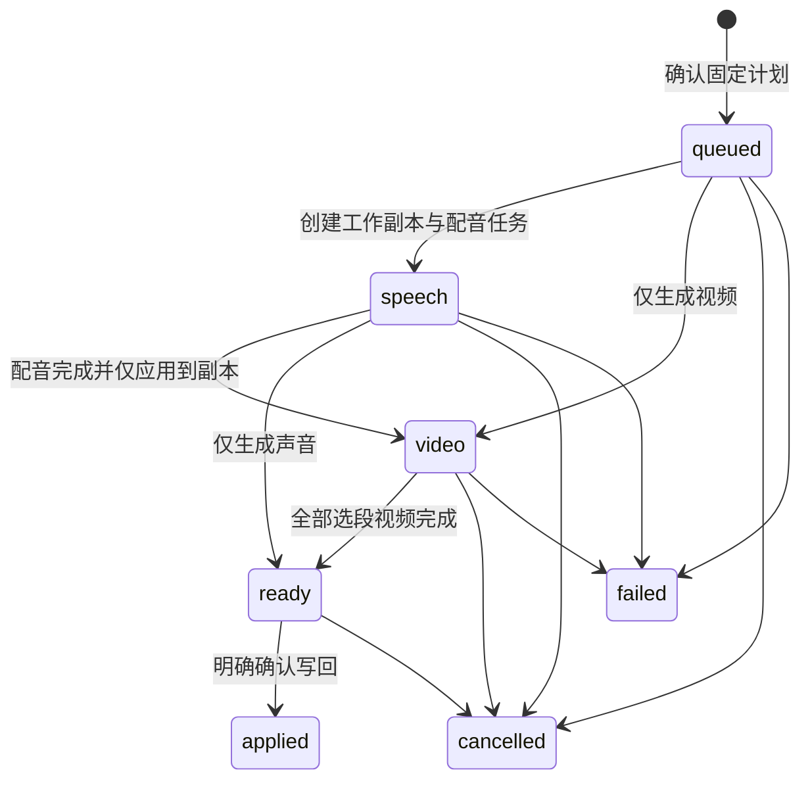

# 聊天式局部编辑与实际预览

本模块推进T24 / R-127 / AC-35。选定已有工程中的分镜，逐轮修改候选文字与配音控制；系统配音和所选时段的视频在独立工作副本生成，核对后才可写回原工程。当前新增[本机真实语义模型与持久解释任务](41-local-semantic-editor.md)；完整T24、通用语义质量、真人语气复刻、形象与口型重新生成继续建设；134项需求、38项任务、65条验收及G1/G2范围保持。

## 使用路径

在创作工作台打开“聊天式局部编辑”，选择已保存的工程和1—8个分镜。工程编辑器也提供“聊天式编辑当前分镜”，有未保存修改时先保存。确认工程版本与所选范围后建立对话；原工程快照、素材来源摘要及选段在该对话中固定，不能悄悄扩大到其他分镜。

每轮显示固定原稿、候选文字、声音控制和提供方式。可以继续提出下一轮修改，也可以人工逐段填写；不会在形成建议时覆盖工程。另一窗口改变候选后保留本窗口未提交文字，先明确载入当前候选再继续。原工程另有保存或归档时，旧对话保留供核对，需从最新工程另开对话。

选择实际系统声音、语气控制和发音词典，审阅局部生成计划。计划显示所选时间、实际输出规格、声音控制、文件估算及覆盖旧声音的处理。确认后生成工作副本、持久配音子任务和逐段视频子任务。可逐段播放WAV、播放MP4，下载当前有效产物；透明MOV需使用支持该格式的软件检查。

最后明确确认采用当前预览，服务端检查同一轮候选、最新生成、工程版本、来源与实际文件后，保存原工程的下一版本及应用记录。无声音控制修改时也可只写回文字；已修改台词所对应的旧声音会静音。含语速等声音控制的候选必须实际重新配音后采用，不能只改变文字就称已实现声音修改。

## 已实现的编辑方式

| 方式 | 实际行为 | 边界 |
| --- | --- | --- |
| 本地明确指令 | 规范空白、精简所选段落、单段“替换为：新文字” | 有限规则，未知指令说明原因；不是通用语义写作 |
| 本地声音指令 | 语速慢一点、语速快一点、恢复正常语速、结尾停顿500毫秒等 | 控制保存在候选中，需要实际系统配音；不复刻真人语气 |
| 人工修订 | 逐段填写候选文字，继承前轮声音控制与模拟标记 | 仅可写固定选段 |
| 模拟建议 | 明确标注模拟编辑结果，可继续人工修改 | mock且非production；生成前须单独确认模拟内容，不能通过人工修改去掉来源标记 |
| 本机语义模型 | 固定Qwen3-4B Q8与llama.cpp CPU实际推理，多轮改写与明确声音控制，持久任务可取消/重试 | 需安装固定4.28GB权重和原生运行时，候选仍需核对事实；不是声音或形象克隆 |
| 外部语义编辑 | 提供接口，未配置时明确503 | 没有真实模型、调用、质量或费用验收，不返回替代成功 |

编辑模型接口只接收当前指令、所选分镜的标题/时长/原稿/候选、声音控制和必要的前轮标记，不接收整个工程、未选文字、素材编号或租户身份。当前本机模型实际遵循该边界；返回后仍检查原稿、固定范围、模拟继承、当前工程和权限，模型输出不能扩大操作范围。旧同步turns入口不直接执行本机模型；使用043的持久解释队列，细节见[本机语义编辑](41-local-semantic-editor.md)。

## 配音、视频与声音保留

实际配音复用Windows SAPI任务与本机声音目录；所选声音/语言不存在时失败，不改用其他声音。支持语速、音高、音量、段尾停顿，及现有无参考语气样式和发音词典的固定版本。聊天中明确提出的声音控制优先显示；与保存的语气样式不同则要求改选自定义控制，避免悄悄丢失指令。

超出分镜时长的声音默认不裁剪，生成失败仍保留实际配音任务、原工程和失败原因。可以延长原工程分镜后另开对话，也可在下一份计划中明确同意裁去超出部分并逐段听审。原WAV保留完整声音，可编辑片段记录选用长度；此类裁剪不是自动语义压缩或对齐。

视频复用现有实际时间线编码，逐个固定分镜时间范围输出。可选HD/4K、24/30/60fps、字幕、移除背景轨、H.264 MP4或带Alpha的ProRes 4444 MOV；具体宽高按原画布比例计算并显示在计划中。4K/透明是编码规格，不证明原素材具备真实4K细节，也不是自动人物抠像。本批浏览器主流程验证1080p MP4，既有4K/透明引擎证据仍见[参数化模板](29-parameterized-templates.md)，不称本批新增规格均已单独现场验收。

新的系统配音只绑定所选分镜。所选旧台词片段保留并静音；跨时段的未绑定旁白会按选段切分，保留外侧原声、源偏移、包络及曲线相位。属于未选分镜的重叠角色声音继续保留。原视频自带声音默认只在选段内静音，画面及范围外声音保持，也可明确选择保留并听审重叠声音。锁定轨道或不足最小片段长度的边界给出原因，不静默丢片段。其他音乐和重叠轨仍按原时间线混合。

工作副本沿用原画面/静态形象、时间线和素材，不能将实际视频文件称作真人重新驱动、动作生成或口型合成。生成视频是听审/查看所选时间段的预览；采用时写回候选文字与新的配音轨，原多轨工程继续可编辑，不把整段成片替换为不可编辑素材。

## 状态、恢复与并发



原工程与候选、生成计划分离。生成计划、指令候选与应用事实不可覆写；阶段、分支版本和子任务编号落库。父任务每次推进在同步事务内重新核对并建立下一项子任务，不在事务内调用异步引擎；双worker不会建立两份工作副本。真实配音/编码继续使用既有持久租约、尝试与提交前检查，进程重启沿用原子任务和代次；取消后迟到结果不能成为当前预览或写回工程。

同一候选最多三次明确生成，每对话最多三十轮、每工程一百份对话；一次最多八个分镜、累计五分钟，系统配音合计最多四千字，局部输出估算不超过1GB。组织当前环境最多五份未完成局部生成，视频全局容量不足时保留当前进度等待。对话详情只带最近六份生成，历史按服务端游标分页。

所有写操作使用现有登录、CSRF、幂等键及当前权限；异步建议、声音目录、文件哈希计算之后重新鉴权。幂等缓存只保留资源引用，重放返回当前投影。候选轮次、父轮次、原工程版本、当前生成版本、计划/输出摘要均须一致；并发确认只保存一次工程版本和应用事实。多行读取使用同一SQLite读取快照。

## 权限、来源与文件

读取需要asset.read和当前工作空间范围，编辑/生成/应用还需studio.write。组织、空间、mock/live及应用环境由服务端核对，前端隐藏按钮不代替权限。工作副本没有额外授予权限；原任务执行者失权、素材用途/期限或内容来源变化，会停止后续生成。

来源失效时旧对话不再返回指令、原文和候选正文，也不提供已生成声音/视频地址；旧幂等响应重新投影相同限制。底层内容来源关系继续约束派生声音、普通资产和视频。原工程已有其他正常修改时保留对话供核对，但禁止旧候选覆盖当前工程。

生成前核对原素材实际字节，预览下载和最终写回重新检查WAV/视频摘要。文件缺失或损坏给出失败原因，不能使用数据库“成功”状态冒充可用媒体。输出为private/no-store，支持既有受控文件Range；不向浏览器返回存储目录、系统命令或密钥。

## 数据与API

042迁移新增四表：studio_assistant_sessions固定原工程/来源/选段并保存控制版本；studio_assistant_turns追加多轮候选与哈希；studio_assistant_generations固定计划并保存工作副本、配音、逐段导出与阶段；studio_assistant_applications保存一次确认的前后版本/摘要、改变文字的分镜和实际重新配音资产。旧迁移和原工程历史保持。

接口基址为/api/v1/studio/assistant，共享Zod与[OpenAPI](api/openapi.json)记录确切字段：

| 路径 | 用途 |
| --- | --- |
| GET /capabilities | 本机声音、编码能力、提供方式及限额 |
| GET/POST /sessions | 分页对话摘要、固定工程和选段 |
| GET /sessions/:id | 当前对话、候选、受限正文和最近生成 |
| POST /sessions/:id/turns | 形成下一轮固定候选 |
| POST /sessions/:id/generation-plan | 审阅当前候选的实际生成计划 |
| GET/POST /sessions/:id/generations | 分页历史、确认固定计划生成 |
| POST /sessions/:id/apply 或 /close | 明确写回当前版本或关闭对话 |
| GET /generations/:id | 当前生成阶段和可用媒体 |
| POST /generations/:id/cancel | 版本保护取消及停止活动子任务 |
| GET /generations/:id/segments/:segmentId/audio | 当前有效WAV |
| GET /generations/:id/artifacts/:artifactId | 属于该生成的实际预览/字幕 |

## 启动与边界

已有4301/5174实例直接访问[聊天式局部编辑](http://127.0.0.1:5174/studio/assistant)，演示账号选择林知及“品牌与接待”。关闭实例后在PowerShell启动；保留storage、两类私有密钥和原AE配置，不重新初始化主库：

```powershell
$env:API_PORT='4301'
$env:WEB_PORT='5174'
$env:WEB_ORIGIN='http://127.0.0.1:5174'
$env:DATA_DIR='storage'
$env:APP_ENV='development'
$env:PROVIDER_MODE='mock'
$aeState=Get-Content storage/ae-preview-state.json -Raw|ConvertFrom-Json
$env:AE_RUNTIME_CONFIG=$aeState.configFile
pnpm dev
```

首次安装按README准备依赖和本地媒体工具；实际配音要求安装对应Windows系统声音。本机可生成声音/视频不表示外部模型、真人克隆或实时口型已接入。服务器部署的声音引擎、真实模型、授权形象/音色素材、现场噪声与目标设备、长期性能和相应真实业务渠道仍须分别验收。

本模块不启动摄像头、麦克风、真实通知、发布、广告花费或推流；与接待目标说话人识别及身份授权分开。模型级视线修正、语义切片、神经修复和任意自然语言编辑仍在原T24；[点选主体跟随](38-subject-tracking.md)已在后续批次接入，真实多人/跨镜头质量继续；后续[本机前景分割](37-neural-segmentation.md)已增加实际模型，真人/发丝/时序与实时质量继续验收。T25/T28及完整平台最终范围未删减。下方50364为本批历史运行记录，当前主实例与断点保留见[执行计划](../PLAN.md)。

## 本批实际验证

703/703后端（87文件）、定向54/54（7文件）、Chrome三个完整/并发/对话隔离流程通过，实际pnpm build、类型、lint、OpenAPI与文档检查结果见[完整证据](evidence/T24/assistant/verification.json)。全量启动后另修复前端切换对话的状态归属，最终重新执行三个浏览器流程、构建和编译验证；API、领域与worker保持该全量版本。

编译双API/worker共15个拥有的根进程覆盖排队、配音在途、就绪和应用后的强杀/重启，11项通过。原30秒租约自然到期后同一配音任务第二次尝试完成，未改写时间戳；同一工作副本、两份所选WAV和两段1080p音视频，非零PCM及实际解码通过。双API确认只产生一条应用事实；全部根进程退出有独立OS观察。首次类型/测试夹具和浏览器失败保留，不计为通过。

主50364/schema042的[原创选段样例](http://127.0.0.1:5174/studio/assistant?project=4891c361-da2b-4cb3-b8a1-b0be6bd0cb4c&session=188aa1fe-868a-4872-824e-b77923cc14da)保留原工程v1、两轮候选、一份就绪生成、同一分支/配音/视频。实际主8项与只读浏览器14项覆盖播放、刷新、390px和核对未自动写回。20组旧模块、32份原媒体、039直播32项/浏览器19项、040连续媒体23项/浏览器20项以及原广告10项/浏览器19项复核。广告原排期自然到期，页面隐藏原预览并使旧批准当前有效性失效；审批事实、原账本与对账保留，未续期或重开投放，初始旧预期失败记录保留。

主库和两类私有密钥升级前备份；268表1999原行升级时全保持，最终267业务表1888原行无改变。原始全表FAIL只涉及24条基线中捕获的到期认证会话，原FAIL和独立逐哈希评估保存，不重置基线或恢复旧凭证。042冻结，下一迁移043。

只读复核可设置ASSISTANT_EVIDENCE_DIR为新的证据目录，执行pnpm exec tsx scripts/studio-assistant-preview.ts --verify-only及scripts/studio-assistant-preview-browser.ts；它们只新建演示登录和读取/静音播放现有断点，不开始新生成或确认原工程。运行号通过PREVIEW_SESSION_HANDLE记录，不能复用已有证据目录。T24/R-127保持in_progress，本地verified仍22项，完整134/38/65及G1/G2继续。

