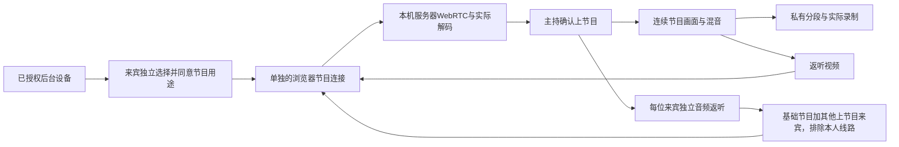

# 来宾参与节目、返听与录制授权

2026-11-22｜T28 / R-097、R-098、R-100、R-128｜本地子模块；完整直播及G1/G2继续

在[后台WebRTC连麦](53-local-webrtc-calls.md)之上，新增明确启用的节目接入。主持人申请，来宾另行选择节目画面、声音和公开显示名；开启录制的场次必须再确认录制用途。主持端收到实际解码媒体后才可让来宾上节目，最多三位同时参与。原后台同意不会自动扩大到节目或录制，旧场次也不自动启用。

本模块实际使用服务器WebRTC收发、H264/Opus解码、720p/24fps节目合流、各来宾独立返听和既有连续录制。测试使用原创canvas及振荡器；它证明传输、混音、控制和权限流程，不证明物理设备、真人驱动、声音/语气克隆、现场抗噪、公网或真实频道质量。没有自动转写、人脸、声纹、人员建档或业务动作。

## 操作

1. 在直播中心新建或准备场次，在连续媒体设置勾选“允许本场来宾节目接入”，核对当前素材、用途及录制设置后准备连续输出。旧的后台场次保持原用途。
2. 主持人明确开始本地试播，创建受限邀请；来宾主动打开所选设备作本机预览，主持人审批后另行接通后台连麦。详见前一章。
3. 主持人点击该来宾的“邀请来宾加入本场节目”。来宾核对独立用途、显示名、设备及到期时间；可以“只保留后台连麦”，也可以确认节目及本场录制后准备节目连接。仅同意声音时，不克隆或发送摄像头轨道。
4. 主持人等待服务器收到本次设备的实际画面和声音，再点击“将来宾加入节目”。可独立移出画面、静音、恢复、返回预览、结束连接或撤回整个节目用途；按钮等待编码确认，不把请求成功显示为已编码。
5. 来宾可随时“停止节目使用并撤回录制用途”。节目连接停止，后台设备按原授权继续。关闭全部设备或撤回整个后台用途时，两条媒体连接均停止。
6. 正常结束通话并不等于撤回独立录制同意。来宾可在原浏览器的“本次邀请的授权管理入口”打开对应记录；再次参与节目会新增入口，保留此前的入口。管理页不调用摄像头或麦克风。

本版本的节目及录制用途不超过原邀请到期时间，最长24小时；连接结束后在剩余有效期内可管理录制授权。到期后相关录制和派生素材不再提供。长期留存、用途续期或自动去除被撤回来宾，尚需独立实现和验收，不能通过延长旧同意或重放请求绕过。

## 启动与独立样例

在仓库根目录沿用既有环境，不重新初始化数据：

```powershell
$env:API_PORT='4301'
$env:WEB_PORT='5174'
$env:WEB_ORIGIN='http://127.0.0.1:5174'
$env:DATA_DIR='storage'
$env:APP_ENV='development'
$env:PROVIDER_MODE='mock'
$aeSourceState=Get-Content -LiteralPath 'storage/ae-source-preview-state.json' -Raw | ConvertFrom-Json
$env:AE_RUNTIME_CONFIG=$aeSourceState.configFile
pnpm dev
```

新待试播样例使用`storage/live-guest-programme-preview-state.json`的`url`。它使用原创蓝色画面及440Hz测试音，停在ready/armed，打开页面不采集、不建立通话、不自动开播。状态文件只保存非敏感编号，不保存受限邀请凭证或媒体。既有后台样例、AE原件、工程、模型和其他业务样例继续保留。

新样例在“青禾餐饮 / 餐饮运营”演示组织，使用“沈禾 · 餐饮管理员”演示账号进入。原“星屿科技”已有三场待播，保持其原状；首次新建返回容量429的记录及新草稿编号保留，没有停止旧场次、修改限额或绕过租户隔离。

主库运行及升级结果以[最终证据](evidence/T28/guest-programme/verification.json)为准；不能仅凭新源码或测试数据库声称主库已升级。051新增三表，应用后冻结；下一次结构变更使用052，050及此前迁移不修改。

## 媒体结构



每位来宾新建独立节目PeerConnection，仅克隆本次选中的现有设备轨道，不再调用getUserMedia。原后台连接继续承担审批及原用途。节目连接关闭只停止克隆轨道；全部设备停止则同时停止两者。刷新、断网恢复、旧连接终止或编码代次变化都不会自动重新建立节目连接。

服务器固定`werift@0.28.0`，显式关闭默认STUN、IPv6及TCP候选，使用ICE-Lite与回环UDP。应答中的远端候选不用于服务器主动访问外部地址；当前路径用于同一Windows主机上的浏览器与服务。公网设备、TURN/SFU、复杂NAT及多人远端部署未在本批验收。

H264/Opus通过有界内存WebM和FFmpeg管道解码为320×180画面及48kHz双声道PCM，视频保留比例并补边。节目渲染器排列三位来宾及公开名称，声音按当前场控混入。主视频仅编码一次，tee同时生成HLS及返程RTP；关键帧携带参数集以支持后加入的来宾。每位来宾另有Opus返听编码器，发送基础节目加其他上节目且未静音的来宾声音，排除其本人来源。

这里的排除本人只针对其独立线路。它不能消除对方扬声器串入麦克风的声音，不能替代现场AEC、麦克风阵列、指定发问人提取或[专注对话](10-speaker-focus.md)。不将线路静音或混音验证写成声纹抗噪验收。

## 数据与生命周期

`live_guest_programme_grants`固定邀请、后台设备代次、场次/输出、原主持、环境/空间、可用设备、实际选择、公开名称、录制用途、同意摘要和到期时间。`live_guest_programme_connections`固定一次节目设备连接、运行令牌及编码代次，保存短期私有SDP和实际RTP/解码计数；终止时清除SDP。`live_guest_programme_controls`保存不可改写的控制输入、版本及实际编码确认。

组织接口校验`live.start`/`live.moderate`及当前租户、空间、来源、用途和控制版本。来宾使用独立的HttpOnly、SameSite=Strict、按节目编号限定路径的Cookie及CSRF；它不授予组织身份。Cookie与后台凭证分开，因此正常结束后仍可撤回录制。管理页的Permissions-Policy禁止摄像头、麦克风和屏幕捕获，不在普通日志或证据中保存Cookie、访问凭证或SDP。

设备心跳15秒，前端授权网络看护5秒；服务器还拒绝超过5秒未收到当前媒体进度的连接和超过30秒的未完成协商。单次连接固定当前控制令牌及输出代次，迟到消息和角色恢复不能复活旧连接。帮助进程失去父进程/授权心跳、停止或撤回后关闭所属PeerConnection、回环端口、解码器及返听编码器。原输出30秒租约自然到期后可恢复新编码代次；仍有效的后台通话可继续，但节目需新的独立确认。

## 录制及撤权

实际进入节目的帧保留对应用途/连接引用及控制版本，分段读取重新核对重叠帧的来源。最终录制汇总实际使用过的来宾用途，传递至归档素材、拆条工程及实际时间线渲染。读取、开始执行和提交时继续核对原主持权限、来源摘要、录制同意和有效期；磁盘已有文件不等于继续有权提供。

正常通话结束保留此前明确同意的录制用途；撤回整个邀请、权限失效或来源撤回则关闭相关用途。来宾独立撤回后，含其历史媒体的已发布分段拒绝读取，当前节目可以继续生成其他来宾的干净帧。完整混合录制只要含一份失效用途就拒绝提供；本批没有自动剪除、打码或音源移除，因此直播中撤回后可能无法生成完整录制，界面会显示具体来源失效原因。

已观看或下载的内容无法远程收回。管理入口依赖原浏览器Cookie；不同浏览器、Cookie被清除、签名配置轮换和到期后的身份重新核验流程尚未实现。此限制不能用受限邀请链接或声纹/人脸匹配代替授权。

## 验证与继续工作

[最终证据](evidence/T28/guest-programme/verification.json)集中记录实际运行结果、失败及复验、编译产物、主库持久性和原数据保护。协议测试中使用的媒体计数夹具不计媒体验收。浏览器另外读取真实解码像素、频率功率和RTP计数，验证三位实际来宾的画面与声音、每人排除自身且含其他人的返听、静音/恢复、直播中撤回继续播出，以及仅声音同意和真实接口断网。

编译验证实际强杀工作进程，观察原生进程及UDP退出、原30秒租约自然恢复、新用途确认后恢复媒体；进一步核对实际MP4、实际一秒拆条渲染、双API/双worker重启后独立撤回，以及历史录制、素材和派生视频被阻止。具体计数和是否通过以证据为准，不用首轮局部通过替代最终结果。

原始失败保留：H264去包标识、后加入视频参数集、节目帧引用与完整录制来源字段误用等实现问题已修复并重验；页面定位、分析处于paused状态的实时MediaStream及生命周期预期错误也分别保留。后台通话可在节目工作进程恢复时继续，旧节目连接自然到期后可为expired，验证不得误要求它们全部成为ended，也不得放宽“终止、无媒体、不可复活”的断言。

恢复后接通按钮曾在当前节目捕获未就绪时可点击，现按当前场次/控制版本及真实播放器就绪状态等待，保留中文原因。首轮合并浏览器回归仍有一次等待就绪超时，并导致后续用例遇到三场未结束容量限制；该次6通过/3失败完整保留。单独三人媒体及后续同次9项均通过，测试增加仅清理自己场次及失败时记录播放器/来源状态的逻辑，没有放宽媒体或容量断言。未对该次就绪超时作已证实的根因或长时稳定性承诺。

后续仍需真实设备与长时质量、现场回声和T38目标声源、公网TURN/SFU与真实渠道、真人形象/声音/语气、更多构图与直播能力。制作、多轨与模板、多人同屏、批量协作、4K/透明、资产迁移、PPT、发布投放、展厅、前台和餐厅等134需求、38任务、65验收、26类竞品并集保持；本批不将T28或G1/G2标为完成。

## 依赖来源

WebRTC实现采用[werift官方仓库](https://github.com/shinyoshiaki/werift-webrtc)固定0.28.0版本，项目MIT及随包第三方声明见[许可](licenses/werift-MIT.txt)、[第三方声明](licenses/werift-libwebrtc-notices.txt)和[来源摘要](evidence/T28/guest-programme/dependency-license.json)。未复制竞品代码、模型或素材；这份记录不代表完成全部传递依赖或商用专利审计。

视频分流与关键帧参数集机制参考[FFmpeg tee](https://ffmpeg.org/ffmpeg-formats.html#tee)及[dump_extra](https://ffmpeg.org/ffmpeg-bitstream-filters.html#dump_005fextra)。浏览器媒体授权、捕获及WebRTC规范仍见前一章；依赖行为以固定安装版本和当前源码验证为准。
